## 3. Detailed Design

### 3.1 FE-01 Customer Registration, Sign-In and Account Access

This section presents the detailed design for `FE-01` (Customer organization and initial asset registration with No-Fly Zone airspace screening, Argon2id credential sign-in, consolidated OTP verification, Google OAuth 2.0 federation, JWT session rotation, and four-role `ActorZone` access control).

#### 3.1.1 Class Diagram

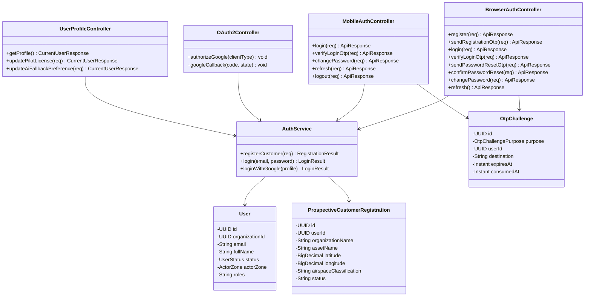

**Class Specifications**

| No | Class | Description |
| :---: | :--- | :--- |
| 01 | `BrowserAuthController` & `MobileAuthController` | Handle customer registration, email and password sign-in, one-time verification code delivery and confirmation, password reset, password change, and session token refresh for web (`HttpOnly` cookie) and mobile (`Bearer` / refresh token) clients. |
| 02 | `OAuth2Controller` | Handles federated Google OAuth 2.0 sign-in and callback redirection for web browsers and mobile deep links (`smartdrone://auth`). |
| 03 | `UserProfileController` | Allows signed-in users to retrieve their current profile (`/api/v1/users/me`), update pilot license credentials, and configure AI vision fallback preferences. |
| 04 | `AuthService` | Coordinates Argon2id credential verification, account lockout after repeated failed attempts (`LoginFailureService`), airspace screening during customer onboarding (`CustomerAirspacePolicyAdapter`), and JWT session issuance (`AccessTokenService`, `RefreshCookieService`). |
| 05 | `User` & `OtpChallenge` | Domain entities representing user accounts across the four active system roles (`ADMIN`, `MANAGER`, `CUSTOMER`, `INSPECTOR`) and consolidated time-limited OTP challenges (`LOGIN`, `REGISTRATION`, `PASSWORD_RESET`). |
| 06 | `ProspectiveCustomerRegistration` | Domain entity recording a customer organization and initial asset registration request along with its airspace classification result (`CLEAR_ZONE`, `RESTRICTED_ZONE`, `NO_FLY_ZONE`). |

#### 3.1.2 Customer Organization and Initial Asset Registration Sequence Diagram

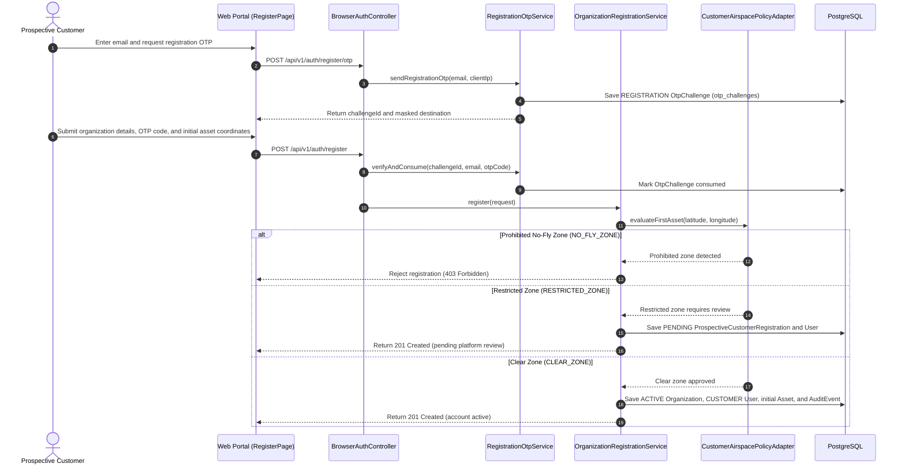

#### 3.1.3 User Sign-In, OTP Verification and Google OAuth 2.0 Sequence Diagram

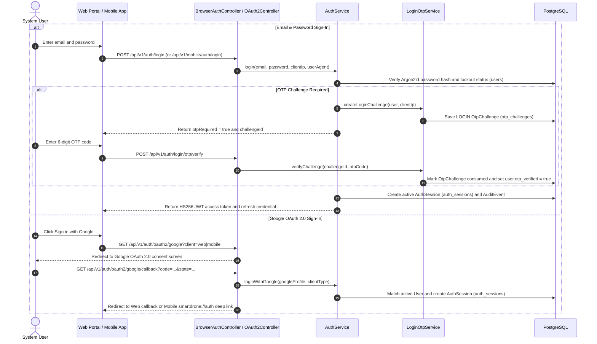

---

### 3.2 FE-02 Partner Qualification, Workforce, Assets and Drone Registration

This section presents the detailed design for `FE-02` (Platform-provisioned Inspector accounts, pilot license profiles and flight logs, restricted-airspace customer review, infrastructure asset catalog with `inspection_items` checkpoints and reference documents, and Inspector-owned drone 3-document registration).

#### 3.2.1 Class Diagram

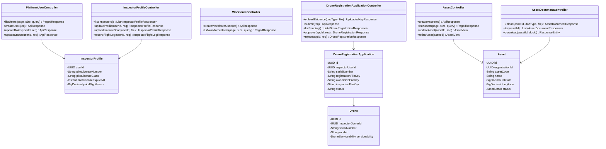

**Class Specifications**

| No | Class | Description |
| :---: | :--- | :--- |
| 01 | `PlatformUserController` & `InspectorProfileController` | Allow platform administrators and managers to provision `INSPECTOR` accounts, maintain pilot license credentials in `inspector_profiles`, upload license scans, and record flight logs in `inspector_flight_logs`. |
| 02 | `WorkforceController` & `WorkforceService` | Retired maintenance-account provisioning; not an active product API or workflow. |
| 03 | `AssetController` & `AssetDocumentController` | Manage customer infrastructure assets, structural inspection checkpoints (`inspection_items`), and SHA-256 engineering reference documents in MinIO, blocking asset creation inside prohibited No-Fly Zones. |
| 04 | `DroneRegistrationApplicationController` & `DroneRegistrationApplicationService` | Handle Inspector-owned drone registration submissions with three required documents (`REGISTRATION`, `OWNERSHIP`, and `INSPECTION`) and platform review decisions. |
| 05 | `InspectorProfile`, `Drone` & `Asset` | Domain entities representing Inspector qualifications, approved Inspector-owned drones, and customer infrastructure assets. |

#### 3.2.2 Inspector Provisioning, License Profile and Customer Workforce Sequence Diagram

```mermaid
%% title: FE-02 Inspector Provisioning, License Profile and Customer Workforce Sequence Diagram
sequenceDiagram
  autonumber
  actor Admin as Admin or Manager
  actor Cust as Customer
  actor Insp as Inspector
  participant PlatCtrl as PlatformUserController / InspectorProfileController
  participant WorkCtrl as WorkforceController
  participant UserSvc as AdminUserService / InspectorProfileService / WorkforceService
  participant DB as PostgreSQL & MinIO

  Admin->>PlatCtrl: POST /api/v1/platform/users (role = INSPECTOR)
  PlatCtrl->>UserSvc: createUser(request)
  UserSvc->>DB: Insert User (actor_zone = INSPECTOR_PARTNER) and InspectorProfile
  DB-->>Admin: Return provisioned Inspector account (201 Created)

  Admin->>PlatCtrl: PUT /api/v1/platform/inspectors/{id} & POST /license-scan
  PlatCtrl->>UserSvc: updateProfile(userId, req) & uploadLicenseScan(userId, file)
  UserSvc->>DB: Store license scan in MinIO and update inspector_profiles
  Insp->>PlatCtrl: GET /api/v1/platform/inspectors/{id}/flight-logs
  PlatCtrl->>UserSvc: listFlightLogs(userId)
  UserSvc->>DB: Query inspector_flight_logs

  Note over Cust,WorkCtrl: Legacy maintenance provisioning interaction; excluded from current scope
  WorkCtrl->>UserSvc: createWorkforceUser(customerActorId, request)
  UserSvc->>DB: Verify same-tenant email uniqueness and insert User (must_change_password = true)
  Note over Cust,DB: Legacy maintenance records are retained; no provisioning workflow is exposed
```

#### 3.2.3 Infrastructure Asset and Reference Document Registration Sequence Diagram

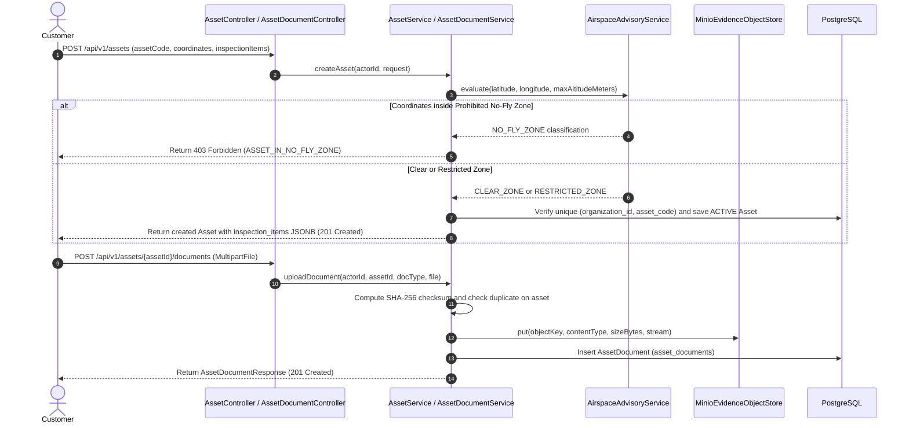

#### 3.2.4 Inspector-Owned Drone Registration and Approval Sequence Diagram

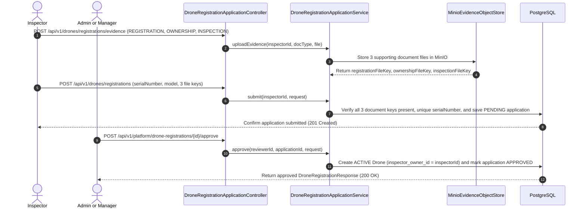

---

### 3.3 FE-03 Recurring Service Requests, Occurrences and Notifications

This section presents the detailed design for `FE-03` (Recurring service request cadence validation, count-bound and end-date-bound `ServiceRequestOccurrence` materialization with month-end date anchoring, and deduplicated in-app notifications via the Spring Modulith transactional event outbox).

#### 3.3.1 Class Diagram

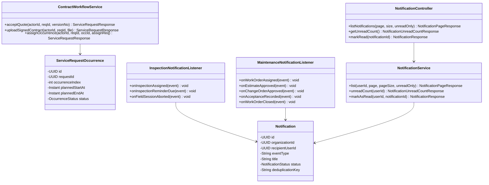

**Class Specifications**

| No | Class | Description |
| :---: | :--- | :--- |
| 01 | `ContractWorkflowService` & `ServiceRequestOccurrence` | Materialize count-bound or end-date-bound `ServiceRequestOccurrence` rows with month-end anchoring when a Customer accepts a recurring quotation and the signed contract is recorded. |
| 02 | `NotificationController` & `NotificationService` | Provide the role- and organization-scoped in-app notification inbox, unread notification counter, and idempotent `SENT -> READ` updates for signed-in users. |
| 03 | `InspectionNotificationListener` & `MaintenanceNotificationListener` | Consume transactional Spring Modulith domain events (`InspectionAssignedEvent`, `InspectionReminderDueEvent`, `FieldSessionAbortedEvent`, `WorkOrderAssignedEvent`, `EstimateApprovedEvent`, `ChangeOrderApprovedEvent`, `AcceptanceRecordedEvent`, `WorkOrderClosedEvent`) to persist deduplicated notifications. |
| 04 | `Notification` | Domain entity representing an in-app user notification protected by `uq_notifications_deduplication_key`. |

#### 3.3.2 Recurring Service Request Occurrence Materialization Sequence Diagram

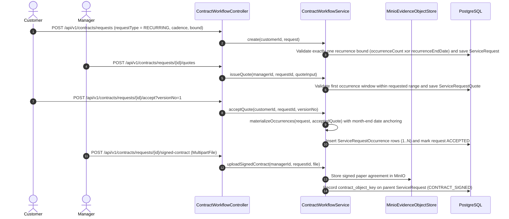

#### 3.3.3 Event-Driven Notification Inbox and Read Status Sequence Diagram

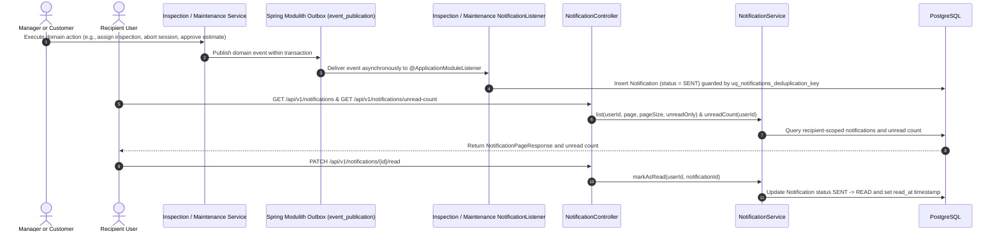

---

### 3.4 FE-04 Service Requests, Quotations, Agreements and Dispatch

This section presents the detailed design for `FE-04` (Service request creation, Order Chat negotiation, versioned VND quotations, signed paper contract upload, cross-organization partner Inspector and owned Drone dispatch, abort recovery dispatch, and Vietnam airspace evaluation).

#### 3.4.1 Class Diagram

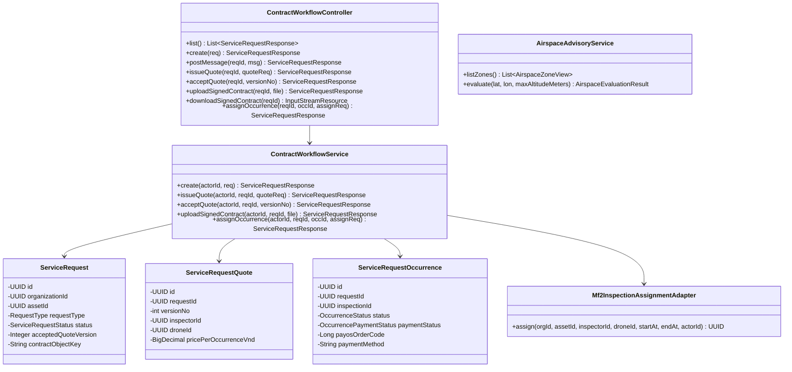

**Class Specifications**

| No | Class | Description |
| :---: | :--- | :--- |
| 01 | `ContractWorkflowController` & `ContractWorkflowService` | Manage customer inspection service requests, order chat messages, versioned VND quotations, quote acceptance, signed paper agreement uploads, and occurrence dispatch. |
| 02 | `Mf2InspectionAssignmentAdapter` & `PartnerRegistryService` | Validate Inspector pilot license status, drone ownership, and cross-organization schedule availability before creating a scheduled inspection mission. |
| 03 | `AirspaceController` & `AirspaceAdvisoryService` | Expose Vietnam No-Fly and Restricted airspace polygons and evaluate target coordinates and altitudes using Haversine distance checks. |
| 04 | `ServiceRequest`, `ServiceRequestQuote` & `ServiceRequestOccurrence` | Domain entities representing the customer request, each proposed VND quotation version, and the individual inspection occurrences generated upon quote acceptance. |

#### 3.4.2 Service Request, Order Chat and VND Quotation Sequence Diagram

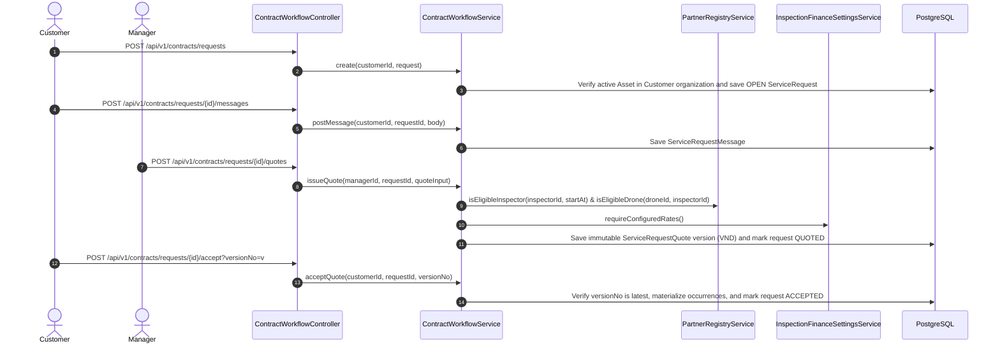

#### 3.4.3 Signed Contract Upload, Occurrence Dispatch and Airspace Check Sequence Diagram

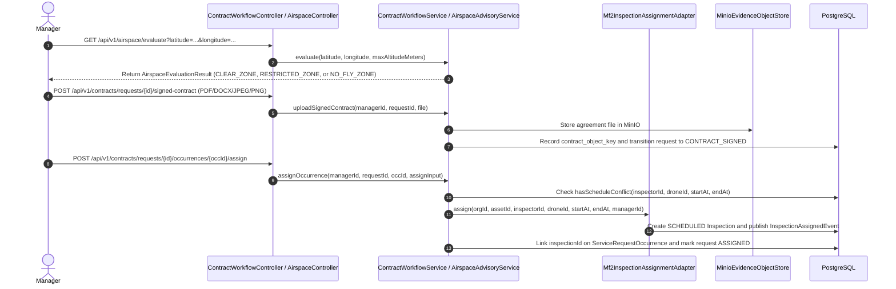

---

### 3.5 FE-05 Flight Permit and On-Site Field Sessions

This section presents the detailed design for `FE-05` (Aviation flight permit upload with pilot license validation, on-site field session execution, `SmartDroneHub` live telemetry, flight trace and MP4 video sync, session abort and Manager recovery dispatch, four-role operational dashboards, and Inspector Schedule Calendar).

#### 3.5.1 Class Diagram

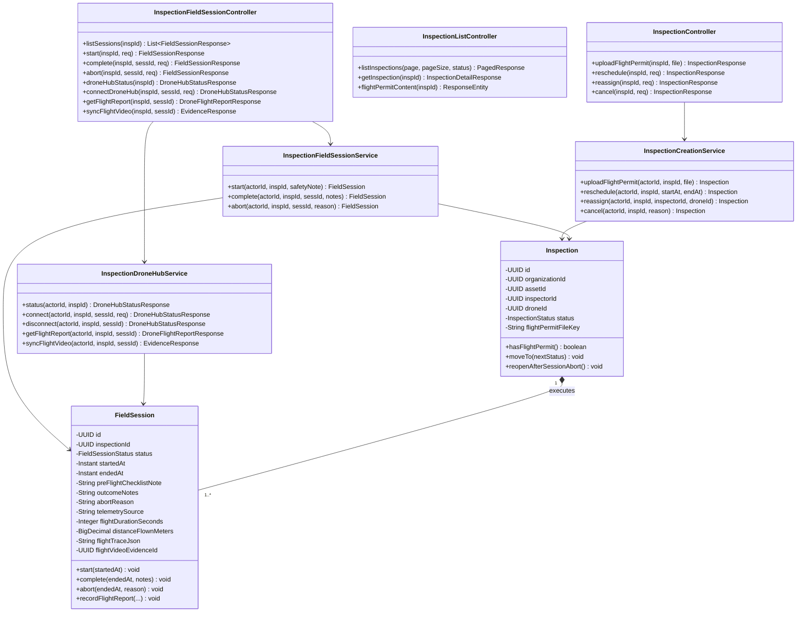

**Class Specifications**

| No | Class | Description |
| :---: | :--- | :--- |
| 01 | `InspectionController`, `InspectionListController` & `InspectionCreationService` | Handle mission flight permit uploads (checking assigned Inspector pilot license validity at upload time), scoped mission queries, flight permit streaming, and Manager recovery actions (`reschedule`, `reassign`, or `cancel`) when an on-site field session is aborted. |
| 02 | `InspectionFieldSessionController` & `InspectionFieldSessionService` | Govern on-site field session execution, enforcing that a session can start only when the inspection is `SCHEDULED` with `hasFlightPermit() == true`, and recording either normal completion (`FIELD_COMPLETED`) or session abort (`ABORTED` with mission reopen to `SCHEDULED`). |
| 03 | `InspectionDroneHubService` & `SmartDroneHubClient` | Connect an active field session to `SmartDroneHub`, stream live telemetry, persist post-flight report metrics and GPS flight traces (`flight_trace_json`) on `FieldSession`, and synchronize recorded mission MP4 videos into inspection `Evidence`. |
| 04 | `DashboardController` & `DashboardAnalyticsService` | Aggregate 5-role operational KPIs, mission queues, confirmed defect severity distributions, and inspection-service metrics only. |
| 05 | `Inspection` & `FieldSession` | Domain entities representing the 6-state inspection mission aggregate and the 4-state on-site flight session with persisted telemetry, GPS flight trace, and synced video reference (`V28`). |

#### 3.5.2 Flight Permit Gate, Field Session Execution and SmartDroneHub Sync Sequence Diagram

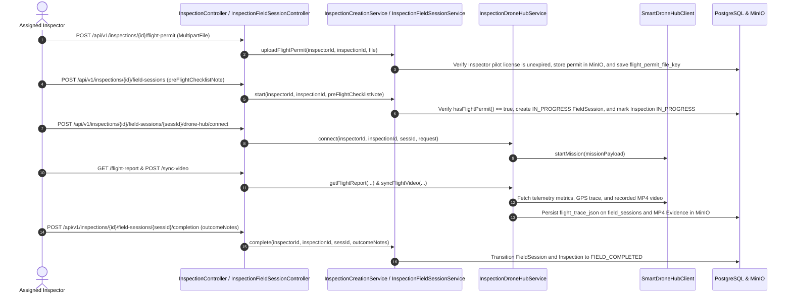

#### 3.5.3 Field Session Abort and Manager Recovery Dispatch Sequence Diagram

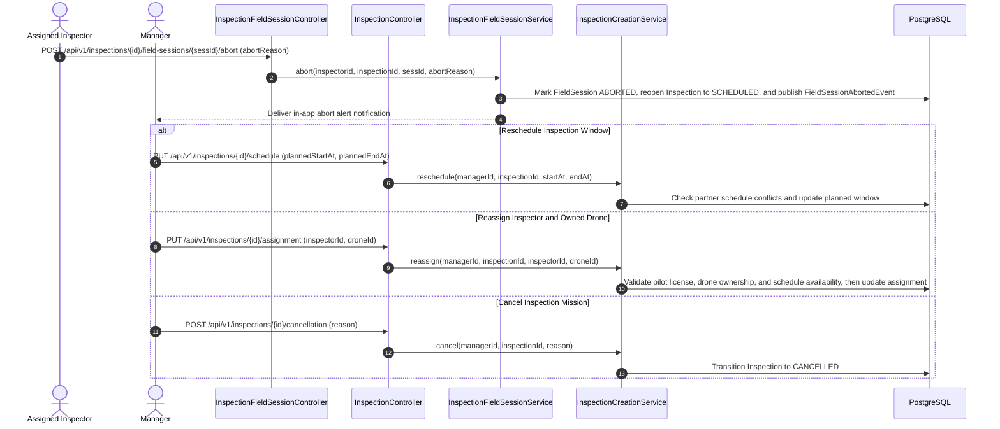

---

### 3.6 FE-06 Evidence, Findings, Reports and Payment

This section presents the detailed design for `FE-06` (Photograph and streaming MP4 video evidence intake, Ultralytics YOLO11 defect detection with Vision LLM fallback, findings baseline confirmation, 4-state inspection report authoring and direct Manager publication, on-demand A4 PDF rendering, Customer report acceptance, and PayOS VietQR / VNPay v2.1.0 online payment settlement).

#### 3.6.1 Class Diagram

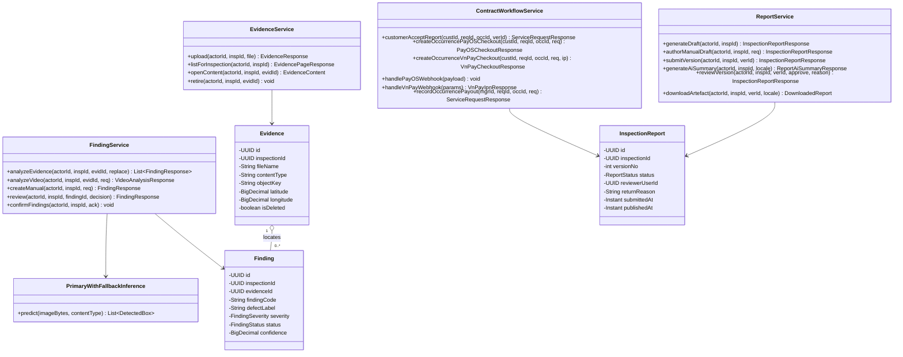

**Class Specifications**

| No | Class | Description |
| :---: | :--- | :--- |
| 01 | `EvidenceService` | Uploads, validates, streams, and soft-retires field photographs (`10 MB`) and MP4 videos (`500 MB`) associated with an inspection session while extracting EXIF GPS coordinates and capture timestamps. |
| 02 | `FindingService` & `PrimaryWithFallbackInference` | Invoke Ultralytics YOLO11 (`YoloInferenceClient`) and Vision LLM fallback (`OpenAiCompatibleInferenceClient`) defect detection on photographs and video keyframes, manage manual and AI-suggested findings, and lock the confirmed findings baseline (`inspections.findings_confirmed_at`). |
| 03 | `ReportService`, `PdfReportRenderer` & `InspectionReport` | Compile and submit 4-state inspection reports (`SUBMITTED`, `RETURNED`, `PUBLISHED`, `SUPERSEDED`), synthesize AI executive summaries (`ReportDraftClient`), enforce independent Manager direct publication, and render on-demand A4 PDFs (`reports/<versionId>.pdf`). |
| 04 | `ContractWorkflowService`, `PayOSWebhookController` & `VnPayWebhookController` | Record Customer acceptance of a published report (`PAYMENT_DUE`), generate PayOS VietQR (`PayOSPaymentGateway`) and VNPay v2.1.0 (`VnPayPaymentGateway`) checkout links in VND, verify signed webhook callbacks, and settle customer payment (`PAID`) and partner payout (`ELIGIBLE`/`PAID`). |
| 05 | `Evidence` & `Finding` | Domain entities representing stored inspection media and AI-proposed (`PENDING`) or Inspector-confirmed (`CONFIRMED`) structural defects. |

#### 3.6.2 Photo/Video Evidence Intake, YOLO11 Detection and Findings Confirmation Sequence Diagram

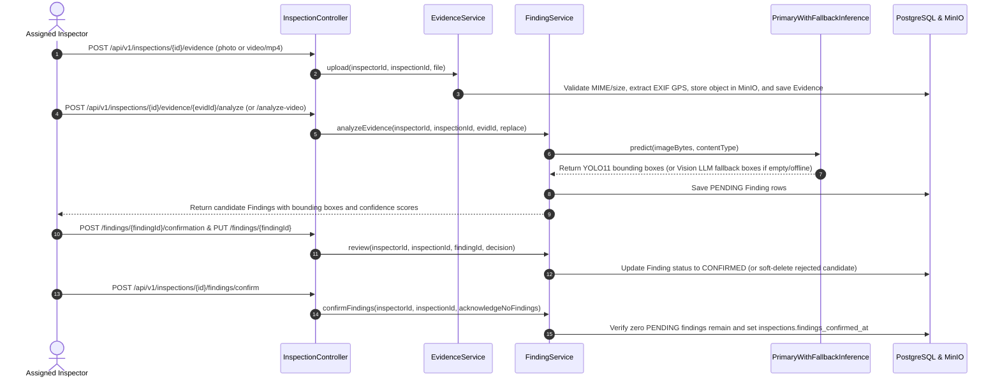

#### 3.6.3 Report Submission, Manager Direct Publication and On-Demand PDF Export Sequence Diagram

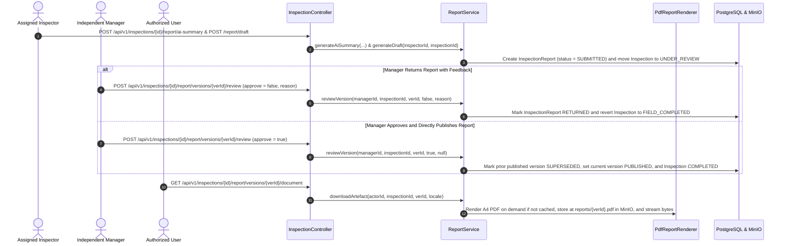

#### 3.6.4 Customer Report Acceptance and PayOS / VNPay Online Payment Sequence Diagram

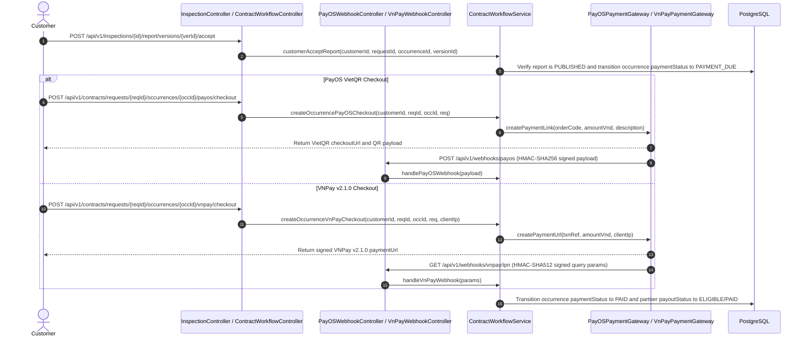

---

---

### 3.7 Retired Maintenance Scope

Maintenance work-order, repair, maintenance-specific re-inspection, and cost-closeout features are not part of the application. Existing database tables and records for those features are retained unchanged for data preservation; they are not exposed through application workflows. Inspection re-inspection functionality, where required as part of an inspection process, remains within FE-05/FE-06 only where specified by those requirements.
