## 3. Detailed Design

### 3.1 FE-01 Account Access and Verification

The backend verifies credentials, creates a session, and checks the user's role and access to the requested record. The web portal opens the workspace for that role. The mobile app accepts Customer accounts.

#### 3.1.1 Components and Responsibilities

*Figure 4.12 Account Access Class Diagram*

| No | Component | Responsibility |
| :---: | :--- | :--- |
| 01 | Browser and mobile auth controllers | Handle registration, sign-in, verification, password reset, and session renewal. |
| 02 | OAuth2Controller | Handles Google sign-in and returns users to the calling client. |
| 03 | UserProfileController and PlatformUserController | Let users edit their own profile and let Admins manage platform accounts. |
| 04 | AuthService | Checks credentials, limits repeated attempts, and issues and renews sessions. |
| 05 | User, OtpChallenge, and AuthSession | Represent a user account, a time-limited verification challenge, and an authenticated session. |

#### 3.1.2 Main Sequence

*Figure 4.13 Customer Registration Sequence*

*Figure 4.14 Sign-In and Verification Sequence*

#### 3.1.3 Alternative Sequence

*Figure 4.15 Expired Sign-In Challenge*

#### 3.1.4 Design Verification

Only a valid challenge can trigger session creation.

These scenarios describe expected behavior. See Report 5 for the execution result and supporting evidence.

| Case | Scenario | Expected behavior |
| --- | --- | --- |
| WF1-001 | Customer registers an organization and initial asset in clear airspace with OTP verification. | Returns 201 Created; persists Active `Organization`, `CUSTOMER` user in `CUSTOMER_ORGANIZATION` zone, and initial `Asset`; marks `OtpChallenge` consumed and writes `Organization Registration` audit event in one transaction. |
| WF1-003 | `ADMIN` manages internal platform accounts while `MANAGER` is denied account mutations. | `ADMIN` succeeds (201/200) and writes `User Created` audit event; dual platform role assignment is rejected (400); `MANAGER` is rejected with 403 Forbidden. |
| WF1-004 | Authentication endpoints enforce IP rate limiting (10 req/60s), 5-failure account lockout (15m), Google OAuth2 callback, and refresh token rotation. | Account locks for 15 minutes after 5 failed attempts (423/401); 11th request within 60s returns 429 Too Many Requests; replayed refresh token is rejected (401) and revokes `AuthSession`. |
| WF1-005 | Web portal route guards (`accessPolicy.ts`, `RequireAuth`) and backend `@PreAuthorize` policies block 100% of unauthorized 4-role and cross-zone requests. | 100% of unauthorized route transitions redirect to `/forbidden`; 100% of unauthorized or cross-tenant API calls return 403 Forbidden or 404 Not Found with zero data leakage. |
| WF1-022 | Edit the signed-in user's profile. | Save valid values for that user. Reject invalid values and unauthenticated requests. |
| WF2-019 | Web, Mobile, and Backend API localize system labels/messages for English and Vietnamese while preserving user-authored content and dark/light theme mode. | UI labels, airspace/dashboard charts, and `ProblemDetail` messages localize cleanly in Vietnamese and English while Inspector/Engineer prose remains unchanged. |
| WF2-020 | Unauthorized role navigation and malformed notification `targetPath` links are blocked. | Unauthorized route access redirects to `/forbidden` (403); external or unrecognized `targetPath` values are rejected. |

### 3.2 FE-02 Inspector Application and Qualification

A prospective Inspector submits a licence and supporting documents. The Manager reviews the application and provisions the account after approval. Administrators can view the review queue. Dispatch checks that qualifications are current for the planned flight.

#### 3.2.1 Components and Responsibilities

*Figure 4.16 Inspector Qualification Class Diagram*

| No | Component | Responsibility |
| :---: | :--- | :--- |
| 01 | InspectorApplicationService | Accepts partner applications, records Manager decisions, and creates approved accounts. |
| 02 | InspectorProfileService | Maintains pilot credentials, licence renewals, and flight records. |
| 03 | PilotLicenseClassService and expiry checks | Maintain the licence classes and notify users when a licence approaches expiry. |

#### 3.2.2 Main Sequence

*Figure 4.17 Inspector Application Review Sequence*

#### 3.2.3 Alternative Sequence

*Figure 4.18 Application Rejected at Review*

#### 3.2.4 Design Verification

The application and approved account are separate records.

These scenarios describe expected behavior. See Report 5 for the execution result and supporting evidence.

| Case | Scenario | Expected behavior |
| --- | --- | --- |
| WF1-006 | Platform maintains Inspector pilot-license credentials in `inspector_profiles`; only complete, recognized and unexpired credentials with uploaded scan evidence qualify for flight work. | Profile/license fields persist consistently. Pilot eligibility requires nonblank number, uploaded scan, recognized Class A/B class and expiry after the relevant planned start. Invalid or incomplete credentials cannot qualify. |
| WF1-007 | Prevent self-granted access during Inspector onboarding. | An application does not create a role. Manager approval provisions an Inspector account. Duplicate email responses disclose no account details. |
| WF1-008 | Platform provisions an `INSPECTOR` account in `INSPECTOR_PARTNER` zone without requiring a drone at account creation and manages pilot credentials. | Inspector account is created in `INSPECTOR_PARTNER` with `organization_id=NULL`; `InspectorProfile` stores pilot license credentials and scan key; owned drone registration proceeds as a separate reviewed workflow. |
| WF1-010 | End-to-end Platform-provisioned Inspector and 3-document owned-drone approval walkthrough on staging. | Inspector is active in `INSPECTOR_PARTNER` zone and owned drone transitions to `ACTIVE` with `inspector_owner_id` set in `drones`. |

### 3.3 FE-03 Drone Registration and Fleet

An Inspector submits a drone with its photos and configured documents. The Manager approves or rejects the registration. Dispatch requires an active drone owned by the selected Inspector with registration valid for the planned flight.

#### 3.3.1 Components and Responsibilities

*Figure 4.19 Drone Fleet Class Diagram*

| No | Component | Responsibility |
| :---: | :--- | :--- |
| 01 | Drone document and feature controllers | Let Admins configure document requirements and the drone capabilities used for dispatch. |
| 02 | DroneRegistrationApplicationController | Accepts registration evidence and records the Manager's decision. |
| 03 | DroneService | Maintains the Inspector's fleet, including renewals and availability. |

#### 3.3.2 Main Sequence

*Figure 4.20 Drone Registration Sequence*

#### 3.3.3 Alternative Sequence

*Figure 4.21 Drone Unavailable at Dispatch*

#### 3.3.4 Design Verification

Approval alone does not make an aircraft eligible for every occurrence.

These scenarios describe expected behavior. See Report 5 for the execution result and supporting evidence.

| Case | Scenario | Expected behavior |
| --- | --- | --- |
| WF1-014 | Register or renew an Inspector-owned drone. | A Manager approves the application. Dispatch still requires current registration, complete documentation, and known weight. |
| WF1-015 | Owned drone registration rejects missing Admin-configured mandatory documents, missing drone photo, or duplicate serial numbers owned by another actor. | Missing required documents or missing drone photo returns 400 Bad Request; conflicting `serialNumber` returns 409 Conflict without creating a `drones` row; owner renewal of own drone succeeds. |
| WF1-016 | Partner drone serviceability transitions (`ACTIVE <-> IN_MAINTENANCE -> RETIRED`) and blocks scheduling on non-serviceable drones. | Valid transitions succeed; `RETIRED` is terminal and rejects reactivation (409); occurrence assignment rejects non-`ACTIVE` drones (400/409). |

### 3.4 FE-04 Building Location and Airspace Screening

The airspace service checks the building coordinates chosen on the map. A no-fly zone blocks registration of that building. A restricted zone shows an advisory and the applicable altitude ceiling.

#### 3.4.1 Components and Responsibilities

*Figure 4.22 Airspace Screening and Advisories Class Diagram*

| No | Component | Responsibility |
| :---: | :--- | :--- |
| 01 | AirspaceController | Provides published airspace zones and evaluates selected coordinates. |
| 02 | AirspaceAdvisoryService | Classifies a location using active no-fly and restricted zones. |
| 03 | CustomerAirspacePolicyAdapter | Shares the classification, warning, and altitude limit with registration and inspection workflows. |
| 04 | Location picker and airspace advisory | Show the result on web and mobile. The web map also flags a building footprint that overlaps a no-fly zone. |

#### 3.4.2 Main Sequence

*Figure 4.23 Airspace Screening Sequence*

#### 3.4.3 Alternative Sequence

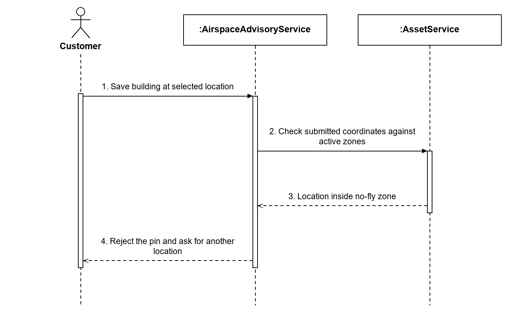

*Figure 4.24 Building Pin Inside No-Fly Zone*

#### 3.4.4 Design Verification

The backend checks submitted coordinates independently of the map display.

These scenarios describe expected behavior. See Report 5 for the execution result and supporting evidence.

| Case | Scenario | Expected behavior |
| --- | --- | --- |
| WF1-002 | Screen the location during Customer registration. | Reject a no-fly location. For a restricted location, activate the accepted registration with the advisory and retain the permit requirement. |
| WF2-004 | `AirspaceAdvisoryService`, Web `AirspaceNoFlyMap`, and Mobile `AirspaceAdvisoryCard` classify coordinates into No-Fly Zone, Restricted Zone, or Clear Zone with `MSG28` warnings. | Returns accurate Haversine classification (`NO_FLY_ZONE`, `RESTRICTED_ZONE`, `CLEAR_ZONE`), surfaces `MSG28` warning and `cambay.mod.gov.vn` reference, and renders interactive vector overlays. |
| WF2-005 | Airspace evaluation endpoint rejects invalid latitude/longitude bounds. | Out-of-bounds coordinates outside `[-90..90]` and `[-180..180]` are rejected with 400 Bad Request. |

### 3.5 FE-05 Financial History

The ledger links each scheduled inspection to its settlement records. Customers see their own payments and receipts. Inspectors see their assigned work and payouts. Managers see separate revenue and payout views.

#### 3.5.1 Components and Responsibilities

*Figure 4.25 Financial History Class Diagram*

| No | Component | Responsibility |
| :---: | :--- | :--- |
| 01 | ContractWorkflowController | Provides ledger entries filtered by the caller's role and access to each visit. |
| 02 | Financial response models | Return the payment and payout fields that each role is allowed to see. |
| 03 | Finance history and inspection overview | Show the ledger and the settlement details for a visit. |

#### 3.5.2 Main Sequence

*Figure 4.26 Financial History Sequence*

#### 3.5.3 Alternative Sequence

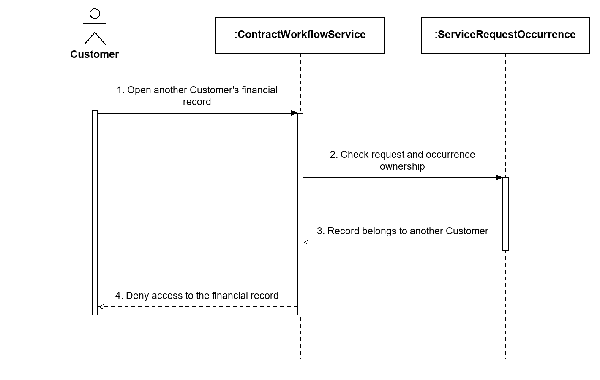

*Figure 4.27 Financial Ledger Outside Owner Scope*

#### 3.5.4 Design Verification

Role permissions and access to the individual record are checked separately.

These scenarios describe expected behavior. See Report 5 for the execution result and supporting evidence.

| Case | Scenario | Expected behavior |
| --- | --- | --- |
| WF3-032 | Customer, Partner Inspector, and Platform Manager query their scoped financial history and revenue/payment ledger views without cross-organization leakage. | Each role sees only its authorized financial ledger projection (`CUSTOMER`: organization invoices/payments; `INSPECTOR`: own payouts/receivables; `MANAGER`: platform revenue ledger with masked/unmasked boundaries); cross-scope queries return 403/404. |

### 3.6 FE-06 Buildings and Reference Documents

Customers manage their own buildings. A building category supplies default inspection checkpoints. The Manager selects the checkpoints for the requested visit before dispatch.

#### 3.6.1 Components and Responsibilities

*Figure 4.28 Buildings and Documents Class Diagram*

| No | Component | Responsibility |
| :---: | :--- | :--- |
| 01 | AssetService | Records buildings, screens their location, and locks checkpoint edits once inspections use them. |
| 02 | AssetCatalogService | Maintains building categories and the default checkpoints for new buildings. |
| 03 | AssetDocumentService | Checks uploaded documents, prevents duplicates, and serves files to authorized users. |

#### 3.6.2 Main Sequence

*Figure 4.29 Building and Document Registration Sequence*

#### 3.6.3 Alternative Sequence

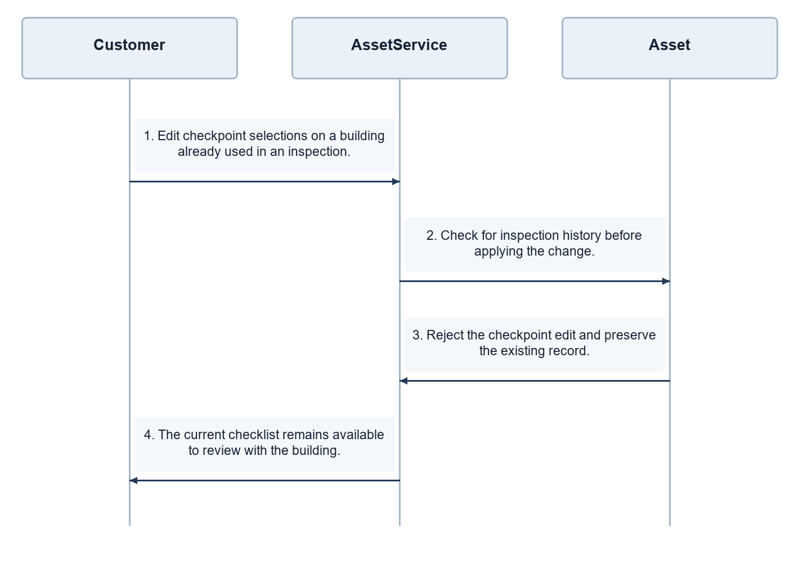

*Figure 4.30 Checkpoint Changes After Inspection Use*

#### 3.6.4 Design Verification

Building-level defaults are distinct from the checkpoint snapshot kept by a visit.

These scenarios describe expected behavior. See Report 5 for the execution result and supporting evidence.

| Case | Scenario | Expected behavior |
| --- | --- | --- |
| WF1-011 | Customer registers an infrastructure asset in clear/restricted airspace with `inspectionItems` checkpoints and uploads an engineering document to MinIO. | Asset created in `ACTIVE` status with normalized `inspection_items` JSONB (201); document stored in MinIO with SHA-256 checksum and streamed back with matching bytes (200). |
| WF1-012 | Asset registry rejects coordinates inside `NO_FLY_ZONE`, duplicate asset codes within the same tenant, and duplicate identical document uploads. | `NO_FLY_ZONE` coordinates return 403 `ASSET_IN_NO_FLY_ZONE`; duplicate `assetCode` returns 409 Conflict; duplicate document `checksum_sha256` returns 409 Conflict; 0-byte upload returns 400 Bad Request. |
| WF1-013 | Customer retires an asset (`ACTIVE -> RETIRED`) and system blocks subsequent modifications or new service requests. | Asset transitions `ACTIVE -> RETIRED` (200 OK) while preserving historical inspections/reports; subsequent edits or service requests on a `RETIRED` asset are rejected (400/404/409); `INSPECTOR` is rejected with 403. |

### 3.7 FE-07 Restricted Airspace Advisory

A restricted location can proceed after the Customer verifies their account. The system records the warning on the building. The assigned Inspector must obtain and record the required permit before flight.

#### 3.7.1 Components and Responsibilities

See Figure 4.22. The shared model identifies the airspace result and the adapter that supplies the advisory to registration.

| No | Component | Responsibility |
| :---: | :--- | :--- |
| 01 | CustomerAirspacePolicyAdapter | Passes the restricted-zone warning and altitude limit to the relevant workflow. |
| 02 | AuthService and AssetService | Allow registration in restricted zones and store the resulting advisory. |
| 03 | Restricted airspace notices | Show the zone and altitude ceiling where the Customer or Inspector needs to act. |

#### 3.7.2 Main Sequence

*Figure 4.31 Restricted Airspace Advisory Sequence*

#### 3.7.3 Alternative Sequence

*Figure 4.32 Restricted Location With a Ceiling*

#### 3.7.4 Design Verification

A location advisory and the permit decision are distinct checks.

These scenarios describe expected behavior. See Report 5 for the execution result and supporting evidence.

| Case | Scenario | Expected behavior |
| --- | --- | --- |
| WF1-009 | Register a Customer at a restricted location. | Activate the account and building after verification. Return the restricted-zone advisory. Prohibited locations remain blocked. |

### 3.8 FE-08 Service Requests and Quotations

Customers request one visit or a recurring schedule. The assigned Manager records the scope, checkpoints, and price in VND. A change to the active quotation requires a new Customer decision.

#### 3.8.1 Components and Responsibilities

See Figure 4.35. The shared model shows how a request relates to its quotations and how accepted terms become scheduled occurrences.

| No | Component | Responsibility |
| :---: | :--- | :--- |
| 01 | ContractWorkflowService | Validates dates, handles Manager assignment, and saves the current quotation. |
| 02 | ServiceRequest and ServiceRequestQuote | Record the requested schedule, checkpoints, price, and latest quoted terms. |
| 03 | Request list and quotation workspace | Let Customers submit and review requests. Managers use the workspace to prepare and revise quotes. |

#### 3.8.2 Main Sequence

*Figure 4.33 Request and Quotation Sequence*

#### 3.8.3 Alternative Sequence

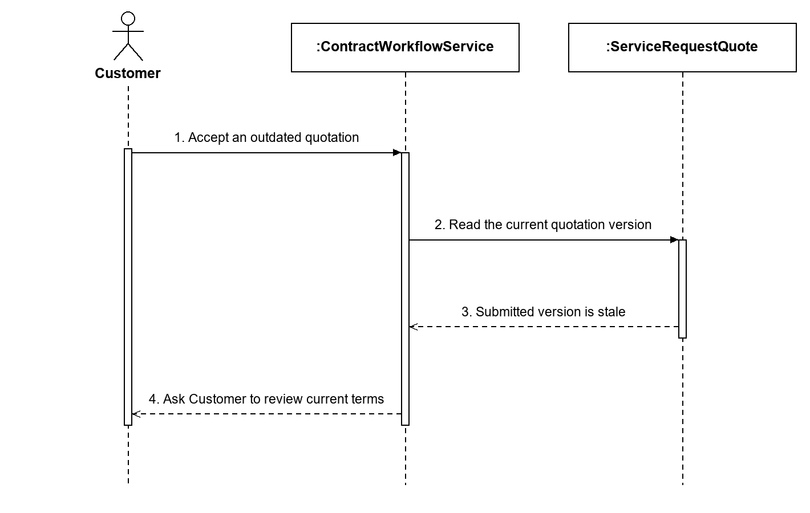

*Figure 4.34 Quotation Changes Before Acceptance*

#### 3.8.4 Design Verification

Only the accepted terms can create the agreed occurrence schedule.

These scenarios describe expected behavior. See Report 5 for the execution result and supporting evidence.

| Case | Scenario | Expected behavior |
| --- | --- | --- |
| WF1-017 | Create recurring visits from accepted terms. | Create the agreed dates without choosing an Inspector in the quotation. At dispatch, check licences and drone registration for each visit. |
| WF1-018 | Monthly recurring `ServiceRequest` occurrences stay anchored to the Customer-requested first date without drift across short months. | Occurrences remain anchored at `2027-01-31`, `2027-02-28`, `2027-03-31`, and `2027-04-30` (`09:00:00Z`), with February clamped and no permanent drift. The same month-arithmetic helper supports 1, 3, 6, 9, 12 and custom month intervals up to 120. |
| WF1-019 | Validate the planned recurring dates. | Enforce the minimum lead time. Keep the accepted end-date or visit-count rule when revising the quotation. |
| WF2-022 | Manager may move the first inspection later than the Customer-requested date; the Customer must accept the revised quote. | Later first dates save as `QUOTED`; earlier dates, count-term violations and fewer-than-two-occurrence end-date revisions are rejected before persistence. The Customer sees the proposed date and must accept again; occurrences and dispatch use the accepted quote term. |
| WF2-023 | Manager request detail shows a persistent asset overview above every workflow step. | The overview renders on every step, shows the linked asset and customer-selected schedule, displays the signed-in Manager and assigned drone (or an empty value before dispatch), and toggles cleanly. Manager list queries do not perform the Customer-name lookup. |
| WF2-026 | Set checkpoints for a service request. | Save the cleaned checkpoint list to the request and transfer it to the inspection on dispatch. Reject later changes to the dispatched list. |

### 3.9 FE-09 Signed Contracts and Dispatch

The accepted quotation sets the schedule. A Manager uploads the signed paper agreement before assigning an Inspector and a drone. Dispatch checks qualification and schedule conflicts for each visit.

#### 3.9.1 Components and Responsibilities

*Figure 4.35 Contracts and Dispatch Class Diagram*

| No | Component | Responsibility |
| :---: | :--- | :--- |
| 01 | ContractWorkflowService | Freezes accepted terms, creates visits, stores the signed agreement, and records assignment or cancellation. |
| 02 | PartnerRegistryService and assignment adapter | Check the Inspector and drone for valid qualifications, equipment, and availability on the scheduled date. |
| 03 | Occurrence dispatch workspace | Lets the Manager review candidates, assign a team, or reschedule, reassign, or cancel a visit. |

#### 3.9.2 Main Sequence

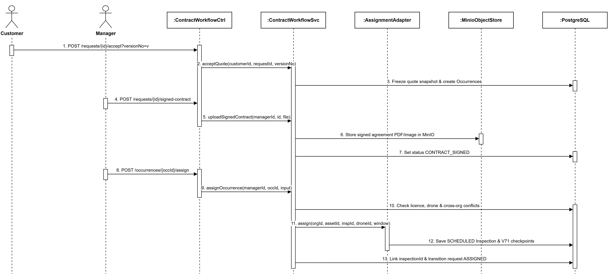

*Figure 4.36 Contract Signing and Dispatch Sequence*

#### 3.9.3 Alternative Sequence

*Figure 4.37 Cancel a Visit After Inspector Withdrawal*

#### 3.9.4 Design Verification

A scheduled visit can close independently of other visits under the accepted contract.

These scenarios describe expected behavior. See Report 5 for the execution result and supporting evidence.

| Case | Scenario | Expected behavior |
| --- | --- | --- |
| WF1-021 | Connect onboarding, quotation and dispatch. | Verified Inspector and drone records become eligible. Signing enables dispatch. The assigned visit links to a scheduled inspection. |
| WF2-002 | Partner occurrence dispatch and abort re-dispatch reject cross-organization schedule overlaps, unowned drones, or missing signed contracts. | Cross-organization overlapping partner booking is rejected with 409 Conflict; assigning before `CONTRACT_SIGNED` or with an unowned/non-`ACTIVE` drone is rejected with 400/409. |
| WF2-003 | Service request contracting, occurrence dispatch, and abort re-dispatch (`Reschedule`, `Reassign`, `Cancel`) enforce strict 4-role and zone authorization. | Non-`MANAGER` callers are rejected from quote/contract/dispatch mutations with 403 Forbidden; cross-tenant service request access is rejected with 404/403 without leaking foreign tenant data. |
| WF2-015 | End-to-end Flutter mobile app walkthrough covering airspace radar card, flight permit upload, session abort/re-dispatch, session completion, and photo/MP4 evidence upload against staging. | Mobile app synchronizes 6-state status transitions (`SCHEDULED -> IN_PROGRESS -> FIELD_COMPLETED`) and streams photo/MP4 evidence visible on Web Portal. |
| WF2-024 | The Manager dispatch-step `Open review` action opens the reviewer field-audit step, not the report-decision step. | `Open review` navigates to `/manager/inspections/{id}/audit` (step 1 Field Audit) for incomplete audits; it never opens `/review` (step 2 Report Decision) directly, and the inspection detail still resolves the active reviewer step from its own status. |
| WF2-016 | Full WF-02 execution from service contract dispatch and airspace check through permit gate and field session completion with `p95` API latency `<= 500 ms`. | Complete WF-02 chain reaches `FIELD_COMPLETED`; `p95` JSON API latency remains `<= 500 ms` (measured `~180 ms`) with `0%` 5xx errors. |
| WF2-034 | Manager cancels a scheduled occurrence after Inspector withdrawal | The inspection becomes CANCELLED. reassignmentRequired is false. The Inspector identity, withdrawal reason and Manager cancellation reason remain in the response. |

### 3.10 FE-10 Order, Partner, and Inspection Chat

Order chat connects the Customer and assigned Manager. Partner chat connects the Manager and Inspector for the request. Inspection chat connects the owning Customer and assigned Inspector. Attachments use the same access rules as their conversation.

#### 3.10.1 Components and Responsibilities

*Figure 4.38 Scoped Conversations Class Diagram*

| No | Component | Responsibility |
| :---: | :--- | :--- |
| 01 | ContractWorkflowController | Handles messages and attachments between the Customer and the assigned Manager. |
| 02 | InspectionChatService | Limits inspection messages and attachments to the owning Customer and assigned Inspector. |
| 03 | ServiceRequestPartnerChatService | Limits partner messages and attachments to the Manager and Inspector for the request. |
| 04 | ChatAttachmentValidator | Checks file type, name, and size before storing an attachment. |
| 05 | Web and mobile inboxes | Keep each conversation separate and show its messages, unread count, and attachments. |

#### 3.10.2 Main Sequence

*Figure 4.39 Order, Partner, and Inspection Chat Sequence*

#### 3.10.3 Alternative Sequence

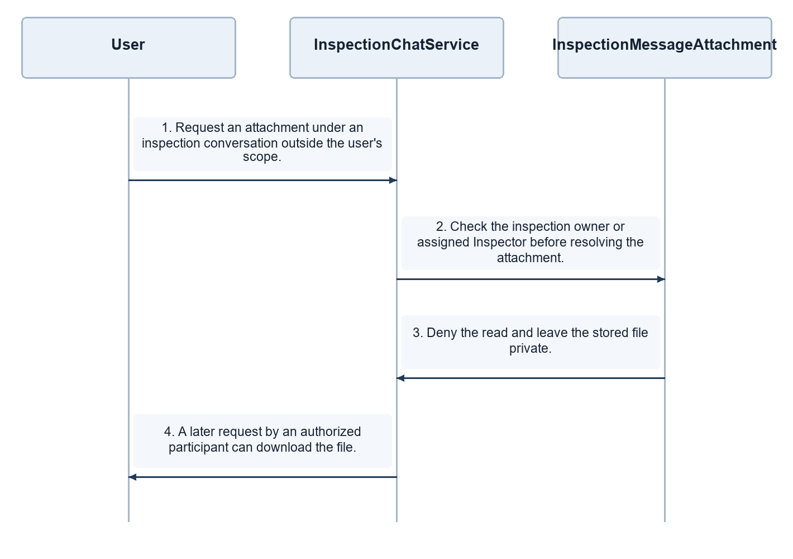

*Figure 4.40 Attachment Request Outside Conversation Scope*

#### 3.10.4 Design Verification

Attachment rights follow the conversation, not possession of a file identifier.

These scenarios describe expected behavior. See Report 5 for the execution result and supporting evidence.

| Case | Scenario | Expected behavior |
| --- | --- | --- |
| WF2-001 | Keep order chat and its files scoped to the request. | Only the owning Customer and assigned Manager can read the conversation and validated attachments. Eligible visits can receive bulk assignments. |
| WF2-027 | Assigned Manager and Partner Inspector coordinate in private per-request Partner Chat, isolated from Customer and ADMIN. | Partner Chat persists messages/attachments privately in `service_request_partner_messages` / `service_request_partner_message_attachments` (`V70`) and MinIO, updates read state, and denies `CUSTOMER`, `ADMIN`, and uninvolved actors (`403`/`404`) without leaking commercial Customer messages. |

### 3.11 FE-11 Assignment Expiry

An unanswered assignment expires after the configured window. The system releases the reservation and notifies the Manager so the visit can be assigned again.

#### 3.11.1 Components and Responsibilities

*Figure 4.41 Assignment Eligibility and Permits Class Diagram*

| No | Component | Responsibility |
| :---: | :--- | :--- |
| 01 | PlatformOperationsSettingsService | Lets an Admin configure how long an Inspector has to accept an offer. |
| 02 | InspectionAssignmentTimeoutMonitor | Clears expired offers and returns the affected visit to the assignment queue. |
| 03 | Settings and expiry notification | Show the configured timeout and take the Manager to the request that needs a new assignment. |

#### 3.11.2 Main Sequence

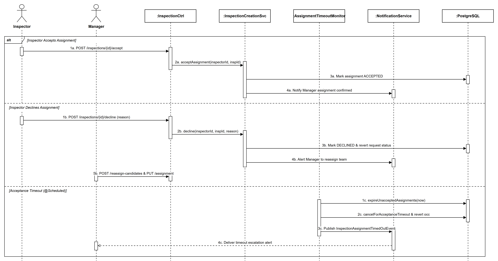

*Figure 4.42 Assignment Expiry Sequence*

#### 3.11.3 Alternative Sequence

*Figure 4.43 Withdraw an Accepted Assignment Before Field Work*

#### 3.11.4 Design Verification

Withdrawal sets the assignment to `DECLINED` while the inspection remains `SCHEDULED`. The reassignment flag stays set until the Manager recovers or cancels the visit.

These scenarios describe expected behavior. See Report 5 for the execution result and supporting evidence.

| Case | Scenario | Expected behavior |
| --- | --- | --- |
| WF2-021 | Pending Step 4 assignment enforces Admin-configurable acceptance timeout, reverts expired assignment to `PENDING_ASSIGNMENT`, and escalates alert to the owning Manager. | Expired unaccepted assignment is cancelled cleanly, occurrence returns to `PENDING_ASSIGNMENT` for re-dispatch, and owning `MANAGER` receives an escalation notification deep-linking to `/manager/contracts?requestId=...`. |
| WF2-032 | Withdraw an accepted assignment before field work | Eligibility is true before withdrawal. The operation succeeds and the scheduled occurrence requires reassignment. |

### 3.12 FE-12 Notifications

Workflow events create alerts for the people involved. Opening a notification still requires access to the related record. The same event can be retried without creating a duplicate alert.

#### 3.12.1 Components and Responsibilities

*Figure 4.44 Lifecycle Notifications Class Diagram*

| No | Component | Responsibility |
| :---: | :--- | :--- |
| 01 | Notification listeners | Convert request, inspection, application, and payment events into alerts. |
| 02 | NotificationService and email service | Store alerts once, track read status, and send emails for important events. |
| 03 | Notification bell and inbox | Show unread alerts and open the related record through an approved portal link. |

#### 3.12.2 Main Sequence

*Figure 4.45 Notification Delivery Sequence*

#### 3.12.3 Alternative Sequence

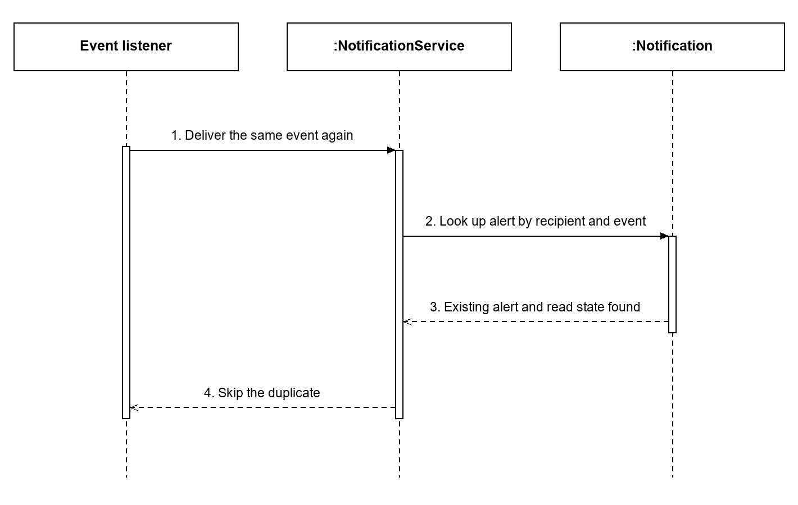

*Figure 4.46 Notification Event Delivered Again*

#### 3.12.4 Design Verification

The target record still requires its ordinary access check.

These scenarios describe expected behavior. See Report 5 for the execution result and supporting evidence.

| Case | Scenario | Expected behavior |
| --- | --- | --- |
| WF2-025 | A new Customer service request notifies every active Manager. | Each active Manager receives exactly one `SERVICE_REQUEST_CREATED` notice containing the request description and date, with target `/manager/contracts?requestId={id}`; the inactive Manager receives nothing, replay is ignored by the deduplication key, and the deep link opens the Manager request detail. |
| WF1-020 | Domain events publish in-app notifications via Spring Modulith outbox, deduplicate on `uq_notifications_deduplication_key`, and transition `SENT -> READ` idempotently. | First event persists a `SENT` `Notification` row; duplicate replay is safely ignored; PATCH transitions status `SENT -> READ` idempotently; cross-user read/mark returns 404 Not Found. |
| WF2-028 | Retry bilingual notifications and mark alerts as read. | Persist one alert per recipient and event. Deliver critical email where configured. Reading alerts updates only the authenticated recipient and keeps authorized links usable. |

### 3.13 FE-13 Flight Permits

The assigned Inspector uploads and attests the permit. It becomes effective after the system validates it. A change of drone or a reschedule outside the permit window requires another upload.

#### 3.13.1 Components and Responsibilities

See Figure 4.41. The shared model identifies the inspection service and permit policy that check the aircraft and flight window.

| No | Component | Responsibility |
| :---: | :--- | :--- |
| 01 | InspectionController | Accepts the permit from the assigned Inspector and serves the uploaded document to authorized users. |
| 02 | FlightPermitPolicy | Checks file validity, the scheduled window, the drone, and the applicable altitude limit. |
| 03 | Permit panel and preview | Show upload and validation status. The Inspector can decline when the required permit cannot be obtained. |

#### 3.13.2 Main Sequence

*Figure 4.47 Flight Permit Validation Sequence*

#### 3.13.3 Alternative Sequence

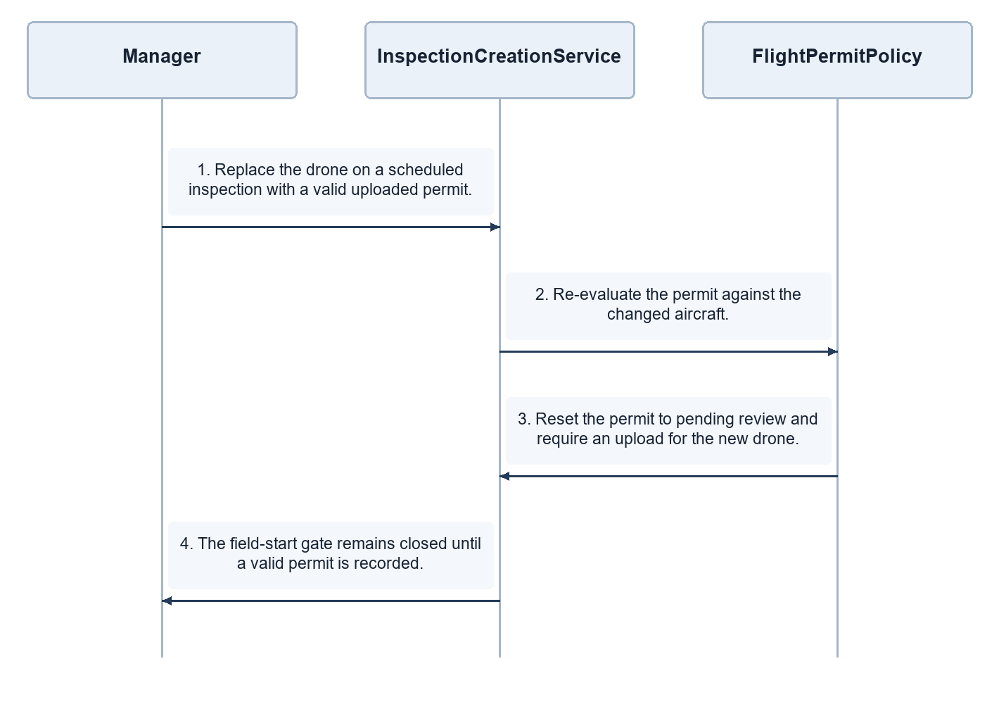

*Figure 4.48 Drone Change Invalidates the Permit*

#### 3.13.4 Design Verification

The permit is tied to both the aircraft and the scheduled window.

These scenarios describe expected behavior. See Report 5 for the execution result and supporting evidence.

| Case | Scenario | Expected behavior |
| --- | --- | --- |
| WF2-008 | Historical case for independent Manager permit approval. | This case is superseded. The current design validates the assigned Inspector's self-attestation and grants approval after a valid upload. See WF2-029. |
| WF2-009 | Historical case for the previous permit review flow. | This case is superseded. Use the active self-attestation and replacement-permit cases in this section for the current design. |
| WF2-029 | Assigned Inspector self-attested flight-permit upload is effective immediately without Manager/Admin approval. | Permit validation succeeds and becomes effective immediately (`APPROVED` self-attestation) without Manager/Admin approval; Stage 2 Pre-flight unlocks right away. |
| WF2-030 | Flight-permit Manager/Admin review/approval endpoint and UI decision controls are removed. | Review endpoint is absent (`404`/`405`), `PERMIT_REVIEW` pending action is never raised, and Manager/Admin UI renders read-only permit view only. |
| WF2-031 | Changing drone or rescheduling outside permit validity window resets permit to `PENDING_REVIEW` (re-upload required). | `requireReupload()` resets permit to `PENDING_REVIEW` and blocks field start (`MSG42`) until assigned Inspector uploads a new valid permit; replacement locks once field work starts. |
| WF2-033 | Reject withdrawal after an Inspector has aborted a started session | canWithdrawAssignment is false. The decline endpoint returns HTTP 409 ASSIGNMENT_FIELD_WORK_STARTED. |

### 3.14 FE-14 Field Sessions and Flight Data

The Inspector completes safety checks and records each flight within a field session. SmartDroneHub supplies read-only telemetry and video. When the Inspector records an abort, the Manager can reschedule, reassign, or cancel the visit. The Customer receives flight summaries and traces after report publication.

#### 3.14.1 Components and Responsibilities

*Figure 4.49 Field Session and Flight Data Class Diagram*

| No | Component | Responsibility |
| --- | --- | --- |
| 01 | InspectionFieldSessionService | Starts, completes, and aborts a session for the assigned Inspector. |
| 02 | InspectionDroneHubService | Reads permitted flight data and links a synchronized video to evidence. |
| 03 | FieldSessionFlight | Tracks individual flights separately from the parent session. |

#### 3.14.2 Main Sequence

*Figure 4.50 Field Session and Flight Data Sequence*

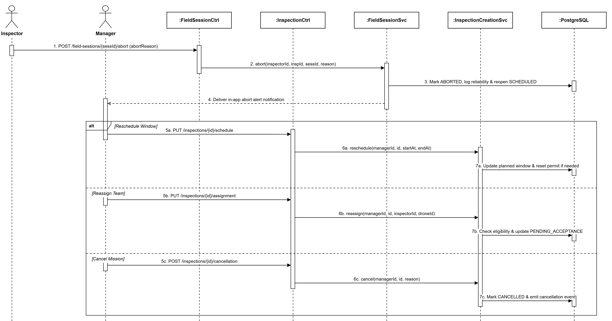

*Figure 4.51 Abort and Recovery Sequence*

#### 3.14.3 Alternative Sequence

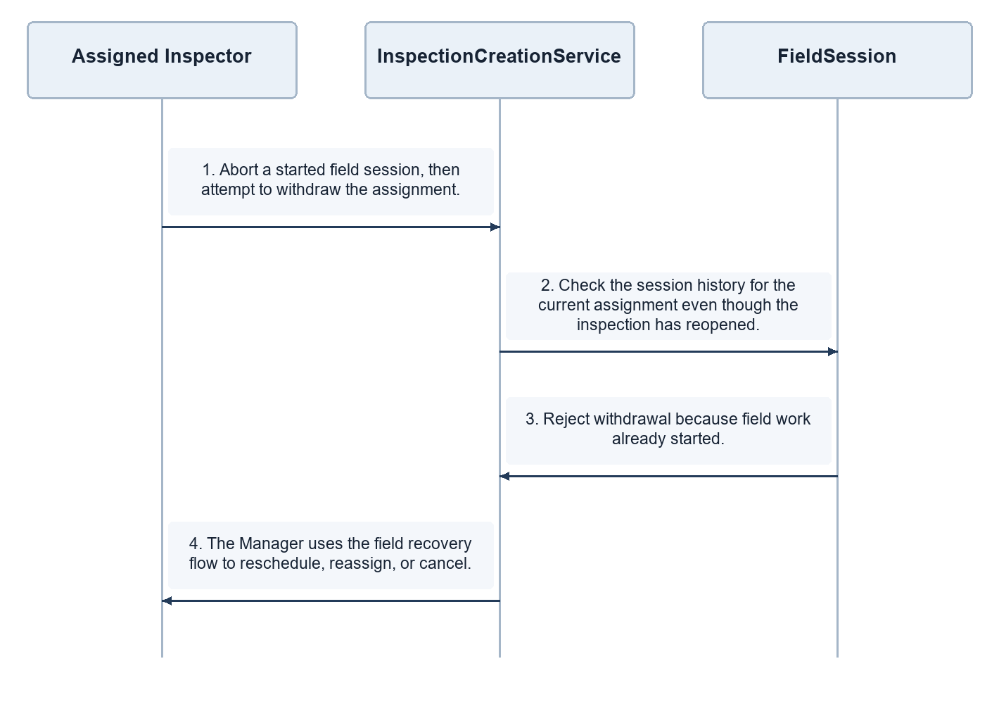

*Figure 4.52 Reject Withdrawal After Field Abort*

#### 3.14.4 Design Verification

Field abort and pre-field withdrawal use different recovery rules.

These scenarios describe expected behavior. See Report 5 for the execution result and supporting evidence.

| Case | Scenario | Expected behavior |
| --- | --- | --- |
| WF2-011 | Assigned Inspector starts field session only while permit is `APPROVED` (valid dates & matching drone), resets on reschedule/reassignment, syncs Hub, aborts, and completes. | Starting session succeeds only when permit is `APPROVED`, valid at use time, and serial-matched; out-of-window reschedule or drone change invalidates prior approval (`PENDING_REVIEW`); Hub sync/abort/completion work as specified. |
| WF2-012 | Start field work without a valid permit or checklist. | Reject a missing, pending, rejected or expired permit, a blank required checklist note, or a concurrent session. No new session is created. |
| WF2-017 | `DashboardPage` renders 4-role scoped KPIs, radial gauges, stacked bar charts, and queue tables without leaking unconfirmed AI candidates. | Each role sees only its authorized portal metrics and action queues; official defect charts count only `CONFIRMED` findings (`BR-21`). |
| WF2-018 | `InspectorScheduleCalendar` maps planned inspections into Month/Week/Agenda views, displays abort warning banners, and opens `InspectionWorkDetailDialog`. | Calendar accurately renders scheduled missions and aborted/unscheduled warning banners; clicking an item opens `InspectionWorkDetailDialog` with direct stage navigation. |
| WF3-020 | Import flight data or record a manual declaration. | Label the data source. Keep unavailable fields empty and show no fabricated GPS trace for manual entries. Reject access outside the assigned inspection. |

### 3.15 FE-15 Photo and Video Evidence

The system links each upload to its inspection and field session. Video uploads can resume after interruption. Processed media becomes available to authorized users once the playable file is ready.

#### 3.15.1 Components and Responsibilities

*Figure 4.53 Evidence Intake and Streaming Class Diagram*

| No | Component | Responsibility |
| :---: | :--- | :--- |
| 01 | EvidenceService and ImageNormalizer | Read capture details from photos, prepare thumbnails, and link the images to the inspection. |
| 02 | EvidenceUploadSessionService | Tracks the parts of resumable video uploads and records completion or failure. |
| 03 | VideoProcessingWorker and MediaTicketService | Prepare playable video and issue short-lived access tickets for authorized viewing. |
| 04 | Evidence workspace | Lets Inspectors upload files, review locations, and select video frames as evidence. |

#### 3.15.2 Main Sequence

*Figure 4.54 Evidence Upload and Processing Sequence*

#### 3.15.3 Alternative Sequence

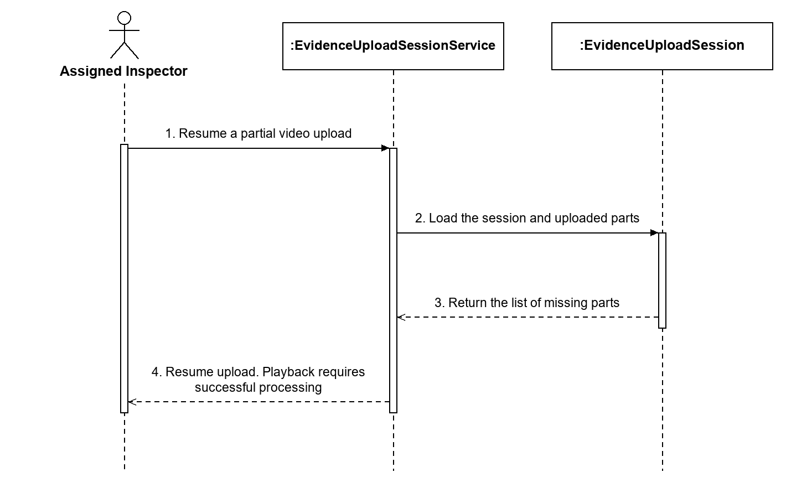

*Figure 4.55 Resume an Interrupted Video Upload*

#### 3.15.4 Design Verification

An upload session and the playable evidence item have different lifecycles.

These scenarios describe expected behavior. See Report 5 for the execution result and supporting evidence.

| Case | Scenario | Expected behavior |
| --- | --- | --- |
| WF3-002 | Upload evidence and handle repeated filenames. | Preserve capture metadata, assign distinct filenames, and reject corrupt or unauthorized uploads. |
| WF3-022 | Normalize an image and create its preview. | Preserve capture time, GPS and orientation. Store a thumbnail and retain the original size alongside the processed size. |
| WF3-023 | Resume or cancel a multipart video upload. | Retrying a part or completion is safe. Cancellation aborts unfinished parts. Reject expired sessions and unauthorized requests. |
| WF3-024 | Process a video in the background. | Keep raw data until the processed video and preview are verified and ready. A failed job retains enough data to retry. |
| WF3-025 | Stream evidence with a scoped access ticket. | Authorize the specific evidence and variant. Support byte ranges without exposing sign-in tokens in playback links. |

### 3.16 FE-16 Defect Detection and Findings

YOLO11 proposes defects from photos and video frames. An optional vision service can help when YOLO11 produces no detections or is unavailable. Platform settings determine whether high-confidence results can be confirmed automatically. The Inspector reviews findings and locks the set used by the report.

#### 3.16.1 Components and Responsibilities

*Figure 4.56 Defect Detection Class Diagram*

| No | Component | Responsibility |
| --- | --- | --- |
| 01 | FindingService | Collects detection results and manages Inspector finding decisions. |
| 02 | PrimaryWithFallbackInference | Routes image analysis through the available, permitted provider. |
| 03 | Finding | Links the proposed or confirmed defect to the supporting evidence. |

#### 3.16.2 Main Sequence

*Figure 4.57 Defect Detection and Review Sequence*

#### 3.16.3 Alternative Sequence

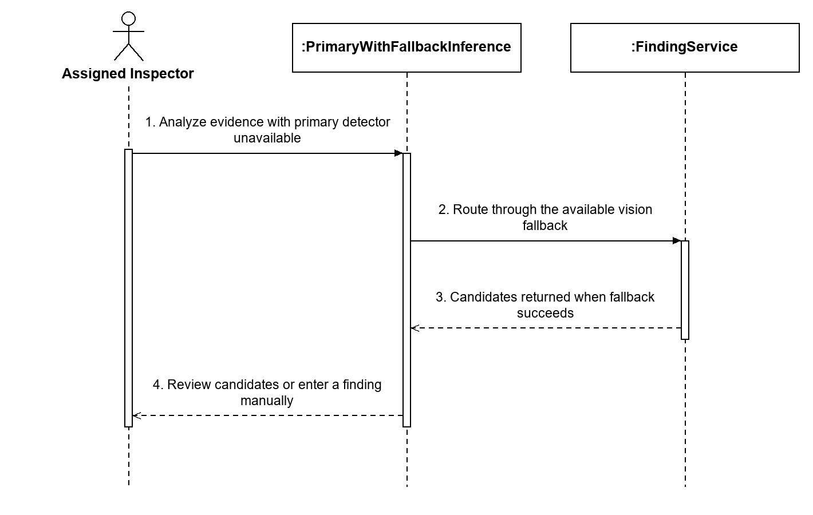

*Figure 4.58 Primary Detection Unavailable*

#### 3.16.4 Design Verification

Detection suggestions do not replace the Inspector's confirmation of the finding baseline.

These scenarios describe expected behavior. See Report 5 for the execution result and supporting evidence.

| Case | Scenario | Expected behavior |
| --- | --- | --- |
| WF3-001 | Re-running detection with `replace=true` swaps unreviewed `PENDING` proposals while preserving `CONFIRMED` findings, and unresolved `PENDING` proposals block baseline confirmation. | Confirmation with unresolved `PENDING` proposals is rejected (`MSG21`); `replace=true` preserves `CONFIRMED`/manual findings and replaces only unreviewed `PENDING` proposals. |
| WF3-003 | Detect or manually record findings. | Keep candidates linked to their evidence. Independent Inspector decisions determine which entries are confirmed for the report. |
| WF3-004 | Only the assigned `INSPECTOR` can invoke AI defect detection, mutate findings, or confirm the findings set baseline. | All mutation requests by non-assigned or non-Inspector callers are rejected with 403 Forbidden or 404 Not Found; Manager/Customer UI hides analysis/edit controls and renders read-only findings. |
| WF3-007 | FastAPI YOLO11 (`MBDD2025`) completes single-image inference within `<= 5,000 ms` and routes to Vision LLM fallback or manual entry when offline. | Primary YOLO11 inference completes in `~1.4 s` (`<= 5,000 ms` threshold) returning `mbdd2025-v1` bounding boxes; when YOLO11 is down, Vision LLM fallback executes if enabled or returns graceful error (`MSG19`) while manual finding entry remains functional. |
| WF3-008 | Complete field evidence, review, publication and Customer payment. | Compile the report from confirmed findings, require independent Manager review, settle any applicable payout, and unlock Customer payment only after publication and acceptance. |
| WF3-010 | Change evidence after finding confirmation. | Edits before review require renewed confirmation. A submitted report locks relevant inputs, a return reopens correction, and publication locks the official result. |
| WF3-017 | If YOLO11 returns no detections, the configured vision fallback model analyzes the same image before the Inspector receives the result. | With fallback enabled, the vision adapter runs automatically after an empty YOLO result and its detections are returned as `PENDING` candidates; disabling fallback preserves the empty YOLO result. |

### 3.17 FE-17 Finding Notes and Knowledge References

DroneKnowledgeAI searches engineering standards, the Customer's past cases, and anonymized examples. It can search by text when embeddings are unavailable. Related cases help draft suggested finding notes. The report summary uses confirmed inspection data and lists source references separately.

#### 3.17.1 Components and Responsibilities

*Figure 4.59 Finding Notes and References Class Diagram*

| No | Component | Responsibility |
| --- | --- | --- |
| 01 | HistoricalCaseService | Retrieves authorized references and prepares context for suggestions. |
| 02 | HistoricalCaseAdvisorPort | Allows retrieval and draft assistance through provider adapters. |
| 03 | DroneKnowledgeClient | Calls the configured embeddings and note drafting providers. |

#### 3.17.2 Main Sequence

*Figure 4.60 Finding Notes and References Sequence*

#### 3.17.3 Alternative Sequence

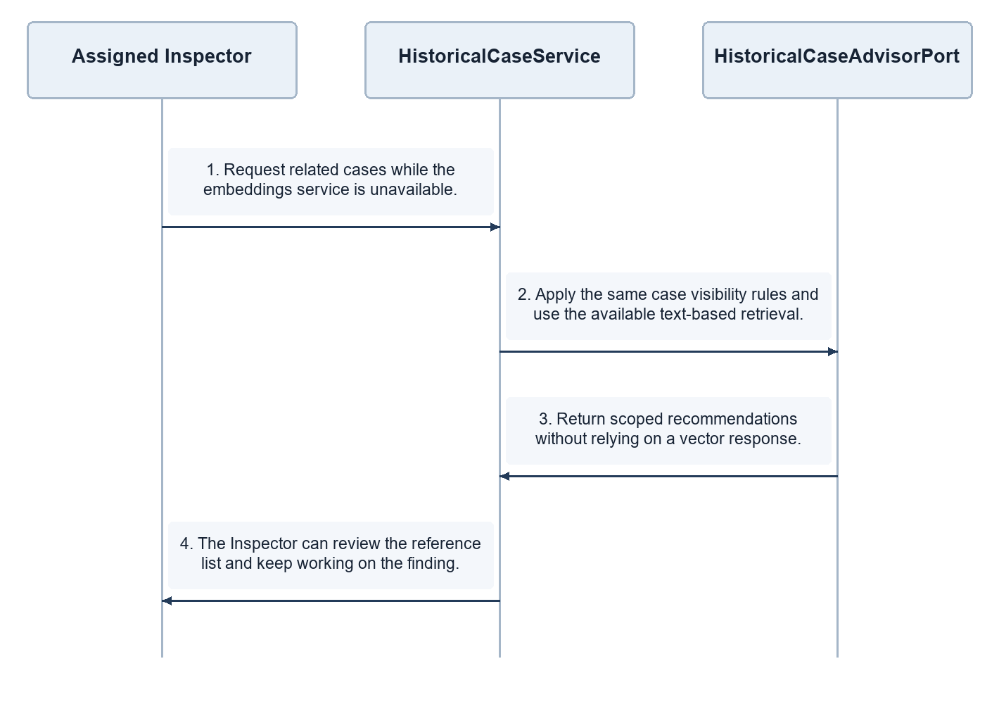

*Figure 4.61 Embeddings Endpoint Unavailable*

#### 3.17.4 Design Verification

The fallback preserves the same record scope as vector retrieval.

These scenarios describe expected behavior. See Report 5 for the execution result and supporting evidence.

| Case | Scenario | Expected behavior |
| --- | --- | --- |
| WF3-029 | Request related cases or a suggested finding note. | Limit retrieval to authorized cases and anonymized examples. Present references and editable text without saving or confirming the finding automatically. |
| WF3-030 | Show case and standards references with a report summary. | Display the references separately. The Inspector remains responsible for the submitted report and the Manager for its review. |

### 3.18 FE-18 Report Review and Publication

The Inspector submits a report version based on confirmed findings. A Manager who did not author the report approves it or returns it for correction. If payout applies, the Manager can publish only after settlement. The published PDF is the official Customer deliverable.

#### 3.18.1 Components and Responsibilities

*Figure 4.62 Report Review Class Diagram*

| No | Component | Responsibility |
| --- | --- | --- |
| 01 | ReportService | Manages versions and enforces review, payout, and publication rules. |
| 02 | ReportDraftClient | Drafts a summary from the supplied inspection context. |
| 03 | PdfReportRenderer | Renders the official report artifact. |

#### 3.18.2 Main Sequence

*Figure 4.63 Report Review and Publication Sequence*

#### 3.18.3 Alternative Sequence

*Figure 4.64 Report Returned for Correction*

#### 3.18.4 Design Verification

Only an independently reviewed version can move toward publication.

These scenarios describe expected behavior. See Report 5 for the execution result and supporting evidence.

| Case | Scenario | Expected behavior |
| --- | --- | --- |
| WF3-005 | Assigned Inspector previews/authors report sections, generates the AI Executive Summary, and submits the inspection report for review. | Report version is persisted in `SUBMITTED` state, `Inspection` transitions `FIELD_COMPLETED -> UNDER_REVIEW`, and AI Executive Summary (`ReportDraftClient` with deterministic fallback) populates structured summary sections. |
| WF3-006 | Independently review and publish the inspection report. | Reject self-review. In the current design approval precedes publication and any applicable payout must settle first. Customer acceptance opens payment through Sepay or VNPay. |
| WF3-009 | Read progress and report queues with scoped access. | The Inspector reads assigned inspections and the Customer reads their own. Staff reads follow the server scope. The official report is visible to the owning Customer after publication. |
| WF3-016 | PDF export is generated on demand for each published report version; a newer published version supersedes the earlier report version. | A PDF is absent at publication and generated on first download; when MinIO is available, each version is cached under its own deterministic key (`V26`). Publishing v2 transitions v1 to `SUPERSEDED` and preserves v1's cached PDF unchanged. |

### 3.19 FE-19 Report Acceptance and Clarification

The owning Customer can request clarification before acceptance. Acceptance applies to the published version the Customer reviewed and opens payment for that visit.

#### 3.19.1 Components and Responsibilities

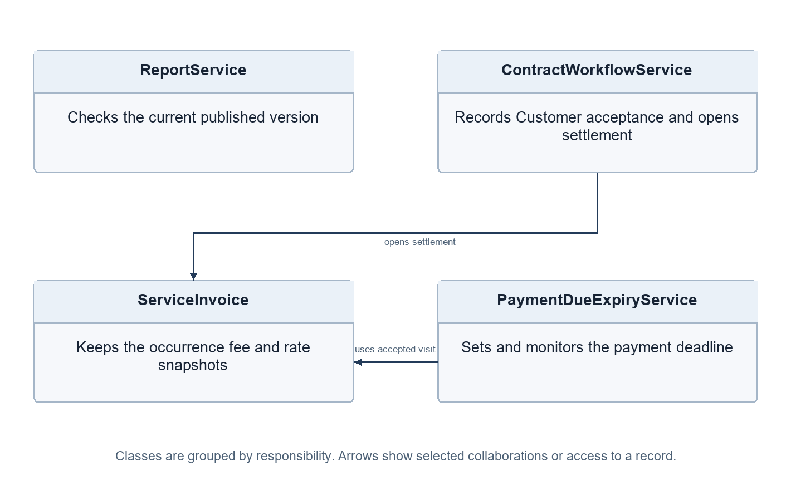

*Figure 4.65 Report Acceptance and Invoicing Class Diagram*

| No | Component | Responsibility |
| :---: | :--- | :--- |
| 01 | ContractWorkflowService | Records acceptance for the published report version and opens payment. |
| 02 | ReportService | Accepts clarification requests from the owning Customer before acceptance. |
| 03 | Customer report and settlement views | Show the published PDF and offer separate actions for clarification and acceptance. |

#### 3.19.2 Main Sequence

*Figure 4.66 Customer Report Acceptance Sequence*

#### 3.19.3 Alternative Sequence

*Figure 4.67 Clarification Before Acceptance*

#### 3.19.4 Design Verification

Clarification and acceptance are separate Customer decisions.

These scenarios describe expected behavior. See Report 5 for the execution result and supporting evidence.

| Case | Scenario | Expected behavior |
| --- | --- | --- |
| WF3-012 | Live staging walkthrough of Customer report acceptance, Sepay VietQR / VNPay settlement, and payment-document handoff. | Customer report acceptance transitions occurrence to `PAYMENT_DUE`, payment callback transitions occurrence to `PAID`, and the official report PDF is available from publication onward while the receipt appears only after payment; no maintenance workflow is available. |

### 3.20 FE-20 Online Payment

After accepting a report, the Customer can pay in VND through Sepay VietQR or VNPay. The backend checks the gateway message and matches the order and amount before recording payment. Returning from the gateway shows the stored result.

#### 3.20.1 Components and Responsibilities

*Figure 4.68 Online Settlement Class Diagram*

| No | Component | Responsibility |
| :---: | :--- | :--- |
| 01 | SepayPaymentGateway | Creates VietQR transfer details and verifies notifications from Sepay. |
| 02 | GatewayInboundTransactionService | Records gateway events, protects against repeat processing, and preserves the result for audit. |
| 03 | VnPayPaymentGateway | Signs checkout requests, verifies payment notifications, and returns the Customer to the settlement screen. |
| 04 | ContractWorkflowService | Keeps one active unresolved order and releases it when the gateway confirms cancellation or expiry. |

#### 3.20.2 Main Sequence

*Figure 4.69 Online Payment Sequence*

#### 3.20.3 Alternative Sequence

*Figure 4.70 Gateway Amount Does Not Match*

#### 3.20.4 Design Verification

An authenticated callback must still match the amount and reference.

These scenarios describe expected behavior. See Report 5 for the execution result and supporting evidence.

| Case | Scenario | Expected behavior |
| --- | --- | --- |
| WF3-018 | Flyway V29 creates `service_invoices`, `service_payments`, and `inspector_payouts`, backfills each occurrence, and removes finance/payment/payout columns from `service_request_occurrences`. | Migration succeeds; finance records are created per occurrence and historical data is copied before the old columns are removed. `inspector_payouts.inspector_id` identifies the assigned Inspector. |
| WF3-019 | Track invoice, Customer payment and partner payout separately. | Keep separate records. Use report approval to establish payout eligibility and record actual disbursement independently of Customer checkout. |

### 3.21 FE-21 Invoices and Payment Deadlines

Acceptance starts the configurable payment window, which defaults to 15 days. The invoice retains the rates applied when it was issued. The Customer can download a notice while payment is due and a receipt after payment.

#### 3.21.1 Components and Responsibilities

See Figure 4.65. The shared model separates the accepted report, invoice snapshot, and payment deadline.

| No | Component | Responsibility |
| :---: | :--- | :--- |
| 01 | InspectionFinanceCalculator and ServiceInvoice | Apply the configured commission and tax rates and store a copy on the invoice. |
| 02 | PaymentDueExpiryService | Sets the due date on acceptance and sends an overdue alert once. |
| 03 | PaymentDocumentService | Serves the payment notice while an amount is due and the receipt after it is paid. |

#### 3.21.2 Main Sequence

*Figure 4.71 Payment Deadline and Document Sequence*

#### 3.21.3 Alternative Sequence

*Figure 4.72 Issue One Alert After Payment Deadline*

#### 3.21.4 Design Verification

The due date is fixed when the published report is accepted.

These scenarios describe expected behavior. See Report 5 for the execution result and supporting evidence.

| Case | Scenario | Expected behavior |
| --- | --- | --- |
| WF3-026 | Open a payment deadline on report acceptance. | Stamp the due date once. Notify on overdue payment without changing the payment state or removing report access. |
| WF3-027 | Download a payment notice or receipt. | Show the notice after acceptance and the receipt after verified payment. Scope the read and label both as records rather than tax invoices. |

### 3.22 FE-22 Inspector Payout

Report approval makes the Inspector eligible for payout. The Manager can record settlement, and Sepay can reconcile a matching transfer. The system checks payout settlement before publication when it applies.

#### 3.22.1 Components and Responsibilities

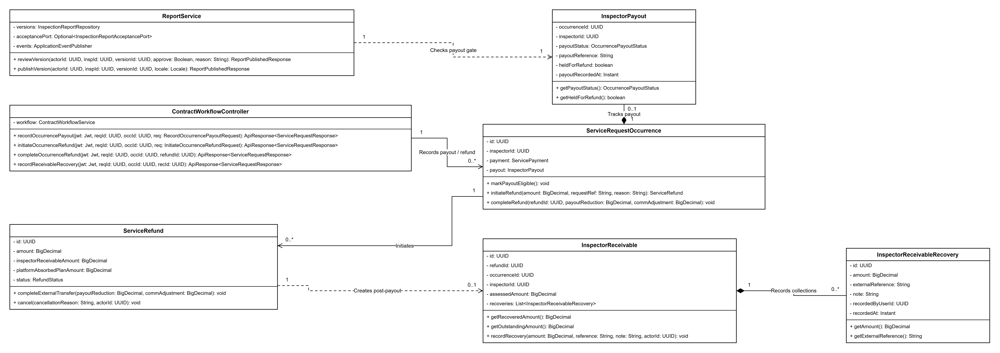

*Figure 4.73 Payouts and Refund Recovery Class Diagram*

| No | Component | Responsibility |
| :---: | :--- | :--- |
| 01 | ReportService and InspectorPayout | Make payout available after approval and check settlement before publication. |
| 02 | OccurrenceFinanceResponse | Shows authorized payout amounts, deductions, refund holds, and receivable information. |
| 03 | Payout workspace | Lets a Manager record a transfer and shows the Inspector the details of their own payout. |

#### 3.22.2 Main Sequence

*Figure 4.74 Inspector Payout Sequence*

#### 3.22.3 Alternative Sequence

*Figure 4.75 Report Publication Waits for Payout*

#### 3.22.4 Design Verification

Customer checkout and Inspector payout have separate settlement records.

These scenarios describe expected behavior. See Report 5 for the execution result and supporting evidence.

| Case | Scenario | Expected behavior |
| --- | --- | --- |
| WF3-033 | Platform Manager reconciles Partner Inspector payouts (`ELIGIBLE -> PAID`) with external bank reference while enforcing duplicate-payout idempotency and refund holds. | First reconciliation transitions payout to `PAID` with manager ID, timestamp, and transfer reference; duplicate replay is idempotent/guarded without double payout; active refund holds block payout release. |

### 3.23 FE-23 Refunds and Inspector Receivables

A Manager can initiate a refund against a captured payment. A pending refund holds an unpaid payout. The Manager records how the refund is allocated, and the amounts must add up to the refund total. After a completed payout, the system records any recoverable amount separately and keeps the original payout in the ledger.

#### 3.23.1 Components and Responsibilities

See Figure 4.73. The shared model separates the historic payout, refund allocation, and receivable created after settlement.

| No | Component | Responsibility |
| :---: | :--- | :--- |
| 01 | ContractWorkflowController and ServiceRefund | Check the refundable balance and record a refund request, transfer, or cancellation. |
| 02 | InspectorReceivable and recovery records | Keep track of money to recover from an Inspector after a paid visit is refunded. |
| 03 | Refund controls | Let a Manager record and reconcile refunds and log collections against a receivable. |

#### 3.23.2 Main Sequence

*Figure 4.76 Refund and Receivable Sequence*

#### 3.23.3 Alternative Sequence

*Figure 4.77 Refund After Payout Settlement*

#### 3.23.4 Design Verification

The refund and collection trail remains attributable to the original occurrence.

These scenarios describe expected behavior. See Report 5 for the execution result and supporting evidence.

| Case | Scenario | Expected behavior |
| --- | --- | --- |
| WF3-021 | Protect checkout and preserve refund accounting. | Keep an unresolved order from being overwritten. Hold an unpaid payout during refund handling. Preserve an already settled payout and record its recoverable share separately. |

### 3.24 FE-24 Re-inspection and Defect Verification

A follow-up visit refers to the original published report. The assigned Inspector compares each original finding with fresh evidence from the follow-up session. The verdict can be resolved, unresolved, or inconclusive. An expired resolved verdict needs fresh evidence before publication.

#### 3.24.1 Components and Responsibilities

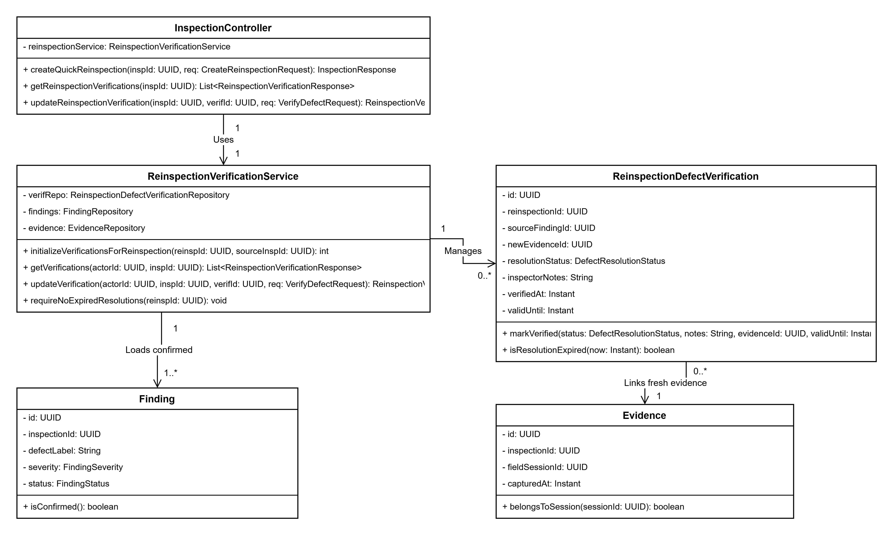

*Figure 4.78 Re-inspection Class Diagram*

| No | Component | Responsibility |
| :---: | :--- | :--- |
| 01 | ReinspectionVerificationService | Checks access and ties each verdict to evidence captured during the assigned follow-up visit. |
| 02 | Web and mobile re-inspection views | Show the original and new evidence together and flag resolved findings that have expired or are near expiry. |

#### 3.24.2 Main Sequence

*Figure 4.79 Re-inspection Verification Sequence*

#### 3.24.3 Alternative Sequence

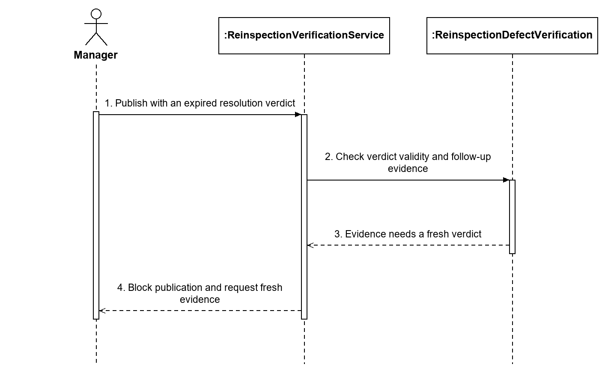

*Figure 4.80 Reject Expired Resolved Verdict*

#### 3.24.4 Design Verification

The comparison remains linked to the original published finding.

These scenarios describe expected behavior. See Report 5 for the execution result and supporting evidence.

| Case | Scenario | Expected behavior |
| --- | --- | --- |
| WF3-028 | Verify a resolved verdict using current evidence. | Accept fresh evidence from the completed follow-up session. Reject reused source evidence and prevent duplicate open follow-up inspections. |
| WF3-031 | Check Customer mobile parity for related records. | Show verdict expiry warnings, payment documents, assigned-inspection chat and knowledge references where that Customer is authorized. |

### 3.25 Design Constraints

The system supports building inspections and follow-up inspections. Repairs and maintenance work are outside the design.

The backend limits access according to the user's role and their relationship to the record. The Manager reviewing a report must be different from its author. The assigned Inspector is responsible for submitting and attesting the flight permit.

AI suggestions support finding review and report writing. Knowledge searches use historical cases within the Customer's scope and anonymized examples. SmartDroneHub supplies flight data through a read-only connection. Authorized users remain responsible for permit attestation, finding confirmation, and report publication.

## 4. Cross-Module Workflow Design

Each diagram shows a handoff between parts of the system. The table below it identifies the record and the rule for moving forward.

### 4.1 Customer Enrollment and Building Eligibility

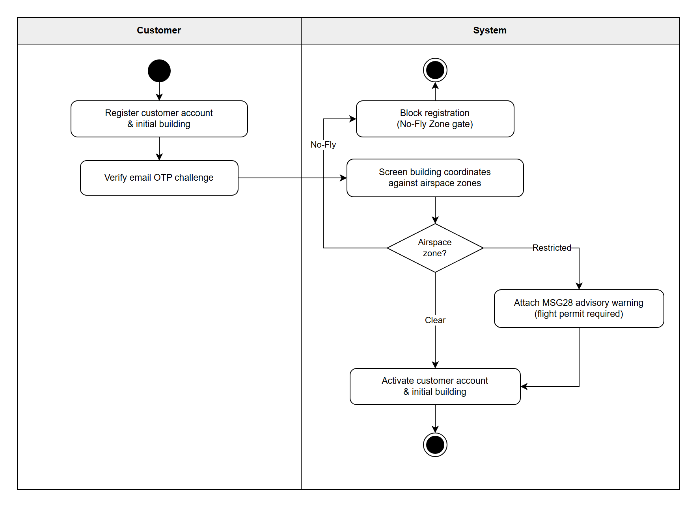

*Figure 4.81 Customer Enrollment and Building Eligibility*

| Step | Record Used | Rule |
| --- | --- | --- |
| Registration and OTP | Identity service and verification challenge | The Customer supplies the code issued for the account. Expired or invalid codes leave verification incomplete. |
| Building location | Building service and published airspace zones | A no-fly zone blocks building registration. A restricted zone shows a warning and requires a permit for flight. |
| Building visibility | Asset ownership and role policy | Customers can open their own buildings. Staff access depends on their role and the record. |
| Handoff | Building identifier and category | The resulting building can be selected in a service request. Its category supplies checkpoint defaults for Manager preparation. |

### 4.2 Partner and Drone Readiness

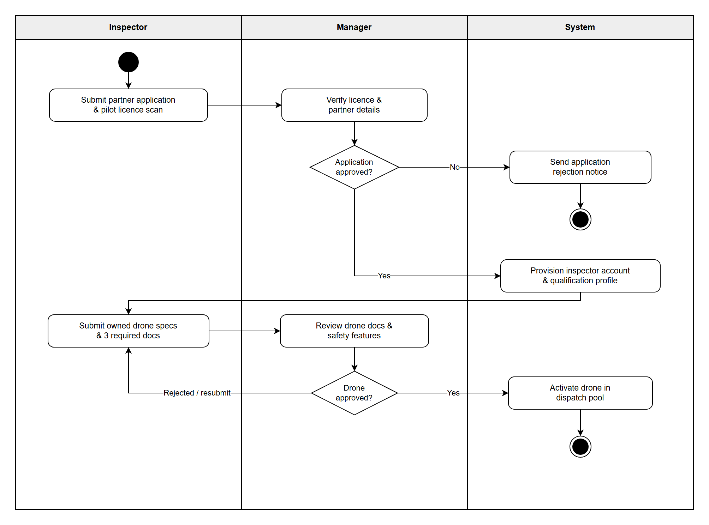

*Figure 4.82 Partner and Drone Readiness*

| Step | Record Used | Rule |
| --- | --- | --- |
| Application review | Assigned Manager and partner application | The Manager records the decision and reason. Admins can view applications. |
| Aircraft record | Inspector, drone and registration documents | The Inspector supplies the configured documents. Dispatch requires an approved, active drone. |
| Occurrence qualification | Partner eligibility and dispatch scheduling | Expired qualifications or incompatible aircraft make that candidate ineligible for the requested flight window. |
| Handoff | Approved Inspector and eligible aircraft | The Manager selects the Inspector and drone. The system checks their availability again when saving. |

### 4.3 Quotation and Dispatch

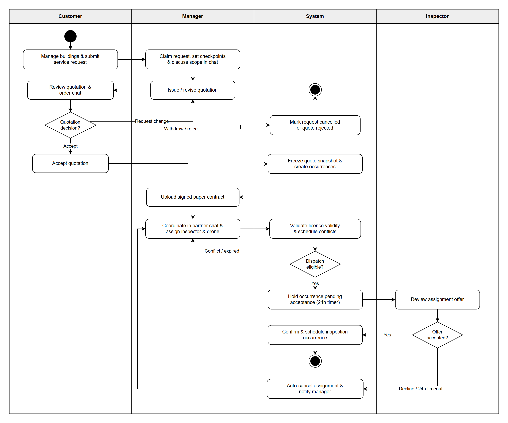

*Figure 4.83 Quotation and Dispatch*

| Step | Record Used | Rule |
| --- | --- | --- |
| Quote preparation | Request assignment and quotation version | The assigned Manager records the price and scope. Changing the active quote returns it to an explicit Customer decision. |
| Agreement and schedule | Accepted quotation and signed agreement | The accepted version defines the initial and recurring dates. The contract upload enables assignment actions. |
| Occurrence assignment | Selected Inspector and drone | Assignment checks qualification and scheduling conflicts. The Inspector receives an offer for that occurrence. |
| Cancellation | Open or quoted request, or contracted occurrence | The Manager can cancel an open request before acceptance or cancel an eligible scheduled visit after signing. The system records the reason. |

### 4.4 Field Work and Evidence

*Figure 4.84 Field Work and Evidence*

| Step | Record Used | Rule |
| --- | --- | --- |
| Permit and planned window | Assigned Inspector, aircraft and permit | The permit must match the dates and drone. A restricted zone with a ceiling also requires an approved maximum altitude. |
| Flight record | Session, sortie and telemetry provenance | Record the session outcome and identify whether the flight data was imported or entered manually. |
| Evidence and findings | Evidence object and finding baseline | Link ready evidence to its findings. The Inspector confirms the set of findings used for the report. |
| Customer read scope | Ownership and publication check | The Customer can see inspection progress. Flight summaries and traces become visible after publication. |

### 4.5 Official Publication and Settlement

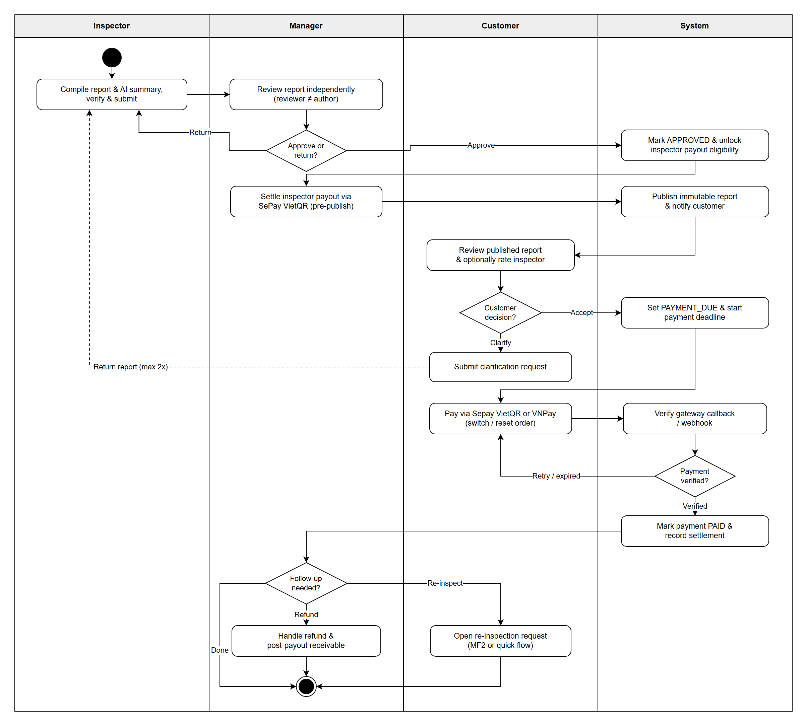

*Figure 4.85 Official Publication and Settlement*

| Step | Record Used | Rule |
| --- | --- | --- |
| Review and payout | Report version and Inspector payout | Return a report for correction or approve it. Resolve an applicable payout before publication. |
| Official report | Published version and ownership | The owning Customer gains access to the official report after publication. |
| Customer settlement | Accepted version, invoice and payment order | Acceptance opens checkout. The backend verifies the gateway message and matches the reference and amount. |
| Follow-up | Receipt, refund ledger or re-inspection | Keep the original inspection and payment history. A re-inspection links the new findings and evidence to the original record. |

## 5. Record State Models

Each model identifies the states of one record. Assignment eligibility, access, and the related workflow rules remain separate checks.

### 5.1 Service Request

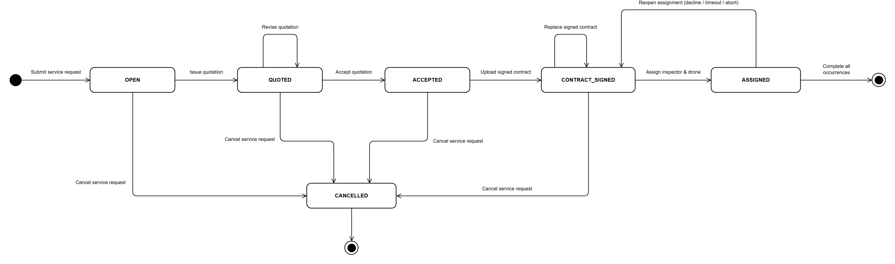

*Figure 4.86 Service Request State Model*

A Customer request moves from preparation and quotation to accepted terms. Uploading the signed agreement enables dispatch. Cancelling a request before acceptance and cancelling a contracted visit operate on different records.

Related design sections are FE-08 and FE-09.

### 5.2 Scheduled Occurrence

*Figure 4.87 Scheduled Occurrence State Model*

Each occurrence keeps its own assignment status and planned window. A Manager can recover or cancel an eligible occurrence while retaining the accepted terms and other visits.

Related design sections are FE-09 and FE-11.

### 5.3 Inspection

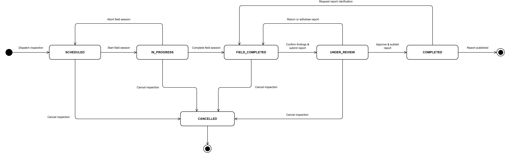

*Figure 4.88 Inspection State Model*

A scheduled inspection can start field work only after its access, assignment, and permit checks succeed. For pre-field withdrawal the inspection remains scheduled while the assignment becomes declined and requires replacement.

Related design sections are FE-11, FE-13 and FE-14.

### 5.4 Field Session

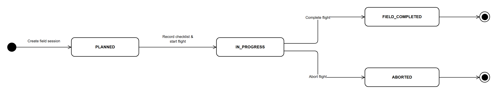

*Figure 4.89 Field Session State Model*

The assigned Inspector completes or aborts a started session. A recorded abort preserves the reason and triggers the Manager recovery flow. It does not restore pre-field withdrawal eligibility for the same assignment.

Related design sections are FE-13 and FE-14.

### 5.5 Report Version

*Figure 4.90 Report Version State Model*

The independent Manager returns or approves the submitted version. An applicable payout must settle before the approved document becomes the official published version.

Related design sections are FE-18 and FE-22.

### 5.6 Customer Payment

*Figure 4.91 Customer Payment State Model*

Customer acceptance opens payment for the visit. Gateway verification checks the active order and exact amount before recording payment. Payment and refund history remain traceable.

Related design sections are FE-19, FE-20 and FE-21.

### 5.7 Inspector Payout

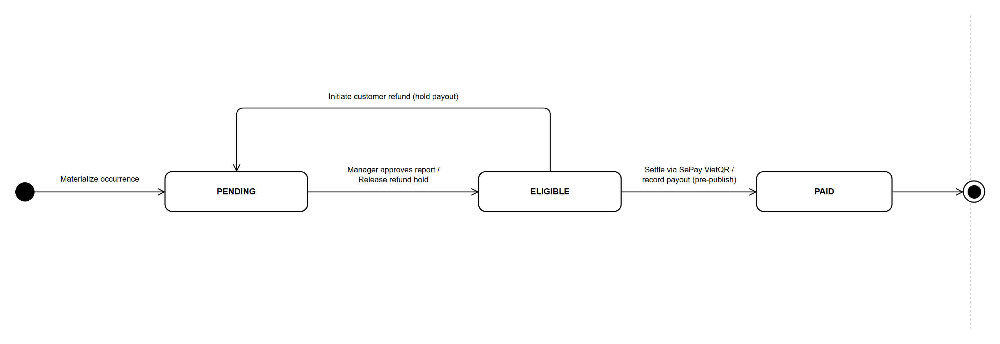

*Figure 4.92 Inspector Payout State Model*

Report approval establishes eligibility. The payout hold and settlement status govern whether the applicable report publication gate can proceed. Completed payouts stay in history even if a later refund creates a receivable.

Related design sections are FE-22 and FE-23.

## 6. Requirements and Verification Index

Use the feature ID to locate the requirement in Report 3 and the case ID to locate the latest execution record in Report 5. The figure references point to the relevant diagrams in this design.

| Feature | Design figures | Test cases |
| --- | --- | --- |
| FE-01 | Figure 4.12, Figure 4.13, Figure 4.15 | WF1-001, WF1-003, WF1-004, WF1-005, WF1-022, WF2-019, WF2-020 |
| FE-02 | Figure 4.16, Figure 4.17, Figure 4.18 | WF1-006, WF1-007, WF1-008, WF1-010 |
| FE-03 | Figure 4.19, Figure 4.20, Figure 4.21 | WF1-014, WF1-015, WF1-016 |
| FE-04 | Figure 4.22, Figure 4.23, Figure 4.24 | WF1-002, WF2-004, WF2-005 |
| FE-05 | Figure 4.25, Figure 4.26, Figure 4.27 | WF3-032 |
| FE-06 | Figure 4.28, Figure 4.29, Figure 4.30 | WF1-011, WF1-012, WF1-013 |
| FE-07 | Figure 4.22, Figure 4.31, Figure 4.32 | WF1-009 |
| FE-08 | Figure 4.35, Figure 4.33, Figure 4.34 | WF1-017, WF1-018, WF1-019, WF2-022, WF2-023, WF2-026 |
| FE-09 | Figure 4.35, Figure 4.36, Figure 4.37 | WF1-021, WF2-002, WF2-003, WF2-015, WF2-024, WF2-016, WF2-034 |
| FE-10 | Figure 4.38, Figure 4.39, Figure 4.40 | WF2-001, WF2-027 |
| FE-11 | Figure 4.41, Figure 4.42, Figure 4.43 | WF2-021, WF2-032 |
| FE-12 | Figure 4.44, Figure 4.45, Figure 4.46 | WF2-025, WF1-020, WF2-028 |
| FE-13 | Figure 4.41, Figure 4.47, Figure 4.48 | WF2-008, WF2-009, WF2-029, WF2-030, WF2-031, WF2-033 |
| FE-14 | Figure 4.49, Figure 4.50, Figure 4.52 | WF2-011, WF2-012, WF2-017, WF2-018, WF3-020 |
| FE-15 | Figure 4.53, Figure 4.54, Figure 4.55 | WF3-002, WF3-022, WF3-023, WF3-024, WF3-025 |
| FE-16 | Figure 4.56, Figure 4.57, Figure 4.58 | WF3-001, WF3-003, WF3-004, WF3-007, WF3-008, WF3-010, WF3-017 |
| FE-17 | Figure 4.59, Figure 4.60, Figure 4.61 | WF3-029, WF3-030 |
| FE-18 | Figure 4.62, Figure 4.63, Figure 4.64 | WF3-005, WF3-006, WF3-009, WF3-016 |
| FE-19 | Figure 4.65, Figure 4.66, Figure 4.67 | WF3-012 |
| FE-20 | Figure 4.68, Figure 4.69, Figure 4.70 | WF3-018, WF3-019 |
| FE-21 | Figure 4.65, Figure 4.71, Figure 4.72 | WF3-026, WF3-027 |
| FE-22 | Figure 4.73, Figure 4.74, Figure 4.75 | WF3-033 |
| FE-23 | Figure 4.73, Figure 4.76, Figure 4.77 | WF3-021 |
| FE-24 | Figure 4.78, Figure 4.79, Figure 4.80 | WF3-028, WF3-031 |
