## 3. Detailed Design

### 3.1 FE-01 Account Access and Verification

The backend verifies credentials, creates a session, and checks the user's role and access to the requested record. The web portal opens the workspace for that role. The mobile app accepts Customer accounts.

#### 3.1.1 Class Diagram

*Figure 4.12 Account Access Class Diagram*

**Component Responsibilities**

| No | Component | Responsibility |
| :---: | :--- | :--- |
| 01 | Browser and mobile auth controllers | Handle registration, sign-in, verification, password reset, and session renewal. |
| 02 | OAuth2Controller | Handles Google sign-in and returns users to the calling client. |
| 03 | UserProfileController and PlatformUserController | Let users edit their own profile and let Admins manage platform accounts. |
| 04 | AuthService | Checks credentials, limits repeated attempts, and issues and renews sessions. |
| 05 | User, OtpChallenge, and AuthSession | Represent a user account, a time-limited verification challenge, and an authenticated session. |

#### 3.1.2 Customer Registration

*Figure 4.13 Customer Registration Sequence*

#### 3.1.3 Sign-In and Verification

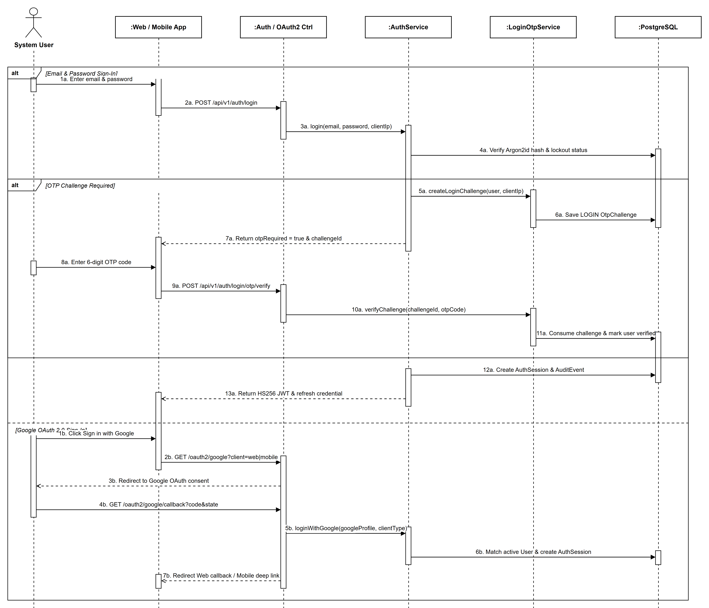

*Figure 4.14 Sign-In and Verification Sequence*

---

### 3.2 FE-02 Inspector Application and Qualification

A prospective Inspector submits a licence and supporting documents. The Manager reviews the application and provisions the account after approval. Administrators can view the review queue. Dispatch checks that qualifications are current for the planned flight.

#### 3.2.1 Class Diagram

*Figure 4.15 Inspector Qualification Class Diagram*

**Component Responsibilities**

| No | Component | Responsibility |
| :---: | :--- | :--- |
| 01 | InspectorApplicationService | Accepts partner applications, records Manager decisions, and creates approved accounts. |
| 02 | InspectorProfileService | Maintains pilot credentials, licence renewals, and flight records. |
| 03 | PilotLicenseClassService and expiry checks | Maintain the licence classes and notify users when a licence approaches expiry. |

#### 3.2.2 Inspector Application Review

*Figure 4.16 Inspector Application Review Sequence*

---

### 3.3 FE-03 Drone Registration and Fleet

An Inspector submits a drone with its photos and configured documents. The Manager approves or rejects the registration. Dispatch requires an active drone owned by the selected Inspector with registration valid for the planned flight.

#### 3.3.1 Class Diagram

*Figure 4.17 Drone Fleet Class Diagram*

#### 3.3.2 Sequence Diagram

*Figure 4.18 Drone Registration Sequence*

**Component Responsibilities**

| No | Component | Responsibility |
| :---: | :--- | :--- |
| 01 | Drone document and feature controllers | Let Admins configure document requirements and the drone capabilities used for dispatch. |
| 02 | DroneRegistrationApplicationController | Accepts registration evidence and records the Manager's decision. |
| 03 | DroneService | Maintains the Inspector's fleet, including renewals and availability. |

---

### 3.4 FE-04 Building Location and Airspace Screening

The airspace service checks the building coordinates chosen on the map. A no-fly zone blocks registration of that building. A restricted zone shows an advisory and the applicable altitude ceiling.

#### 3.4.1 Sequence Diagram

*Figure 4.19 Airspace Screening Sequence*

**Component Responsibilities**

| No | Component | Responsibility |
| :---: | :--- | :--- |
| 01 | AirspaceController | Provides published airspace zones and evaluates selected coordinates. |
| 02 | AirspaceAdvisoryService | Classifies a location using active no-fly and restricted zones. |
| 03 | CustomerAirspacePolicyAdapter | Shares the classification, warning, and altitude limit with registration and inspection workflows. |
| 04 | Location picker and airspace advisory | Show the result on web and mobile. The web map also flags a building footprint that overlaps a no-fly zone. |

---

### 3.5 FE-05 Financial History

The ledger links each scheduled inspection to its settlement records. Customers see their own payments and receipts. Inspectors see their assigned work and payouts. Managers see separate revenue and payout views.

#### 3.5.1 Sequence Diagram

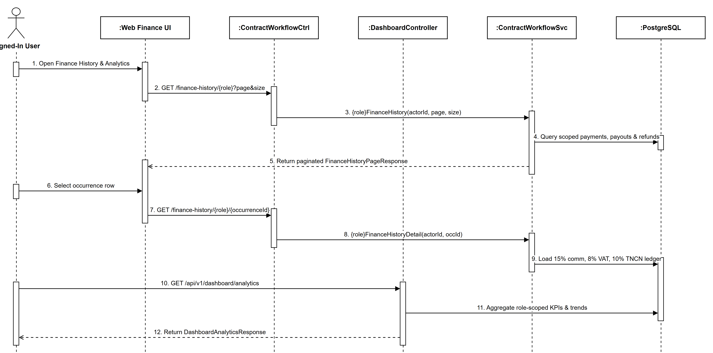

*Figure 4.20 Financial History Sequence*

**Component Responsibilities**

| No | Component | Responsibility |
| :---: | :--- | :--- |
| 01 | ContractWorkflowController | Provides ledger entries filtered by the caller's role and access to each visit. |
| 02 | Financial response models | Return the payment and payout fields that each role is allowed to see. |
| 03 | Finance history and inspection overview | Show the ledger and the settlement details for a visit. |

---

### 3.6 FE-06 Buildings and Reference Documents

Customers manage their own buildings. A building category supplies default inspection checkpoints. The Manager selects the checkpoints for the requested visit before dispatch.

#### 3.6.1 Sequence Diagram

*Figure 4.21 Building and Document Registration Sequence*

**Component Responsibilities**

| No | Component | Responsibility |
| :---: | :--- | :--- |
| 01 | AssetService | Records buildings, screens their location, and locks checkpoint edits once inspections use them. |
| 02 | AssetCatalogService | Maintains building categories and the default checkpoints for new buildings. |
| 03 | AssetDocumentService | Checks uploaded documents, prevents duplicates, and serves files to authorized users. |

---

### 3.7 FE-07 Restricted Airspace Advisory

A restricted location can proceed after the Customer verifies their account. The system records the warning on the building. The assigned Inspector must obtain and record the required permit before flight.

#### 3.7.1 Sequence Diagram

*Figure 4.22 Restricted Airspace Advisory Sequence*

**Component Responsibilities**

| No | Component | Responsibility |
| :---: | :--- | :--- |
| 01 | CustomerAirspacePolicyAdapter | Passes the restricted-zone warning and altitude limit to the relevant workflow. |
| 02 | AuthService and AssetService | Allow registration in restricted zones and store the resulting advisory. |
| 03 | Restricted airspace notices | Show the zone and altitude ceiling where the Customer or Inspector needs to act. |

---

### 3.8 FE-08 Service Requests and Quotations

Customers request one visit or a recurring schedule. The assigned Manager records the scope, checkpoints, and price in VND. A change to the active quotation requires a new Customer decision.

#### 3.8.1 Sequence Diagram

*Figure 4.23 Request and Quotation Sequence*

**Component Responsibilities**

| No | Component | Responsibility |
| :---: | :--- | :--- |
| 01 | ContractWorkflowService | Validates dates, handles Manager assignment, and saves the current quotation. |
| 02 | ServiceRequest and ServiceRequestQuote | Record the requested schedule, checkpoints, price, and latest quoted terms. |
| 03 | Request list and quotation workspace | Let Customers submit and review requests. Managers use the workspace to prepare and revise quotes. |

---

### 3.9 FE-09 Signed Contracts and Dispatch

The accepted quotation sets the schedule. A Manager uploads the signed paper agreement before assigning an Inspector and a drone. Dispatch checks qualification and schedule conflicts for each visit.

#### 3.9.1 Class and Sequence Diagrams

*Figure 4.24 Contracts and Dispatch Class Diagram*

*Figure 4.25 Contract Signing and Dispatch Sequence*

**Component Responsibilities**

| No | Component | Responsibility |
| :---: | :--- | :--- |
| 01 | ContractWorkflowService | Freezes accepted terms, creates visits, stores the signed agreement, and records assignment or cancellation. |
| 02 | PartnerRegistryService and assignment adapter | Check the Inspector and drone for valid qualifications, equipment, and availability on the scheduled date. |
| 03 | Occurrence dispatch workspace | Lets the Manager review candidates, assign a team, or reschedule, reassign, or cancel a visit. |

---

### 3.10 FE-10 Order, Partner, and Inspection Chat

Order chat connects the Customer and assigned Manager. Partner chat connects the Manager and Inspector for the request. Inspection chat connects the owning Customer and assigned Inspector. Attachments use the same access rules as their conversation.

#### 3.10.1 Sequence Diagram

*Figure 4.26 Order, Partner, and Inspection Chat Sequence*

**Component Responsibilities**

| No | Component | Responsibility |
| :---: | :--- | :--- |
| 01 | ContractWorkflowController | Handles messages and attachments between the Customer and the assigned Manager. |
| 02 | InspectionChatService | Limits inspection messages and attachments to the owning Customer and assigned Inspector. |
| 03 | ServiceRequestPartnerChatService | Limits partner messages and attachments to the Manager and Inspector for the request. |
| 04 | ChatAttachmentValidator | Checks file type, name, and size before storing an attachment. |
| 05 | Web and mobile inboxes | Keep each conversation separate and show its messages, unread count, and attachments. |

---

### 3.11 FE-11 Assignment Expiry

An unanswered assignment expires after the configured window. The system releases the reservation and notifies the Manager so the visit can be assigned again.

#### 3.11.1 Sequence Diagram

*Figure 4.27 Assignment Expiry Sequence*

**Component Responsibilities**

| No | Component | Responsibility |
| :---: | :--- | :--- |
| 01 | PlatformOperationsSettingsService | Lets an Admin configure how long an Inspector has to accept an offer. |
| 02 | InspectionAssignmentTimeoutMonitor | Clears expired offers and returns the affected visit to the assignment queue. |
| 03 | Settings and expiry notification | Show the configured timeout and take the Manager to the request that needs a new assignment. |

---

### 3.12 FE-12 Notifications

Workflow events create alerts for the people involved. Opening a notification still requires access to the related record. The same event can be retried without creating a duplicate alert.

#### 3.12.1 Sequence Diagram

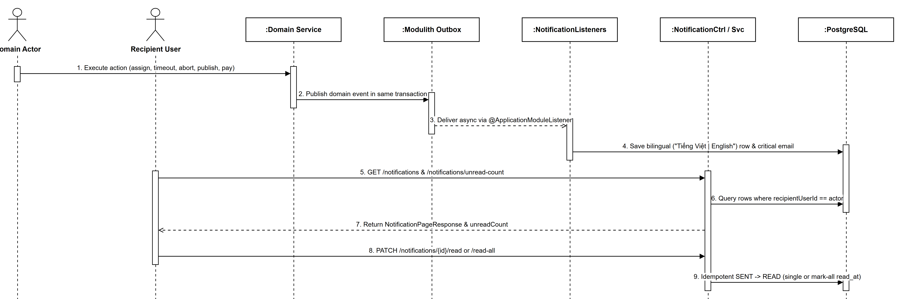

*Figure 4.28 Notification Delivery Sequence*

**Component Responsibilities**

| No | Component | Responsibility |
| :---: | :--- | :--- |
| 01 | Notification listeners | Convert request, inspection, application, and payment events into alerts. |
| 02 | NotificationService and email service | Store alerts once, track read status, and send emails for important events. |
| 03 | Notification bell and inbox | Show unread alerts and open the related record through an approved portal link. |

---

### 3.13 FE-13 Flight Permits

The assigned Inspector uploads and attests the permit. It becomes effective after the system validates it. A change of drone or a reschedule outside the permit window requires another upload.

#### 3.13.1 Sequence Diagram

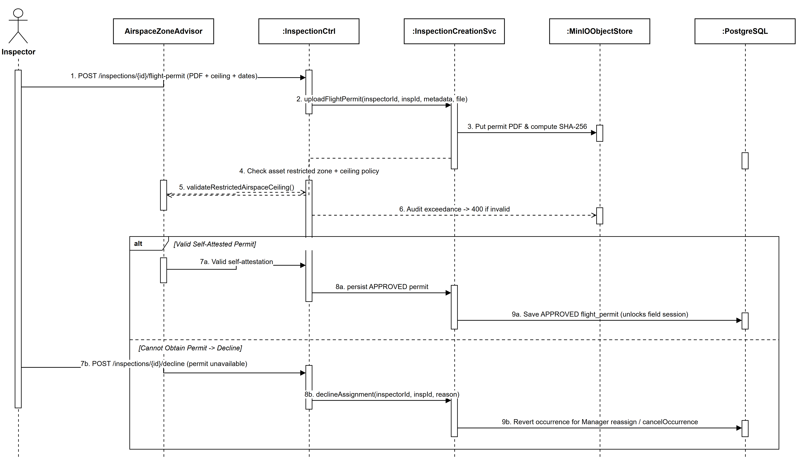

*Figure 4.29 Flight Permit Validation Sequence*

**Component Responsibilities**

| No | Component | Responsibility |
| :---: | :--- | :--- |
| 01 | InspectionController | Accepts the permit from the assigned Inspector and serves the uploaded document to authorized users. |
| 02 | FlightPermitPolicy | Checks file validity, the scheduled window, the drone, and the applicable altitude limit. |
| 03 | Permit panel and preview | Show upload and validation status. The Inspector can decline when the required permit cannot be obtained. |

---

### 3.14 FE-14 Field Sessions and Flight Data

The Inspector completes safety checks and records each flight within a field session. SmartDroneHub supplies read-only telemetry and video. When the Inspector records an abort, the Manager can reschedule, reassign, or cancel the visit. The Customer receives flight summaries and traces after report publication.

#### 3.14.1 Class Diagram

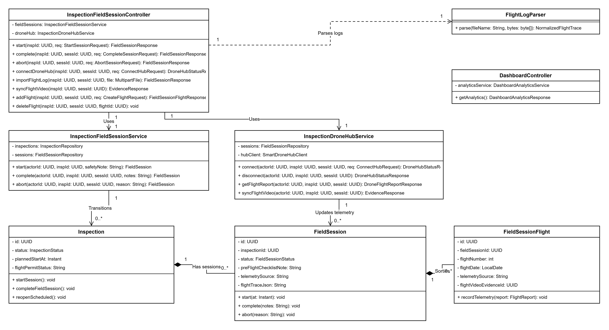

*Figure 4.30 Field Session and Flight Data Class Diagram*

#### 3.14.2 Field Work and Abort Recovery

*Figure 4.31 Field Session and Flight Data Sequence*

*Figure 4.32 Abort and Recovery Sequence*

---

### 3.15 FE-15 Photo and Video Evidence

The system links each upload to its inspection and field session. Video uploads can resume after interruption. Processed media becomes available to authorized users once the playable file is ready.

#### 3.15.1 Sequence Diagram

*Figure 4.33 Evidence Upload and Processing Sequence*

**Component Responsibilities**

| No | Component | Responsibility |
| :---: | :--- | :--- |
| 01 | EvidenceService and ImageNormalizer | Read capture details from photos, prepare thumbnails, and link the images to the inspection. |
| 02 | EvidenceUploadSessionService | Tracks the parts of resumable video uploads and records completion or failure. |
| 03 | VideoProcessingWorker and MediaTicketService | Prepare playable video and issue short-lived access tickets for authorized viewing. |
| 04 | Evidence workspace | Lets Inspectors upload files, review locations, and select video frames as evidence. |

---

### 3.16 FE-16 Defect Detection and Findings

YOLO11 proposes defects from photos and video frames. An optional vision service can help when YOLO11 produces no detections or is unavailable. Platform settings determine whether high-confidence results can be confirmed automatically. The Inspector reviews findings and locks the set used by the report.

#### 3.16.1 Class and Sequence Diagrams

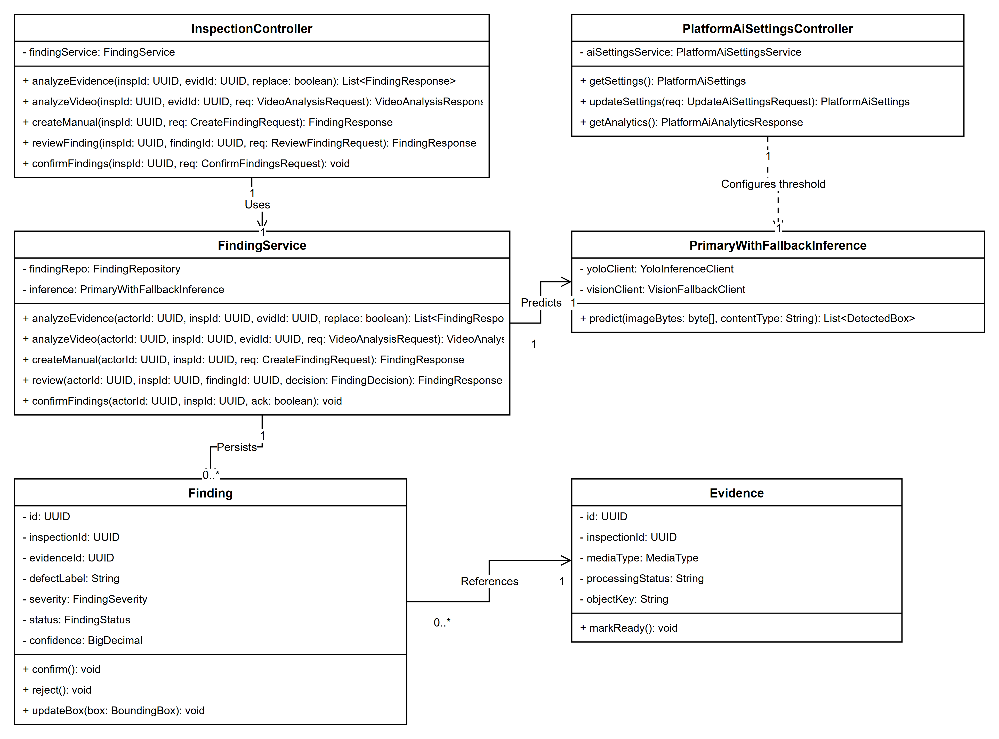

*Figure 4.34 Defect Detection Class Diagram*

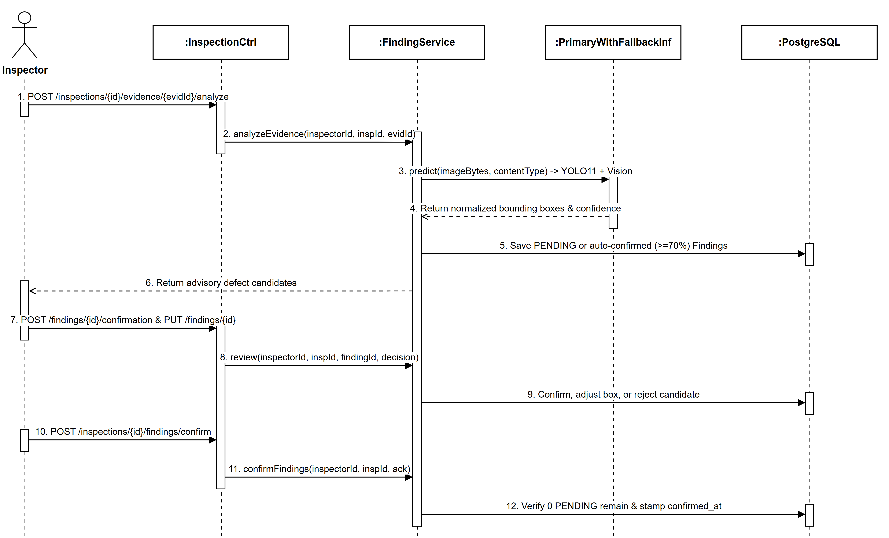

*Figure 4.35 Defect Detection and Review Sequence*

---

### 3.17 FE-17 Finding Notes and Knowledge References

DroneKnowledgeAI searches engineering standards, the Customer's past cases, and anonymized examples. It can search by text when embeddings are unavailable. Related cases help draft suggested finding notes. The report summary uses confirmed inspection data and lists source references separately.

#### 3.17.1 Class and Sequence Diagrams

*Figure 4.36 Finding Notes and References Class Diagram*

*Figure 4.37 Finding Notes and References Sequence*

---

### 3.18 FE-18 Report Review and Publication

The Inspector submits a report version based on confirmed findings. A Manager who did not author the report approves it or returns it for correction. If payout applies, the Manager can publish only after settlement. The published PDF is the official Customer deliverable.

#### 3.18.1 Class and Sequence Diagrams

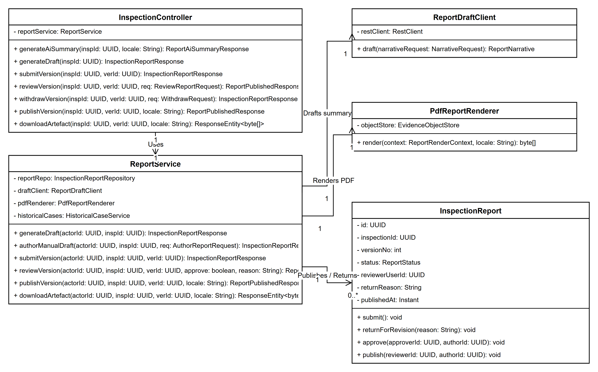

*Figure 4.38 Report Review Class Diagram*

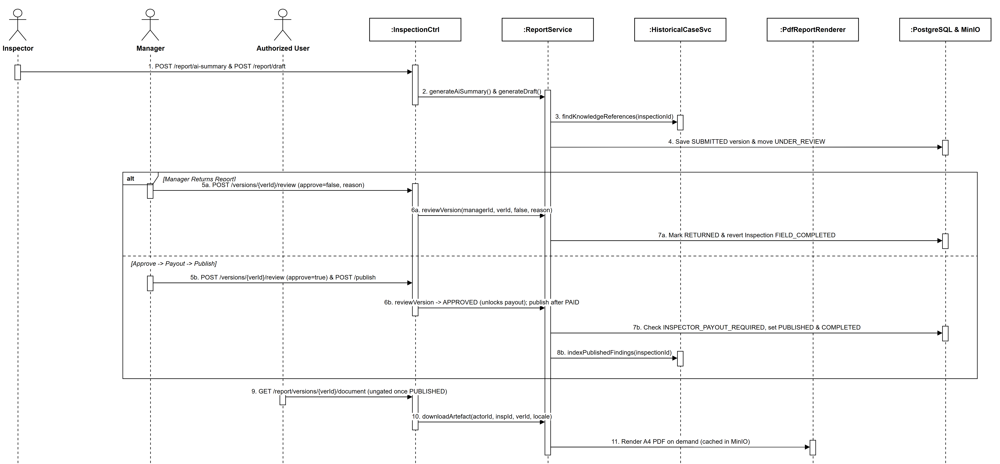

*Figure 4.39 Report Review and Publication Sequence*

---

### 3.19 FE-19 Report Acceptance and Clarification

The owning Customer can request clarification before acceptance. Acceptance applies to the published version the Customer reviewed and opens payment for that visit.

#### 3.19.1 Sequence Diagram

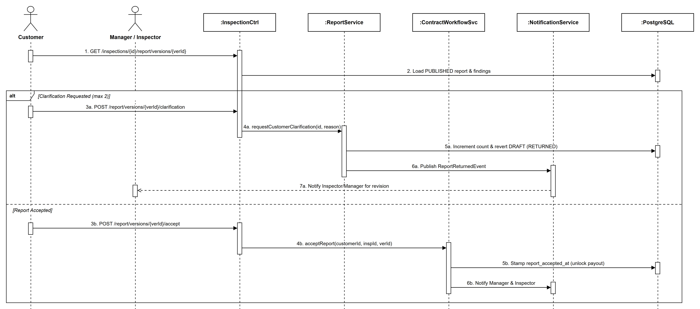

*Figure 4.40 Customer Report Acceptance Sequence*

**Component Responsibilities**

| No | Component | Responsibility |
| :---: | :--- | :--- |
| 01 | ContractWorkflowService | Records acceptance for the published report version and opens payment. |
| 02 | ReportService | Accepts clarification requests from the owning Customer before acceptance. |
| 03 | Customer report and settlement views | Show the published PDF and offer separate actions for clarification and acceptance. |

---

### 3.20 FE-20 Online Payment

After accepting a report, the Customer can pay in VND through Sepay VietQR or VNPay. The backend checks the gateway message and matches the order and amount before recording payment. Returning from the gateway shows the stored result.

#### 3.20.1 Sequence Diagram

*Figure 4.41 Online Payment Sequence*

**Component Responsibilities**

| No | Component | Responsibility |
| :---: | :--- | :--- |
| 01 | SepayPaymentGateway | Creates VietQR transfer details and verifies notifications from Sepay. |
| 02 | GatewayInboundTransactionService | Records gateway events, protects against repeat processing, and preserves the result for audit. |
| 03 | VnPayPaymentGateway | Signs checkout requests, verifies payment notifications, and returns the Customer to the settlement screen. |
| 04 | ContractWorkflowService | Keeps one active unresolved order and releases it when the gateway confirms cancellation or expiry. |

---

### 3.21 FE-21 Invoices and Payment Deadlines

Acceptance starts the configurable payment window, which defaults to 15 days. The invoice retains the rates applied when it was issued. The Customer can download a notice while payment is due and a receipt after payment.

#### 3.21.1 Sequence Diagram

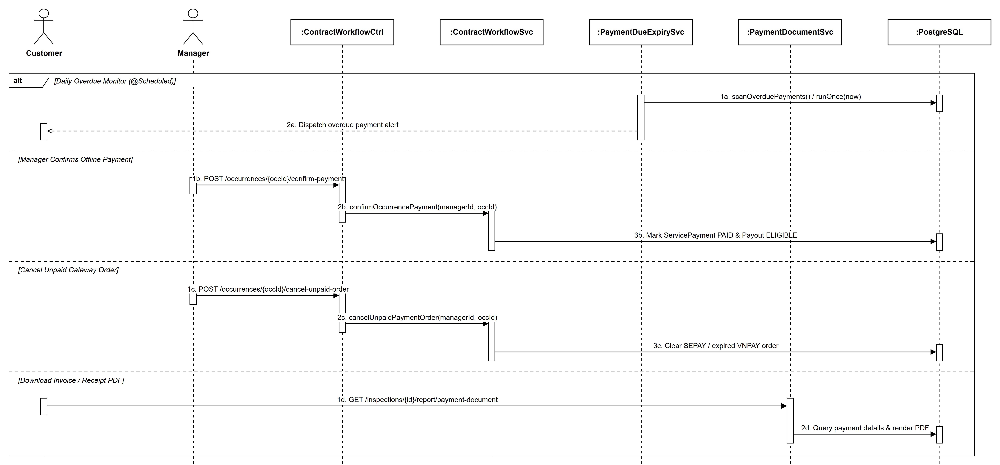

*Figure 4.42 Payment Deadline and Document Sequence*

**Component Responsibilities**

| No | Component | Responsibility |
| :---: | :--- | :--- |
| 01 | InspectionFinanceCalculator and ServiceInvoice | Apply the configured commission and tax rates and store a copy on the invoice. |
| 02 | PaymentDueExpiryService | Sets the due date on acceptance and sends an overdue alert once. |
| 03 | PaymentDocumentService | Serves the payment notice while an amount is due and the receipt after it is paid. |

---

### 3.22 FE-22 Inspector Payout

Report approval makes the Inspector eligible for payout. The Manager can record settlement, and Sepay can reconcile a matching transfer. The system checks payout settlement before publication when it applies.

#### 3.22.1 Sequence Diagram

*Figure 4.43 Inspector Payout Sequence*

**Component Responsibilities**

| No | Component | Responsibility |
| :---: | :--- | :--- |
| 01 | ReportService and InspectorPayout | Make payout available after approval and check settlement before publication. |
| 02 | OccurrenceFinanceResponse | Shows authorized payout amounts, deductions, refund holds, and receivable information. |
| 03 | Payout workspace | Lets a Manager record a transfer and shows the Inspector the details of their own payout. |

---

### 3.23 FE-23 Refunds and Inspector Receivables

A Manager can initiate a refund against a captured payment. A pending refund holds an unpaid payout. The Manager records how the refund is allocated, and the amounts must add up to the refund total. After a completed payout, the system records any recoverable amount separately and keeps the original payout in the ledger.

#### 3.23.1 Sequence Diagram

*Figure 4.44 Refund and Receivable Sequence*

**Component Responsibilities**

| No | Component | Responsibility |
| :---: | :--- | :--- |
| 01 | ContractWorkflowController and ServiceRefund | Check the refundable balance and record a refund request, transfer, or cancellation. |
| 02 | InspectorReceivable and recovery records | Keep track of money to recover from an Inspector after a paid visit is refunded. |
| 03 | Refund controls | Let a Manager record and reconcile refunds and log collections against a receivable. |

---

### 3.24 FE-24 Re-inspection and Defect Verification

A follow-up visit refers to the original published report. The assigned Inspector compares each original finding with fresh evidence from the follow-up session. The verdict can be resolved, unresolved, or inconclusive. An expired resolved verdict needs fresh evidence before publication.

#### 3.24.1 Class Diagram

*Figure 4.45 Re-inspection Class Diagram*

#### 3.24.2 Sequence Diagram

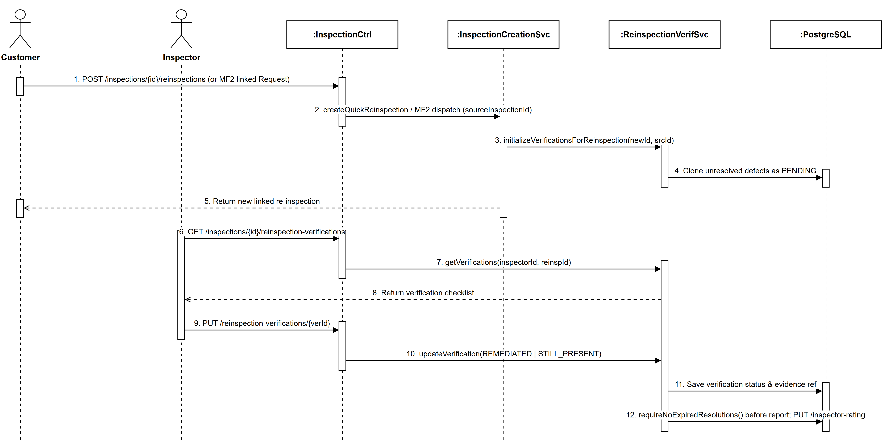

*Figure 4.46 Re-inspection Verification Sequence*

**Component Responsibilities**

| No | Component | Responsibility |
| :---: | :--- | :--- |
| 01 | ReinspectionVerificationService | Checks access and ties each verdict to evidence captured during the assigned follow-up visit. |
| 02 | Web and mobile re-inspection views | Show the original and new evidence together and flag resolved findings that have expired or are near expiry. |

---

### 3.25 Design Constraints

The system supports building inspections and follow-up inspections. Repairs and maintenance work are outside the design.

The backend limits access according to the user's role and their relationship to the record. The Manager reviewing a report must be different from its author. The assigned Inspector is responsible for submitting and attesting the flight permit.

AI suggestions support finding review and report writing. Knowledge searches use historical cases within the Customer's scope and anonymized examples. SmartDroneHub supplies flight data through a read-only connection. Authorized users remain responsible for permit attestation, finding confirmation, and report publication.

## 4. Cross-Module Workflow Design

Each diagram shows a handoff between parts of the system. The table below it identifies the record and the rule for moving forward.

### 4.1 Customer Enrollment and Building Eligibility

*Figure 4.47 Customer Enrollment and Building Eligibility*

| Step | Record Used | Rule |
| --- | --- | --- |
| Registration and OTP | Identity service and verification challenge | The Customer supplies the code issued for the account. Expired or invalid codes leave verification incomplete. |
| Building location | Building service and published airspace zones | A no-fly zone blocks building registration. A restricted zone shows a warning and requires a permit for flight. |
| Building visibility | Asset ownership and role policy | Customers can open their own buildings. Staff access depends on their role and the record. |
| Handoff | Building identifier and category | The resulting building can be selected in a service request. Its category supplies checkpoint defaults for Manager preparation. |

### 4.2 Partner and Drone Readiness

*Figure 4.48 Partner and Drone Readiness*

| Step | Record Used | Rule |
| --- | --- | --- |
| Application review | Assigned Manager and partner application | The Manager records the decision and reason. Admins can view applications. |
| Aircraft record | Inspector, drone and registration documents | The Inspector supplies the configured documents. Dispatch requires an approved, active drone. |
| Occurrence qualification | Partner eligibility and dispatch scheduling | Expired qualifications or incompatible aircraft make that candidate ineligible for the requested flight window. |
| Handoff | Approved Inspector and eligible aircraft | The Manager selects the Inspector and drone. The system checks their availability again when saving. |

### 4.3 Quotation and Dispatch

*Figure 4.49 Quotation and Dispatch*

| Step | Record Used | Rule |
| --- | --- | --- |
| Quote preparation | Request assignment and quotation version | The assigned Manager records the price and scope. Changing the active quote returns it to an explicit Customer decision. |
| Agreement and schedule | Accepted quotation and signed agreement | The accepted version defines the initial and recurring dates. The contract upload enables assignment actions. |
| Occurrence assignment | Selected Inspector and drone | Assignment checks qualification and scheduling conflicts. The Inspector receives an offer for that occurrence. |
| Cancellation | Open or quoted request, or contracted occurrence | The Manager can cancel an open request before acceptance or cancel an eligible scheduled visit after signing. The system records the reason. |

### 4.4 Field Work and Evidence

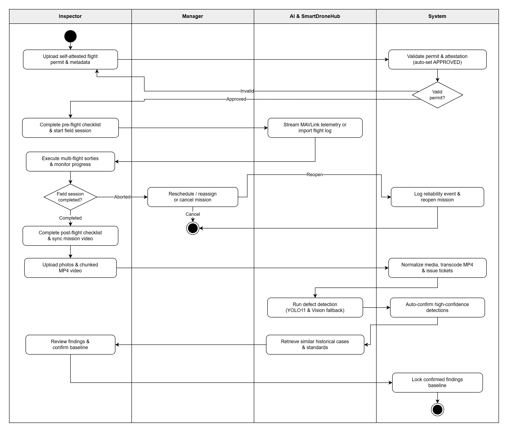

*Figure 4.50 Field Work and Evidence*

| Step | Record Used | Rule |
| --- | --- | --- |
| Permit and planned window | Assigned Inspector, aircraft and permit | The permit must match the dates and drone. A restricted zone with a ceiling also requires an approved maximum altitude. |
| Flight record | Session, sortie and telemetry provenance | Record the session outcome and identify whether the flight data was imported or entered manually. |
| Evidence and findings | Evidence object and finding baseline | Link ready evidence to its findings. The Inspector confirms the set of findings used for the report. |
| Customer read scope | Ownership and publication check | The Customer can see inspection progress. Flight summaries and traces become visible after publication. |

### 4.5 Official Publication and Settlement

*Figure 4.51 Official Publication and Settlement*

| Step | Record Used | Rule |
| --- | --- | --- |
| Review and payout | Report version and Inspector payout | Return a report for correction or approve it. Resolve an applicable payout before publication. |
| Official report | Published version and ownership | The owning Customer gains access to the official report after publication. |
| Customer settlement | Accepted version, invoice and payment order | Acceptance opens checkout. The backend verifies the gateway message and matches the reference and amount. |
| Follow-up | Receipt, refund ledger or re-inspection | Keep the original inspection and payment history. A re-inspection links the new findings and evidence to the original record. |
