## 3. Detailed Design

### 3.1 FE-01 Authentication, Google OAuth2 & 5-Role Access Control

#### 3.1.1 Class Diagram

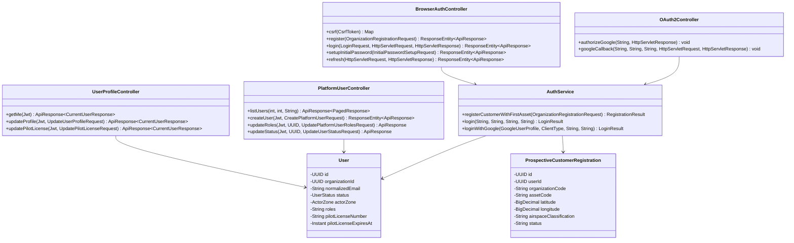

**Class Specifications**

- **BrowserAuthController, MobileAuthController & OAuth2Controller**: Expose web (`/api/v1/auth`), native mobile (`/api/v1/mobile/auth`), and Google OAuth 2.0 (`/api/v1/auth/oauth2/authorize/google`, `/callback/google` with `smartdrone://auth` mobile deep-link redirect) authentication endpoints, enforcing `AuthRateLimitFilter` (`10` req/60s per IP), Argon2id password verification, `HS256` JWT issuance (`15m` TTL), and `HmacSHA256` refresh session rotation (`auth_sessions`, `7d` TTL).
- **UserProfileController & PlatformUserController**: Decouple self-service profile and pilot license updates (`/api/v1/users/me`) from authentication routes (`7cc2534`), and govern 5-role accounts (`ADMIN`, `MANAGER`, `CUSTOMER`, `INSPECTOR`, `MAINTENANCE_ENGINEER`) across `ActorZone` boundaries (`PLATFORM`, `CUSTOMER_ORGANIZATION`, `INSPECTOR_PARTNER`, `PROSPECT_CUSTOMER`).

#### 3.1.2 User Authentication, Google OAuth2 & Airspace Registration Sequence Diagram

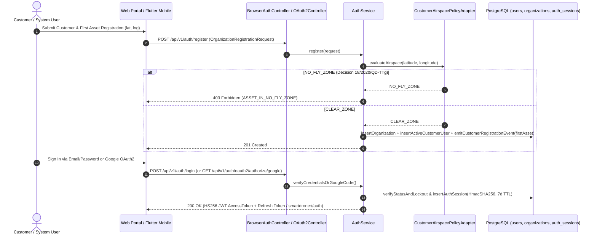

---

### 3.2 FE-02 Partner Onboarding, Workforce, Asset & Inspector Drone Registry

#### 3.2.1 Class Diagram

```mermaid
%% title: Partner Onboarding, Asset Registry and Inspector-Owned Drone Class Diagram
classDiagram
  class InspectorPartnerApplicationController {
    +listPending(Jwt) ApiResponse~List~
    +downloadLicenseDocument(Jwt, UUID) ResponseEntity~InputStreamResource~
    +approve(Jwt, UUID, ApprovePartnerRequest) ApiResponse~PartnerApplicationResponse~
    +reject(Jwt, UUID, RejectApplicationRequest) ApiResponse~PartnerApplicationResponse~
  }
  class AirspaceReviewController {
    +listPending(Jwt) ApiResponse~List~
    +approve(Jwt, UUID, ReviewNoteRequest) ApiResponse
    +reject(Jwt, UUID, ReviewNoteRequest) ApiResponse
  }
  class WorkforceController {
    +createWorkforceUser(Jwt, CreateWorkforceUserRequest) ResponseEntity~ApiResponse~
    +listWorkforceUsers(Jwt, int, int, String) ApiResponse~PagedResponse~
  }
  class AssetController {
    +createAsset(Jwt, CreateAssetRequest) ResponseEntity~ApiResponse~
    +listAssets(Jwt, int, int, String) ApiResponse~PagedResponse~
    +updateAsset(Jwt, UUID, UpdateAssetRequest) ApiResponse~AssetView~
    +retireAsset(Jwt, UUID) ApiResponse~AssetView~
  }
  class DroneRegistrationApplicationController {
    +uploadEvidence(Jwt, String, MultipartFile) ApiResponse~UploadedKeyResponse~
    +submit(Jwt, CreateDroneRegistrationRequest) ResponseEntity~ApiResponse~
    +listMine(Jwt) ApiResponse~List~
    +listPending(Jwt) ApiResponse~List~
    +approve(Jwt, UUID, ReviewNoteRequest) ApiResponse~DroneRegistrationResponse~
    +reject(Jwt, UUID, ReviewNoteRequest) ApiResponse~DroneRegistrationResponse~
  }
  class InspectorPartnerApplication {
    -UUID id
    -String normalizedEmail
    -String pilotLicenseNumber
    -String pilotLicenseFileKey
    -String partnerContractFileKey
    -String status
  }
  class DroneRegistrationApplication {
    -UUID id
    -UUID inspectorUserId
    -String serialNumber
    -String registrationFileKey
    -String ownershipFileKey
    -String inspectionFileKey
    -String status
  }
  class Drone {
    -UUID id
    -UUID inspectorOwnerId
    -UUID organizationId
    -String serialNumber
    -DroneServiceability serviceability
  }
  class Asset {
    -UUID id
    -UUID organizationId
    -String assetCode
    -BigDecimal latitude
    -BigDecimal longitude
    -AssetStatus status
  }
  InspectorPartnerApplicationController --> InspectorPartnerApplication
  DroneRegistrationApplicationController --> DroneRegistrationApplication
  DroneRegistrationApplication --> Drone
  AssetController --> Asset
```

**Class Specifications**

- **InspectorPartnerApplicationController, AirspaceReviewController & WorkforceController**: Govern `MF1` onboarding review queues (`/admin/onboarding-reviews`) for restricted-airspace customers and partner Inspectors (requiring `partnerContractFileKey` proof of the executed offline partner contract), and allow `CUSTOMER` users to provision `MAINTENANCE_ENGINEER` accounts.
- **AssetController, AssetDocumentController & DroneRegistrationApplicationController**: Manage customer infrastructure assets (`assets`, `asset_documents`) with No-Fly Zone guards and platform-wide `ADMIN`/`MANAGER` read visibility (`92fb490`), and govern 3-document inspector-owned drone registrations (`REGISTRATION`, `OWNERSHIP`, `INSPECTION` $\rightarrow$ `drones.inspector_owner_id`).

#### 3.2.2 Partner Inspector Application & Customer Workforce Provisioning Sequence Diagram

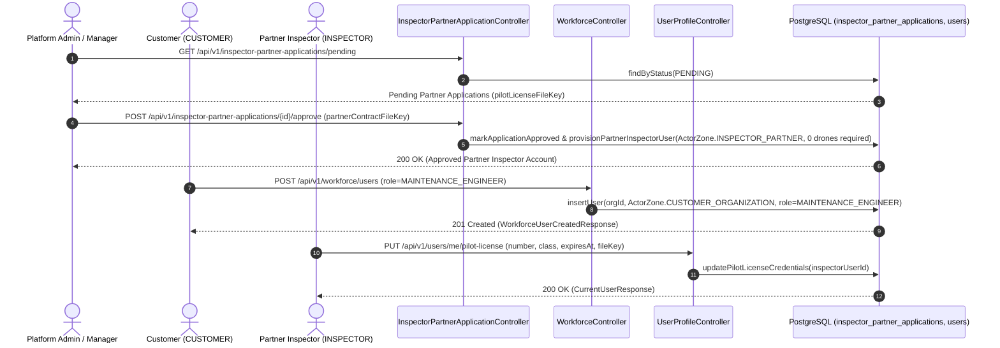

#### 3.2.3 Inspector-Owned Drone 3-Document Registration & Review Sequence Diagram

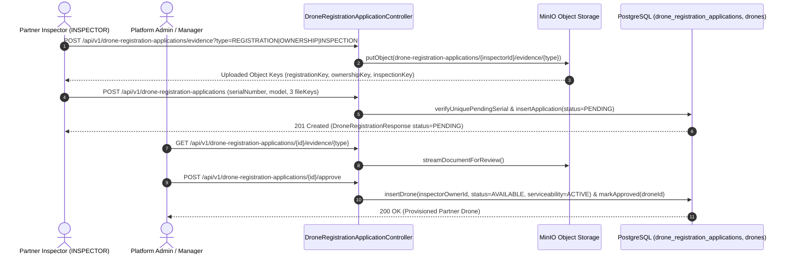

#### 3.2.4 WF-01 Activity Diagram — Customer Airspace & Partner Onboarding, Asset & Drone Registry

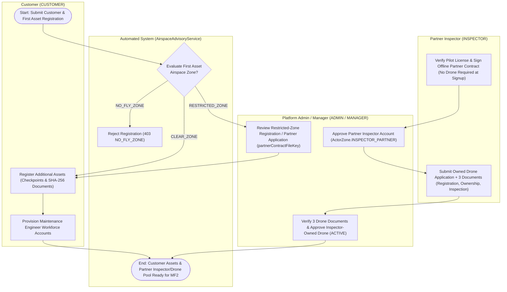

---

### 3.3 FE-03 Recurring Schedules, Contract Occurrences & Outbox Notifications

#### 3.3.1 Class Diagram

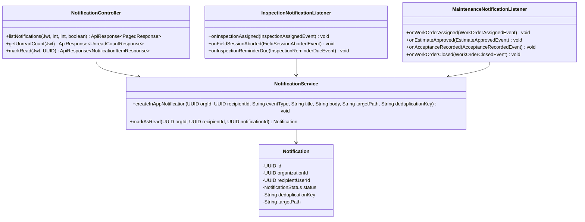

**Class Specifications**

- **InspectionScheduleController, RecurringInspectionScheduleService & ContractWorkflowService (Occurrences)**: Manage timezone-anchored recurring schedules (`recurring_inspection_schedules`, `schedule_occurrences`) and multi-occurrence contract cycles (`service_request_occurrences`) that automatically inherit the parent signed paper contract (Decision D2, `92fb490`).
- **NotificationController & InspectionNotificationListener / MaintenanceNotificationListener**: Persist deduplicated in-app notifications (`uq_notifications_deduplication_key`) via Spring Modulith's `event_publication` outbox, including urgent manager alerts when a field session is aborted (`FieldSessionAbortedEvent`, `3792889`).

#### 3.3.2 Event-Driven Transactional Outbox Notification Sequence Diagram

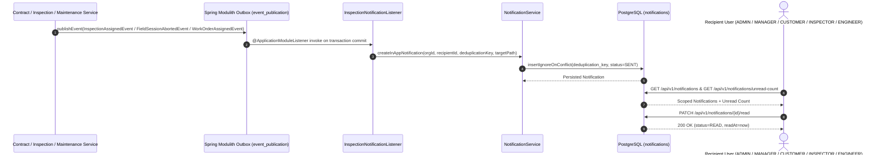

---

### 3.4 FE-04 Service Requests, Quotations, Contracts, Dispatch & Airspace Map

#### 3.4.1 Class Diagram

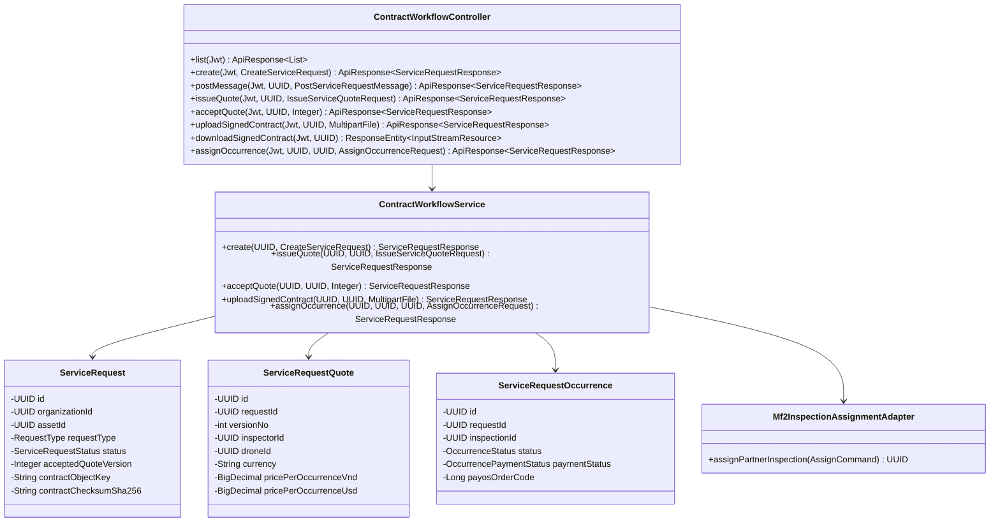

**Class Specifications**

- **ContractWorkflowController & ContractWorkflowService**: Implement the commercial `MF2` request-to-assignment vertical slice (`/api/v1/contracts/requests`), managing `ONE_TIME` and `RECURRING` service requests, in-context order chat (`service_request_messages` with author details), versioned `VND`/`USD` quotations, quote acceptance, and `SHA-256` signed paper contract storage (`PDF`, `DOCX`, `JPEG`, `PNG`).
- **Mf2InspectionAssignmentAdapter & InspectionCreationService**: Enforce partner Inspector license validity, inspector-owned drone ownership (`drone.inspectorOwnerId == inspectorId`), and cross-organization schedule conflict checks (`hasPlatformPartnerScheduleConflict`) before creating a `SCHEDULED` inspection mission, and expose manager dispatch endpoints (`PUT /schedule`, `PUT /assignment`, `POST /cancellation`) for aborted missions.

#### 3.4.2 Service Request Negotiation, Signed Contract & Cross-Org Partner Dispatch Sequence Diagram

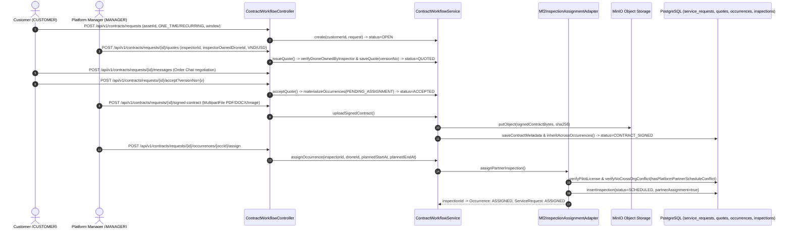

#### 3.4.3 WF-02 Activity Diagram — Service Request, VND/USD Quote, Signed Contract & Cross-Org Partner Dispatch

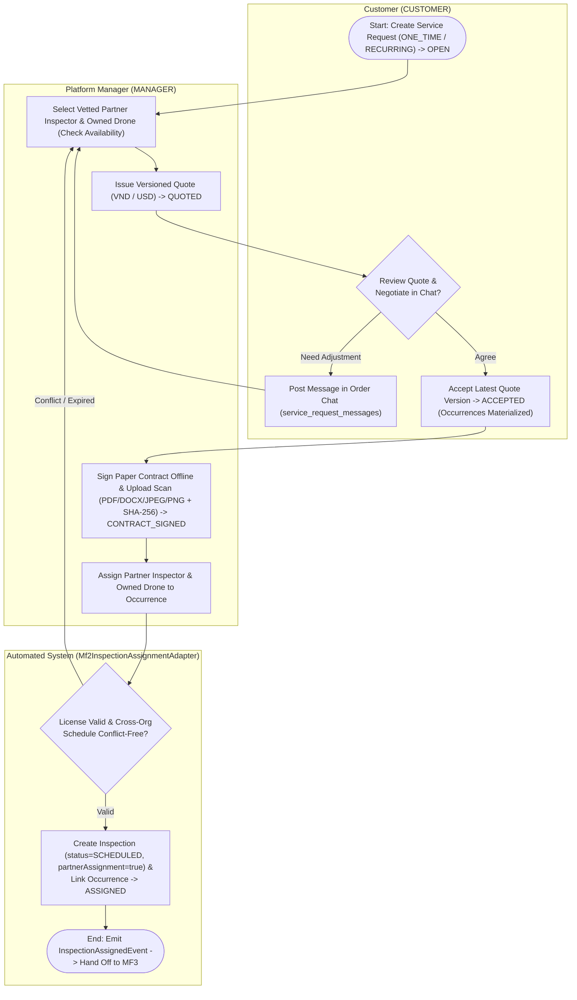

---

### 3.5 FE-05 Flight Permit Gate, Field Execution, Dashboard & Calendar

#### 3.5.1 Class Diagram

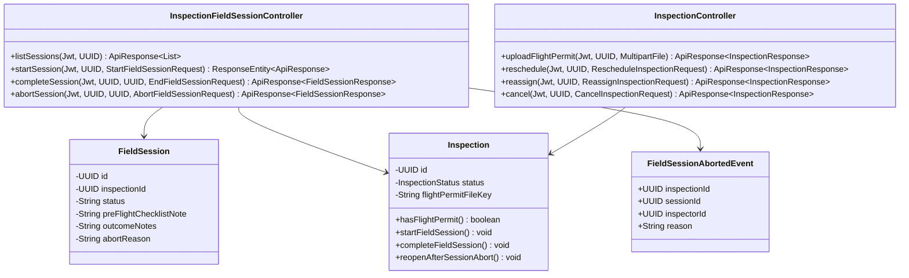

**Class Specifications**

- **InspectionController (Flight Permit & Manager Dispatch)**: Stores uploaded mission flight permits in MinIO (`flight_permit_file_key`) while keeping the mission in `SCHEDULED` (`V15`), and provides `MANAGER` recovery endpoints (`PUT /schedule`, `PUT /assignment`, `POST /cancellation`) when a field session is aborted (`3792889`).
- **InspectionFieldSessionController & Inspection**: Enforce the 2-outcome field session lifecycle (`Complete` $\rightarrow$ `FIELD_COMPLETED` or `Abort` $\rightarrow$ `ABORTED`, reverting `Inspection` to `SCHEDULED` and emitting `FieldSessionAbortedEvent`).

#### 3.5.2 Field Flight Session, Abort Dispatch & Evidence Upload Sequence Diagram

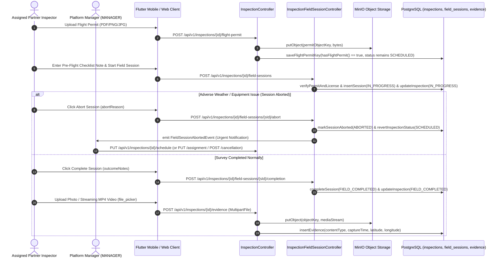

---

### 3.6 FE-06 Evidence Intake, YOLO11 Detection, Auto-Compiled Report & PayOS

#### 3.6.1 YOLO11 Defect Detection & Finding Verification Class Diagram

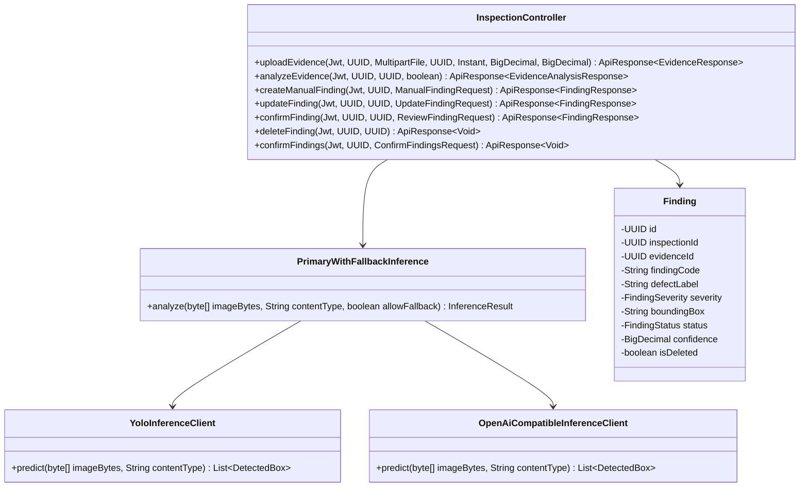

#### 3.6.2 YOLO11 Defect Detection, Vision Fallback & Finding Confirmation Sequence Diagram

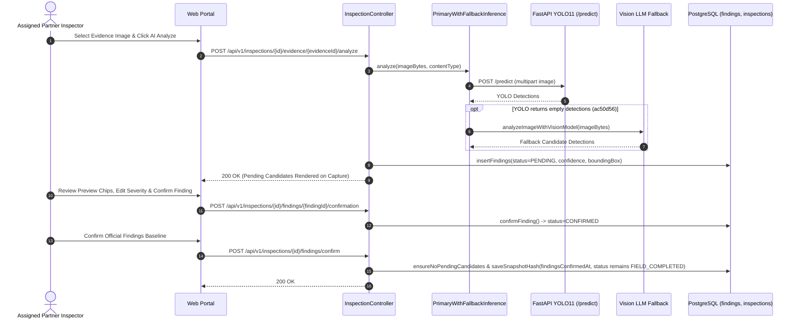

#### 3.6.3 Auto-Compiled Inspection Report, Review, PDF Publication & PayOS Class Diagram

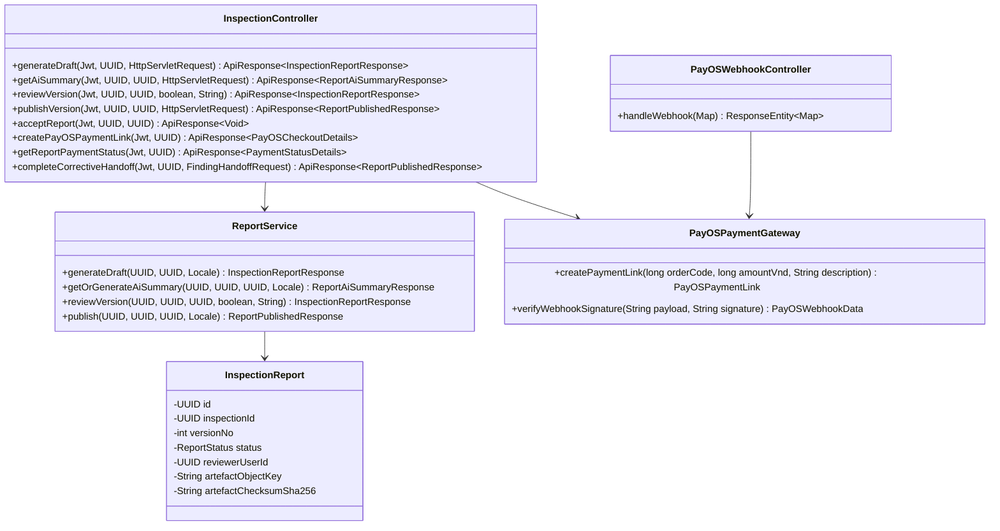

**Class Specifications**

- **ReportService & ReportDraftClient**: Auto-compile confirmed findings, evidence metadata, and field session records directly into a `SUBMITTED` `InspectionReport` (`V16`, `V17` — `DRAFT`, `AUTHOR_VERIFIED`, and `content_snapshot` eliminated), transition the mission to `UNDER_REVIEW`, generate the LLM Executive Summary (`ReportAiSummaryResponse`), enforce independent `MANAGER` review (`APPROVED` / `RETURNED`), and render the immutable `SHA-256` A4 PDF (`PUBLISHED`, moving the mission to `COMPLETED`).
- **ContractWorkflowService (InspectionReportAcceptancePort), PayOSPaymentGateway & PayOSWebhookController**: Transition occurrence `payment_status` to `PAYMENT_DUE` when the `CUSTOMER` accepts the published report, generate a VietQR checkout link (`/payos/create-payment-link`), verify HMAC-SHA256 webhook callbacks (`POST /api/v1/webhooks/payos`) to mark `payment_status = PAID` and `payout_status = ELIGIBLE`, and enforce the `402 Payment Required` download guard until paid.

#### 3.6.4 Report Auto-Compilation, Manager Publication & PayOS Settlement Sequence Diagram

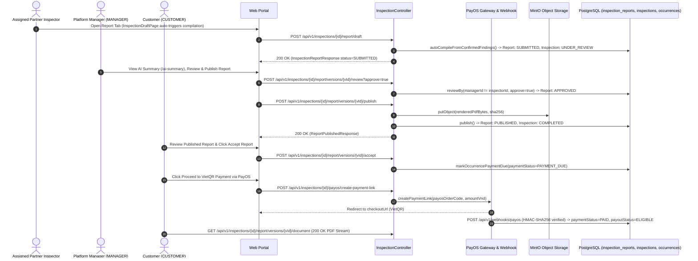

#### 3.6.5 WF-03 Activity Diagram — Flight Permit, Field Session, YOLO11, Auto-Compiled Report & PayOS Settlement

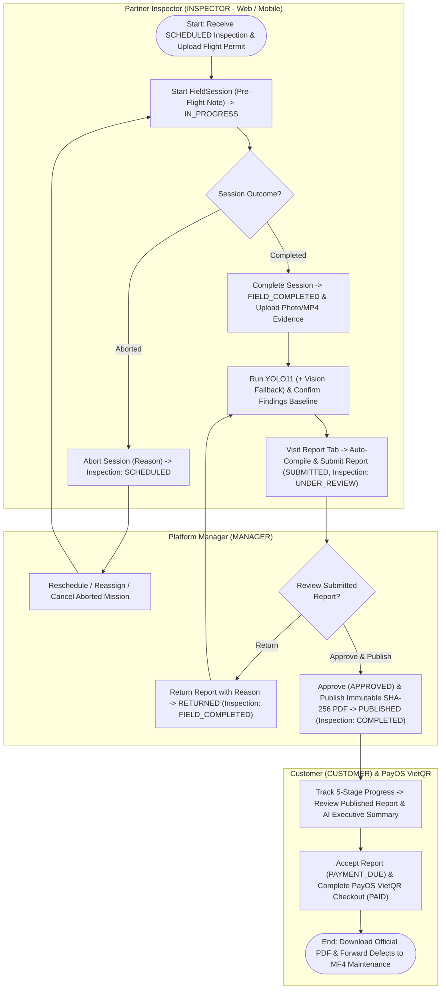

---

### 3.7 FE-07 Maintenance Work Orders, RAG Scope/Norms Advisor & Repair Execution

#### 3.7.1 Class Diagram

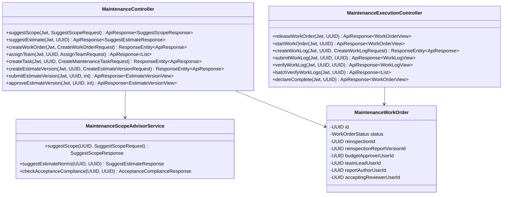

**Class Specifications**

- **MaintenanceController & MaintenanceScopeAdvisorService (`FE-07`)**: Query `repair_knowledge_chunks` (`pgvector`) to recommend corrective scope and acceptance criteria (`/suggest-scope`), provision `initialTasks` in 1 click inside `WorkOrderService.create` (`92fb490`), and generate standard Vietnamese engineering cost norm breakdowns (`LABOR`, `MATERIAL`, `EQUIPMENT`, `CONTINGENCY`) via `/suggest-estimate`.
- **MaintenanceExecutionController (`FE-07`)**: Governs repair execution (`READY` $\rightarrow$ `IN_PROGRESS` $\rightarrow$ `WORK_COMPLETED`), Change Orders, and 1-click Team Lead batch work log verification (`POST /work-orders/{id}/work-logs/batch-verify`), enforcing that no pending Change Orders or unverified work logs exist on `declareComplete()`.

#### 3.7.2 Work Order Planning, 1-Click RAG Tasks, Norm Estimation & Batch Log Verification Sequence Diagram

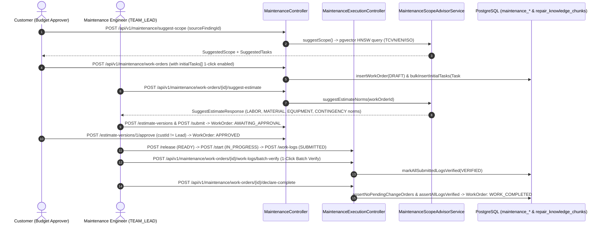

---

### 3.8 FE-08 Completion Report, 3-Way Re-inspection Verification & Cost Closure

#### 3.8.1 Class Diagram

```mermaid
%% title: Re-inspection 3-Way Verification, RAG Compliance Audit and Cost Closure Class Diagram
classDiagram
  class MaintenanceExecutionController {
    +getAutoDraftReport(Jwt, UUID) ApiResponse~AutoDraftReportResponse~
    +getAcceptanceCompliance(Jwt, UUID) ApiResponse~AcceptanceComplianceResponse~
    +recordAcceptanceDecision(Jwt, UUID, RecordAcceptanceRequest) ResponseEntity~ApiResponse~
    +reconcileCosts(Jwt, UUID, ReconcileCostsRequest) ApiResponse~CostReconciliationView~
    +closeWorkOrder(Jwt, UUID) ApiResponse~WorkOrderView~
  }
  class InspectionController {
    +getReinspectionVerifications(Jwt, UUID) ApiResponse~List~
    +updateReinspectionVerification(Jwt, UUID, UUID, UpdateDefectVerificationRequest) ApiResponse~ReinspectionVerificationResponse~
  }
  class ReinspectionVerificationService {
    +getVerifications(UUID, UUID) List~ReinspectionVerificationResponse~
    +updateVerification(UUID, UUID, UUID, UpdateDefectVerificationRequest) ReinspectionVerificationResponse
  }
  class InspectionReinspectionListener {
    +onReinspectionRequested(ReinspectionRequestedEvent) void
  }
  class WorkOrderReinspectionListener {
    +onReinspectionCreated(ReinspectionCreatedEvent) void
    +onReinspectionReportPublished(ReinspectionReportPublishedEvent) void
  }
  class ReinspectionDefectVerification {
    -UUID id
    -UUID reinspectionId
    -UUID sourceFindingId
    -UUID newEvidenceId
    -String repairProofUrl
    -String repairEngineerNotes
    -String resolutionStatus
    -String inspectorNotes
  }
  MaintenanceExecutionController --> WorkOrderReinspectionListener
  InspectionController --> ReinspectionVerificationService
  ReinspectionVerificationService --> ReinspectionDefectVerification
  InspectionReinspectionListener --> ReinspectionDefectVerification
```

**Class Specifications**

- **MaintenanceExecutionController (`auto-draft` & `acceptance-compliance`)**: Synthesizes a 5-part completion report from completed tasks, verified hours, `testReadings`, `asLeftCondition`, and approved Change Orders (`GET /reports/auto-draft`), and evaluates quantitative field measurements against `TCVN` standards (`GET /acceptance-compliance`).
- **InspectionReinspectionListener, WorkOrderReinspectionListener & ReinspectionVerificationService**: Orchestrate the event-driven re-inspection loop (`ReinspectionRequestedEvent` $\rightarrow$ `Inspection` with `inspection_type = 'RE_INSPECTION'` + `ReinspectionDefectVerification` rows $\rightarrow$ `ReinspectionCreatedEvent` $\rightarrow$ 3-way verification `RESOLVED`/`UNRESOLVED`/`INCONCLUSIVE` $\rightarrow$ `ReinspectionReportPublishedEvent` reinstating the Work Order for final `CUSTOMER` acceptance).

#### 3.8.2 Auto-Draft Completion Report, RAG Compliance Audit, 3-Way Re-inspection & Cost Closure Sequence Diagram

```mermaid
%% title: Auto-Draft Completion Report, 3-Way Re-inspection and Cost Closure Sequence Diagram
sequenceDiagram
  autonumber
  actor Author as Maintenance Engineer (REPORT_AUTHOR)
  actor Cust as Customer (Accepting Reviewer)
  actor Insp as Partner Inspector (INSPECTOR)
  actor Mgr as Platform Manager (MANAGER)
  participant ExecCtrl as MaintenanceExecutionController
  participant InspCtrl as InspectionController
  participant Outbox as Spring Modulith Events
  participant DB as PostgreSQL (maintenance_*, inspections, reinspection_defect_verifications)

  Author->>ExecCtrl: GET /api/v1/maintenance/work-orders/{id}/reports/auto-draft
  ExecCtrl-->>Author: 5-Part Synthesized Markdown Draft
  Author->>ExecCtrl: POST /reports -> POST /verify -> POST /submit -> WorkOrder: SUBMITTED_FOR_ACCEPTANCE

  Cust->>ExecCtrl: GET /api/v1/maintenance/work-orders/{id}/acceptance-compliance (RAG Audit)
  ExecCtrl-->>Cust: AcceptanceComplianceResponse (complianceScore, status, checks)
  Cust->>ExecCtrl: POST /acceptance-decisions (decision=REINSPECTION_REQUIRED)
  ExecCtrl->>Outbox: publish ReinspectionRequestedEvent
  Outbox->>DB: createInspection(type=RE_INSPECTION) + createDefectVerifications(repairProofUrl, repairEngineerNotes)
  Outbox->>DB: emit ReinspectionCreatedEvent -> attach reinspectionId to WorkOrder

  Insp->>InspCtrl: Execute 3-Step Re-inspection & PUT /reinspection-verifications/{vId} (newEvidenceId, RESOLVED)
  Insp->>InspCtrl: Auto-Compile & Submit Re-inspection Report (SUBMITTED)
  Mgr->>InspCtrl: Review & Publish Re-inspection Report (PUBLISHED)
  InspCtrl->>Outbox: publish ReinspectionReportPublishedEvent
  Outbox->>DB: attach reinspectionReportVersionId & reinstate Completion Report to SUBMITTED

  Cust->>ExecCtrl: Review Published Re-inspection Report -> POST /acceptance-decisions (ACCEPTED)
  Cust->>ExecCtrl: Inherit Baseline Costs -> POST /cost-reconciliation (COST_RECONCILED) -> POST /close (CLOSED)
```

#### 3.8.3 WF-04 Activity Diagram — Maintenance Work Order, RAG Advisor, 3-Way Re-inspection & Cost Closure

```mermaid
%% title: WF-04 Activity Diagram - Maintenance Work Order, RAG Advisor, 3-Way Re-inspection and Closure
flowchart TD
  subgraph CU4["Customer (CUSTOMER - Budget Approver & Accepting Reviewer)"]
    D1(["Start: Create WorkOrder from Published Defect + 1-Click RAG Tasks -> DRAFT"])
    D4{"Approve RAG-Assisted\nCost Estimate?"}
    D5["Approve Estimate -> WorkOrder: APPROVED"]
    D9["Run RAG Acceptance Compliance Audit (/acceptance-compliance)"]
    D10{"Acceptance Decision?"}
    D11["Request Re-inspection (REINSPECTION_REQUIRED)"]
    D15["Record ACCEPTED -> Reconcile Actual Costs (COST_RECONCILED) -> Close WorkOrder (CLOSED)"]
    D16(["End: Closed Work Order with Full Audit & Re-inspection Traceability"])
  end

  subgraph ME4["Maintenance Engineer Team (TEAM_LEAD, REPORT_AUTHOR, MEMBER)"]
    D2["Generate RAG Cost Norms (/suggest-estimate) & Submit Estimate -> AWAITING_APPROVAL"]
    D6["Execute Repairs, Upload Repair Proof & 1-Click Batch Verify Work Logs -> WORK_COMPLETED"]
    D8["Auto-Draft (/reports/auto-draft), Verify & Submit Completion Report -> SUBMITTED_FOR_ACCEPTANCE"]
  end

  subgraph RI4["Partner Inspector & Platform Manager (3-Step Re-inspection Loop)"]
    D12["Auto-Create Linked RE_INSPECTION Mission & 3-Way Verification Cards"]
    D13["Inspector Captures New Drone Proof & Marks RESOLVED / UNRESOLVED / INCONCLUSIVE"]
    D14["Manager Reviews & Publishes Re-inspection Report -> Reinstates WorkOrder"]
  end

  D1 --> D2 --> D4
  D4 -->|"Reject"| D2
  D4 -->|"Approve"| D5 --> D6 --> D8 --> D9 --> D10
  D10 -->|"REWORK_REQUIRED"| D6
  D10 -->|"REINSPECTION_REQUIRED"| D11 --> D12 --> D13 --> D14 --> D9
  D10 -->|"ACCEPTED"| D15 --> D16
```
