## 3. Detailed Design

### 3.1 `MF1` — `FE-01` Account Authentication, OTP & 4-Role Access Control

This section presents the detailed design for `FE-01`: Customer organization registration (with No-Fly Zone airspace gate), Argon2id credential sign-in, consolidated `REGISTRATION`/`LOGIN`/`PASSWORD_RESET` OTP challenges, Google OAuth 2.0 federation, HS256 JWT and HmacSHA256 refresh-token rotation, self-service user profile updates, platform user administration, and strict four-role access control (`ADMIN`, `MANAGER`, `CUSTOMER`, `INSPECTOR`).

#### 3.1.1 Class Diagram

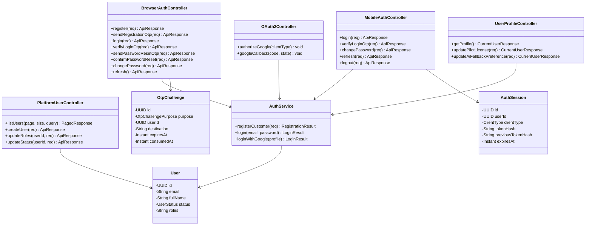

**Class Specifications**

| No | Class | Description |
| :---: | :--- | :--- |
| 01 | `BrowserAuthController` & `MobileAuthController` | Handle customer registration, email/password sign-in, OTP verification and password reset, password change, and token refresh for web (`HttpOnly` cookie CSRF-protected chain) and mobile (`Bearer` / refresh token) clients. |
| 02 | `OAuth2Controller` | Handles federated Google OAuth 2.0 sign-in and callback redirection for web browsers and mobile deep links (`smartdrone://auth`). |
| 03 | `UserProfileController`, `PlatformUserController` & `AdminAuditLogController` | Allow signed-in users to manage their own profile (`/api/v1/users/me`, `vision_fallback_enabled`), let `ADMIN` provision/activate single-role platform accounts (`Last-Admin` protected), and expose append-only `audit_events`. |
| 04 | `AuthService`, `AuthRateLimitFilter` & `LoginFailureService` | Coordinates Argon2id verification, 5-failure 15-minute lockout, per-IP OTP/login throttling, and JWT issuance/rotation (`AccessTokenService`, `RefreshCookieService`). |
| 05 | `User`, `OtpChallenge` & `AuthSession` | Domain entities representing single-role users across `ADMIN`, `MANAGER`, `CUSTOMER`, and `INSPECTOR`, time-limited OTP challenges, and rotated refresh sessions. |

#### 3.1.2 Customer Organization and Initial Asset Registration Sequence Diagram

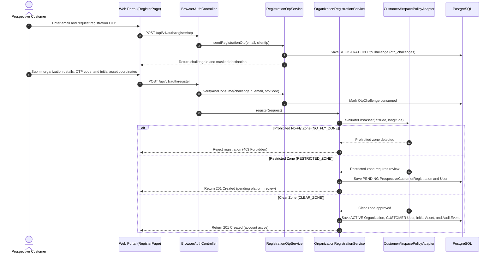

#### 3.1.3 User Sign-In, OTP Verification and Google OAuth 2.0 Sequence Diagram

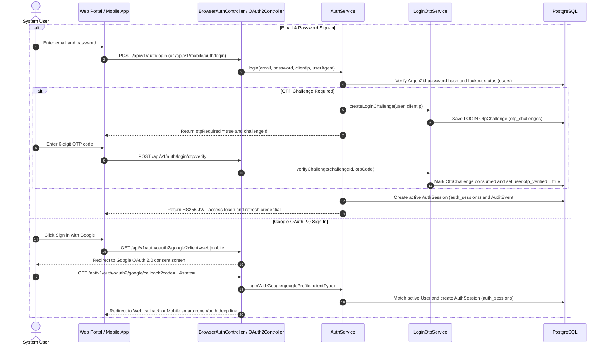

---

### 3.2 `MF1` — `FE-02` Partner Inspector Application & Qualification Management

This section presents the detailed design for `FE-02`: the public partner Inspector application with licence scan, platform review and atomic account provisioning, the signed partner contract record, Administrator-managed UAV pilot-licence classes, pilot licence renewal, and Inspector flight logs.

#### 3.2.1 Class Diagram

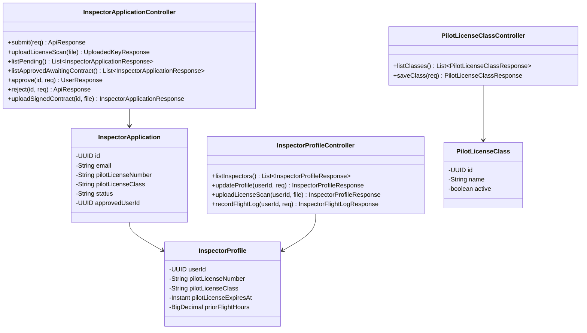

**Class Specifications**

| No | Class | Description |
| :---: | :--- | :--- |
| 01 | `InspectorApplicationController` & `InspectorApplicationService` | Accept unauthenticated partner applications and MinIO licence scans (`PENDING_REVIEW`), expose review queues to `MANAGER`/`ADMIN`, provision `INSPECTOR` user + `InspectorProfile` upon approval (requiring no drone at signup), record mandatory rejection reasons, and persist signed partner contracts. |
| 02 | `InspectorProfileController` & `InspectorProfileService` | Maintain pilot credentials in `inspector_profiles`, handle licence scan renewals, and store attribution flight history in `inspector_flight_logs` (`InspectorProfileController` also emits `PilotLicenseUpdatedEvent`). |
| 03 | `PilotLicenseClassController`, `PilotLicenseClassService` & `PilotLicenseExpiryCheckService` | Maintain recognized licence classes (`pilot_license_classes`) mapped to Decree 288 rules and run scheduled expiry checks notifying Inspectors and staff when licences lapse. |

#### 3.2.2 Partner Inspector Application, Review and Account Provisioning Sequence Diagram

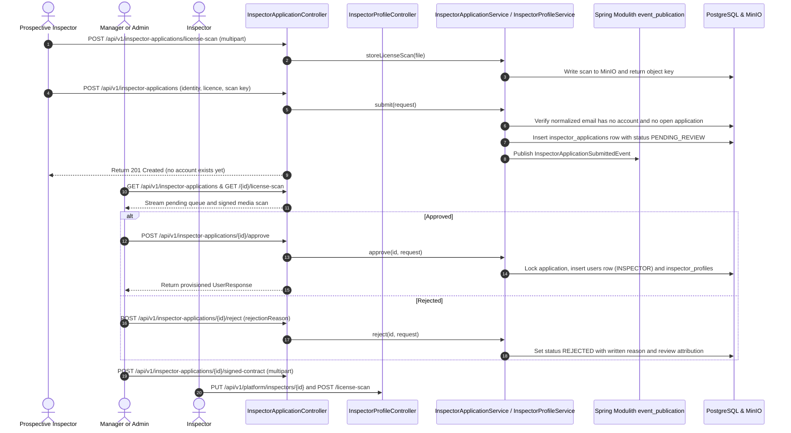

---

### 3.3 `MF1` — `FE-03` Inspector-Owned Drone Registration & Fleet Management

This section presents the detailed design for `FE-03`: Administrator configuration of required drone documents and safety/capability features, Inspector submission of owned drones with real photographs and documents, Decree 288/2025/ND-CP weight classification, review and approval, renewal, and serviceability transitions (`ACTIVE <-> IN_MAINTENANCE -> RETIRED`).

#### 3.3.1 Class Diagram & Specifications

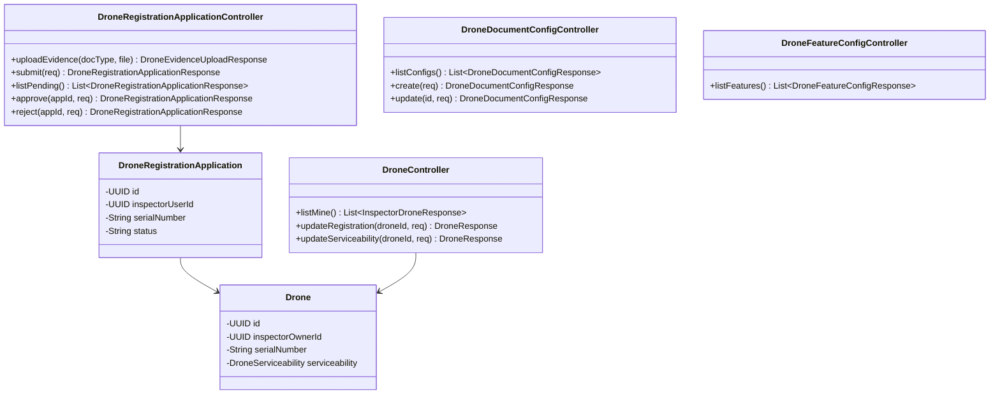

| No | Class | Description |
| :---: | :--- | :--- |
| 01 | `DroneDocumentConfigController` & `DroneFeatureConfigController` | Manage Admin-configurable document requirements (`REGISTRATION` & `OWNERSHIP` active/required by default; `INSPECTION` optional) and outdoor flight capability/safety checklists (`drone_document_configs`, `drone_feature_configs`). |
| 02 | `DroneRegistrationApplicationController` & `DroneEvidenceUploadService` | Handle MinIO evidence upload (`>= 1` `DRONE_IMAGE` photo + configured doc types), duplicate serial checks, `MANAGER`/`ADMIN` approval into `drones` (`inspector_owner_id`), and rejection reasons. |
| 03 | `DroneController` & `DroneService` | Manage Inspector fleet inventory (`InspectorDroneRegistrationPage`), registration renewal (`updateRegistration`), maintenance holds (`IN_MAINTENANCE`), and terminal `RETIRED` locks, enforcing Decree 288 MTOW (`>= 2 kg` -> Class B) during eligibility checks. |

---

### 3.4 `MF1` — `FE-04` Interactive Location Map & No-Fly Zone Airspace Screening

This section presents the detailed design for `FE-04`: interactive coordinate selection on Web (`AssetLocationPickerModal` / `AirspaceNoFlyMap`) and Mobile (`AirspaceAdvisoryCard`), Vietnam restricted/no-fly zone polygon definitions, and deterministic coordinate/altitude evaluation (`AirspaceController`, `AirspaceAdvisoryService`) gating registration and building management.

**Class & UI Specifications**

| No | Component / Class | Description |
| :---: | :--- | :--- |
| 01 | `AirspaceController` (`assets.api`) | Exposes `GET /api/v1/airspace/zones` (`AirspaceZoneResponse`) and `GET`/`POST /api/v1/airspace/evaluate` (`EvaluateAirspaceRequest` -> `AirspaceEvaluationResponse`), enforcing `latitude` in `[-90, 90]` and `longitude` in `[-180, 180]`. |
| 02 | `AirspaceAdvisoryService` (`assets.service`) | Performs Haversine distance calculations against active prohibited and restricted airspace zones, returning `CLEAR_ZONE`, `RESTRICTED_ZONE`, or `NO_FLY_ZONE` plus an advisory disclaimer (`MSG49`: screening never grants government aviation permission). |
| 03 | `CustomerAirspacePolicyAdapter` (`assets.service`) | Adapter implementing `shared.api.CustomerAirspacePolicy` so `users` onboarding (`OrganizationRegistrationService`) enforces `NO_FLY_ZONE` blocking (`403`) and `RESTRICTED_ZONE` holding (`PENDING`) without violating module boundaries. |
| 04 | Web `AssetLocationPickerModal.tsx` & Mobile `AirspaceAdvisoryCard` | Interactive MapLibre/map picker displaying circle overlays, zone classification pills (`MSG28`), and altitude limits across Web registration/assets and Customer Mobile views. |

---

### 3.5 `MF4` — `FE-05` Financial History & Revenue/Payment Ledger

This section presents the detailed design for `FE-05`: role-scoped financial ledgers querying settled payments, VAT breakdowns, platform commissions (`15%`), TNCN withholdings, partner payout statuses, and refund impacts across Customer, Inspector, and Manager portals.

**Class & UI Specifications**

| No | Component / Class | Description |
| :---: | :--- | :--- |
| 01 | `ContractWorkflowController` (`finance-history/*` routes) | Exposes `GET /api/v1/contracts/requests/finance-history/customer`, `/inspector`, and `/manager` (plus `/{occurrenceId}` detail endpoints) backed by `ContractWorkflowService` paged/filtered ledger queries. |
| 02 | `FinanceHistoryPageResponse`, `FinanceHistoryItemResponse`, `ManagerFinanceHistoryResponse` & `OccurrenceFinanceResponse` | DTOs projecting strict role-appropriate financial fields: Customer views payment amounts, receipts, and refundable status while masking partner payouts/receivables; Inspector views gross fee, commission/TNCN deductions, and net payout; Manager views platform inflows, commission, VAT/TNCN, and reconciliation state. |
| 03 | Web `FinanceHistoryPage.tsx` & `OverviewFinanceSection.tsx` | Role-aware Web ledger views mounted at `/client/finance-history`, `/operations/finance-history`, and `/manager/finance-history`, paired with per-inspection overview financial cards. |

---

### 3.6 `MF2` — `FE-06` Building Asset Registry, Checkpoints & Reference Documents

This section presents the detailed design for `FE-06`: the six building-only categories (`AssetCategory`), customer building creation and lifecycle management (`Asset`, with dedicated `ownership_information VARCHAR(1000)` added in `V66`), category-seeded inspection checkpoints (`inspection_items`), and SHA-256 deduplicated MinIO reference documents (`AssetDocument`).

#### 3.6.1 Sequence Diagram

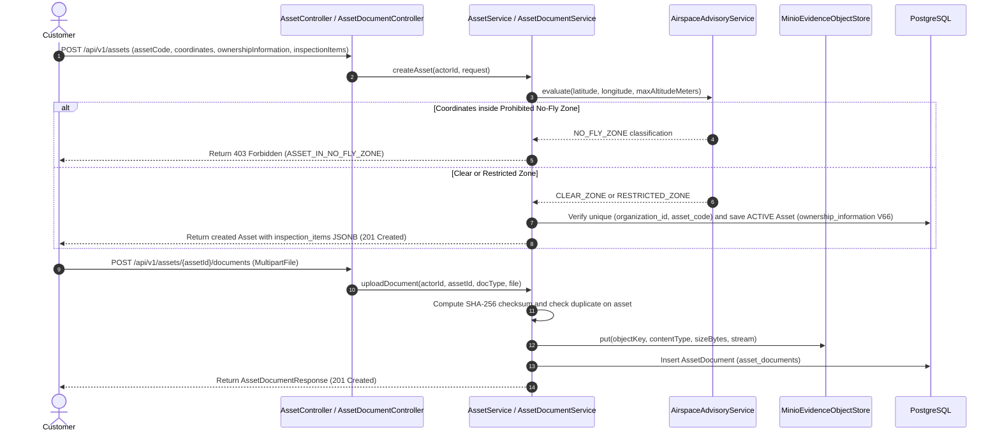

**Class Specifications**

| No | Class | Description |
| :---: | :--- | :--- |
| 01 | `AssetController`, `AssetService` & `Asset` (`assets`) | Manage customer buildings under the `NO_FLY_ZONE` gate; persist plain-text ownership in `assets.ownership_information` (`varchar(1000)`, `V66__asset_ownership_information.sql`) separate from `technical_profile jsonb`, enforce checkpoint edits only prior to the first inspection (`InspectionAssetUsageAdapter`), expose `AssetResponse.checkpointsLocked` from one bulk `AssetInspectionUsagePort.inspectedAssetIds` lookup per page and reject post-inspection edits with `409 INSPECTION_HISTORY_EXISTS`, and support terminal retirement (`RETIRED`). |
| 02 | `AssetCatalogController` & `AssetCatalogService` | Maintain the six building-only `AssetCategory` templates and default `InspectionItem` checkpoints without retroactively rewriting checkpoints on existing buildings. |
| 03 | `AssetDocumentController` & `AssetDocumentService` | Validate non-empty building reference documents (`PDF`/images/drawings), enforce per-asset `SHA-256` uniqueness, store binaries under `assets/{assetId}/documents/` in MinIO, and stream downloads strictly to authorized Customer/Manager/Admin actors. |

---

### 3.7 `MF2` — `FE-07` Restricted Airspace Review & Clearance Decision

This section presents the detailed design for `FE-07`: reviewing held `RESTRICTED_ZONE` customer organization and initial building submissions (`prospective_customer_registrations`) before granting platform access.

**Class & Workflow Specifications**

| No | Class / Component | Description |
| :---: | :--- | :--- |
| 01 | `AirspaceReviewController` (`users.api`) | Exposes `GET /api/v1/platform/customer-airspace-reviews/pending`, `POST /{registrationId}/approve`, and `POST /{registrationId}/reject` restricted to `ADMIN` reviewers (`ApproveProspectiveCustomerRequest`, `RejectProspectiveCustomerRequest`). |
| 02 | `ProspectiveCustomerReviewService` & `ProspectiveCustomerRegistration` | On `approve`, transitions status to `APPROVED`, activates the pending `CUSTOMER` user, publishes `CustomerRegistrationEvent` handled by `assets.AssetRegistrationListener` to create the initial `Asset` preserving plain-text `ownership_information` (`V66`), and records an `AuditEvent`. On `reject`, enforces a mandatory non-blank reason and marks `REJECTED`. |
| 03 | Web `OnboardingReviews` (`Customer Airspace` tab) | Admin console queue displaying coordinates, plain-text ownership info, and review note controls (`adm-onboarding-reviews.png`). |

---

### 3.8 `MF2` — `FE-08` Service Requests (One-Time & Recurring) & VND Quotations

This section presents the detailed design for `FE-08`: one-time and recurring customer service requests (`>= 20` calendar-day lead time in `Asia/Ho_Chi_Minh`, `1–120` month cadence, `2–100` occurrences, concise titles `<Building> · Monthly inspection`), pessimistic Manager self-claim with immediate detail navigation, ADMIN assignment oversight, and active VND quotation negotiation.

#### 3.8.1 Sequence Diagram

```mermaid
%% title: FE-08 Service Request, Claim Ownership and VND Quotation Sequence Diagram
sequenceDiagram
  autonumber
  actor Cust as Customer
  actor Mgr as Manager
  participant Ctrl as ContractWorkflowController
  participant Svc as ContractWorkflowService
  participant Partner as PartnerRegistryService
  participant FinSvc as InspectionFinanceSettingsService
  participant DB as PostgreSQL

  Cust->>Ctrl: POST /api/v1/contracts/requests
  Ctrl->>Svc: create(customerId, request)
  Svc->>DB: Verify active Asset, generate concise title, and save OPEN ServiceRequest

  Mgr->>Ctrl: POST /api/v1/contracts/requests/{id}/claim
  Ctrl->>Svc: claimRequest(managerId, requestId)
  Svc->>DB: Pessimistic lock request row and assign only if unassigned

  Mgr->>Ctrl: POST /api/v1/contracts/requests/{id}/quotes
  Ctrl->>Svc: issueQuote(managerId, requestId, quoteInput)
  Svc->>Partner: Validate optional pair and credential expiry across all planned dates
  Svc->>FinSvc: requireConfiguredRates()
  Svc->>DB: Save ServiceRequestQuote (VND) on or after the Customer first date (QUOTED; later date needs Customer re-acceptance)
```

**Class & UI Specifications**

| No | Class / Component | Description |
| :---: | :--- | :--- |
| 01 | `ContractWorkflowController` & `ContractWorkflowService` | Enforce 20-day lead time, generate concise recurring titles (`Monthly inspection` / `Every N-month inspection`), serialize `claimRequest` under DB locking, restrict commercial actions to `assignedManagerId`, expose `ADMIN` assignment registry (`PUT`/`DELETE /manager-assignment`), expose `PUT /{requestId}/inspection-items` (`UpdateServiceRequestInspectionItemsRequest`, locked after dispatch starts with `CHECKPOINTS_LOCKED`), project asset overview summary (`assetName`, `assetCode`, `assetLocationText`) + assigned Manager contact (`ServiceManagerContactResponse`), and validate later first-occurrence quotes. |
| 02 | `ServiceRequest` & `ServiceRequestQuote` | Store request cadence/bounds, Manager assignment audit metadata, `inspection_items jsonb` (`V71`), and single active VND quotation (`V60` nullable `inspector_id`/`drone_id`, empty `requiredDroneFeatureCodes` compatible, optional `inspectionItems`). Accepted terms keep the effective first date so a revised quote cannot take effect without Customer acceptance. |
| 03 | Web `ServiceRequestListView.tsx`, `RequestOverviewCard.tsx`, `AssetOverviewDialog.tsx`, `CheckpointsOverviewDialog.tsx`, `RequestCheckpointsEditor.tsx`, `ManagerQuoteWorkspace.tsx`, `QuoteTermsSummary.tsx` | Compact 4-column desktop table + unified outer/inner role-scoped Overview (`Asset` detail modal and compact numbered `Checkpoints` modal). `ManagerQuoteWorkspace` restores explicit start/end `datetime-local` schedule inputs and embeds a compact 1-row `RequestCheckpointsEditor` bar inside `Request review` that opens a modal dialog to configure request checkpoints from Asset suggestions, `ADMIN` category templates (`CATEGORY_INSPECTION_ITEM`), or custom items. |

---

### 3.9 `MF2` — `FE-09` Offline Signed Contract & Occurrence Dispatch Scheduling

This section presents the detailed design for `FE-09`: Customer quotation acceptance (freezing terms snapshot & materializing month-end anchored occurrences), offline signed paper agreement upload to MinIO, partner eligibility & cross-organization schedule-conflict checks, bulk `Apply to remaining` occurrence dispatch, and abort recovery (`reschedule`, `reassign`, `cancel`).

#### 3.9.1 Class & Sequence Diagrams

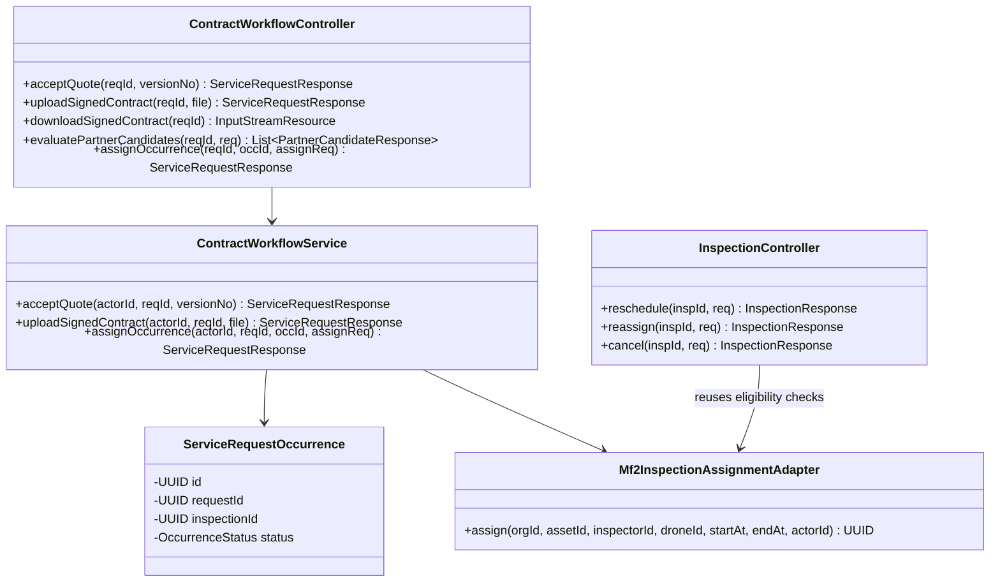

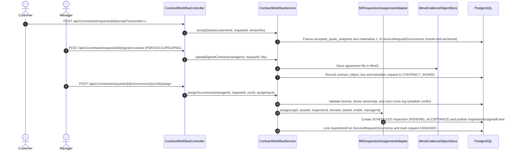

**Class & UI Specifications**

| No | Class / Component | Description |
| :---: | :--- | :--- |
| 01 | `ContractWorkflowService` (`acceptQuote`, `uploadSignedContract`, `assignOccurrence`) | Freezes immutable quote snapshot, materializes recurring occurrences (`Jan 31 -> Feb 28/29 -> Mar 31`), persists signed paper contracts under `contracts/requests/{id}/`, dispatches single or bulk (`Apply to remaining`) partner assignments, and forwards request `inspectionItems` via the 9-arg `Mf2InspectionAssignment.assign(...)` SPI to `Inspection` (`V71`). |
| 02 | `PartnerRegistryService`, `Mf2InspectionAssignmentAdapter`, `InspectionCreationService`, `InspectionDroneHubService`, `ReportService` | Verify Decree 288 class match, non-expired registration/licence at planned flight timestamps, and absence of cross-organization schedule collisions (`hasScheduleConflict`); resolve checkpoints via `Inspection.resolveInspectionItems(...)` (`inspection.inspectionItems` with `asset.inspectionItems` fallback) across API responses, SmartDroneHub missions, and rendered reports. Reassigning a `FIELD_COMPLETED` inspection returns `409`. |
| 03 | Web `PartnerCandidateResults.tsx` & `ManagerOccurrencesStep.tsx` | Render explicit candidate table column widths with an icon-only details action button (`PR #139`) preventing overlap between drone tier, details, and `Select` controls, bulk team assignment confirmation, `inspectorName` / `droneLabel` resolution, and Step 4 Partner Chat `Messages` deep link. |

---

### 3.10 `MF2` — `FE-10` Dual-Channel Messaging (Order Chat & Inspection Chat)

This section presents the detailed design for `FE-10`: strictly separated commercial Order Chat (`service_request_messages`, Customer <-> assigned Manager) and operational Inspection Chat (`inspection_messages` added in `V61`, Customer <-> assigned Inspector) with private MinIO attachment storage and Mobile parity.

**Class & UI Specifications**

| No | Class / Component | Description |
| :---: | :--- | :--- |
| 01 | `ContractWorkflowController` (`/requests/{id}/messages*`) | Serves Customer <-> assigned `MANAGER` commercial order chat (`ServiceRequestMessage`, `ServiceRequestMessageAttachment`: up to 5 files, `10 MiB` per file / `20 MiB` per message, `PNG`/`JPG`/`WEBP`/`PDF`/`DOCX`), refusing `ADMIN` and non-assigned Managers. |
| 02 | `InspectionChatController` & `InspectionChatService` (`inspections.api/service`, `V61`) | Exposes `GET /inspections/messages/threads`, `GET /inspections/{id}/messages`, `POST /{id}/messages`, `POST /{id}/messages/read`, and `GET /{id}/messages/{msgId}/attachments/{attId}` scoped solely to owning `CUSTOMER` and assigned `INSPECTOR` (`ADMIN` and `MANAGER` denied), capping message text at `4000` chars and attachments at `10 MiB` per file and `20 MiB` total per message in MinIO (`inspections/{id}/messages/`). |
| 03 | `ServiceRequestPartnerChatController` & `ServiceRequestPartnerChatService` (`contracts.api/service`, `V70`) | Exposes `/api/v1/contracts/requests/{requestId}/partner-chat/**` (`threads`, `{inspectorId}/messages`, `POST .../messages`, `read`, attachment download) scoped strictly to the request's assigned `MANAGER` and active/assigned `INSPECTOR` partners, refusing `CUSTOMER`, `ADMIN`, and uninvolved actors with shared `4000`-char / 5-file / `10 MiB` / `20 MiB` limits under `contracts/requests/{requestId}/partner-messages/{inspectorId}/`. |
| 04 | `ChatAttachmentValidator` (`shared.storage`) | Validates real file magic signatures, declared MIME types, safe filenames, and size caps prior to object upload. |
| 05 | Web `RequestChatPanel.tsx` (`PartnerChatPanel`), `ContractInboxPage.tsx` (`/messages`) & Mobile `RequestChat`, `InspectionChatPage` | Deliver tabbed inboxes (`/client/messages` switching `Service requests` vs `Inspector`; `/manager/messages` switching `Customers` vs `Inspectors`; `/operations/messages` switching `Customers` vs `Managers`), Step 4 Partner Chat `Messages` button, and matching Flutter Mobile threads (`PR #27`). |

---

### 3.11 `MF2` — `FE-11` Assignment Acceptance Timeout & Escalation Handling

This section presents the detailed design for `FE-11`: the Administrator-configurable Step 4 assignment acceptance SLA (`platform_operations_settings`, `V61`) and the scheduled timeout monitor that releases unaccepted crew reservations and notifies stakeholders.

**Class & UI Specifications**

| No | Class / Component | Description |
| :---: | :--- | :--- |
| 01 | `PlatformOperationsSettingsController`, `PlatformOperationsSettingsService` & `PlatformOperationsSettings` (`V61`) | Admin-only endpoints (`GET/PUT /api/v1/platform/operations-settings`) configuring `assignment_acceptance_timeout_hours` (`1–720`, default `24` hours). |
| 02 | `InspectionAssignmentTimeoutMonitor` (`inspections.service`) | Scheduled monitor scanning `SCHEDULED` inspections in `PENDING_ACCEPTANCE` past `assignmentRequestedAt + timeoutHours`; atomically cancels the inspection, clears crew reservations, reverts `ServiceRequestOccurrence` to `PENDING_ASSIGNMENT` (reopening `ASSIGNED` request to `CONTRACT_SIGNED`), stamps `lastTimeoutCancelledAt`/`lastTimeoutInspectorId`, and emits `InspectionAssignmentTimedOutEvent`. |
| 03 | Web `PlatformOperationsSettingsPage.tsx` & Deep-Link Notification | Admin settings page plus actionable notifications routing the owning `MANAGER` directly to `/manager/contracts?requestId=...` to dispatch a replacement team. |

---

### 3.12 `MF2` — `FE-12` System Notifications & Alert Center

This section presents the detailed design for `FE-12`: transactional Spring Modulith outbox-driven notifications, database-level deduplication (`uq_notifications_deduplication_key`), unread counter queries, and XSS/open-redirect safe deep linking.

#### 3.12.1 Sequence Diagram

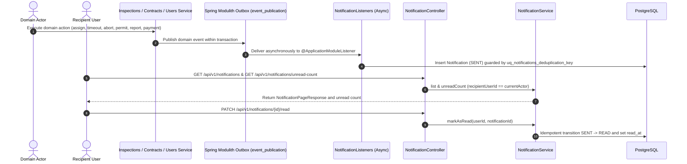

**Class & UI Specifications**

| No | Class / Component | Description |
| :---: | :--- | :--- |
| 01 | `InspectionNotificationListener`, `ServiceRequestNotificationListener`, `InspectorApplicationNotificationListener`, `PaymentOverdueNotificationListener` & `PaymentSettlementNotificationListener` | Handle `ServiceRequestCreatedEvent`, `InspectionAssignedEvent`, `InspectionAssignmentTimedOutEvent`, `InspectionDeclinedEvent`, `InspectionOverdueEvent`, `InspectionRescheduledEvent`, `InspectionAssignmentRevokedEvent`, `FieldSessionAbortedEvent`, `FieldSessionHungEvent`, `FieldSessionForceAbortedEvent`, `FlightPermitSubmittedEvent`, `FlightPermitReviewedEvent`, `ReportSubmittedEvent`, `ReportReturnedEvent`, `ReportPublishedEvent`, `InspectorApplicationSubmittedEvent`, `PaymentOverdueEvent`, and `PaymentSettledEvent`. A new service request notifies every active Manager with the request date and a `/manager/contracts?requestId=...` deep link. |
| 02 | `NotificationController`, `NotificationService` & `Notification` | Expose recipient-scoped paged queries, unread counter, and idempotent `markAsRead` updates protected by `uq_notifications_deduplication_key`. |
| 03 | Web `NotificationBell.tsx`, `NotificationsPage.tsx` & `targetPath.ts` | Render real-time unread counts, notification feed, and client-side `targetPath` allowlist sanitizer blocking malformed/external links while server APIs enforce independent authorization. |

---

### 3.13 `MF3` — `FE-13` Flight Permit Upload & Independent Verification Gate

This section presents the detailed design for `FE-13`: assigned-Inspector flight permit submission (`<= 25 MB`, verified binary signature & `SHA-256`, structured permit metadata), mandatory non-uploader `MANAGER`/`ADMIN` approval (`PENDING_REVIEW -> APPROVED`/`REJECTED`), pre-session verification gate, and automatic verification reset when drone or schedule changes.

**Class & Workflow Specifications**

| No | Class / Component | Description |
| :---: | :--- | :--- |
| 01 | `InspectionController`, `InspectionListController` & `InspectionCreationService` | Expose `POST /inspections/{id}/flight-permit` (assigned `INSPECTOR` only, `SCHEDULED` lock), `POST /inspections/{id}/flight-permit/review` (non-uploader `MANAGER`/`ADMIN`), and scoped `GET /inspections/{id}/flight-permit/content`. |
| 02 | `FlightPermitPolicy` (`inspections.service`) | Validates binary magic bytes (`PDF`/`PNG`/`JPG`/`WEBP`, `<= 25 MB`), `permitNumber`, `issuingAuthority`, `validFrom`/`validTo` window covering planned flight time, assigned drone serial match, optional `maxAltitudeM` (`1–2000 m`), and resets `APPROVED` -> `PENDING_REVIEW` on drone swap or out-of-window reschedule (`BR-24`, `BR-25`). |
| 03 | Web `FlightPermitVerificationPanel.tsx` & `FlightPermitPreviewDialog.tsx` | Workspace Stage 1 metadata form/viewer and Manager/Admin Permit Audit card inside `/audit` and `/permit`. |

---

### 3.14 `MF3` — `FE-14` On-Site Field Session & SmartDroneHub MAVLink Telemetry

This section presents the detailed design for `FE-14`: pre-flight safety checklists, accountable `Start` / `Complete` / reasoned `Abort` field sessions, read-only `SmartDroneHub` live MAVLink telemetry (`14551/udp`, `5762/tcp`) and mission video sync, non-MAVLink log import (`SRT`/`CSV`/`KML`/`GPX`), manual flight declarations, abort recovery dispatch, and role dashboards/calendar.

#### 3.14.1 Class Diagram

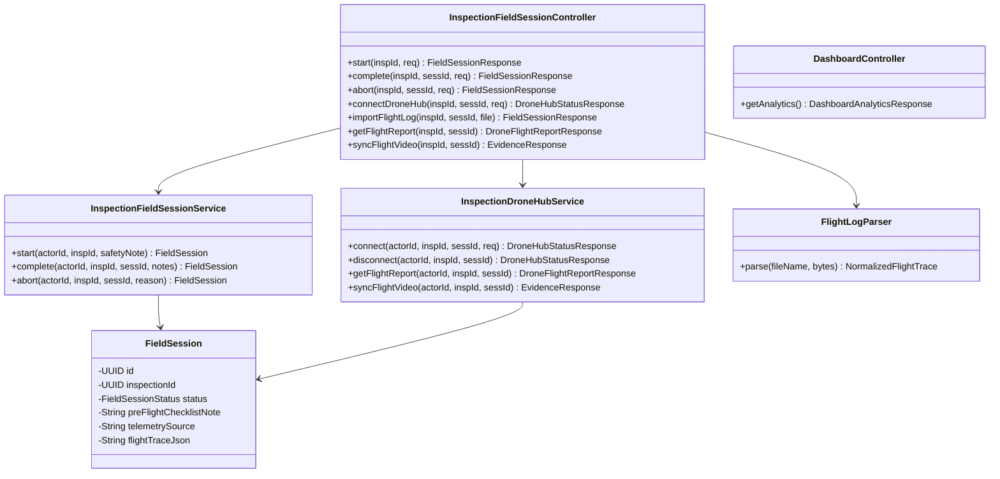

#### 3.14.2 Field Session, SmartDroneHub Sync & Abort Recovery Sequence Diagrams

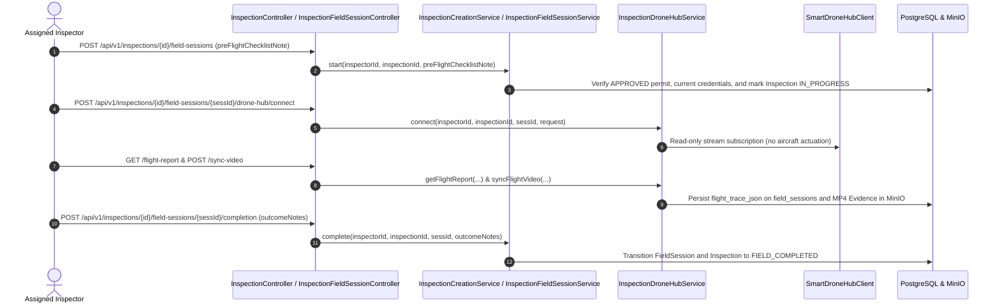

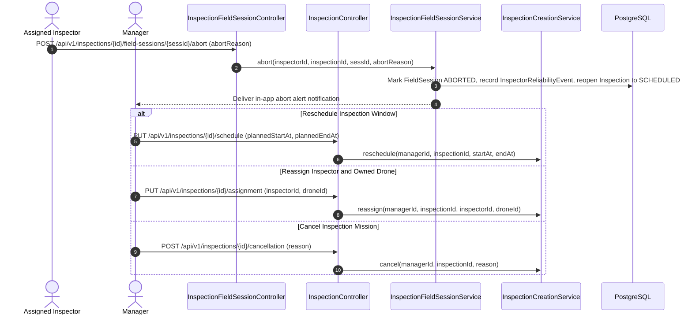

---

### 3.15 `MF3` — `FE-15` Field Evidence Intake & Chunked Video Processing Pipeline

This section presents the detailed design for `FE-15`: image EXIF extraction prior to decoding and `2048 px` / `480 px` normalization, resumable `10 MiB` S3 multipart MP4 uploads up to `2 GiB`, durable async FFmpeg `<= 1080p` faststart + poster transcoding, duplicate filename disambiguation (`name (1).ext`), video keyframe extraction, and short-lived HMAC ticketed HTTP Range playback.

**Class & Pipeline Specifications**

| No | Class / Component | Description |
| :---: | :--- | :--- |
| 01 | `EvidenceService`, `ExifMetadataExtractor` & `ImageNormalizer` | Extract EXIF GPS/time/orientation first, normalize oversized (`> 2048 px`) or rotated photos (`<= 10 MB`), emit `480 px` JPEG thumbnails (`?variant=thumb`), disambiguate duplicate filenames sequentially (`MSG17`), promote video keyframes (`<= 1280x720`), and enforce inspection read scope (`EvidenceOwnershipService`). |
| 02 | `EvidenceUploadSessionService` (`evidence_upload_sessions`) | Manages `OPEN -> COMPLETING -> COMPLETED`/`FAILED`/`CANCELLED`/`EXPIRED` resumable multipart uploads up to `2 GiB` in `10 MiB` chunks directly via MinIO S3 multipart without full-file JVM buffering. |
| 03 | `VideoProcessingWorker`, `FfmpegVideoTranscoder` & `MediaTicketService` | Poll `PENDING` video jobs (`max-concurrent-jobs: 2`), transcode via argument-array `ffmpeg` (`<= 1080p` H.264 `+faststart` MP4 + `480 px` poster) retaining `raw_object_key` until verified `READY` (retryable on `FAILED`), and mint 5-minute HMAC streaming tickets (`GET/HEAD .../stream?ticket=...` supporting `200`/`206`/`416`/`If-Range`). |
| 04 | Web `InspectionEvidencePage.tsx`, `EvidenceCaptureGroup.tsx`, `VideoFrameCropDialog.tsx` & `EvidenceGpsMapDialog.tsx` | Workspace Stage 5 upload queue, native `<video>` Range player (`AuthenticatedMedia`), EXIF map inspection, and frame promotion UI. |

---

### 3.16 `MF3` — `FE-16` AI Defect Detection (`YOLO11` + Vision Fallback) & Findings Confirmation

This section presents the detailed design for `FE-16`: Ultralytics `YOLO11s` (`MBDD2025`, 5 building classes: `crack`, `leakage`, `abscission`, `corrosion`, `bulge`), Vision LLM fallback respecting per-user opt-out (`vision_fallback_enabled`), `V63` `70.00` default auto-confirm threshold (`platform_ai_settings`), confirmation status filter chips, manual finding entry (`confidence = null`), normalized `[0, 1]` bounding boxes, and explicit baseline confirmation.

#### 3.16.1 Class Diagram & Sequence Diagram

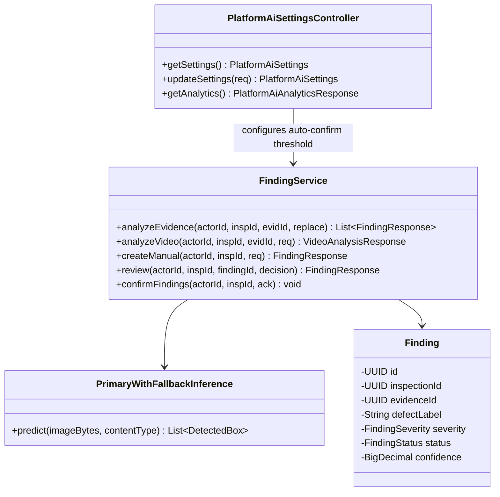

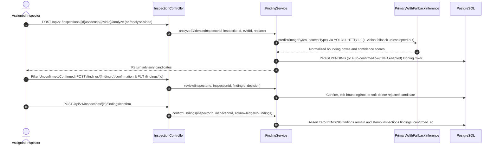

---

### 3.17 `MF3` — `FE-17` AI Case/Standard Retrieval (`pgvector` RAG), Note Drafting & Report Summary

This section presents the detailed design for `FE-17` (`DroneKnowledgeAI`): tenant-isolated `pgvector` `vector(384)` HNSW cosine search over `inspection_knowledge_chunks` and `historical_finding_cases` (`V62`, `V64` published-case backfill, `V65` local `fastembed` `paraphrase-multilingual-MiniLM-L12-v2` embeddings in `ai-inference`), automatic `HYBRID_MATCH` fallback, `POST .../draft-note` (`Draft note with AI` + batch `Draft all notes`), `ReportAiSummaryResponse.knowledgeReferences`, and Customer Mobile `KnowledgeReferencesStrip`.

#### 3.17.1 Class Diagram & RAG Sequence Diagram

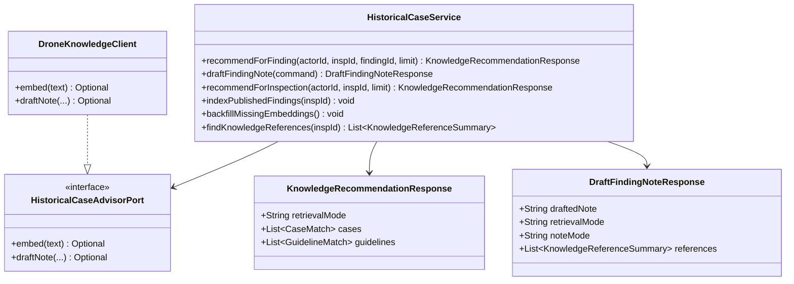

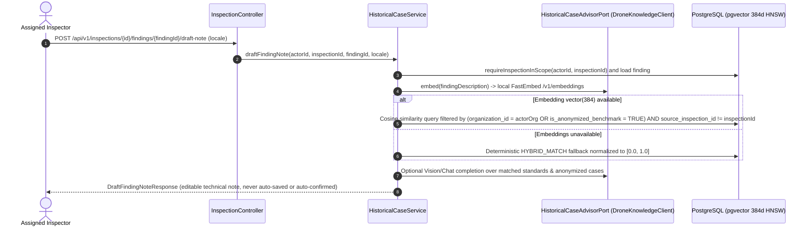

---

### 3.18 `MF4` — `FE-18` Inspection Report Compilation, Independent Review & Official Publication

This section presents the detailed design for `FE-18`: deterministic fixed-section report compilation from confirmed findings (`SUBMITTED`, `RETURNED`, `PUBLISHED`, `SUPERSEDED`), single-shot advisory narrative drafting (`ReportDraftClient` + `Matched Cases & Standards`), strict non-author independent Manager/Admin review and publication, version supersession, and on-demand A4 PDF rendering without video buffering.

#### 3.18.1 Class Diagram & Publication Sequence Diagram

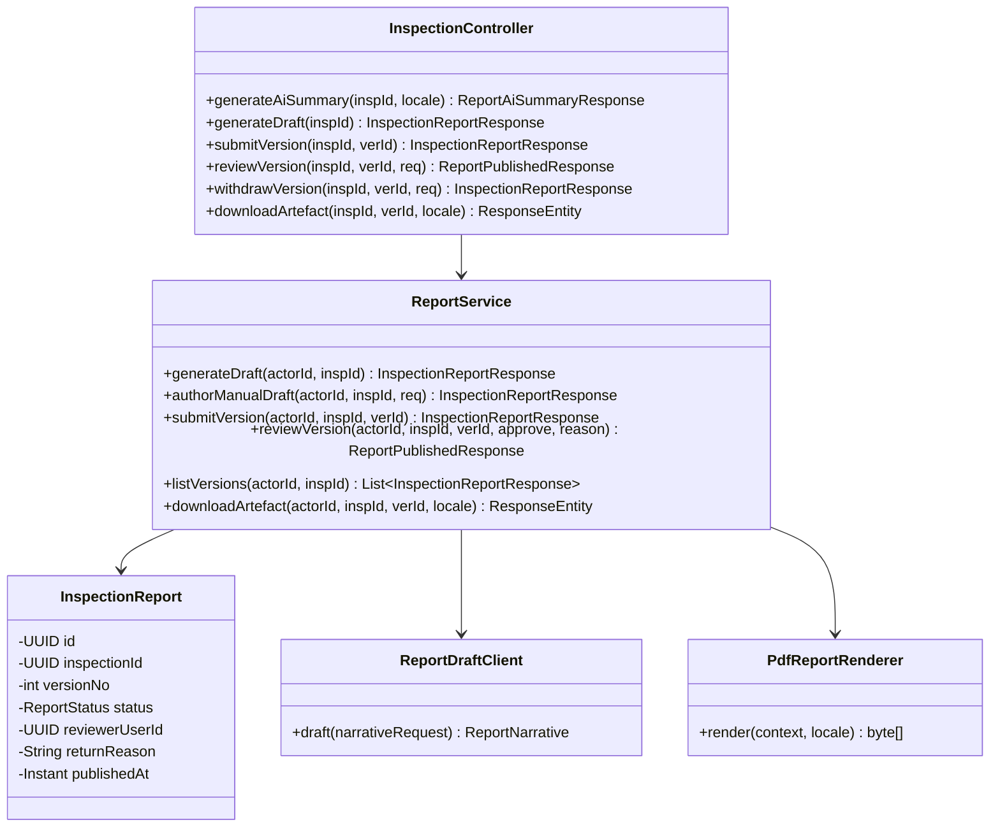

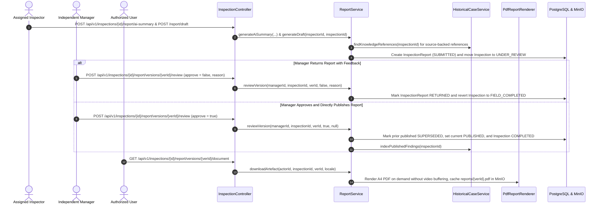

---

### 3.19 `MF4` — `FE-19` Customer Report Acceptance & Clarification Workflow

This section presents the detailed design for `FE-19`: Customer organization review of published inspection deliverables across Web and Flutter Mobile, explicit acceptance against the exact published report version (`PAYMENT_DUE`), and owning-Customer-only pre-acceptance clarification requests (`BR-41`).

**Class & Workflow Specifications**

| No | Class / Component | Description |
| :---: | :--- | :--- |
| 01 | `ContractWorkflowService.customerAcceptReport` & `InspectionReportAcceptancePort` | Verify target report is `PUBLISHED`, transition occurrence payment status to `PAYMENT_DUE`, stamp `service_invoices.customer_accepted_at` and `payment_due_at`, and block duplicate acceptance or acceptance on unpublished drafts. |
| 02 | `ReportService.requestCustomerClarification` | Restricted strictly to the owning `CUSTOMER` prior to report acceptance (`403` for `MANAGER`, `ADMIN`, `INSPECTOR`, or foreign organizations), incrementing `inspections.clarification_count` and notifying staff. |
| 03 | Web `CustomerReportDeliverablePage.tsx`, `CustomerReportSettlementCard.tsx` & Mobile Settlement Step 1 | Surface read-only official PDF deliverables (`PUBLISHED` only), Clarification dialog, and explicit **Accept report** confirmation before unlocking online checkout. |

---

### 3.20 `MF4` — `FE-20` Online Service Fee Payment (`Sepay` VietQR & `VNPay`)

This section presents the detailed design for `FE-20`: configuration-gated VND checkout, VietQR transfer-code matching (`SDI<orderCode>`) and `Authorization: Apikey` webhook verification for `Sepay` VietQR (backed by `V68` `gateway_inbound_transactions`), `VNPay v2.1.0` (`HMAC-SHA512`) IPN/Return handling with automatic terminal cancel/expiry order release (`V67` `gateway_order_created_at`), unresolved gateway order locks (`BR-47`), 3-second Web QR status polling, and authorized manual confirmation fallback.

#### 3.20.1 Sequence Diagram

```mermaid
%% title: FE-20 Sepay VietQR and VNPay Online Payment and Webhook Settlement Sequence Diagram
sequenceDiagram
  autonumber
  actor Cust as Customer
  participant Web as Web Settlement / SepayQrDialog
  participant Ctrl as ContractWorkflowController
  participant Webhooks as SepayWebhookController / VnPayWebhookController
  participant ContractSvc as ContractWorkflowService
  participant PayGW as SepayPaymentGateway / VnPayPaymentGateway
  participant InboundSvc as GatewayInboundTransactionService
  participant DB as PostgreSQL

  alt Sepay VietQR Checkout
    Cust->>Ctrl: POST /api/v1/contracts/requests/{reqId}/occurrences/{occId}/sepay/create-payment-link
    Ctrl->>ContractSvc: createSepayPaymentLink(customerId, reqId, occId)
    ContractSvc->>PayGW: createPaymentLink(orderCode, amountVnd, description, bankInfo)
    PayGW-->>Web: Return VietQR image URL and transfer content SDI<orderCode>
    loop Every 3 seconds while QR dialog is open
      Web->>Ctrl: GET .../finance (auto-closes modal when paymentStatus == PAID)
    end
    PayGW->>Webhooks: POST /api/v1/webhooks/sepay (Authorization: Apikey + JSON payload)
    Webhooks->>InboundSvc: isAlreadyHandled("SEPAY", externalId)
    Webhooks->>ContractSvc: applySepayWebhookPayment(orderCode, amount, reference)
    Webhooks->>InboundSvc: record("SEPAY", ..., Status.APPLIED | AMOUNT_MISMATCH | ORDER_NOT_FOUND | REJECTED | ERROR)
  else VNPay v2.1.0 Checkout
    Cust->>Ctrl: POST /api/v1/contracts/requests/{reqId}/occurrences/{occId}/vnpay/create-payment-url
    Ctrl->>ContractSvc: createVnPayPaymentLink(customerId, reqId, occId, clientIp)
    ContractSvc->>PayGW: createPaymentUrl(txnRef, amountVnd, clientIp)
    PayGW-->>Cust: Return signed VNPay v2.1.0 paymentUrl
    PayGW->>Webhooks: GET /api/v1/webhooks/vnpay/ipn (HMAC-SHA512 signed query params)
    Webhooks->>ContractSvc: applyVnPayPayment(orderCode, amountVnd, transactionNo)
    Note over Webhooks,ContractSvc: On cancel/timeout (vnp_ResponseCode 24/11), releaseVnPayOrderAfterFailure(orderCode); browser /return redirects to /settlement
  end

  ContractSvc->>DB: Transition ServicePayment to PAID and InspectorPayout to ELIGIBLE (publish PaymentSettledEvent)
```

**Class Specifications**

| No | Class / Component | Description |
| :---: | :--- | :--- |
| 01 | `SepayWebhookController`, `SepayPaymentGateway`, `SepayProperties` & `DisabledSepayGateway` | Generate signed-free public VietQR image URLs embedding `SDI<orderCode>`, verify `Authorization: Apikey` via constant-time SHA-256 comparison plus receiving account number and whole-VND checks, and settle `ServicePayment`; returns `HTTP 500` on unexpected runtime exceptions so Sepay retries transient failures while persisting outcomes safely via `GatewayInboundTransactionService`. |
| 02 | `GatewayInboundTransactionService` & `GatewayInboundTransaction` (`gateway_inbound_transactions`) | Persists inbound gateway outcomes (`APPLIED`, `AMOUNT_MISMATCH`, `ORDER_NOT_FOUND`, `REJECTED`, `ERROR`) in `Propagation.REQUIRES_NEW` transactions (`V68`) so audit records survive rolled-back payment attempts and already-handled deliveries are deduplicated cleanly. |
| 03 | `VnPayWebhookController`, `VnPayPaymentGateway`, `VnPayCrypto` & `DisabledVnPayGateway` | Generate signed `VNPay v2.1.0` payment URLs and verify `HMAC-SHA512` IPN/Return params (`BR-45`); browser `/return` redirects directly back to `/settlement` without settling on its own, and terminal failure codes `24` (cancelled) or `11` (timed out) release the unresolved order via `releaseVnPayOrderAfterFailure`. |
| 04 | `ContractWorkflowService` & Web `SepayQrDialog.tsx` | Prevent overwriting an active unresolved gateway order across providers (`MSG49`) using `gateway_order_created_at` (`V67`) for automatic expiry release, allow attributable Manager cancellation (`cancelUnpaidPaymentOrder`), support manual confirmation when gateways are disabled, and poll every 3 seconds in the Web UI to close `SepayQrDialog` automatically upon `PAID`. |

---

### 3.21 `MF4` — `FE-21` Payment Deadlines, Invoices & Payment Document Management

This section presents the detailed design for `FE-21`: per-occurrence `ServiceInvoice` commission/VAT/TNCN snapshots (`InspectionFinanceSettings`), `V4` configurable payment-due window (default `15` days) with one-time overdue notification (`PaymentDueExpiryService`), and downloadable non-tax-invoice notice/receipt PDFs (`PaymentDocumentService`, `PaymentDocumentRenderer`) across Web and Mobile.

**Class & Service Specifications**

| No | Class / Component | Description |
| :---: | :--- | :--- |
| 01 | `InspectionFinanceSettingsController`, `InspectionFinanceSettingsService`, `InspectionFinanceCalculator` & `ServiceInvoice` | Manage Admin finance rates (`platformCommissionRate`, `vatRate`, `tncnRate`, `paymentDueDays`) and freeze exact rate snapshots onto each occurrence's `ServiceInvoice`. |
| 02 | `PaymentDueExpiryService` (`V4`) | Stamps `service_payments.payment_due_at = accepted_at + configuredWindow` once upon report acceptance; scheduled `scanOverduePayments()` emits a single `PaymentOverdueEvent` (`payment_overdue_notified_at` guard) to owning Customer and active Managers without revoking published report access or altering `PAYMENT_DUE`. |
| 03 | `PaymentDocumentService` & `PaymentDocumentRenderer` | Expose `GET /api/v1/inspections/{id}/report/payment-document` (returning `409` before acceptance, A4 Payment Notice PDF while `PAYMENT_DUE`, and Payment Receipt PDF once `PAID`, each bearing a non-tax-invoice disclaimer); strictly scoped to owning organization, assigned Inspector, `MANAGER`, and `ADMIN` (`404` otherwise). |

---

### 3.22 `MF4` — `FE-22` Partner Inspector Payout Reconciliation

This section presents the detailed design for `FE-22`: enforcing strict separation between payout eligibility (`ELIGIBLE`) upon verified customer payment and explicit Manager-recorded partner disbursement (`PAID`), refund-hold blocking, final capped payout computation, and role-based financial masking.

**Class & UI Specifications**

| No | Class / Component | Description |
| :---: | :--- | :--- |
| 01 | `ContractWorkflowController.recordOccurrencePayout` & `InspectorPayout` | Transitions payout from `ELIGIBLE` to `PAID` only when a `MANAGER` supplies a unique external transfer reference (`payout_reference`, actor attribution, timestamp), enforcing active refund holds and post-reduction payout caps (`BR-46`). |
| 02 | `OccurrenceFinanceResponse` & Role Masking | Projects net payout, commission/TNCN deductions, refund holds, masked `inspectorRefundSummaries` (exposing payout reduction and receivable impact while omitting platform absorption, commission/VAT adjustments, and internal notes), and recovery ledgers to assigned `INSPECTOR`, full rows to `MANAGER`, while stripping internal partner settlement details from `CUSTOMER` payloads. |
| 03 | Web `OccurrenceFinanceDrawer.tsx`, `InspectorPayoutStatementCard.tsx` & `InspectorPayoutSummaryBar.tsx` | Render eligible/held/paid states, net disbursement breakdown, and Manager payout recording forms inside Workspace Settlement (`/settlement`). |

---

### 3.23 `MF4` — `FE-23` Evidence-Backed Refunds & Receivable Recovery

This section presents the detailed design for `FE-23`: Manager-initiated refunds holding unpaid payouts, external transfer completion with exact five-way accounting allocations (`service_refunds`), untransferred cancellation, individual legacy refund reconciliation, and immutable post-payout `InspectorReceivable` recovery ledgers.

**Class & Ledger Specifications**

| No | Class / Component | Description |
| :---: | :--- | :--- |
| 01 | `ContractWorkflowController` & `ServiceRefund` (`service_refunds`) | `POST .../refunds` validates captured balance (`BR-49`) and unique case-insensitive request reference to create `INITIATED` refund and hold unpaid payouts (`BR-48`); `POST .../complete` enforces a unique external reference and exact five-part sum (`inspectorPayoutReduction + platformCommission + vat + tncn + platformAbsorption == amount`); `POST .../cancel` allows cancellation only prior to completion with mandatory reason; `POST .../reconcile-allocation` reconciles legacy `COMPLETED` rows individually by refund ID. |
| 02 | `InspectorReceivable` & `InspectorReceivableRecovery` (`inspector_receivables*`) | When a completed refund follows an already-`PAID` payout, the historical payout stays immutable (`BR-50`) and an attributable `InspectorReceivable` row is created. `POST .../receivables/{id}/recover` appends manual collections under `@Version` concurrency control, capped at outstanding balance, with zero automatic future payout offsets. |
| 03 | Web `RefundControls.tsx` | Exposes four distinct Manager UI panels inside `/settlement` for refund initiation, external completion/cancellation, legacy ID reconciliation, and manual receivable collection. |

---

### 3.24 `MF4` — `FE-24` Post-Remediation Re-inspection & Defect Verification

This section presents the detailed design for `FE-24`: opening follow-up `RE_INSPECTION` occurrences linked via `source_inspection_id` against a completed published inspection, recording three-way defect comparisons (`RESOLVED`, `UNRESOLVED`, `INCONCLUSIVE`), enforcing fresh in-session evidence (`V2`), and surfacing/enforcing `RESOLVED` verdict validity expiry (`V3`, `valid_until`).

#### 3.24.1 Class Diagram & Specifications

```mermaid
%% title: FE-24 Post-Remediation Re-inspection and Verdict Validity Class Diagram
classDiagram
  class InspectionController {
    +createQuickReinspection(inspId, req) InspectionResponse
    +getReinspectionVerifications(inspId) List~ReinspectionVerificationResponse~
    +updateReinspectionVerification(inspId, verificationId, req) ReinspectionVerificationResponse
  }
  class ReinspectionVerificationService {
    +initializeVerificationsForReinspection(reinspectionId, sourceInspectionId) int
    +getVerifications(actorId, inspectionId) List~ReinspectionVerificationResponse~
    +updateVerification(actorId, inspectionId, verificationId, req) ReinspectionVerificationResponse
    +requireNoExpiredResolutions(reinspectionId) void
  }
  class ReinspectionDefectVerification {
    -UUID id
    -UUID reinspectionId
    -UUID sourceFindingId
    -UUID newEvidenceId
    -DefectResolutionStatus resolutionStatus
    -String inspectorNotes
    -Instant verifiedAt
    -Instant validUntil
  }
  InspectionController --> ReinspectionVerificationService
  ReinspectionVerificationService --> ReinspectionDefectVerification
```

| No | Class / Component | Description |
| :---: | :--- | :--- |
| 01 | `InspectionController`, `ReinspectionVerificationService` & `ReinspectionDefectVerification` (`V2`, `V3`) | Authorize re-inspection creation strictly for owning `CUSTOMER` or `MANAGER`, initialize one verification row per source `CONFIRMED` finding, restrict verdict updates to the assigned `INSPECTOR` only after `FIELD_COMPLETED` (and lock once report `SUBMITTED`/`PUBLISHED`), enforce fresh evidence from a completed field session of the current re-inspection (`EVIDENCE_NOT_FRESH`, `EVIDENCE_SESSION_MISMATCH`, `EVIDENCE_SESSION_NOT_COMPLETED`, `EVIDENCE_OUTSIDE_SESSION`, `EVIDENCE_REUSED`), and reject expired `RESOLVED` verdicts (`valid_until < now`) via `requireNoExpiredResolutions` (`RESOLUTION_EXPIRED`). |
| 02 | Web `ReinspectionVerificationSection.tsx`, `verdictExpiry.ts` (`VerdictExpiryBanner`, `ValidityNotice`) & Mobile `verdict_expiry.dart` | Render Before-vs-After comparison cards and split `RESOLVED` verdicts into lapsed vs expiring within 14 days (`VERDICT_SOON_WINDOW_MS`) on both Web and Customer Mobile (`PR #27`). |

---

### 3.25 Design Constraints and Exclusions

**No maintenance design exists.** Corrective maintenance — work orders, repair scope advisory, repair execution, completion reporting, and cost close-out — is absent from the delivered codebase. There is no maintenance package, class, endpoint, or table, so there is no retained schema to document. `reinspection_defect_verifications` is part of the inspection design, not of a maintenance design: it records the three-way comparison (`RESOLVED`, `UNRESOLVED`, `INCONCLUSIVE`) between an original finding and fresh re-observed evidence during a re-inspection, including the `V3` `valid_until` expiry of a `RESOLVED` verdict, designed under `FE-24`.

**DroneKnowledgeAI is advisory, tenant-isolated and degradation-tolerant.** `V62` creates the `pgvector` extension, `V64` backfills published historical cases, and `V65` persists `vector(384)` embeddings in `inspection_knowledge_chunks` (eight seeded engineering standards) and `historical_finding_cases` (six anonymized benchmarks plus published confirmed findings), each with an HNSW `vector_cosine_ops` index. `HistoricalCaseService` (`FE-17`) backfills missing vectors on `ApplicationReadyEvent` and queries these stores behind `HistoricalCaseAdvisorPort`, using `PGVECTOR_RAG` via local `fastembed` `/v1/embeddings` when available and deterministic `HYBRID_MATCH` otherwise, as well as `AI_VISION_RAG` for note drafting (`POST .../draft-note`). Retrieval is scoped by `(organization_id = actor org OR is_anonymized_benchmark = TRUE) AND (source_inspection_id IS NULL OR source_inspection_id <> current inspection)`, so no cross-organization PII leaks. Recommendations, drafted notes, and knowledge references never confirm a finding, publish a report, clear a location for flight, or authorize maintenance.

**Buildings only.** Building-defect classes, inspection checkpoints, and asset categories are all building-specific. No design element addresses bridges, transmission towers, solar farms, roads, dams, tunnels, ports, or pipelines.

**Separation of duties is a design constraint, not a UI convention.** The reviewer of a flight permit (`FE-13`) or an inspection report (`FE-18`) must differ from its author/uploader, enforced inside service transactions rather than only in client routing (`BR-24`, `BR-38`).

**External services never substitute for human authority.** The detection service, vision fallback, narrative drafter, DroneKnowledgeAI advisor, SmartDroneHub telemetry bridge, and airspace advisory all produce advisory or read-only outputs; official transitions require authenticated human decisions recorded with actor and timestamp.
