## 3. Detailed Design

### 3.1 Identity, Enterprise Subscription and Workforce Governance

#### 3.1.1 Class Diagram

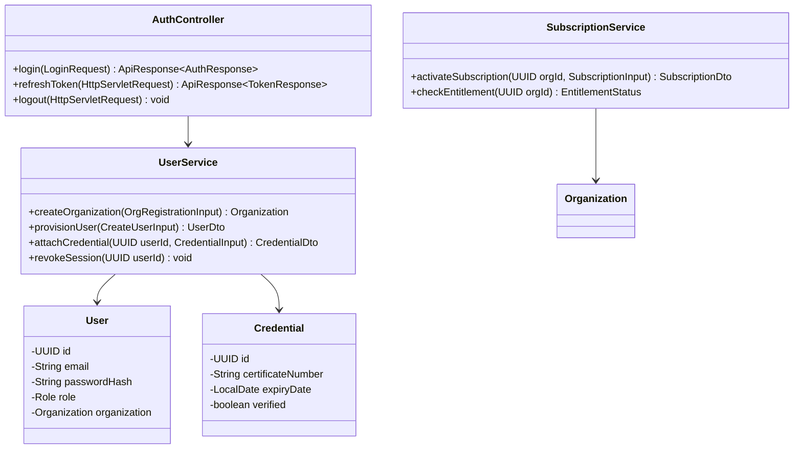

- **AuthController**: Exposes authentication endpoints for web and mobile clients; coordinates password verification and token generation.
- **UserService**: Manages tenant organization onboarding, workforce user creation, credential validation, and session revocation.
- **SubscriptionService**: Governs enterprise subscription plans, payment confirmation recording, and quota enforcement.

#### 3.1.2 User Authentication Sequence Diagram

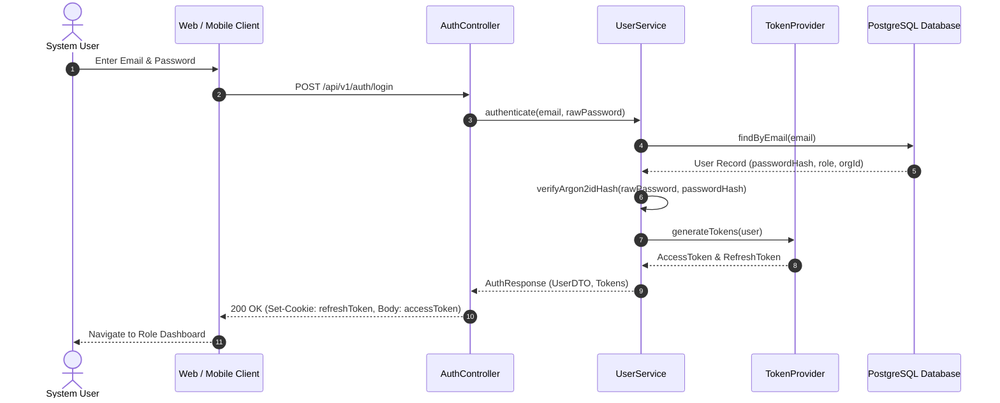

- Steps 1–3: The user submits login credentials through the client application over HTTPS.
- Steps 4–6: The authentication service verifies credentials against the database using Argon2id password hashing.
- Steps 7–9: The token provider issues a short-lived memory access token and an encrypted HttpOnly refresh token.
- Step 10: The client transitions to the authenticated operational dashboard.

#### 3.1.3 Workforce Provisioning Sequence Diagram

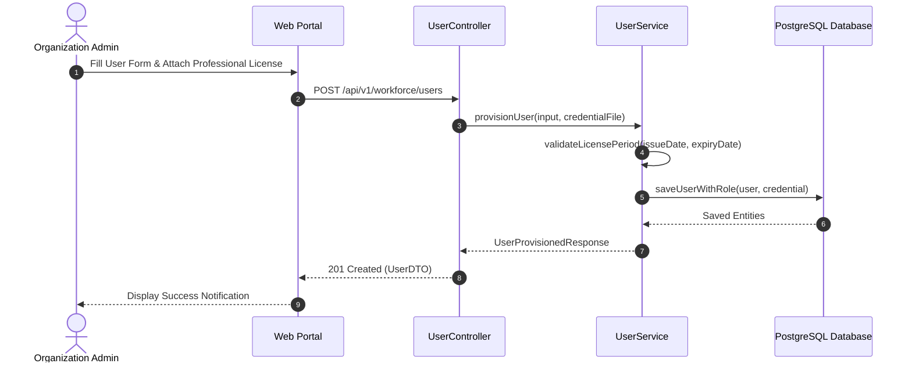

---

### 3.2 Infrastructure Asset, Equipment Fleet and Compliance Registry

#### 3.2.1 Class Diagram

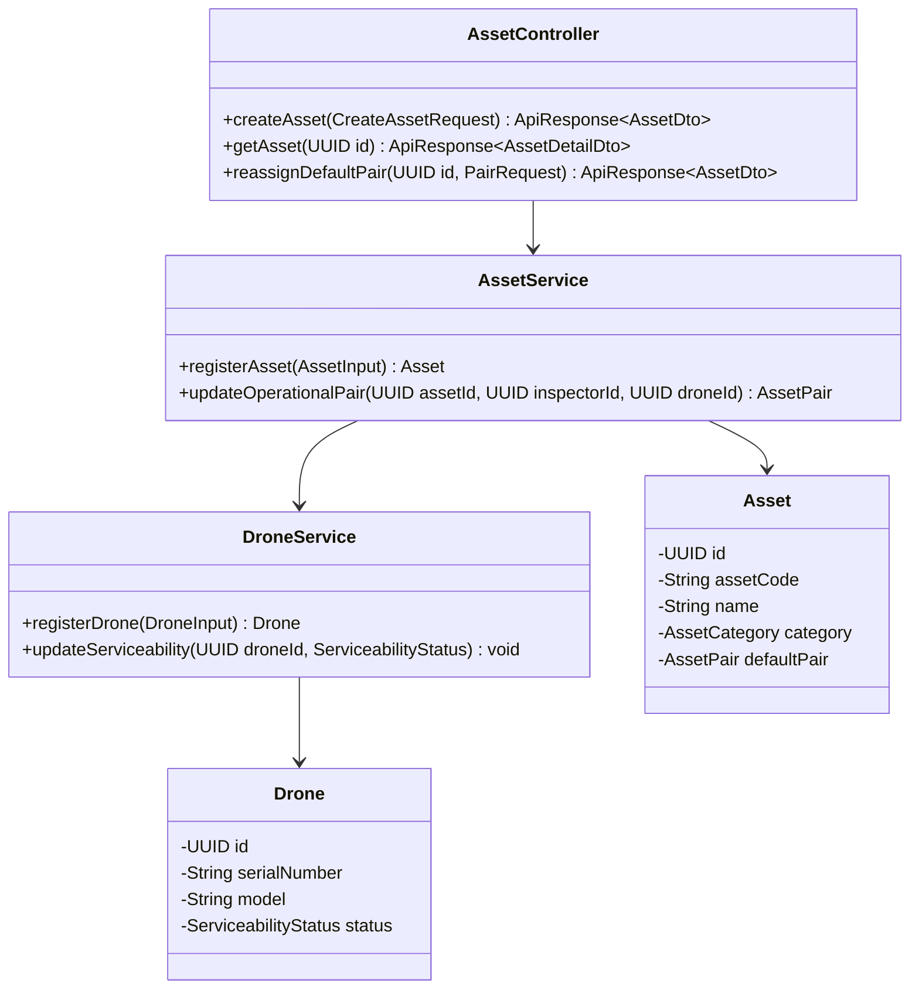

- **AssetController**: REST endpoints for asset catalog management, technical specifications, and operational pair assignments.
- **AssetService**: Enforces asset code uniqueness within organizations, atomically binds default Inspector-Drone pairs, and maintains assignment history.
- **DroneService**: Tracks drone hardware inventory, maintenance hours, and serviceability transitions.

#### 3.2.2 Asset Registration and Default Pair Assignment Sequence Diagram

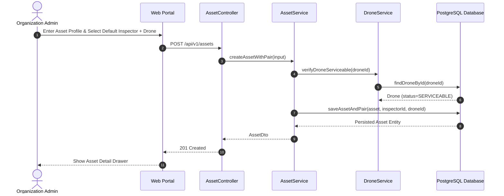

---

### 3.3 Flight Mission Planning and Readiness Authorization

#### 3.3.1 Class Diagram

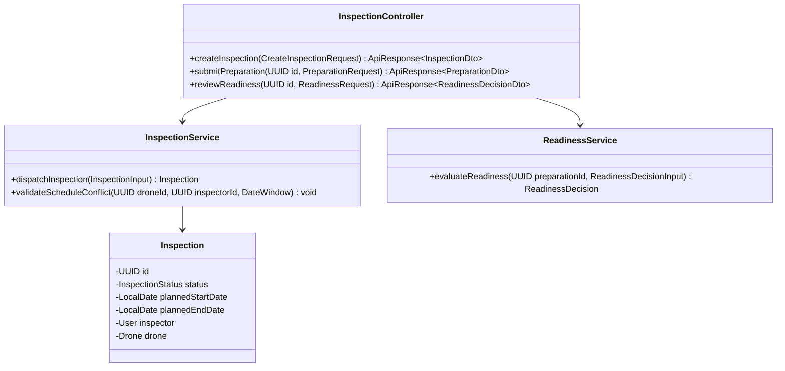

- **InspectionController**: Handles mission scheduling, preparation submissions, and administrative readiness decisions.
- **InspectionService**: Manages mission creation, validates scheduling conflicts across drone fleets, and tracks mission states.
- **ReadinessService**: Evaluates flight clearances against valid permits, pilot credentials, and weather constraints.

#### 3.3.2 Mission Dispatch and Readiness Authorization Sequence Diagram

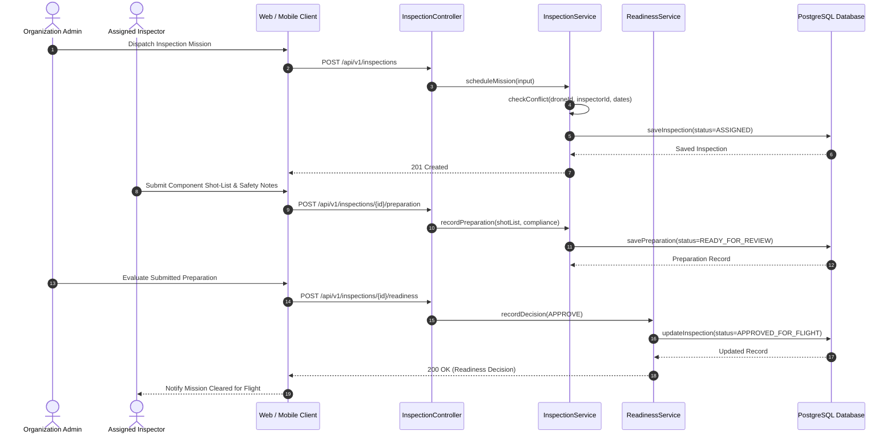

---

### 3.4 Field Survey Execution and Evidence Management

#### 3.4.1 Class Diagram

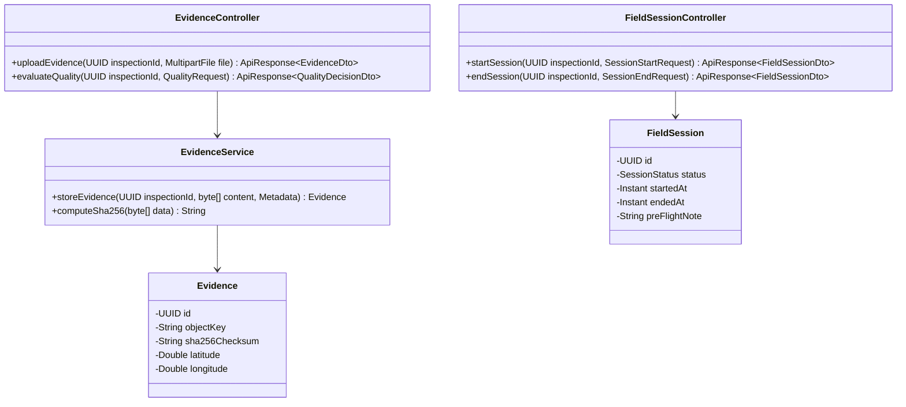

- **FieldSessionController**: On-site session tracking interface for remote pilots to record pre-flight notes and session outcomes.
- **EvidenceController**: Multi-file ingestion controller managing media streaming, checksum validation, and quality evaluations.
- **EvidenceService**: Calculates SHA-256 digests, streams binaries to MinIO object storage, and extracts embedded EXIF telemetry.

#### 3.4.2 Field Flight Session and Evidence Upload Sequence Diagram

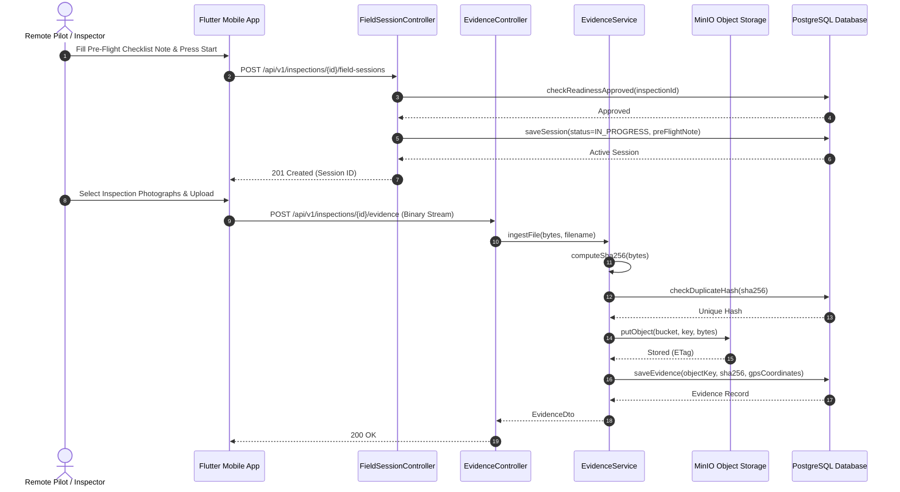

---

### 3.5 AI-Assisted Defect Detection and Inspector Verification

#### 3.5.1 Class Diagram

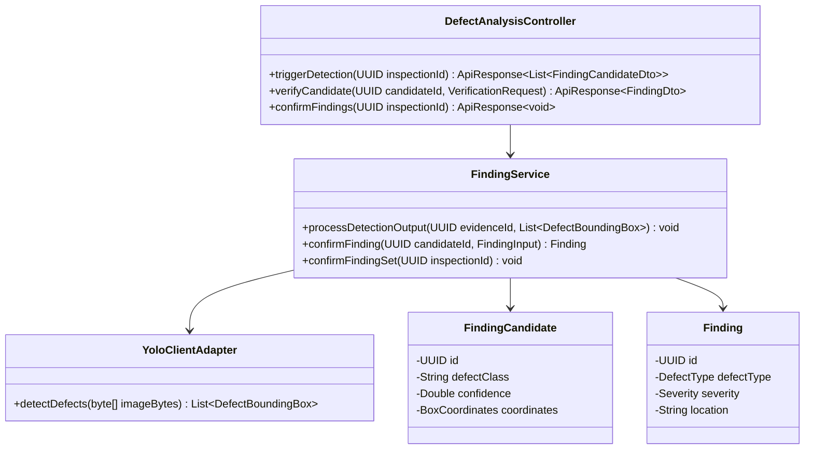

- **DefectAnalysisController**: REST endpoints for triggering computer vision analysis and recording inspector finding decisions.
- **YoloClientAdapter**: HTTP client invoking the external YOLO11s FastAPI microservice, returning parsed bounding boxes and classes.
- **FindingService**: Manages finding lifecycle transitions, converts verified candidates to official findings, and locks finding sets.

#### 3.5.2 YOLO11s Defect Detection and Verification Sequence Diagram

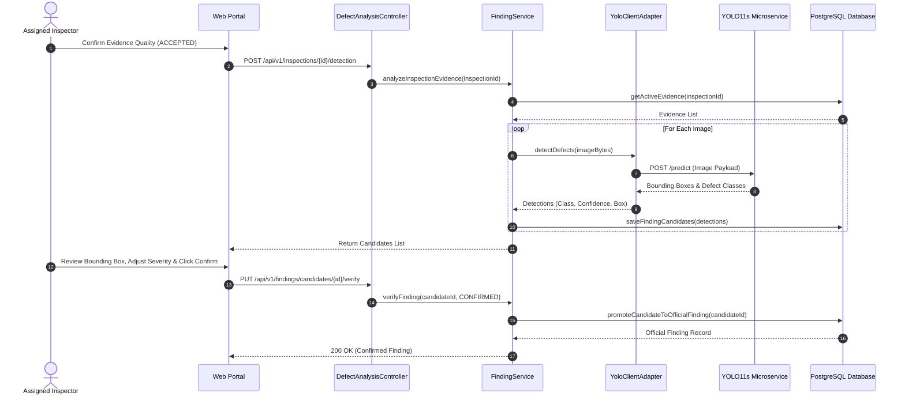

---

### 3.6 Inspection Report Drafting, Review and Publication

#### 3.6.1 Class Diagram

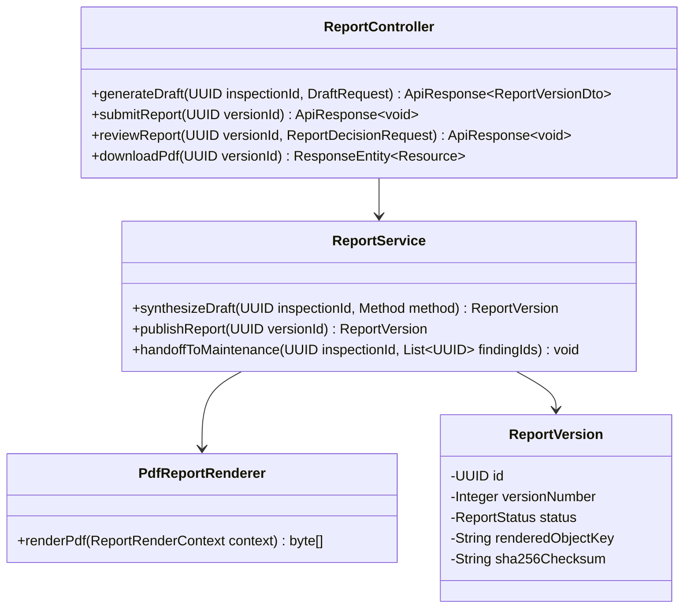

- **ReportController**: Endpoints for draft synthesis, authoring edits, administrative approval, and compiled PDF downloads.
- **ReportService**: Manages grounded prompt synthesis, section persistence, approval gate enforcement, and maintenance defect handoffs.
- **PdfReportRenderer**: Generates publication-grade A4 PDF documents from clean HTML/CSS templates via OpenHTMLtoPDF.

#### 3.6.2 Report Synthesis, Review and Immutable Publication Sequence Diagram

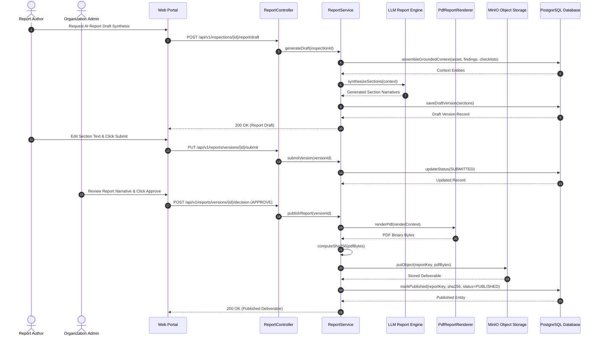

---

### 3.7 Maintenance Remediation, Cost Control and Acceptance

#### 3.7.1 Class Diagram

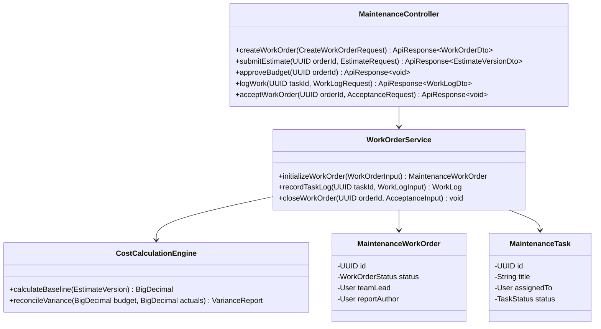

- **MaintenanceController**: Manages work orders, task planning, daily execution logging, cost estimations, and closure approvals.
- **WorkOrderService**: Orchestrates work order state transitions, enforces separation of duties, and persists repair evidence.
- **CostCalculationEngine**: Computes deterministic decimal totals for baseline budgets, approved change orders, and actual expenses.

#### 3.7.2 Work Order Planning, Cost Estimation and Technical Acceptance Sequence Diagram

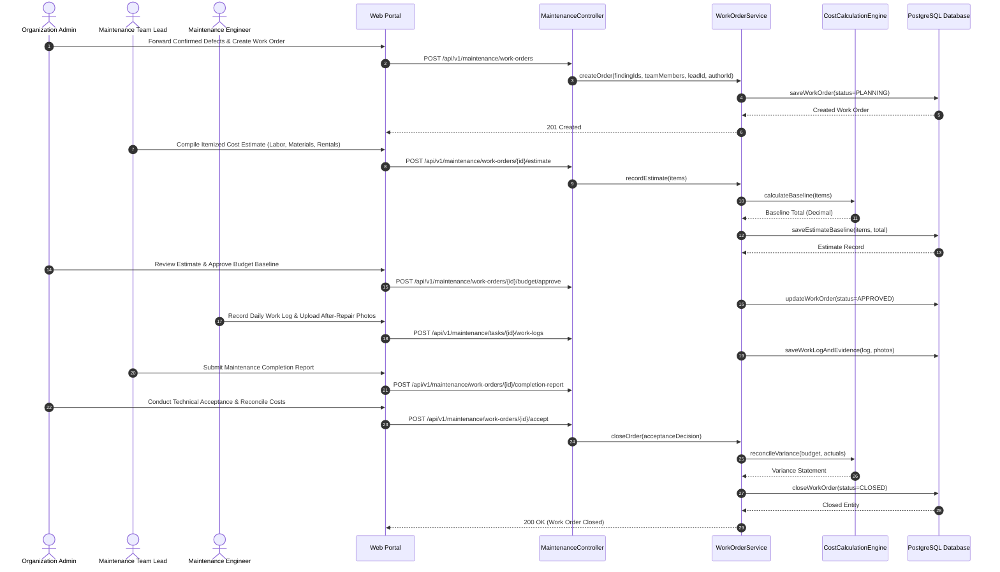

---

### 3.8 Operational Dashboard and System Notifications

#### 3.8.1 Class Diagram

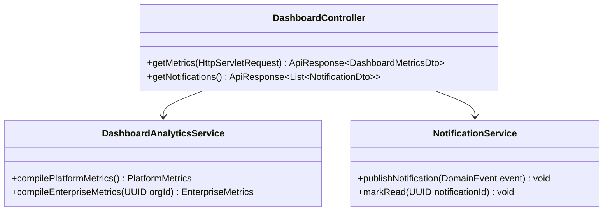

- **DashboardController**: Provides scoped metrics and active notification queues tailored to the authenticated user's role.
- **DashboardAnalyticsService**: Executes optimized aggregation queries across assets, mission statuses, defect severities, and budgets.
- **NotificationService**: Listens to published application domain events and delivers in-app alert badges and outbound email notifications.

#### 3.8.2 Event-Driven Notification Dispatch Sequence Diagram

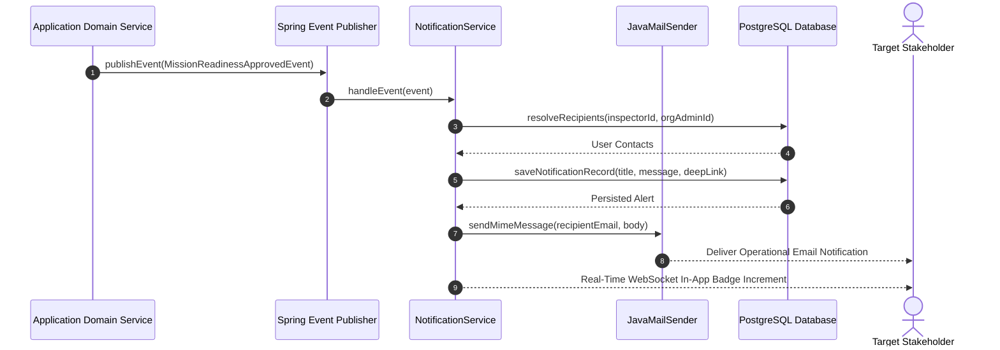
