## 3. Detailed Design
### 3.1 MF1 — FE-01 Registration, Sign-in and Account Access

This section presents the detailed design for `FE-01` (Customer organization and initial asset registration with No-Fly Zone airspace screening, Argon2id credential sign-in, consolidated OTP verification, Google OAuth 2.0 federation, JWT session rotation, and four-role `ActorZone` access control).

#### 3.1.1 Class Diagram

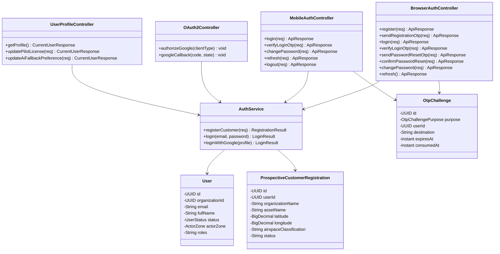

**Class Specifications**

| No | Class | Description |
| :---: | :--- | :--- |
| 01 | `BrowserAuthController` & `MobileAuthController` | Handle customer registration, email and password sign-in, one-time verification code delivery and confirmation, password reset, password change, and session token refresh for web (`HttpOnly` cookie) and mobile (`Bearer` / refresh token) clients. |
| 02 | `OAuth2Controller` | Handles federated Google OAuth 2.0 sign-in and callback redirection for web browsers and mobile deep links (`smartdrone://auth`). |
| 03 | `UserProfileController` | Allows signed-in users to retrieve their current profile (`/api/v1/users/me`), update pilot license credentials, and configure AI vision fallback preferences. |
| 04 | `AuthService` | Coordinates Argon2id credential verification, account lockout after repeated failed attempts (`LoginFailureService`), airspace screening during customer onboarding (`CustomerAirspacePolicyAdapter`), and JWT session issuance (`AccessTokenService`, `RefreshCookieService`). |
| 05 | `User` & `OtpChallenge` | Domain entities representing user accounts across the four active system roles (`ADMIN`, `MANAGER`, `CUSTOMER`, `INSPECTOR`) and consolidated time-limited OTP challenges (`LOGIN`, `REGISTRATION`, `PASSWORD_RESET`). |
| 06 | `ProspectiveCustomerRegistration` | Domain entity recording a customer organization and initial asset registration request along with its airspace classification result (`CLEAR_ZONE`, `RESTRICTED_ZONE`, `NO_FLY_ZONE`). |

#### 3.1.2 Customer Organization and Initial Asset Registration Sequence Diagram

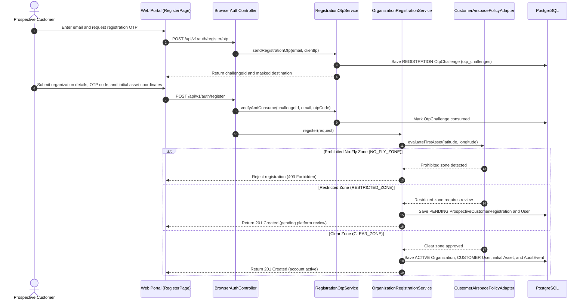

#### 3.1.3 User Sign-In, OTP Verification and Google OAuth 2.0 Sequence Diagram

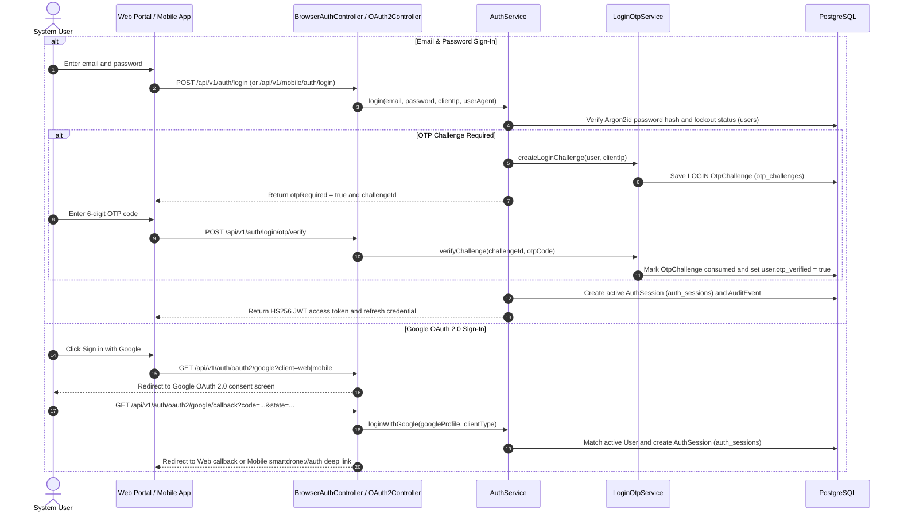

---

### 3.2 MF1 — FE-02 Partner Inspector and Drone Registration

This section presents the detailed design for `FE-02`: the public partner Inspector application with licence scan, platform review and account provisioning, the pilot-licence profile and flight-log records, and Inspector-owned drone registration against the administrator-configurable document set with platform approval.

#### 3.2.1 Class Diagram

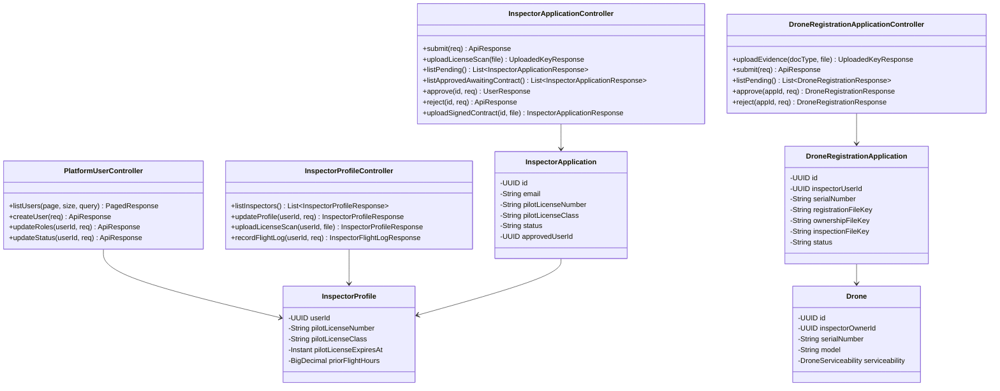

**Class Specifications**

| No | Class | Description |
| :---: | :--- | :--- |
| 01 | `PlatformUserController` & `InspectorProfileController` | Allow platform administrators and managers to provision `INSPECTOR` accounts, maintain pilot license credentials in `inspector_profiles`, upload license scans, and record flight logs in `inspector_flight_logs`. |
| 02 | `InspectorApplicationController` & `InspectorApplicationService` | Accept the public partner Inspector application and licence scan without authentication, expose the pending and approved-awaiting-contract review queues to `MANAGER` and `ADMIN`, record approval or rejection with reasons, and on approval provision the `INSPECTOR` account and its `InspectorProfile`. Record the signed partner contract after approval. |
| 03 | `DroneRegistrationApplicationController` & `DroneRegistrationApplicationService` | Handle Inspector-owned drone registration submissions with three required documents (`REGISTRATION`, `OWNERSHIP`, and `INSPECTION`) and platform review decisions. |
| 04 | `InspectorApplication`, `InspectorProfile` & `Drone` | Domain entities representing a pending partner application, an Inspector's licence and onboarding state, and an approved Inspector-owned drone. |

#### 3.2.2 Partner Inspector Application, Review and Account Provisioning Sequence Diagram

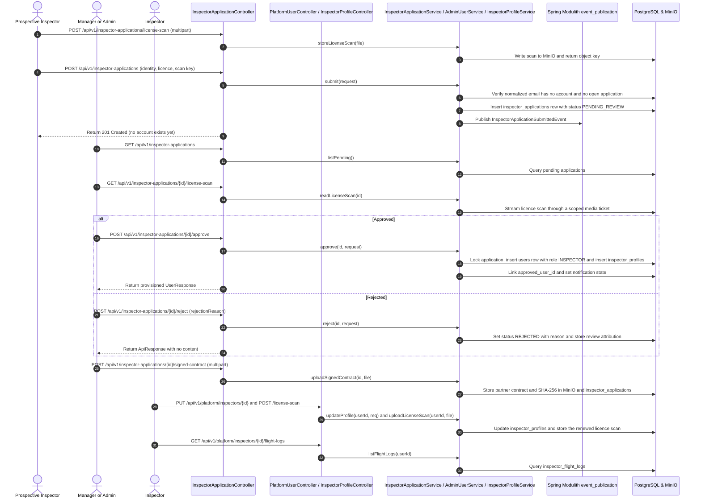

### 3.3 MF2 — FE-03 Buildings, Airspace Screening and Notifications

This section presents the detailed design for `FE-03`: the customer building catalogue with category-scoped inspection checkpoints and SHA-256 reference documents under the No-Fly Zone airspace gate, the platform review of restrictive-airspace registrations, recurring service request occurrence materialization with month-end anchoring, and deduplicated in-app notifications delivered through the Spring Modulith transactional event outbox.

#### 3.3.1 Class Diagram

```mermaid
%% title: FE-03 Building Catalogue, Occurrences and Notification Inbox Class Diagram
classDiagram
  class AssetController {
    +createAsset(req) ApiResponse
    +listAssets(page, size, query) PagedResponse
    +updateAsset(assetId, req) AssetView
    +retireAsset(assetId) AssetView
  }
  class AssetDocumentController {
    +upload(assetId, docType, file) AssetDocumentResponse
    +list(assetId) List~AssetDocumentResponse~
    +download(assetId, docId) ResponseEntity
  }
  class AirspaceReviewController {
    +listPending() List~ProspectiveCustomerRegistrationResponse~
    +approve(registrationId) ProspectiveCustomerRegistrationResponse
    +reject(registrationId, req) ProspectiveCustomerRegistrationResponse
  }
  class Asset {
    -UUID id
    -UUID ownerCustomerId
    -String assetCode
    -String name
    -BigDecimal latitude
    -BigDecimal longitude
    -AssetStatus status
  }
  class ContractWorkflowService {
    +acceptQuote(actorId, reqId, versionNo) ServiceRequestResponse
    +uploadSignedContract(actorId, reqId, file) ServiceRequestResponse
    +assignOccurrence(actorId, reqId, occId, assignReq) ServiceRequestResponse
  }
  class ServiceRequestOccurrence {
    -UUID id
    -UUID requestId
    -int occurrenceIndex
    -Instant plannedStartAt
    -Instant plannedEndAt
    -OccurrenceStatus status
  }
  class NotificationController {
    +listNotifications(page, size, unreadOnly) NotificationPageResponse
    +getUnreadCount() NotificationUnreadCountResponse
    +markRead(notificationId) NotificationResponse
  }
  class NotificationService {
    +list(userId, page, pageSize, unreadOnly) NotificationPageResponse
    +unreadCount(userId) NotificationUnreadCountResponse
    +markAsRead(userId, notificationId) NotificationResponse
  }
  class InspectionNotificationListener {
    +onInspectionAssigned(event) void
    +onFieldSessionAborted(event) void
    +onInspectionDeclined(event) void
    +onInspectionOverdue(event) void
    +onFieldSessionHung(event) void
    +onFieldSessionForceAborted(event) void
    +onInspectionRescheduled(event) void
    +onInspectionAssignmentRevoked(event) void
    +onFlightPermitSubmitted(event) void
    +onFlightPermitReviewed(event) void
  }
  class InspectorApplicationNotificationListener {
    +onApplicationSubmitted(event) void
  }
  class PilotLicenseExpiryCheckService {
    +checkExpiringLicenses() void
  }
  class Notification {
    -UUID id
    -UUID recipientUserId
    -String eventType
    -String title
    -NotificationStatus status
    -String deduplicationKey
  }
  AssetController --> Asset
  AssetDocumentController --> Asset
  ContractWorkflowService --> ServiceRequestOccurrence
  NotificationController --> NotificationService
  InspectionNotificationListener --> Notification
  InspectorApplicationNotificationListener --> Notification
  NotificationService --> Notification
```

**Class Specifications**

| No | Class | Description |
| :---: | :--- | :--- |
| 01 | `AssetController`, `AssetDocumentController` & `AirspaceReviewController` | Manage customer buildings, category-scoped inspection checkpoints (`inspection_items`), and SHA-256 engineering reference documents in MinIO, blocking building creation inside prohibited No-Fly Zones, and let `ADMIN` or `MANAGER` review pending restrictive-airspace customer registrations with a mandatory rejection reason. |
| 02 | `ContractWorkflowService` & `ServiceRequestOccurrence` | Materialize count-bound or end-date-bound `ServiceRequestOccurrence` rows with month-end anchoring when a Customer accepts a recurring quotation and the signed contract is recorded. |
| 03 | `NotificationController` & `NotificationService` | Provide the role- and organization-scoped in-app notification inbox, unread notification counter, and idempotent `SENT -> READ` updates for signed-in users. |
| 04 | `InspectionNotificationListener`, `InspectorApplicationNotificationListener` & `PaymentSettlementNotificationListener` | Consume transactional Spring Modulith domain events and persist deduplicated notifications. The inspection listener handles `InspectionAssignedEvent`, `InspectionDeclinedEvent`, `InspectionOverdueEvent`, `InspectionRescheduledEvent`, `InspectionAssignmentRevokedEvent`, `FieldSessionAbortedEvent`, `FieldSessionHungEvent`, `FieldSessionForceAbortedEvent`, `FlightPermitSubmittedEvent`, `FlightPermitReviewedEvent`, `ReportSubmittedEvent`, `ReportReturnedEvent`, and `ReportPublishedEvent`; the application listener handles `InspectorApplicationSubmittedEvent`; the payment listener handles `PaymentSettledEvent`. `PilotLicenseExpiryCheckService` runs the scheduled licence-expiry sweep rather than consuming an event. |
| 05 | `Asset` & `Notification` | Domain entities representing a customer building under the airspace gate and an in-app user notification protected by `uq_notifications_deduplication_key`. |

#### 3.3.2 Building Asset and Reference Document Registration Sequence Diagram

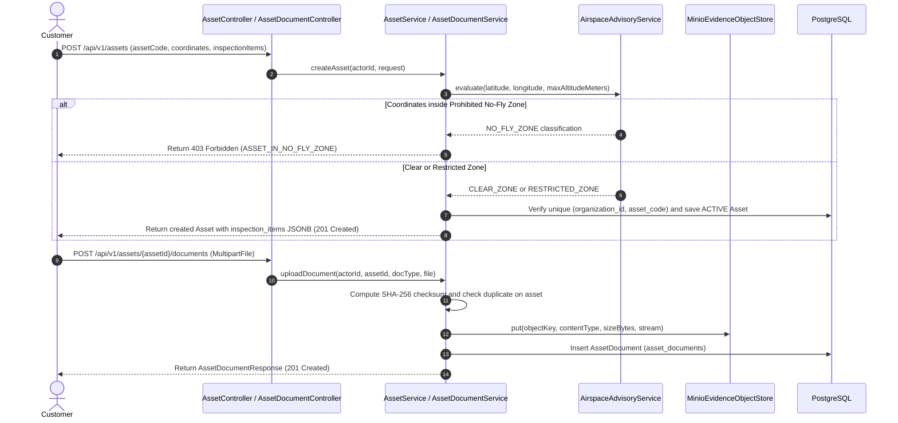

#### 3.3.3 Recurring Service Request Occurrence Materialization Sequence Diagram

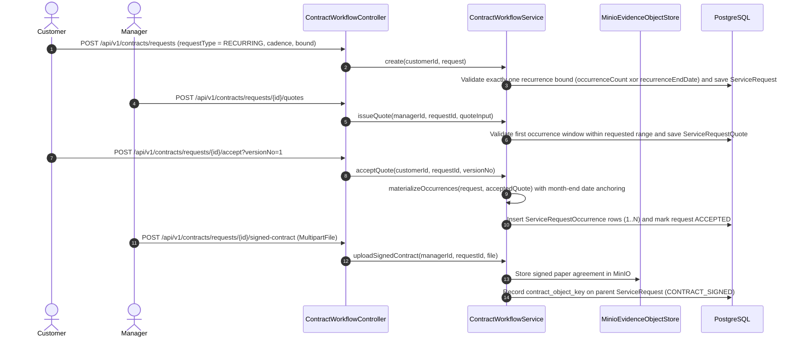

#### 3.3.4 Event-Driven Notification Inbox and Read Status Sequence Diagram

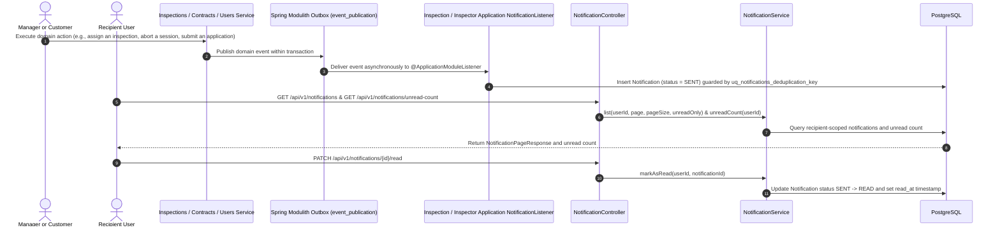

---

### 3.4 MF2 — FE-04 Service Requests, VND Quotations, Agreements and Dispatch

This section presents the detailed design for `FE-04` (request-level single-Manager ownership, serialized Manager self-claim, ADMIN-only audited assignment correction, assignment-scoped Manager details and commercial workflows, Customer-only assigned-Manager contact projection, three-dot action menu and overview, Service Request Messages inbox, single active VND quotation, signed paper contract upload, cross-organization partner Inspector and owned Drone dispatch, abort recovery dispatch, and Vietnam airspace evaluation).

#### 3.4.1 Class Diagram

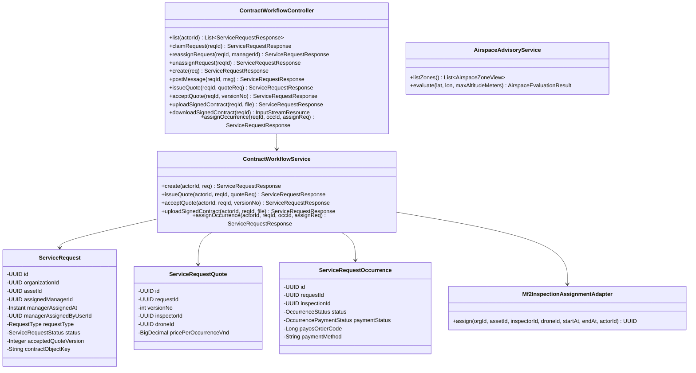

**Class Specifications**

| No | Class | Description |
| :---: | :--- | :--- |
| 01 | `ContractWorkflowController` & `ContractWorkflowService` | Manage role-scoped service requests: Managers claim unassigned rows under a pessimistic request lock, and only the assigned Manager receives detailed conversation/commercial access. ADMIN uses an assignment-only registry to assign, reassign, or unassign with audit events and cannot act as a Manager. The owning Customer alone receives the assigned active Manager contact. The Customer/Manager UI provides a three-dot menu, structured overview, request progress navigation, and left-nav Messages inbox. |
| 02 | `Mf2InspectionAssignmentAdapter` & `PartnerRegistryService` | Validate Inspector pilot license status, drone ownership, and cross-organization schedule availability before creating a scheduled inspection mission. |
| 03 | `AirspaceController` & `AirspaceAdvisoryService` | Expose Vietnam No-Fly and Restricted airspace polygons and evaluate target coordinates and altitudes using Haversine distance checks. |
| 04 | `ServiceRequest`, `ServiceRequestQuote` & `ServiceRequestOccurrence` | Domain entities representing the customer request, each proposed VND quotation version, and the individual inspection occurrences generated upon quote acceptance. |

#### 3.4.2 Service Request, Order Chat and VND Quotation Sequence Diagram

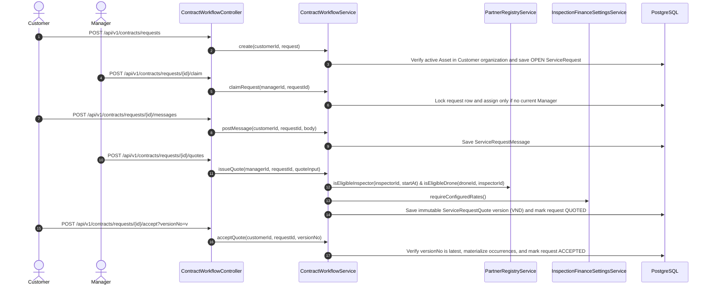

#### 3.4.3 Signed Contract Upload, Occurrence Dispatch and Airspace Check Sequence Diagram

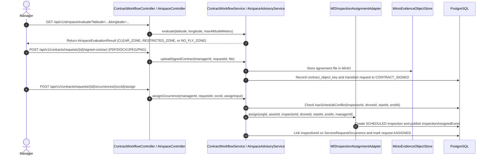

---

### 3.5 MF3 — FE-05 Flight Permit and On-site Field Sessions

This section presents the detailed design for `FE-05` (Aviation flight permit upload with pilot license validation, on-site field session execution, `SmartDroneHub` live telemetry, flight trace and MP4 video sync, session abort and Manager recovery dispatch, four-role operational dashboards, and Inspector Schedule Calendar).

#### 3.5.1 Class Diagram

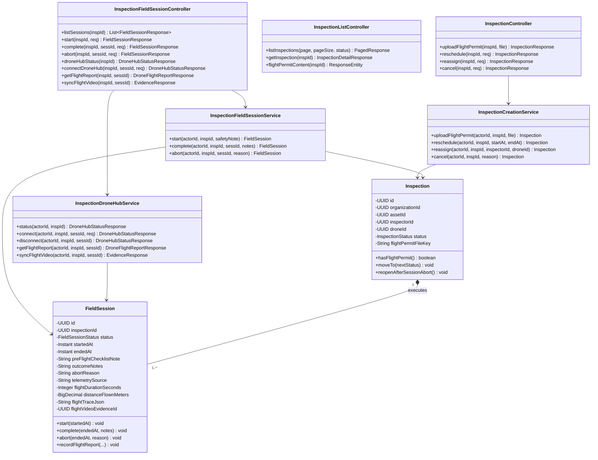

**Class Specifications**

| No | Class | Description |
| :---: | :--- | :--- |
| 01 | `InspectionController`, `InspectionListController` & `InspectionCreationService` | Handle mission flight permit uploads (checking assigned Inspector pilot license validity at upload time), scoped mission queries, flight permit streaming, and Manager recovery actions (`reschedule`, `reassign`, or `cancel`) when an on-site field session is aborted. |
| 02 | `InspectionFieldSessionController` & `InspectionFieldSessionService` | Govern on-site field session execution, enforcing that a session can start only when the inspection is `SCHEDULED` with `hasFlightPermit() == true`, and recording either normal completion (`FIELD_COMPLETED`) or session abort (`ABORTED` with mission reopen to `SCHEDULED`). |
| 03 | `InspectionDroneHubService` & `SmartDroneHubClient` | Connect an active field session to `SmartDroneHub`, stream live telemetry, persist post-flight report metrics and GPS flight traces (`flight_trace_json`) on `FieldSession`, and synchronize recorded mission MP4 videos into inspection `Evidence`. |
| 04 | `DashboardController` & `DashboardAnalyticsService` | Aggregate 5-role operational KPIs, mission queues, confirmed defect severity distributions, and inspection-service metrics only. |
| 05 | `Inspection` & `FieldSession` | Domain entities representing the 6-state inspection mission aggregate and the 4-state on-site flight session with persisted telemetry, GPS flight trace, and synced video reference (`V28`). |

#### 3.5.2 Flight Permit Gate, Field Session Execution and SmartDroneHub Sync Sequence Diagram

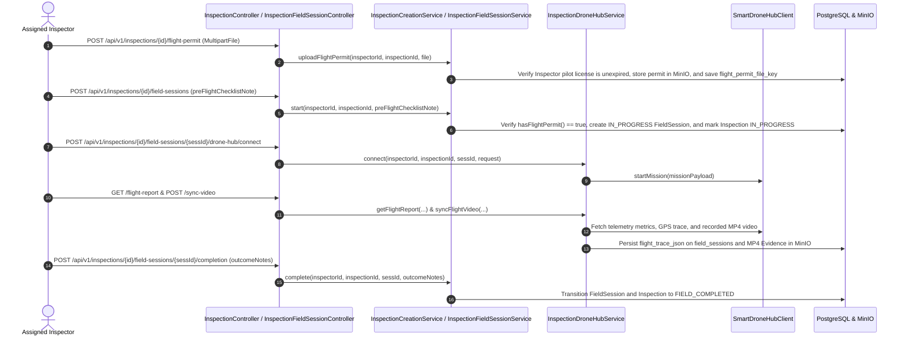

#### 3.5.3 Field Session Abort and Manager Recovery Dispatch Sequence Diagram

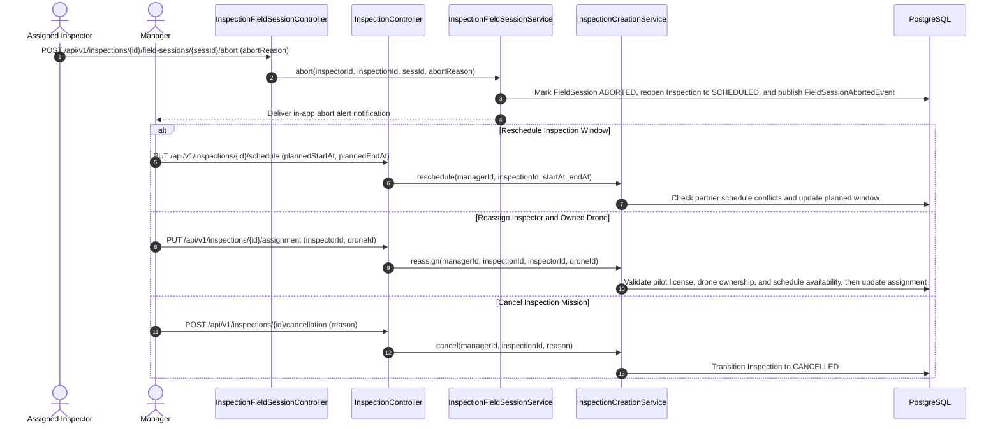

---

### 3.6 MF3 — FE-06 Evidence Intake and Human-Reviewed Defect Detection

This section presents the detailed design for `FE-06`: photograph intake with EXIF extraction and bounded normalization, resumable chunked MP4 upload with asynchronous FFmpeg transcoding and ticketed Range playback, YOLO11 defect detection with an OpenAI-compatible vision fallback, the human-reviewed findings baseline that fixes which defects become official, and tenant-isolated DroneKnowledgeAI recommendations that ground each finding in historical cases and engineering standards.

#### 3.6.1 Class Diagram

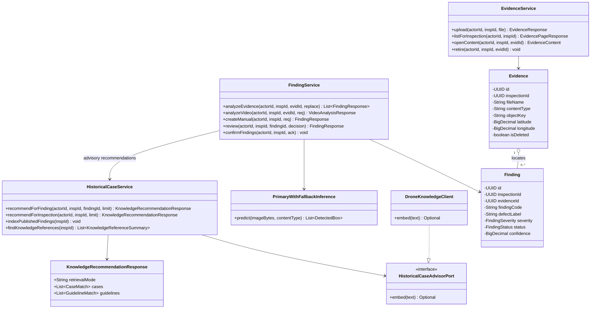

**Class Specifications**

| No | Class | Description |
| :---: | :--- | :--- |
| 01 | `EvidenceService` & `ImageNormalizer` | Extract EXIF GPS/time/orientation prior to decoding, normalize oversized (`> 2048 px`) or rotated photographs, generate `480 px` JPEG thumbnails (`?variant=thumb`), serve authenticated object reads (`HEAD`, `200`, `206` Partial Content, `416`), retry failed video processing, and soft-retire captures. |
| 02 | `EvidenceUploadSessionService` | Coordinates resumable multipart MP4 uploads up to `2 GB` (`2 GiB`) using bounded `10 MiB` chunks (`OPEN -> COMPLETING -> COMPLETED`/`FAILED`/`CANCELLED`/`EXPIRED`) through MinIO S3 multipart streaming without full-video JVM buffering, and cleans up expired/aborted sessions. |
| 03 | `VideoProcessingWorker`, `FfmpegVideoTranscoder` & `MediaTicketService` | Poll durable DB-backed `PENDING` video jobs, run argument-array FFmpeg transcoding (`<= 1080p` H.264 `+faststart` MP4 + `480 px` poster) with `raw_object_key` retained until verification or retryable failure, and mint short-lived HMAC tickets (`POST .../media-ticket` -> `GET/HEAD .../stream?ticket=...`) for native `<video>` Range playback. |
| 04 | `FindingService` & `PrimaryWithFallbackInference` | Invoke Ultralytics YOLO11 (`YoloInferenceClient`) and Vision LLM fallback (`OpenAiCompatibleInferenceClient`) defect detection on photographs and video keyframes, manage manual and AI-suggested findings, and lock the confirmed findings baseline (`inspections.findings_confirmed_at`). |
| 05 | `Evidence`, `EvidenceUploadSession` & `Finding` | Domain entities representing normalized/processed inspection media, resumable upload sessions, and AI-proposed (`PENDING`) or Inspector-confirmed (`CONFIRMED`) structural defects. |
| 06 | `HistoricalCaseService` (`inspections.service`) | Tenant-isolated advisory retrieval and AI note drafting in `inspections`. `recommendForFinding(actorId, inspectionId, findingId, limit)` and `recommendForInspection(actorId, inspectionId, limit)` first call `EvidenceService.requireInspectionInScope`, then embed the finding description and query `inspection_knowledge_chunks`/`historical_finding_cases`. `draftFindingNote(command)` combines matched cases/guidelines and optional evidence image context (`EvidenceService.readAdvisoryImage`) via `HistoricalCaseAdvisorPort` to return an editable technical note (`DraftFindingNoteResponse`) in the requested locale (`AI_VISION_RAG`, `PGVECTOR_RAG`, or deterministic `HYBRID_MATCH`). `indexPublishedFindings(inspectionId)` publishes confirmed findings with re-inspection `resolution_status` when a report is published, `backfillMissingEmbeddings()` fills null vectors on `ApplicationReadyEvent`, and `findKnowledgeReferences(inspectionId)` supplies compact references to the AI summary. |
| 07 | `HistoricalCaseAdvisorPort` (`inspections.spi`) & `DroneKnowledgeClient` (`infrastructure.ai`) | The outbound advisor port owned by `inspections` and its HTTP/1.1 adapter. `embed(text)` calls `POST /v1/embeddings` on `app.knowledge-ai.embedding-base-url` (default `http://ai-inference:8000`, serving local `fastembed` `paraphrase-multilingual-MiniLM-L12-v2` 384-dimensional vectors), returning empty on timeout, authentication failure or malformed response. `draftNote(...)` calls `/v1/chat/completions` for optional RAG + image narrative drafting. Retrieval scope is `(organization_id = actor org OR is_anonymized_benchmark = TRUE) AND (source_inspection_id IS NULL OR source_inspection_id <> current inspection)`, so no cross-organization PII leaks. |
| 08 | `KnowledgeRecommendationResponse` & `DraftFindingNoteResponse` | Advisory DTOs exposing retrieved cases/guidelines and drafted finding notes (`POST /api/v1/inspections/{inspectionId}/findings/{findingId}/draft-note`). The Web `DraftNoteAction` (`Draft note with AI`, collapsed `References`) and batch `Draft all notes (N)` toolbar button replace the inline `Similar Cases & Guide` strip (`KnowledgeRecommendationPanel`), writing drafted text only into the editable note field without auto-confirming. |

#### 3.6.2 Photo/Video Evidence Intake, YOLO11 Detection and Findings Confirmation Sequence Diagram

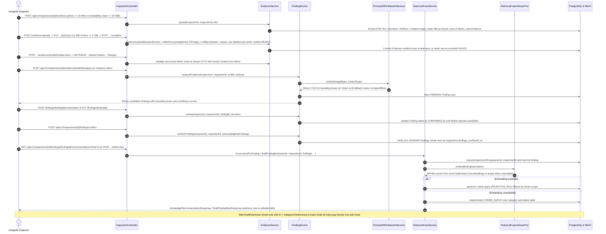

### 3.7 MF4 — FE-07 Inspection Report Preparation, Review and Publication

This section presents the detailed design for `FE-07`: the four-state inspection report lifecycle
(`SUBMITTED`, `RETURNED`, `PUBLISHED`, `SUPERSEDED`), report content compiled from the confirmed
findings and the inspected checkpoints, single-shot advisory narrative drafting enriched with
source-backed DroneKnowledgeAI references, independent Manager review of a report the reviewer did
not author, publication with automatic indexing of confirmed findings, and on-demand A4 PDF
rendering of the published version.

#### 3.7.1 Class Diagram

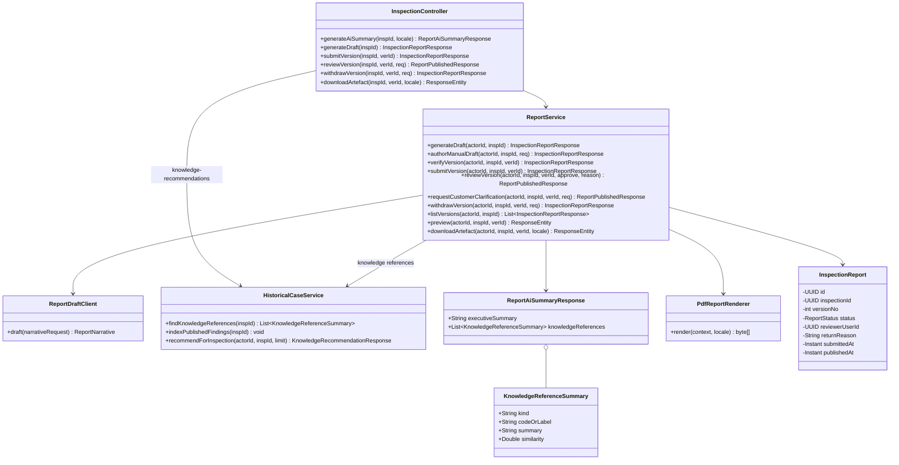

**Class Specifications**

| No | Class | Description |
| :---: | :--- | :--- |
| 01 | `InspectionController` & `ReportService` | Compile report content from the confirmed findings baseline and the inspected checkpoints, accept an authored or AI-drafted version, verify it, submit it for review, and expose the version history to authorized readers. |
| 02 | `ReportDraftClient` | Produce a single-shot advisory executive summary through the configured OpenAI-compatible endpoint. The narrative request is not itself retrieval-augmented and the rendered report falls back to the deterministic template when the model is unavailable; however `ReportService` now supplies source-backed reference strings from `HistoricalCaseService` so the summary is grounded in indexed standards and historical cases. |
| 03 | `ReportService` (review path) | Enforce independent review: a `MANAGER` or `ADMIN` who is not the author may publish the submitted version, returning the lifecycle to `FIELD_COMPLETED` on rejection with a recorded reason, or superseding an earlier published version on approval. |
| 04 | `PdfReportRenderer` | Render the published version on demand as an A4 PDF from normalized ready image bytes, skipping video binaries, caching the artefact at `reports/<versionId>.pdf` in MinIO, and streaming it to the caller. |
| 05 | `InspectionReport` | Domain entity holding the version number, lifecycle status, reviewer identity, return reason, and submission and publication timestamps. |
| 06 | `HistoricalCaseService` (report path) | `findKnowledgeReferences(inspectionId)` returns compact source-backed references from `inspection_knowledge_chunks` and tenant-visible `historical_finding_cases`; `indexPublishedFindings(inspectionId)` copies the published report's confirmed findings into `historical_finding_cases` with `is_anonymized_benchmark = FALSE`. `recommendForInspection(actorId, inspectionId, limit)` backs `GET /api/v1/inspections/{inspectionId}/knowledge-recommendations?limit=4`, which the Web report summary renders as a `Matched Cases & Standards` footer. |
| 07 | `ReportAiSummaryResponse` & `KnowledgeReferenceSummary` | `generateAiSummary` returns the advisory narrative plus `knowledgeReferences` (`kind`, `codeOrLabel`, `summary`, normalized `similarity`); the list is empty when DroneKnowledgeAI is unavailable, so the UI degrades cleanly. References are advisory only and never alter the confirmed findings or publication decision. |
| 08 | Web `ReportAiSummaryCard` & `EvidenceCaptureGroup` (`DraftNoteAction`) | `src/features/reports/ReportAiSummaryCard` renders the `Matched Cases & Standards` footer from `knowledgeReferences`, while `DraftNoteAction` inside `src/features/inspections/components/EvidenceCaptureGroup.tsx` renders `Draft note with AI` with collapsed `References` inside finding cards alongside the toolbar `Draft all notes (N)` action and confirmation status filter chips. |

#### 3.7.2 Report Submission, Manager Direct Publication and On-Demand PDF Export Sequence Diagram

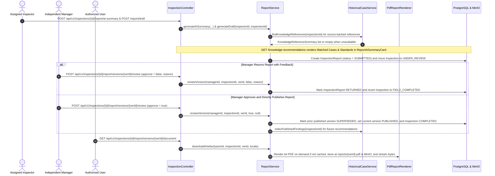

### 3.8 MF4 — FE-08 Customer Report Acceptance and Payment Settlement

This section presents the detailed design for `FE-08`: customer acceptance of a published report,
the `V4` payment-due window with a single overdue reminder and a notice/receipt PDF, VND settlement
through PayOS VietQR and VNPay with signed webhook verification, Manager-recorded partner settlement
with payouts and refunds, Inspector–Customer inspection chat with a configurable assignment-acceptance
timeout from `V61`, and the re-inspection loop opened against a published report to re-assess each
originally confirmed defect three ways with `V3` verdict validity.

#### 3.8.1 Class Diagram

```mermaid
%% title: FE-08 Customer Acceptance, Payment Settlement and Re-inspection Class Diagram
classDiagram
  class InspectionController {
    +createQuickReinspection(inspId, req) InspectionResponse
    +getReinspectionVerifications(inspId) List~ReinspectionVerificationResponse~
    +updateReinspectionVerification(inspId, verificationId, req) ReinspectionVerificationResponse
  }
  class ContractWorkflowService {
    +customerAcceptReport(custId, reqId, occId, verId) ServiceRequestResponse
    +createOccurrencePayOSCheckout(custId, reqId, occId, req) PayOSCheckoutResponse
    +createOccurrenceVnPayCheckout(custId, reqId, occId, req, ip) VnPayCheckoutResponse
    +handlePayOSWebhook(payload) void
    +handleVnPayWebhook(params) VnPayIpnResponse
    +recordOccurrencePayout(mgrId, reqId, occId, req) ServiceRequestResponse
    +initiateRefund(mgrId, reqId, occId, req) ServiceRefundResponse
    +completeRefund(mgrId, reqId, occId, refundId, req) ServiceRefundResponse
  }
  class ReinspectionVerificationService {
    +initializeVerificationsForReinspection(reinspectionId, sourceInspectionId) int
    +getVerifications(actorId, inspectionId) List~ReinspectionVerificationResponse~
    +updateVerification(actorId, inspectionId, verificationId, req) ReinspectionVerificationResponse
  }
  class PayOSWebhookController {
    +handleWebhook(payload) void
  }
  class VnPayWebhookController {
    +handleIpn(params) VnPayIpnResponse
  }
  class PaymentDocumentService {
    +download(actorId, inspId) byte[]
  }
  class InspectionChatController {
    +listThreads(actorId) List~InspectionChatThreadResponse~
    +getThread(actorId, inspId) InspectionChatThreadResponse
    +postMessage(actorId, inspId, body, files) InspectionChatThreadResponse
    +markMessagesRead(actorId, inspId) InspectionChatThreadResponse
    +downloadMessageAttachment(actorId, inspId, messageId, attachmentId) ResponseEntity
  }
  class InspectionChatService {
    +postMessage(actorId, inspId, body, files) InspectionChatThreadResponse
    +markMessagesRead(actorId, inspId) InspectionChatThreadResponse
  }
  class ServicePayment {
    -UUID id
    -UUID invoiceId
    -String provider
    -BigDecimal amountVnd
    -PaymentStatus status
    -String providerTransactionRef
    -Instant paymentDueAt
    -Instant paymentOverdueNotifiedAt
  }
  class ServiceRefund {
    -UUID id
    -UUID paymentId
    -BigDecimal amountVnd
    -RefundStatus status
    -String evidenceReference
  }
  class ReinspectionDefectVerification {
    -UUID id
    -UUID reinspectionId
    -UUID sourceFindingId
    -UUID newEvidenceId
    -DefectResolutionStatus resolutionStatus
    -String inspectorNotes
    -Instant verifiedAt
    -Instant validUntil
  }
  ContractWorkflowService --> ServicePayment
  ContractWorkflowService --> ServiceRefund
  PayOSWebhookController --> ContractWorkflowService
  VnPayWebhookController --> ContractWorkflowService
  InspectionController --> PaymentDocumentService
  InspectionChatController --> InspectionChatService
  ReinspectionVerificationService --> ReinspectionDefectVerification
```

**Class Specifications**

| No | Class | Description |
| :---: | :--- | :--- |
| 01 | `ContractWorkflowService`, `PayOSWebhookController` & `VnPayWebhookController` | Record Customer acceptance (`PAYMENT_DUE`), issue PayOS/VNPay checkout links, verify signed callbacks, and settle Customer payment (`PAID`) with Inspector payout `ELIGIBLE` only. `MANAGER` records actual payout references; unresolved orders cannot be replaced, and only provider-confirmed PayOS cancellation clears an unpaid order. Manager-recorded external refunds use a capped auditable ledger and hold payout until explicit reconciliation records the actual final payout and attribution. |
| 02 | `ServicePayment` & `ServiceRefund` | Domain entities representing a provider payment against a service invoice and an evidence-backed refund with its allocation. |
| 03 | `ReinspectionVerificationService` | Open a re-inspection against a source inspection, initialize one `ReinspectionDefectVerification` row per originally confirmed defect, and record each three-way outcome (`RESOLVED`, `UNRESOLVED`, `INCONCLUSIVE`) with the inspector's note and the supporting evidence capture. Recording is refused while the re-inspection is still `SCHEDULED` or `IN_PROGRESS`, and locked once a report for it is `SUBMITTED` or `PUBLISHED`. |
| 04 | `ReinspectionDefectVerification` | Domain entity linking the re-inspection, the source finding, the replacement evidence, and the recorded resolution status. |
| 05 | `PaymentDocumentService` (`V4`) | Renders the payment notice/receipt PDF at `GET /api/v1/inspections/{inspectionId}/report/payment-document`. On acceptance, `service_payments.payment_due_at` is set from the configurable window (default 15 days) and `payment_overdue_notified_at` guards a single overdue reminder; both deadlines are surfaced on Web and Mobile. |
| 06 | `InspectionChatController` & `InspectionChatService` (`V61`) | Inspector–Customer chat through `GET /api/v1/inspections/messages/threads`, `GET /api/v1/inspections/{inspectionId}/messages`, `POST /api/v1/inspections/{inspectionId}/messages`, `POST /{inspectionId}/messages/read`, and `GET /{inspectionId}/messages/{messageId}/attachments/{attachmentId}`. The body is capped at 4000 characters, attachments at 20 MiB each, and every read rechecks inspection scope. `platform_operations_settings.assignment_acceptance_timeout_hours` (default 24) bounds dispatch acceptance before automatic unassignment. |
| 07 | `ReinspectionVerificationService` (validity path, `V3`) | A `RESOLVED` verdict requires fresh evidence captured in the re-inspection's completed field-session window and stores `verified_at` plus a derived `valid_until`. Web `VerdictExpiryBanner` (`verdictExpiry.ts`) and Mobile `verdict_expiry.dart` split verdicts into expired and expiring-soon, so stale verdicts cannot close regressed defects. |
| 08 | Mobile Customer parity (`PR #27`) | `KnowledgeReferencesStrip` (`knowledge_references_strip.dart`), `InspectionChatPage` (`inspection_chat_page.dart`), `verdict_expiry.dart`, and payment-due/PDF document support keep the Customer Flutter app aligned with the Web portal across the published-report and re-inspection stages. |

#### 3.8.2 Customer Report Acceptance and PayOS / VNPay Online Payment Sequence Diagram

```mermaid
%% title: FE-08 Customer Report Acceptance and PayOS / VNPay Online Payment Sequence Diagram
sequenceDiagram
  autonumber
  actor Cust as Customer
  participant Ctrl as InspectionController / ContractWorkflowController
  participant Webhooks as PayOSWebhookController / VnPayWebhookController
  participant ContractSvc as ContractWorkflowService
  participant DocSvc as PaymentDocumentService
  participant PayGW as PayOSPaymentGateway / VnPayPaymentGateway
  participant DB as PostgreSQL

  Cust->>Ctrl: POST /api/v1/inspections/{id}/report/versions/{verId}/accept
  Ctrl->>ContractSvc: customerAcceptReport(customerId, requestId, occurrenceId, versionId)
  ContractSvc->>DB: Verify report is PUBLISHED and transition occurrence paymentStatus to PAYMENT_DUE
  ContractSvc->>DB: Set payment_due_at from the configurable window (default 15 days)
  Cust->>Ctrl: GET /api/v1/inspections/{id}/report/payment-document
  Ctrl->>DocSvc: download(customerId, inspectionId)
  DocSvc-->>Cust: Notice/receipt PDF carrying the due date and payment instructions

  alt PayOS VietQR Checkout
    Cust->>Ctrl: POST /api/v1/contracts/requests/{reqId}/occurrences/{occId}/payos/checkout
    Ctrl->>ContractSvc: createOccurrencePayOSCheckout(customerId, reqId, occId, req)
    ContractSvc->>PayGW: createPaymentLink(orderCode, amountVnd, description)
    PayGW-->>Cust: Return VietQR checkoutUrl and QR payload
    PayGW->>Webhooks: POST /api/v1/webhooks/payos (HMAC-SHA256 signed payload)
    Webhooks->>ContractSvc: handlePayOSWebhook(payload)
  else VNPay v2.1.0 Checkout
    Cust->>Ctrl: POST /api/v1/contracts/requests/{reqId}/occurrences/{occId}/vnpay/checkout
    Ctrl->>ContractSvc: createOccurrenceVnPayCheckout(customerId, reqId, occId, req, clientIp)
    ContractSvc->>PayGW: createPaymentUrl(txnRef, amountVnd, clientIp)
    PayGW-->>Cust: Return signed VNPay v2.1.0 paymentUrl
    PayGW->>Webhooks: GET /api/v1/webhooks/vnpay/ipn (HMAC-SHA512 signed query params)
    Webhooks->>ContractSvc: handleVnPayWebhook(params)
  end

  ContractSvc->>DB: Transition customer payment to PAID and payout to ELIGIBLE, then a Manager records the actual payout separately
  Note over ContractSvc,DB: Refund initiation occurs before manual external transfer and immediately holds any unpaid Inspector payout
```

#### 3.8.3 Refund Initiation, External Completion, Legacy Reconciliation and Receivable Recovery

Manager-only operations run under a locked occurrence transaction. `POST /contracts/requests/{requestId}/occurrences/{occurrenceId}/refunds` validates captured balance and a case-insensitive request reference, reserves the refund amount, and holds an unpaid payout before any external transfer. No gateway or bank transfer is initiated by the system. After the Manager completes the transfer outside the platform, `POST .../refunds/{refundId}/complete` accepts a unique external reference and accounting allocations whose sum exactly equals the refund. Cancellation requires a reason and is rejected after completion; hold release is recalculated against all other pending and unallocated legacy rows.

Legacy `COMPLETED` refunds with unknown allocation are reconciled one row at a time by ID through `POST .../refunds/{refundId}/reconcile-allocation`. The evidence reference, note, Manager and time are stored with the allocation. Already-paid Inspector payouts are immutable: initiation records the receivable/platform-absorption plan and completion adds an `inspector_receivables` row. Managers record actual collections separately through `POST .../receivables/{receivableId}/recover`; row locking and optimistic versioning prevent concurrent over-recovery, and the system never offsets future payouts automatically. Manager finance responses list the refund and receivable ledgers; Customer responses mask internal recovery details. The Contracts UI presents separate forms for initiation, completion/cancellation, refund-ID legacy reconciliation, and manual receivable recovery.

---

### 3.9 Design Constraints and Exclusions

**No maintenance design exists.** Corrective maintenance — work orders, repair scope advisory, repair execution, completion reporting, and cost close-out — is absent from the delivered codebase. There is no maintenance package, class, endpoint, or table, so there is no retained schema to document. `reinspection_defect_verifications` is part of the inspection design, not of a maintenance design: it records the three-way comparison between an original finding and its re-observed evidence during a re-inspection, including the `V3` `valid_until` expiry of a `RESOLVED` verdict, and that loop is designed in `FE-08`.

**DroneKnowledgeAI is advisory, tenant-isolated and degradation-tolerant.** `V62` creates the `pgvector` extension, `V64` backfills published historical cases, and `V65` persists `vector(384)` embeddings in `inspection_knowledge_chunks` (eight seeded engineering standards) and `historical_finding_cases` (six anonymized benchmarks plus published confirmed findings), each with an HNSW `vector_cosine_ops` index. `HistoricalCaseService` backfills missing vectors on `ApplicationReadyEvent` and queries these stores behind the inspections-owned `HistoricalCaseAdvisorPort`, using `PGVECTOR_RAG` via the local `fastembed` `/v1/embeddings` endpoint inside `ai-inference` when available and deterministic `HYBRID_MATCH` otherwise, as well as `AI_VISION_RAG` for localized finding note drafting (`POST .../draft-note`). Retrieval is scoped by `(organization_id = actor org OR is_anonymized_benchmark = TRUE) AND (source_inspection_id IS NULL OR source_inspection_id <> current inspection)`, so no cross-organization PII is exposed. Recommendations, drafted notes, and knowledge references never confirm a finding, publish a report, clear a location for flight, or authorize maintenance.

**Buildings only.** Building-defect classes, inspection checkpoints, and asset categories are all building-specific. No design element addresses bridges, transmission towers, solar farms, roads, dams, tunnels, ports, or pipelines.

**Separation of duties is a design constraint, not a UI convention.** The reviewer of a flight permit or a report must differ from its author, enforced by comparing the acting user against the stored author or submitter inside the service transaction. This rule is implemented in the domain services rather than in the client, so a direct API call cannot bypass it.

**External services never substitute for human authority.** The detection service, the vision fallback, the narrative drafter, the DroneKnowledgeAI case/standard advisor, and the airspace advisory all produce advisory output. None of them can confirm a finding, approve a permit, publish a report, or clear a location for flight; each of those transitions requires an authenticated human decision recorded with its actor and time.
