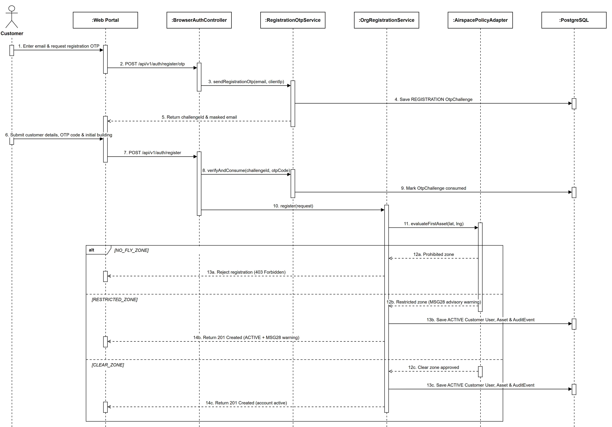
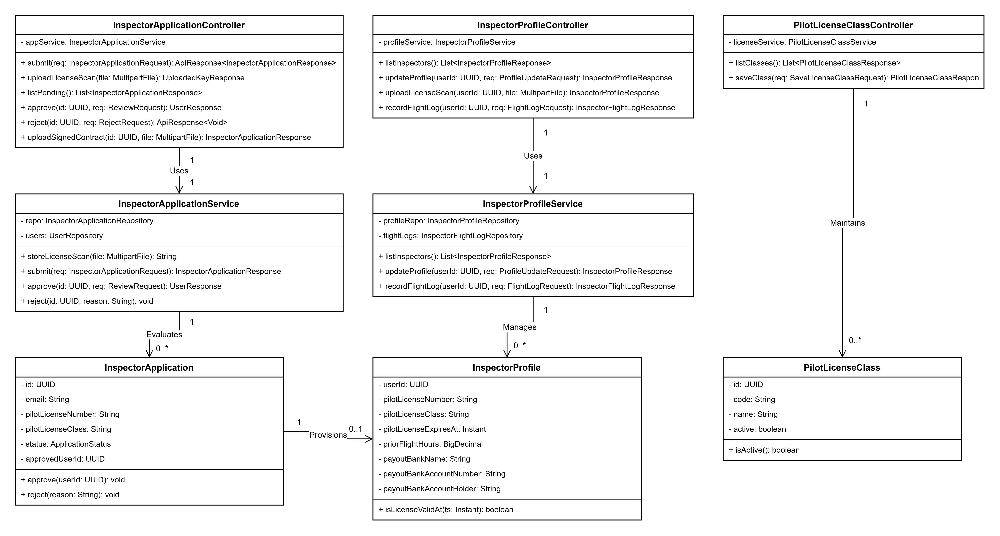
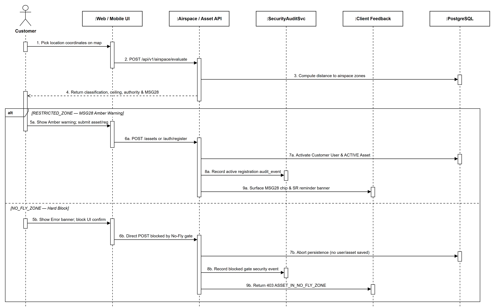
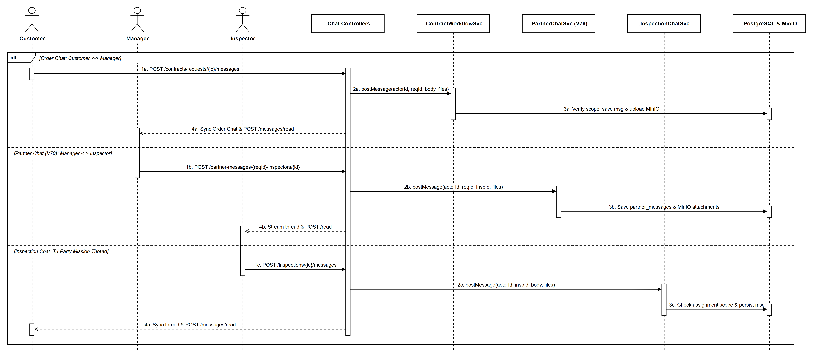
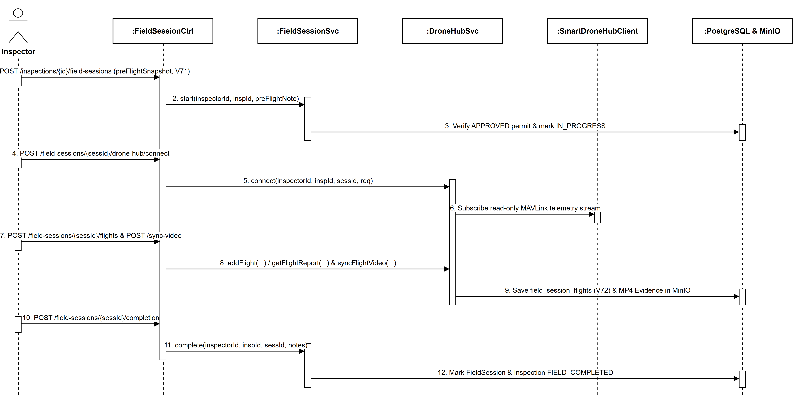
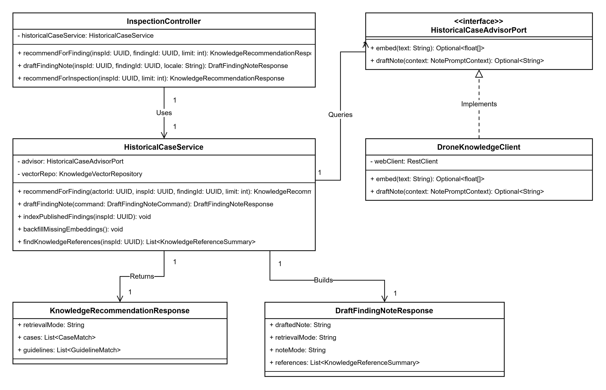
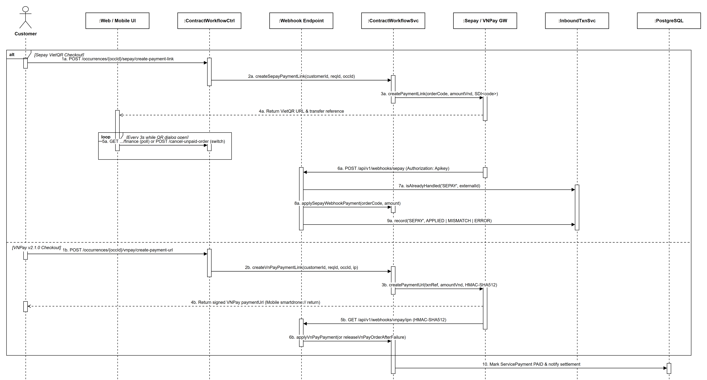
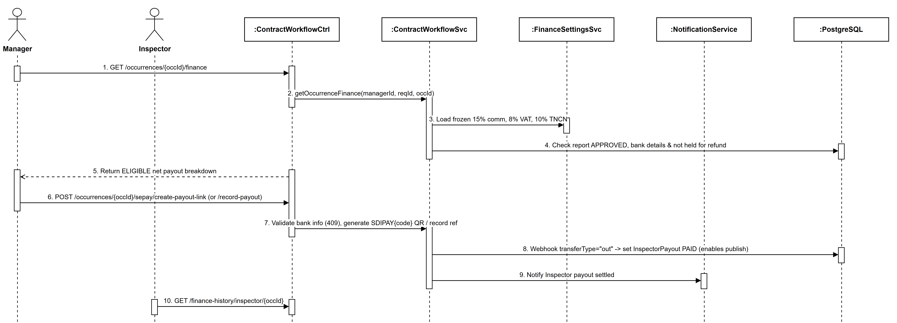

## 3. Detailed Design

### 3.1 `MF1` — `FE-01` Account Authentication, OTP & 4-Role Access Control

This section presents the detailed design for `FE-01`: Customer organization registration (with No-Fly Zone airspace gate), Argon2id credential sign-in, consolidated `REGISTRATION`/`LOGIN`/`PASSWORD_RESET` OTP challenges, Google OAuth 2.0 federation, HS256 JWT and HmacSHA256 refresh-token rotation, self-service user profile updates, platform user administration, and strict four-role access control (`ADMIN`, `MANAGER`, `CUSTOMER`, `INSPECTOR`).

#### 3.1.1 Class Diagram

Figure 4.12 models the authentication controllers, security filters, OTP/session services, and four-role user entities for `FE-01`.

*Figure 4.12 — FE-01 Account Authentication, OTP & 4-Role Access Control Class Diagram.*

**Class Specifications**

| No | Class | Description |
| :---: | :--- | :--- |
| 01 | `BrowserAuthController` & `MobileAuthController` | Handle customer registration, email/password sign-in, OTP verification and password reset, password change, and token refresh for web (`HttpOnly` cookie CSRF-protected chain) and mobile (`Bearer` / refresh token) clients. |
| 02 | `OAuth2Controller` | Handles federated Google OAuth 2.0 sign-in and callback redirection for web browsers and mobile deep links (`smartdrone://auth`). |
| 03 | `UserProfileController`, `PlatformUserController` & `AdminAuditLogController` | Allow signed-in users to manage their own profile (`/api/v1/users/me`, `vision_fallback_enabled`), let `ADMIN` provision/activate single-role platform accounts (`Last-Admin` protected), and expose append-only `audit_events`. |
| 04 | `AuthService`, `AuthRateLimitFilter` & `LoginFailureService` | Coordinates Argon2id verification, 5-failure 15-minute lockout, per-IP OTP/login throttling, and JWT issuance/rotation (`AccessTokenService`, `RefreshCookieService`). |
| 05 | `User`, `OtpChallenge` & `AuthSession` | Domain entities representing single-role users across `ADMIN`, `MANAGER`, `CUSTOMER`, and `INSPECTOR`, time-limited OTP challenges, and rotated refresh sessions. |

#### 3.1.2 Customer Organization and Initial Asset Registration Sequence Diagram

Figure 4.13 traces the self-registration, airspace zone evaluation (`NO_FLY_ZONE` gate vs `RESTRICTED_ZONE` `MSG28` advisory), and immediate account/building activation sequence.

*Figure 4.13 — FE-01A Customer Organization Registration & Restricted Airspace Advisory Sequence Diagram.*

#### 3.1.3 User Sign-In, OTP Verification and Google OAuth 2.0 Sequence Diagram

Figure 4.14 details credential sign-in, OTP verification, refresh token rotation, and Google OAuth 2.0 federation.

*Figure 4.14 — FE-01B Sign-In, OTP Challenge & Google OAuth 2.0 Sequence Diagram.*

---

### 3.2 `MF1` — `FE-02` Partner Inspector Application & Qualification Management

This section presents the detailed design for `FE-02`: the public partner Inspector application with licence scan, platform review and atomic account provisioning, the signed partner contract record, Administrator-managed UAV pilot-licence classes, pilot licence renewal, and Inspector flight logs.

#### 3.2.1 Class Diagram

Figure 4.15 illustrates the Inspector onboarding controllers, qualification services, pilot licence classes, and flight log entities.

*Figure 4.15 — FE-02 Partner Inspector Onboarding & Qualification Class Diagram.*

**Class Specifications**

| No | Class | Description |
| :---: | :--- | :--- |
| 01 | `InspectorApplicationController` & `InspectorApplicationService` | Accept unauthenticated partner applications and MinIO licence scans (`PENDING_REVIEW`), expose read-only queues to `ADMIN` and approval/rejection decisions to `MANAGER`, provision `INSPECTOR` user + `InspectorProfile` upon approval (requiring no drone at signup), record mandatory rejection reasons, and persist signed partner contracts. |
| 02 | `InspectorProfileController` & `InspectorProfileService` | Maintain pilot credentials in `inspector_profiles`, handle licence scan renewals, and store attribution flight history in `inspector_flight_logs` (`InspectorProfileController` also emits `PilotLicenseUpdatedEvent`). |
| 03 | `PilotLicenseClassController`, `PilotLicenseClassService` & `PilotLicenseExpiryCheckService` | Maintain recognized licence classes (`pilot_license_classes`) mapped to Decree 288 rules and run scheduled expiry checks notifying Inspectors and staff when licences lapse. |

#### 3.2.2 Partner Inspector Application, Review and Account Provisioning Sequence Diagram

Figure 4.16 captures the public application upload, staff approval review, and atomic account provisioning sequence.

*Figure 4.16 — FE-02 Partner Inspector Application & Onboarding Review Sequence Diagram.*

---

### 3.3 `MF1` — `FE-03` Inspector-Owned Drone Registration & Fleet Management

This section presents the detailed design for `FE-03`: Administrator configuration of required drone documents and safety/capability features, Inspector submission of owned drones with real photographs and documents, Decree 288/2025/ND-CP weight classification, review and approval, renewal, and serviceability transitions (`ACTIVE <-> IN_MAINTENANCE -> RETIRED`).

#### 3.3.1 Class Diagram & Specifications

Figure 4.17 shows the configurable document/feature catalog, drone registration, and fleet inventory classes.

*Figure 4.17 — FE-03 Inspector-Owned Drone Registration & Fleet Class Diagram.*

#### 3.3.2 Sequence Diagram

Figure 4.18 traces drone photograph/document submission, structured specification parsing, and fleet approval.

*Figure 4.18 — FE-03 Drone Registration, Evidence Upload & Approval Sequence Diagram.*

**Class Specifications**

| No | Class | Description |
| :---: | :--- | :--- |
| 01 | `DroneDocumentConfigController` & `DroneFeatureConfigController` | Manage Admin-configurable document requirements (`REGISTRATION` & `OWNERSHIP` active/required by default; `INSPECTION` optional) and outdoor flight capability/safety checklists (`drone_document_configs`, `drone_feature_configs`). |
| 02 | `DroneRegistrationApplicationController` & `DroneEvidenceUploadService` | Handle MinIO evidence upload (`>= 1` `DRONE_IMAGE` photo + configured doc types), structured specs (`mtow_kg`, `max_flight_time_minutes`, `camera_sensor` `V75`), duplicate serial checks, `MANAGER` approval into `drones` (`inspector_owner_id`, with `ADMIN` retaining read-only queue visibility), and rejection reasons. |
| 03 | `DroneController` & `DroneService` | Manage server-side paginated Inspector fleet inventory (`InspectorDroneRegistrationPage`, `#174`), registration renewal (`updateRegistration`), serviceability changes (`ACTIVE <-> IN_MAINTENANCE`, `RETIRED <-> ACTIVE` retire/reactivate `#173`), enforcing Decree 288 MTOW (`>= 2 kg` -> Class B) during eligibility checks. |

---

### 3.4 `MF1` — `FE-04` Interactive Location Map & No-Fly Zone Airspace Screening

This section presents the detailed design for `FE-04`: interactive coordinate selection on Web (`AssetLocationPickerModal` / `AirspaceNoFlyMap`) and Mobile (`AirspaceAdvisoryCard`), Vietnam restricted/no-fly zone polygon definitions, and deterministic coordinate/altitude evaluation (`AirspaceController`, `AirspaceAdvisoryService`) gating registration and building management.

#### 3.4.1 Sequence Diagram

Figure 4.19 illustrates interactive coordinate evaluation across Web and Mobile against Vietnam prohibited and restricted zones.

*Figure 4.19 — FE-04 Interactive Airspace Map & Coordinate Screening Sequence Diagram.*

**Class & UI Specifications**

| No | Component / Class | Description |
| :---: | :--- | :--- |
| 01 | `AirspaceController` (`assets.api`) | Exposes `GET /api/v1/airspace/zones` (`AirspaceZoneResponse`) and `GET`/`POST /api/v1/airspace/evaluate` (`EvaluateAirspaceRequest` -> `AirspaceEvaluationResponse`), enforcing `latitude` in `[-90, 90]` and `longitude` in `[-180, 180]`. |
| 02 | `AirspaceAdvisoryService` (`assets.service`) | Performs Haversine distance calculations against active prohibited and restricted airspace zones, returning `CLEAR_ZONE`, `RESTRICTED_ZONE`, or `NO_FLY_ZONE` plus `estimateFootprintRadiusMeters` and `findFootprintNoFlyOverlap` perimeter checks (`sqrt(area / pi)`) and advisory disclaimer (`MSG49`: screening never grants government aviation permission). |
| 03 | `CustomerAirspacePolicyAdapter` (`assets.service`) | Implements `shared.api.CustomerAirspacePolicy` and `shared.api.AirspaceZoneAdvisor` (`AirspaceZoneInfo`: zone status, code, name, authority, ceiling `maxAltitudeMeters`, advisory message) so `users` onboarding and `inspections` permit ceiling validation read airspace policy without breaking module boundaries. |
| 04 | Web `AssetLocationPickerModal.tsx`, `RestrictedAirspaceNotice.tsx` & Mobile `AirspaceAdvisoryCard` | Interactive MapLibre/map picker displaying circle overlays, zone classification pills (`MSG28`), and role-aware `RestrictedAirspaceChip` / `RestrictedAirspaceAlert` surfacing ceiling alerts, partial-coverage notices, and adjacent `NO_FLY_ZONE` footprint overlap warnings. |

---

### 3.5 `MF4` — `FE-05` Financial History & Revenue/Payment Ledger

This section presents the detailed design for `FE-05`: role-scoped financial ledgers querying settled payments, VAT breakdowns, platform commissions (`15%`), TNCN withholdings, partner payout statuses, and refund impacts across Customer, Inspector, and Manager portals.

#### 3.5.1 Sequence Diagram

Figure 4.20 outlines role-scoped financial history queries across Customer, Inspector, and Manager ledgers.

*Figure 4.20 — FE-05 Role-Scoped Financial History & Ledger Query Sequence Diagram.*

**Class & UI Specifications**

| No | Component / Class | Description |
| :---: | :--- | :--- |
| 01 | `ContractWorkflowController` (`finance-history/*` routes) | Exposes `GET /api/v1/contracts/requests/finance-history/customer`, `/inspector`, and `/manager` with `scope=REVENUE` or `scope=PAYOUTS` (plus `/{occurrenceId}` detail endpoints) backed by `ContractWorkflowService` paged/filtered ledger queries (`REVENUE` for customer-paid receipts; `PAYOUTS` for report-published eligible/settled payouts). |
| 02 | `FinanceHistoryPageResponse`, `FinanceHistoryItemResponse`, `ManagerFinanceHistoryResponse` & `OccurrenceFinanceResponse` | DTOs projecting strict role-appropriate financial fields: Customer views payment amounts, receipts, and refundable status while masking partner payouts/receivables; Inspector views gross fee, commission/TNCN deductions, and net payout; Manager views platform inflows, commission, VAT/TNCN, and reconciliation state. |
| 03 | Web `FinanceHistoryPage.tsx` & `OverviewFinanceSection.tsx` | Role-aware Web ledger views mounted at `/client/finance-history`, `/operations/finance-history`, and `/manager/finance-history`, paired with per-inspection overview financial cards. |

---

### 3.6 `MF2` — `FE-06` Building Asset Registry, Checkpoints & Reference Documents

This section presents the detailed design for `FE-06`: the six building-only categories (`AssetCategory`), customer building creation and lifecycle management (`Asset`, with dedicated `ownership_information VARCHAR(1000)` added in `V66`), category-seeded inspection checkpoints (`inspection_items`), and SHA-256 deduplicated MinIO reference documents (`AssetDocument`).

#### 3.6.1 Sequence Diagram

Figure 4.21 details building creation under the No-Fly Zone gate, checkpoint seeding/locking, and SHA-256 document uploads.

*Figure 4.21 — FE-06 Building Asset Registry, Checkpoints & Reference Documents Sequence Diagram.*

**Class Specifications**

| No | Class | Description |
| :---: | :--- | :--- |
| 01 | `AssetController`, `AssetService` & `Asset` (`assets`) | Manage server-side paginated customer buildings (`GET /api/v1/assets`, `#174`) under the `NO_FLY_ZONE` gate (`400 NO_FLY_ZONE_RESTRICTION`, while allowing `RESTRICTED_ZONE` assets with Web footprint perimeter warnings); persist plain-text ownership in `assets.ownership_information` (`varchar(1000)`, `V66__asset_ownership_information.sql`), expose `AssetResponse.checkpointsLocked` from one bulk `AssetInspectionUsagePort.inspectedAssetIds` lookup per page and reject post-inspection edits with `409 INSPECTION_HISTORY_EXISTS`, and support terminal retirement (`RETIRED`). |
| 02 | `AssetCatalogController` & `AssetCatalogService` | Maintain the six building-only `AssetCategory` templates and default `InspectionItem` checkpoints without retroactively rewriting checkpoints on existing buildings. |
| 03 | `AssetDocumentController` & `AssetDocumentService` | Validate non-empty building reference documents (`PDF`/images/drawings), enforce per-asset `SHA-256` uniqueness, store binaries under `assets/{assetId}/documents/` in MinIO, and stream downloads strictly to authorized Customer/Manager/Admin actors. |

---

### 3.7 `MF2` — `FE-07` Restricted Airspace Advisory & Warning Workflow

This section presents the detailed design for `FE-07`: surfacing `MSG28` amber restricted-airspace advisories (zone name, authority, altitude ceiling `<= X m AGL`, and `https://cambay.mod.gov.vn` guidance) during onboarding, building setup, service request creation, and flight-permit preparation while keeping `NO_FLY_ZONE` hard-blocked and eliminating the retired Admin pre-registration hold queue (`/api/v1/platform/customer-airspace-reviews` removed; `prospective_customer_registrations` retained solely as a legacy historical table).

#### 3.7.1 Sequence Diagram

Figure 4.22 models warning-only `RESTRICTED_ZONE` advisory evaluation across onboarding, building editing, and operational workflows (`NO_FLY_ZONE` still fails closed).

*Figure 4.22 — FE-07 Restricted Airspace Advisory & Warning Sequence Diagram.*

**Class & Workflow Specifications**

| No | Class / Component | Description |
| :---: | :--- | :--- |
| 01 | `CustomerAirspacePolicyAdapter` & `AirspaceZoneAdvisor` (`assets.service`) | Evaluates coordinates against restricted zones, returning `RESTRICTED_ZONE` classification, ceiling `maxAltitudeMeters`, advisory `reviewMessage` (`MSG28`), and footprint no-fly overlap checks without placing registrations on hold. |
| 02 | `AuthService` & `AssetService` | Activate `CUSTOMER` accounts and initial buildings immediately after OTP when coordinates fall in `RESTRICTED_ZONE` (returning advisory context alongside `201 Created`) while rejecting `NO_FLY_ZONE` with `403 ASSET_IN_NO_FLY_ZONE` / `400 NO_FLY_ZONE_RESTRICTION`. |
| 03 | Web `RestrictedAirspaceNotice.tsx`, `AssetsPage.tsx` & Mobile `AirspaceAdvisoryCard` | Render amber `MSG28` banners, ceiling badges, partial-coverage notes, and no-fly perimeter overlap warnings across registration, sign-in notices, building tables, service requests, and dispatch views. |

---

### 3.8 `MF2` — `FE-08` Service Requests (One-Time & Recurring) & VND Quotations

This section presents the detailed design for `FE-08`: one-time and recurring customer service requests (`>= 20` calendar-day lead time in `Asia/Ho_Chi_Minh`, `1–120` month cadence, `2–100` occurrences, concise titles `<Building> · Monthly inspection`), pessimistic Manager self-claim with immediate detail navigation, ADMIN assignment oversight, and active VND quotation negotiation.

#### 3.8.1 Sequence Diagram

Figure 4.23 traces one-time/recurring request creation, pessimistic Manager claim, checkpoint overrides, and VND quoting.

*Figure 4.23 — FE-08 Service Request, Checkpoints Snapshot & VND Quotation Sequence Diagram.*

**Class & UI Specifications**

| No | Class / Component | Description |
| :---: | :--- | :--- |
| 01 | `ContractWorkflowController` & `ContractWorkflowService` | Serve paginated request lists (`#174`), enforce 20-day lead time, generate concise recurring titles (`Monthly inspection` / `Every N-month inspection`), serialize `claimRequest` under DB locking, expose `POST /api/v1/contracts/requests/{requestId}/cancel` (`CancelServiceRequestRequest`, `ServiceRequest.cancelOpenOrQuoted()`) when `OPEN`/`QUOTED` cannot proceed (e.g., restricted permit unobtainable), expose `PUT /{requestId}/inspection-items` (locked after dispatch with `CHECKPOINTS_LOCKED`), project asset overview summary (`assetName`, `assetCode`, `assetLocationText`) + assigned Manager contact, and validate later first-occurrence quotes. |
| 02 | `ServiceRequest` & `ServiceRequestQuote` | Store request cadence/bounds, Manager assignment audit metadata, `inspection_items jsonb` (`V80`), and single active VND quotation (`V60` nullable `inspector_id`/`drone_id`, empty `requiredDroneFeatureCodes` compatible, optional `inspectionItems`). Accepted terms keep the effective first date so a revised quote cannot take effect without Customer acceptance; `isActiveRequest(...)` excludes `CONTRACT_SIGNED` requests whose occurrences are all cancelled. |
| 03 | Web `ServiceRequestListView.tsx`, `CreateRequestDialog.tsx`, `RequestOverviewCard.tsx`, `AssetOverviewDialog.tsx`, `CheckpointsOverviewDialog.tsx`, `RequestCheckpointsEditor.tsx`, `ManagerQuoteWorkspace.tsx`, `QuoteTermsSummary.tsx` | Server-paginated table + unified outer/inner role-scoped Overview, `RestrictedAirspaceAlert` + `RestrictedAirspaceChip` on restricted-zone requests (warning about partial footprint coverage & no-fly overlap), `Cancel request` button & confirmation modal in `ManagerQuoteWorkspace`, explicit start/end `datetime-local` schedule inputs, and compact `RequestCheckpointsEditor`. |

---

### 3.9 `MF2` — `FE-09` Offline Signed Contract & Occurrence Dispatch Scheduling

This section presents the detailed design for `FE-09`: Customer quotation acceptance (freezing terms snapshot & materializing month-end anchored occurrences), offline signed paper agreement upload to MinIO, partner eligibility & cross-organization schedule-conflict checks, bulk `Apply to remaining` occurrence dispatch, and abort recovery (`reschedule`, `reassign`, `cancel`).

#### 3.9.1 Class & Sequence Diagrams

Figure 4.24 shows the contract, occurrence dispatch, conflict-checking, and assignment adapter classes.

*Figure 4.24 — FE-09 Contract Workflow & Occurrence Dispatch Class Diagram.*

Figure 4.25 captures quotation acceptance, signed paper agreement upload, bulk dispatch, and occurrence cancellation.

*Figure 4.25 — FE-09 Quote Acceptance, Signed Contract Upload & Dispatch Sequence Diagram.*

**Class & UI Specifications**

| No | Class / Component | Description |
| :---: | :--- | :--- |
| 01 | `ContractWorkflowService` (`acceptQuote`, `uploadSignedContract`, `assignOccurrence`, `cancelOccurrence`) | Freezes immutable quote snapshot, materializes recurring occurrences (`Jan 31 -> Feb 28/29 -> Mar 31`), persists signed paper contracts under `contracts/requests/{id}/`, dispatches single or bulk (`Apply to remaining`) partner assignments forwarding `inspectionItems` via the 9-arg `Mf2InspectionAssignment.assign(...)` SPI (`V80`), and cancels individual non-completed occurrences via `cancelOccurrence` (`Mf2InspectionAssignment.cancelInspection(...)`) without mutating accepted-quote columns (`ck_service_requests_acceptance_v33`). |
| 02 | `PartnerRegistryService`, `Mf2InspectionAssignmentAdapter`, `InspectionCreationService`, `InspectionDroneHubService`, `ReportService` | Verify Decree 288 class match, non-expired registration/licence at planned flight timestamps, and zero cross-org schedule collisions (`hasScheduleConflict`); resolve checkpoints via `Inspection.resolveInspectionItems(...)` (`inspection.inspectionItems` with `asset.inspectionItems` fallback) across API responses, SmartDroneHub missions, and rendered reports. Reassigning a `FIELD_COMPLETED` inspection returns `409`. |
| 03 | Web `PartnerCandidateResults.tsx` & `ManagerOccurrencesStep.tsx` | Render explicit candidate table column widths with icon-only details button, bulk team assignment confirmation, `RestrictedAirspaceAlert` guidance, `Cancel flight` action on unassigned / `PENDING_ACCEPTANCE` / `DECLINED` occurrences, and Step 4 Partner Chat `Messages` deep link. |

---

### 3.10 `MF2` — `FE-10` Dual-Channel Messaging (Order Chat & Inspection Chat)

This section presents the detailed design for `FE-10`: strictly separated commercial Order Chat (`service_request_messages`, Customer <-> assigned Manager) and operational Inspection Chat (`inspection_messages` added in `V61`, Customer <-> assigned Inspector) with private MinIO attachment storage and Mobile parity.

#### 3.10.1 Sequence Diagram

Figure 4.26 illustrates the three isolated messaging channels (Order Chat, Partner Chat, and Inspection Chat) and attachment validation.

*Figure 4.26 — FE-10 Scoped Order Chat, Partner Chat & Inspection Chat Sequence Diagram.*

**Class & UI Specifications**

| No | Class / Component | Description |
| :---: | :--- | :--- |
| 01 | `ContractWorkflowController` (`/requests/{id}/messages*`) | Serves Customer <-> assigned `MANAGER` commercial order chat (`ServiceRequestMessage`, `ServiceRequestMessageAttachment`: up to 5 files, `10 MiB` per file / `20 MiB` per message, `PNG`/`JPG`/`WEBP`/`PDF`/`DOCX`), refusing `ADMIN` and non-assigned Managers. |
| 02 | `InspectionChatController` & `InspectionChatService` (`inspections.api/service`, `V61`) | Exposes `GET /inspections/messages/threads`, `GET /inspections/{id}/messages`, `POST /{id}/messages`, `POST /{id}/messages/read`, and `GET /{id}/messages/{msgId}/attachments/{attId}` scoped solely to owning `CUSTOMER` and assigned `INSPECTOR` (`ADMIN` and `MANAGER` denied), capping message text at `4000` chars and attachments at `10 MiB` per file and `20 MiB` total per message in MinIO (`inspections/{id}/messages/`). |
| 03 | `ServiceRequestPartnerChatController` & `ServiceRequestPartnerChatService` (`contracts.api/service`, `V79`) | Exposes `/api/v1/contracts/requests/{requestId}/partner-chat/**` (`threads`, `{inspectorId}/messages`, `POST .../messages`, `read`, attachment download) scoped strictly to the request's assigned `MANAGER` and active/assigned `INSPECTOR` partners, refusing `CUSTOMER`, `ADMIN`, and uninvolved actors with shared `4000`-char / 5-file / `10 MiB` / `20 MiB` limits under `contracts/requests/{requestId}/partner-messages/{inspectorId}/`. |
| 04 | `ChatAttachmentValidator` (`shared.storage`) | Validates real file magic signatures, declared MIME types, safe filenames, and size caps prior to object upload. |
| 05 | Web `RequestChatPanel.tsx` (`PartnerChatPanel`), `ContractInboxPage.tsx` (`/messages`) & Mobile `RequestChat`, `InspectionChatPage` | Deliver tabbed inboxes (`/client/messages` switching `Service requests` vs `Inspector`; `/manager/messages` switching `Customers` vs `Inspectors`; `/operations/messages` switching `Customers` vs `Managers`), Step 4 Partner Chat `Messages` button, and matching Flutter Mobile threads (`PR #27`). |

---

### 3.11 `MF2` — `FE-11` Assignment Acceptance Timeout & Escalation Handling

This section presents the detailed design for `FE-11`: the Administrator-configurable Step 4 assignment acceptance SLA (`platform_operations_settings`, `V61`) and the scheduled timeout monitor that releases unaccepted crew reservations and notifies stakeholders.

#### 3.11.1 Sequence Diagram

Figure 4.27 traces the scheduled SLA timeout sweep releasing unaccepted reservations back to the Manager queue.

*Figure 4.27 — FE-11 Assignment Acceptance SLA Timeout & Escalation Sequence Diagram.*

**Class & UI Specifications**

| No | Class / Component | Description |
| :---: | :--- | :--- |
| 01 | `PlatformOperationsSettingsController`, `PlatformOperationsSettingsService` & `PlatformOperationsSettings` (`V61`) | Admin-only endpoints (`GET/PUT /api/v1/platform/operations-settings`) configuring `assignment_acceptance_timeout_hours` (`1–720`, default `24` hours). |
| 02 | `InspectionAssignmentTimeoutMonitor` (`inspections.service`) | Scheduled monitor scanning `SCHEDULED` inspections in `PENDING_ACCEPTANCE` past `assignmentRequestedAt + timeoutHours`; atomically cancels the inspection, clears crew reservations, reverts `ServiceRequestOccurrence` to `PENDING_ASSIGNMENT` (reopening `ASSIGNED` request to `CONTRACT_SIGNED`), stamps `lastTimeoutCancelledAt`/`lastTimeoutInspectorId`, and emits `InspectionAssignmentTimedOutEvent`. |
| 03 | Web `PlatformOperationsSettingsPage.tsx` & Deep-Link Notification | Admin settings page plus actionable notifications routing the owning `MANAGER` directly to `/manager/contracts?requestId=...` to dispatch a replacement team. |

---

### 3.12 `MF2` — `FE-12` System Notifications & Alert Center

This section presents the detailed design for `FE-12`: transactional Spring Modulith outbox-driven notifications, database-level deduplication (`uq_notifications_deduplication_key`), unread counter queries, and XSS/open-redirect safe deep linking.

#### 3.12.1 Sequence Diagram

Figure 4.28 details the Spring Modulith outbox listeners, deduplicated persistence, and safe deep-link delivery.

*Figure 4.28 — FE-12 Event-Driven Notification Outbox & Inbox Sequence Diagram.*

**Class & UI Specifications**

| No | Class / Component | Description |
| :---: | :--- | :--- |
| 01 | `InspectionNotificationListener`, `ServiceRequestNotificationListener`, `InspectorApplicationNotificationListener`, `PaymentOverdueNotificationListener` & `PaymentSettlementNotificationListener` | Handle `ServiceRequestCreatedEvent`, `InspectionAssignedEvent`, `InspectionAssignmentTimedOutEvent`, `InspectionDeclinedEvent`, `InspectionOverdueEvent`, `InspectionRescheduledEvent`, `InspectionAssignmentRevokedEvent`, `FieldSessionAbortedEvent`, `FieldSessionHungEvent`, `FieldSessionForceAbortedEvent`, `FlightPermitSubmittedEvent`, `FlightPermitReviewedEvent`, `ReportSubmittedEvent`, `ReportReturnedEvent`, `ReportPublishedEvent`, `InspectorApplicationSubmittedEvent`, `PaymentOverdueEvent`, and `PaymentSettledEvent`. A new service request notifies every active Manager with the request date and a `/manager/contracts?requestId=...` deep link. |
| 02 | `NotificationController`, `NotificationService`, `CriticalLifecycleEmailService` & `Notification` | Expose recipient-scoped paged queries, unread counter, and idempotent `markAsRead` updates protected by `uq_notifications_deduplication_key`, delivering full-lifecycle bilingual EN/VI alerts (`#172`) plus critical-milestone transactional emails. |
| 03 | Web `NotificationBell.tsx`, `NotificationsPage.tsx` & `targetPath.ts` | Render real-time unread counts, notification feed, and client-side `targetPath` allowlist sanitizer blocking malformed/external links while server APIs enforce independent authorization. |

---

### 3.13 `MF3` — `FE-13` Flight Permit Upload, Self-Attestation & Restricted Airspace Gate

This section presents the detailed design for `FE-13`: assigned-Inspector flight permit submission (`<= 25 MB`, verified binary signature & `SHA-256`, structured permit metadata), Inspector self-attestation (`APPROVED` immediately upon valid upload without Manager approval gate), restricted-airspace max altitude ceiling validation via `AirspaceZoneAdvisor`, automatic re-upload reset (`PENDING_REVIEW`) when drone or schedule changes, and quick decline when a restricted-zone permit cannot be obtained.

#### 3.13.1 Sequence Diagram

Figure 4.29 captures assigned-Inspector permit upload, restricted-zone ceiling validation, immediate self-attestation, and decline handling.

*Figure 4.29 — FE-13 Flight Permit Self-Attestation, Ceiling Check & Decline Gate Sequence Diagram.*

**Class & Workflow Specifications**

| No | Class / Component | Description |
| :---: | :--- | :--- |
| 01 | `InspectionController`, `InspectionListController` & `InspectionCreationService` | Expose `POST /inspections/{id}/flight-permit` (multipart & JSON, assigned `INSPECTOR` only, `SCHEDULED` lock), `GET /inspections/{id}/flight-permit/content`, and `POST /inspections/{id}/decline` (allowing Inspector to decline pending or accepted `SCHEDULED` missions when a permit is unobtainable). On valid upload, `InspectionCreationService` evaluates asset airspace via `AirspaceZoneAdvisor`, enforces the restricted ceiling, and records `APPROVED` immediately under Inspector legal responsibility. |
| 02 | `FlightPermitPolicy` (`inspections.service`) | Validates the file signature and size (`PDF`/`PNG`/`JPG`/`WEBP`, `<= 25 MB`), permit metadata, planned flight window, and assigned drone serial. A restricted zone with a configured ceiling requires `maxAltitudeM` (`400 PERMIT_ALTITUDE_REQUIRED`). Values above the ceiling produce `400 PERMIT_ALTITUDE_EXCEEDS_ZONE_LIMIT`. A drone swap or out-of-window reschedule resets the permit to `PENDING_REVIEW` (`BR-25`). |
| 03 | Web `InspectionDetailPage.tsx`, `FieldSessionPage.tsx`, `FlightPermitVerificationPanel.tsx` & `FlightPermitPreviewDialog.tsx` | Assignment confirmation displays `RestrictedAirspaceAlert` + one-click `"Unable to obtain restricted-airspace flight permit"` decline chip; Stage 1 Permit (`showAirspace` enabled) adds `Max altitude (m)` validation against the restricted ceiling and a Stage 1 `"Unable to obtain permit / Decline"` flow before takeoff. |

---

### 3.14 `MF3` — `FE-14` On-Site Field Session & SmartDroneHub MAVLink Telemetry

Live telemetry is available to the assigned Inspector during an active field session. The owning Customer can read flight summaries and traces only after the inspection report is published. Before publication, Customer field-session responses contain progress information and omit flight data.

This section presents the detailed design for `FE-14`: drone-agnostic pre-flight/post-flight safety checklists (`V71`, `V74`), accountable `Start` / `Complete` / reasoned `Abort` field sessions, multi-flight sorties per session (`InspectionFlightController`, `FieldSessionFlight`, `V72`), read-only `SmartDroneHub` live MAVLink telemetry (`14551/udp`, `5762/tcp`) and mission video sync, non-MAVLink log import (`SRT`/`CSV`/`KML`/`GPX`), post-inspection Customer/Manager ratings with configurable criteria (`InspectorRatingController`, `RatingCriteriaConfigController`, `V70`, `V73`), abort recovery dispatch, and separated Admin vs Manager role dashboards (`#173`).

#### 3.14.1 Class Diagram

Figure 4.30 shows the field session, multi-sortie flight log, safety checklist, SmartDroneHub client, and rating entities.

*Figure 4.30 — FE-14 Field Session, Multi-Sortie Flights, SmartDroneHub & Ratings Class Diagram.*

#### 3.14.2 Field Session, SmartDroneHub Sync & Abort Recovery Sequence Diagrams

Figure 4.31 traces checklist verification, session start/completion, live MAVLink telemetry polling, and multi-flight sync.

*Figure 4.31 — FE-14A Flight Session Execution & SmartDroneHub Telemetry Sync Sequence Diagram.*

Figure 4.32 details mid-mission abort recording, crew release, and Manager replacement dispatch.

*Figure 4.32 — FE-14B Field Session Abort, Reliability Tracking & Re-dispatch Recovery Sequence Diagram.*

---

### 3.15 `MF3` — `FE-15` Field Evidence Intake & Chunked Video Processing Pipeline

This section presents the detailed design for `FE-15`: image EXIF extraction prior to decoding and `2048 px` / `480 px` normalization, resumable `10 MiB` S3 multipart MP4 uploads up to `2 GiB`, durable async FFmpeg `<= 1080p` faststart + poster transcoding, duplicate filename disambiguation (`name (1).ext`), video keyframe extraction, and short-lived HMAC ticketed HTTP Range playback.

#### 3.15.1 Sequence Diagram

Figure 4.33 models EXIF extraction, image normalization, resumable 10 MiB S3 multipart video upload, FFmpeg transcoding, and Range streaming.

*Figure 4.33 — FE-15 Evidence Intake, Chunked Multipart Upload & Video Transcoding Sequence Diagram.*

**Class & Pipeline Specifications**

| No | Class / Component | Description |
| :---: | :--- | :--- |
| 01 | `EvidenceService`, `ExifMetadataExtractor` & `ImageNormalizer` | Extract EXIF GPS/time/orientation first, normalize oversized (`> 2048 px`) or rotated photos (`<= 10 MB`), emit `480 px` JPEG thumbnails (`?variant=thumb`), disambiguate duplicate filenames sequentially (`MSG17`), promote video keyframes (`<= 1280x720`), and enforce inspection read scope (`EvidenceOwnershipService`). |
| 02 | `EvidenceUploadSessionService` (`evidence_upload_sessions`) | Manages `OPEN -> COMPLETING -> COMPLETED`/`FAILED`/`CANCELLED`/`EXPIRED` resumable multipart uploads up to `2 GiB` in `10 MiB` chunks directly via MinIO S3 multipart without full-file JVM buffering. |
| 03 | `VideoProcessingWorker`, `FfmpegVideoTranscoder` & `MediaTicketService` | Poll `PENDING` video jobs (`max-concurrent-jobs: 2`), transcode via argument-array `ffmpeg` (`<= 1080p` H.264 `+faststart` MP4 + `480 px` poster) retaining `raw_object_key` until verified `READY` (retryable on `FAILED`), and mint 5-minute HMAC streaming tickets (`GET/HEAD .../stream?ticket=...` supporting `200`/`206`/`416`/`If-Range`). |
| 04 | Web `InspectionEvidencePage.tsx`, `EvidenceCaptureGroup.tsx`, `VideoFrameCropDialog.tsx` & `EvidenceGpsMapDialog.tsx` | Workspace Stage 5 upload queue, native `<video>` Range player (`AuthenticatedMedia`), EXIF map inspection, and frame promotion UI. |

---

### 3.16 `MF3` — `FE-16` AI Defect Detection (`YOLO11` + Vision Fallback) & Findings Confirmation

This section presents the detailed design for `FE-16`: Ultralytics `YOLO11s` (`MBDD2025`, 5 building classes: `crack`, `leakage`, `abscission`, `corrosion`, `bulge`), Vision LLM fallback respecting per-user opt-out (`vision_fallback_enabled`), `V63` `70.00` default auto-confirm threshold (`platform_ai_settings`), confirmation status filter chips, manual finding entry (`confidence = null`), normalized `[0, 1]` bounding boxes, and explicit baseline confirmation.

#### 3.16.1 Class Diagram & Sequence Diagram

Figure 4.34 shows the YOLO11/Vision client ports, finding persistence entities, and configurable AI threshold settings.

*Figure 4.34 — FE-16 AI Defect Detection (`YOLO11` + Vision Fallback) & Findings Class Diagram.*

Figure 4.35 traces defect inference, Vision LLM fallback, auto-confirmation threshold evaluation, and Inspector review.

*Figure 4.35 — FE-16 YOLO11 Defect Inference & Inspector Confirmation Sequence Diagram.*

---

### 3.17 `MF3` — `FE-17` AI Case/Standard Retrieval (`pgvector` RAG), Note Drafting & Report Summary

This section presents the detailed design for `FE-17` (`DroneKnowledgeAI`): tenant-isolated `pgvector` `vector(384)` HNSW cosine search over `inspection_knowledge_chunks` and `historical_finding_cases` (`V62`, `V64` published-case backfill, `V65` local `fastembed` `paraphrase-multilingual-MiniLM-L12-v2` embeddings in `ai-inference`), automatic `HYBRID_MATCH` fallback, `POST .../draft-note` (`Draft note with AI` + batch `Draft all notes`), `ReportAiSummaryResponse.knowledgeReferences`, and Customer Mobile `KnowledgeReferencesStrip`.

#### 3.17.1 Class Diagram & RAG Sequence Diagram

Figure 4.36 illustrates the DroneKnowledgeAI ports, local fastembed embedding client, and pgvector HNSW stores.

*Figure 4.36 — FE-17 DroneKnowledgeAI `pgvector` RAG & Advisory Summary Class Diagram.*

Figure 4.37 captures hybrid/pgvector historical case retrieval, note drafting, and executive report summary generation.

*Figure 4.37 — FE-17 `pgvector` Retrieval, Advisory Draft & Summary Sequence Diagram.*

---

### 3.18 `MF4` — `FE-18` Inspection Report Compilation, Independent Review & Official Publication

This section presents the detailed design for `FE-18`: deterministic fixed-section report compilation from confirmed findings (`SUBMITTED`, `APPROVED` added in `V76`, `RETURNED`, `PUBLISHED`, `SUPERSEDED`), single-shot advisory narrative drafting (`ReportDraftClient` + `Matched Cases & Standards`), strict non-author independent `MANAGER` review (`ADMIN` read-only, `reviewVersion` -> `APPROVED`), payout gate verification (`InspectorPayout.PAID`), explicit publication (`publishVersion` -> `PUBLISHED`), version supersession, and on-demand A4 PDF rendering without video buffering.

#### 3.18.1 Class Diagram & Publication Sequence Diagram

Figure 4.38 models inspection report versioning, non-author review separation, payout gating, and PDF rendering classes.

*Figure 4.38 — FE-18 Inspection Report Review & PDF Publication Class Diagram.*

Figure 4.39 traces deterministic report compilation, independent Manager approval, payout verification, and official publication.

*Figure 4.39 — FE-18 Inspection Report Review, Approval Gate & PDF Export Sequence Diagram.*

---

### 3.19 `MF4` — `FE-19` Customer Report Acceptance & Clarification Workflow

This section presents the detailed design for `FE-19`: Customer organization review of published inspection deliverables across Web and Flutter Mobile, explicit acceptance against the exact published report version (`PAYMENT_DUE`), and owning-Customer-only pre-acceptance clarification requests (`BR-41`).

#### 3.19.1 Sequence Diagram

Figure 4.40 details Customer report review, pre-acceptance clarification requests, and explicit acceptance triggering payment due.

*Figure 4.40 — FE-19 Customer Report Acceptance & Clarification Sequence Diagram.*

**Class & Workflow Specifications**

| No | Class / Component | Description |
| :---: | :--- | :--- |
| 01 | `ContractWorkflowService.customerAcceptReport` & `InspectionReportAcceptancePort` | Verify target report is `PUBLISHED`, transition occurrence payment status to `PAYMENT_DUE`, stamp `service_invoices.customer_accepted_at` and `payment_due_at`, and block duplicate acceptance or acceptance on unpublished drafts. |
| 02 | `ReportService.requestCustomerClarification` | Restricted strictly to the owning `CUSTOMER` prior to report acceptance (`403` for `MANAGER`, `ADMIN`, `INSPECTOR`, or foreign organizations), incrementing `inspections.clarification_count` and notifying staff. |
| 03 | Web `CustomerReportDeliverablePage.tsx`, `CustomerReportSettlementCard.tsx` & Mobile Settlement Step 1 | Surface read-only official PDF deliverables (`PUBLISHED` only), Clarification dialog, and explicit **Accept report** confirmation before unlocking online checkout. |

---

### 3.20 `MF4` — `FE-20` Online Service Fee Payment (`Sepay` VietQR & `VNPay`)

This section presents the detailed design for `FE-20`: configuration-gated VND checkout, VietQR transfer-code matching (`SDI<orderCode>`) and `Authorization: Apikey` webhook verification for `Sepay` VietQR (backed by `V68` `gateway_inbound_transactions`), `VNPay v2.1.0` (`HMAC-SHA512`) IPN/Return handling with automatic terminal cancel/expiry order release (`V67` `gateway_order_created_at`), unresolved gateway order locks (`BR-47`), 3-second Web QR status polling, and authorized manual confirmation fallback.

#### 3.20.1 Sequence Diagram

Figure 4.41 illustrates Sepay VietQR polling and VNPay HMAC-SHA512 IPN/Return settlement with idempotent inbound logging.

*Figure 4.41 — FE-20 `Sepay` VietQR & `VNPay` Online Settlement Sequence Diagram.*

**Class Specifications**

| No | Class / Component | Description |
| :---: | :--- | :--- |
| 01 | `SepayWebhookController`, `SepayPaymentGateway`, `SepayProperties` & `DisabledSepayGateway` | Generate signed-free public VietQR image URLs embedding `SDI<orderCode>`, verify `Authorization: Apikey` via constant-time SHA-256 comparison plus receiving account number and whole-VND checks, and settle `ServicePayment`; returns `HTTP 500` on unexpected runtime exceptions so Sepay retries transient failures while persisting outcomes safely via `GatewayInboundTransactionService`. |
| 02 | `GatewayInboundTransactionService` & `GatewayInboundTransaction` (`gateway_inbound_transactions`) | Persists inbound gateway outcomes (`APPLIED`, `AMOUNT_MISMATCH`, `ORDER_NOT_FOUND`, `REJECTED`, `ERROR`) in `Propagation.REQUIRES_NEW` transactions (`V68`) so audit records survive rolled-back payment attempts and already-handled deliveries are deduplicated cleanly. |
| 03 | `VnPayWebhookController`, `VnPayPaymentGateway`, `VnPayCrypto` & `DisabledVnPayGateway` | Generate signed `VNPay v2.1.0` payment URLs and verify `HMAC-SHA512` IPN/Return params (`BR-45`); browser `/return` redirects directly back to `/settlement` without settling on its own, and terminal failure codes `24` (cancelled) or `11` (timed out) release the unresolved order via `releaseVnPayOrderAfterFailure`. |
| 04 | `ContractWorkflowService` & Web `SepayQrDialog.tsx` | Prevent overwriting an active unresolved gateway order across providers (`MSG49`) using `gateway_order_created_at` (`V67`) for automatic expiry release, allow attributable Manager cancellation (`cancelUnpaidPaymentOrder`), support manual confirmation when gateways are disabled, and poll every 3 seconds in the Web UI to close `SepayQrDialog` automatically upon `PAID`. |

---

### 3.21 `MF4` — `FE-21` Payment Deadlines, Invoices & Payment Document Management

This section presents the detailed design for `FE-21`: per-occurrence `ServiceInvoice` commission/VAT/TNCN snapshots (`InspectionFinanceSettings`), `V4` configurable payment-due window (default `15` days) with one-time overdue notification (`PaymentDueExpiryService`), and downloadable non-tax-invoice notice/receipt PDFs (`PaymentDocumentService`, `PaymentDocumentRenderer`) across Web and Mobile.

#### 3.21.1 Sequence Diagram

Figure 4.42 captures configurable due-date stamping, one-time overdue alerts, and Notice/Receipt PDF generation.

*Figure 4.42 — FE-21 Payment Deadlines, Overdue Alerts & Notice/Receipt PDF Sequence Diagram.*

**Class & Service Specifications**

| No | Class / Component | Description |
| :---: | :--- | :--- |
| 01 | `InspectionFinanceSettingsController`, `InspectionFinanceSettingsService`, `InspectionFinanceCalculator` & `ServiceInvoice` | Manage Admin finance rates (`platformCommissionRate`, `vatRate`, `tncnRate`, `paymentDueDays`) and freeze exact rate snapshots onto each occurrence's `ServiceInvoice`. |
| 02 | `PaymentDueExpiryService` (`V4`) | Stamps `service_payments.payment_due_at = accepted_at + configuredWindow` once upon report acceptance; scheduled `scanOverduePayments()` emits a single `PaymentOverdueEvent` (`payment_overdue_notified_at` guard) to owning Customer and active Managers without revoking published report access or altering `PAYMENT_DUE`. |
| 03 | `PaymentDocumentService` & `PaymentDocumentRenderer` | Expose `GET /api/v1/inspections/{id}/report/payment-document` (returning `409` before acceptance, A4 Payment Notice PDF while `PAYMENT_DUE`, and Payment Receipt PDF once `PAID`, each bearing a non-tax-invoice disclaimer); strictly scoped to owning organization, assigned Inspector, `MANAGER`, and `ADMIN` (`404` otherwise). |

---

### 3.22 `MF4` — `FE-22` Partner Inspector Payout Reconciliation

This section presents the detailed design for `FE-22`: enforcing a two-step report approval gate (`SUBMITTED -> APPROVED -> InspectorPayout.PAID -> PUBLISHED`) via `InspectionReportAcceptancePort.onReportApproved` / `requiresPayoutBeforePublish`, keeping strict separation from explicit Manager-recorded partner disbursement (`PAID`), refund-hold blocking, final capped payout computation, and role-based financial masking.

#### 3.22.1 Sequence Diagram

Figure 4.43 models the two-step report approval payout gate, Sepay partner VietQR settlement, and role masking.

*Figure 4.43 — FE-22 Partner Inspector Payout Eligibility & Settlement Sequence Diagram.*

**Class & UI Specifications**

| No | Class / Component | Description |
| :---: | :--- | :--- |
| 01 | `ReportService.reviewVersion` / `publishVersion` -> `InspectionReportAcceptancePort`, `ContractWorkflowController.recordOccurrencePayout` & `InspectorPayout` | `ReportService.reviewVersion(..., approve=true)` calls `onReportApproved(inspectionId)` and holds the version at `APPROVED` (`V76`, hidden from `CUSTOMER`) when `requiresPayoutBeforePublish` returns true, transitioning `InspectorPayout` to `ELIGIBLE` immediately. Partner payout records bank account snapshots (`V77` `payout_bank_*`) and `Sepay` VietQR `payout_order_code` (`SDIPAY<orderCode>`, `V78` `uq_inspector_payouts_order_code`) for both manual `recordOccurrencePayout` and automatic webhook `ELIGIBLE -> PAID` settlement, enforcing active refund holds and post-reduction payout caps (`BR-46`). `POST /api/v1/inspections/{inspectionId}/report/versions/{versionId}/publish` enforces `requiresPayoutBeforePublish == false` (`409 INSPECTOR_PAYOUT_REQUIRED`) before setting `PUBLISHED`. |
| 02 | `OccurrenceFinanceResponse` & Role Masking | Projects net payout, commission/TNCN deductions, refund holds, masked `inspectorRefundSummaries` (exposing payout reduction and receivable impact while omitting platform absorption, commission/VAT adjustments, and internal notes), and recovery ledgers to assigned `INSPECTOR`, full rows to `MANAGER`, while stripping internal partner settlement details from `CUSTOMER` payloads. |
| 03 | Web `OccurrenceFinanceDrawer.tsx`, `InspectorPayoutStatementCard.tsx` & `InspectorPayoutSummaryBar.tsx` | Render eligible/held/paid states, net disbursement breakdown, and Manager payout recording forms inside Workspace Settlement (`/settlement`). |

---

### 3.23 `MF4` — `FE-23` Evidence-Backed Refunds & Receivable Recovery

This section presents the detailed design for `FE-23`: Manager-initiated refunds holding unpaid payouts, external transfer completion with exact five-way accounting allocations (`service_refunds`), untransferred cancellation, individual legacy refund reconciliation, and immutable post-payout `InspectorReceivable` recovery ledgers.

#### 3.23.1 Sequence Diagram

Figure 4.44 traces refund initiation with payout hold, five-way completion allocations, and manual post-payout receivable recovery.

*Figure 4.44 — FE-23 Evidence-Backed Refunds & Inspector Receivable Recovery Sequence Diagram.*

**Class & Ledger Specifications**

| No | Class / Component | Description |
| :---: | :--- | :--- |
| 01 | `ContractWorkflowController` & `ServiceRefund` (`service_refunds`) | `POST .../refunds` validates captured balance (`BR-49`) and unique case-insensitive request reference to create `INITIATED` refund and hold unpaid payouts (`BR-48`); `POST .../complete` enforces a unique external reference and exact five-part sum (`inspectorPayoutReduction + platformCommission + vat + tncn + platformAbsorption == amount`); `POST .../cancel` allows cancellation only prior to completion with mandatory reason; `POST .../reconcile-allocation` reconciles legacy `COMPLETED` rows individually by refund ID. |
| 02 | `InspectorReceivable` & `InspectorReceivableRecovery` (`inspector_receivables*`) | When a completed refund follows an already-`PAID` payout, the historical payout stays immutable (`BR-50`) and an attributable `InspectorReceivable` row is created. `POST .../receivables/{id}/recover` appends manual collections under `@Version` concurrency control, capped at outstanding balance, with zero automatic future payout offsets. |
| 03 | Web `RefundControls.tsx` | Exposes four distinct Manager UI panels inside `/settlement` for refund initiation, external completion/cancellation, legacy ID reconciliation, and manual receivable collection. |

---

### 3.24 `MF4` — `FE-24` Post-Remediation Re-inspection & Defect Verification

This section presents the detailed design for `FE-24`: opening follow-up `RE_INSPECTION` occurrences linked via `source_inspection_id` against a completed published inspection, recording three-way defect comparisons (`RESOLVED`, `UNRESOLVED`, `INCONCLUSIVE`), enforcing fresh in-session evidence (`V2`), and surfacing/enforcing `RESOLVED` verdict validity expiry (`V3`, `valid_until`).

#### 3.24.1 Class Diagram & Specifications

Figure 4.45 shows the follow-up re-inspection, defect verification verdict, and validity expiry classes.

*Figure 4.45 — FE-24 Post-Remediation Re-Inspection & Verdict Expiry Class Diagram.*

#### 3.24.2 Sequence Diagram

Figure 4.46 details post-remediation re-inspection creation, fresh evidence checks, three-way verdicts, and expiry enforcement.

*Figure 4.46 — FE-24 Post-Remediation Re-Inspection & Three-Way Defect Verification Sequence Diagram.*

**Class & Component Specifications**

| No | Class / Component | Description |
| :---: | :--- | :--- |
| 01 | `InspectionController`, `ReinspectionVerificationService` & `ReinspectionDefectVerification` (`V2`, `V3`) | Authorize re-inspection creation strictly for owning `CUSTOMER` or `MANAGER`, initialize one verification row per source `CONFIRMED` finding, restrict verdict updates to the assigned `INSPECTOR` only after `FIELD_COMPLETED` (and lock once report `SUBMITTED`/`PUBLISHED`), enforce fresh evidence from a completed field session of the current re-inspection (`EVIDENCE_NOT_FRESH`, `EVIDENCE_SESSION_MISMATCH`, `EVIDENCE_SESSION_NOT_COMPLETED`, `EVIDENCE_OUTSIDE_SESSION`, `EVIDENCE_REUSED`), and reject expired `RESOLVED` verdicts (`valid_until < now`) via `requireNoExpiredResolutions` (`RESOLUTION_EXPIRED`). |
| 02 | Web `ReinspectionVerificationSection.tsx`, `verdictExpiry.ts` (`VerdictExpiryBanner`, `ValidityNotice`) & Mobile `verdict_expiry.dart` | Render Before-vs-After comparison cards and split `RESOLVED` verdicts into lapsed vs expiring within 14 days (`VERDICT_SOON_WINDOW_MS`) on both Web and Customer Mobile (`PR #27`). |

---

### 3.25 Design Constraints and Exclusions

**No maintenance design exists.** Corrective maintenance — work orders, repair scope advisory, repair execution, completion reporting, and cost close-out — is absent from the delivered codebase. There is no maintenance package, class, endpoint, or table, so there is no retained schema to document. `reinspection_defect_verifications` is part of the inspection design, not of a maintenance design: it records the three-way comparison (`RESOLVED`, `UNRESOLVED`, `INCONCLUSIVE`) between an original finding and fresh re-observed evidence during a re-inspection, including the `V3` `valid_until` expiry of a `RESOLVED` verdict, designed under `FE-24`.

**DroneKnowledgeAI is advisory, tenant-isolated and degradation-tolerant.** `V62` creates the `pgvector` extension, `V64` backfills published historical cases, and `V65` persists `vector(384)` embeddings in `inspection_knowledge_chunks` (eight seeded engineering standards) and `historical_finding_cases` (six anonymized benchmarks plus published confirmed findings), each with an HNSW `vector_cosine_ops` index. `HistoricalCaseService` (`FE-17`) backfills missing vectors on `ApplicationReadyEvent` and queries these stores behind `HistoricalCaseAdvisorPort`, using `PGVECTOR_RAG` via local `fastembed` `/v1/embeddings` when available and deterministic `HYBRID_MATCH` otherwise, as well as `AI_VISION_RAG` for note drafting (`POST .../draft-note`). Retrieval is scoped by `(organization_id = actor org OR is_anonymized_benchmark = TRUE) AND (source_inspection_id IS NULL OR source_inspection_id <> current inspection)`, so no cross-organization PII leaks. Recommendations, drafted notes, and knowledge references never confirm a finding, publish a report, clear a location for flight, or authorize maintenance.

**Buildings only.** Building-defect classes, inspection checkpoints, and asset categories are all building-specific. No design element addresses bridges, transmission towers, solar farms, roads, dams, tunnels, ports, or pipelines.

**Separation of duties and self-attestation are enforced inside service transactions.** The reviewer of an inspection report (`FE-18`) must differ from its author, enforced in `ReportService` rather than only in client routing (`BR-38`). Under `FE-13`, uploaded flight permits become effective (`APPROVED`) immediately under assigned-Inspector self-attestation once binary, time-window, drone-serial, and restricted-zone altitude ceiling validations succeed.

**External services never substitute for human authority.** The detection service, vision fallback, narrative drafter, DroneKnowledgeAI advisor, SmartDroneHub telemetry bridge, and airspace advisory all produce advisory or read-only outputs; official transitions require authenticated human decisions recorded with actor and timestamp.
