## 3. Detailed Design

### 3.1 FE-01 Authentication & Access Control

#### 3.1.1 Class Diagram

```mermaid
%% title: Identity, Workforce and Subscription Class Diagram
classDiagram
  class BrowserAuthController {
    +csrf(CsrfToken) Map
    +register(OrganizationRegistrationRequest) ResponseEntity~ApiResponse~
    +login(LoginRequest, HttpServletRequest, HttpServletResponse) ResponseEntity~ApiResponse~
    +setupInitialPassword(InitialPasswordSetupRequest) ResponseEntity~ApiResponse~
    +refresh(HttpServletRequest, HttpServletResponse) ResponseEntity~ApiResponse~
    +updatePilotLicense(Jwt, UpdatePilotLicenseRequest) ResponseEntity~ApiResponse~
  }
  class PlatformUserController {
    +listUsers(int, int, String) ApiResponse~PagedResponse~
    +createUser(Jwt, CreatePlatformUserRequest) ResponseEntity~ApiResponse~
    +updateRoles(Jwt, UUID, UpdatePlatformUserRolesRequest) ApiResponse
    +updateStatus(Jwt, UUID, UpdateUserStatusRequest) ApiResponse
  }
  class WorkforceController {
    +createWorkforceUser(Jwt, CreateWorkforceUserRequest) ResponseEntity~ApiResponse~
    +listWorkforceUsers(Jwt, int, int, String) ApiResponse~PagedResponse~
    +updateRoles(Jwt, UUID, UpdateWorkforceRolesRequest) ApiResponse
  }
  class SubscriptionController {
    +getCurrent(Jwt) ApiResponse~CurrentSubscriptionView~
    +requestSubscription(Jwt, CreateSubscriptionRequest) ResponseEntity~ApiResponse~
    +createPayPalOrder(Jwt, CreatePayPalOrderRequest) ApiResponse~PayPalOrderCreatedView~
    +capturePayPalOrder(Jwt, CapturePayPalOrderRequest) ApiResponse~SubscriptionView~
  }
  class PlatformSubscriptionController {
    +listSubscriptions(String, int, int) ApiResponse~PagedResponse~
    +confirmPayment(Jwt, UUID, ConfirmSubscriptionPaymentRequest) ApiResponse~SubscriptionView~
  }
  class PayPalWebhookController {
    +handleWebhook(String, Map) ResponseEntity~Void~
  }
  class User {
    -UUID id
    -UUID organizationId
    -String normalizedEmail
    -UserStatus status
    -ActorZone actorZone
    -String roles
    -String pilotLicenseNumber
    -Instant pilotLicenseExpiresAt
  }
  class Subscription {
    -UUID id
    -UUID organizationId
    -Integer billingPeriodMonths
    -BigDecimal agreedAmountUsd
    -Status status
    -Instant startsAt
    -Instant endsAt
  }
  BrowserAuthController --> User
  PlatformUserController --> User
  WorkforceController --> User
  SubscriptionController --> Subscription
  PlatformSubscriptionController --> Subscription
  PayPalWebhookController --> Subscription
```

**Class Specifications**

- **BrowserAuthController & MobileAuthController**: Expose web (`/api/v1/auth`) and native mobile (`/api/v1/mobile/auth`) authentication endpoints, enforcing `AuthRateLimitFilter` (`10` req/60s per IP), Argon2id password verification, `HS256` JWT issuance (`15m` TTL), and `HmacSHA256` refresh session rotation (`auth_sessions`, `7d` TTL).
- **PlatformUserController**: Governs platform-zone accounts (`ADMIN` XOR `PLATFORM_MANAGER`) and customer `ORG_MANAGER` accounts with one-time temporary passwords and session revocation.

#### 3.1.2 User Authentication Sequence Diagram

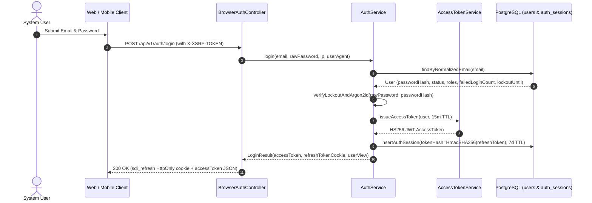

---

### 3.2 FE-02 Workforce & Subscription Management

#### 3.2.1 Class Diagram

Refer to the shared Identity, Workforce and Subscription Class Diagram in **Section 3.1.1** (`WorkforceController`, `SubscriptionController`, `PlatformSubscriptionController`, `PayPalWebhookController`, `User`, and `Subscription`).

#### 3.2.2 Workforce Provisioning & Pilot License Sequence Diagram

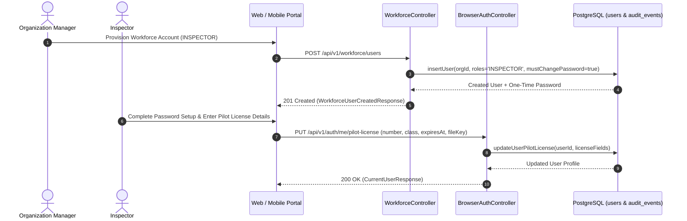

#### 3.2.3 PayPal Subscription Payment & Webhook Capture Sequence Diagram

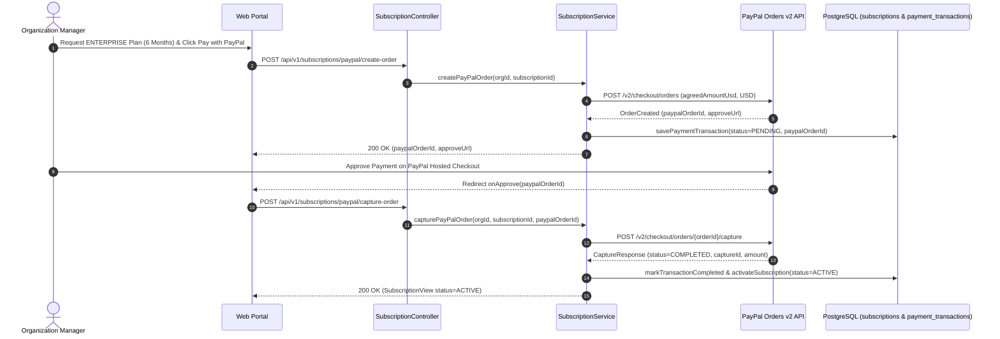

---

### 3.3 FE-03 Asset & Drone Fleet Management

#### 3.3.1 Class Diagram

```mermaid
%% title: Asset, Drone Fleet and Drone Equipment Leasing Class Diagram
classDiagram
  class AssetController {
    +createAsset(Jwt, CreateAssetRequest) ResponseEntity~ApiResponse~
    +listAssets(Jwt, int, int, String) ApiResponse~PagedResponse~
    +updateAsset(Jwt, UUID, UpdateAssetRequest) ApiResponse~AssetView~
    +retireAsset(Jwt, UUID) ApiResponse~AssetView~
  }
  class AssetDocumentController {
    +uploadDocument(Jwt, UUID, MultipartFile, String, LocalDate) ResponseEntity~ApiResponse~
    +downloadDocument(Jwt, UUID, UUID) ResponseEntity~byte[]~
  }
  class DroneController {
    +createDrone(Jwt, CreateDroneRequest) ResponseEntity~ApiResponse~
    +changeServiceability(Jwt, UUID, ChangeServiceabilityRequest) ApiResponse~DroneView~
    +updateRegistration(Jwt, UUID, UpdateDroneRegistrationRequest) ApiResponse~DroneView~
  }
  class DroneLeaseController {
    +listAvailablePoolDrones() ApiResponse~List~
    +requestLease(Jwt, CreateDroneLeaseRequest) ResponseEntity~ApiResponse~
    +createPayPalOrder(Jwt, UUID) ApiResponse~PayPalOrderCreatedView~
    +capturePayPalOrder(Jwt, UUID, CaptureDroneLeasePayPalRequest) ApiResponse~DroneLeaseView~
  }
  class PlatformDroneLeaseController {
    +addPoolDrone(Jwt, CreatePlatformDroneRequest) ResponseEntity~ApiResponse~
    +confirmWirePayment(Jwt, UUID, ConfirmDroneLeasePaymentRequest) ApiResponse~DroneLeaseView~
    +reclaimLease(Jwt, UUID) ApiResponse~DroneLeaseView~
  }
  class Asset {
    -UUID id
    -UUID organizationId
    -String assetCode
    -String inspectionItems
    -AssetStatus status
  }
  class PlatformDrone {
    -UUID id
    -String serialNumber
    -BigDecimal monthlyRateUsd
    -PlatformDroneStatus status
  }
  class DroneLease {
    -UUID id
    -UUID platformDroneId
    -UUID organizationId
    -UUID customerDroneId
    -DroneLeaseStatus status
  }
  class Drone {
    -UUID id
    -UUID organizationId
    -String serialNumber
    -DroneOwnershipType ownershipType
    -DroneServiceability serviceability
  }
  AssetController --> Asset
  AssetDocumentController --> Asset
  DroneController --> Drone
  DroneLeaseController --> DroneLease
  PlatformDroneLeaseController --> PlatformDrone
  PlatformDroneLeaseController --> DroneLease
  DroneLease --> Drone
```

**Class Specifications**

- **AssetController & AssetDocumentController**: Manage infrastructure assets (`assets`) with GPS coordinates and standardized `inspection_items` checkpoints, SHA-256 deduplicated documents in MinIO (`asset_documents`), and terminal asset retirement (`RETIRED`).
- **DroneController, DroneLeaseController & PlatformDroneLeaseController**: Govern customer owned/leased drones (`drones`), platform leasable drone pool (`platform_drones`), and drone equipment lease contracts (`drone_leases`) with automatic customer fleet provisioning and reclaim.

#### 3.3.2 Drone Equipment Leasing & Automatic Fleet Provisioning Sequence Diagram

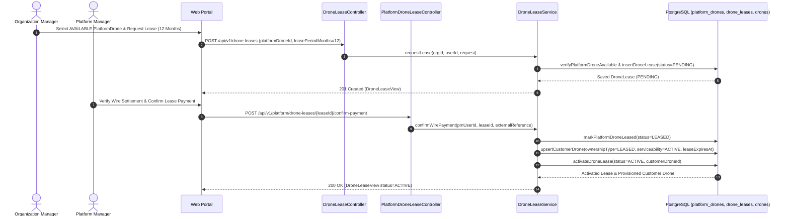

---

### 3.4 FE-04 Recurring Schedule & Notifications

#### 3.4.1 Class Diagram

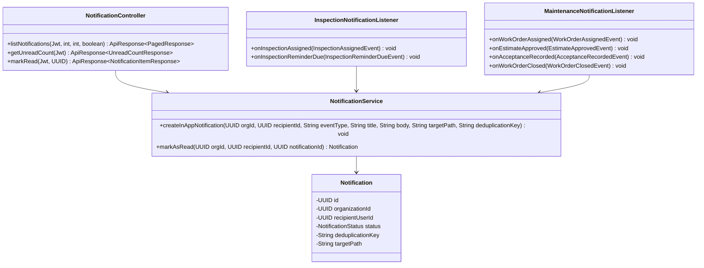

**Class Specifications**

- **InspectionScheduleController & RecurringInspectionScheduleService**: Manage timezone-anchored recurring schedules (`recurring_inspection_schedules`, `schedule_occurrences`), rolling 14-day generation (`RecurringInspectionSchedulerJob`), 3-day advance reminders (`InspectionReminderJob`), and `BLOCKED` occurrence retry/skip.
- **NotificationController & InspectionNotificationListener / MaintenanceNotificationListener**: Persist deduplicated in-app notifications (`uq_notifications_deduplication_key`) via Spring Modulith's `event_publication` outbox and serve recipient-scoped inbox queries.

#### 3.4.2 Event-Driven Transactional Outbox Notification Sequence Diagram

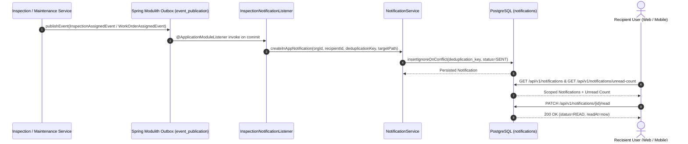

#### 3.4.3 WF-01 Activity Diagram — Enterprise Onboarding, Leasing & Recurring Scheduling

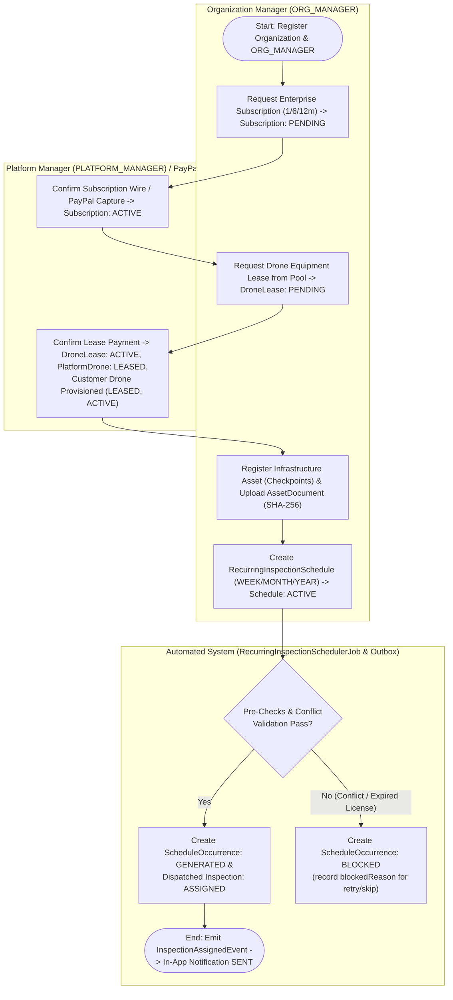

---

### 3.5 FE-05 Mission Dispatch & Airspace Advisory

#### 3.5.1 Class Diagram

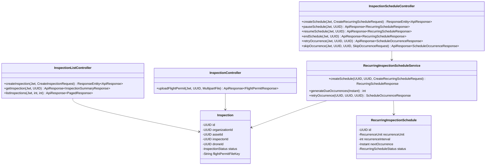

**Class Specifications**

- **InspectionListController & InspectionCreationService**: Handle one-off inspection mission scheduling (`POST /api/v1/inspections`), validating active subscription, active asset, active Inspector, serviceable Drone, and concurrent time-window conflicts.
- **AirspaceController & AirspaceAdvisoryService**: Expose `/api/v1/airspace/zones` and `/api/v1/airspace/evaluate`, computing Haversine distance against published Vietnam `NO_FLY_ZONE` and `RESTRICTED_ZONE` areas (Decree No. 288/2025/NĐ-CP) and returning `MSG28` advisories.

#### 3.5.2 Mission Dispatch and Self-Service Permit Upload Sequence Diagram

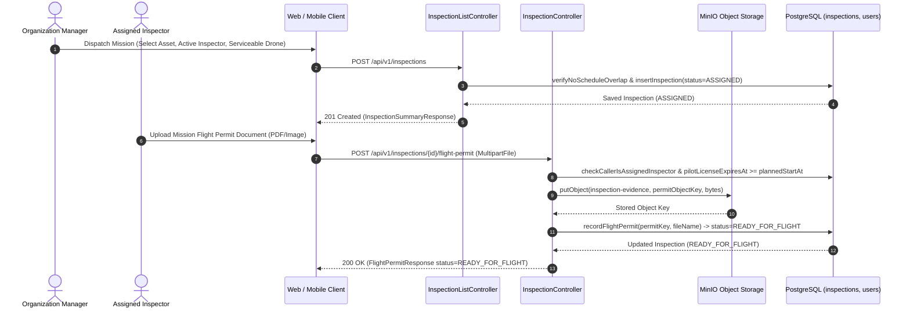

---

### 3.6 FE-06 Flight Readiness & Field Execution

#### 3.6.1 Class Diagram

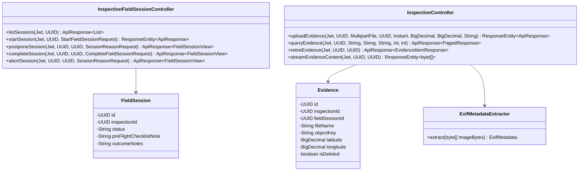

**Class Specifications**

- **InspectionController (Flight Permit Gate)**: Validates assigned Inspector identity and unexpired remote pilot license (`pilot_license_expires_at >= planned_start_at`), stores the flight permit in MinIO, and transitions `Inspection` `ASSIGNED -> READY_FOR_FLIGHT`.
- **InspectionFieldSessionController**: Manages on-site `FieldSession` execution (`start`, `postpone`, `complete`, `abort`, and additional sessions from `FIELD_COMPLETED`) guided by `assets.inspection_items`.

#### 3.6.2 Field Flight Session and Evidence Upload Sequence Diagram

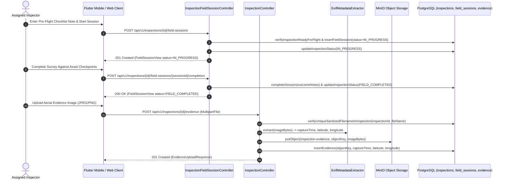

#### 3.6.3 WF-02 Activity Diagram — Mission Dispatch, Flight Permit Gate & Field Execution

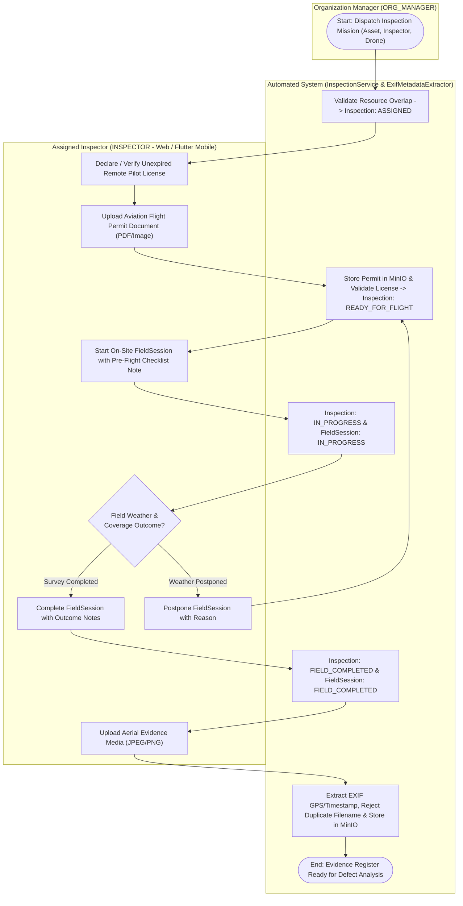

---

### 3.7 FE-07 Operational Dashboard & Schedule Calendar

#### 3.7.1 Class Diagram

Refer to the Notification, Dashboard and Schedule Class Diagrams in **Sections 3.4.1 and 3.5.1** (`DashboardAnalyticsService`, `InspectionListController`, `InspectionScheduleController`, and `NotificationController`).

#### 3.7.2 Role-Scoped Dashboard & Schedule Calendar Sequence Diagram

Refer to the scoped inspection/schedule query and outbox notification sequence in **Section 3.4.2**.

---

### 3.8 FE-08 Evidence Management & AI Defect Detection

#### 3.8.1 Class Diagram

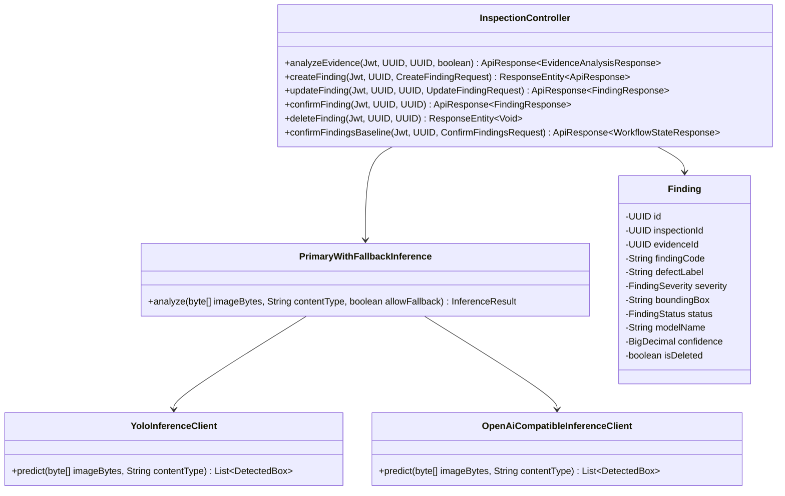

**Class Specifications**

- **InspectionController (Evidence & Findings)** & **ExifMetadataExtractor**: Decode uploaded image bytes, extract EXIF GPS/capture timestamps, store objects in MinIO, support single/bulk soft-retirement (`is_deleted = true`), manage `Finding` CRUD/confirmation, and lock `findings_snapshot_hash` (`FIELD_COMPLETED -> REPORT_DRAFT`).
- **PrimaryWithFallbackInference, YoloInferenceClient & OpenAiCompatibleInferenceClient**: Invoke the self-hosted FastAPI Ultralytics `YOLO11 (mbdd2025-v1)` container (`POST /predict`) with optional multimodal vision fallback.

#### 3.8.2 YOLO11 Defect Detection and Verification Sequence Diagram

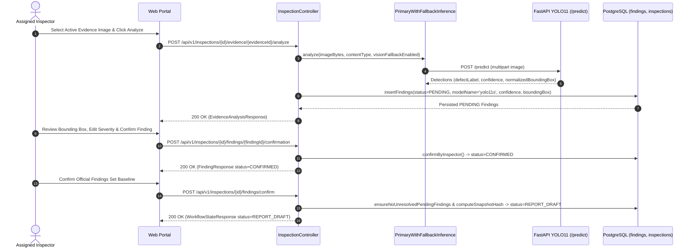

---

### 3.9 FE-09 Inspection Reporting & Publication

#### 3.9.1 Class Diagram

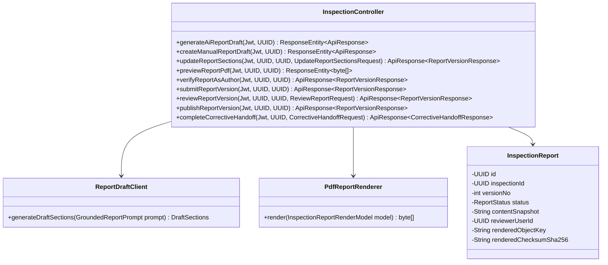

**Class Specifications**

- **InspectionController (Reports & Corrective Handoff)**: Orchestrates LLM (`ReportDraftClient`) and manual report draft creation (`DRAFT`), section editing, live PDF preview, author verification (`AUTHOR_VERIFIED`), submission (`SUBMITTED`), independent `ORG_MANAGER` review (`APPROVED` / `RETURNED`), immutable PDF publication (`PUBLISHED`), and per-finding corrective handoff (`REPAIR_PENDING` / `COMPLETED`).
- **PdfReportRenderer**: Renders publication-grade A4 PDF documents via OpenHTMLtoPDF and computes 64-character SHA-256 digests stored in MinIO.

#### 3.9.2 Report Synthesis, Review and Immutable Publication Sequence Diagram

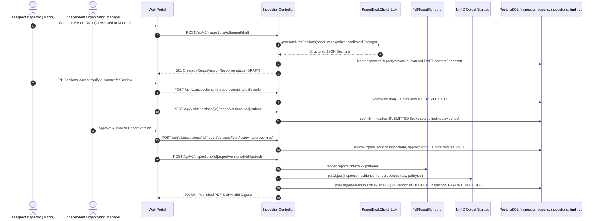

#### 3.9.3 WF-03 Activity Diagram — AI Defect Detection, Report Publication & Corrective Handoff

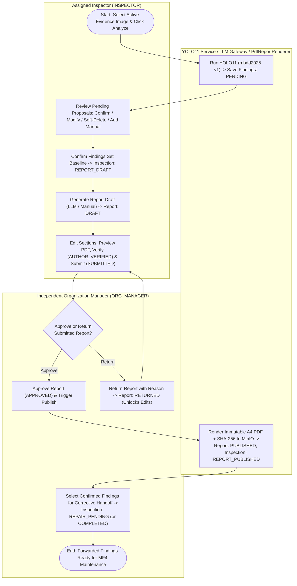

---

### 3.10 FE-10 Maintenance Planning & AI Scope Advisory

#### 3.10.1 Class Diagram

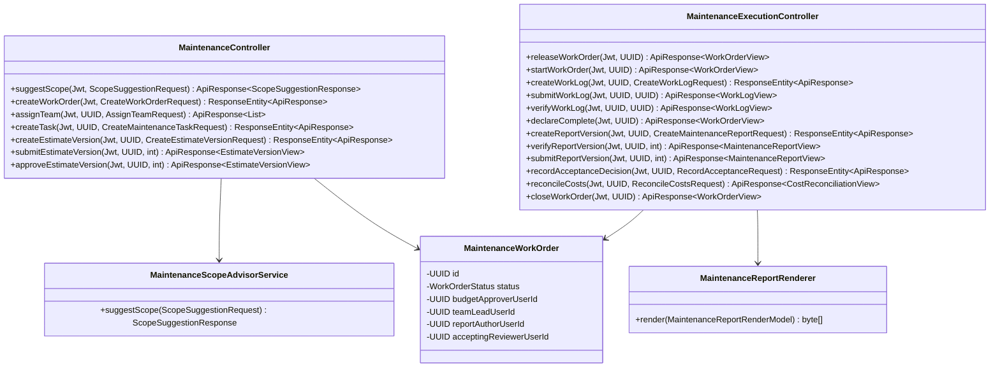

**Class Specifications**

- **MaintenanceController**: Manages repair candidate queries, `MaintenanceWorkOrder` creation (`DRAFT`), team role assignment (`LEAD`, `REPORT_AUTHOR`, `MEMBER`, independent `acceptingReviewerUserId`), `MaintenanceTask` decomposition, and `MaintenanceEstimateVersion` submission/approval.
- **MaintenanceScopeAdvisorService & DeterministicScopeFallback**: Retrieve civil engineering repair standards (`TCVN 9343:2012`, `EN 1504-9`, `ISO 12944-5`, `ASTM C1583`, `TCVN 9361:2012`) from `repair_knowledge_chunks` (`pgvector`) and synthesize corrective scope, acceptance criteria, and suggested tasks.

#### 3.10.2 Work Order Planning, Cost Estimation and Technical Acceptance Sequence Diagram

```mermaid
%% title: Work Order Planning, Cost Estimation and Technical Acceptance Sequence Diagram
sequenceDiagram
  autonumber
  actor OM as Organization Manager (Approver / Independent Reviewer)
  actor Lead as Maintenance Engineer (LEAD & REPORT_AUTHOR)
  participant Client as Web / Mobile Client
  participant MaintCtrl as MaintenanceController
  participant ExecCtrl as MaintenanceExecutionController
  participant Advisor as MaintenanceScopeAdvisorService
  participant DB as PostgreSQL (maintenance_* tables)
  participant MinIO as MinIO Object Storage

  OM->>Client: Create WorkOrder from Forwarded Finding & Assign Team
  Client->>MaintCtrl: POST /api/v1/maintenance/work-orders & POST /team
  MaintCtrl->>DB: insertWorkOrder(status=DRAFT) & saveTeam(LEAD, REPORT_AUTHOR, acceptingReviewerUserId)

  Lead->>Client: Request RAG Scope Advice, Create Tasks & Submit Estimate
  Client->>MaintCtrl: POST /api/v1/maintenance/suggest-scope
  MaintCtrl->>Advisor: suggestScope(defectLabel, severity, category) -> TCVN/EN/ISO standards
  Advisor-->>Client: CorrectiveScope, AcceptanceCriteria & SuggestedTasks
  Client->>MaintCtrl: POST /estimate-versions & POST /estimate-versions/1/submit
  MaintCtrl->>DB: saveEstimateLines(ESTIMATE) & updateWorkOrder(status=AWAITING_APPROVAL)

  OM->>Client: Approve Estimate Baseline (omUserId != preparedByUserId)
  Client->>MaintCtrl: POST /api/v1/maintenance/work-orders/{id}/estimate-versions/1/approve
  MaintCtrl->>DB: approveEstimate() -> WorkOrder: APPROVED

  Lead->>Client: Release (READY), Start (IN_PROGRESS), Log & Verify WorkLogs, Declare Complete
  Client->>ExecCtrl: POST /release -> POST /start -> POST /work-logs -> POST /verify -> POST /declare-complete
  ExecCtrl->>DB: verifyAllLogsVerified & updateWorkOrder(status=WORK_COMPLETED)

  Lead->>Client: Author, Verify (AUTHOR_VERIFIED) & Submit Completion Report
  Client->>ExecCtrl: POST /reports -> POST /reports/1/verify -> POST /reports/1/submit
  ExecCtrl->>DB: updateWorkOrder(status=SUBMITTED_FOR_ACCEPTANCE)

  OM->>Client: Record Independent Acceptance (ACCEPTED), Reconcile Actual Costs & Close
  Client->>ExecCtrl: POST /acceptance-decisions (ACCEPTED) -> POST /cost-reconciliation -> POST /close
  ExecCtrl->>MinIO: storeRenderedCompletionPdf(sha256)
  ExecCtrl->>DB: updateWorkOrder(ACCEPTED -> COST_RECONCILED -> CLOSED)
  ExecCtrl-->>Client: 200 OK (WorkOrderView status=CLOSED)
```

---

### 3.11 FE-11 Cost Estimation & Repair Execution

#### 3.11.1 Class Diagram

Refer to the Maintenance Work Order, RAG Advisor and Cost Control Class Diagram in **Section 3.10.1** (`MaintenanceController` and `MaintenanceExecutionController`).

#### 3.11.2 Estimate Approval, Change Order & Verified Work Log Sequence Diagram

Refer to Steps 3–5 of the Work Order Planning, Cost Estimation and Technical Acceptance Sequence Diagram in **Section 3.10.2**.

---

### 3.12 FE-12 Maintenance Acceptance & Cost Closure

#### 3.12.1 Class Diagram

Refer to `MaintenanceExecutionController` and `MaintenanceReportRenderer` in **Section 3.10.1**.

#### 3.12.2 Completion Report, Independent Acceptance & Cost Reconciliation Sequence Diagram

Refer to Steps 6–7 of the Sequence Diagram in **Section 3.10.2**.

#### 3.12.3 WF-04 Activity Diagram — Maintenance Work Order Lifecycle & Cost Reconciliation

```mermaid
%% title: WF-04 Activity Diagram - Maintenance Work Order Lifecycle and Cost Reconciliation
flowchart TD
  subgraph OM4["Organization Manager (Budget Approver & Independent Reviewer)"]
    D1(["Start: Create WorkOrder from Forwarded Finding -> WorkOrder: DRAFT"])
    D2["Assign Team (LEAD, REPORT_AUTHOR, MEMBER) & Independent Reviewer"]
    D5{"Approve Estimate\nBaseline?"}
    D6["Approve Estimate -> Estimate: APPROVED, WorkOrder: APPROVED"]
    D10{"Independent Technical\nAcceptance Decision?"}
    D11["Record ACCEPTED -> Render Completion PDF + SHA-256 -> WorkOrder: ACCEPTED"]
    D12["Record REWORK_REQUIRED / REINSPECTION_REQUIRED"]
    D13["Reconcile Actual Cost Lines vs. Baseline + Change Deltas -> COST_RECONCILED"]
    D14(["End: Close WorkOrder (CLOSED) & Update Inspection to COMPLETED"])
  end

  subgraph ME4["Maintenance Engineer Team (LEAD, REPORT_AUTHOR, MEMBER)"]
    D3["Invoke RAG Scope Advisor (TCVN/EN/ISO), Plan Tasks & Submit Estimate -> AWAITING_APPROVAL"]
    D7["Release (READY) & Start (IN_PROGRESS) WorkOrder"]
    D8["Log Task WorkLogs (SUBMITTED), Lead Verifies (VERIFIED) & Declare Complete -> WORK_COMPLETED"]
    D9["Author, Verify (AUTHOR_VERIFIED) & Submit Completion Report -> SUBMITTED_FOR_ACCEPTANCE"]
  end

  D1 --> D2 --> D3 --> D5
  D5 -->|"Reject"| D3
  D5 -->|"Approve"| D6 --> D7 --> D8 --> D9 --> D10
  D10 -->|"Rework / Reinspection"| D12 --> D8
  D10 -->|"Accepted"| D11 --> D13 --> D14
```
