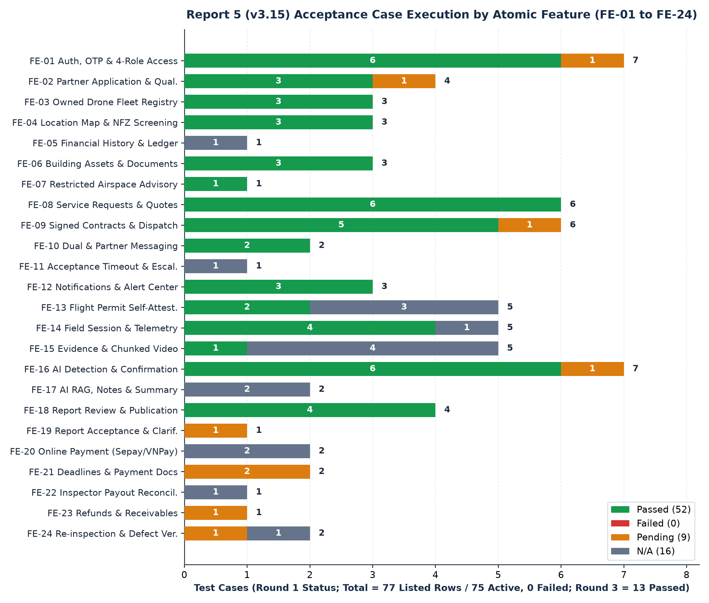

# II. Testing Documentation

## 1. Scope of Testing

The test scope covers all 24 features across the web portal, Customer mobile app, backend, and AI, telemetry, and payment integrations.

- **`MF1` — Onboarding and access.** Account registration, sign-in, role permissions, Inspector and drone registration, and airspace screening.
- **`MF2` — Requests and dispatch.** Building records, quotations, signed contracts, Inspector and drone assignment, messaging, and notifications.
- **`MF3` — Field work and findings.** Flight permit submission, field sessions and telemetry, evidence upload and processing, AI-assisted analysis, and findings confirmation.
- **`MF4` — Reporting and settlement.** Independent review and publication, Customer acceptance, payments, Inspector payouts, refunds, and re-inspection.

Chapter III, Section 3.8 defines the product scope. Payment tests use test credentials and simulated gateway callbacks.

Four levels were executed. Unit level verifies entities, services, components, and widgets in isolation. Integration level verifies controllers, repositories, migrations, the security filter chain, object storage, and the event outbox against containerized services. System level verifies connected flows and non-functional thresholds across the integrated stack. Acceptance level verifies business rules and acceptance criteria per feature.

Integration tests require Docker. The test strategy includes fallback behavior when AI services are unavailable.

## 2. Test Strategy

### 2.1 Testing Types

Functional tests cover workflow rules, permitted status changes, and limits such as file sizes and scheduling dates. Security tests cover sign-in protection and access by role, ownership, and assignment.

Integration and system tests cover evidence processing, AI fallbacks, payment callback verification, response times, and published-report integrity. Interface and regression tests cover localization, theme settings, and behavior across releases.

### 2.2 Test Levels

| Type of Tests | Unit | Integration | System | Acceptance |
| --- | :---: | :---: | :---: | :---: |
| Functional and Business Rule Testing | X | X | X | X |
| Domain State Machine Transition Testing | X | X | X | X |
| API and Database Persistence Testing | | X | X | |
| Security and Scope Isolation Testing | X | X | X | X |
| AI Vision, Narrative Drafting and Fallback Testing | X | X | X | X |
| Performance, Payment Webhook and Report Integrity Testing | | X | X | X |
| User Interface, Localization and Regression Testing | X | X | X | X |

### 2.3 Supporting Tools

| Purpose | Tool | Vendor/In-house | Version |
| --- | --- | --- | --- |
| Backend unit and integration testing | JUnit Jupiter, Spring Boot Test, MockMvc | Open Source / Broadcom | `JUnit 6.x` / `4.1.0` |
| Containerized database and storage harness | Testcontainers (`pgvector:pg17`, `adobe/s3mock`) | AtomicJar / Docker | `1.20.x` / `PostgreSQL 17` |
| Architectural boundary verification | Spring Modulith Test | Broadcom | `2.1.1` |
| Backend coverage measurement | JaCoCo Maven Plugin | EclEmma | `0.8.13` |
| Frontend component and unit testing | Vitest, React Testing Library, JSDOM | Open Source | `5.0.1` / `16.3.3` |
| Mobile widget and repository testing | Flutter Test, Dart Analyzer | Google | `Flutter 3.x` |
| Report workbook generation and verification | Custom Python OOXML exporter and unittest suite | In-house | `Python 3.12+` |

## 3. Test Plan

### 3.1 Human Resources

| Worker/Doer | Role | Specific Responsibilities/Comments |
| --- | --- | --- |
| Trần Hoàng Trung Hiếu (`SE184212`) | Project Leader and Tester (`FE-01`–`FE-05`) | Owns the cases and regression runs for authentication/OTP/4-role RBAC (`FE-01`), partner admission (`FE-02`), owned-drone fleet (`FE-03`), airspace map (`FE-04`), and financial history ledger (`FE-05`), plus Customer Mobile co-testing. |
| Phùng Trung Quốc (`SE170027`) | Backend and Mobile Engineer and Tester (`FE-06`–`FE-12`) | Owns the cases and regression runs for building assets (`FE-06`), restricted-airspace advisories (`FE-07`), service requests & VND quotes (`FE-08`), signed contracts & dispatch (`FE-09`), Order, Partner, and Inspection Chat (`FE-10`), assignment timeout (`FE-11`), and notifications (`FE-12`). |
| Trần Tùng Bách (`SE180220`) | Full-Stack and AI Engineer and Tester (`FE-13`–`FE-18`) | Owns the cases and regression runs for flight permits (`FE-13`), field telemetry (`FE-14`), evidence/chunked video pipeline (`FE-15`), YOLO11 + fallback confirmation (`FE-16`), `DroneKnowledgeAI` RAG & drafting (`FE-17`), and report publication (`FE-18`), plus backend/DB architecture & Mobile co-testing. |
| Trương Thái Như (`SE180082`) | Full-Stack Engineer and Tester (`FE-19`–`FE-24`) | Owns the cases and regression runs for customer acceptance (`FE-19`), Sepay VietQR/VNPay settlement (`FE-20`), payment deadlines/documents (`FE-21`), Inspector payouts (`FE-22`), refunds & receivables (`FE-23`), and re-inspection (`FE-24`), plus automated test reconciliation & Report 5 workbook maintenance. |
| Supervisors | Reviewers | Review the strategy, audit traceability across Reports 3–5, and evaluate defence readiness. |

### 3.2 Test Environment

| Purpose | Tool | Provider | Version |
| --- | --- | --- | --- |
| Application runtime | Java 21 with Spring Boot Modulith | Eclipse Temurin / Broadcom | `Java 21` / `4.1.0` |
| Relational database | PostgreSQL (`53` application tables / `55` total in `public`, migrations `V1`–`V4`, `V60`–`V80`) | PostgreSQL Global Development Group | `17` |
| Object storage | MinIO (`inspection-evidence` bucket) | MinIO Inc. | `RELEASE.2025` |
| Test containers | Testcontainers with `pgvector:pg17` and `adobe/s3mock` | AtomicJar / Docker | `PostgreSQL 17` |
| Computer vision service | FastAPI with Ultralytics YOLO11s | Python / Ultralytics | `YOLO11s` |
| Web client under test | Chrome and Edge (desktop) | Google / Microsoft | Evergreen |
| Mobile client under test | Flutter test runner and Android client | Google | `Flutter 3.x` |
| Local execution platform | Windows 11 with Git Bash | Microsoft | `10.0.26200` |

### 3.3 Test Milestones

| Milestone Task | Start Date | End Date |
| --- | --- | --- |
| Milestone 1: Unit and migration foundation gate | `2026-09-15` | `2026-10-08` |
| Milestone 2: Core inspection, storage, detection and report integration testing | `2026-10-09` | `2026-10-22` |
| Milestone 3: Review baseline and scope retirement verification | `2026-10-23` | `2026-10-27` |
| Milestone 4: Four-role, multi-flow consolidation across `MF1`–`MF4` with contracts and payment | `2026-10-28` | `2026-11-04` |
| Milestone 5: Final regression, 24-feature decomposition (`FE-01`–`FE-24`), staging walkthrough, and defence rehearsal | `2026-11-05` | `2026-11-30` |

## 4. Test Cases

Section 5.1 records the backend, web, and mobile suite results. The companion workbook (`Report5_Test Report.xlsx`, version 3.19) records 78 active integration, system, and acceptance cases and two superseded flight-permit cases. Its 24 feature sheets list the procedures, expected results, and results of each test round.

## 5. Test Reports

### 5.1 Automated Suite Results

| Suite | Command | Scope | Result |
| --- | --- | --- | --- |
| Backend | `.\mvnw.cmd verify` | Domain, service, controller, repository, migration, storage, architecture and knowledge retrieval tests | Full rerun on 26 Nov 2026: 1,060 passed, 0 failures, 0 errors. JaCoCo coverage checks passed. |
| Backend focused rerun | `.\mvnw.cmd -o surefire:test` | Flight-data ownership, publication, Customer progress, and module boundaries | All 14 checks passed. The report API suite passed all 31 checks. |
| Backend connected rerun | `.\mvnw.cmd -o surefire:test` | Onboarding through publication and migrated schema inventory | All 4 checks passed. |
| Web portal | `npm test` | Components, pages, access policy, API clients, settlement, notifications, and guided finding notes | Release revision `bcb7b48`: 831 passed and 4 skipped across 120 files in the full run and focused rerun. Lint and build exited 0. |
| Mobile | `flutter test` and `flutter analyze` | Customer-only access, localization, verdict expiry, payment PDF, chat, knowledge references, and Customer screens | 26 Nov 2026: 58 tests passed, and the analyzer reported no issues. |

The first backend attempt recorded 875 passes and 184 errors. Testcontainers timed out while starting PostgreSQL, and Maven stopped before the coverage gate. The successful rerun completed the suite and coverage checks.

The first shared-checkout web attempt recorded 527 passes, one timeout, and 66 worker startup errors. An isolated checkout of the release revision ran 111 files and skipped 4. Vite denied the MapLibre worker path for five files. Those five files passed all 62 tests after the temporary test config allowed the installed MapLibre dependency.

Section 5.3 names the tests used for the two focused backend reruns. The full backend run compiled the release code equivalent to `5c1d484`. The mobile run used the code equivalent to `ba5dc62`.

### 5.2 Acceptance Case Execution

*Figure 5.1 — Round 1 status for the 77-case baseline before the three assignment-withdrawal cases were added.*

| Main flow and features | Cases | Passed | Failed | Pending | N/A |
| --- | ---: | ---: | ---: | ---: | ---: |
| MF1 Onboarding and assets (FE-01–FE-07) | 22 | 19 | 0 | 2 | 1 |
| MF2 Commercial workflow and dispatch (FE-08–FE-12) | 20 | 16 | 0 | 1 | 3 |
| MF3 Permits, field operations, evidence and findings (FE-13–FE-17) | 25 | 13 | 0 | 1 | 11 |
| MF4 Reports, settlement and re-inspection (FE-18–FE-24) | 13 | 4 | 0 | 5 | 4 |
| Total | 80 | 52 | 0 | 9 | 19 |

In Round 1, 52 of the 61 applicable cases passed and 9 were pending, with zero failures. The other 19 rows were marked N/A. The companion workbook provides feature-level totals.

The regression ledger links fresh Surefire class results to 64 of the 77 listed cases. In the local browser check, the owning Customer could follow progress before publication. The report action and Flight operations tab were absent. A published demo inspection opened the findings report and the stored Flight operations tab. The workbook retains the recorded dates and outcomes of its acceptance rounds.

Report 5 records 16 passes and zero failures in Round 3 (`WF3-005`, `WF3-006`, `WF3-009`, `WF3-016`, `WF3-018`, `WF3-019`, `WF3-021`, `WF3-026`–`WF3-031`, and the three cases below). `WF3-020`, `WF3-022`–`WF3-025`, `WF3-032`, `WF2-021`, and `WF3-033` remain pending.

The cases cover payouts (`WF3-019`), payment deadlines and documents (`WF3-026`, `WF3-027`), fresh re-inspection evidence (`WF3-028`), and knowledge references on web and mobile (`WF3-029`–`WF3-031`).

The assignment-withdrawal regression ran on Backend revision 9dd0d67. The recovery integration suite and inspection lifecycle suite passed all 15 checks.

- **WF2-032 (FE-11)** The assigned Inspector withdrew before field work. The scheduled occurrence required reassignment.
- **WF2-033 (FE-13)** Withdrawal after abort was rejected with HTTP 409 ASSIGNMENT_FIELD_WORK_STARTED.
- **WF2-034 (FE-09)** The Manager cancelled after withdrawal. The two reasons were retained and the reassignment flag cleared.

### 5.3 Cross-Cutting Assertions

| Assertion | Test | What it verifies |
| --- | --- | --- |
| Database schema matches the release | `FullDatabaseSchemaMigrationTest` | Flyway applies `V1`–`V4` and `V60`–`V80`. The test checks all 55 expected tables in `public`, including the event outbox and the Flyway migration ledger. |
| Module boundaries hold | `ModulithArchitectureTest` | No module reaches another outside its declared `allowedDependencies`. |
| Lifecycle is connected | `ConnectedMainFlowE2eIntegrationTest` | Building and drone setup, the request and quotation, dispatch, field evidence, findings, Manager review, partner payout and report publication execute in one run. |
| A report author cannot publish | Reviewer-scope and role-policy tests | Publication requires a `MANAGER` reviewer who is not the author (`ADMIN` is read-only). |
| Customer flight data requires publication | `InspectionFieldSessionControllerFlightLogTest`, `InspectionDroneHubFlightLogTest` | The owning Customer sees inspection progress before publication. The API omits flight data from that response and permits access to stored flight records only after publication. A different Customer is denied. |
| Flight permit self-attestation holds | Permit policy and workflow tests | Valid permit upload immediately transitions the permit to `APPROVED`; drone change or out-of-window reschedule resets to `PENDING_REVIEW` (`ADMIN`/`MANAGER` cannot alter). |
| Media is scoped | Evidence ticket tests | A signed ticket grants access to one evidence record and nothing else. |
| Payment needs a signature | `SepayWebhookControllerTest`, `VnPayWebhookAndGatewayTest` & webhook tests | A browser redirect alone never settles a payment; missing/forged `Authorization: Apikey` or VNPay HMAC-SHA512 signatures are rejected, while Sepay inbound outcomes persist idempotently in `gateway_inbound_transactions`. |
| Knowledge retrieval and note drafting | `HistoricalCaseServiceTest`, `HistoricalCaseApiIntegrationTest`, `InspectionFindingsPage.test.tsx`, `KnowledgeRecommendationPanel.test.tsx`, `knowledge_recommendation_test.dart` | Tests cover vector retrieval (`PGVECTOR_RAG`), keyword fallback (`HYBRID_MATCH`), and note drafting (`AI_VISION_RAG`). Results exclude the current inspection and other Customers' records. The mobile reference strip hides when empty. |
| Payment deadline and documents over HTTP | `PaymentDueAndDocumentApiIntegrationTest` | Acceptance sets `payment_due_at` once. The document API returns `409` before acceptance, a notice after acceptance, and a receipt after payment. Another Customer receives `404`. Repeated scans send one overdue reminder. Report 5 records the results under `WF3-026` and `WF3-027`. |
| Expired re-inspection verdict is surfaced early | `verdictExpiry.ts`, `VerdictExpiryBanner`, `ValidityNotice`, `ReinspectionWorkflow.test.tsx` | The Web client distinguishes lapsed `RESOLVED` verdicts from those lapsing within 14 days and warns before report authoring; the backend remains the authority that refuses an expired verdict with `RESOLUTION_EXPIRED`. |

### 5.4 Release Workflow Verification

`ConnectedMainFlowE2eIntegrationTest` exercises a single inspection across the main flows using isolated test accounts. It verifies state transitions between modules. The workbook provides the wider coverage for variations, retries and manual checks.

#### MF1 — Onboarding and readiness

The connected test provisions distinct Customer, Manager and Inspector accounts. It registers the Inspector's drone and the Customer's building with inspection items. The same building and drone are referenced by later dispatch checks. The schema test separately verifies the database inventory after applying all release migrations.

#### MF2 — Quotation and dispatch

The Customer opens an inspection request. The Manager prepares the quote and completes the commercial and assignment steps. The assigned Inspector accepts the occurrence. Later steps use this same occurrence so a disconnected or incomplete dispatch cannot satisfy the automated flow.

#### MF3 — Permits, field session and findings

The assigned Inspector uploads a valid self-attested permit. The connected check observes the approved permit, then verifies that Start and Complete move the existing inspection through `IN_PROGRESS` and `FIELD_COMPLETED`. The Inspector uploads image evidence, confirms a finding and the findings baseline, and submits the drafted report. Dedicated FE-13 to FE-17 cases cover permit rejection, field exceptions, other media formats, and advisory AI output.

#### MF4 — Independent review and publication

The Manager review step approves the submitted report. The connected test resolves the partner payout fixture and continues to publication. The Customer report-view check uses two demo inspections. In the scheduled inspection, the tracking page displays progress and identifies the report as pending publication. The published inspection exposes the Findings report and Flight operations tabs. Service and controller tests check that only the owning Customer receives stored flight data after publication and that the assigned Inspector has the active-session telemetry access.

Payment tests use isolated Sepay and VNPay fixtures. They exercise gateway status, signature verification and idempotent processing, while the document API tests verify the payment notice and receipt states. See the workbook for individual settlement and payout cases.

### 5.5 Defects and Limitations

| ID | Severity | Status | Description | Impact |
| --- | --- | --- | --- | --- |
| `DEF-01` | Low | Resolved | The mobile `UserRole` enumeration included the retired `MAINTENANCE_ENGINEER` role. The enumeration now matches the four platform roles. | `flutter analyze` and all 58 mobile tests passed. The mobile app restricts sign-in to Customers. |
| `DEF-02` | Low | Open | The backend E2E runner script resolves its frontend root to a directory that does not exist in the workspace. | The connected integration test remains the automated coverage path for the lifecycle. |

The companion workbook retains the original acceptance rounds, including pending cases. The regression evidence ledger links test classes from the new run to their associated cases. An individual automated result covers the assertions in that class and leaves the full manual acceptance procedure open when further steps are required.
