# II. Release Package & User Guides

## 1. Deliverable Package

This release delivers the SmartDroneInspection platform: a building-inspection service in which a Platform coordinates customer organizations and partner drone inspectors. The table below lists every artifact in this release together with the version it corresponds to.

| No. | Deliverable Item | Description |
| --- | --- | --- |
| 1 | Project Schedule/Tracking | Task schedule, milestone dates, and effort tracking for the eight-week build, maintained from the project plan in Report 2. |
| 2 | Project Backlog | The feature and function backlog for `FE-01`–`FE-08` across `MF1`–`MF4`, with the acceptance criteria each item was closed against. |
| 3 | Source Codes | Four independent repositories: `SmartDroneInspection-backend` (Java 21, Spring Boot 4.1, Spring Modulith), `SmartDroneInspection-frontend` (React 19, strict TypeScript, Vite, Material UI), `SmartDroneInspection-mobile` (Flutter, Riverpod, GoRouter, Dio), and `SmartDroneInspection-docs`. |
| 4 | Database Script(s) | Flyway migrations `V1__baseline.sql` (consolidated baseline with catalog seeds) and `V2__remove_finding_recommended_action.sql`, together defining the 41-table PostgreSQL 17 schema. |
| 5 | Final Report Document | Reports 1–6 of the capstone documentation set, each exported against its official template. |
| 6 | Test Cases Document | `Report5_Test Report.xlsx` with one sheet per feature, plus this release's executed suite results recorded in Report 5. |
| 7 | Defects List | The defect log maintained during the build, including the two open defects recorded in Report 5 §5. |
| 8 | Issues List | Outstanding issues and known limitations, including the out-of-scope items documented in Report 3 §3.8. |
| 9 | Slide | The defence presentation used for the final review. |

## 2. Installation Guides

### 2.1 System Requirements

**Hardware requirements**

| Component | Minimum | Recommended |
| --- | --- | --- |
| Processor | 4 logical cores, x86-64 | 8 logical cores |
| Memory | 8 GB | 16 GB |
| Free disk space | 40 GB | 80 GB SSD |
| Display (web portals) | 1366 × 768 | 1920 × 1080 |
| Network | Broadband connection for object storage and payment callbacks | Wired connection |

The detection service and the video transcoder are the dominant resource consumers. A machine that also runs the YOLO11 container should have at least 8 GB of memory available to Docker alone.

**Software requirements**

| Purpose | Software | Version |
| --- | --- | --- |
| Container runtime | Docker Engine with the Compose plugin | Docker 27 or later |
| Application runtime | Java Development Kit (Temurin) | Java 21 |
| Backend build | Maven Wrapper (bundled as `./mvnw`) | Bundled |
| Web client build | Node.js and npm | Node 22 or later |
| Mobile client build | Flutter SDK with the Android toolchain | Flutter 3.x |
| Object storage | MinIO | Provided by the compose stack |
| Database | PostgreSQL | `17` (provided by the compose stack) |
| Media processing | FFmpeg | Provided by the backend container image |
| Browser | Chrome or Edge | Current version |

Optional media processing for local (non-container) backend runs needs FFmpeg installed and on the `PATH`.

### 2.2 Installation Instruction

**Step 1 — Obtain the repositories.** Clone the four repositories into sibling folders, because the frontend proxy and the tooling assume that layout:

```bash
git clone <backend-url> SmartDroneInspection-backend
git clone <frontend-url> SmartDroneInspection-frontend
git clone <mobile-url> SmartDroneInspection-mobile
git clone <docs-url> SmartDroneInspection-docs
```

**Step 2 — Configure the backend environment.** Copy the example file and set the required values:

```bash
cd SmartDroneInspection-backend
cp .env.example .env
```

At minimum, set these keys in `.env`:

- `POSTGRES_DB`, `POSTGRES_USER`, `POSTGRES_PASSWORD`, `POSTGRES_PORT` — database identity.
- `MINIO_ROOT_USER`, `MINIO_ROOT_PASSWORD`, `MINIO_BUCKET` — object storage credentials and bucket name.
- `AUTH_JWT_SECRET` and `AUTH_REFRESH_TOKEN_PEPPER` — signing secrets. Generate each with a long random value and never commit them.
- `AUTH_SECURE_COOKIES` — set to `true` only when serving over HTTPS.
- `AUTH_ALLOWED_ORIGINS` — the exact origin of the web client, for example `http://localhost:3000`.
- `AUTH_BOOTSTRAP_ENABLED`, `AUTH_BOOTSTRAP_EMAIL`, `AUTH_BOOTSTRAP_PASSWORD`, `AUTH_BOOTSTRAP_FULL_NAME` — the first administrator. Disable bootstrap after the first successful start.

The AI, payment, and telemetry integrations are all optional. Leave `YOLO_INFERENCE_ENABLED`, `COMPATIBLE_VISION_ENABLED`, `REPORT_DRAFT_ENABLED`, and the payment gateway switches off for a self-contained local installation; the application starts and remains usable, with detection falling back to manual finding entry and narrative drafting falling back to the deterministic template.

**Step 3 — Start the backend stack.** This brings up PostgreSQL, MinIO, the inference service, the hub service, and the backend:

```bash
docker compose up -d --build
```

Flyway applies `V1` and `V2` automatically on first start. Confirm the stack is healthy:

```bash
docker compose ps
curl http://localhost:8080/actuator/health
```

The health endpoint should report `UP`.

**Step 4 — Start the web client.** In a second terminal:

```bash
cd SmartDroneInspection-frontend
cp .env.example .env
npm install
npm run dev
```

Open `http://localhost:3000`. The Vite dev server proxies `/api` to the backend on port 8080. If port 3000 is already occupied, Vite selects the next free port and prints it; update `AUTH_ALLOWED_ORIGINS` in the backend `.env` to match, then restart the backend container.

**Step 5 — Build the mobile client (optional).** In a third terminal:

```bash
cd SmartDroneInspection-mobile
flutter pub get
flutter run
```

The mobile application is for customer accounts only. Any other role is refused at sign-in with the message corresponding to the `CUSTOMER_ONLY_MOBILE` error code.

**Step 6 — Sign in for the first time.** Use the bootstrap administrator account from Step 2. Change its password immediately, then create the remaining accounts from **Platform Accounts** in the administration portal.

**Troubleshooting.** If the backend container exits at start-up, check that both signing secrets are present and long enough; the application refuses to start with a missing or short secret. If uploads fail while the rest of the application works, verify the MinIO credentials and that the configured bucket exists. If the detection service is unavailable, finding creation still works and detection simply becomes manual.

## 3. User Manual

### 3.1 Overview

SmartDroneInspection coordinates building inspections between three parties: the platform team, the customer organizations that own buildings, and the partner drone inspectors who fly the missions. A single inspection passes through a fixed sequence of stages:

1. **Onboarding.** A customer registers its organization and first building; a partner inspector applies with licence details and registers the drones it intends to fly. Platform staff review both.
2. **Commercial agreement.** The customer submits a service request, negotiates with a platform manager in the order chat, and accepts a VND quotation. The parties sign an agreement offline and the manager records the signed copy.
3. **Field preparation.** The manager assigns an inspector and a drone to each occurrence. The inspector uploads the mission flight permit, and a different manager verifies it before any field work may start.
4. **Field execution.** The inspector records the on-site session, captures photographs and video, and lets the platform propose candidate defects, which the inspector confirms or rejects.
5. **Reporting.** The inspector submits the report; a manager who did not write it reviews and publishes it as an immutable PDF.
6. **Settlement.** The customer accepts the published report and pays through PayOS VietQR or VNPay.

Four login roles operate the platform. Each has its own portal, and a section a role may not use does not appear in its navigation at all:

| Role | Portal | Responsibility |
| --- | --- | --- |
| `ADMIN` | `/admin` | Platform accounts, building categories, licence classes, drone document configuration, finance and AI settings, and review of airspace cases and partner applications. |
| `MANAGER` | `/manager` | Partner and drone coordination, service requests, quotations, agreements, dispatch, independent report review and publication, and payouts. |
| `CUSTOMER` | `/client` | Organization and buildings, service requests and negotiation, report acceptance, and payment. A native mobile application covers the same customer work. |
| `INSPECTOR` | `/operations` | Owned drones, assigned missions, flight permits, field sessions, evidence capture, findings confirmation, and report submission. |

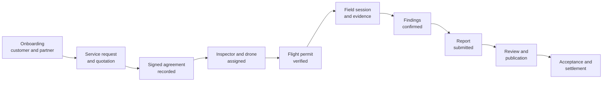

### 3.2 Workflow 1: Customer Onboarding and Building Registration (`MF1` `FE-01`, `FE-03`)

**Purpose.** Bring a new customer organization onto the platform and register its first building so that a service request can later be raised against it.

**Actors.** Prospective customer (public), `ADMIN`, `MANAGER`.

**Preconditions.** The platform is running and reachable. The prospective customer has a decision on the building's location, because the airspace screening result determines whether registration completes immediately or waits for review.

**Step 1.** Open the public site and choose **Sign up**, then select the customer path.

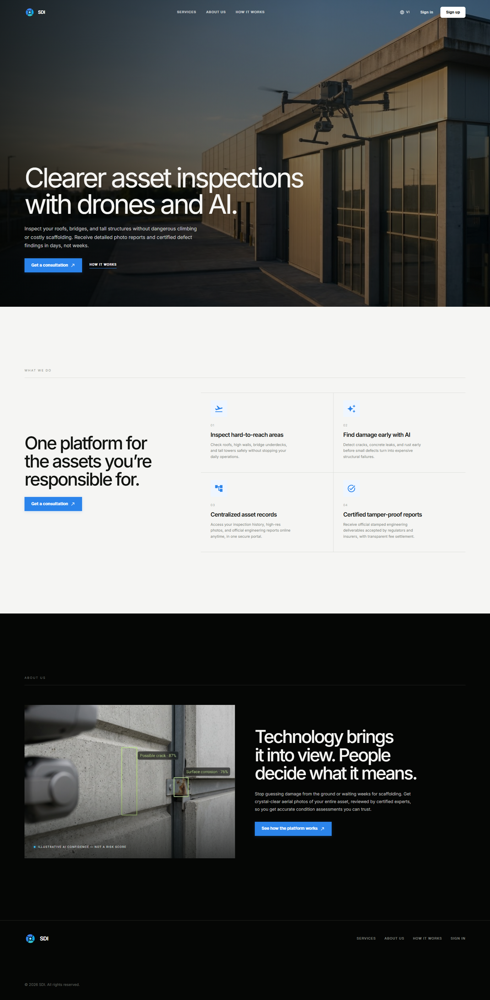

*Figure 6.1 — Public landing page with the services overview and the sign-up entry point.*

Note that the marketing copy on the public page still names bridges among the inspected structures. The delivered product supports buildings only; the supported categories are high-rise office, residential tower, commercial mall, industrial factory and warehouse, hotel and hospital complex, and telecom rooftop mast.

**Step 2.** Complete the organization form: organization name and code, your own name, email, phone, and a password that satisfies the policy shown. Enter the building's name, category, and address, and place its location on the map.

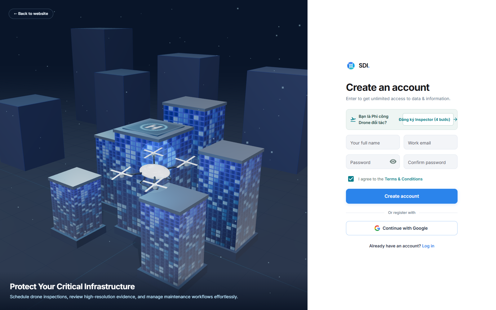

*Figure 6.2 — Customer registration, including the building location that is screened for prohibited airspace.*

**Step 3.** Submit the form. Your one-time code arrives by email; enter it to confirm the account. The platform screens the location you selected:

- **Prohibited airspace** — registration is refused and the reason is shown. Choose a different location or contact the platform.
- **Restricted airspace** — the registration is held as pending and a platform reviewer decides. You are notified of the outcome.
- **Eligible location** — registration completes immediately and you are signed in.

Screening is advisory. It records the platform's own check and is not a government flight clearance.

**Step 4.** After signing in to the customer portal, open **Assets** to see your building register.

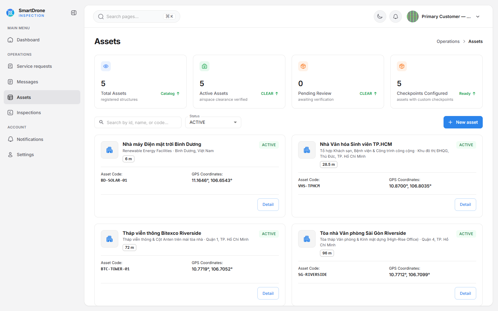

*Figure 6.3 — The customer building register with status, category, height, and coordinates.*

**Step 5.** Choose **New asset** to add another building, or open an existing record to review its details. For each building you can set the category, structure height, footprint area, technical profile, and GPS coordinates, attach engineering drawings, and later retire it when it is no longer in service. Retiring a building preserves its inspection history and blocks new service requests against it.

The categories available on a clean installation are the six building categories listed in Report 3 §1. A platform administrator can add categories from the catalogue, but the defect classes and inspection items shipped with this release are building-specific.

**Step 6.** If you need to review a held registration, sign in as `ADMIN` or `MANAGER` and open **Onboarding Reviews**.

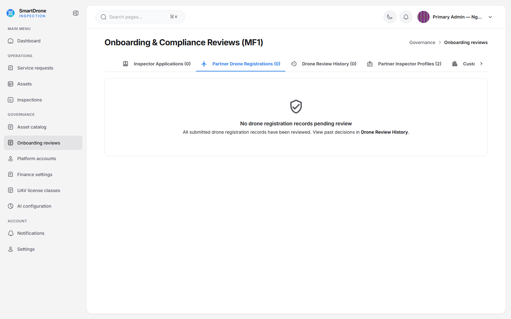

*Figure 6.4 — The onboarding review queue where restricted-airspace cases are approved or rejected with a reason.*

Approve or reject each case with a written reason. A rejection reason is mandatory, and the decision is attributed to you in the activity history.

### 3.3 Workflow 2: Partner Inspector Application and Drone Registration (`MF1` `FE-02`)

**Purpose.** Admit a partner drone inspector to the platform and register the drones that inspector will fly.

**Actors.** Prospective inspector (public), `ADMIN`, `MANAGER`, `INSPECTOR`.

**Preconditions.** The applicant holds a pilot licence and has a scanned copy of it. Drone ownership is not required to apply.

**Step 1.** On the public site choose **Apply as a partner inspector**.

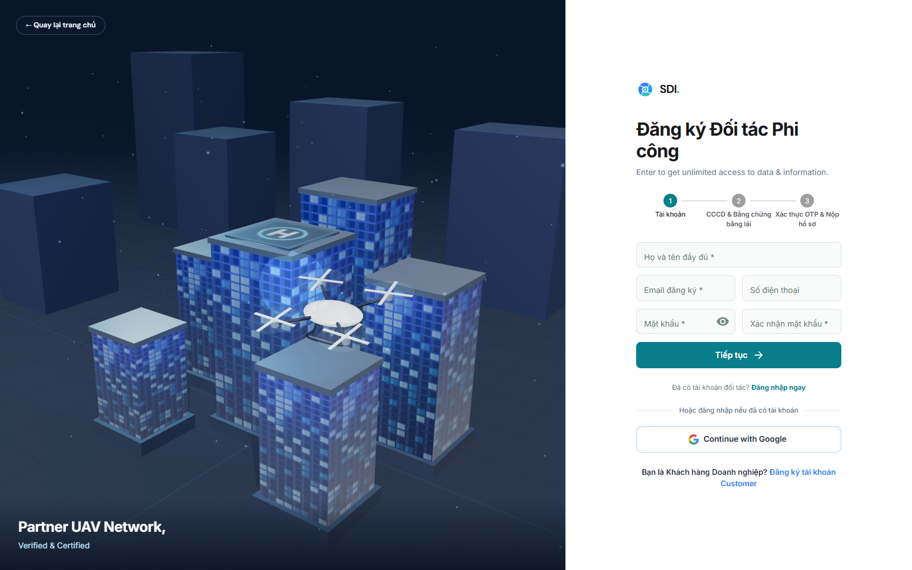

*Figure 6.5 — Partner inspector application with licence details and the required licence scan.*

**Step 2.** Enter your identity and contact details, your pilot licence number, class, and expiry date, and upload your licence scan. Submit the application. No account exists yet — you will be notified when the platform has reviewed it.

**Step 3.** As `ADMIN` or `MANAGER`, open **Onboarding Reviews** and locate the new application. Open the licence scan to verify it against the details supplied.

**Step 4.** Approve or reject. Approval provisions the `INSPECTOR` account and its licence profile in one step and notifies the applicant. Rejection requires a reason and notifies the applicant with it. After approval, record the signed partner contract against the application.

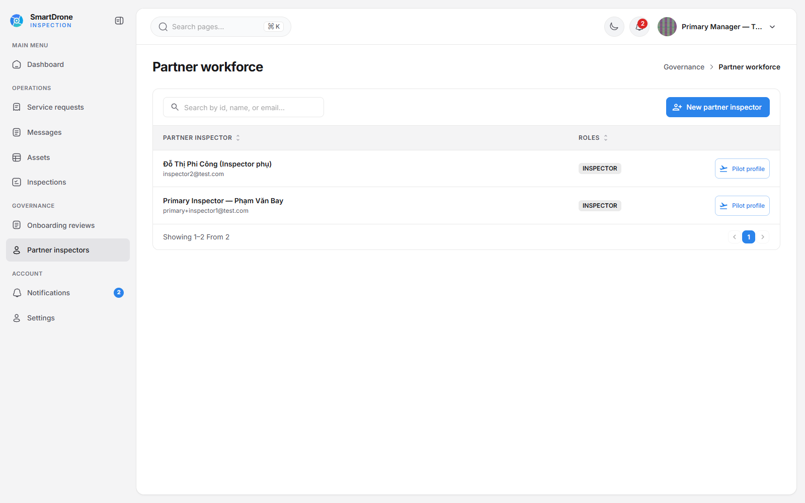

*Figure 6.6 — The partner inspector register, showing licence class, validity, and eligibility.*

**Step 5.** Sign in as the new inspector and open **My Drones**. Choose **Register a drone** and supply the serial number, model, and manufacturer, at least one photograph, the outdoor flight capabilities (wind resistance, optical zoom, maximum altitude), and the documents the platform requires. `REGISTRATION` and `OWNERSHIP` are required by default and `INSPECTION` is optional.

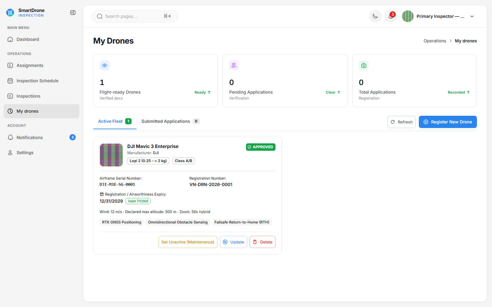

*Figure 6.7 — The inspector's drone inventory with serviceability and document state.*

**Step 6.** Wait for platform review. A manager or administrator approves the drone, after which it becomes selectable for dispatch. You can renew a registration or mark a drone as unavailable from the same screen.

**Step 7.** Review drone document and feature configuration when the required document set changes. As `ADMIN`, open **Drone Configuration** to set which document types are required and which capability features appear on the registration form.

### 3.4 Workflow 3: Service Request, Quotation and Agreement (`MF2` `FE-04`)

**Purpose.** Turn a customer's inspection need into an agreed, signed, scheduled engagement.

**Actors.** `CUSTOMER`, `MANAGER`.

**Preconditions.** The customer has an active building. At least one inspector with a valid licence and at least one serviceable drone exist for the manager to quote.

**Step 1.** In the customer portal open **Service Requests** and choose **New request**. Select the building and inspection type, choose one-time or recurring, and pick the window you want. A first date must be at least twenty calendar days away.

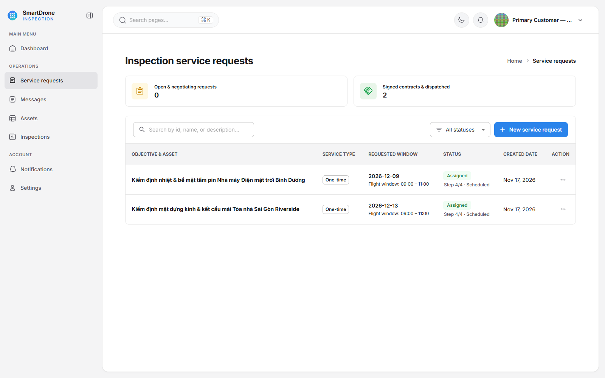

*Figure 6.8 — The customer request list with the four-stage progress indicator.*

**Step 2.** Submit the request. It enters the manager queue and you may still add detail or ask questions.

**Step 3.** As `MANAGER`, open **Service Requests** and claim the request so that it is owned by you. Open its order chat and discuss scope with the customer.

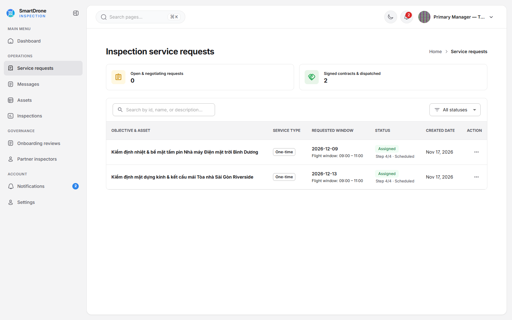

*Figure 6.9 — The manager request queue with claim and assignment state.*

**Step 4.** Issue a quotation. Set the scope, the first occurrence window, the inspector, the drone, the price per occurrence in VND, and any drone features the mission requires. The first occurrence must fall on the date the customer requested. Save the quotation; the customer is notified.

**Step 5.** As `CUSTOMER`, review the quotation and accept it. Acceptance freezes the agreed terms into an immutable snapshot and, for a recurring request, materialises every planned occurrence. If you need different terms, ask the manager for a revised quotation instead.

**Step 6.** Sign the agreement on paper, then as `MANAGER` record the signed copy against the request. Occurrences then become available for dispatch.

### 3.5 Workflow 4: Dispatch, Flight Permit and Field Session (`MF2` `FE-04`, `MF3` `FE-05`)

**Purpose.** Prepare and execute one inspection occurrence in the field.

**Actors.** `MANAGER`, `INSPECTOR`, `ADMIN`.

**Preconditions.** The occurrence exists from an accepted request, and the inspector's licence and the drone's registration are both valid on the planned date.

**Step 1.** As `MANAGER`, open the occurrence and assign an inspector and a drone. The platform refuses an assignment whose licence or drone registration expires before the planned start, or whose schedule conflicts with the inspector's other work.

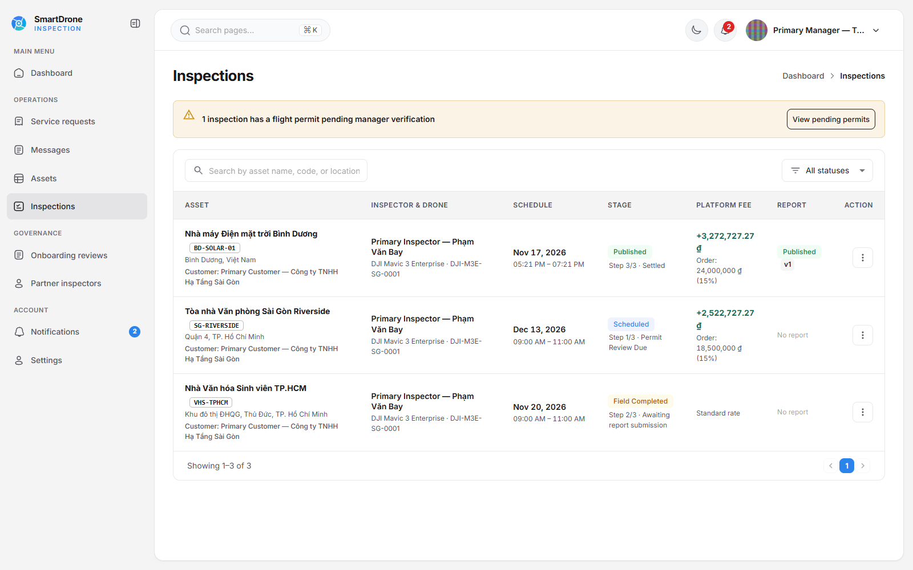

*Figure 6.10 — Dispatch state across scheduled occurrences.*

**Step 2.** As `INSPECTOR`, open the assigned mission in the operations portal and upload the mission flight permit in the **Permit** tab. Supply the permit number, issuing authority, validity window, and optionally the drone serial and maximum altitude.

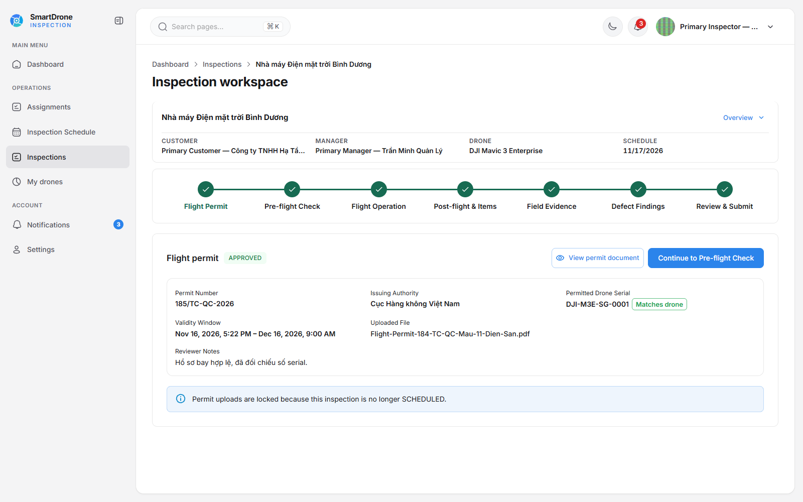

*Figure 6.11 — The flight permit upload with structured metadata.*

**Step 3.** As a `MANAGER` or `ADMIN` who did not upload the permit, verify it. Approval is mandatory: the field session cannot start without a verified permit, and there is no bypass.

**Step 4.** Back in the operations portal, open the **Pre-flight** tab and complete the safety checklist.

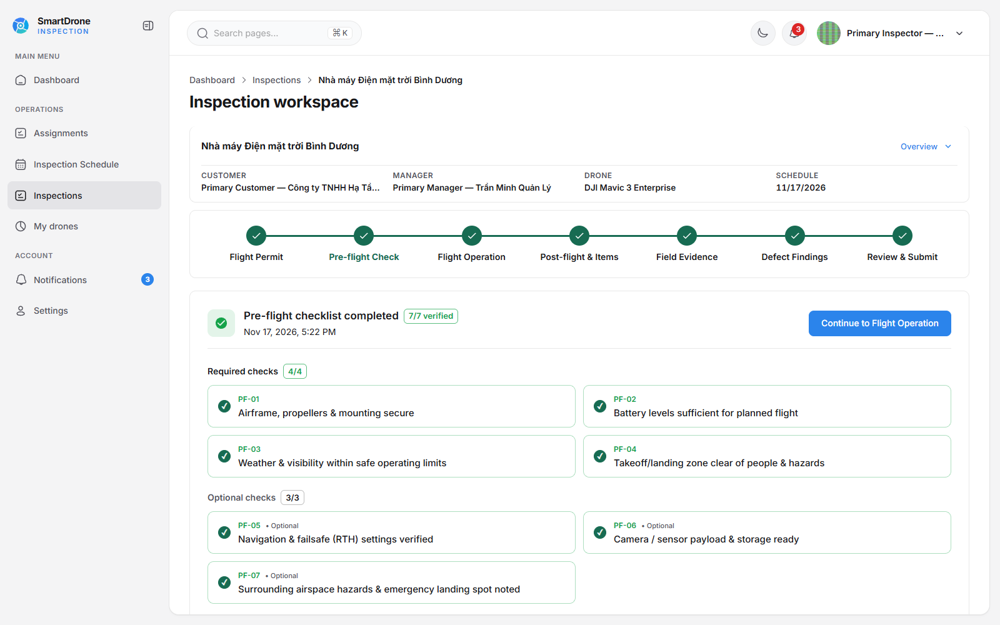

*Figure 6.12 — The pre-flight safety checklist that must be completed before a session starts.*

**Step 5.** Open the **Field Session** tab and choose **Start**. The platform records the session start. Fly the mission, capture photographs and video, and when finished choose **Complete** with outcome notes. If the mission cannot proceed, choose **Abort** and give a reason; the manager is alerted and may reschedule, reassign, or cancel the occurrence.

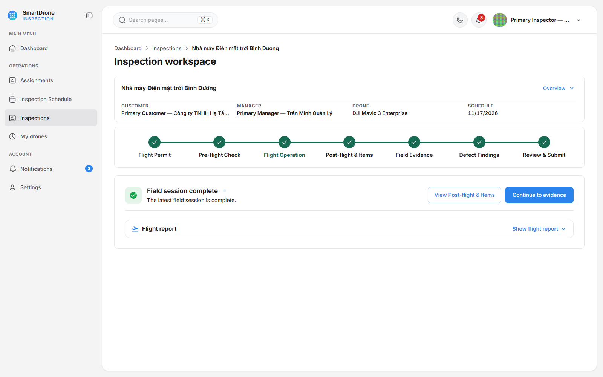

*Figure 6.13 — Field session controls with telemetry and the completion outcome.*

**Step 6.** Review the **Post-flight** tab. When a ground station is connected, flight metrics and the GPS trace are recorded here automatically.

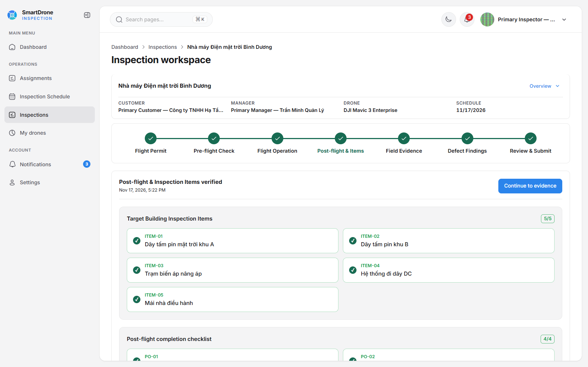

*Figure 6.14 — Post-flight metrics and the recorded GPS flight trace.*

### 3.6 Workflow 5: Evidence Intake and Findings Confirmation (`MF3` `FE-06`)

**Purpose.** Capture inspection evidence and turn it into an agreed set of official findings.

**Actors.** `INSPECTOR`.

**Preconditions.** A field session has been started or completed for the inspection.

**Step 1.** Open the **Evidence** tab and upload photographs. Each photograph is normalized and a thumbnail is generated for fast review.

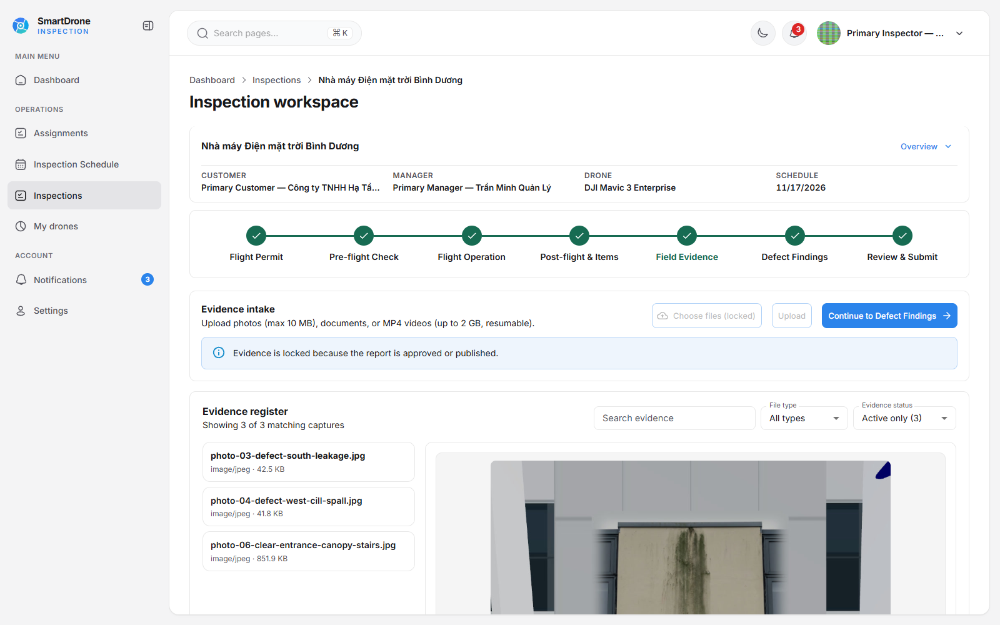

*Figure 6.15 — Evidence capture with thumbnail previews and defect-analysis controls.*

**Step 2.** To upload a video, select it and let the upload run. A large video uploads in chunks and resumes from where it stopped if the connection drops. Processing completes in the background; playback is available once it is ready.

**Step 3.** Choose **Analyse** on a photograph or a video keyframe. The platform proposes candidate defects with a class, a severity estimate, a confidence score, and a highlighted region. If the detection service is unavailable the platform falls back to its secondary vision service, or you may create findings manually.

**Step 4.** Open the **Findings** tab and review each candidate. For every proposal, accept it, adjust its label, severity, note, or region, or reject it. Add any finding the system missed by hand.

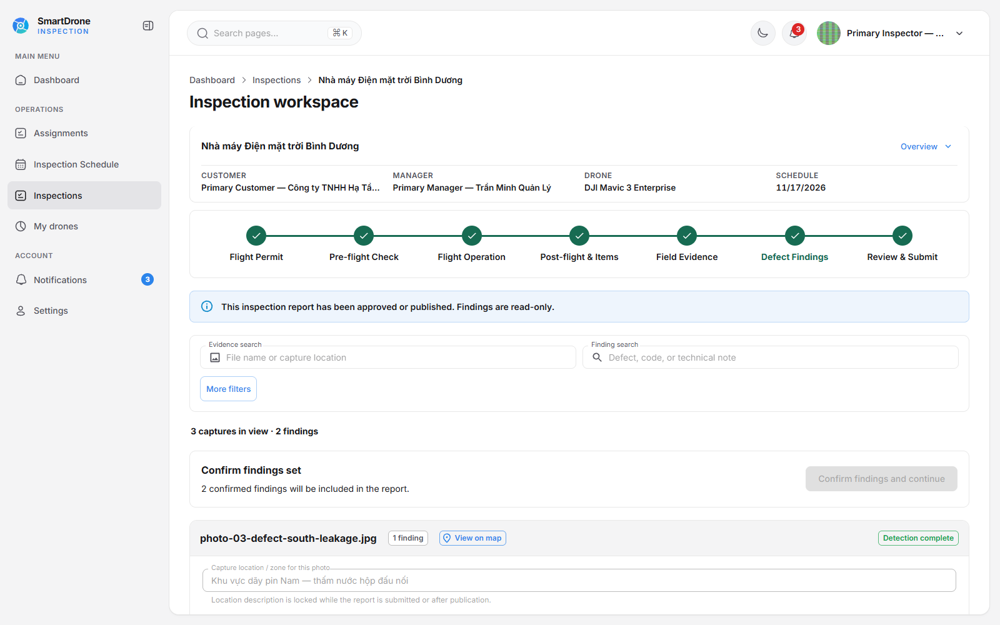

*Figure 6.16 — Candidate findings awaiting inspector confirmation.*

**Step 5.** Choose **Confirm findings** to set the baseline. This is an explicit action. Only confirmed findings become official, and once confirmed the baseline is what the report is built from.

### 3.7 Workflow 6: Report Submission, Review and Publication (`MF4` `FE-07`)

**Purpose.** Produce the official inspection report and publish it as a PDF the customer can rely on.

**Actors.** `INSPECTOR`, `MANAGER`, `ADMIN`.

**Preconditions.** Findings have been confirmed for the inspection.

**Step 1.** As `INSPECTOR`, open the **Report** tab. The platform compiles the report from the confirmed findings, the evidence, and the session record. You may request an advisory narrative draft, which you must review and edit before use.

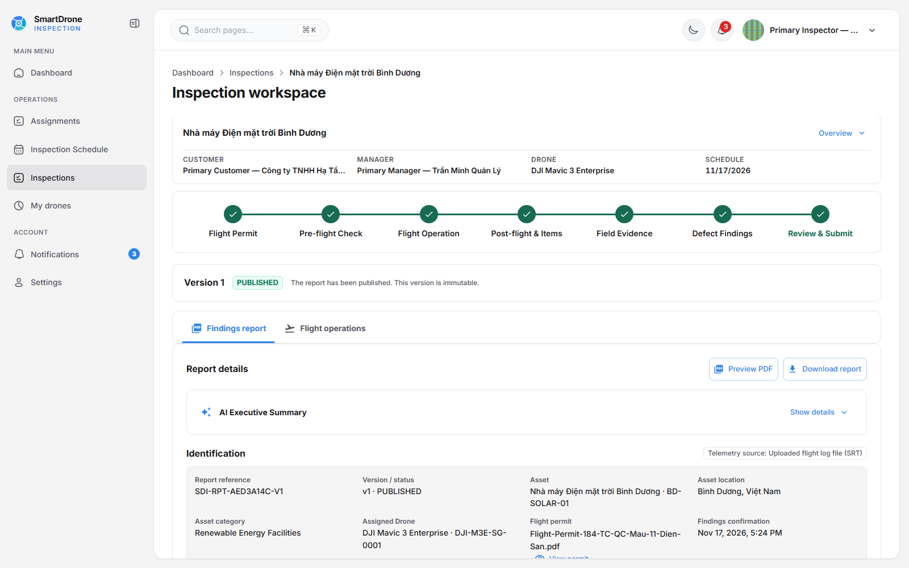

*Figure 6.17 — The compiled report preview with the advisory summary.*

**Step 2.** Review every section and choose **Submit**. Submission is an explicit action; opening the report does not submit it.

**Step 3.** As `MANAGER` or `ADMIN`, open the submitted report in the review queue. Review the findings, the evidence, and the summary.

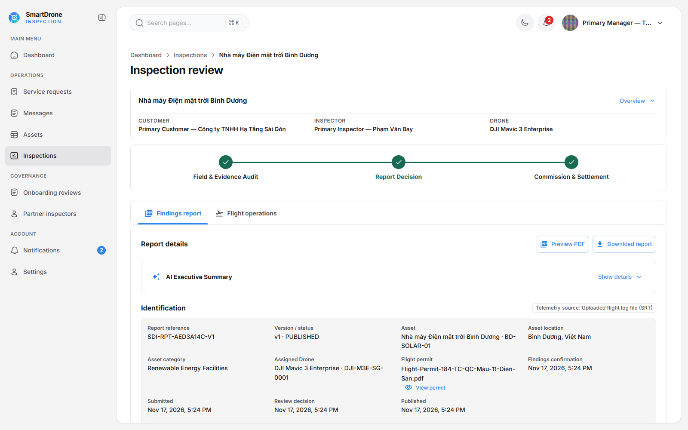

*Figure 6.18 — Independent report review with the publish and return actions.*

**Step 4.** Publish, or return the report with reasons. The platform refuses publication by the report's own author, so the reviewer must be a different person. Publication renders an immutable PDF that the customer can download.

**Step 5.** If a published report requires correction, issue a new version. The previously published version is preserved and marked superseded rather than overwritten.

### 3.8 Workflow 7: Report Acceptance and Payment (`MF4` `FE-08`)

**Purpose.** Accept the published report and settle the inspection fee.

**Actors.** `CUSTOMER`.

**Preconditions.** The report is published and the customer is signed in to the customer portal.

**Step 1.** Open **Inspections** and select the completed inspection.

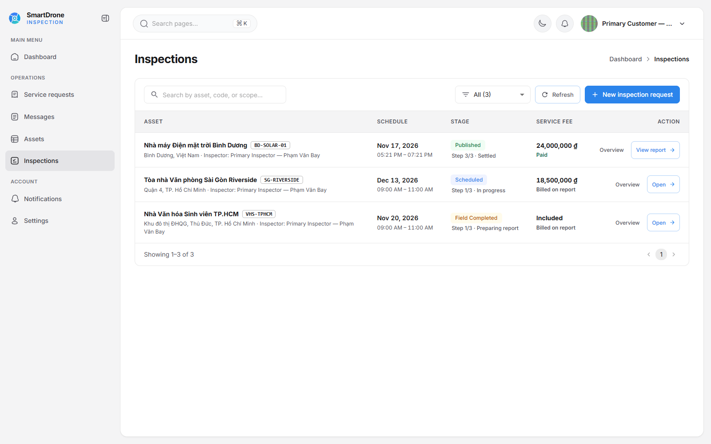

*Figure 6.19 — The customer inspection list with published reports available to review.*

**Step 2.** Download and read the published PDF report.

**Step 3.** Choose **Accept report**. Acceptance is recorded against the occurrence and the payment becomes due.

**Step 4.** Choose **Pay** and select PayOS VietQR or VNPay. For VietQR, scan the displayed code with a banking application; for VNPay, follow the redirect to the payment page.

**Step 5.** Confirm that the payment shows as paid. Settlement is confirmed by the gateway callback rather than by the redirect alone, so the status may take a moment to update. Once paid, a manager can record the inspector's payout for that occurrence.

### 3.9 Workflow 8: Customer Mobile Application (`MF1`–`MF4`, Customer only)

**Purpose.** Let a customer follow and act on its inspections from a phone.

**Actors.** `CUSTOMER` only.

**Preconditions.** The account has the `CUSTOMER` role. The mobile application admits no other role: an `ADMIN`, `MANAGER`, or `INSPECTOR` account is refused at sign-in.

**Step 1.** Install the application and sign in with your customer credentials, or continue with Google.

**Step 2.** Use the bottom navigation to reach **Home**, **Buildings**, **Requests**, **Inspections**, and **Profile**.

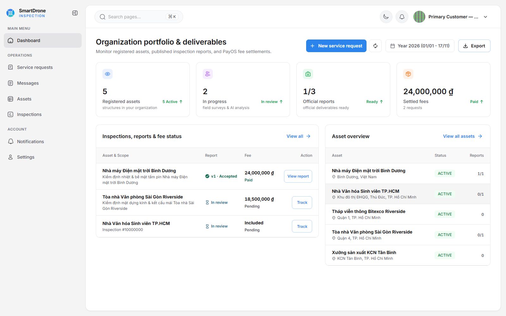

*Figure 6.20 — The customer home summary that mirrors the mobile dashboard.*

**Step 3.** Open **Requests** to raise a new service request or continue an existing conversation, and **Inspections** to track progress and read the published report.

**Step 4.** Open **Profile** to change your name, phone number, or language. The application supports English and Vietnamese, and the choice persists between sessions.

**Limitation.** Field capture, permit handling, and report preparation are not available on mobile. Those tasks belong to the inspector and are performed in the operations web portal.
