# II. Release Package & User Guides

## 1. Deliverable Package

| No. | Deliverable Item | Description |
| --- | --- | --- |
| 1 | Project Schedule/Tracking | Task schedule, milestone dates, and effort tracking against the weighted plan in Report 2 (`208` md). |
| 2 | Project Backlog | The twenty-four atomic feature backlog (`FE-01`–`FE-24`) across `MF1`–`MF4`. |
| 3 | Source Codes | Four independent repositories: backend service (`SmartDroneInspection-backend`), web portals (`SmartDroneInspection-frontend`), Customer mobile client (`SmartDroneInspection-mobile`), and documentation (`SmartDroneInspection-docs`). |
| 4 | Database Script(s) | Flyway migrations `V1`–`V4` and `V60`–`V80` build the PostgreSQL 17 schema. See Chapter IV, Section 2 for the database design. |
| 5 | Final Report Document | Reports 1–7, prepared using the official templates. |
| 6 | Test Cases Document | `Report5_Test Report.xlsx` (`v3.19`) with twenty-four feature sheets (`Feature 1`–`Feature 24`) covering `80` listed rows (`78` active cases + `2` superseded `FE-13` cases), plus the executed results in Report 5 §5. |
| 7 | Defects List | The defect log records one resolved defect (`DEF-01`) and one open tooling defect (`DEF-02`). |
| 8 | Issues List | Outstanding issues and known limitations, including the product limitations listed in Chapter III. |
| 9 | Slide | The defence presentation used for the final review. |

## 2. Installation Guides

### 2.1 System Requirements

| Component | Minimum Setup | Notes |
| --- | --- | --- |
| Host | 64-bit x86 processor with 4 logical cores, 8 GB RAM and 40 GB free disk | Allow additional CPU, memory and storage for detection and video processing. Use 16 GB RAM and 60 GB free for the recommended setup. |
| Backend and storage | Docker Engine 27+ with Docker Compose | Runs PostgreSQL, MinIO, AI inference, SmartDroneHub and the Spring Boot API. Java 21 is required for local backend builds and tests. |
| Web development | Node.js 22+ and npm | Runs the Vite development server. Use Chrome or Edge. |
| Customer mobile app | Flutter SDK and Android toolchain | Run on an emulator or physical Android device. |
| Optional integrations | Network access for configured services | SmartDroneHub receives MAVLink on UDP 14551 by default. Its default TCP connection targets the host on port 5762. |

### 2.2 Installation Procedure

#### Step 1 — Configure and Start the Backend

Clone the backend, frontend, mobile, and documentation repositories into sibling directories. In the backend folder, copy `.env.example` to `.env` and set the PostgreSQL and MinIO credentials, signing secrets, web origin, and bootstrap Administrator. Configure mail to test registration with email verification.

Run `docker compose up -d --build` in the backend directory. Use `docker compose ps` and open `http://localhost:8080/actuator/health`. Wait for `UP` before connecting either client. Flyway applies the migrations during startup.

#### Step 2 — Start the Web Portal

From the frontend directory, run `npm install` and then `npm run dev`. Open `http://localhost:3000` and check that the sign-in page loads. The development server proxies `/api` to `http://localhost:8080` by default.

#### Step 3 — Start the Customer Mobile App

From the mobile directory, run `flutter doctor` and `flutter pub get`. Start an Android emulator and run `flutter run --dart-define=API_BASE_URL=http://10.0.2.2:8080/api/v1`. On a physical device, use a backend address that the device can reach. Verify that a Customer can sign in and open the home screen.

#### Step 4 — Verify the First Web Login

Use the bootstrap Administrator credentials to sign in to the web portal. Change the initial password and check that **Platform users** opens.

If startup fails, use `docker compose logs backend` to find the failing check. For a signing error, check the secret lengths against `.env.example`. If uploads fail after sign-in, check that MinIO is healthy and the configured buckets are available.

## 3. User Manual

The figures use demonstration accounts and building data. A caption marked as an illustration shows an example of the named workflow state.

### 3.1 Find the Right Workflow

Use the web portal and follow the same building, request, and inspection when switching roles. The numbered instructions match the red callouts in the figures.

| If you want to | Start with | Finish when |
| --- | --- | --- |
| Create a Customer account and add a building | Workflow 1 · Customer | The building appears as **Active** in **Assets**. |
| Onboard a Partner Inspector and register a drone | Workflow 2 · Applicant, Manager, Inspector | The Inspector account is approved and the drone appears in the active fleet. |
| Request, contract and schedule an inspection | Workflow 3 · Customer, Manager | The agreed occurrence has an assigned Inspector and drone. |
| Prepare and complete a field session | Workflow 4 · Inspector | The session is complete and **Field Evidence** is available. |
| Upload evidence and confirm findings | Workflow 5 · Inspector | The findings are confirmed and **Review & Submit** opens. |
| Publish a report and settle payment | Workflow 6 · Inspector, Manager, Customer | The Customer accepts the published report and sees **Payment confirmed**. |

### 3.2 Workflow 1: Set Up a Customer Account and Building

Use a mailbox you can access for verification. Have the building address, category and map location ready.

#### Customer registration and building setup

**Step 1 — Create your Customer account.**

From the public home page, select **Sign up**.

❶ Enter your name and email, set and confirm your password, and accept the terms.

❷ Select **Create account** to request the email code.

Enter the six-digit code, then sign in when the portal returns you to the login page.

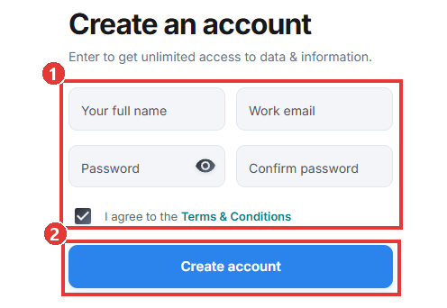

*Figure 6.1 — Customer registration form.*

**Step 2 — Add the building.**

In **Assets**, select **New asset** and enter the name and category. Pin the building with **Pick on Google Maps**.

❶ Check the airspace result for the pin.

❷ Select **Xác nhận vị trí này** (Confirm this location), then save the building.

No-fly zones block confirmation. Restricted locations can be saved and require a permit for inspection flights.

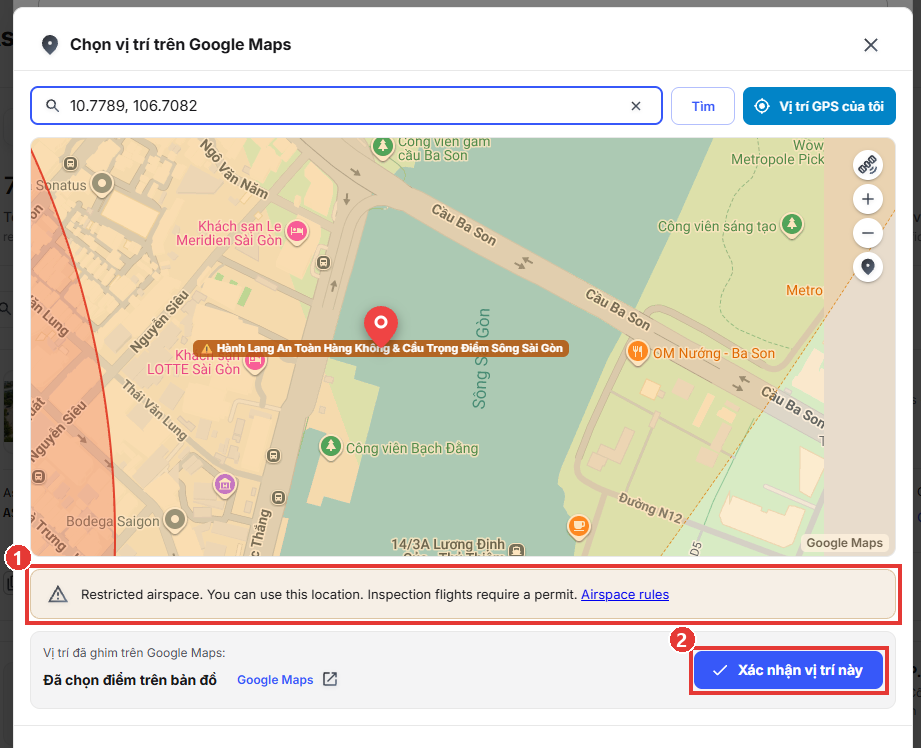

*Figure 6.2 — Building location and airspace result.*

**Step 3 — Verify the saved building.**

In **Assets**, select **Detail** on the building you added.

❶ Check that it is **Active** and the pinned location is correct.

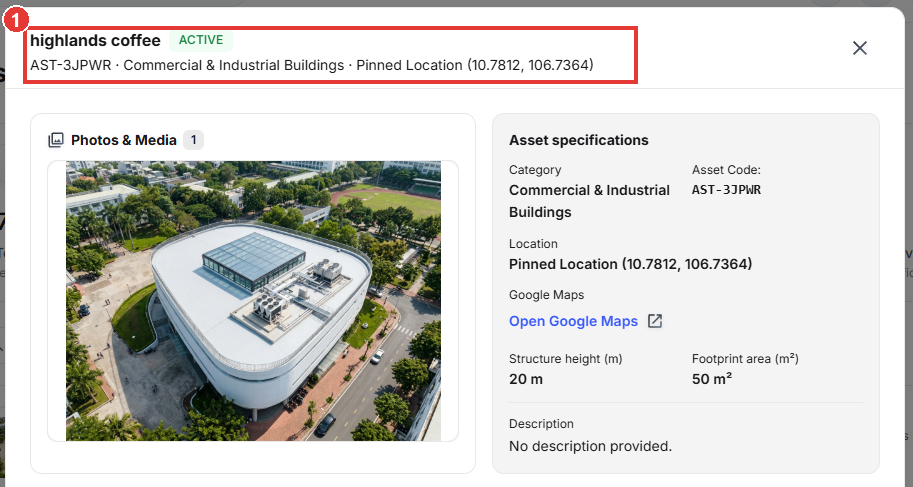

*Figure 6.3 — Saved Customer building details.*

#### Find an update from a notification (optional)

**Step 4 — Open the linked request or inspection.**

❶ In the Customer portal, open **Notifications**.

❷ Select the alert for the request or inspection you want to follow.

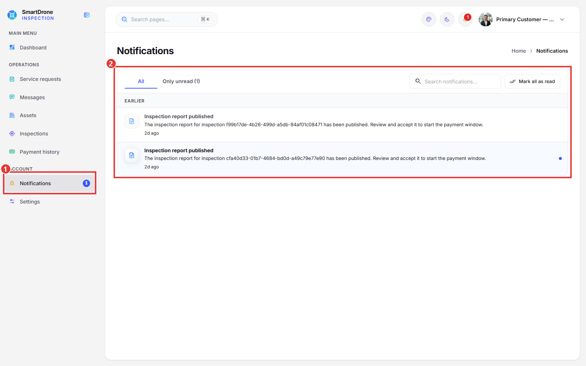

*Figure 6.4 — Customer notification linking to a work item.*

### 3.3 Workflow 2: Approve a Partner Inspector and Register a Drone

The applicant needs an email address, identity information and a pilot licence scan. The Manager needs a signed partner contract before approval. The Inspector can prepare the aircraft documents after account approval.

#### Applicant submits the application

**Step 1 — Apply as a Partner Inspector.**

On the Inspector sign-in page, select **Register as Inspector**.

❶ Enter your account details and select **Tiếp tục** (Continue).

❷ Provide identity and licence information, upload the requested scan and complete email verification to submit the application.

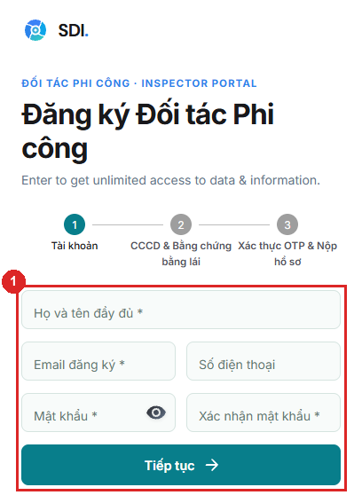

*Figure 6.5 — Partner Inspector application stages.*

#### Manager reviews the application

**Step 2 — Record the signed contract and approve the applicant.**

Open **Inspector applications**, locate the applicant and select **Review application**. Verify the licence details and scan.

❶ Select **Upload signed contract** to attach the signed partner agreement.

❷ Select **Approve** once the scan is attached.

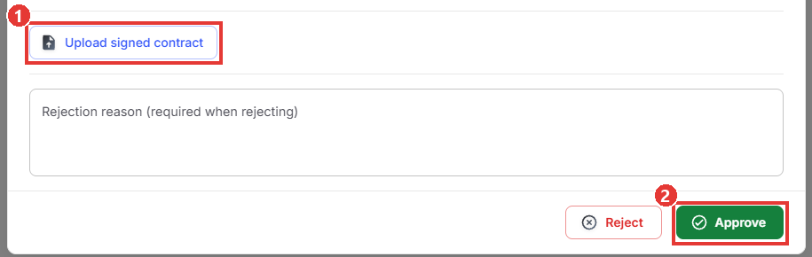

*Figure 6.6 — Signed partner contract upload in the Inspector application.*

#### Inspector submits the drone registration

**Step 3 — Open the registration form.**

Sign in as the approved Inspector and open **My drones**.

❶ Select **Register New Drone**.

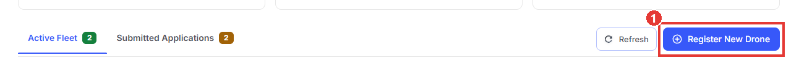

*Figure 6.7 — Opening the Register New Drone form.*

**Step 4 — Submit the aircraft and supporting documents.**

❶ Enter the aircraft details, select its capabilities and attach the requested photos and documents. Check the requirements shown for registration, proof of ownership and technical inspection.

❷ Select **Submit Application** and check that the application is awaiting review.

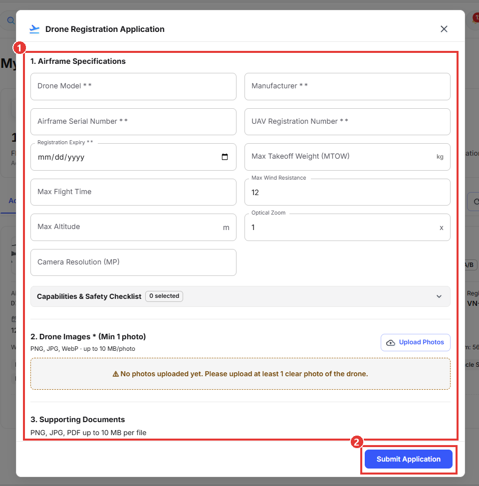

*Figure 6.8 — Drone registration form and submit action.*

#### Manager reviews the drone registration

**Step 5 — Approve the drone application.**

❶ Open **Drone registrations** as Manager.

❷ Find the pending aircraft and open **Review application**.

Check the documents before approving the application. After approval, the Inspector can verify the aircraft in **My drones → Active Fleet**.

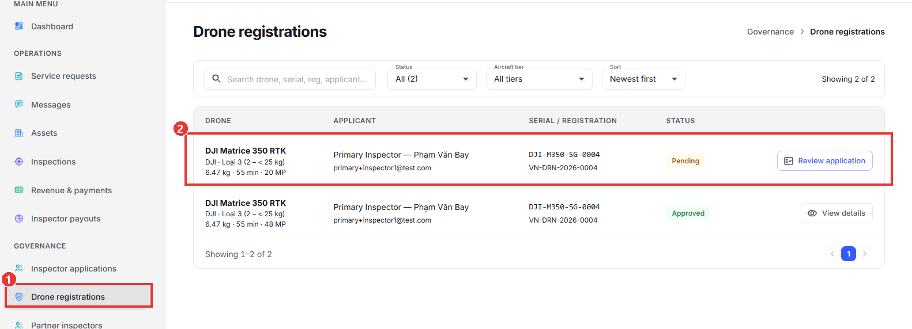

*Figure 6.9 — Manager drone registration queue.*

### 3.4 Workflow 3: Request, Quote, Contract and Dispatch an Inspection

Start with an active building in the Customer portal. Use the same request when switching between Customer and Manager.

#### Customer submits the request

**Step 1 — Create a service request.**

Open **Service requests → New service request**.

❶ Select the building and inspection frequency. Set the first date at least 20 days ahead and complete the recurring schedule fields if shown.

❷ Select **Submit service request** and confirm the new request appears in the list.

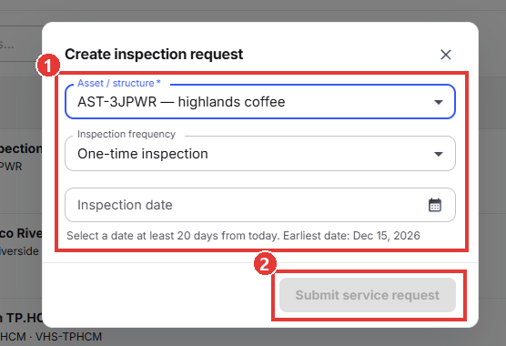

*Figure 6.10 — Building, schedule and submit controls for a service request.*

#### Manager claims the request and prepares the quotation

**Step 2 — Claim the new request.**

Open **Service requests** as Manager.

❶ Select **Claim request** on the new request.

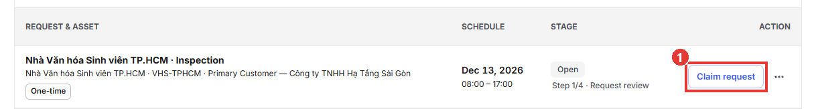

*Figure 6.11 — Claim action for an open service request (workflow illustration).*

**Step 3 — Clarify the scope if needed.**

❶ In **Messages**, select the **Customer** tab and open the request thread.

❷ Ask about the inspection scope or proposed schedule. The Customer replies in the same request thread from the **Manager** tab in **Messages**.

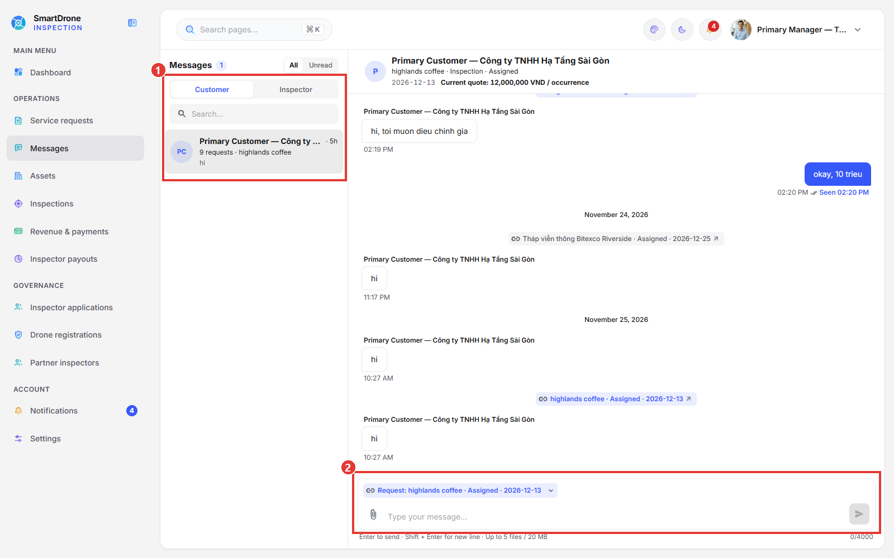

*Figure 6.12 — Order Chat for a Customer request.*

**Step 4 — Issue the quotation.**

Open the claimed request. Enter the scope, dates and price.

❶ Select **Configure checkpoints** if the inspection scope needs changes.

❷ Select **Save quote** to send it for Customer review.

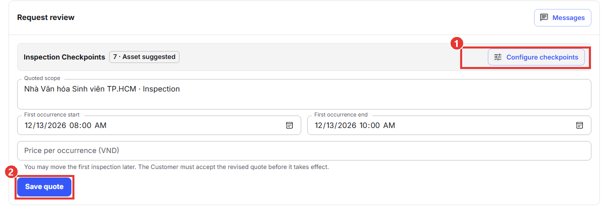

*Figure 6.13 — Manager quotation form and save action (workflow illustration).*

#### Customer accepts the quoted terms

**Step 5 — Accept the current quotation.**

Open **Review quote** on the same request. Check the scope, date and price.

❶ Select **Accept quote** and confirm.

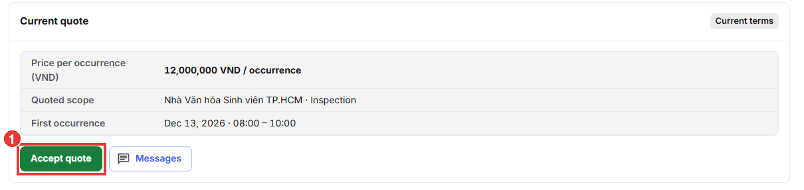

*Figure 6.14 — Customer quotation acceptance (workflow illustration).*

#### Manager records the contract and dispatches the team

**Step 6 — Record the signed contract.**

After both parties sign, open **Record contract**.

❶ Select **Choose signed contract scan**.

❷ Select **Upload signed scan**.

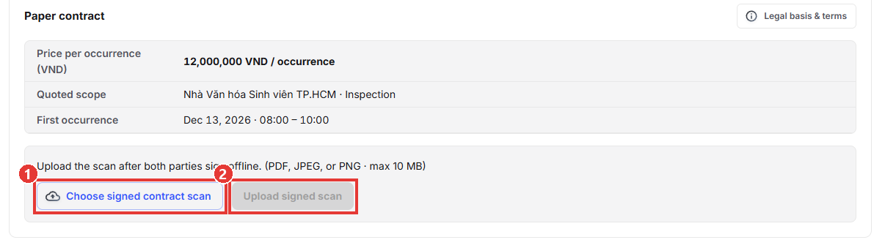

*Figure 6.15 — Manager uploads the signed agreement (workflow illustration).*

**Step 7 — Assign the Inspector and drone.**

Open **Assign team** for the occurrence after the contract is recorded.

❶ In **Scheduled flight & assignment**, set the flight window and select **Find eligible partners**.

Choose an eligible Inspector and drone, then select **Assign occurrence**. Check the assigned team and flight window. If the assignment is awaiting a response, continue with **Accept mission** in Workflow 4.

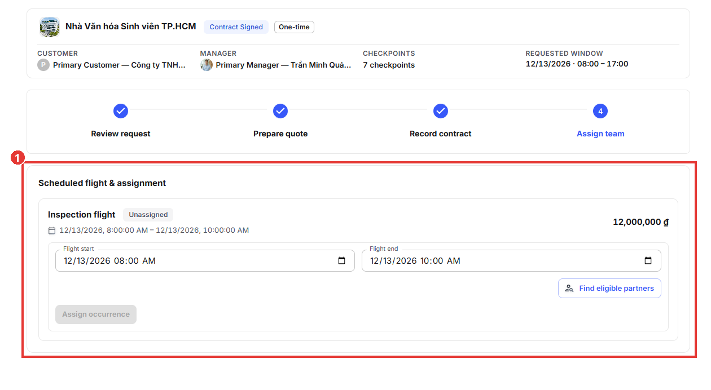

*Figure 6.16 — Flight window and eligible team selection.*

#### View the scheduled inspection as a Customer (optional)

**Step 8 — Open the scheduled inspection.**

❶ In the same request, check that the progress bar shows **Scheduled**.

❷ Select **Open inspection** to confirm the scheduled occurrence.

*Figure 6.17 — Scheduled request and inspection link.*

### 3.5 Workflow 4: Accept a Mission and Complete Field Work

Use the assigned Inspector account. Have the flight permit ready and confirm that it covers the assigned aircraft and planned flight window.

#### Inspector accepts and prepares the mission

**Step 1 — Open and accept the assigned mission.**

In **Inspections**, open the assigned building and date.

❶ Select **Accept mission** when a response is pending.

If you cannot take the assignment, select **Decline mission** and give a reason.

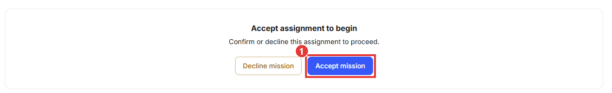

*Figure 6.18 — Inspector accepts a pending assignment (workflow illustration).*

**Step 2 — Confirm site access if needed.**

Open the Customer conversation from **Messages** in the inspection.

❶ Confirm the meeting point or access arrangements.

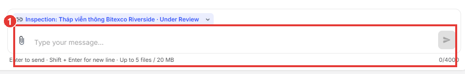

*Figure 6.19 — Inspector message composer for the selected inspection.*

**Step 3 — Save the flight permit or withdraw before field work.**

Open **Flight Permit** while the inspection is scheduled.

❶ Select **Choose permit file** (up to 25 MB). To update an existing permit, select **Replace permit** and **Choose replacement permit file**. Enter the permit details and check the assigned drone and flight window.

❷ Select **Save flight permit** (**Lưu giấy phép bay**). Check that a valid upload shows **Approved**. If a drone change or reschedule resets the permit, save a replacement.

❸ If you have accepted the assignment and field work has yet to start, select **Withdraw from assignment** (**Rút khỏi phân công**), enter the reason and select **Confirm withdrawal** (**Xác nhận rút**). The inspections list opens and the Manager can reassign or cancel the scheduled inspection. After starting a session, contact the Manager to change the schedule, even if you have since aborted the session.

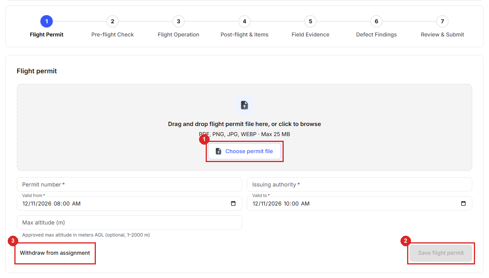

*Figure 6.20 — Flight Permit save and withdrawal actions before field work (demo data).*

#### Inspector completes the field session

**Step 4 — Complete pre-flight checks.**

❶ Select **Pre-flight Check** in the progress bar.

❷ Verify and tick each item under **Required checks**, along with any applicable optional items below.

*Note:* Use **Check all** only after verifying every item it will mark.

*Figure 6.21 — Required pre-flight checks and checklist controls.*

**Step 5 — Start the field session.**

Record any site observations under **Pre-flight note**.

❶ Select **Start session & Continue to Flight** after completing the checks.

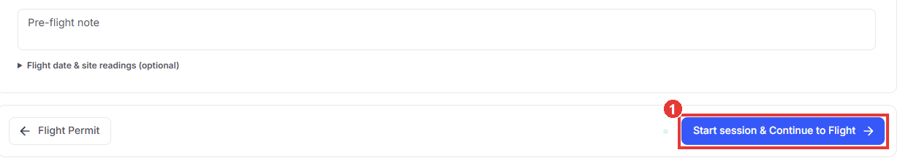

*Figure 6.22 — Start action at the end of pre-flight checks.*

**Step 6 — Record and finish a flight.**

In **Flight Operation**, record telemetry with **SmartDroneHub** if connected. With telemetry active, select **Complete flight** after each sortie. Continue to **Post-flight & Items** after the final sortie.

❶ Use **Choose log** if you need to import a supported flight log. The control is shown here after session closure.

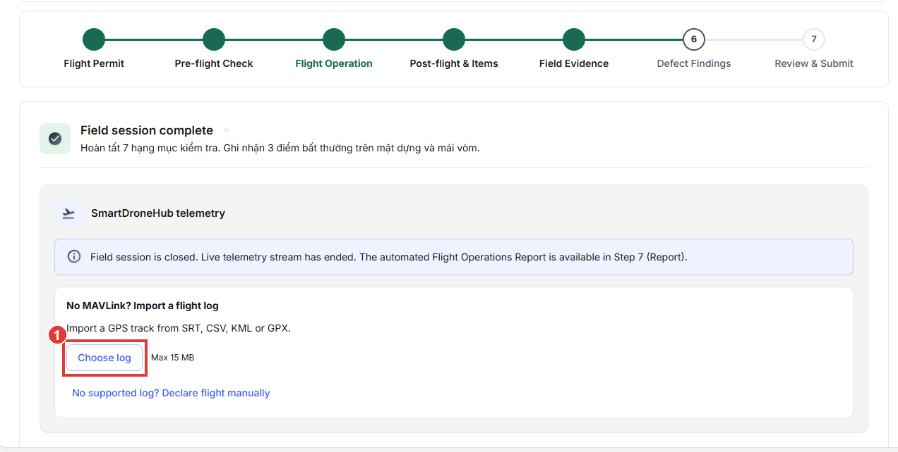

*Figure 6.23 — Flight log import after the session closes.*

**Step 7 — Complete post-flight checks and close the session.**

❶ Open **Post-flight & Items**.

❷ Complete the post-flight checklist and mark the **Target Building Inspection Items** you verified.

Select **Complete session & Continue to Evidence**. Supply a reason if the app prompts for an explanation of remaining items. If field work cannot continue, use **Abort session** and record why.

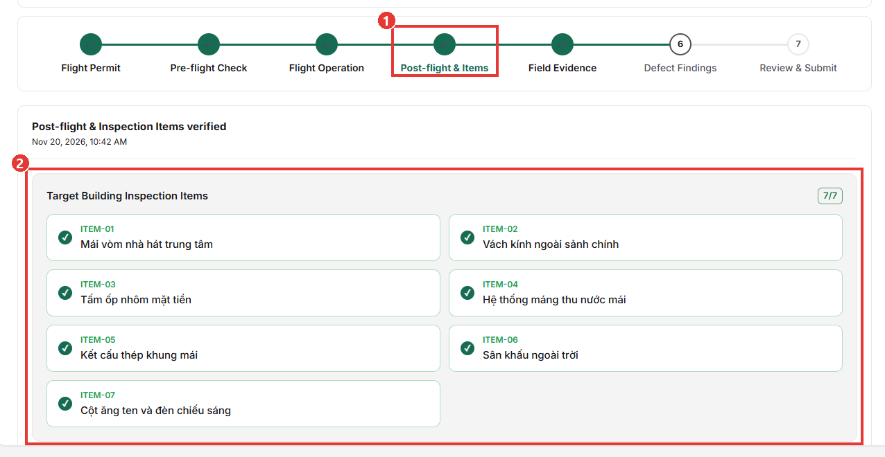

*Figure 6.24 — Post-flight stage and building inspection items.*

#### Manager checks the recorded field work

**Step 8 — Audit the permit and flight record.**

❶ Open **Field & Evidence Audit** in the Manager inspection workspace.

❷ Check the recorded **Flight Permit** and expand **Flight report** to review the flight details.

*Figure 6.25 — Manager audit of the permit and flight record.*

### 3.6 Workflow 5: Upload Evidence and Confirm Findings

Use the assigned Inspector account and the same inspection as in Workflow 4. Have the photos or MP4 files available. Complete field work before confirming findings.

#### Inspector records evidence and findings

**Step 1 — Upload the inspection captures.**

❶ In **Field Evidence**, select **Choose files** and then **Upload**. Photos may be up to 10 MB and MP4 videos up to 2 GB.

❷ Verify that the files appear in the evidence register. Wait for video processing before checking playback.

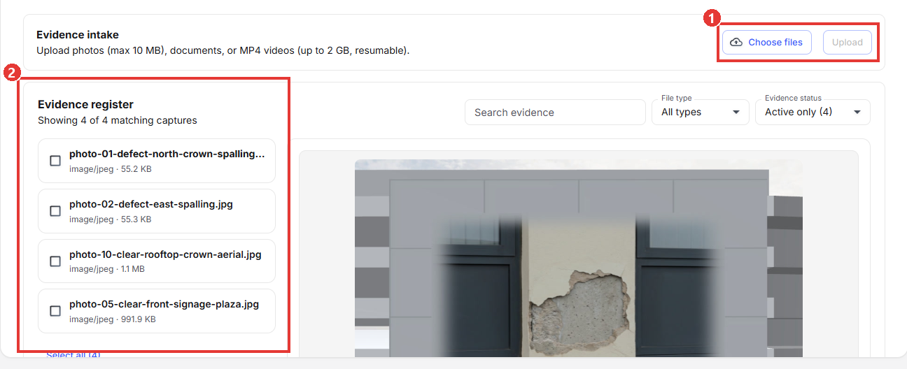

*Figure 6.26 — Evidence upload and registered captures.*

**Step 2 — Run detection on the uploaded images.**

❶ In **Defect Findings**, select **Analyze all images** to run detection on eligible photos.

❷ When findings are present, select **Draft all notes** if you want suggested notes for them.

Review the evidence yourself before accepting a detection or an AI-drafted note.

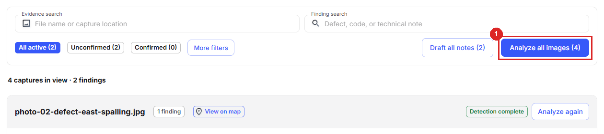

*Figure 6.27 — Batch detection and note drafting controls.*

**Step 3 — Decide each suggested finding.**

❶ Turn on **Show detected regions** to compare the marked region with the evidence photo.

❷ Use **Draft note with AI** when needed and correct the suggested text before saving.

❸ Select **Confirm** when the finding is supported by the evidence.

❹ Select **Remove** if the evidence does not support the suggestion.

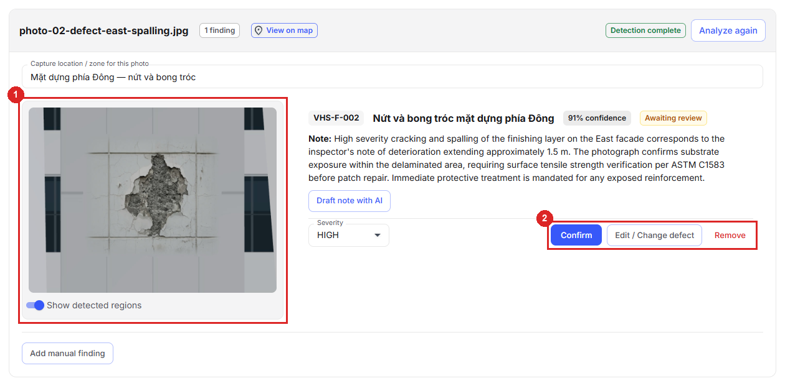

*Figure 6.28 — Evidence, suggested note and finding decision.*

**Step 4 — Confirm the findings baseline.**

❶ Once field work is complete and at least one evidence item is still active, select **Confirm findings and continue**.

If suggestions are awaiting a decision, as shown in the figure, use **Unconfirmed** to find and resolve them. If no findings were observed, acknowledge that you reviewed the captures. Confirmation opens **Review & Submit**.

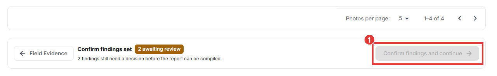

*Figure 6.29 — Findings confirmation awaiting review decisions.*

### 3.7 Workflow 6: Submit, Publish and Pay for the Report

Before submitting the report, confirm the findings for the inspection.

#### Inspector submits the report

**Step 1 — Review and submit the report.**

In **Review & Submit**, check the findings and flight operations previews. Review the AI summary against the evidence.

❶ Select **Submit for review**, then **Confirm and Submit**. Verify that the report is **Submitted**.

If the Manager returns it, address the reason, review the revised report and submit it again.

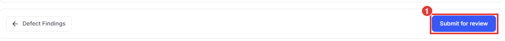

*Figure 6.30 — Inspector submission action in the report preview (workflow illustration).*

#### Manager decides, settles payout and publishes

**Step 2 — Review the submitted report.**

Open the submitted report from **Reports → Report Decision** and check it against the evidence.

❶ Approve the report or return it with a reason.

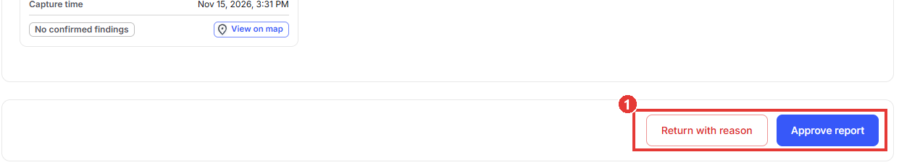

*Figure 6.31 — Manager report decision controls.*

**Step 3 — Settle the Inspector payout.**

For a commercial inspection, open **Inspector Payout** after approval.

❶ Select **Pay Inspector via SePay (VietQR)**. Verify settlement before publishing.

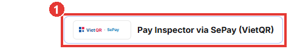

*Figure 6.32 — Inspector payout action before publication.*

**Step 4 — Publish the official report.**

❶ Select **Continue to Publish Report** once the report is approved and any required payout is settled.

Select **Publish to Customer** and verify that the report is **Published**.

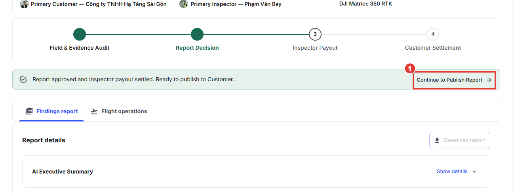

*Figure 6.33 — Approved report with settled payout ready for publication.*

#### Customer accepts the report and pays

**Step 5 — Open the published report.**

❶ Open **Inspections** in the Customer portal.

❷ Select the inspection marked **Published**, then open **Inspection Report** to read the report.

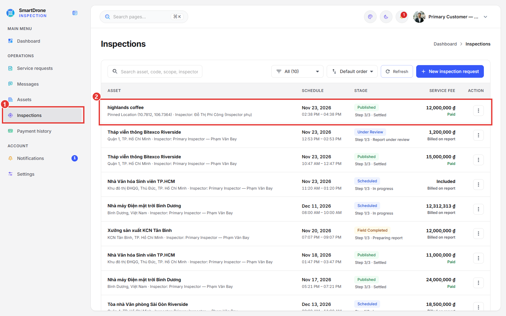

*Figure 6.34 — Customer inspections list with the published report.*

**Step 6 — Accept the published report.**

❶ Select **Accept Report**, then **Confirm & Accept Report** to unlock payment.

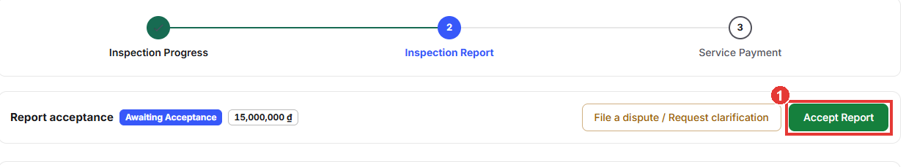

*Figure 6.35 — Customer accepts the published report (workflow illustration).*

**Step 7 — Pay the service fee.**

Open **Service Payment** after accepting the report.

❶ Choose **Pay with VietQR (Sepay)** or **Pay with VNPay** and follow the gateway instructions.

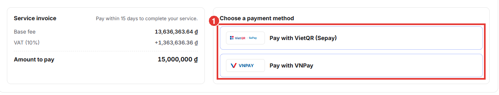

*Figure 6.36 — Payment options after report acceptance (workflow illustration).*

**Step 8 — Verify payment.**

❶ Check **Payment confirmed** and verify the recorded method.

❷ Select **Download payment receipt (PDF)** if you need a copy.

*Figure 6.37 — Confirmed Customer payment and receipt download.*

#### Look up a past payment as a Customer (optional)

**Step 9 — Find the payment record.**

❶ Open **Payment history** and verify the amount, method and status for the inspection.

❷ Select **Details** on its payment row to retrieve the payment record.

*Figure 6.38 — Customer payment history and transaction details.*

#### Reconcile an inspection payment as a Manager (optional)

**Step 10 — Check payment against the inspection invoice.**

❶ Open **Customer Settlement** in the inspection workspace.

❷ Compare the recorded acceptance, amount and payment status with the invoice breakdown. Use the receipt for reconciliation when needed.

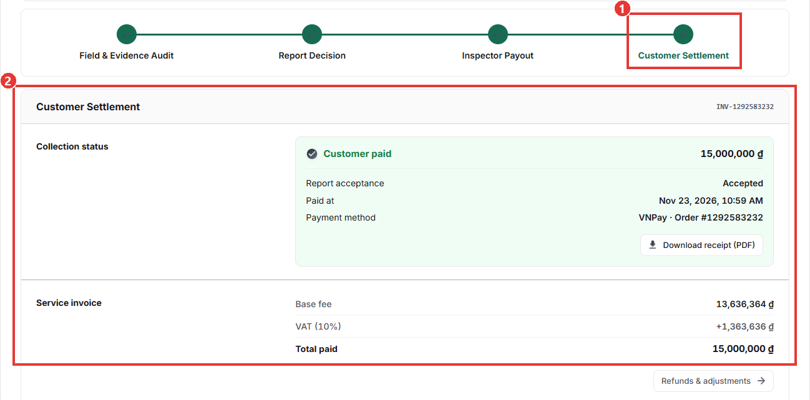

*Figure 6.39 — Manager view of Customer settlement and invoice details.*

**Step 11 — Reconcile the same payment in the ledger.**

Open **Revenue & payments** in the Manager portal.

❶ Find the same inspection in the transaction list and compare the amount collected and recorded commission with the settlement record.

*Figure 6.40 — Manager revenue ledger and per-inspection transactions.*

### 3.8 Customer Mobile App

Use the Customer account from Workflow 1. A Manager or Inspector uses the web portal for assigned duties. The mobile actions below follow the same inspection record as the web portal.

**Step 1 — Sign in on mobile.**

Enter the Customer email and password, then sign in. Use the password recovery action if needed. A successful sign-in opens the Customer home screen.

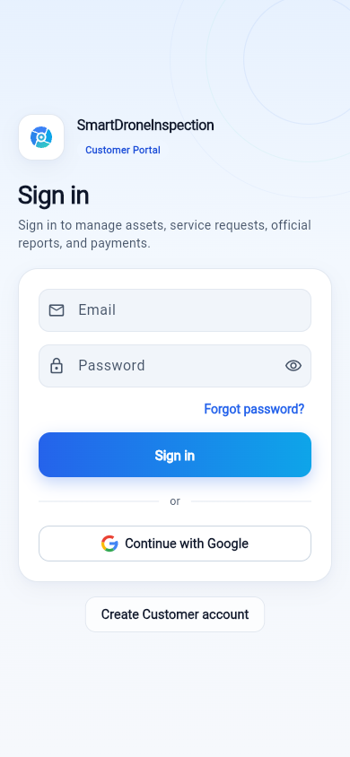

*Figure 6.41 — Customer sign-in in the Flutter web preview.*

**Step 2 — Find work that needs attention.**

Use the home view to open buildings, requests or inspections. Start from the relevant record if a notification asks you to review an update.

*Figure 6.42 — Find work that needs attention (demo data).*

**Step 3 — Open the building list.**

Open Assets from the bottom navigation. Choose the building used in the inspection request. Check the name and address before continuing.

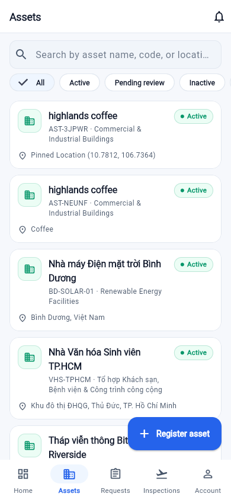

*Figure 6.43 — Open the building list (demo data).*

**Step 4 — Check a building record.**

Review the building location and attached material in the asset detail. Go back to Assets to select a different building.

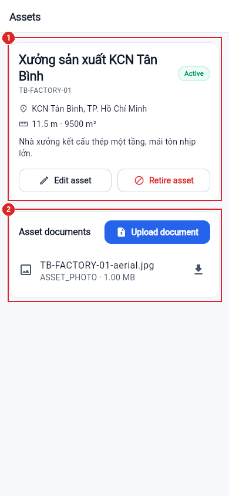

*Figure 6.44 — Check a building record (demo data).*

**Step 5 — Review service requests.**

Open Requests to find the current commercial stage. Select the request that belongs to the building and planned inspection date.

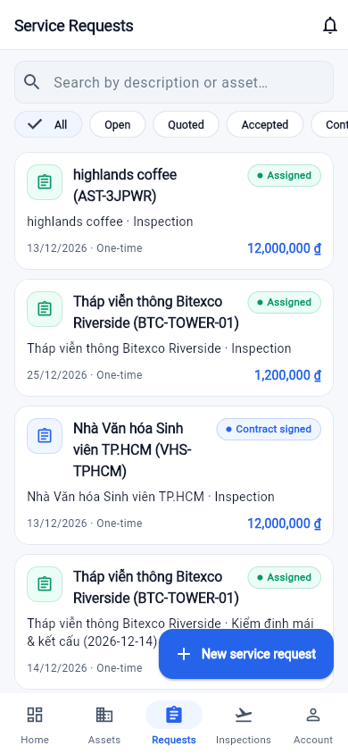

*Figure 6.45 — Review service requests (demo data).*

**Step 6 — Prepare a new service request.**

Choose the building, service dates and recurrence as applicable. Review the request information before submitting. The Manager takes over quotation preparation.

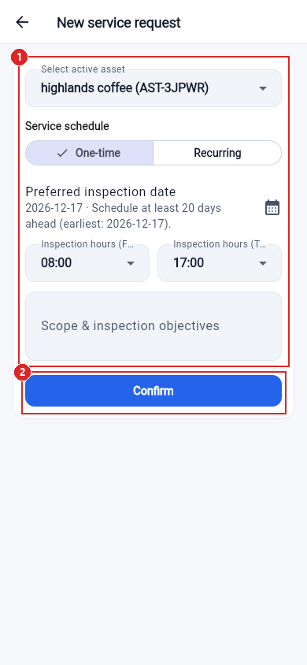

*Figure 6.46 — Prepare a new service request (demo data).*

**Step 7 — Review the quotation.**

Open the current request version and review the agreed scope, dates and price. Use the available review action when the quotation is ready, or open the request conversation for clarification.

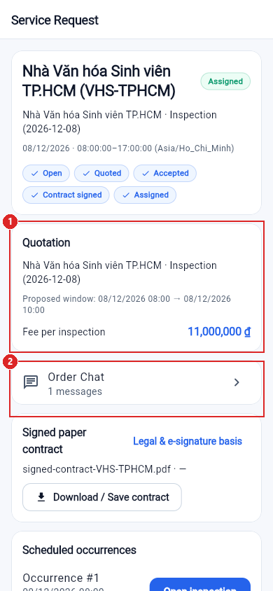

*Figure 6.47 — Review the quotation (demo data).*

**Step 8 — Send a request message.**

Open the conversation from the request. Keep commercial questions in the request thread so the assigned Manager can review them with the quotation.

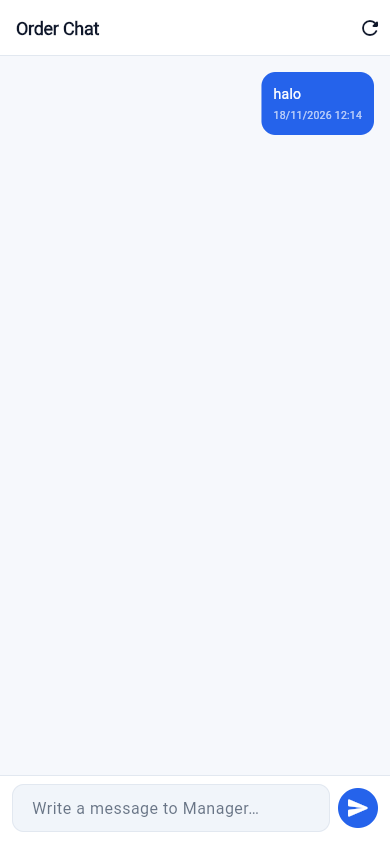

*Figure 6.48 — Send a request message (demo data).*

**Step 9 — Find the scheduled inspection.**

Open Inspections and choose the occurrence for the building and requested date. A recurring request can have several separate inspections.

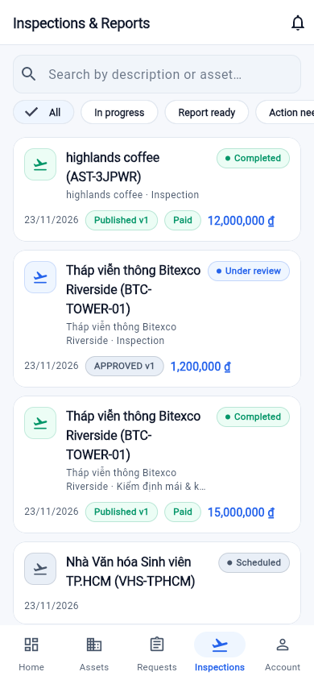

*Figure 6.49 — Find the scheduled inspection (demo data).*

**Step 10 — Follow inspection progress.**

Read the inspection milestone and assigned team. Return after the Manager publishes the report to open its findings. Flight data becomes available after publication.

*Figure 6.50 — Follow inspection progress (demo data).*

**Step 11 — Open the published report.**

Open the Report view when publication is available. Review the findings and request clarification if needed. Accept the report when the contents are agreed.

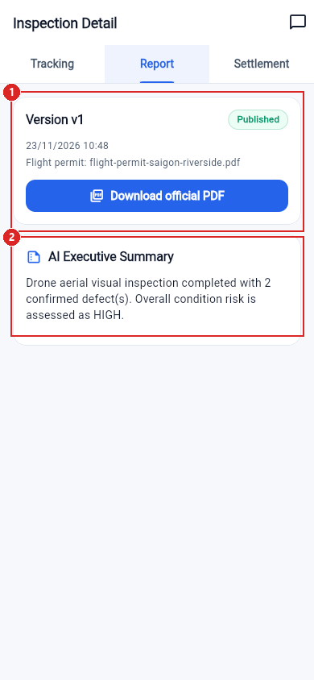

*Figure 6.51 — Open the published report (demo data).*

**Step 12 — Open payment and receipt actions.**

Open Settlement after acceptance. Use an available checkout method and return to the app to check the recorded status. Open the receipt after payment is confirmed.

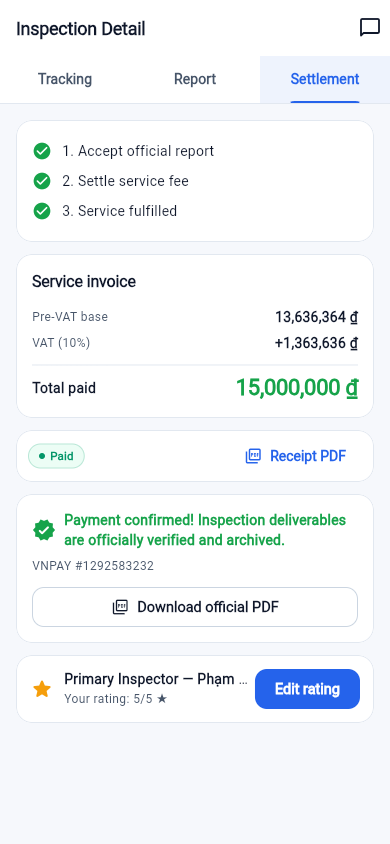

*Figure 6.52 — Open payment and receipt actions (demo data).*

**Step 13 — Open a notification.**

Open Notifications and select the update about your own request or inspection. Check the record title and stage when the app opens the work item.

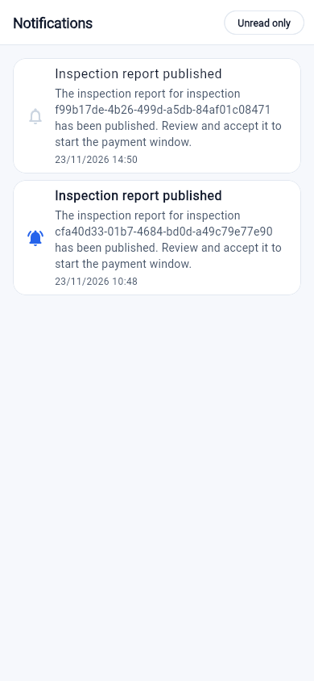

*Figure 6.53 — Open a notification (demo data).*

**Step 14 — Manage your account settings.**

Open Profile for personal details and app preferences. Sign out from a shared device after use.

*Figure 6.54 — Manage your account settings (demo data).*

### 3.9 Web Lookup and Recovery

Use these screens to recover a workflow or find records after the main handoff. Match the record and role before taking any action.

**Step 1 — Review the account used for this session.**

Open Settings on the Customer portal. Check the signed-in account when a request or inspection you expected is missing.

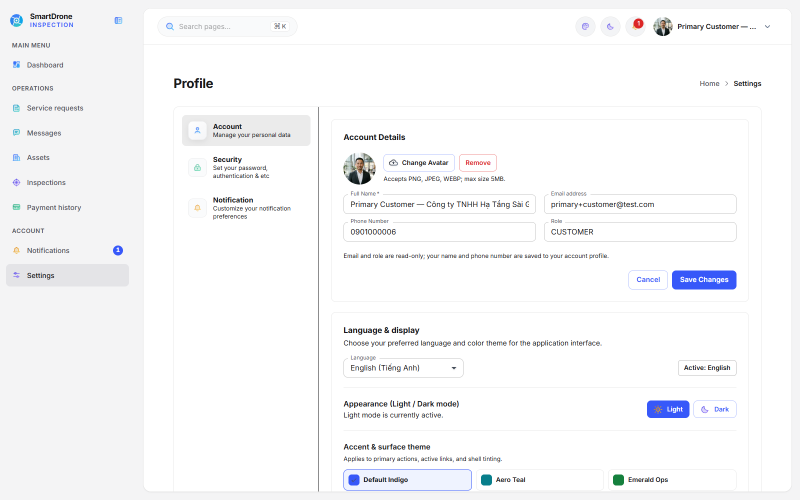

*Figure 6.55 — Review the account used for this session (demo data).*

**Step 2 — Review customer buildings.**

Open Assets, then Detail on the matching building. Confirm the location and attached documents. Customer building screens omit the staff checkpoint editor.

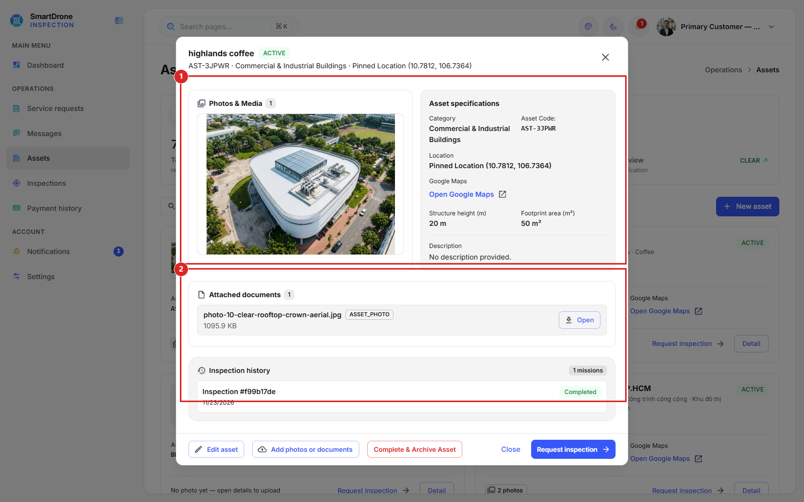

*Figure 6.56 — Review customer buildings (demo data).*

**Step 3 — Resolve a question about the requested scope.**

Open Messages from the Customer portal and select the matching commercial request. Keep details such as changes to the requested area or schedule in that thread.

*Figure 6.57 — Resolve a question about the requested scope (demo data).*

**Step 4 — Find the partner record.**

Open the Manager partner list and check the matching Inspector. Review the qualification and contract context before returning to dispatch.

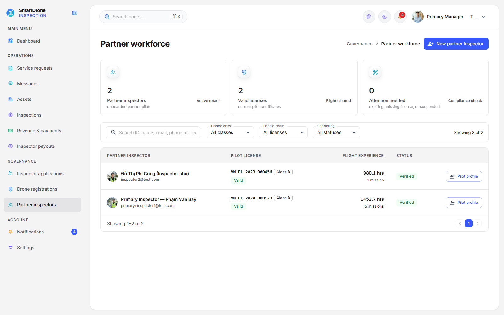

*Figure 6.58 — Find the partner record (demo data).*

**Step 5 — Check a scheduled or cancelled occurrence.**

Open the inspection listing and find the building and occurrence date. If a permit cannot be obtained, review the state and available cancellation or reassignment actions on the dispatch workflow.

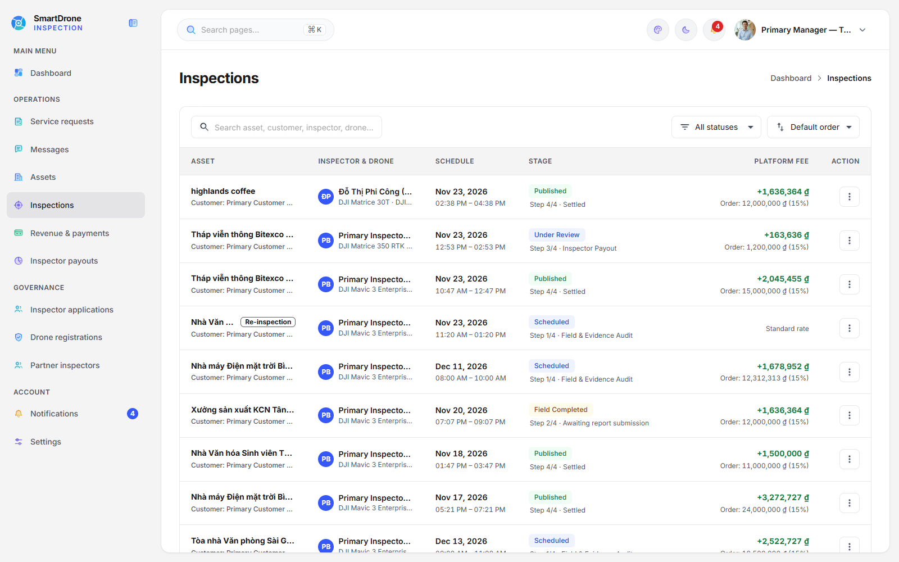

*Figure 6.59 — Check a scheduled or cancelled occurrence (demo data).*

**Step 6 — Review the aircraft documentation catalog.**

Open the Admin flight configuration and review the configured document types. Inspectors use those types when submitting registration, ownership and inspection evidence for a drone.

*Figure 6.60 — Review the aircraft documentation catalog (demo data).*

**Step 7 — Inspect the configured licence classes.**

Open the licence classes section and review the relevant class. The Manager checks partner eligibility again at dispatch for the concrete occurrence.

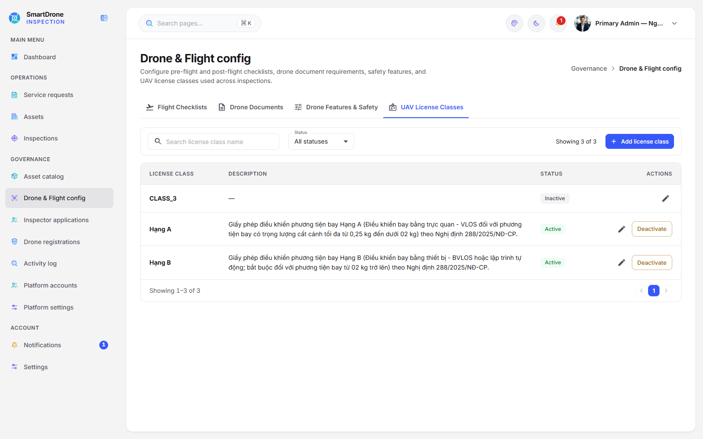

*Figure 6.61 — Inspect the configured licence classes (demo data).*

**Step 8 — Find authorized asset categories.**

Open the Admin asset catalog to review categories and their settings. Building selection and checkpoint defaults are based on the configured category.

*Figure 6.62 — Find authorized asset categories (demo data).*

**Step 9 — Review audit activity.**

Open Audit Logs as Admin. Filter or scan the relevant period and confirm the actor and operation against the workflow under review.

*Figure 6.63 — Review audit activity (demo data).*

**Step 10 — Recover a scheduled mission without the right permit.**

Open the permit stage for the assigned inspection. Check the aircraft, dates and restricted-zone ceiling. If a required permit cannot be obtained, use the available decline action and provide the Manager with a reason.

*Figure 6.64 — Recover a scheduled mission without the right permit (demo data).*

**Step 11 — Find the official report in the manager list.**

Find the matching building and inspection in Reports. Open the correct version to see the decision or published result.

*Figure 6.65 — Find the official report in the manager list (demo data).*

**Step 12 — Find a recorded Customer payment.**

Open Finance History after checkout. Compare the recorded reference and amount with the inspection settlement and open the matching financial record.

*Figure 6.66 — Find a recorded Customer payment (demo data).*
