# Acknowledgement

The team thanks its supervisors for their guidance across the planning, design, build, and testing phases of this capstone project. Their reviews of the requirement specification and the design document shaped both the scope and the rigour of the delivered system.

The team also thanks the lecturers of the Software Engineering programme at FPT University for the foundation on which this work rests, and the customer and partner organisations that reviewed early builds and gave the feedback that turned an inspection concept into a working service.

Finally, the team thanks the open-source communities behind Spring Boot, Spring Modulith, React, Flutter, PostgreSQL, MinIO, Ultralytics YOLO, and FFmpeg. This product is built on their work.

# Definition and Acronyms

| Acronym | Definition |
| --- | --- |
| `ADMIN` | Platform Administrator |
| AI | Artificial Intelligence |
| API | Application Programming Interface |
| `BR` | Business Rule |
| CDD | Containerized Database Deployment |
| `CUSTOMER` | Customer Organization Manager or Owner |
| ERD | Entity Relationship Diagram |
| `FE` | Feature |
| FFmpeg | Fast Forward Moving Picture Experts Group (media toolkit) |
| HMAC | Hash-based Message Authentication Code |
| `INSPECTOR` | Partner Drone Inspector |
| JWT | JSON Web Token |
| `MANAGER` | Platform Manager |
| `MF` | Main Flow |
| MinIO | High-performance S3-compatible object storage |
| MP4 | MPEG-4 Part 14 (video container) |
| NFR | Non-Functional Requirement |
| OAuth | Open Authorization |
| PDF | Portable Document Format |
| RBAC | Role-Based Access Control |
| SDD | Software Design Description |
| SRS | Software Requirement Specification |
| `UC` | Use Case |
| VND | Vietnamese Dong |
| VNPay | Vietnam Payment Solution Joint Stock Company gateway |
| YOLO | You Only Look Once (object detection model family) |

# I. Project Introduction

## 1. Overview

### 1.1 Project Information

- **Project name:** SmartDroneInspection — AI-Powered Infrastructure Inspection Coordination Platform
- **Project code:** GFA26SE139
- **Group name:** FA26SE112
- **Software type:** Web application, native mobile application, and self-hosted AI detection service

### 1.2 Project Team

| Full Name | Role | Email | Mobile |
| --- | --- | --- | --- |
| Trần Hoàng Trung Hiếu | Team Leader, Backend and Frontend Engineer | hieuthttse184212@fpt.edu.vn | 0912 345 678 |
| Phùng Trung Quốc | Backend and Mobile Engineer | quocptse170027@fpt.edu.vn | 0913 456 789 |
| Trần Tùng Bách | Full-Stack and AI Engineer | bachttse180220@fpt.edu.vn | 0914 567 890 |
| Trương Thái Như | Full-Stack Engineer | nhuttse180082@fpt.edu.vn | 0915 678 901 |
| Phạm Minh Trí | Supervisor | tripm@fpt.edu.vn | — |
| Đặng Ngọc Minh Đức | External Supervisor | ducdnm@fpt.edu.vn | — |

## 2. Product Background

Buildings age, and the parts that age fastest — roofs, curtain walls, facades, balconies, rooftop equipment, and structural seams — are exactly the parts that are hardest to reach and safest to ignore. A leaking roof or a hairline facade crack is cheap to repair early and expensive to repair late, yet the routine check that would catch it demands scaffolding, rope access, or a cherry picker. For most building owners that means the inspection happens later than it should, is documented in photographs and notes that nobody can compare across years, and produces a recommendation that is difficult to act on.

Vietnam's building stock has grown faster than its maintenance discipline. High-rise offices, apartment towers, commercial podiums, and industrial sheds now dominate urban skylines, and facility teams are asked to keep them in service with budgets that assume the work is periodic and the records are complete. Neither assumption holds. The result is a familiar cycle: a visible defect is discovered by a tenant rather than by an inspection, the response is reactive, the repair is larger than it needed to be, and the record of what was found and when is lost when the technician who found it moves on.

Drone photography has changed what is technically possible. A trained pilot can capture a facade at close range in minutes, and computer vision can scan those images for cracks, corrosion, leakage stains, bulging render, and detached cladding far faster than a human reviewer can. What has been missing is not the flight and not the detection, but the coordination layer between them: a place where a building owner can request an inspection, a platform can quote and schedule it, a licensed partner pilot can be dispatched with a registered drone and a verified flight permit, the resulting evidence can be turned into confirmed findings, and the whole chain can end in a report that a customer accepts and pays for.

SmartDroneInspection is that coordination layer. It does not fly the aircraft and it does not replace the licensed pilot or the reviewing engineer. It makes the sequence between them auditable.

## 3. Existing Systems

Three existing products were studied as comparators. Each solves part of the problem; none of them solves the coordination problem that this project targets.

### 3.1 DroneDeploy

- **Description:** A cloud platform for drone-based aerial mapping and site documentation, widely used in construction and agriculture, with photogrammetry, progress tracking, and machine-learning analysis of aerial imagery.
- **Link:** https://www.dronedeploy.com
- **Pros:** Mature flight planning and automated capture; strong photogrammetric reconstruction and site-accuracy tooling; a large integration ecosystem; well-suited to comparing site progress across time.
- **Cons:** Oriented toward the organisation that operates its own drones, so a building owner without a flight operation is not the primary user; no partner-marketplace model for dispatching an independent licensed inspector; the commercial chain from request to quotation to signed agreement to settlement sits outside the product.

### 3.2 Flyability Inspector

- **Description:** A software suite and collision-tolerant indoor drone offering for confined-space and indoor inspection, with a structured inspection workflow and reporting aimed at asset owners and inspection service companies.
- **Link:** https://www.flyability.com
- **Pros:** Excellent fit for confined and indoor spaces where a conventional drone cannot safely fly; a structured, checklist-driven inspection flow; inspection-grade image and video capture; report generation built into the workflow.
- **Cons:** Hardware-coupled, so adopting it means adopting a specific aircraft; aimed mainly at industrial assets rather than the broader building portfolio; no cross-organisation dispatch of independent partner pilots and no customer-facing settlement process.

### 3.3 Skycatch

- **Description:** An enterprise drone data platform focused on construction and mining, providing automated capture, 3D reconstruction, volumetric analysis, and integration with project management systems.
- **Link:** https://www.skycatch.com
- **Pros:** Strong automation of the capture-to-model pipeline; useful volumetric and progress analytics; designed to feed existing project-management systems rather than replace them; industry-specific reporting.
- **Cons:** Mining and earthworks focus means building envelope defects such as facade cracks and leakage are not its primary detection target; no inspection-specific lifecycle from permit verification to independent report publication; not aimed at a marketplace of partner inspectors.

The gap across all three is the same. They are strong at capturing and analysing imagery and weak at governing a multi-party inspection: who applied to be a partner, whose licence is still valid on the mission date, who uploaded the permit and who verified it, who wrote the report and who was allowed to publish it, and whether the customer has accepted and settled it. SmartDroneInspection addresses that governance layer and treats detection as one advisory input to it.

## 4. Business Opportunity

The opportunity sits between two groups that need each other and currently find each other informally.

On one side are building owners and facility operators — office landlords, apartment management boards, retail and industrial park operators, hospitals, hotels, and telecom tower owners — who need periodic envelope and structural inspections but do not own drones or employ pilots. On the other side are licensed drone pilots who own serviceable equipment and want recurring, well-documented work rather than one-off jobs sourced through personal contacts.

Today that match is made over the phone. There is no standard quotation, no record of what was agreed, no verification that the pilot's licence and the drone's registration are valid on the day of the flight, no structured evidence trail, and no report format a customer can rely on or an insurer will accept.

A platform that standardises the chain — request, quotation in VND, signed agreement, dispatch, permit verification, field execution, evidence, confirmed findings, published report, accepted and settled — turns an ad-hoc arrangement into a repeatable service. That repeatability is the commercial proposition: it lets an owner budget for inspections instead of discovering them, it lets a pilot build a portfolio of documented work, and it lets the platform charge for coordination rather than for flight hours.

## 5. Software Product Vision

For building owners who need to know the true condition of their structures, and for licensed drone pilots who need dependable work, SmartDroneInspection is a coordination platform that turns a building inspection from an informal arrangement into an auditable service. Unlike aerial-mapping tools that stop at imagery and analytics, SmartDroneInspection governs the whole chain — partner admission, quotation, agreement, dispatch, permit verification, field execution, confirmed findings, independent publication, and settlement — and treats machine detection as advisory input that a human must confirm before it becomes an official finding.

## 6. Project Scope & Limitations

### 6.1 Major Features

1. **`MF1` `FE-01` — Registration, Sign-in and Account Access.** A customer organization registers itself and its first building, is screened against prohibited airspace, and signs in securely with one-time codes or Google; sessions rotate, and every portal exposes only the sections its role may use.
2. **`MF1` `FE-02` — Partner Inspector and Drone Registration.** A prospective partner inspector applies publicly with licence details, platform staff review and approve, and the inspector then registers owned drones against the required document set for platform approval.
3. **`MF2` `FE-03` — Buildings, Airspace Screening and Notifications.** A customer maintains its buildings, inspection checkpoints, and reference documents under the airspace gate; restrictive-airspace registrations are reviewed by platform staff; recurring requests generate their planned occurrences; and lifecycle notices reach the responsible users without duplication.
4. **`MF2` `FE-04` — Service Requests, VND Quotations, Agreements and Dispatch.** A manager claims the request, negotiates in an order chat, issues a VND quotation, records the signed agreement, and assigns a qualified inspector and an eligible drone to each occurrence.
5. **`MF3` `FE-05` — Flight Permit and On-site Field Sessions.** The assigned inspector uploads the mission flight permit, a different manager verifies it, and the field session can start; the session is recorded to completion or a reasoned abort, with manager follow-up.
6. **`MF3` `FE-06` — Evidence Intake and Human-Reviewed Defect Detection.** The inspector captures photographs and video, the platform proposes candidate building defects for confirmation, and the confirmed findings become the official baseline.
7. **`MF4` `FE-07` — Inspection Report Preparation, Review and Publication.** The platform compiles the report from the confirmed findings, drafts an executive summary, and an independent manager reviews and publishes a locked PDF version.
8. **`MF4` `FE-08` — Customer Report Acceptance and Payment Settlement.** The customer accepts the published report and settles through PayOS VietQR or VNPay; the platform tracks partner payouts and refunds and supports a re-inspection that re-assesses each confirmed defect.

### 6.2 Limitations & Exclusions

- **`LI-1` — No aircraft control.** The platform does not pilot, steer, or command any aircraft. It records the governance around a flight — who is assigned, whose licence is valid, which permit was verified — and leaves the flight itself to the licensed human pilot.
- **`LI-2` — Buildings only.** The supported categories are high-rise office and curtain-wall towers, residential apartment towers, commercial malls and podiums, industrial factories and warehouses, hotel, hospital and public complexes, and telecom rooftop masts with antenna structures. Bridges, transmission towers, solar farms, roads, dams, tunnels, ports, and pipelines are outside the delivered scope, and the defect classes and inspection checkpoints shipped with this release are building-specific.
- **`LI-3` — No corrective maintenance module.** Work orders, repair-scope advisory, repair execution, completion reporting, maintenance acceptance, and cost reconciliation are outside the delivered scope. What the platform does provide is a re-inspection loop opened against a published report, in which each originally confirmed defect is re-assessed as resolved, unresolved, or inconclusive. That loop reuses the request, dispatch, field, and reporting flows rather than adding a maintenance flow. And cost close-out are not implemented.
- **`LI-4` — Detection is advisory.** Candidate findings and the drafted narrative summary are advisory output. A human must confirm every finding, verify every permit, and publish every report. No automated output becomes an official decision.
- **`LI-5` — No photogrammetric reconstruction.** Evidence is reviewed as individual photographs and video. Three-dimensional modelling, volumetric measurement, and change detection across flights are not provided.
- **`LI-6` — No retrieval-augmented advisory.** The language model receives the confirmed inspection context in a single request. No engineering-standard corpus is searched, no embedding is stored, and no vector retrieval exists.
- **`LI-7` — Mobile is Customer-only.** The native mobile application admits `CUSTOMER` accounts only. Field capture, permit handling, and report preparation are performed by inspectors in the operations web portal.
- **`LI-8` — Recorded status is not legal clearance.** An airspace screening result, a verified permit, and a published report are the platform's own governance records. They are not government flight authorisation, and they do not transfer any aviation or structural obligation away from the licensed pilot or the responsible engineer.

# II. Project Management Plan

## 1. Overview

### 1.1 Scope & Estimation

The work was decomposed into eight features — two per main flow — and estimated in man-days at
three complexity levels. Simple items are single-screen or single-endpoint changes with no new
persistence; medium items add a workflow or a data model; complex items span several modules and a
state machine, and carry their own test surface.

| # | WBS Item | Complexity | Est. Effort (man-days) |
| --- | --- | --- | --- |
| 1 | `MF1` — Onboarding and partner admission | Complex | 45 |
| 1.1 | `FE-01` Registration, sign-in and account access | Complex | 22 |
| 1.2 | `FE-02` Partner inspector admission and owned drone registration | Complex | 23 |
| 2 | `MF2` — Buildings, requests, quotations and dispatch | Complex | 59 |
| 2.1 | `FE-03` Buildings, airspace screening, occurrences and notifications | Complex | 33 |
| 2.2 | `FE-04` Service requests, VND quotations, agreements and dispatch | Complex | 26 |
| 3 | `MF3` — Field delivery and evidence | Complex | 46 |
| 3.1 | `FE-05` Flight permit verification and field sessions | Complex | 23 |
| 3.2 | `FE-06` Evidence intake and human-reviewed defect detection | Complex | 23 |
| 4 | `MF4` — Report review and payment settlement | Complex | 28 |
| 4.1 | `FE-07` Report preparation, independent review and publication | Complex | 14 |
| 4.2 | `FE-08` Customer acceptance, settlement and re-inspection | Complex | 14 |
| 5 | Cross-cutting foundation | Medium | 18 |
| 5.1 | Module boundaries, authorization policy, audit trail | Medium | 8 |
| 5.2 | Object storage, media pipeline, bilingual localization | Medium | 10 |
| 6 | Verification and documentation | Medium | 12 |
| 6.1 | Automated suites and regression | Medium | 7 |
| 6.2 | Report set and test workbooks | Simple | 5 |
| | **Total** | | **208** |

The estimate reconciles against capacity: four members over three and three-quarter months at twenty
working days each gives `4 × 3.75 × 20 = 300` person-days, and 208 man-days of delivery work
represents roughly 70% of that total once supervision, review, coursework, and contingency are set
aside.

### 1.2 Project Objectives

The overall objective was to deliver a working, defensible platform covering the full inspection chain for buildings, with governance — not detection — as the differentiator. The measurable targets were:

- All eight features accepted against their Report 3 acceptance criteria.
- `0` unauthorized or cross-scope data disclosures, verified by role, organization, and assignment probing across all four portals.
- `0` Spring Modulith module-boundary violations.
- A verified schema inventory of 41 tables with the applied migration set exactly the declared baseline plus forward migrations.
- `0` open Critical or High severity defects at handover, with any remaining defect recorded rather than omitted.

**Quality**

| # | Testing Stage | Test Coverage | No. of Defects | % of Defect | Notes |
| --- | --- | --- | --- | --- | --- |
| 1 | Reviewing | Requirement, design, and code review of every feature before merge | 6 | 25.0% | Defects caught in review before the code reached a test environment. |
| 2 | Unit Test | Domain rules, services, components, and widgets | 8 | 33.3% | Backend `627` tests across `119` classes; frontend `627` cases; mobile `42` cases. |
| 3 | Integration Test | Controllers, repositories, migrations, storage, and outbox | 7 | 29.2% | Schema, authorization, and object-storage defects. |
| 4 | System Test | Connected end-to-end lifecycle across roles and clients | 3 | 12.5% | Cross-module sequencing and recovery-path defects. |
| 5 | Acceptance Test | Business rules and acceptance criteria per feature | 0 | 0.0% | No accepted-scope defect remained at handover. |
| | **Total** | | **24** | **100%** | |

Milestone Timeliness (%): 92%

Allocated Effort (man-days): 142

### 1.3 Project Risks

| # | Risk Description | Impact | Possibility | Response Plans |
| --- | --- | --- | --- | --- |
| 1 | Repeated schema rewrites invalidate migration history and tests | High | High | Consolidate to a single baseline plus forward migrations; assert the applied migration set in a test so an accidental renumbering fails the build. |
| 2 | AI model integration produces unusable or unstable detections | High | Medium | Treat detection as advisory only; add a secondary vision fallback and a manual finding path; require human confirmation before any finding becomes official. |
| 3 | External payment sandbox unavailable or behaviour changes | Medium | High | Keep both gateways configuration-gated and disabled by default; support an authorised manual confirmation path so settlement is testable without a sandbox. |
| 4 | Contract drift between the four repositories | High | Medium | Keep one focused PR per repository with an explicit merge order; treat the OpenAPI surface as the contract and regression-test it. |
| 5 | Scope creep toward corrective maintenance | High | High | Fix the six-feature scope early; record maintenance and non-building domains explicitly as out of scope rather than partially implementing them. |
| 6 | Large video evidence destabilises upload or report rendering | Medium | Medium | Chunked resumable uploads, asynchronous transcoding with source retention, range-based streaming, and report rendering that never reads video into memory. |
| 7 | Module boundaries erode into a tangled monolith | Medium | Medium | Declare `allowedDependencies` per module and enforce them with an architecture test that fails the build. |
| 8 | Test evidence becomes overstated | High | Medium | Report only executed runs with their actual counts; keep unexecuted cases `Pending`; record known defects rather than omitting them. |
| 9 | Team members unavailable during review periods | Medium | Medium | Cross-review ownership so no single person is the only holder of a feature's context. |
| 10 | Local environment inconsistency between members | Low | High | Containerise the database, storage, detection, and hub services so every member runs the same stack. |

## 2. Management Approach

### 2.1 Project Process

The team followed an iterative incremental process inside a fixed capstone timeline. Each of five milestones produced a demonstrable increment: the foundation and migrations first, then core inspection and evidence, then the review baseline, then the four-role consolidation with contracts and payment, and finally regression and rehearsal. Work was organised as vertical slices — a feature was considered done when its backend contract, its client surface, and its tests landed together — rather than as horizontal layers completed one at a time. A pull request carried one slice, and review confirmed the acceptance criteria before merge.

### 2.2 Quality Management

Quality was maintained through four controls. Every change was reviewed by a member who had not written it, with the requirement text open beside the diff. Automated suites ran on every pull request, and a failing architecture, schema, or authorization test blocked the merge. Coverage was measured rather than asserted: the backend reported line coverage of 72.2% and branch coverage of 51.9% at handover. Finally, a strict distinction was kept between what was verified automatically, what was exercised manually, and what was not verified at all, so that the test record never claimed more than it could show.

### 2.3 Training Plan

| Training Area | Participants | When, Duration | Waiver Criteria |
| --- | --- | --- | --- |
| Spring Boot 4 and Spring Modulith module boundaries | All backend contributors | Week 1–2, 12 hours | Prior production Spring Boot experience with a reviewed sample pull request |
| React 19 and strict TypeScript patterns in the existing codebase | Frontend contributors | Week 1–2, 10 hours | Two reviewed frontend pull requests without rework |
| Flutter and Riverpod state management | Mobile contributors | Week 2–3, 8 hours | A merged mobile screen with tests |
| Ultralytics YOLO training and inference integration | AI and backend contributors | Week 3, 6 hours | A successful local inference run against the delivered model |
| Aviation context: licences, permits, and airspace categories | All members | Week 1, 4 hours | None; mandatory for everyone because it underpins acceptance rules |
| Testcontainers and containerized test environments | All members | Week 2, 4 hours | A locally green integration suite |

## 3. Project Deliverables

| # | Deliverable | Due Date | Notes |
| --- | --- | --- | --- |
| D1 | Requirement specification (Report 3) | 2026-10-03 | Four roles, eight features, `BR-01`–`BR-54`, `MSG01`–`MSG50`. |
| D2 | Design document (Report 4) | 2026-10-17 | Architecture, package diagrams, 41-table schema, detailed design per feature. |
| D3 | Working platform across four repositories | 2026-11-15 | Backend, web portal, mobile client, documentation tooling. |
| D4 | Automated test suites | 2026-11-17 | Backend, frontend, and mobile suites green. |
| D5 | Test documentation and workbook (Report 5) | 2026-11-18 | One workbook sheet per feature with executed results. |
| D6 | Release package and user guides (Report 6) | 2026-11-19 | Installation guide and eight illustrated workflows. |
| D7 | Project introduction and management plan (Reports 1 and 2) | 2026-11-19 | Scope, comparators, estimation, and process. |
| D8 | Final project report (Report 7) | 2026-11-20 | Consolidated defence document. |
| D9 | Defence slide deck | 2026-11-24 | Summarises scope, design, evidence, and demonstration. |

## 4. Responsibility Assignments

Members are identified by initials: H — Trần Hoàng Trung Hiếu, Q — Phùng Trung Quốc, B — Trần Tùng Bách, N — Trương Thái Như. The legend is `D`~Do; `R`~Review; `S`~Support; `I`~Informed.

| Function | H | Q | B | N |
| --- | :---: | :---: | :---: | :---: |
| `FE-01` Customer registration and account access | D | I | S | R |
| `FE-02` Partner qualification and drone registration | D | I | S | R |
| `FE-03` Recurring requests and notifications | S | D | I | R |
| `FE-04` Requests, quotations, agreements and dispatch | I | D | S | R |
| `FE-05` Flight permit and field sessions | S | I | D | R |
| `FE-06` Evidence, findings, reports and payment | I | S | D | R |
| Backend module boundaries and authorization policy | R | S | D | I |
| Media storage and video pipeline | I | S | D | R |
| Web portal shell and access policy | D | I | S | R |
| Mobile customer application | I | D | I | R |
| Test workbooks and report set | R | S | S | D |
| Release and defence preparation | D | S | S | R |

## 5. Project Communications

| Communication Item | Who/ Target | Purpose | When, Frequency | Type, Tool, Method(s) |
| --- | --- | --- | --- | --- |
| Weekly progress review | Team and supervisors | Demonstrate the increment, surface blockers | Weekly, 45 minutes | Video call with live demo |
| Daily stand-up | Team | Align on the day's slice and hand-offs | Daily, 15 minutes | Chat thread |
| Pull request review | Reviewing member | Verify the slice against acceptance criteria | Per change | Git pull request with review comments |
| Requirement clarification | Owner and reviewers | Resolve ambiguity in Report 3 before coding | As needed | Issue thread with the requirement linked |
| Defect triage | Feature owner and reviewer | Classify and assign a defect | Per defect | Issue tracker |
| Milestone sign-off | Team and supervisors | Record the baseline for the next milestone | Per milestone | Written summary and tagged commit |
| Documentation handoff | Documentation owner | Keep Reports 1–7 consistent with delivery | Per milestone and at handover | Repository commit with a change record |

## 6. Configuration Management

### 6.1 Document Management

Each report is maintained as Markdown under its own folder, with an appended row in its Record of Changes for every revision. Exported `.docx` files are generated from those sources against the untouched official templates, so an exported document is always reproducible from the repository. Screenshots and rendered diagrams live in each report's own `assets/` folder, which keeps a report self-contained when it is handed over.

### 6.2 Source Code Management

The workspace is four independent repositories — backend, frontend, mobile, and documentation — each with its own history. Every change is a focused pull request on a branch, never a direct commit to the default branch. Cross-repository work is split into one pull request per repository with an explicit merge order recorded in each body. Generated files are not edited by hand, and no credential, token, secret, recovery code, or private key is committed.

### 6.3 Tools & Infrastructures

| Category | Tools / Infrastructure |
| --- | --- |
| Technology | Java 21, Spring Boot 4.1, Spring Modulith 2.1.1, React 19 with strict TypeScript, Flutter with Riverpod, Python FastAPI with Ultralytics YOLO11s |
| Database | PostgreSQL 17 with Flyway migrations; MinIO for S3-compatible object storage |
| IDEs/Editors | IntelliJ IDEA, Visual Studio Code, Android Studio |
| Diagramming | Mermaid rendered to PNG; Draw.io for free-form diagrams |
| Documentation | Markdown sources exported to `.docx` through a custom OOXML pipeline against the official templates |
| Version Control | Git with four independent repositories and pull-request review |
| Deployment server | Docker Compose stack of database, object storage, detection service, hub service, and backend |
| Project management | Issue tracker, milestone board, and a shared task backlog |

# III. Software Requirement Specification

## 1. Product Overview

SmartDroneInspection is a Platform Inspection Service for buildings. A Platform coordinates customer organizations that own buildings and partner drone inspectors who fly the missions. The service records preparation and field results; it does not pilot or control aircraft, and it does not depend on a drone-operation platform.

The scope is limited to buildings, in six supported categories: high-rise office and curtain-wall towers, residential apartment towers, commercial malls and podiums, industrial factories and warehouses, hotel, hospital and public complexes, and telecom rooftop masts with antenna structures. Bridges, transmission towers, solar farms, roads, dams, tunnels, ports, and pipelines are excluded, and every defect class and inspection checkpoint shipped with this release is building-specific.

Four roles sign in. `ADMIN` is the Platform Administrator and `MANAGER` the Platform Manager; `CUSTOMER` is the Customer Organization Manager or Owner, and `INSPECTOR` is a Partner Drone Inspector. There is no fifth login role. The automated actors — airspace screening, the detection model, the vision fallback, the narrative drafter, the payment gateways, and the optional ground-station hub — are not login roles and cannot make a decision that a human is required to make.

The lifecycle runs through four main flows, two features each. `MF1` admits the parties: a partner inspector applies with licence details and is provisioned only after review, and a customer registers its organization and first building subject to airspace screening. `MF2` turns need into agreement: buildings and their reference documents, a one-time or recurring request, an order chat, a VND quotation, an offline signed agreement recorded against the request, and cross-organization dispatch of an inspector and drone to each occurrence. `MF3` delivers the field work: a flight permit that a second person must verify, an on-site field session, evidence capture, and human-confirmed findings. `MF4` closes the engagement: an independently reviewed and published report, customer acceptance with online settlement, partner payouts and refunds, and an optional re-inspection that re-assesses each confirmed defect.

## 2. User Requirements

The platform serves four human actors and a set of automated and external ones.

`ADMIN` governs the platform: accounts, the building category catalogue, pilot-licence classes, the required drone document configuration, finance settings, and AI inference settings, and reviews customer airspace cases, partner inspector applications, and drone registrations.

`MANAGER` coordinates delivery: inspector and drone records, customer service requests, VND quotations, signed agreements, dispatch, independent report review and publication, and partner payouts.

`CUSTOMER` acts for a building owner: registering the organization and its first building, maintaining buildings, inspection checkpoints, and reference documents, raising one-time or recurring requests, negotiating and accepting quotations, following progress, accepting published reports, and paying the service fee.

`INSPECTOR` is a partner pilot: applying publicly with licence details, registering owned drones against the required documents, uploading the mission flight permit, conducting the assigned field session, providing evidence, confirming findings, and preparing and submitting the report.

Supporting actors are the automated system, the external payment and identity services, and the optional ground-station hub. None of them can confirm a finding, approve a permit, publish a report, or clear a location for flight.

**Actors**

| # | Actor | Description |
| --- | --- | --- |
| 1 | `ADMIN` | Platform administrator. Governs accounts, building categories, licence classes, drone document requirements, finance and AI settings, and reviews airspace cases, partner applications, and drone registrations. |
| 2 | `MANAGER` | Platform manager. Coordinates partners, requests, quotations, agreements, dispatch, independent report review and publication, and payouts. |
| 3 | `CUSTOMER` | Customer organization representative. Registers and maintains the organization and its buildings, requests inspections, negotiates and accepts quotations, accepts reports, and pays. |
| 4 | `INSPECTOR` | Partner drone inspector. Applies for admission, registers owned drones, conducts assigned field work, confirms findings, and submits reports. |
| 5 | Automated System and AI | Provides airspace screening, schedule-conflict checks, lifecycle notices, candidate building-defect analysis, and advisory narrative drafting. All output is advisory. |
| 6 | External Payment and Identity Services | Google OAuth2 sign-in, PayOS VietQR, and VNPay settlement. These do not replace the platform's authorization or review obligations. |
| 7 | SmartDroneHub | An optional ground-station integration supplying read-only telemetry, flight traces, and mission video. It receives no flight commands. |

```mermaid
%% title: Use Case Diagram
flowchart TD
  ADMIN["ADMIN"]
  MANAGER["MANAGER"]
  CUSTOMER["CUSTOMER"]
  INSPECTOR["INSPECTOR"]
  PUBLIC["Prospective Inspector"]
  AI["Automated advisory support"]
  HUB["SmartDroneHub"]
  GOV["Govern accounts and settings"]
  REVIEW["Review applications and records"]
  APPLY["Apply as partner inspector"]
  REGISTER["Register organization and building"]
  LEGACY["Manage buildings and drones"]
  COMMERCIAL["Request, negotiate and accept quote"]
  DISPATCH["Assign partner and dispatch"]
  PUBLISH["Review and publish report"]
  FINANCE["Manage payouts and refunds"]
  FIELD["Verify permit and record session"]
  EVIDENCE["Provide evidence and confirm findings"]
  PREPARE["Prepare and submit report"]
  PAYMENT["Accept report and pay fee"]
  ADMIN --> GOV
  ADMIN --> REVIEW
  MANAGER --> REVIEW
  MANAGER --> COMMERCIAL
  MANAGER --> DISPATCH
  MANAGER --> PUBLISH
  MANAGER --> FINANCE
  CUSTOMER --> REGISTER
  CUSTOMER --> LEGACY
  CUSTOMER --> COMMERCIAL
  CUSTOMER --> PAYMENT
  PUBLIC --> APPLY
  INSPECTOR --> LEGACY
  INSPECTOR --> FIELD
  INSPECTOR --> EVIDENCE
  INSPECTOR --> PREPARE
  AI --> EVIDENCE
  HUB --> FIELD
  GOV ~~~ COMMERCIAL
  REGISTER ~~~ COMMERCIAL
```

**Use Cases**

| ID | Use Case | Actors | Use Case Description |
| --- | --- | --- | --- |
| UC-01 | Sign In and Manage Account | All roles | Users sign in by password, one-time code, or Google, manage their account information, and end their own sessions. |
| UC-02 | Govern Platform Accounts and Catalogs | `ADMIN`, `MANAGER` | Staff manage accounts and the building category catalogue; `ADMIN` maintains licence classes, drone document configuration, and finance and AI settings. |
| UC-03 | Register Customer Organization and First Building | `CUSTOMER`, public | A prospective customer registers its organization with a first building; airspace screening may refuse, hold for review, or admit the registration. |
| UC-04 | Manage Buildings, Checkpoints and Documents | `CUSTOMER` | Customers maintain buildings, their inspection checkpoints, and reference documents, and may retire buildings no longer in service. |
| UC-05 | Submit and Review Partner Inspector Application | Public, `INSPECTOR`, `ADMIN`, `MANAGER` | A prospective inspector applies publicly with licence details and a scan; staff review, approve, or reject, and approval provisions the account. |
| UC-06 | Register and Review Inspector-Owned Drones | `INSPECTOR`, `ADMIN`, `MANAGER` | An inspector registers an owned drone with photographs, capabilities, and required documents; staff review it before it becomes assignable. |
| UC-07 | Request Inspection, Negotiate and Accept Quotation | `CUSTOMER`, `MANAGER` | A customer submits a one-time or recurring request, exchanges messages with the manager, and accepts the active VND quotation. |
| UC-08 | Record Signed Agreement and Arrange Occurrences | `MANAGER`, `CUSTOMER` | After the parties sign offline, the manager records the signed document; a recurring request covers the occurrences in its agreed term. |
| UC-09 | Assign, Reschedule, Reassign or Cancel an Inspection | `MANAGER`, `INSPECTOR`, Automated System | The manager assigns a qualified inspector and eligible drone to an occurrence; after an abort the manager may reschedule, reassign, or cancel. |
| UC-10 | Provide and Verify Mission Flight Permit | `INSPECTOR`, `MANAGER`, `ADMIN` | The inspector uploads the permit with structured metadata; a different manager or administrator verifies it before field work may start. |
| UC-11 | Record Field Session | `INSPECTOR` | The inspector records start, completion, or abort with the required safety note and an outcome or reason. |
| UC-12 | Capture Flight Evidence | `INSPECTOR`, SmartDroneHub | The inspector supplies read-only telemetry, imports a flight log, or receives mission video, and the trace is reviewable afterwards. |
| UC-13 | Review Airspace Information | All roles | Users review airspace information relevant to building and mission locations; it is advisory and not permission to fly. |
| UC-14 | Provide Inspection Evidence | `INSPECTOR`, `MANAGER`, `CUSTOMER` | Inspectors upload photographs and video and associate them with structural locations; authorised users review them within their responsibilities. |
| UC-15 | Review Candidate Findings and Confirm Findings | `INSPECTOR`, Automated System | The service proposes candidate defects; the inspector accepts, edits, rejects, or supplements each, and confirms the baseline. Only confirmed findings become official. |
| UC-16 | Prepare and Submit Inspection Report | `INSPECTOR`, Automated System | The report author prepares and submits the report for independent review; the drafted summary is advisory material only. |
| UC-17 | Independently Review and Publish Inspection Report | `MANAGER`, `ADMIN` | A reviewer who is not the author reviews the report, approves or returns it with reasons, and publishes the approved official report. |
| UC-18 | Follow Inspection, Accept Report and Pay | `CUSTOMER`, `MANAGER`, Payment Service | Customers follow progress, review the published report, record acceptance, and settle the fee through PayOS or VNPay. |
| UC-19 | Manage Partner Settlement, Payouts and Refunds | `MANAGER` | The manager records inspector payouts against verified customer payment, completes evidence-backed refunds, and records receivable recovery. |
| UC-20 | View Dashboard, Calendar and Notifications | All roles | Users review operational information, schedules, progress, and notices within their authorised scope. |
| UC-21 | Review Activity History | Authorised roles | Authorised users review attributable records of onboarding, commercial, inspection, payment, and acceptance decisions. |

## 3. Functional Requirements

### 3.1 System Functional Overview

The platform is delivered as four role-scoped web portals — `/admin`, `/manager`, `/client`, and `/operations` — plus a customer-only mobile application. A section a role may not use has no route at all for that role, so denial is enforced at the routing boundary as well as at the API.

The main screens are the public landing and the two registration paths, then per portal: the administrative dashboard, accounts, building catalogue, licence classes, drone configuration, finance settings, AI settings, and onboarding reviews; the manager dashboard, service requests, messages, inspections, reports, partner inspectors, and settlement; the customer dashboard, assets, service requests, messages, inspections, and notifications; and for the inspector the dashboard, assigned inspections, the inspection workspace, and the drone inventory. The inspector workspace carries the permit, pre-flight, field session, post-flight, evidence, findings, report, and tracking tabs.

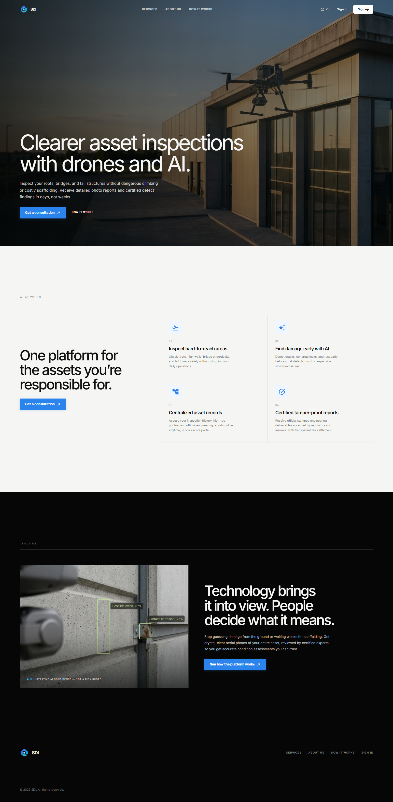

*Figure 7.1 — Public landing page.*

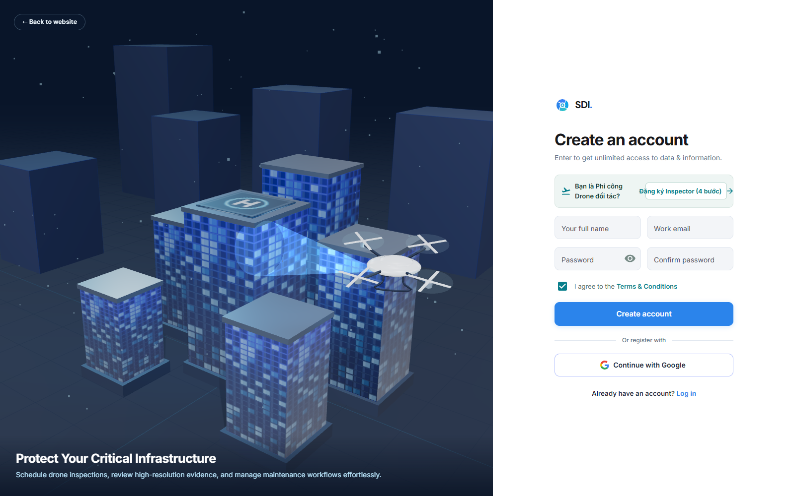

*Figure 7.2 — Customer registration with building location screening.*

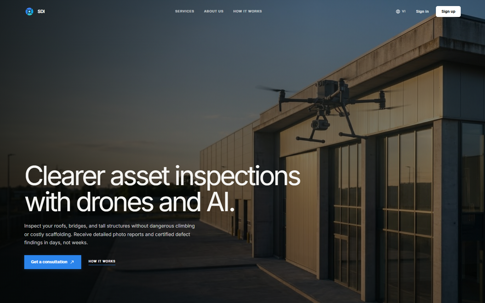

*Figure 7.3 — Public partner inspector application.*

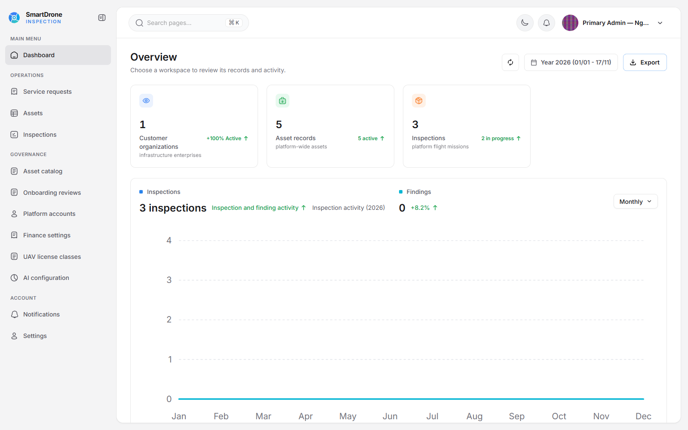

*Figure 7.4 — Administration dashboard.*

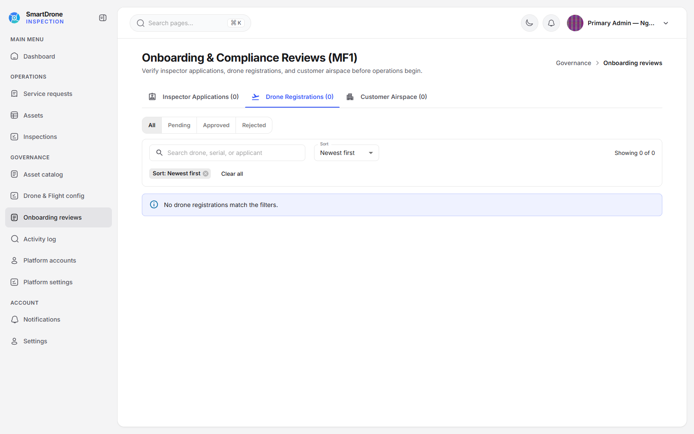

*Figure 7.5 — Onboarding review queue.*

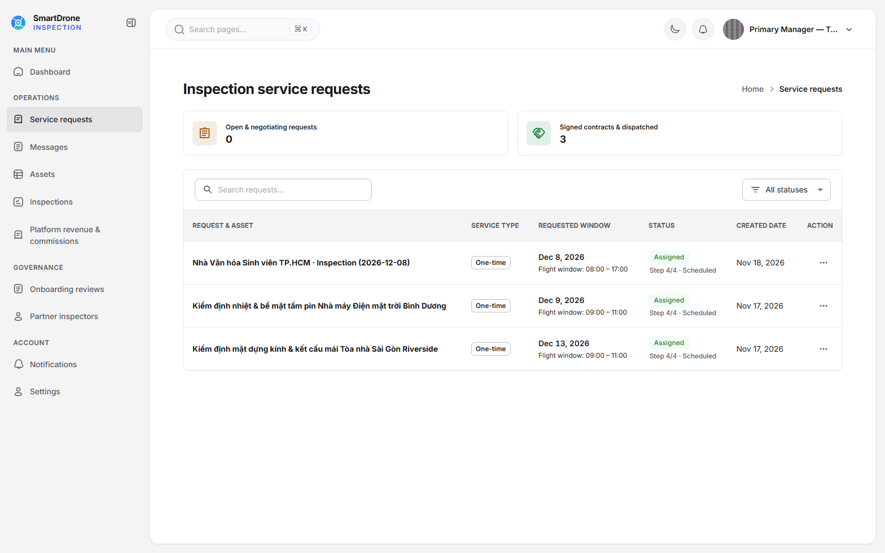

*Figure 7.6 — Manager request queue.*

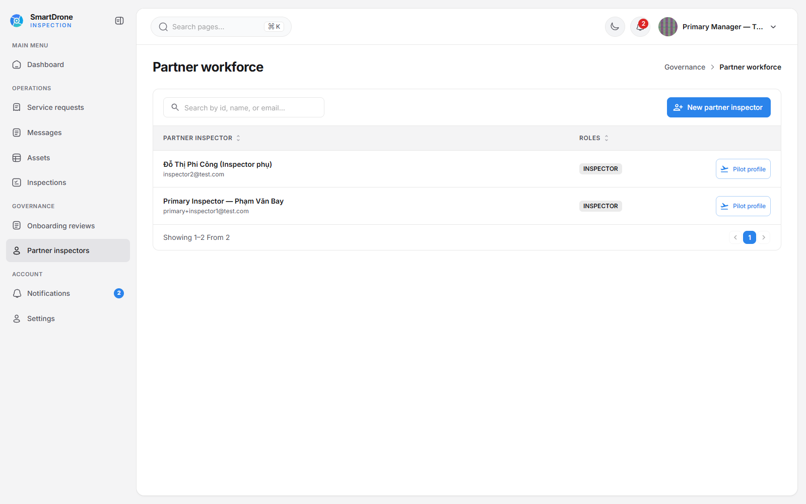

*Figure 7.7 — Partner inspector register.*

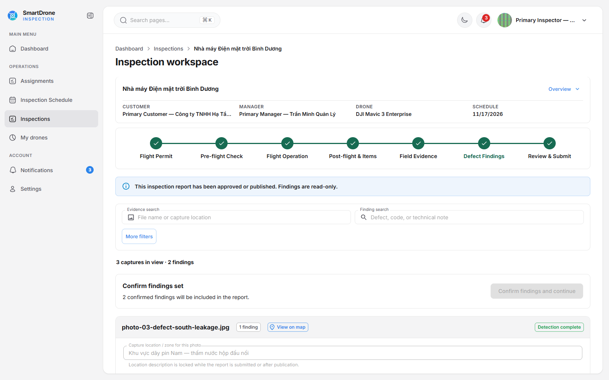

*Figure 7.8 — Candidate findings awaiting confirmation.*

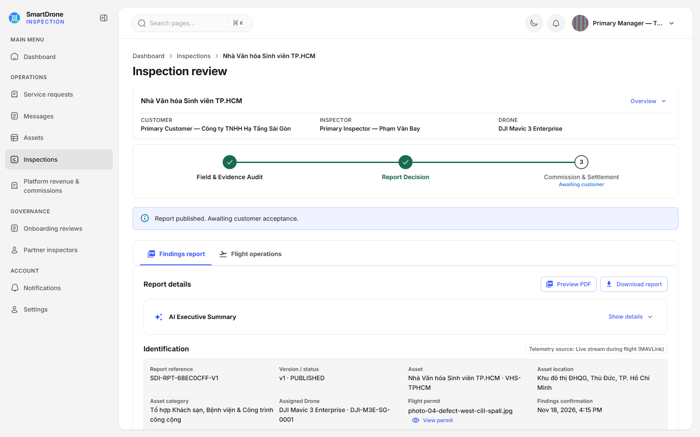

*Figure 7.9 — Independent report review.*

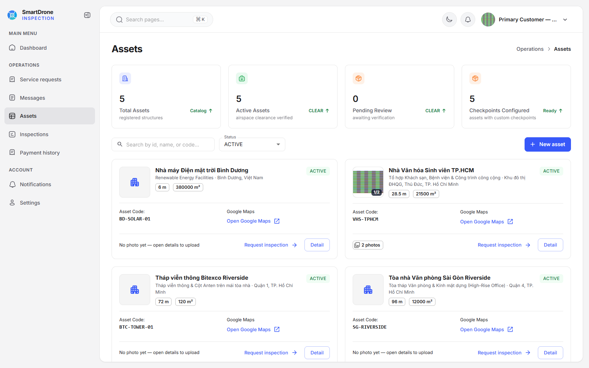

*Figure 7.10 — Customer building register.*

**Screen Authorization**

| Screen | `ADMIN` | `MANAGER` | `CUSTOMER` | `INSPECTOR` |
| --- | :---: | :---: | :---: | :---: |
| Public landing and registration | | | | |
| Dashboard | X | X | X | X |
| Platform accounts | X | | | |
| Building catalogue | X | X | | |
| Pilot licence classes | X | | | |
| Drone configuration | X | | | |
| Finance settings | X | | | |
| AI inference settings | X | | | |
| Onboarding reviews | X | X | | |
| Fee schedules | X | X | | |
| Services and pricing | | X | | |
| Partner inspectors | | X | | |
| Service requests | X | X | X | |
| Inspections | X | X | X | X |
| Inspection details | X | X | X | X |
| Reports | X | X | X | X |
| Assets | | X | X | |
| Drones | X | X | | X |
| Payments | X | X | X | |
| Messages | X | X | X | X |
| Payouts and refunds | X | X | | |
| Notification inbox | X | X | X | X |
| Personal account settings | X | X | X | X |
| Query All Data | X | X | | |
| Query Own Data | | | X | X |

**Non-Screen Functions**

| # | Feature | System Function | Description |
| --- | --- | --- | --- |
| 1 | `FE-01` | Airspace screening on registration | Classifies a submitted location as prohibited, restricted, or eligible and routes the registration accordingly. |
| 2 | `FE-01` | One-time code issuance and verification | Issues and validates single-use codes for sign-in, registration, and password reset with expiry and attempt limits. |
| 3 | `FE-01` | Session issuance and rotation | Issues access and refresh tokens, rotates the refresh token on use, and revokes affected sessions on a sensitive account change. |
| 4 | `FE-01` | Rate limiting and lockout | Blocks repeated sign-in attempts by address and locks an account after repeated failures. |
| 5 | `FE-02` | Partner application admission | Records a public application, notifies reviewers, and provisions an account only on approval. |
| 6 | `FE-02` | Drone eligibility evaluation | Determines whether a drone may be assigned from serviceability, registration validity, and required documents. |
| 7 | `FE-02` | Licence expiry sweep | Detects approaching licence expiry and notifies the affected inspector and the platform. |
| 8 | `FE-03` | Occurrence materialization | Generates the dated occurrences of an accepted recurring request and anchors them to the requested first date. |
| 9 | `FE-03` | Notification dispatch and deduplication | Delivers notices from domain events through the outbox and suppresses duplicate delivery of the same event. |
| 10 | `FE-04` | Quotation eligibility checks | Refuses a quotation whose inspector or drone is not eligible for every planned occurrence. |
| 11 | `FE-04` | Terms snapshot | Freezes the agreed commercial terms at acceptance so later edits cannot alter what was agreed. |
| 12 | `FE-04` | Schedule conflict detection | Refuses an assignment that overlaps the inspector's other work. |
| 13 | `FE-05` | Permit integrity verification | Checks the uploaded permit's file signature, size, and checksum and records its structured metadata. |
| 14 | `FE-05` | Permit review gate | Blocks field-session start until a person other than the uploader has approved the permit. |
| 15 | `FE-05` | Abort recovery | Reopens the mission and raises a manager action after an aborted or hung field session. |
| 16 | `FE-05` | Telemetry ingestion | Persists flight metrics and the GPS trace supplied by the optional ground station. |
| 17 | `FE-06` | Evidence normalization pipeline | Extracts metadata, normalizes images, generates thumbnails and posters, and transcodes video in the background. |
| 18 | `FE-06` | Resumable upload management | Tracks chunked video upload state so an interrupted transfer resumes rather than restarting. |
| 19 | `FE-06` | Defect detection and fallback | Runs the primary model, falls back to the secondary vision service, and returns advisory candidates only; a human confirms the baseline. |
| 20 | `FE-06` | Media streaming ticket issuance | Mints a short-lived signed ticket so a browser can stream video with HTTP Range requests without exposing storage credentials. |
| 21 | `FE-07` | Report submission and author gating | Records an explicit submit action and refuses publication by the report's own author. |
| 22 | `FE-07` | Independent review and publication | Lets a manager who did not author the report publish a locked version or return it with a reason; prior published versions are superseded rather than overwritten. |
| 23 | `FE-08` | Report acceptance and settlement | Transitions an occurrence to payment due on acceptance, and settles the occurrence through a PayOS or VNPay gateway callback with a verified signature. |
| 24 | `FE-08` | Refund initiation and payout hold | Caps each refund by the captured balance, requires a reason and evidence reference, and holds any unpaid payout until reconciliation records the outcome. |
| 25 | `FE-08` | Re-inspection initialization and defect verification | Initializes one verification item per source defect for a re-inspection opened on a published report, and records each three-way outcome: resolved, unresolved, or inconclusive. |

**Entity Relationship Model**

The schema holds 41 tables. Users own buildings and requests; buildings belong to categories that define inspection checkpoints; accepted requests produce occurrences that become inspections; inspections gather evidence, findings, field sessions, and reports; and occurrences carry the invoice, payment, payout, and refund ledger.

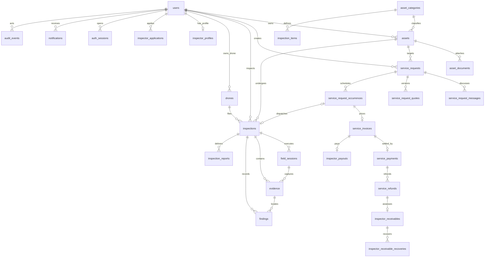

**Entity Descriptions**

| # | Entity | Description |
| --- | --- | --- |
| 1 | `users` | Every platform account, including email, password hash, status, failed-login state, and the constrained role set. A customer organization is represented by the `CUSTOMER` account that owns its buildings. |
| 2 | `inspector_profiles` | Inspector licence details, partner contract, onboarding state, and approval attribution. |
| 3 | `inspector_applications` | Public partner applications before an account exists, with review state and the approved account. |
| 4 | `otp_challenges` | One-time verification challenges for sign-in, registration, and password reset. |
| 5 | `auth_sessions` | Active web and mobile sessions with hashed refresh tokens and revocation state. |
| 6 | `inspector_flight_logs` | Historical inspector flight missions and safety notes. |
| 7 | `prospective_customer_registrations` | Organization and first-building registrations held for review because of restricted airspace. |
| 8 | `drone_registration_applications` | Inspector requests to register an owned drone, with documents, photographs, and capabilities. |
| 9 | `drones` | Approved drones with serial, model, registration validity, capabilities, and serviceability. |
| 10 | `asset_categories` | The building category catalogue. All six seeded rows are building categories. |
| 11 | `inspection_items` | Category-scoped inspection checkpoints. |
| 12 | `assets` | Customer buildings with coordinates, status, technical profile, height, footprint, and captured checkpoints. |
| 13 | `asset_documents` | Building drawings and reference documents with checksums. |
| 14 | `checklist_templates` | Configurable pre-flight and post-flight checklist items. |
| 15 | `drone_document_configs` | Which drone document types the platform requires and whether each is mandatory. |
| 16 | `drone_feature_configs` | The configurable drone capability catalogue. |
| 17 | `pilot_license_classes` | Recognised pilot-licence classes that gate inspector eligibility. |
| 18 | `inspection_finance_settings` | Platform commission, VAT, and personal income tax rates. |
| 19 | `platform_ai_settings` | Detection auto-confirmation setting and threshold. |
| 20 | `service_requests` | One-time and recurring requests with cadence bounds, accepted terms snapshot, and manager assignment. |
| 21 | `service_request_messages` | Order-chat messages between the customer and the assigned manager. |
| 22 | `service_request_message_attachments` | Private chat attachment metadata with MIME, size, and checksum. |
| 23 | `service_request_quotes` | The active VND quotation with scope, window, inspector, drone, and price. |
| 24 | `service_request_occurrences` | Dated occurrences materialized from an accepted request, with dispatch state. |
| 25 | `service_invoices` | Per-occurrence price and the commission, VAT, and tax rate snapshots. |
| 26 | `service_payments` | Customer payment status, gateway order reference, and refunded amount. |
| 27 | `inspector_payouts` | Inspector payout eligibility, disbursement, and refund hold state. |
| 28 | `service_refunds` | Refund lifecycle ledger with accounting allocation and reconciliation. |
| 29 | `inspector_receivables` | Attributable inspector debt assessed after a refund follows a paid payout. |
| 30 | `inspector_receivable_recoveries` | Append-only collection records against a receivable. |
| 31 | `inspections` | Scheduled missions with assignment state, permit metadata and verification, and confirmation timestamps. |
| 32 | `field_sessions` | On-site sessions with safety notes, outcome or abort reason, flight metrics, and the GPS trace. |
| 33 | `evidence` | Photographs and video with object keys, processing state, media dimensions, and capture metadata. |
| 34 | `evidence_upload_sessions` | Resumable chunked upload state and its finalized evidence record. |
| 35 | `findings` | Candidate and confirmed defects with label, severity, region, and confidence. |
| 36 | `reinspection_defect_verifications` | Three-way comparison between an original finding and its re-observed evidence. |
| 37 | `inspection_reports` | Versioned reports with submission, review, publication, and supersession state. |
| 38 | `notifications` | Deduplicated in-app notices with target path and read state. |
| 39 | `audit_events` | Append-only attributable record of material decisions. |
| 40 | `inspector_reliability_events` | Attributable inspector reliability events such as an abort or a hung session. |
| 41 | `event_publication` | The transactional outbox that carries domain events to their listeners. |

**`FE-01` Registration, Sign-in and Account Access**

**Function trigger**: A prospective customer opens the public registration page, or an existing user signs in from any portal.

**Function description**: A prospective organization submits its details and its first building's location. The location is screened: a prohibited location is refused, a restricted one is held for review, and an eligible one completes registration. An account then signs in by password, one-time code, or Google, and receives access scoped to its role. `ADMIN` manages platform accounts, and a user may edit their own name and phone number.

**Screen layout (mock-up)**: The public registration form carries identity, organization, and building fields with a location picker; the sign-in page offers password, code, and Google paths; the account settings page edits the profile.

**Function Details**: Validation covers password policy, uniqueness of email, and presence of the building location. A weak password, a duplicate email, an invalid code, or a prohibited location is refused with a client error. A restricted location creates a pending review record. A repeated failure locks the account and repeated requests from one address are rate-limited. Every account change is attributed in the activity history.

**`FE-02` Partner Inspector and Drone Registration**

**Function trigger**: A prospective inspector submits the public application, or an approved inspector registers a drone.

**Function description**: The applicant supplies identity, pilot-licence number, class, and expiry, with a scanned licence. Platform staff review it, and approval provisions the inspector's account and licence profile in one step. The inspector then registers owned drones against the document set the administrator configures, and a manager or administrator approves each drone before it becomes selectable for dispatch.

**Screen layout (mock-up)**: The public application form carries identity and licence fields with a scan upload; the reviewer's queue shows the application with its scan beside the recorded details; the partner register lists licence class, validity, and eligibility; the inspector's drone screen lists each drone with its serviceability and document state.

**Function Details**: A missing licence number, scan, recognised class, or future expiry makes the inspector ineligible for assignment. Drone eligibility requires a current registration number, its evidence, a known maximum take-off weight, and an expiry after the planned flight. Rejection requires a written reason and notifies the applicant. Renewal is an inspector action and restores eligibility once reviewed.

**`FE-03` Buildings, Airspace Screening and Notifications**

**Function trigger**: A customer registers or edits a building, or accepts a quotation for a recurring request.

**Function description**: A building is stored with its category, structure data, inspection checkpoints, and reference documents. Its location is screened: a prohibited location is refused, and a location requiring review is held for a platform decision. Acceptance of a recurring quotation materializes every planned occurrence from the agreed schedule and anchors each to the customer-requested first date, and domain events drive in-app notifications to the responsible users.

**Screen layout (mock-up)**: The customer building register lists each building with status, category, height, and coordinates; the building sheet carries the checkpoints and documents; the review queue lists held registrations with approve and reject actions; the request detail shows the four-stage progress indicator and each planned occurrence; the notification inbox lists notices with an unread count.

**Function Details**: A building inside a prohibited zone is refused with its reason; a restricted location is held pending review, and a rejection reason is mandatory. A building in service cannot be duplicated by code within the same organization. A recurring request carries exactly one bound — either an occurrence count or an end date — and the resulting dates must fall inside the agreed term. Notifications deduplicate on a key derived from the event, so a redelivered event cannot create a second notice.

**`FE-04` Service Requests, VND Quotations, Agreements and Dispatch**

**Function trigger**: A customer submits a service request.

**Function description**: The request enters the manager queue and a manager claims it. Customer and manager exchange messages, with optional attachments. The manager issues a VND quotation naming the inspector, the drone, the scope, and the first occurrence window, and the customer accepts it or asks for a revision. After the paper agreement is signed, the manager records the signed copy, and a qualified inspector and eligible drone are assigned to each occurrence.

**Screen layout (mock-up)**: The request list shows status and the four-stage indicator; the request detail carries the order chat with attachments; the quotation form shows the scope, window, price, and the named inspector and drone; the dispatch screen shows the occurrence schedule and assignment state.

**Function Details**: A request needs an active building, an inspection type, and a first date at least twenty calendar days away. A quotation is refused when the named inspector's licence or the named drone's registration expires before any planned occurrence, or when the assignment conflicts with the inspector's other work across organizations. Acceptance freezes the agreed terms into an immutable snapshot, so a later edit cannot change what was agreed.

**`FE-05` Flight Permit and On-site Field Sessions**

**Function trigger**: An inspector opens an assigned mission to upload the permit, or begins the field session.

**Function description**: The inspector uploads the mission flight permit with structured metadata. A manager or administrator who is not the uploader verifies it. The inspector records the on-site session — start, completion, or abort with a reason — and the platform records the outcome, the flight metrics, and the GPS trace. An abort or a hung session reopens the mission and raises a manager action.

**Screen layout (mock-up)**: The permit tab shows the upload and metadata; the pre-flight tab shows the safety checklist; the field session tab shows the start, complete, and abort controls with telemetry; the post-flight tab shows the recorded metrics and trace; the manager screen shows dispatch state with reschedule, reassign, and cancel actions.

**Function Details**: The permit file is checked for its signature, for a valid size, and for a recorded checksum. The structured metadata must be complete: number, issuing authority, and validity window. The field session cannot start without an approved permit and a completed pre-flight checklist, and there is no bypass. Verification by the uploader is refused.

**`FE-06` Evidence Intake and Human-Reviewed Defect Detection**

**Function trigger**: The inspector opens the evidence tab after a field session.

**Function description**: The inspector uploads photographs and video. The platform normalizes images, generates thumbnails, transcodes video in the background, and streams media through short-lived tickets. On request it proposes candidate defects, which fall back to a secondary vision service when the primary is unavailable. The inspector reviews each candidate, editing, rejecting, or supplementing it, and confirms the findings baseline.

**Screen layout (mock-up)**: The evidence tab shows thumbnails and analysis controls; the findings tab lists candidates with region, label, severity, and confidence beside the inspector's decision.

**Function Details**: A photograph is limited to 10 MB and is normalized to at most 2048 px with a 480 px thumbnail. Video uploads use 10 MiB chunks up to 2 GB and resume after interruption; a failed transcode retains its source for retry. Detection returns advisory candidates only, and a manual finding carries no model confidence. Only human-confirmed findings become official, and confirmation locks the baseline for the report that follows.

**`FE-07` Inspection Report Preparation, Review and Publication**

**Function trigger**: The inspector opens the report tab after confirming findings.

**Function description**: The platform compiles the report from the confirmed findings and the inspected checkpoints, and drafts an executive summary from the confirmed context. The inspector reviews, edits, and submits the report. A manager or administrator who is not the author reviews it independently, returning it with a reason or publishing it as an immutable PDF.

**Screen layout (mock-up)**: The report tab shows the compiled preview with the drafted summary and the submit action; the review screen shows the submitted version with publish and return actions; the customer screen shows the published report with its download.

**Function Details**: Submission is an explicit action; opening the report does not submit it. Publication by the report's own author is refused. A published report is immutable, and a correction is issued as a new version that supersedes the previous one. Rendering skips video binaries and falls back to the deterministic template when the language model is unavailable.

**`FE-08` Customer Report Acceptance and Payment Settlement**

**Function trigger**: The customer opens a published report, or a manager opens an occurrence to settle it.

**Function description**: The customer reviews the published report and records acceptance, which moves the occurrence to payment due. The customer pays through PayOS VietQR or VNPay, and the gateway callback settles the occurrence. A manager records the partner payout and any refund separately. A customer or manager may also open a re-inspection against the published report, in which each originally confirmed defect is re-assessed.

**Screen layout (mock-up)**: The customer screen shows the report, the acceptance action, and the payment options with their return states; the manager screen shows the occurrence settlement with payout and refund controls; the re-inspection screen lists each source defect with its verification item and resolution status.

**Function Details**: Payment confirmation comes from the gateway callback, not from the redirect alone. A refund is capped by the captured balance, requires a written reason and a reference, and holds any unpaid payout until reconciliation records the actual outcome. A defect verification records resolved, unresolved, or inconclusive with a note, is refused while the re-inspection is still scheduled or in progress, and is locked once a report for it is submitted or published.

### 3.2 Out-of-Scope Domains and Retired Capability

Non-building infrastructure — bridges, transmission towers, solar farms, roads, dams, tunnels, ports, and pipelines — is outside the delivered scope, and the shipped defect classes and inspection checkpoints are building-specific. Corrective maintenance is not modelled: there is no maintenance package, endpoint, or table. The platform does not pilot or control aircraft and does not perform photogrammetric reconstruction. No retrieval-augmented advisory exists: the language model receives the confirmed context in a single request and no embedding is stored. The native mobile application admits `CUSTOMER` accounts only.

## 4. Non-Functional Requirements

### 4.1 External Interfaces

- **Web interface.** The service is available through a responsive web experience on current desktop and mobile browsers, with English and Vietnamese labels.
- **Mobile interface.** The `CUSTOMER` role has a native application covering sign-in, registration, buildings, requests with negotiation, inspection tracking, published reports, and notifications. Field capture and field-session recording are performed by inspectors in the operations web portal.
- **Detection service.** Building-defect detection is served by a self-hosted inference service, with an OpenAI-compatible vision model as fallback. A user may opt out of the fallback for their own account.
- **Narrative drafting service.** An OpenAI-compatible language model drafts the report narrative once per draft from the confirmed context, returns strict JSON, and is instructed not to invent facts.
- **Payment and identity services.** PayOS VietQR and VNPay process settlement and Google OAuth2 provides federated sign-in. Both gateways are configuration-gated and can be disabled, in which case an authorised manual confirmation records payment.
- **Ground-station integration.** An optional hub supplies read-only telemetry, flight traces, and mission video. A response from any external service does not replace the platform's own authorization or human review.

### 4.2 Quality Attributes

- **Usability.** Each stage communicates its purpose, status, responsible role, and required next action. Candidate findings and drafted summaries are visibly advisory, and a manual finding is distinguishable from a detected one. Users can work in English or Vietnamese.
- **Reliability.** Signed documents, building documents, and published reports keep their integrity, and unauthorised in-place changes are prevented. A retried event does not create a duplicate occurrence, evidence record, payment, or notice. A large video upload resumes after interruption, and a failed transcode retains its source.
- **Performance.** Standard actions, searches, and paged lists respond within two seconds at the 95th percentile under fifty concurrent users, and a single-image defect suggestion completes within five seconds. Report rendering never reads video into memory, so generation cost does not scale with evidence size.
- **Security and data protection.** Users see only what their role, organization, partner relationship, and assignment permit; a direct link or a known identifier grants nothing extra. A denied section has no route. A report author cannot publish their own report and a permit uploader cannot verify their own permit. Media is served only through short-lived scoped tickets. Credentials are supplied as configuration and never committed.
- **Maintainability and portability.** Module boundaries are enforced by an architecture test. Schema evolution is forward-only, and a test asserts the exact applied migration set. The service runs from container images with the database, storage, detection service, and application as separate services.

| NFR ID | Category | Requirement Statement | Metric | Target Threshold |
| :---: | --- | --- | --- | --- |
| `NFR-01` | Performance | Standard actions and list views respond promptly under concurrent use. | 95th percentile response time and server error rate. | `p95 <= 2.0 s` and `0%` server errors under `50` concurrent users. |
| `NFR-02` | Performance | Supported image analysis stays within interactive limits. | Processing time per image. | `<= 5.0 s` per request. |
| `NFR-03` | Security | Users cannot reach records or actions outside their role, organization, or assignment. | Unauthorised and cross-scope attempts blocked. | `100%` blocked; `0` disclosures. |
| `NFR-04` | Security | Sign-in resists guessing and revoked access stops working. | Lockout and request rate. | Lockout for `15 min` after `5` failures; over `10` requests per minute blocked. |
| `NFR-05` | Reliability | Signed and published records stay intact and cannot be silently altered. | Integrity and prevention of in-place change. | `100%` integrity; `100%` of unauthorised changes prevented. |
| `NFR-06` | Reliability | Large video evidence survives interruption and transcode failure. | Resume success and retry availability. | `100%` resumable; `100%` of failed transcodes retained. |
| `NFR-07` | Maintainability | All eight features have repeatable verification and module boundaries hold. | Feature coverage and boundary violations. | All six features covered; `0` violations. |
| `NFR-08` | Portability | The service rebuilds and starts from its stated dependencies. | Clean start and migration set. | Starts from the compose stack with the declared migration set. |

These thresholds are acceptance targets, not measured claims. Verification is recorded in Report 5.

## 5. Requirement Appendix

### 5.1 Business Rules

Representative rules from the `BR-01`–`BR-54` set:

| ID | Rule Definition |
| --- | --- |
| `BR-01` | An account has exactly one login role, and no account may hold both a platform role and a customer or partner role. |
| `BR-02` | A partner inspector account is created only by platform approval of a submitted application, never by public self-registration. |
| `BR-03` | A user sees only records permitted by their role, organization, partner relationship, and assignment. |
| `BR-07` | The inspection scope is buildings only; non-building infrastructure is out of scope. |
| `BR-08` | A submitted partner application grants no platform role and is always provisioned as an inspector on approval. |
| `BR-09` | Drone ownership is not a condition of partner admission. |
| `BR-12` | Take-off weight classification follows the decree classes, and the pilot licence class must cover the aircraft. |
| `BR-24` | A flight permit must be verified by a person other than its uploader before field work may start. |
| `BR-26` | Field work cannot start without an approved permit and a completed pre-flight safety checklist. |
| `BR-28` | A recurring request carries exactly one schedule bound and produces between two and one hundred occurrences. |
| `BR-30` | A quotation cannot move the customer-requested first date. |
| `BR-33` | Acceptance freezes the agreed terms into an immutable snapshot; later changes require a revised quotation. |
| `BR-38` | Only human-confirmed findings become official inspection findings. |
| `BR-41` | A report cannot be published by its own author. |
| `BR-43` | A published report is immutable, and a correction is issued as a new version that supersedes the previous one. |
| `BR-47` | A retried event does not create a duplicate occurrence, evidence record, payment, or notice. |
| `BR-54` | Corrective maintenance, aircraft control, photogrammetric reconstruction, and retrieval-augmented advisory are out of scope. |

### 5.2 Common Requirements

- **Language and locale.** The interface supports English and Vietnamese, and a generated report follows the language selected for the engagement.
- **Currency and tax.** Prices are stated in VND, and commission, VAT, and personal income tax are applied from the configured rates captured at invoice time.
- **Attribution.** Every material decision records the responsible actor and the time it was made, and historical records are never silently rewritten.
- **Advisory labelling.** Detection output and drafted narrative are labelled advisory wherever they appear.
- **Idempotency.** Repeated submission of the same event or request does not duplicate its effect.

### 5.3 Application Messages List

Representative messages from the `MSG01`–`MSG50` catalogue:

| # | Message code | Message Type | Context | Content |
| --- | --- | --- | --- | --- |
| 1 | `MSG01` | Error | Registration | The selected location is inside prohibited airspace. Choose another location. |
| 2 | `MSG02` | Info | Registration | Your registration is held for review because the location is inside restricted airspace. |
| 3 | `MSG03` | Error | Sign-in | Too many failed attempts. Try again in 15 minutes. |
| 4 | `MSG04` | Error | Sign-in | Too many requests from this address. Try again shortly. |
| 5 | `MSG05` | Error | Partner application | An account already exists for this email. Sign in instead. |
| 6 | `MSG06` | Info | Partner application | Your application has been submitted. You will be notified after review. |
| 7 | `MSG07` | Info | Partner application | Your application was approved. You can now sign in. |
| 8 | `MSG08` | Error | Partner application | A rejection reason is required. |
| 9 | `MSG09` | Error | Drone registration | The required documents are incomplete. |
| 10 | `MSG10` | Error | Drone registration | This serial number is already registered. |
| 11 | `MSG11` | Info | Drone registration | Your drone has been approved and is now available for assignment. |
| 12 | `MSG12` | Error | Service request | The first date must be at least 20 days from today. |
| 13 | `MSG13` | Error | Service request | A recurring request must produce between 2 and 100 occurrences. |
| 14 | `MSG14` | Error | Service request | A recurring request needs either an occurrence count or an end date, not both. |
| 15 | `MSG15` | Error | Quotation | The quotation cannot move the requested first date. |
| 16 | `MSG16` | Error | Quotation | The assigned inspector or drone is not eligible for every planned occurrence. |
| 17 | `MSG17` | Info | Quotation | Your quotation is ready for review. |
| 18 | `MSG18` | Info | Agreement | The agreed terms have been accepted and recorded. |
| 19 | `MSG19` | Error | Chat | A message must contain text or at least one attachment. |
| 20 | `MSG20` | Error | Chat | Each attachment must be 10 MiB or smaller and no more than five may be sent at once. |
| 21 | `MSG21` | Error | Dispatch | The inspector already has work scheduled at this time. |
| 22 | `MSG22` | Info | Dispatch | You have been assigned an inspection on the planned date. |
| 23 | `MSG23` | Error | Permit | A flight permit is required before the field session can start. |
| 24 | `MSG24` | Error | Permit | The permit must be verified by someone other than the person who uploaded it. |
| 25 | `MSG25` | Info | Permit | The flight permit has been verified. |
| 26 | `MSG26` | Error | Field session | Complete the pre-flight safety checklist before starting the session. |
| 27 | `MSG27` | Info | Field session | The session has been aborted and the manager has been notified. |
| 28 | `MSG28` | Info | Evidence | Processing is still in progress. Playback is available once it is ready. |
| 29 | `MSG29` | Error | Evidence | This file type is not supported. |
| 30 | `MSG30` | Info | Findings | Confirm the findings baseline before preparing the report. |
| 31 | `MSG31` | Info | Report | The report has been submitted for review. |
| 32 | `MSG32` | Error | Report | You cannot publish a report you authored. |
| 33 | `MSG33` | Info | Report | The report was returned for revision. See the reason provided. |
| 34 | `MSG34` | Info | Report | The report has been published. |
| 35 | `MSG35` | Info | Report | A newer version of this report has been published. |
| 36 | `MSG36` | Info | Payment | Report accepted. The service fee is now due. |
| 37 | `MSG37` | Info | Payment | Payment confirmed. Thank you. |
| 38 | `MSG38` | Info | Payment | Waiting for the payment provider to confirm. This may take a moment. |
| 39 | `MSG39` | Info | Settlement | Inspector payout recorded for this occurrence. |
| 40 | `MSG40` | Error | Settlement | The refund allocation must sum exactly to the refund amount. |
| 41 | `MSG41` | Error | Mobile | The mobile application is available to customer accounts only. |
| 42 | `MSG42` | Error | General | You do not have permission to perform this action. |
| 43 | `MSG43` | Error | General | The record you requested was not found. |
| 44 | `MSG44` | Error | General | The record was changed by someone else. Reload and try again. |
| 45 | `MSG45` | Error | General | The operation could not be completed. Try again. |
| 46 | `MSG46` | Info | Building | The building has been retired and cannot receive new requests. |
| 47 | `MSG47` | Error | Session | Your session has expired. Sign in again. |
| 48 | `MSG48` | Info | Notification | You have unread notifications. |
| 49 | `MSG49` | Info | Airspace | Airspace information is advisory and is not permission to fly. |
| 50 | `MSG50` | Info | Detection | Detected candidates are advisory. Confirm each finding before it becomes official. |

### 5.4 Other Requirements

- **Scope and operational constraints.** The platform does not pilot aircraft. Permits, airspace results, and published reports are the platform's governance records and are not government clearance.
- **Feature and flow traceability.** `FE-01` and `FE-02` belong to `MF1`; `FE-03` and `FE-04` to `MF2`; `FE-05` and `FE-06` to `MF3`.
- **Research basis.** Requirements were derived from the delivered product, verified against the running system, and checked against the decrees governing drone operation and building inspection in Vietnam.

# IV. Software Design Description

## 1. System Design

### 1.1 System Architecture

SmartDroneInspection uses a modular client-server architecture that separates the client presentation sub-systems, the modular monolith backend, the persistence and object storage layer, and the external services.

The clients are a React 19 web application serving four role-scoped portals and a Flutter mobile application that admits customer accounts only. The backend is a Spring Boot 4.1 modular monolith across eight modules whose permitted collaborators are declared per module and enforced by an architecture test. Persistence is PostgreSQL 17 with a 41-table schema, and binary content lives in MinIO. External services are the self-hosted YOLO11 detector, an OpenAI-compatible vision and drafting gateway, an optional ground-station hub, PayOS and VNPay for settlement, and Google OAuth2 for federated sign-in.

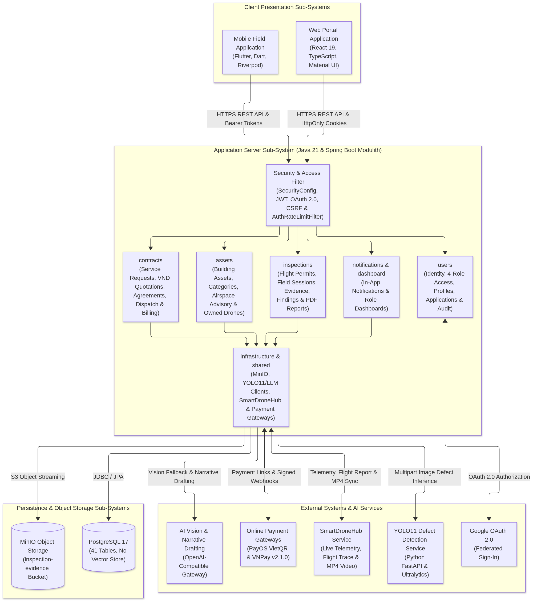

*Figure 7.11 — System architecture.*

| Component | Technology | Responsibility |
| --- | --- | --- |
| Web Portal Application | React 19, strict TypeScript, Vite, Material UI | Four role-scoped portals with route-level denial. |
| Mobile Field Application | Flutter, Riverpod, GoRouter, Dio | Customer-only mobile access. |
| Application Server | Java 21, Spring Boot 4.1.0, Spring Modulith 2.1.1 | Domain logic, authorization, state transitions, PDF rendering, audit, events. |
| YOLO11 Detection Service | Python FastAPI, Ultralytics YOLO11s | Primary building-defect candidate detection. |
| Vision and Drafting Gateway | OpenAI-compatible HTTP API | Vision fallback and single-shot narrative drafting. |
| SmartDroneHub | External ground station | Read-only telemetry, flight traces, and mission video. |
| PostgreSQL | PostgreSQL 17 | 41-table relational persistence, audit trail, and event outbox. |
| MinIO | S3-compatible object storage | Private storage of documents, evidence, and published PDFs. |
| PayOS, VNPay, Google OAuth2 | External HTTPS services | Settlement and federated sign-in. |

### 1.2 Package Diagram

The backend is organised into `users`, `contracts`, `assets`, `inspections`, `notifications`, `dashboard`, `infrastructure`, and `shared`. Each declares its permitted collaborators, so `contracts` may reach `assets::domain`, `assets::enums`, `assets::repository`, `users`, and `inspections::spi`, while `notifications` may reach only `inspections::events` and `users::events`. Directional control therefore passes through narrow named sub-packages rather than whole modules.

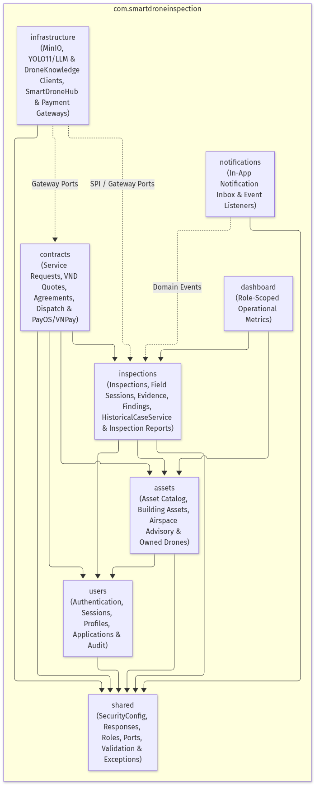

*Figure 7.12 — Backend module dependencies.*

| No | Package | Description |
| :---: | :--- | :--- |
| 01 | `com.smartdroneinspection.users` | Authentication, sessions, profiles, partner applications, airspace reviews, audit, and platform administration. |
| 02 | `com.smartdroneinspection.contracts` | Service requests, order chat and attachments, VND quotations, agreements, occurrence dispatch, finance settings, and payment webhooks. |
| 03 | `com.smartdroneinspection.assets` | Building categories, buildings, inspection checkpoints, reference documents, airspace evaluation, drone configuration, and owned drones. |
| 04 | `com.smartdroneinspection.inspections` | Missions, permit verification, field sessions, telemetry sync, evidence, findings, reports, and PDF rendering. |
| 05 | `com.smartdroneinspection.notifications` | Deduplicated in-app notifications driven by domain events. |
| 06 | `com.smartdroneinspection.dashboard` | Role-scoped operational metrics. |
| 07 | `com.smartdroneinspection.infrastructure` | Outbound adapters for object storage, detection and drafting clients, the ground-station hub, FFmpeg, and payment gateways. |
| 08 | `com.smartdroneinspection.shared` | Security configuration, response wrappers, role constants, cross-module ports, upload validation, error handling, and localization. |

The web client separates `app` (shell, router, access policy, theme) from nine feature folders — `auth`, `admin`, `landing`, `assets`, `contracts`, `inspections`, `reports`, `dashboard`, and `notifications` — over a shared layer providing the HTTP client, airspace mapping, localization, and the UI kit. The mobile client separates `core` (network, token storage, router, theme) from `auth`, `assets`, `contracts`, `inspections`, `dashboard`, `notifications`, and `profile`, each with `data`, `domain`, and `presentation` layers where it holds state.

## 2. Database Design

The schema is evolved by exactly two forward migrations: `V1__baseline.sql`, a consolidated baseline holding the complete schema and the catalog seeds, and `V2__remove_finding_recommended_action.sql`, which merges the former `recommended_action` column into `technical_notes` and drops it. A test asserts the applied set is exactly `["1","2"]`. The schema holds 41 tables and contains no vector column.

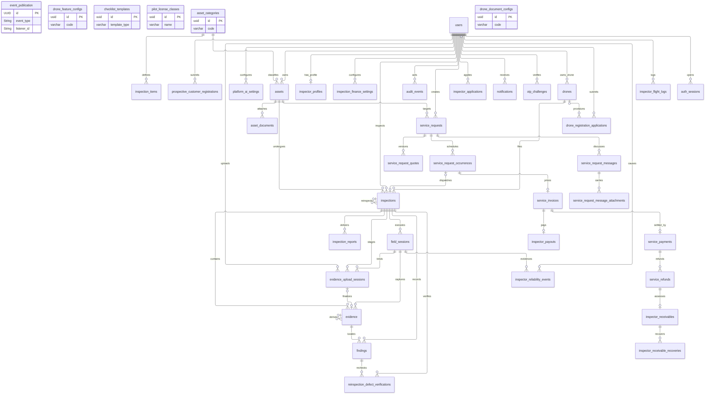

*Figure 7.13 — Entity relationship diagram.*

| No | Table | Description |
| :---: | :--- | :--- |
| 01 | `users` | Platform accounts with role set, status, and lockout state. A customer organization is represented by its owning account. |
| 02 | `inspector_profiles` | Inspector licence details, partner contract, and onboarding state. |
| 03 | `inspector_applications` | Public partner applications and their review outcome. |
| 04 | `otp_challenges` | One-time verification challenges. |
| 05 | `auth_sessions` | Active sessions with hashed refresh tokens and revocation. |
| 06 | `inspector_flight_logs` | Historical inspector flight missions. |
| 07 | `prospective_customer_registrations` | Registrations held for restricted-airspace review. |
| 08 | `drone_registration_applications` | Drone registration requests with documents and capabilities. |
| 09 | `drones` | Approved drones with registration validity and serviceability. |
| 10 | `asset_categories` | The building category catalogue. |
| 11 | `inspection_items` | Category-scoped inspection checkpoints. |
| 12 | `assets` | Customer buildings with coordinates, profile, and checkpoints. |
| 13 | `asset_documents` | Building reference documents with checksums. |
| 14 | `checklist_templates` | Configurable field checklist items. |
| 15 | `drone_document_configs` | Required drone document types. |
| 16 | `drone_feature_configs` | The drone capability catalogue. |
| 17 | `pilot_license_classes` | Recognised pilot-licence classes. |
| 18 | `inspection_finance_settings` | Commission, VAT, and tax rates. |
| 19 | `platform_ai_settings` | Detection auto-confirmation setting. |
| 20 | `service_requests` | One-time and recurring requests with terms snapshot and manager assignment. |
| 21 | `service_request_messages` | Order-chat messages. |
| 22 | `service_request_message_attachments` | Private chat attachment metadata. |
| 23 | `service_request_quotes` | The active VND quotation. |
| 24 | `service_request_occurrences` | Dated occurrences with dispatch state. |
| 25 | `service_invoices` | Per-occurrence price and rate snapshots. |
| 26 | `service_payments` | Customer payment status and gateway reference. |
| 27 | `inspector_payouts` | Inspector payout state and refund hold. |
| 28 | `service_refunds` | Refund ledger with accounting allocation. |
| 29 | `inspector_receivables` | Inspector debt after a refund follows a paid payout. |
| 30 | `inspector_receivable_recoveries` | Collection records against a receivable. |
| 31 | `inspections` | Missions with assignment, permit verification, and confirmation state. |
| 32 | `field_sessions` | On-site sessions with safety notes, metrics, and flight trace. |
| 33 | `evidence` | Photographs and video with object keys and processing state. |
| 34 | `evidence_upload_sessions` | Resumable upload state. |
| 35 | `findings` | Candidate and confirmed defects. |
| 36 | `reinspection_defect_verifications` | Three-way re-inspection comparison. |
| 37 | `inspection_reports` | Versioned reports with publication state. |
| 38 | `notifications` | Deduplicated in-app notices. |
| 39 | `audit_events` | Append-only decision record. |
| 40 | `inspector_reliability_events` | Inspector reliability events. |
| 41 | `event_publication` | The transactional outbox. |

## 3. Detailed Design

### 3.1 Registration and Access

The access design combines a routing policy with an API policy. The web client's access policy determines which sections exist as routes for a role, so a denied section is unreachable rather than merely hidden; the backend repeats the decision at each endpoint, and ownership, organization, and assignment are checked inside the service transaction rather than in the controller.

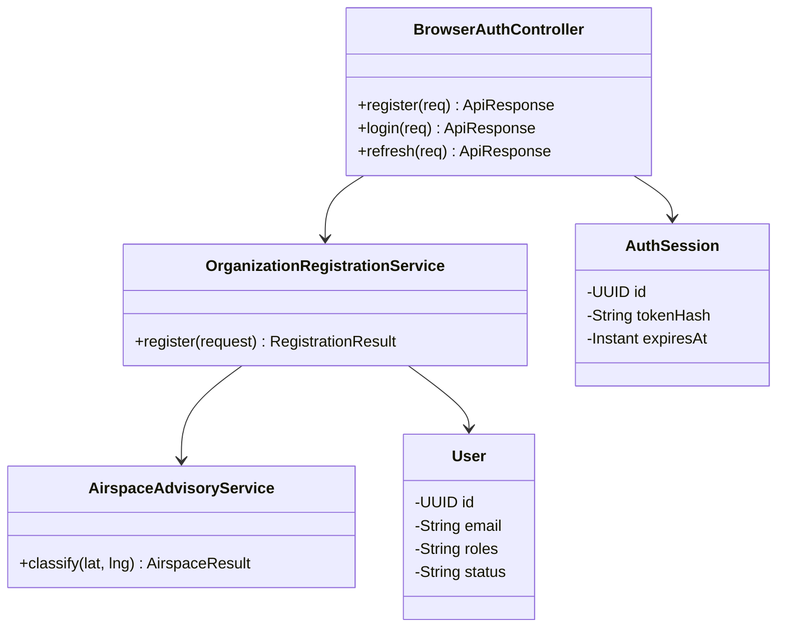

**Class Specifications**

| No | Class | Description |
| :---: | :--- | :--- |
| 01 | `BrowserAuthController` | Registration, sign-in, one-time code, refresh, and sign-out endpoints for the web client. |
| 02 | `OrganizationRegistrationService` | Creates the customer account, its first building, and the pending review record when airspace screening requires one, in a single transaction. |
| 03 | `AirspaceAdvisoryService` | Classifies a coordinate as prohibited, restricted, or eligible. Its output is advisory and is not a flight clearance. |
| 04 | `User` & `AuthSession` | The account with its constrained role set, and the rotatable session with a hashed refresh token. |

#### 3.1.1 Registration and Sign-in Sequence

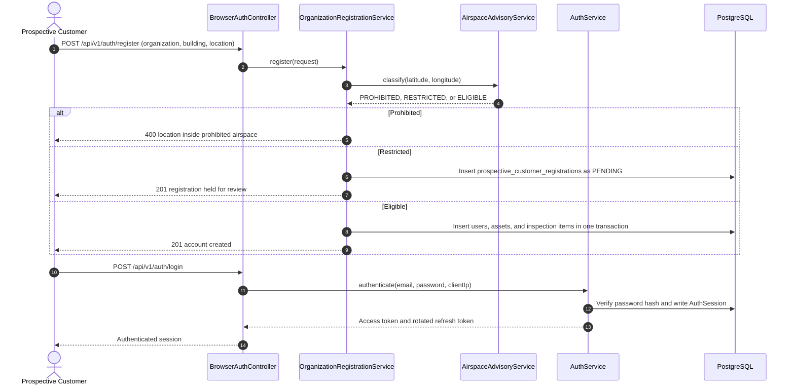

### 3.2 Partner Admission and Drone Registration

Admission is an application, not a self-registration. The public applicant has no account; approval is what creates one, and the approved inspector's licence and each registered drone are evaluated for eligibility before any assignment is offered.

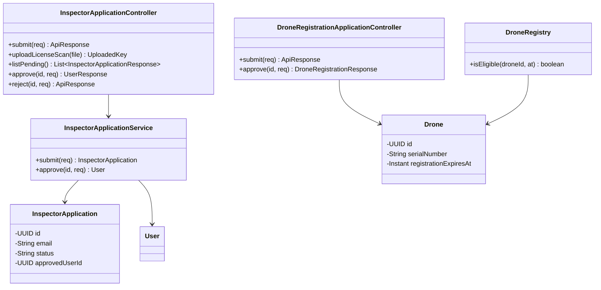

**Class Specifications**

| No | Class | Description |
| :---: | :--- | :--- |
| 01 | `InspectorApplicationController` | Accepts the public application and licence scan, exposes the review queues, and records approval, rejection, and the signed partner contract. |
| 02 | `InspectorApplicationService` | Enforces unique normalized email, records the review outcome with attribution, and on approval provisions the account and licence profile in one step. |
| 03 | `DroneRegistrationApplicationController` | Accepts an inspector's drone registration with documents, photographs, and capabilities, and records the platform review. |
| 04 | `DroneRegistry` & `Drone` | Evaluate and store drone eligibility — serviceability, registration number and expiry, evidence, and known take-off weight. |

#### 3.2.1 Partner Admission Sequence

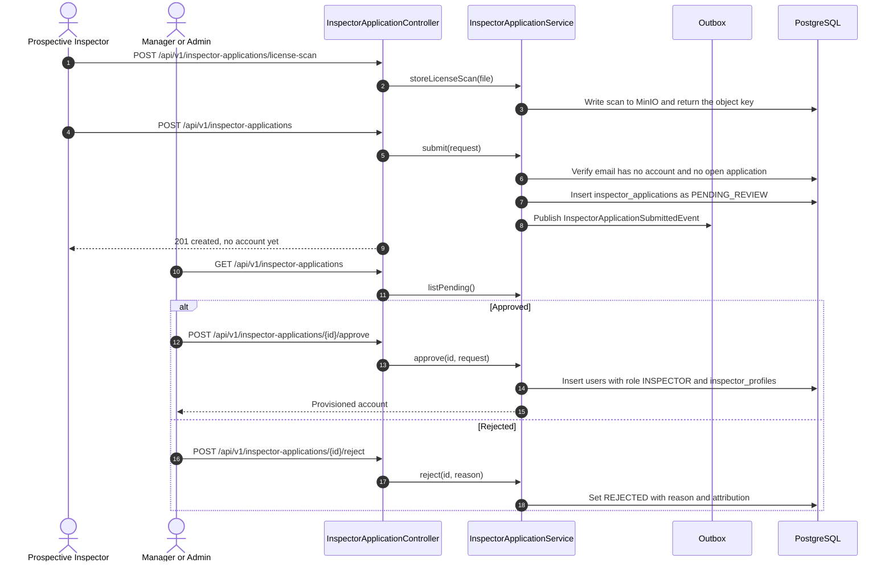

### 3.3 Requests, Quotations and Occurrences

The commercial design centres on a request that carries its own frozen terms. A quotation is replaced rather than versioned, and acceptance copies the agreed terms into an immutable snapshot on the request so that later edits to a quotation cannot change what was agreed. Recurring acceptance is also what materializes the dated occurrences.

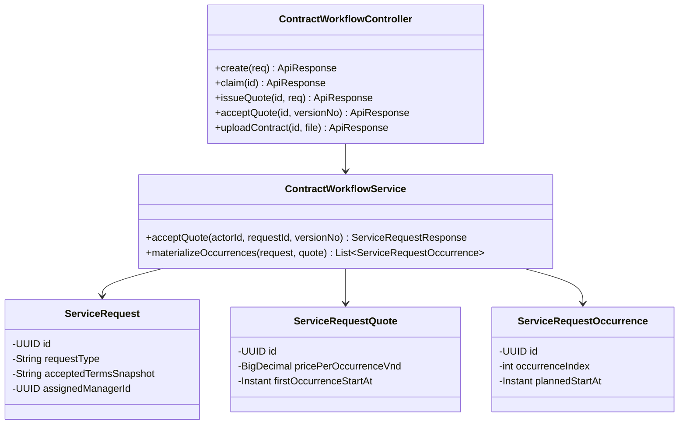

**Class Specifications**

| No | Class | Description |
| :---: | :--- | :--- |
| 01 | `ContractWorkflowController` | Request creation and claim, message exchange, quotation issue and acceptance, signed-agreement upload, and occurrence dispatch. |
| 02 | `ContractWorkflowService` | Validates the request bound and lead time, checks partner eligibility across every planned occurrence, freezes the accepted terms, and materializes occurrences. |
| 03 | `ServiceRequest` | The customer's request with its type, cadence, snapshot, and owning manager. |
| 04 | `ServiceRequestQuote` | The active VND quotation with scope, window, price, and the named inspector and drone. |
| 05 | `ServiceRequestOccurrence` | A dated occurrence with its dispatch state and assigned mission. |

#### 3.3.1 Quotation and Occurrence Materialization Sequence

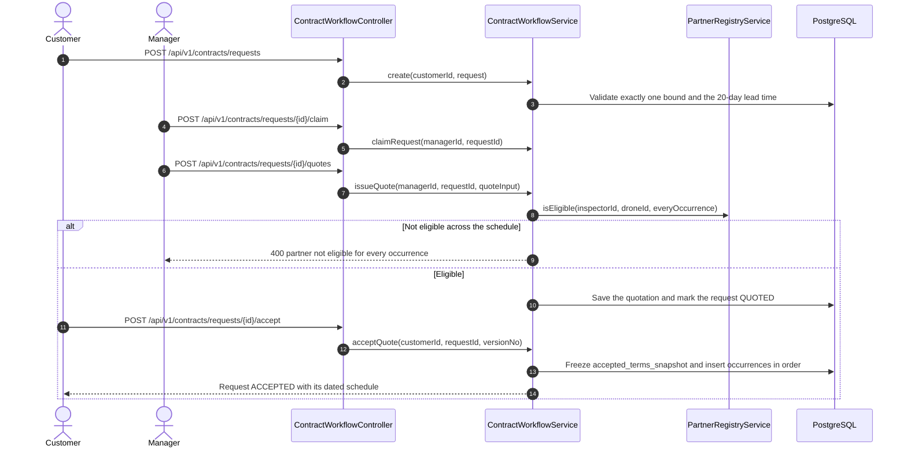

### 3.4 Flight Permit and Field Session

The permit gate is the design's clearest expression of separation of duties: the person who uploads a permit is structurally unable to verify it, and the field session cannot begin until a different person has approved it and the safety checklist is complete.

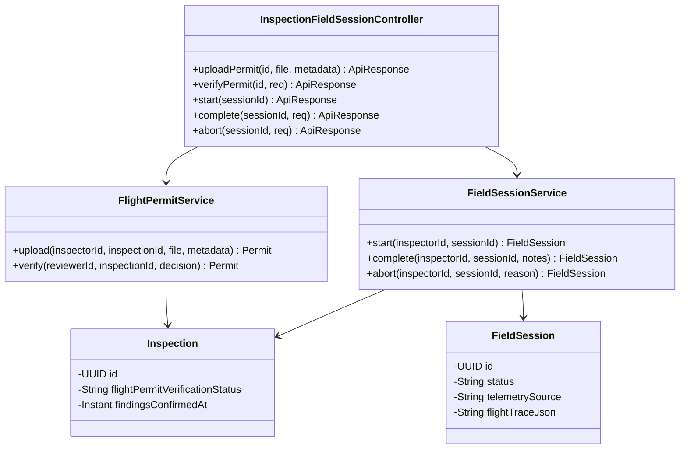

**Class Specifications**

| No | Class | Description |
| :---: | :--- | :--- |
| 01 | `InspectionFieldSessionController` | Permit upload and verification, session start, completion, and abort. |
| 02 | `FlightPermitService` | Checks the file signature, size, and checksum, validates the structured metadata against the schedule and the named drone, and refuses verification by the uploader. |
| 03 | `FieldSessionService` | Refuses a start without an approved permit and a completed checklist, records completion notes or an abort reason, and raises manager follow-up on an abort. |
| 04 | `Inspection` & `FieldSession` | The mission with its permit verification state, and the session with its outcome, metrics, and flight trace. |

#### 3.4.1 Permit Verification and Field Session Sequence

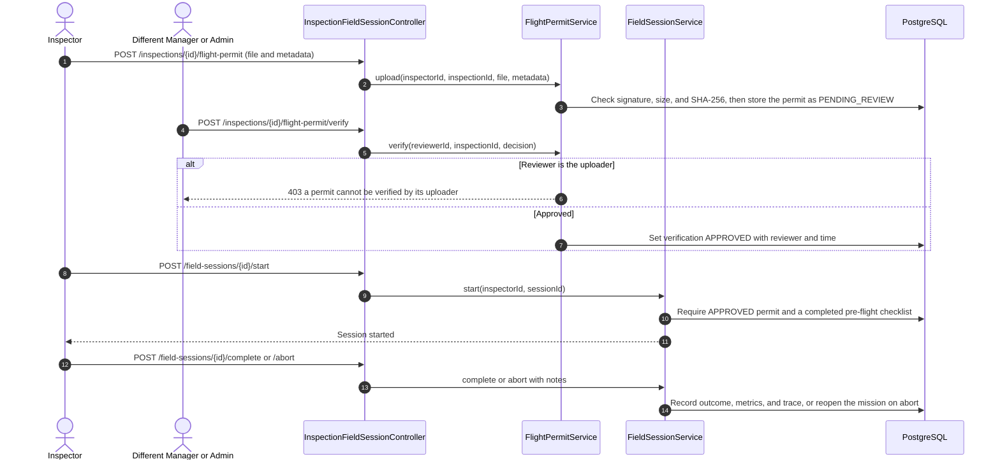

### 3.5 Evidence Intake and Defect Detection

The evidence design couples a resumable upload pipeline to an advisory detection step and a deterministic renderer. The pipeline is responsible for making large media survive interruption; the detector is responsible only for proposing candidates; and the renderer builds the report from confirmed findings so that generation cost never scales with stored video size.

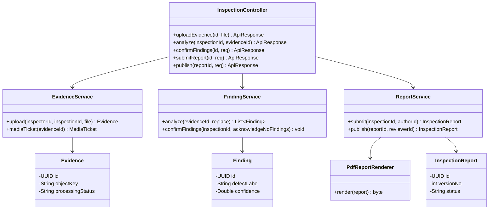

**Class Specifications**

| No | Class | Description |
| :---: | :--- | :--- |
| 01 | `InspectionController` | Evidence upload, analysis, findings confirmation, report submission, and publication. |
| 02 | `EvidenceService` | Normalizes photographs, manages resumable video uploads, and issues short-lived scoped media tickets for streaming. |
| 03 | `FindingService` | Runs detection with fallback, stores advisory candidates, and fixes the confirmed baseline. |
| 04 | `ReportService` & `PdfReportRenderer` | Compile the report from confirmed findings, refuse publication by the author, and render an immutable PDF without reading video into memory. |
| 05 | `Evidence`, `Finding`, `InspectionReport` | The stored media with its processing state, the candidate and confirmed defect, and the versioned report. |

#### 3.5.1 Evidence, Detection and Publication Sequence

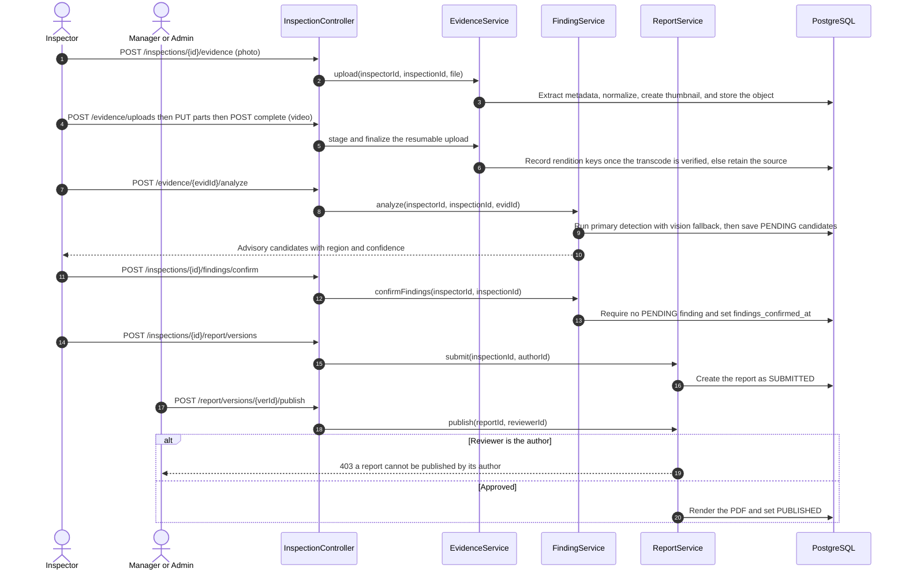

# V. Software Testing Documentation

## 1. Scope of Testing

Testing covers the delivered platform across the web portals, the customer mobile application, the backend, and the AI, telemetry, and payment integrations, for all six features `FE-01`–`FE-06` and the business rules `BR-01`–`BR-54`. The inspection scope is buildings only.

`FE-01` covers customer registration with airspace screening, sign-in by password, one-time code, and Google, session rotation, the account profile, and four-role authorization at both the route and the API boundary. `FE-02` covers partner application and admission, licence records and flight logs, restricted-airspace review, the building register with its No-Fly Zone guard, and inspector-owned drone registration. `FE-03` covers recurring occurrence materialization and deduplicated notifications. `FE-04` covers requests, quotations, agreements, dispatch, and the airspace evaluation. `FE-05` covers the permit gate, field sessions, and telemetry. `FE-06` covers evidence intake, detection, findings, the report lifecycle, publication, and settlement.

Out of scope: physical aircraft control and flight-controller firmware; corrective maintenance; non-building infrastructure; retrieval-augmented advisory; native push delivery and commercial mail relay; banking core systems behind the payment gateways; and mobile behaviour for roles other than `CUSTOMER`.

Four levels were executed. Unit level verifies entities, services, components, and widgets in isolation. Integration level verifies controllers, repositories, migrations, the security filter chain, object storage, and the event outbox against containerized services. System level verifies connected flows and non-functional thresholds across the integrated stack. Acceptance level verifies business rules and acceptance criteria per feature.

Constraints: integration tests need a running Docker daemon; when the inference container or the drafting gateway is unreachable the system routes to its fallbacks so workflows stay testable; payment verification uses signed test credentials rather than live debits; and permits, airspace results, and reports are governance records, not government clearance.

## 2. Test Strategy

### 2.1 Testing Types

Functional and business rule testing applies equivalence partitioning and boundary analysis to the stated limits — 10 MB photographs, 2 GB video in 10 MiB chunks, coordinate ranges, rate percentages, the twenty-day lead time, and the occurrence and interval bounds. Domain state machine testing walks every lifecycle entity along its valid edges and asserts that illegal edges are refused. Security and scope isolation testing probes cross-organization identifiers, permutes the four roles across the four portals, and simulates brute-force sign-in. AI testing verifies bounding-box parsing, automatic vision fallback, and the deterministic template path. Performance and payment testing covers response latency, tampered-signature webhook rejection, and published-report immutability. Interface, localization, and regression testing covers component rendering, `Accept-Language` negotiation, theme persistence, and repeated full-suite runs.

### 2.2 Test Levels

| Type of Tests | Unit | Integration | System | Acceptance |
| --- | :---: | :---: | :---: | :---: |
| Functional and Business Rule Testing | X | X | X | X |
| Domain State Machine Transition Testing | X | X | X | X |
| API and Database Persistence Testing | | X | X | |
| Security and Scope Isolation Testing | X | X | X | X |
| AI Vision, Narrative Drafting and Fallback Testing | X | X | X | X |
| Performance, Payment Webhook and PDF Integrity Testing | | X | X | X |
| User Interface, Localization and Regression Testing | X | X | X | X |

### 2.3 Supporting Tools

| Purpose | Tool | Vendor/In-house | Version |
| --- | --- | --- | --- |
| Backend unit and integration testing | JUnit Jupiter, Spring Boot Test, MockMvc | Open Source / Broadcom | `JUnit 6.x` / `4.1.0` |
| Containerized database and storage harness | Testcontainers (`pgvector:pg17`, `adobe/s3mock`) | AtomicJar / Docker | `1.20.x` / `PostgreSQL 17` |
| Architectural boundary verification | Spring Modulith Test | Broadcom | `2.1.1` |
| Backend coverage measurement | JaCoCo Maven Plugin | EclEmma | `0.8.13` |
| Frontend component and unit testing | Vitest, React Testing Library, JSDOM | Open Source | `5.0.1` / `16.3.3` |
| Mobile widget and repository testing | Flutter Test, Dart Analyzer | Google | `Flutter 3.x` |
| Report workbook generation and verification | Custom Python OOXML exporter and unittest suite | In-house | `Python 3.12+` |

## 3. Test Plan

### 3.1 Human Resources

| Worker/Doer | Role | Specific Responsibilities/Comments |
| --- | --- | --- |
| Trần Hoàng Trung Hiếu | Project Leader and Tester (`FE-01`, `FE-02` owner) | Owns the cases and regression runs for registration, access control, partner admission, buildings, and drones. |
| Phùng Trung Quốc | Backend and Mobile Engineer and Tester (`FE-03`, `FE-04` owner) | Owns the cases and regression runs for recurring requests, notifications, quotations, agreements, and dispatch. |
| Trần Tùng Bách | Full-Stack and AI Engineer and Tester (`FE-05`, `FE-06` owner) | Owns the cases and regression runs for the permit gate, field sessions, evidence, detection, reports, and payment. |
| Trương Thái Như | Full-Stack Engineer and Tester | Supports cross-feature regression, environment provisioning, and workbook reconciliation. |
| Supervisors | Reviewers | Review the strategy, audit traceability across Reports 3–5, and evaluate defence readiness. |

### 3.2 Test Environment

| Purpose | Tool | Provider | Version |
| --- | --- | --- | --- |
| Application runtime | Java 21 with Spring Boot Modulith | Eclipse Temurin / Broadcom | `Java 21` / `4.1.0` |
| Relational database | PostgreSQL (41 tables, `V1` + `V2`) | PostgreSQL Global Development Group | `17` |
| Object storage | MinIO (`inspection-evidence` bucket) | MinIO Inc. | `RELEASE.2025` |
| Test containers | Testcontainers with `pgvector:pg17` and `adobe/s3mock` | AtomicJar / Docker | `PostgreSQL 17` |
| Computer vision service | FastAPI with Ultralytics YOLO11s | Python / Ultralytics | `YOLO11s` |
| Web client under test | Chrome and Edge (desktop) | Google / Microsoft | Evergreen |
| Mobile client under test | Flutter test runner and Android client | Google | `Flutter 3.x` |
| Local execution platform | Windows 11 with Git Bash | Microsoft | `10.0.26200` |

### 3.3 Test Milestones

| Milestone Task | Start Date | End Date |
| --- | --- | --- |
| Milestone 1: Unit and migration foundation gate | `2026-09-15` | `2026-10-08` |
| Milestone 2: Core inspection, storage, detection and PDF integration testing | `2026-10-09` | `2026-10-22` |
| Milestone 3: Review baseline and scope retirement verification | `2026-10-23` | `2026-10-27` |
| Milestone 4: Four-role, eight-feature consolidation across `MF1`–`MF4` with contracts and payment | `2026-10-28` | `2026-11-04` |
| Milestone 5: Final regression, staging walkthrough, and defence rehearsal | `2026-11-05` | `2026-11-30` |

## 4. Test Cases

Unit test cases live in the repository suites. The backend holds JUnit Jupiter classes verifying domain transitions, service rules, cryptography, and architecture and schema contracts, with `627` tests across `119` classes. The frontend holds Vitest files verifying the four-portal access policy, the airspace map, the calendar, and the evidence, findings, and report screens. The mobile suite verifies customer-only admission, localization, and the customer screens.

Integration, system, and acceptance cases live in `Report5_Test Report.xlsx`, partitioned across eight feature sheets with columns for the procedure, expected results, preconditions, three execution rounds, the test date, the tester, and a note recording the mode and the automated evidence.

## 5. Test Reports

| Suite | Scope | Result |
| --- | --- | --- |
| Backend (`./mvnw test`) | Domain and integration tests including boundary and schema assertions | `119` classes, `627` tests: `627` passed, `0` failed, `0` errors, `0` skipped. JaCoCo line coverage `72.2%` (`13,586 / 18,805`), branch coverage `51.9%` (`4,735 / 9,123`). |
| Frontend (`npm test -- --run`) | Components, pages, access policy, and API clients | `89` test files (`85` passed, `4` skipped), `627` tests (`623` passed, `4` skipped), `0` failed. |
| Mobile (`flutter test`) | Customer-only session, localization, and screens | `42` cases in `13` files, all passed. |

The connected lifecycle is exercised end-to-end by `ConnectedMainFlowE2eIntegrationTest`, which drives onboarding, building and drone registration, request and quotation, occurrence dispatch, evidence and detection, publication, and settlement in one run. `FullDatabaseSchemaMigrationTest` asserts the applied migration set is exactly `["1","2"]`, while the inventory and mapping tests verify the 41-table schema and the entity-to-column projection. `ModulithArchitectureTest` asserts that no module reaches another outside its declared dependencies. Separation of duties is verified by the role-policy and reviewer-scope tests, which confirm that a report author cannot publish their own report and a permit uploader cannot verify their own permit.

Two defects remain open and are recorded rather than omitted. The mobile `UserRole` enumeration still parses the retired `MAINTENANCE_ENGINEER` role; the behaviour is harmless because the session gate admits `CUSTOMER` only, but the stale member should be removed. The backend E2E runner script resolves its frontend root to a directory that does not exist in the workspace, so it cannot execute as written. Neither defect affects a delivered feature path, and neither is claimed as passing. Cases not executed in this run remain `Pending` in the workbook.

# VI. Release Package & User Guides

## 1. Deliverable Package

| No. | Deliverable Item | Description |
| --- | --- | --- |
| 1 | Project Schedule/Tracking | Task schedule, milestone dates, and effort tracking against the plan in Report 2. |
| 2 | Project Backlog | The feature and function backlog for `FE-01`–`FE-08` across `MF1`–`MF4`. |
| 3 | Source Codes | Four independent repositories: backend (Java 21, Spring Boot 4.1), frontend (React 19, strict TypeScript), mobile (Flutter), and documentation. |
| 4 | Database Script(s) | `V1__baseline.sql` and `V2__remove_finding_recommended_action.sql`, defining the 41-table PostgreSQL 17 schema. |
| 5 | Final Report Document | Reports 1–7 of this documentation set, exported against the official templates. |
| 6 | Test Cases Document | `Report5_Test Report.xlsx` with one sheet per feature, plus the executed results in Report 5 §5. |
| 7 | Defects List | The defect log, including the two open defects recorded above. |
| 8 | Issues List | Outstanding issues and known limitations, including the out-of-scope items in Report 3 §3.8. |
| 9 | Slide | The defence presentation used for the final review. |

## 2. Installation Guides

### 2.1 System Requirements

Hardware: a 64-bit machine with at least 4 logical cores, 8 GB of memory, and 40 GB of free disk space. The detection service and the video transcoder dominate resource use, so a machine that also runs the inference container should give Docker at least 8 GB.

Software: Docker Engine 27 or later with the Compose plugin; Java 21 (Temurin) for a local backend build; Node 22 or later for the web client; the Flutter SDK with the Android toolchain for the mobile client; and a current Chrome or Edge. PostgreSQL 17, MinIO, and FFmpeg are provided by the compose stack. A local non-container backend run needs FFmpeg on the `PATH`.

### 2.2 Installation Instruction

Clone the four repositories into sibling folders, because the frontend proxy and the tooling assume that layout. Copy the backend example environment file to `.env` and set the database identity, the MinIO credentials and bucket, both signing secrets, the allowed client origin, and the first administrator's bootstrap credentials. Generate each signing secret as a long random value and never commit them. The AI, payment, and telemetry integrations are optional; leave them disabled for a self-contained local installation, in which case detection falls back to manual entry and drafting falls back to the deterministic template.

Start the backend stack with `docker compose up -d --build`; Flyway applies `V1` and `V2` on first start. Confirm health with `docker compose ps` and `curl http://localhost:8080/actuator/health`, which should report `UP`. Then copy the frontend example environment file, run `npm install` and `npm run dev`, and open `http://localhost:3000`, where the dev server proxies `/api` to port 8080. If port 3000 is occupied, Vite prints the port it chose; update the backend's allowed origin to match and restart the backend container.

For mobile, run `flutter pub get` and `flutter run` in the mobile repository. Finally, sign in with the bootstrap administrator, change its password immediately, and create the remaining accounts from the platform accounts screen.

If the backend container exits at start-up, check that both signing secrets are present and long enough. If uploads fail while everything else works, verify the MinIO credentials and that the configured bucket exists. If the detection service is unavailable, finding creation still works and detection simply becomes manual.

## 3. User Manual

### 3.1 Overview

The platform coordinates building inspections between the platform team, customer organizations, and partner drone inspectors. An inspection passes through onboarding, a commercial agreement, field preparation and execution, reporting, and settlement. The four login roles each have their own portal, and a section a role may not use does not appear in its navigation.

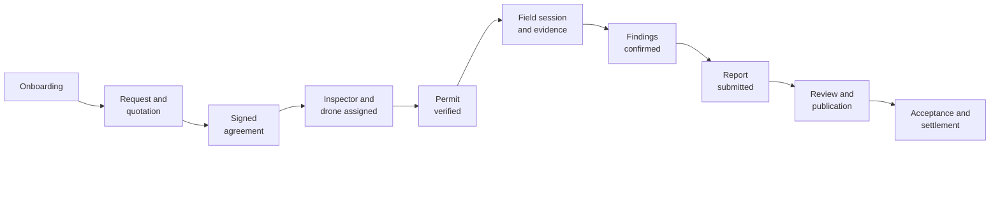

### 3.2 Workflow 1: Customer Onboarding and Building Registration

**Purpose.** Bring a new customer organization onto the platform and register its first building. **Actors.** Prospective customer (public), `ADMIN`, `MANAGER`. **Preconditions.** The platform is reachable and the building's location is decided, because the screening result determines the path.

**Step 1.** Open the public site and choose **Sign up**, then select the customer path.

*Figure 7.14 — Public landing page.*

**Step 2.** Complete the organization form — name, code, your own name, email, phone, and a password meeting the stated policy — then enter the building's name, category, and address and place its location on the map.

*Figure 7.15 — Customer registration with the screened building location.*

**Step 3.** Submit and enter the one-time code sent to your email. A prohibited location is refused, a restricted one is held for platform review, and an eligible one completes registration immediately. Screening is the platform's own check, not a government flight clearance.

**Step 4.** After signing in, open **Assets** to see your building register.

*Figure 7.16 — Customer building register.*

**Step 5.** Choose **New asset** to add another building, or open a record to review its details. Set the category, structure height, footprint, technical profile, and coordinates, attach drawings, and retire a building when it leaves service; retiring preserves history and blocks new requests.

**Step 6.** As `ADMIN` or `MANAGER`, open **Onboarding Reviews** to decide held registrations.

*Figure 7.17 — Onboarding review queue.*

Approve or reject with a written reason. The reason is mandatory on rejection and the decision is attributed in the activity history.

### 3.3 Workflow 2: Partner Inspector Application and Drone Registration

**Purpose.** Admit a partner inspector and register the drones that inspector will fly. **Actors.** Prospective inspector (public), `ADMIN`, `MANAGER`, `INSPECTOR`. **Preconditions.** The applicant holds a pilot licence and a scanned copy. Drone ownership is not required to apply.

**Step 1.** On the public site choose the partner inspector path.

*Figure 7.18 — Partner inspector application.*

**Step 2.** Enter your identity and contact details, licence number, class, and expiry, upload the licence scan, and submit. No account exists yet; you are notified after review.

**Step 3.** As `ADMIN` or `MANAGER`, open the review queue, open the licence scan, and check it against the details supplied.

**Step 4.** Approve or reject. Approval provisions the inspector account and licence profile in one step; rejection requires a reason. Record the signed partner contract after approval.

*Figure 7.19 — Partner inspector register.*

**Step 5.** As the inspector, open **My Drones**, choose to register a drone, and supply the serial number, model, manufacturer, at least one photograph, the outdoor flight capabilities, and the required documents.

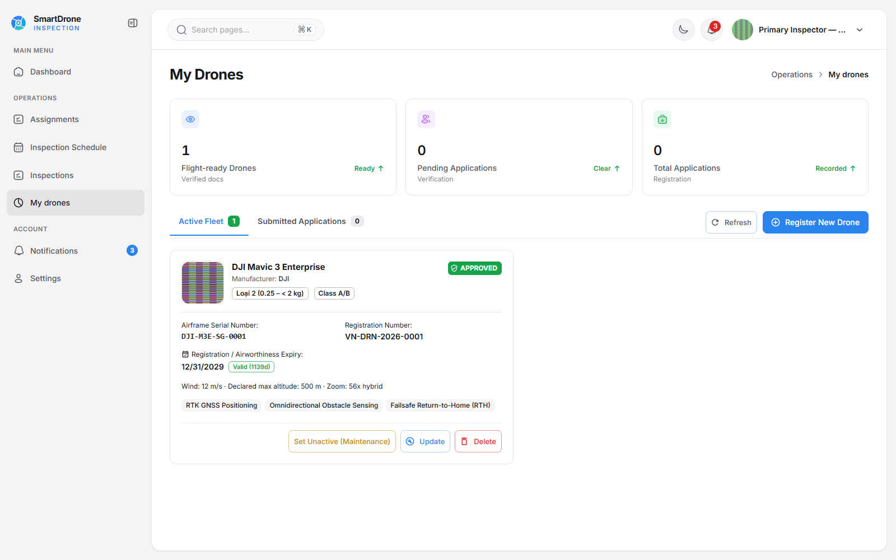

*Figure 7.20 — Inspector drone inventory.*

**Step 6.** Wait for platform review; once approved the drone becomes assignable. You can renew a registration or mark a drone unavailable from the same screen.

### 3.4 Workflow 3: Service Request, Quotation and Agreement

**Purpose.** Turn an inspection need into an agreed, signed engagement. **Actors.** `CUSTOMER`, `MANAGER`. **Preconditions.** The customer has an active building, and an eligible inspector and serviceable drone exist.

**Step 1.** In the customer portal open **Service Requests**, choose **New request**, select the building and inspection type, choose one-time or recurring, and pick a window starting at least twenty calendar days away.

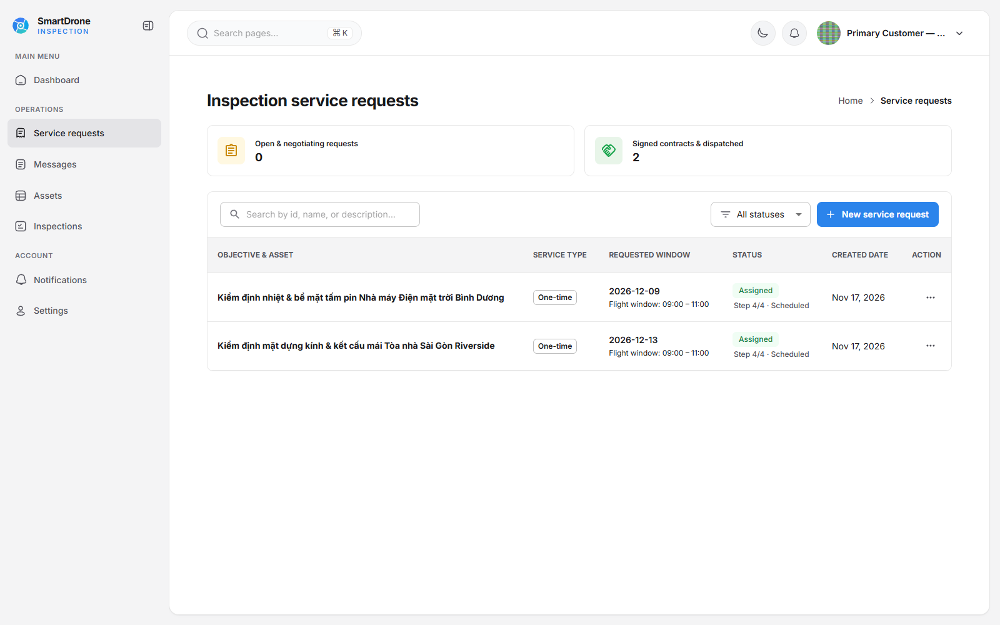

*Figure 7.21 — Customer request list.*

**Step 2.** Submit. The request enters the manager queue.

**Step 3.** As `MANAGER`, open **Service Requests**, claim the request, and discuss scope in its order chat.

*Figure 7.22 — Manager request queue.*

**Step 4.** Issue the quotation: scope, first occurrence window, inspector, drone, price per occurrence in VND, and any required drone features. The first occurrence must fall on the customer's requested date.

**Step 5.** As `CUSTOMER`, accept the quotation. Acceptance freezes the agreed terms and materially schedules a recurring request. For different terms, ask for a revised quotation instead.

**Step 6.** Sign the agreement on paper and have the manager record the signed copy, after which occurrences become available for dispatch.

### 3.5 Workflow 4: Dispatch, Flight Permit and Field Session

**Purpose.** Prepare and execute one occurrence in the field. **Actors.** `MANAGER`, `INSPECTOR`, `ADMIN`. **Preconditions.** The occurrence exists, and the inspector's licence and the drone's registration are valid on the planned date.

**Step 1.** As `MANAGER`, open the occurrence and assign an inspector and drone. An assignment whose credentials expire before the planned start, or that conflicts with other work, is refused.

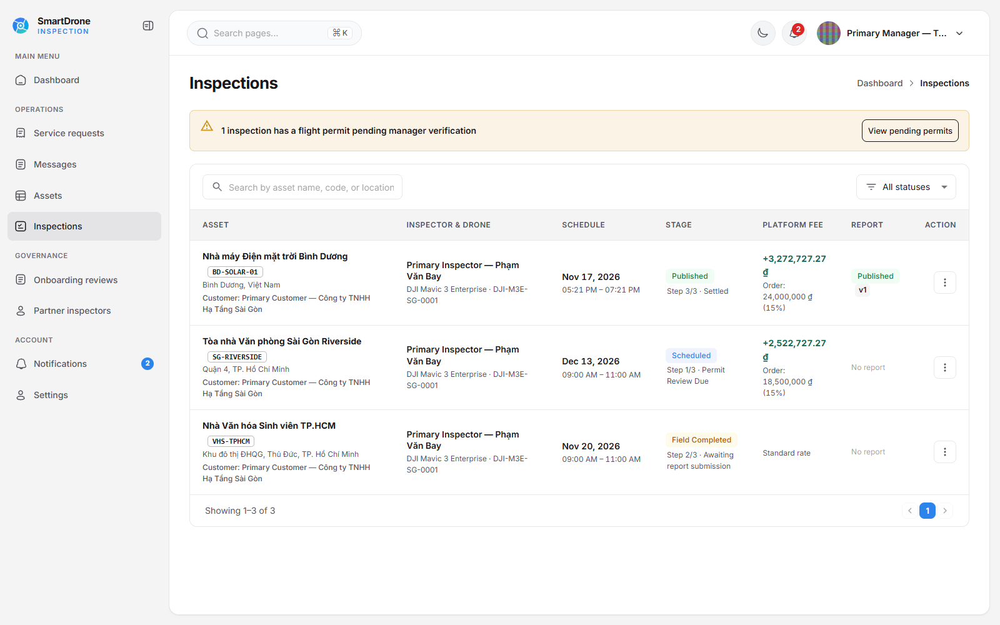

*Figure 7.23 — Dispatch state across occurrences.*

**Step 2.** As `INSPECTOR`, open the mission and upload the flight permit in the **Permit** tab with its number, authority, validity window, and optionally the drone serial and maximum altitude.

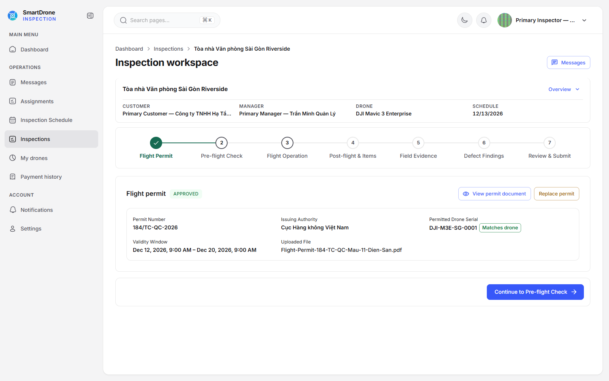

*Figure 7.24 — Flight permit upload.*

**Step 3.** As a different `MANAGER` or `ADMIN`, verify the permit. The session cannot start without approval, and there is no bypass.

**Step 4.** Open the **Pre-flight** tab and complete the safety checklist.

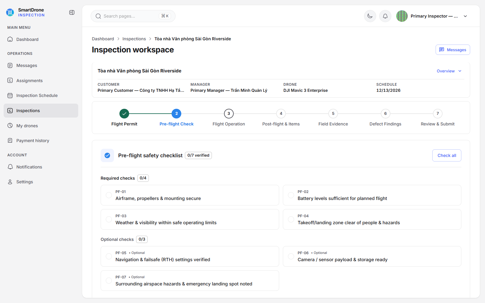

*Figure 7.25 — Pre-flight safety checklist.*

**Step 5.** Open **Field Session** and choose **Start**. When finished choose **Complete** with outcome notes; if the mission cannot proceed choose **Abort** with a reason, and the manager is alerted to reschedule, reassign, or cancel.

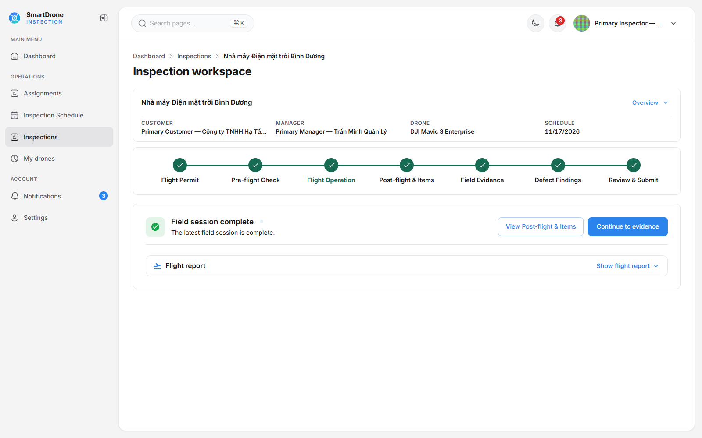

*Figure 7.26 — Field session controls.*

**Step 6.** Review the **Post-flight** tab; when a ground station is connected, metrics and the GPS trace are recorded automatically.

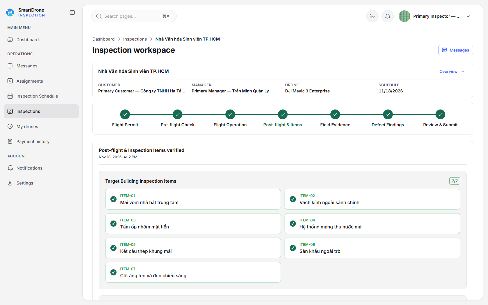

*Figure 7.27 — Post-flight metrics and flight trace.*

### 3.6 Workflow 5: Evidence, Detection and Findings

**Purpose.** Capture evidence and turn it into agreed official findings. **Actors.** `INSPECTOR`. **Preconditions.** A field session has been started or completed.

**Step 1.** Open the **Evidence** tab and upload photographs; each is normalized and thumbnailed for fast review.

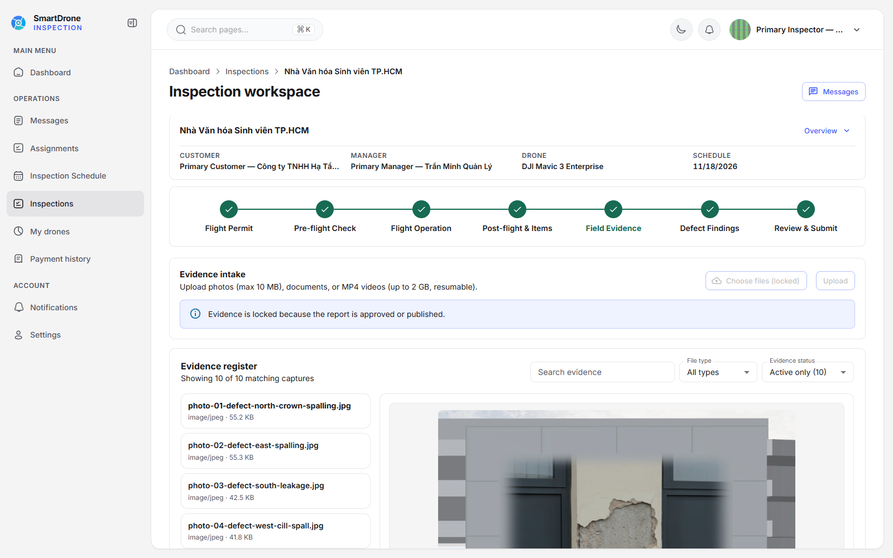

*Figure 7.28 — Evidence capture.*

**Step 2.** To upload a video, select it and let the upload run; a large file uploads in chunks and resumes if the connection drops, and playback is available once processing completes.

**Step 3.** Choose **Analyse** on a photograph or video keyframe. The platform proposes candidates with class, severity, confidence, and a highlighted region, falling back to its secondary vision service or to manual entry when the primary cannot run.

**Step 4.** In the **Findings** tab, accept, edit, or reject each candidate, and add any finding the system missed by hand.

*Figure 7.29 — Candidate findings.*

**Step 5.** Choose **Confirm findings**. This explicit action fixes the baseline, and only confirmed findings become official.

### 3.7 Workflow 6: Report Submission, Review and Publication

**Purpose.** Produce and publish the official report. **Actors.** `INSPECTOR`, `MANAGER`, `ADMIN`. **Preconditions.** Findings are confirmed.

**Step 1.** Open the **Report** tab. The platform compiles the report from the confirmed findings, evidence, and session record. You may request an advisory narrative draft, which you must review and edit before use.

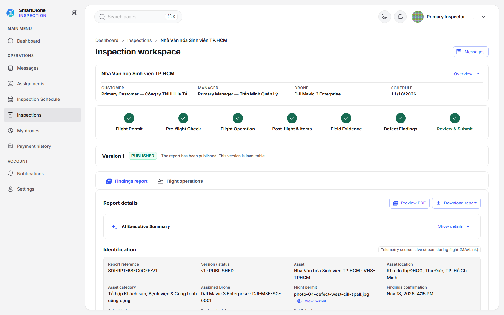

*Figure 7.30 — Compiled report preview.*

**Step 2.** Review every section and choose **Submit**. Opening the report does not submit it.

**Step 3.** As a different `MANAGER` or `ADMIN`, open the report in the review queue.

*Figure 7.31 — Independent report review.*

**Step 4.** Publish, or return with reasons. Publication by the report's own author is refused, and publication renders an immutable PDF.

**Step 5.** To correct a published report, issue a new version; the previous version is preserved and marked superseded.

### 3.8 Workflow 7: Report Acceptance and Payment

**Purpose.** Accept the published report and settle the fee. **Actors.** `CUSTOMER`. **Preconditions.** The report is published and the customer is signed in.

**Step 1.** Open **Inspections** and select the completed inspection.

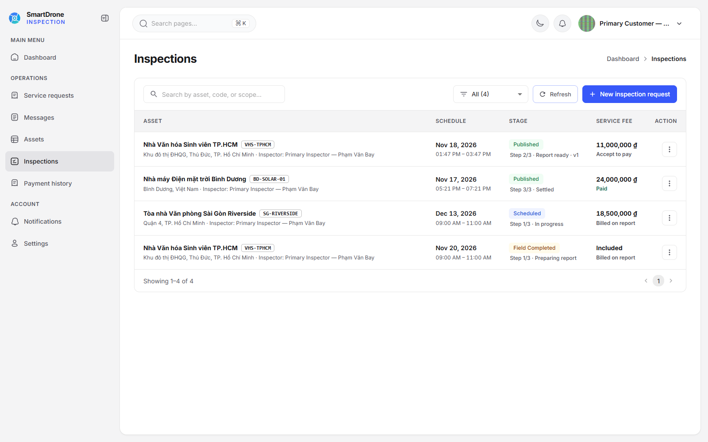

*Figure 7.32 — Customer inspection list.*

**Step 2.** Download and read the published PDF.

**Step 3.** Choose **Accept report**; acceptance is recorded against the occurrence and the fee becomes due.

**Step 4.** Choose **Pay** and select PayOS VietQR or VNPay. For VietQR, scan the displayed code; for VNPay, follow the redirect.

**Step 5.** Confirm the payment shows as paid. Settlement is confirmed by the gateway callback rather than the redirect alone, so the status may take a moment. Once paid, a manager can record the inspector's payout.

### 3.9 Workflow 8: Customer Mobile Application

**Purpose.** Follow and act on inspections from a phone. **Actors.** `CUSTOMER` only. **Preconditions.** The account holds the `CUSTOMER` role; any other role is refused at sign-in.

**Step 1.** Install the application and sign in with customer credentials or continue with Google.

**Step 2.** Use the bottom navigation for **Home**, **Buildings**, **Requests**, **Inspections**, and **Profile**.

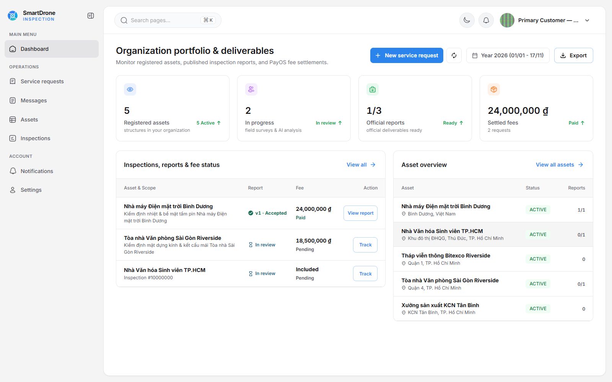

*Figure 7.33 — Customer dashboard.*

**Step 3.** Open **Requests** to raise a request or continue a conversation, and **Inspections** to track progress and read the published report.

**Step 4.** Open **Profile** to change your name, phone number, or language. English and Vietnamese are supported and the choice persists.

Field capture, permit handling, and report preparation are not available on mobile; those tasks belong to the inspector and are performed in the operations web portal.
