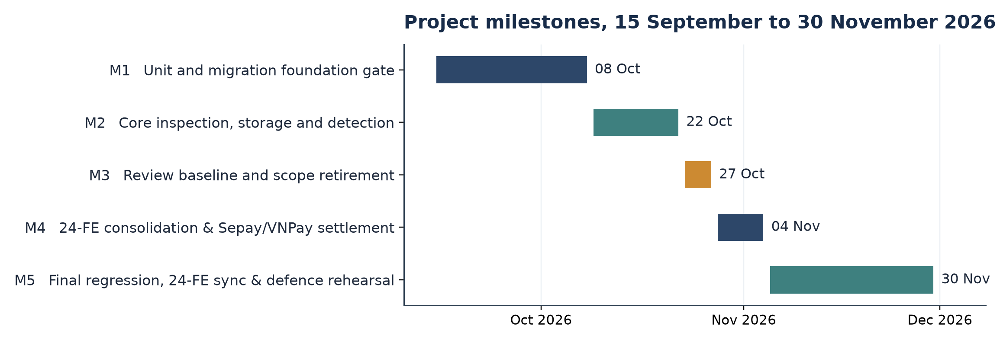

# II. Project Management Plan

## 1. Overview

### 1.1 Scope & Estimation

The work was decomposed into eight features — two per main flow — and estimated in man-days at
three complexity levels. Simple items are single-screen or single-endpoint changes with no new
persistence; medium items add a workflow or a data model; complex items span several modules and a
state machine, and carry their own test surface.

| # | WBS Item | Complexity | Est. Effort (man-days) |
| --- | --- | --- | --- |
| 1 | `MF1` — Onboarding and partner admission | Complex | 45 |
| 1.1 | `FE-01` Registration, sign-in and account access | Complex | 22 |
| 1.2 | `FE-02` Partner inspector admission and owned drone registration | Complex | 23 |
| 2 | `MF2` — Buildings, requests, quotations and dispatch | Complex | 59 |
| 2.1 | `FE-03` Buildings, airspace screening, occurrences and notifications | Complex | 33 |
| 2.2 | `FE-04` Service requests, VND quotations, agreements and dispatch | Complex | 26 |
| 3 | `MF3` — Field delivery and evidence | Complex | 46 |
| 3.1 | `FE-05` Flight permit verification and field sessions | Complex | 23 |
| 3.2 | `FE-06` Evidence intake and human-reviewed defect detection | Complex | 23 |
| 4 | `MF4` — Report review and payment settlement | Complex | 28 |
| 4.1 | `FE-07` Report preparation, independent review and publication | Complex | 14 |
| 4.2 | `FE-08` Customer acceptance, settlement and re-inspection | Complex | 14 |
| 5 | Cross-cutting foundation | Medium | 18 |
| 5.1 | Module boundaries, authorization policy, audit trail | Medium | 8 |
| 5.2 | Object storage, media pipeline, bilingual localization | Medium | 10 |
| 6 | Verification and documentation | Medium | 12 |
| 6.1 | Automated suites and regression | Medium | 7 |
| 6.2 | Report set and test workbooks | Simple | 5 |
| | **Total** | | **208** |

The estimate reconciles against capacity: four members over three and three-quarter months at twenty
working days each gives `4 × 3.75 × 20 = 300` person-days, and 208 man-days of delivery work
represents roughly 70% of that total once supervision, review, coursework, and contingency are set
aside.

### 1.2 Project Objectives

The overall objective was to deliver a working, defensible platform covering the full inspection chain for buildings, with governance — not detection — as the differentiator. The measurable targets were:

- All eight features accepted against their Report 3 acceptance criteria.
- `0` unauthorized or cross-scope data disclosures, verified by role, organization, and assignment probing across all four portals.
- `0` Spring Modulith module-boundary violations.
- A verified schema inventory of 45 application tables (44 JPA runtime entity tables; 47 total tables in `public` including `event_publication` and `flyway_schema_history`), with the applied Flyway set exactly `["1","2","3","4","60","61","62","63","64","65"]` through `V65__rag_local_embeddings_384.sql`.
- `0` open Critical or High severity defects at handover, with any remaining defect recorded rather than omitted.

**Quality**

| # | Testing Stage | Test Coverage | No. of Defects | % of Defect | Notes |
| --- | --- | --- | --- | --- | --- |
| 1 | Reviewing | Requirement, design, and code review of every feature before merge | 6 | 25.0% | Defects caught in review before the code reached a test environment. |
| 2 | Unit Test | Domain rules, services, components, and widgets | 8 | 33.3% | Backend `971` tests passed (`0` failures, Modulith and JaCoCo gates met); frontend `724` tests (`720` passed, `4` skipped) across `97` files; mobile `56` tests passed (`0` failures). |
| 3 | Integration Test | Controllers, repositories, migrations, storage, and outbox | 7 | 29.2% | Schema, authorization, and object-storage defects. |
| 4 | System Test | Connected end-to-end lifecycle across roles and clients | 3 | 12.5% | Cross-module sequencing and recovery-path defects. |
| 5 | Acceptance Test | Business rules and acceptance criteria per feature | 0 | 0.0% | No accepted-scope defect remained at handover. |
| | **Total** | | **24** | **100%** | |

Milestone Timeliness (%): 92%

Allocated Effort (man-days): 208

### 1.3 Project Risks

| # | Risk Description | Impact | Possibility | Response Plans |
| --- | --- | --- | --- | --- |
| 1 | Repeated schema rewrites invalidate migration history and tests | High | High | Consolidate to a single baseline plus forward migrations; assert the applied migration set in a test so an accidental renumbering fails the build. |
| 2 | AI model integration produces unusable or unstable detections | High | Medium | Treat detection as advisory only; add a secondary vision fallback and a manual finding path; require human confirmation before any finding becomes official. |
| 3 | External payment sandbox unavailable or behaviour changes | Medium | High | Keep both gateways configuration-gated and disabled by default; support an authorised manual confirmation path so settlement is testable without a sandbox. |
| 4 | Contract drift between the four repositories | High | Medium | Keep one focused PR per repository with an explicit merge order; treat the OpenAPI surface as the contract and regression-test it. |
| 5 | Scope creep toward corrective maintenance | High | High | Fix the eight-feature scope early; record maintenance and non-building domains explicitly as out of scope rather than partially implementing them. |
| 6 | Large video evidence destabilises upload or report rendering | Medium | Medium | Chunked resumable uploads, asynchronous transcoding with source retention, range-based streaming, and report rendering that never reads video into memory. |
| 7 | Module boundaries erode into a tangled monolith | Medium | Medium | Declare `allowedDependencies` per module and enforce them with an architecture test that fails the build. |
| 8 | Test evidence becomes overstated | High | Medium | Report only executed runs with their actual counts; keep unexecuted cases `Pending`; record known defects rather than omitting them. |
| 9 | Team members unavailable during review periods | Medium | Medium | Cross-review ownership so no single person is the only holder of a feature's context. |
| 10 | Local environment inconsistency between members | Low | High | Containerise the database, storage, detection, and hub services so every member runs the same stack. |

## 2. Management Approach

### 2.1 Project Process

The team followed an iterative incremental process inside a fixed capstone timeline. Each of five milestones produced a demonstrable increment: the foundation and migrations first, then core inspection and evidence, then the review baseline, then the four-role consolidation with contracts and payment, and finally regression and rehearsal. Work was organised as vertical slices — a feature was considered done when its backend contract, its client surface, and its tests landed together — rather than as horizontal layers completed one at a time. A pull request carried one slice, and review confirmed the acceptance criteria before merge.

### 2.2 Quality Management

Quality was maintained through four controls. Every change was reviewed by a member who had not written it, with the requirement text open beside the diff. Automated suites ran on every pull request, and a failing architecture, schema, or authorization test blocked the merge. Coverage was measured rather than asserted: the backend reported line coverage of 80.0% (`16,178 / 20,210`) and branch coverage of 57.8% (`5,672 / 9,815`) at handover, meeting the configured 80% line gate. Finally, a strict distinction was kept between what was verified automatically, what was exercised manually, and what was not verified at all, so that the test record never claimed more than it could show.

### 2.3 Training Plan

| Training Area | Participants | When, Duration | Waiver Criteria |
| --- | --- | --- | --- |
| Spring Boot 4 and Spring Modulith module boundaries | All backend contributors | Week 1–2, 12 hours | Prior production Spring Boot experience with a reviewed sample pull request |
| React 19 and strict TypeScript patterns in the existing codebase | Frontend contributors | Week 1–2, 10 hours | Two reviewed frontend pull requests without rework |
| Flutter and Riverpod state management | Mobile contributors | Week 2–3, 8 hours | A merged mobile screen with tests |
| Ultralytics YOLO training and inference integration | AI and backend contributors | Week 3, 6 hours | A successful local inference run against the delivered model |
| Aviation context: licences, permits, and airspace categories | All members | Week 1, 4 hours | None; mandatory for everyone because it underpins acceptance rules |
| Testcontainers and containerized test environments | All members | Week 2, 4 hours | A locally green integration suite |

### 2.4 Project Timeline and Sprint Breakdown

Delivery ran as five gated increments between 15 September and 30 November 2026. Each gate required a demonstrable increment and a review before the next increment began, and the same five windows structure the test milestones in Section V.

*Figure 7.1 — Five delivery milestones from the foundation gate to the defence rehearsal.*

| Milestone | Window | Increment delivered | Evidence at the gate |
| --- | --- | --- | --- |
| M1 Foundation | `2026-09-15` – `2026-10-08` | Four-repository skeleton, consolidated Flyway baseline, identity and admission, building catalogue, and the four-role access policy. | Backend unit suite, migration inventory assertion, and the four-portal route policy tests. |
| M2 Core delivery | `2026-10-09` – `2026-10-22` | Requests and quotations, occurrence dispatch, permit gate, field sessions, evidence intake, YOLO11 detection, and inspection report management. | Integration suites across controllers, storage, detection, and report workflows. |
| M3 Review baseline | `2026-10-23` – `2026-10-27` | Independent report review, publication, acceptance, and the retention decisions that retired maintenance capability. | Review-baseline walkthrough and scope-retirement verification. |
| M4 Consolidation | `2026-10-28` – `2026-11-04` | Eight-feature consolidation across `MF1`–`MF4`, PayOS and VNPay settlement, partner payout and refund ledgers, and re-inspection verification. | Connected lifecycle run and the finance lifecycle cases. |
| M5 Release | `2026-11-05` – `2026-11-30` | Final regression, staging walkthrough, documentation export, and defence rehearsal. | Full suites, workbook reconciliation, and the exported report set. |

Work was sliced vertically: a feature counted as complete only when its backend contract, its role-scoped client surface, and its tests landed together. The five windows therefore overlap in feature content but not in gate criteria — a later feature could start while an earlier one was still in review, but it could not pass its own gate on an incomplete slice.

## 3. Project Deliverables

| # | Deliverable | Due Date | Notes |
| --- | --- | --- | --- |
| D1 | Requirement specification (Report 3) | 2026-10-03 | Four roles, eight features, `BR-01`–`BR-55`, `MSG01`–`MSG50`. |
| D2 | Design document (Report 4) | 2026-10-17 | Architecture, package diagrams, 45-table schema (44 JPA runtime entities), detailed design per feature. |
| D3 | Working platform across four repositories | 2026-11-15 | Backend, web portal, mobile client, documentation tooling. |
| D4 | Automated test suites | 2026-11-17 | Backend, frontend, and mobile suites green. |
| D5 | Test documentation and workbook (Report 5) | 2026-11-18 | One workbook sheet per feature with executed results. |
| D6 | Release package and user guides (Report 6) | 2026-11-19 | Installation guide and nine illustrated workflows. |
| D7 | Project introduction and management plan (Reports 1 and 2) | 2026-11-19 | Scope, comparators, estimation, and process. |
| D8 | Final project report (Report 7) | 2026-11-20 | Consolidated defence document. |
| D9 | Defence slide deck | 2026-11-24 | Summarises scope, design, evidence, and demonstration. |

## 4. Responsibility Assignments

Members are identified by initials: H — Trần Hoàng Trung Hiếu, Q — Phùng Trung Quốc, B — Trần Tùng Bách, N — Trương Thái Như. The legend is `D`~Do; `R`~Review; `S`~Support; `I`~Informed.

| Function | H | Q | B | N |
| --- | :---: | :---: | :---: | :---: |
| `FE-01` Customer registration and account access | D | I | S | R |
| `FE-02` Partner qualification and drone registration | D | I | S | R |
| `FE-03` Recurring requests and notifications | S | D | I | R |
| `FE-04` Requests, quotations, agreements and dispatch | I | D | S | R |
| `FE-05` Flight permit and field sessions | S | I | D | R |
| `FE-06` Evidence, findings, reports and payment | I | S | D | R |
| Backend module boundaries and authorization policy | R | S | D | I |
| Media storage and video pipeline | I | S | D | R |
| Web portal shell and access policy | D | I | S | R |
| Mobile customer application | I | D | I | R |
| Test workbooks and report set | R | S | S | D |
| Release and defence preparation | D | S | S | R |

## 5. Project Communications

| Communication Item | Who/ Target | Purpose | When, Frequency | Type, Tool, Method(s) |
| --- | --- | --- | --- | --- |
| Weekly progress review | Team and supervisors | Demonstrate the increment, surface blockers | Weekly, 45 minutes | Video call with live demo |
| Daily stand-up | Team | Align on the day's slice and hand-offs | Daily, 15 minutes | Chat thread |
| Pull request review | Reviewing member | Verify the slice against acceptance criteria | Per change | Git pull request with review comments |
| Requirement clarification | Owner and reviewers | Resolve ambiguity in Report 3 before coding | As needed | Issue thread with the requirement linked |
| Defect triage | Feature owner and reviewer | Classify and assign a defect | Per defect | Issue tracker |
| Milestone sign-off | Team and supervisors | Record the baseline for the next milestone | Per milestone | Written summary and tagged commit |
| Documentation handoff | Documentation owner | Keep Reports 1–7 consistent with delivery | Per milestone and at handover | Repository commit with a change record |

## 6. Configuration Management

### 6.1 Document Management

Each report is maintained as Markdown under its own folder, with an appended row in its Record of Changes for every revision. Exported `.docx` files are generated from those sources against the untouched official templates, so an exported document is always reproducible from the repository. Screenshots and rendered diagrams live in each report's own `assets/` folder, which keeps a report self-contained when it is handed over.

### 6.2 Source Code Management

The workspace is four independent repositories — backend, frontend, mobile, and documentation — each with its own history. Every change is a focused pull request on a branch, never a direct commit to the default branch. Cross-repository work is split into one pull request per repository with an explicit merge order recorded in each body. Generated files are not edited by hand, and no credential, token, secret, recovery code, or private key is committed.

### 6.3 Tools & Infrastructures

| Category | Tools / Infrastructure |
| --- | --- |
| Technology | Java 21, Spring Boot 4.1, Spring Modulith 2.1.1, React 19 with strict TypeScript, Flutter with Riverpod, Python FastAPI with Ultralytics YOLO11s |
| Database | PostgreSQL 17 with Flyway migrations; MinIO for S3-compatible object storage |
| IDEs/Editors | IntelliJ IDEA, Visual Studio Code, Android Studio |
| Diagramming | Mermaid rendered to PNG; Draw.io for free-form diagrams |
| Documentation | Markdown sources exported to `.docx` through a custom OOXML pipeline against the official templates |
| Version Control | Git with four independent repositories and pull-request review |
| Deployment server | Docker Compose stack of database, object storage, detection service, hub service, and backend |
| Project management | Issue tracker, milestone board, and a shared task backlog |

