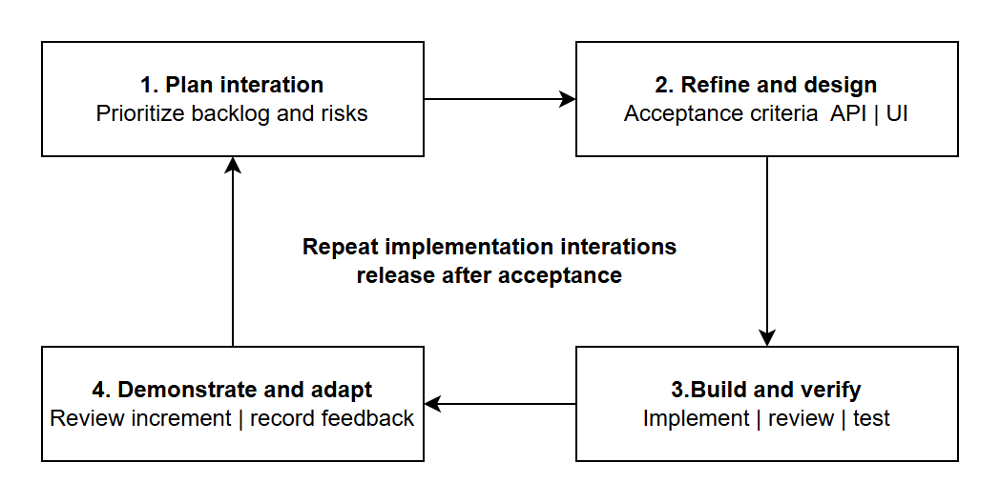

# II. Project Management Plan

## 1. Overview

### 1.1 Scope & Estimation

The work was decomposed into twenty-four atomic product features (`FE-01`–`FE-24`) across the four main flows (`MF1`–`MF4`) and grouped by member ownership (`24%` Hiếu `50` md, `24%` Quốc `50` md, `28%` Bách `58` md, `24%` Như `50` md; `208` man-days total) at three complexity levels. Simple items are single-screen or single-endpoint changes with no new persistence; medium items add a workflow or a data model; complex items span several modules and a state machine, and carry their own test surface.

| # | WBS Item | Complexity | Est. Effort (man-days) |
| --- | --- | --- | --- |
| 1 | Onboarding, Airspace Map & Financial Ledger (`FE-01`–`FE-05`) | Complex | 43 |
| 1.1 | `FE-01` Account Authentication, OTP & 4-Role Access Control (`MF1`) | Complex | 10 |
| 1.2 | `FE-02` Partner Inspector Application & Qualification Management (`MF1`) | Complex | 9 |
| 1.3 | `FE-03` Inspector-Owned Drone Registration & Fleet Management (`MF1`) | Complex | 10 |
| 1.4 | `FE-04` Interactive Location Map & No-Fly Zone Airspace Screening (`MF1`) | Medium | 7 |
| 1.5 | `FE-05` Financial History & Revenue/Payment Ledger (`MF4` ledger views) | Medium | 7 |
| 2 | Buildings, Commercial Service, Chat & Notifications (`MF2`, `FE-06`–`FE-12`) | Complex | 45 |
| 2.1 | `FE-06` Building Asset Registry, Checkpoints & Reference Documents | Complex | 8 |
| 2.2 | `FE-07` Restricted Airspace Advisory Warning & Immediate Onboarding | Medium | 5 |
| 2.3 | `FE-08` Service Requests (One-Time & Recurring) & VND Quotations | Complex | 9 |
| 2.4 | `FE-09` Offline Signed Contract & Occurrence Dispatch Scheduling | Complex | 8 |
| 2.5 | `FE-10` Messaging (Order Chat, Partner Chat & Inspection Chat) | Medium | 6 |
| 2.6 | `FE-11` Assignment Acceptance Timeout & Escalation Handling | Simple | 4 |
| 2.7 | `FE-12` System Notifications & Alert Center | Medium | 5 |
| 3 | Field Execution, AI Inference/RAG & Report Publication (`MF3` + `FE-18`, `FE-13`–`FE-18`) | Complex | 48 |
| 3.1 | `FE-13` Flight Permit Upload & Self-Attestation Gate (`MF3`) | Medium | 7 |
| 3.2 | `FE-14` On-Site Field Session & SmartDroneHub MAVLink Telemetry (`MF3`) | Complex | 8 |
| 3.3 | `FE-15` Field Evidence Intake & Chunked Video Processing Pipeline (`MF3`) | Complex | 9 |
| 3.4 | `FE-16` AI Defect Detection (`YOLO11` + Vision Fallback) & Findings Confirmation (`MF3`) | Complex | 8 |
| 3.5 | `FE-17` AI Case/Standard Retrieval (`pgvector` RAG), Note Drafting & Report Summary (`MF3`) | Complex | 8 |
| 3.6 | `FE-18` Inspection Report Compilation, Independent Review & Official Publication (`MF4`) | Complex | 8 |
| 4 | Acceptance, Payment Settlement, Payouts & Re-inspection (`MF4`, `FE-19`–`FE-24`) | Complex | 42 |
| 4.1 | `FE-19` Customer Report Acceptance & Clarification Workflow | Medium | 6 |
| 4.2 | `FE-20` Online Service Fee Payment (`Sepay` VietQR & `VNPay`) | Complex | 9 |
| 4.3 | `FE-21` Payment Deadlines, Invoices & Payment Document Management | Medium | 7 |
| 4.4 | `FE-22` Partner Inspector Payout Reconciliation | Medium | 7 |
| 4.5 | `FE-23` Evidence-Backed Refunds & Receivable Recovery | Complex | 7 |
| 4.6 | `FE-24` Post-Remediation Re-inspection & Defect Verification | Medium | 6 |
| 5 | Cross-cutting foundation | Complex | 18 |
| 5.1 | Backend Spring Modulith boundaries, PostgreSQL/Flyway architecture & audit trail | Complex | 6 |
| 5.2 | Customer Mobile App (Flutter) co-development, localization & media foundation | Complex | 8 |
| 5.3 | Cross-module integration & environment verification support | Medium | 4 |
| 6 | Verification, coordination & documentation | Medium | 12 |
| 6.1 | Project coordination & supervisor liaison | Simple | 3 |
| 6.2 | Cross-module QA verification & documentation support | Simple | 1 |
| 6.3 | Automated test reconciliation, Report 5 workbook & docs standardization | Medium | 8 |
| | **Total** | | **208** |

The estimate reconciles against capacity: four members over three and three-quarter months at twenty working days each gives `4 × 3.75 × 20 = 300` person-days, and `208` man-days represents roughly 70% effective capacity distributed accurately as **Trần Hoàng Trung Hiếu** `50` md (`43` feature + `4` mobile + `3` leadership/coordination = `24%`), **Phùng Trung Quốc** `50` md (`45` feature + `4` cross-module + `1` QA/docs = `24%`), **Trần Tùng Bách** `58` md (`48` feature + `6` backend/DB architecture + `4` mobile = `28%`), and **Trương Thái Như** `50` md (`42` feature + `8` QA/Report 5/docs = `24%`).

### 1.2 Project Objectives

The overall objective was to deliver a working, defensible platform covering the full inspection chain for buildings, with governance — not detection — as the differentiator. The measurable targets were:

- All twenty-four atomic product features (`FE-01`–`FE-24`) accepted against their Report 3 acceptance criteria.
- `0` unauthorized or cross-scope data disclosures, verified by role, ownership, and assignment probing across all four portals.
- `0` Spring Modulith module-boundary violations.
- A verified database schema baseline of 53 application tables (`55` total database tables across `V1`–`V4` and `V60`–`V80`) enforced by automated migration and persistence checks.
- `0` open Critical or High severity defects at handover, with all identified scope defects resolved and regression-verified.

**Quality**

| # | Testing Stage | Test Coverage | No. of Defects | % of Defect | Notes |
| --- | --- | --- | --- | --- | --- |
| 1 | Reviewing | Requirement, design, and code review of every feature before merge | 6 | 25.0% | Defects caught in review before the code reached a test environment. |
| 2 | Unit Test | Domain rules, services, components, and widgets | 8 | 33.3% | Backend `1,052` tests passed (`0` failures, Modulith and migration gates met); frontend `830` tests (`826` passed, `4` pre-existing skipped) across `120` files; mobile `58` tests passed (`0` failures). |
| 3 | Integration Test | Controllers, repositories, migrations, storage, and outbox | 7 | 29.2% | Schema, authorization, and object-storage defects. |
| 4 | System Test | Connected end-to-end lifecycle across roles and clients | 3 | 12.5% | Cross-module sequencing and recovery-path defects. |
| 5 | Acceptance Test | Business rules and acceptance criteria per feature | 0 | 0.0% | No accepted-scope defect remained at handover. |
| | **Total** | | **24** | **100%** | |

Milestone Timeliness (%): 92%

Allocated Effort (man-days): 208

### 1.3 Project Risks

| # | Risk Description | Impact | Possibility | Response Plans |
| --- | --- | --- | --- | --- |
| 1 | Repeated schema rewrites invalidate migration history and tests | High | High | Consolidate to a single baseline plus forward migrations; assert the applied migration set in a test so an accidental renumbering fails the build. |
| 2 | AI model integration produces unusable or unstable detections | High | Medium | Treat detection as advisory only; add a secondary vision fallback and a manual finding path; require human confirmation before any finding becomes official. |
| 3 | External payment sandbox unavailable or behaviour changes | Medium | High | Keep both gateways configuration-gated and disabled by default; support an authorised manual confirmation path so settlement is testable without a sandbox. |
| 4 | Contract drift between the four repositories | High | Medium | Keep one focused PR per repository with an explicit merge order; treat the OpenAPI surface as the contract and regression-test it. |
| 5 | Scope creep toward corrective maintenance | High | High | Bound scope explicitly to the twenty-four atomic inspection features (`FE-01`–`FE-24`); record maintenance and non-building domains explicitly as out of scope rather than partially implementing them. |
| 6 | Large video evidence destabilises upload or report rendering | Medium | Medium | Chunked resumable uploads, asynchronous transcoding with source retention, range-based streaming, and report rendering that never reads video into memory. |
| 7 | Module boundaries erode into a tangled monolith | Medium | Medium | Declare `allowedDependencies` per module and enforce them with an architecture test that fails the build. |
| 8 | Test evidence becomes overstated | High | Medium | Report only executed runs with their actual counts; keep unexecuted cases `Pending`; record known defects rather than omitting them. |
| 9 | Team members unavailable during review periods | Medium | Medium | Cross-review ownership so no single person is the only holder of a feature's context. |
| 10 | Local environment inconsistency between members | Low | High | Containerise the database, storage, detection, and hub services so every member runs the same stack. |

## 2. Management Approach

### 2.1 Project Process

*Figure 7.1a — Agile Scrum project management process.*

The SmartDroneInspection project adopted the Agile Scrum methodology as its primary project management approach. This methodology combines the structured framework of Scrum with the adaptability of Agile practices, enabling the team to maintain high delivery efficiency and responsiveness to changes across its four repositories — backend service, web portals, Customer mobile app, and documentation. Scrum was selected because:

- The project scope evolved based on supervisor feedback, domain regulations, and academic milestone requirements across the twenty-four atomic product features (`FE-01`–`FE-24`).
- The team size is small, consisting of 4 members, making Scrum lightweight, transparent, and effective.
- Incremental delivery allowed early end-to-end validation of core building-inspection workflows (`MF1` onboarding and airspace screening, `MF2` service requests and dispatch, `MF3` field execution and AI defect detection, and `MF4` report publication and online payment settlement).
- Frequent sprint reviews and supervisor checkpoints reduced late-stage integration and API-contract rework across the web, mobile, and backend repositories.

The project was divided into short sprints aligned with the five delivery milestones (`M1`–`M5`), with each sprint focusing on a prioritized vertical slice of features, automated tests, and matching documentation updates.

### 2.2 Quality Management

To ensure project quality throughout development, the team continuously applied the following practices alongside measured verification controls:

- **Requirement Reviewing:** Every feature slice was reviewed against Report 3 functional requirements, role boundaries, and acceptance criteria before coding and during pull-request review.
- **Code Review:** Every change required peer review by a non-author across the backend, web frontend, mobile, and documentation repositories before merge.
- **Unit and Integration Testing:** Automated unit, architecture-boundary, schema-migration, and integration suites ran on every pull request — reaching `1,052` backend tests (`0` failures), `826` passed (`830` total, `4` deprecated skipped) frontend tests, and `58` mobile tests (`0` failures) at handover.
- **Daily Stand-ups:** Short daily syncs tracked sprint progress, coordinated cross-repository merge order, and kept automated vs. manual verification records strictly accurate.

### 2.3 Training Plan

| Training Area | Participants | When, Duration | Waiver Criteria |
| --- | --- | --- | --- |
| Spring Boot 4 and Spring Modulith module boundaries | All backend contributors | Week 1–2, 12 hours | Prior production Spring Boot experience with a reviewed sample pull request |
| React 19 and strict TypeScript patterns in the existing codebase | Frontend contributors | Week 1–2, 10 hours | Two reviewed frontend pull requests without rework |
| Flutter and Riverpod state management | Mobile contributors | Week 2–3, 8 hours | A merged mobile screen with tests |
| Ultralytics YOLO training and inference integration | AI and backend contributors | Week 3, 6 hours | A successful local inference run against the delivered model |
| Aviation context: licences, permits, and airspace categories | All members | Week 1, 4 hours | None; mandatory for everyone because it underpins acceptance rules |
| Testcontainers and containerized test environments | All members | Week 2, 4 hours | A locally green integration suite |

### 2.4 Project Timeline and Sprint Breakdown

Delivery ran as five gated increments between 15 September and 30 November 2026. Each gate required a demonstrable increment and a review before the next increment began, and the same five windows structure the test milestones in Section V.

*Figure 7.1 — Five delivery milestones from the foundation gate to the defence rehearsal.*

| Milestone | Window | Increment delivered | Evidence at the gate |
| --- | --- | --- | --- |
| M1 Foundation | `2026-09-15` – `2026-10-08` | Four-repository skeleton, consolidated Flyway baseline, identity and admission, building catalogue, and the four-role access policy. | Backend unit suite, migration inventory assertion, and the four-portal route policy tests. |
| M2 Core delivery | `2026-10-09` – `2026-10-22` | Requests and quotations, occurrence dispatch, permit gate, field sessions, evidence intake, YOLO11 detection, and inspection report management. | Integration suites across controllers, storage, detection, and report workflows. |
| M3 Review baseline | `2026-10-23` – `2026-10-27` | Independent report review, publication, acceptance, and the retention decisions that retired maintenance capability. | Review-baseline walkthrough and scope-retirement verification. |
| M4 Consolidation | `2026-10-28` – `2026-11-04` | Twenty-four-feature consolidation across `MF1`–`MF4`, Sepay (VietQR) and VNPay settlement, partner payout and refund ledgers, and re-inspection verification. | Connected lifecycle run and the finance lifecycle cases. |
| M5 Release | `2026-11-05` – `2026-11-30` | Final regression, workflow streamlining (`V70`–`V80`), staging walkthrough, documentation export, and defence rehearsal. | Full suites, workbook reconciliation, and the exported report set. |

Work was sliced vertically: a feature counted as complete only when its backend contract, its role-scoped client surface, and its tests landed together. The five windows therefore overlap in feature content but not in gate criteria — a later feature could start while an earlier one was still in review, but it could not pass its own gate on an incomplete slice.

## 3. Project Deliverables

| # | Deliverable | Due Date | Notes |
| --- | --- | --- | --- |
| D1 | Requirement specification (Report 3) | 2026-10-03 | Four roles, twenty-four atomic features (`FE-01`–`FE-24`), `BR-01`–`BR-55`, `MSG01`–`MSG50`. |
| D2 | Design document (Report 4) | 2026-10-17 | Architecture, package diagrams, 53-table application schema (`55` total database tables across `V1`–`V4`, `V60`–`V80`), and detailed design per feature. |
| D3 | Working platform across four repositories | 2026-11-15 | Integrated backend service, four-portal web application, Customer mobile client, and documentation tooling. |
| D4 | Automated test suites | 2026-11-17 | Backend, frontend, and mobile suites verified. |
| D5 | Test documentation and workbook (Report 5) | 2026-11-18 | Twenty-four feature sheets (`Feature 1`–`Feature 24`) covering `77` listed rows (`75` active test cases + `2` superseded `FE-13` cases). |
| D6 | Release package and user guides (Report 6) | 2026-11-19 | Installation guide and illustrated role workflows mapped to `FE-01`–`FE-24`. |
| D7 | Project introduction and management plan (Reports 1 and 2) | 2026-11-19 | Scope, comparators, weighted WBS estimation (`208` md), and process. |
| D8 | Final project report (Report 7) | 2026-11-25 | Consolidated defence document covering all twenty-four product features across Chapters I–VI. |
| D9 | Defence slide deck | 2026-11-24 | Summarises scope, design, evidence, and demonstration. |

## 4. Responsibility Assignments

Members are identified by initials matching weighted contributions (`24%` / `24%` / `28%` / `24%`): **H** — Trần Hoàng Trung Hiếu (`SE184212`, `24%`), **Q** — Phùng Trung Quốc (`SE170027`, `24%`), **N** — Trương Thái Như (`SE180082`, `24%`), **B** — Trần Tùng Bách (`SE180220`, `28%`). The legend is `D`~Do; `R`~Review; `S`~Support; `I`~Informed.

| Responsibility | H | Q | N | B | Supervisors |
| --- | :---: | :---: | :---: | :---: | :---: |
| `FE-01` Account Authentication, OTP & 4-Role Access Control | D | S | R | S | R |
| `FE-02` Partner Inspector Application & Qualification Management | D | S | R | S | I |
| `FE-03` Inspector-Owned Drone Registration & Fleet Management | D | R | S | S | R |
| `FE-04` Interactive Location Map & No-Fly Zone Airspace Screening | D | S | R | S | I |
| `FE-05` Financial History & Revenue/Payment Ledger | D | S | R | S | I |
| `FE-06` Building Asset Registry, Checkpoints & Reference Documents | S | D | R | S | R |
| `FE-07` Restricted Airspace Advisory Warning & Immediate Onboarding | S | D | R | S | I |
| `FE-08` Service Requests (One-Time & Recurring) & VND Quotations | R | D | S | S | R |
| `FE-09` Offline Signed Contract & Occurrence Dispatch Scheduling | R | D | S | S | R |
| `FE-10` Messaging (Order Chat, Partner Chat & Inspection Chat) | S | D | R | S | I |
| `FE-11` Assignment Acceptance Timeout & Escalation Handling | S | D | R | S | I |
| `FE-12` System Notifications & Alert Center | S | D | S | R | I |
| `FE-13` Flight Permit Upload & Self-Attestation Gate | S | R | S | D | R |
| `FE-14` On-Site Field Session & SmartDroneHub MAVLink Telemetry | R | S | S | D | R |
| `FE-15` Field Evidence Intake & Chunked Video Processing Pipeline | S | S | R | D | R |
| `FE-16` AI Defect Detection (`YOLO11` + Vision Fallback) & Findings Confirmation | S | R | S | D | R |
| `FE-17` AI Case/Standard Retrieval (`pgvector` RAG), Note Drafting & Report Summary | R | S | S | D | R |
| `FE-18` Inspection Report Compilation, Independent Review & Official Publication | R | S | R | D | R |
| `FE-19` Customer Report Acceptance & Clarification Workflow | R | S | D | S | R |
| `FE-20` Online Service Fee Payment (`Sepay` VietQR & `VNPay`) | S | S | D | R | R |
| `FE-21` Payment Deadlines, Invoices & Payment Document Management | S | R | D | S | I |
| `FE-22` Partner Inspector Payout Reconciliation | R | S | D | S | R |
| `FE-23` Evidence-Backed Refunds & Receivable Recovery | S | S | D | R | R |
| `FE-24` Post-Remediation Re-inspection & Defect Verification | R | S | D | R | R |
| `CC-01` Project coordination & supervisor liaison | D | S | S | S | R |
| `CC-02` Backend Spring Modulith & PostgreSQL/Flyway architecture | R | S | S | D | R |
| `CC-03` Customer Mobile App (Flutter) co-development & i18n | D | S | R | D | I |
| `CC-04` Automated test reconciliation, Report 5 workbook & docs standardization | R | S | D | R | R |

## 5. Project Communications

| Communication Item | Who/ Target | Purpose | When, Frequency | Type, Tool, Method(s) |
| --- | --- | --- | --- | --- |
| Weekly progress review | Team and supervisors | Demonstrate the increment, surface blockers | Weekly, 45 minutes | Video call with live demo |
| Daily stand-up | Team | Align on the day's slice and hand-offs | Daily, 15 minutes | Chat thread |
| Pull request review | Reviewing member | Verify the slice against acceptance criteria | Per change | Git pull request with review comments |
| Requirement clarification | Owner and reviewers | Resolve ambiguity in Report 3 before coding | As needed | Issue thread with the requirement linked |
| Defect triage | Feature owner and reviewer | Classify and assign a defect | Per defect | Issue tracker |
| Milestone sign-off | Team and supervisors | Record the baseline for the next milestone | Per milestone | Written summary and tagged commit |
| Documentation handoff | Documentation owner | Keep Reports 1–7 consistent with delivery | Per milestone and at handover | Repository commit with a change record |

## 6. Configuration Management

### 6.1 Document Management

Each report is maintained as Markdown under its own folder, with an appended row in its Record of Changes for every revision. Exported `.docx` files are generated from those sources against the untouched official templates, so an exported document is always reproducible from the repository. Screenshots and rendered diagrams live in each report's own `assets/` folder, which keeps a report self-contained when it is handed over.

### 6.2 Source Code Management

The workspace is four independent repositories — backend, frontend, mobile, and documentation — each with its own history. Every change is a focused pull request on a branch, never a direct commit to the default branch. Cross-repository work is split into one pull request per repository with an explicit merge order recorded in each body. Generated files are not edited by hand, and no credential, token, secret, recovery code, or private key is committed.

### 6.3 Tools & Infrastructures

| Category | Tools / Infrastructure |
| --- | --- |
| Technology | Java 21, Spring Boot 4.1, Spring Modulith 2.1.1, React 19 with strict TypeScript, Flutter with Riverpod, Python FastAPI with Ultralytics YOLO11s |
| Database | PostgreSQL 17 with Flyway migrations; MinIO for S3-compatible object storage |
| IDEs/Editors | IntelliJ IDEA, Visual Studio Code, Android Studio |
| Diagramming | Draw.io (`.drawio`) and dbdiagram (`DBML`) sources exported to crisp white-background PNGs |
| Documentation | Markdown sources exported to `.docx` through a custom OOXML pipeline against the official templates |
| Version Control | Git with four independent repositories and pull-request review |
| Deployment server | Docker Compose stack of database, object storage, detection service, hub service, and backend |
| Project management | Issue tracker, milestone board, and a shared task backlog |

