# III. Software Requirement Specification

## 1. Product Overview

SmartDroneInspection is a Platform Inspection Service for buildings. A Platform coordinates customer organizations that own buildings and partner drone inspectors who fly the missions. The service records preparation and field results; it does not pilot or control aircraft, and it does not depend on a drone-operation platform.

The scope is limited to buildings, in six supported categories: high-rise office and curtain-wall towers, residential apartment towers, commercial malls and podiums, industrial factories and warehouses, hotel, hospital and public complexes, and telecom rooftop masts with antenna structures. Bridges, transmission towers, solar farms, roads, dams, tunnels, ports, and pipelines are excluded, and every defect class and inspection checkpoint shipped with this release is building-specific.

Four roles sign in. `ADMIN` is the Platform Administrator and `MANAGER` the Platform Manager; `CUSTOMER` is the Customer Organization Manager or Owner, and `INSPECTOR` is a Partner Drone Inspector. There is no fifth login role. The four automated actors — `SYSTEM` (lifecycle gates, notices, assignment timeouts), `YOLO11` (defect detection with vision fallback), `LLM` (advisory narrative and executive summaries), and `DroneKnowledgeAI` (tenant-isolated historical-case and engineering-standard retrieval over `pgvector`) — are not login roles and cannot make a decision that a human is required to make.

The lifecycle runs through four main flows, two features each. `MF1` admits the parties: a partner inspector applies with licence details and is provisioned only after review, and a customer registers its organization and first building subject to airspace screening. `MF2` turns need into agreement: buildings and their reference documents, a one-time or recurring request, an order chat, a VND quotation, an offline signed agreement recorded against the request, and cross-organization dispatch of an inspector and drone to each occurrence. `MF3` delivers the field work: a flight permit that a second person must verify, an on-site field session, evidence capture, and human-confirmed findings. `MF4` closes the engagement: an independently reviewed and published report, customer acceptance with online settlement, partner payouts and refunds, and an optional re-inspection that re-assesses each confirmed defect.

Building owners, platform staff, and partner inspectors are the four human actors; the detection service, the language model, the `DroneKnowledgeAI` retrieval advisor, object storage, the ground-station hub, and the payment and identity gateways are supporting systems. The platform coordinates their work but does not control an aircraft.

*Figure 7.2 — System context and external integrations.*

## 2. User Requirements

The platform serves four human actors and a set of automated and external ones.

`ADMIN` governs the platform: accounts, the building category catalogue, pilot-licence classes, the required drone document configuration, finance settings, and AI inference settings, and reviews customer airspace cases, partner inspector applications, and drone registrations.

`MANAGER` coordinates delivery: inspector and drone records, customer service requests, VND quotations, signed agreements, dispatch, independent report review and publication, and partner payouts.

`CUSTOMER` acts for a building owner: registering the organization and its first building, maintaining buildings, inspection checkpoints, and reference documents, raising one-time or recurring requests, negotiating and accepting quotations, following progress, accepting published reports, and paying the service fee.

`INSPECTOR` is a partner pilot: applying publicly with licence details, registering owned drones against the required documents, uploading the mission flight permit, conducting the assigned field session, providing evidence, confirming findings, and preparing and submitting the report.

Supporting actors are the automated system, the external payment and identity services, and the optional ground-station hub. None of them can confirm a finding, approve a permit, publish a report, or clear a location for flight.

**Actors**

| # | Actor | Description |
| --- | --- | --- |
| 1 | `ADMIN` | Platform administrator. Governs accounts, building categories, licence classes, drone document requirements, finance and AI settings, and reviews airspace cases, partner applications, and drone registrations. |
| 2 | `MANAGER` | Platform manager. Coordinates partners, requests, quotations, agreements, dispatch, independent report review and publication, and payouts. |
| 3 | `CUSTOMER` | Customer organization representative. Registers and maintains the organization and its buildings, requests inspections, negotiates and accepts quotations, accepts reports, and pays. |
| 4 | `INSPECTOR` | Partner drone inspector. Applies for admission, registers owned drones, conducts assigned field work, confirms findings, and submits reports. |
| 5 | Automated System and AI Actors | `SYSTEM` runs lifecycle gates, notices, and assignment timeouts; `YOLO11` detects candidate defects with a vision fallback; `LLM` drafts advisory narrative and executive summaries; `DroneKnowledgeAI` retrieves tenant-isolated historical defect cases and engineering standards over `pgvector`. All automated output is advisory. |
| 6 | External Payment and Identity Services | Google OAuth2 sign-in, PayOS VietQR, and VNPay settlement. These do not replace the platform's authorization or review obligations. |
| 7 | SmartDroneHub | An optional ground-station integration supplying read-only telemetry, flight traces, and mission video. It receives no flight commands. |

```mermaid
%% title: Use Case Diagram
flowchart TD
  ADMIN["ADMIN"]
  MANAGER["MANAGER"]
  CUSTOMER["CUSTOMER"]
  INSPECTOR["INSPECTOR"]
  PUBLIC["Prospective Inspector"]
  AI["Automated advisory support"]
  HUB["SmartDroneHub"]
  GOV["Govern accounts and settings"]
  REVIEW["Review applications and records"]
  APPLY["Apply as partner inspector"]
  REGISTER["Register organization and building"]
  LEGACY["Manage buildings and drones"]
  COMMERCIAL["Request, negotiate and accept quote"]
  DISPATCH["Assign partner and dispatch"]
  PUBLISH["Review and publish report"]
  FINANCE["Manage payouts and refunds"]
  FIELD["Verify permit and record session"]
  EVIDENCE["Provide evidence and confirm findings"]
  PREPARE["Prepare and submit report"]
  PAYMENT["Accept report and pay fee"]
  ADMIN --> GOV
  ADMIN --> REVIEW
  MANAGER --> REVIEW
  MANAGER --> COMMERCIAL
  MANAGER --> DISPATCH
  MANAGER --> PUBLISH
  MANAGER --> FINANCE
  CUSTOMER --> REGISTER
  CUSTOMER --> LEGACY
  CUSTOMER --> COMMERCIAL
  CUSTOMER --> PAYMENT
  PUBLIC --> APPLY
  INSPECTOR --> LEGACY
  INSPECTOR --> FIELD
  INSPECTOR --> EVIDENCE
  INSPECTOR --> PREPARE
  AI --> EVIDENCE
  HUB --> FIELD
  GOV ~~~ COMMERCIAL
  REGISTER ~~~ COMMERCIAL
```

**Use Cases**

| ID | Use Case | Actors | Use Case Description |
| --- | --- | --- | --- |
| UC-01 | Sign In and Manage Account | All roles | Users sign in by password, one-time code, or Google, manage their account information, and end their own sessions. |
| UC-02 | Govern Platform Accounts and Catalogs | `ADMIN`, `MANAGER` | Staff manage accounts and the building category catalogue; `ADMIN` maintains licence classes, drone document configuration, and finance and AI settings. |
| UC-03 | Register Customer Organization and First Building | `CUSTOMER`, public | A prospective customer registers its organization with a first building; airspace screening may refuse, hold for review, or admit the registration. |
| UC-04 | Manage Buildings, Checkpoints and Documents | `CUSTOMER` | Customers maintain buildings, their inspection checkpoints, and reference documents, and may retire buildings no longer in service. |
| UC-05 | Submit and Review Partner Inspector Application | Public, `INSPECTOR`, `ADMIN`, `MANAGER` | A prospective inspector applies publicly with licence details and a scan; staff review, approve, or reject, and approval provisions the account. |
| UC-06 | Register and Review Inspector-Owned Drones | `INSPECTOR`, `ADMIN`, `MANAGER` | An inspector registers an owned drone with photographs, capabilities, and required documents; staff review it before it becomes assignable. |
| UC-07 | Request Inspection, Negotiate and Accept Quotation | `CUSTOMER`, `MANAGER` | A customer submits a one-time or recurring request, exchanges messages with the manager, and accepts the active VND quotation. |
| UC-08 | Record Signed Agreement and Arrange Occurrences | `MANAGER`, `CUSTOMER` | After the parties sign offline, the manager records the signed document; a recurring request covers the occurrences in its agreed term. |
| UC-09 | Assign, Reschedule, Reassign or Cancel an Inspection | `MANAGER`, `INSPECTOR`, Automated System | The manager assigns a qualified inspector and eligible drone to an occurrence; after an abort the manager may reschedule, reassign, or cancel. |
| UC-10 | Provide and Verify Mission Flight Permit | `INSPECTOR`, `MANAGER`, `ADMIN` | The inspector uploads the permit with structured metadata; a different manager or administrator verifies it before field work may start. |
| UC-11 | Record Field Session | `INSPECTOR` | The inspector records start, completion, or abort with the required safety note and an outcome or reason. |
| UC-12 | Capture Flight Evidence | `INSPECTOR`, SmartDroneHub | The inspector supplies read-only telemetry, imports a flight log, or receives mission video, and the trace is reviewable afterwards. |
| UC-13 | Review Airspace Information | All roles | Users review airspace information relevant to building and mission locations; it is advisory and not permission to fly. |
| UC-14 | Provide Inspection Evidence | `INSPECTOR`, `MANAGER`, `CUSTOMER` | Inspectors upload photographs and video and associate them with structural locations; authorised users review them within their responsibilities. |
| UC-15 | Review Candidate Findings and Confirm Findings | `INSPECTOR`, Automated System | The service proposes candidate defects; the inspector accepts, edits, rejects, or supplements each, and confirms the baseline. Only confirmed findings become official. |
| UC-16 | Prepare and Submit Inspection Report | `INSPECTOR`, Automated System | The report author prepares and submits the report for independent review; the drafted summary is advisory material only. |
| UC-17 | Independently Review and Publish Inspection Report | `MANAGER`, `ADMIN` | A reviewer who is not the author reviews the report, approves or returns it with reasons, and publishes the approved official report. |
| UC-18 | Follow Inspection, Accept Report and Pay | `CUSTOMER`, `MANAGER`, Payment Service | Customers follow progress, review the published report, record acceptance, and settle the fee through PayOS or VNPay. |
| UC-19 | Manage Partner Settlement, Payouts and Refunds | `MANAGER` | The manager records inspector payouts against verified customer payment, completes evidence-backed refunds, and records receivable recovery. |
| UC-20 | View Dashboard, Calendar and Notifications | All roles | Users review operational information, schedules, progress, and notices within their authorised scope. |
| UC-21 | Review Activity History | Authorised roles | Authorised users review attributable records of onboarding, commercial, inspection, payment, and acceptance decisions. |

## 3. Functional Requirements

### 3.1 System Functional Overview

SmartDroneInspection supports eight product features (`FE-01` to `FE-08`) across four main flows (`MF1` to `MF4`), two features per flow: onboarding and partner admission; building assets, requests and dispatch; field work, evidence and defect detection; and report publication with acceptance and settlement. The product scope is limited to **building structures**; every other infrastructure domain is excluded. The requirements below describe required service outcomes and business controls.

The service is delivered through four web portals, one per login role, and a Customer mobile application. Each portal exposes only the navigation sections its role may reach; a section a role may not use has no route at all rather than being hidden in the interface.

#### 3.1.1 Screens Flow

The application separates its web portals from its native Customer mobile client (`Customer App (Flutter)`). After authentication, every web user lands strictly inside the single portal matching their canonical role (`CUSTOMER`, `INSPECTOR`, `MANAGER`, or `ADMIN`); routes outside that role are not mounted. Figure references in §3.2–§3.7 follow section order (`Figure 7.3.1`–`Figure 7.3.81`).

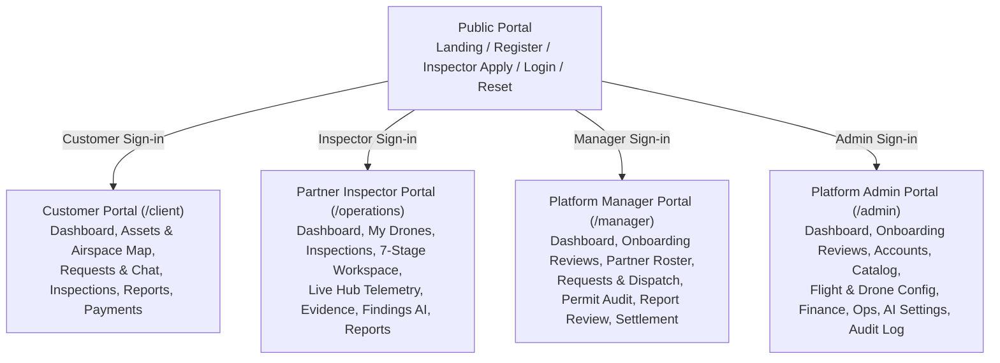

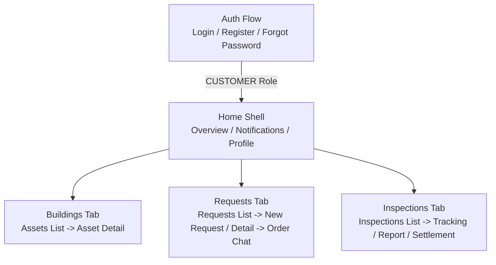

#### 3.1.2 Screen Descriptions

The tables below inventory every implemented interface across the Web Application (65 screens across Public, Customer, Inspector, Manager, and Admin portals) and the Customer Mobile Application (16 Flutter screens). Annotated user screenshots appear within each owning portal section (§3.2–§3.7).

**Web Application Screens**

| # | Feature | Screen | Portal / Role | Description |
| --- | --- | --- | --- | --- |
| 1 | — | Public Landing Page | Public | Service overview across MF1–MF4, capability highlights, and sign-in/sign-up entry points. |
| 2 | FE-01 | Customer Account Registration | Public | Customer administrator account creation form with password policy checks, email OTP modal, and link to Inspector application. |
| 3 | FE-01, FE-02 | Partner Inspector Application | Public | Three-step public onboarding application collecting personal identity, pilot-licence scan/metadata, and OTP confirmation. |
| 4 | FE-01 | User Sign-in | All Roles | Email/password, OTP, and Google OAuth2 sign-in page routing authenticated users to their single role portal. |
| 5 | FE-01 | Password Reset | All Roles | Self-service recovery flow dispatching an email one-time code before accepting a new policy-compliant password. |
| 6 | FE-01 | Customer Dashboard | `CUSTOMER` | Organization summary displaying building counts, active service requests, upcoming inspections, and payment notices. |
| 7 | FE-03 | Customer Buildings Inventory | `CUSTOMER` | Searchable and filterable register of organization buildings with status chips, dimensions, and inspection entry links. |
| 8 | FE-03 | New Building & Airspace Screening Form | `CUSTOMER` | Multi-field asset creation dialog seeded by building category and live Vietnam airspace screening. |
| 9 | FE-03 | Interactive Airspace Coordinate Picker | `CUSTOMER` | Interactive satellite/street map modal returning coordinates and advisory Clear/Restricted/NFZ classification. |
| 10 | FE-03 | Customer Building Detail | `CUSTOMER` | Building metadata, editable inspection checkpoints, photo gallery, and SHA-256 deduplicated reference documents. |
| 11 | FE-04 | Customer Service Requests | `CUSTOMER` | Tracked list of one-time and recurring requests showing current commercial lifecycle stage (`OPEN` to `ASSIGNED`). |
| 12 | FE-04 | Create Service Request Dialog | `CUSTOMER` | Request form enforcing the 20-day lead time in `Asia/Ho_Chi_Minh` and monthly recurrence cadence (`2–100` occurrences). |
| 13 | FE-04 | Customer Request Detail & Quote Acceptance | `CUSTOMER` | Four-stage commercial progress view showing versioned VND quotations, quote acceptance, signed contract PDF, and occurrences. |
| 14 | FE-04 | Customer Messages (Order & Mission Chat) | `CUSTOMER` | Shared messaging inbox switching between Manager order-negotiation threads and Inspector field-coordination threads. |
| 15 | FE-05 | Customer Inspections List | `CUSTOMER` | Organization inspections with stage status (`Scheduled`, `Field Completed`, `Published`) and fee/settlement links. |
| 16 | FE-05 | Customer Inspection Tracking | `CUSTOMER` | Occurrence progress view displaying planned schedule, flight permit status, and telemetry summary without internal drafts. |
| 17 | FE-07 | Customer Inspection Report Deliverable | `CUSTOMER` | Read-only official published report viewer (`v1+`) displaying AI Executive Summary, matched references, and confirmed findings. |
| 18 | FE-08 | Customer Report Acceptance & Settlement | `CUSTOMER` | Three-step closure wizard (`Accept Report -> Settle Fee -> Fulfilled`) with invoice breakdown, PDF notice, and PayOS/VNPay checkout. |
| 19 | FE-07 | Customer Reports Archive | `CUSTOMER` | Filtered register of finalized inspection deliverables available for PDF preview, download, and acceptance tracking. |
| 20 | FE-08 | Customer Payment History | `CUSTOMER` | Organization ledger of verified payments, gateway/manual references, amounts paid, and downloadable receipts. |
| 21 | FE-01 | Notifications Inbox | All Roles | Deduplicated in-app alerts with unread counters and deep links to the triggering request or inspection. |
| 22 | FE-01 | Account & Profile Settings | All Roles | Self-service profile editor, password change, active session revocation, and AI Vision fallback opt-out toggle. |
| 23 | FE-01 | Inspector Dashboard | `INSPECTOR` | Assigned flight queue summary, pilot-licence expiry reminders, and quick links to pending missions. |
| 24 | FE-02 | My Drones Registry | `INSPECTOR` | Owned aircraft inventory displaying approval status, serial numbers, registration expiry, capabilities, and document health. |
| 25 | FE-02 | Register / Update Owned Drone Dialog | `INSPECTOR` | Submission form for Decree 288 MTOW specifications, photos, configurable checklist items, and registration/ownership/inspection files. |
| 26 | FE-05 | Inspector Assigned Inspections | `INSPECTOR` | Filterable schedule of partner assignments with Accept/Decline actions and workspace launch buttons. |
| 27 | FE-04, FE-05 | Inspector Mission Messages | `INSPECTOR` | Dedicated inspection chat thread between the assigned Inspector and Customer with attachment support. |
| 28 | FE-05 | Inspector Workspace — Tracking | `INSPECTOR` | Seven-stage mission workspace header and lifecycle progress tracker. |
| 29 | FE-05 | Inspector Workspace — Flight Permit | `INSPECTOR` | Structured permit upload form (number, authority, validity dates, serial, max altitude) and Manager review status. |
| 30 | FE-05 | Inspector Workspace — Pre-flight Check | `INSPECTOR` | Configurable pre-flight safety checklist and mandatory site condition note required before starting a session. |
| 31 | FE-05 | Inspector Workspace — Field Session & Live Telemetry | `INSPECTOR` | Active session console connecting live MAVLink telemetry (`SmartDroneHub`), gimbal status, fallback SRT/CSV/KML/GPX log import, and manual declaration. |
| 32 | FE-05 | Inspector Workspace — Post-flight & Building Items | `INSPECTOR` | Post-flight checklist verification and per-checkpoint coverage confirmation prior to sealing `FIELD_COMPLETED`. |
| 33 | FE-06 | Inspector Workspace — Field Evidence | `INSPECTOR` | Direct photo intake, chunked 10 MiB resumable MP4 upload queue, evidence filter register, and integrated photo/video player. |
| 34 | FE-06 | Inspector Workspace — AI Defect Findings | `INSPECTOR` | Batch and per-image YOLO11 + Vision fallback analysis with confidence scores, bounding boxes, and Confirm/Edit/Remove controls. |
| 35 | FE-06 | Inspector Workspace — DroneKnowledgeAI Note & Standards | `INSPECTOR` | `Draft note with AI`, `Draft all notes`, confirmation filter chips, and collapsible `References` strip citing matched cases/standards. |
| 36 | FE-07 | Inspector Workspace — Report Authoring & AI Summary | `INSPECTOR` | Auto-compiled draft report (`SUBMITTED`), AI Executive Summary generator with matched cases/standards, PDF preview, and submit control. |
| 37 | FE-07 | Inspector Reports List | `INSPECTOR` | Assigned reports table displaying `DRAFT`, `SUBMITTED`, `RETURNED`, and `PUBLISHED` versions. |
| 38 | FE-08 | Inspector Earnings & Payout History | `INSPECTOR` | Completed mission settlement breakdown showing gross fee, platform commission deduction, TNCN tax, and payout status. |
| 39 | FE-01 | Manager Dashboard | `MANAGER` | Platform operations KPIs for claimed requests, permit audits, report reviews awaiting decision, and settlement queues. |
| 40 | FE-02 | Manager Onboarding & Compliance Reviews | `MANAGER` | Review queue for partner Inspector applications and Inspector-owned Drone registrations with Approve/Reject decisions. |
| 41 | FE-02 | Partner Inspectors Roster | `MANAGER` | Directory of approved partner Inspectors with pilot-licence classes, expiries, linked eligible drones, and reliability counts. |
| 42 | FE-03 | Manager Buildings Directory | `MANAGER` | Cross-organization building register accessible for commercial scoping and field coordination. |
| 43 | FE-04 | Manager Service Requests Queue | `MANAGER` | Incoming customer request queue with unassigned Claim action and 4-stage commercial progress tracking. |
| 44 | FE-04 | Manager Quotation, Contract & Occurrence Dispatch | `MANAGER` | VND quote editor, offline signed-paper contract upload, recurring/single occurrence crew eligibility check, and dispatch trigger. |
| 45 | FE-04 | Manager Messages (Order Chat) | `MANAGER` | Assigned request negotiation inbox connecting Platform Manager with Customer organizations. |
| 46 | FE-05 | Manager Inspections Governance List | `MANAGER` | Cross-organization monitoring table displaying assignment acceptance, permit status, session progress, and abort recovery. |
| 47 | FE-05 | Manager Workspace — Permit Audit & Flight Trace | `MANAGER` | Independent Flight Permit Approve/Reject panel, flown telemetry report summary, and GPS flight trace audit. |
| 48 | FE-07 | Manager Reports Review Queue | `MANAGER` | Filterable report queue highlighting `SUBMITTED` reports requiring non-author independent publication or return. |
| 49 | FE-07 | Manager Workspace — Independent Report Review | `MANAGER` | Side-by-side submitted report, findings evidence, AI Executive Summary, and Publish / Return-with-Reason controls. |
| 50 | FE-08 | Manager Workspace — Partner Settlement & Refunds | `MANAGER` | Verified customer payment summary, Inspector payout disbursement recording, multi-part refund allocation, and receivable recovery. |
| 51 | FE-08 | Manager Platform Revenue & Commissions | `MANAGER` | Platform financial ledger aggregating customer inflows, earned commissions, VAT/TNCN taxes, and partner payouts. |
| 52 | FE-01 | Admin Dashboard | `ADMIN` | Platform-wide governance metrics for user accounts, compliance queues, total assets, and recent audit activity. |
| 53 | FE-02 | Admin Onboarding & Customer Airspace Reviews | `ADMIN` | Full 3-tab compliance review console adding Restricted-Airspace Customer pre-registrations alongside Inspector & Drone queues. |
| 54 | FE-01, FE-02 | Admin Platform Accounts Directory | `ADMIN` | User lifecycle directory across all four canonical roles (`ADMIN`, `MANAGER`, `CUSTOMER`, `INSPECTOR`) with status controls. |
| 55 | FE-01 | Create / Provision Platform Account Dialog | `ADMIN` | Modal for provisioning internal Managers/Admins or managing account activation and password-reset requirements. |
| 56 | FE-02, FE-03 | Admin Building Asset Catalog | `ADMIN` | Master maintenance of the six in-scope building categories and seeded default inspection checkpoints. |
| 57 | FE-02, FE-03 | Edit Building Asset Category Dialog | `ADMIN` | Category editor specifying VN/EN labels, structure type metadata, and default inspection item templates (`TELECOM_ROOFTOP_TOWER`, etc.). |
| 58 | FE-02, FE-05 | Admin Flight & Drone Config — Required Documents | `ADMIN` | Configures mandatory/optional drone registration document rules plus configurable pre-flight and post-flight checklists. |
| 59 | FE-02 | Admin UAV Pilot Licence Classes | `ADMIN` | Configures pilot-licence class tiers mapped to Decree 288/2025/ND-CP weight eligibility gates. |
| 60 | FE-08 | Admin Finance Governance Settings | `ADMIN` | Maintains global platform commission rate (`15%`), VAT (`10%`), TNCN rate, and overdue payment deadline rules. |
| 61 | FE-04, FE-05 | Admin Operations Governance Settings | `ADMIN` | Configures the assignment acceptance timeout window (`1–720` hours, default `24` hours) and operational thresholds. |
| 62 | FE-06 | Admin AI Inference Settings | `ADMIN` | Configures YOLO11 confidence auto-confirm threshold (default `70%` from `V63`) and Vision LLM fallback policy. |
| 63 | FE-04 | Admin Service Request Governance | `ADMIN` | Read-only commercial overview allowing `ADMIN` to assign, reassign, or unassign `MANAGER` ownership on requests. |
| 64 | FE-03 | Admin Platform-Wide Buildings Registry | `ADMIN` | Cross-tenant building catalog view for airspace governance and inspection readiness oversight. |
| 65 | FE-01 | Admin Activity & Audit Logs | `ADMIN` | Append-only attributable trail of security, onboarding, configuration, permit, and report-publication decisions. |

**Mobile Application Screens (Customer App)**

| # | Feature | Screen | Route | Description |
| --- | --- | --- | --- | --- |
| 1 | FE-01 | Customer Mobile Sign-in | `#/login` | Email/password, OTP, and Google sign-in entry restricted exclusively to `CUSTOMER` accounts on mobile. |
| 2 | FE-01 | Customer Mobile Registration | `#/register` | Mobile customer organization registration screen with password validation and email OTP check. |
| 3 | FE-01 | Mobile Forgot Password | `#/forgot-password` | OTP-backed password recovery flow for mobile Customer accounts. |
| 4 | FE-01 | Mobile Home Dashboard | `#/home` | Summary cards displaying registered buildings, active service requests, scheduled inspections, and quick navigation tiles. |
| 5 | FE-01 | Mobile Notifications Inbox | `#/notifications` | Real-time notification feed with unread badges and deep links to requests and inspection deliverables. |
| 6 | FE-03 | Mobile Buildings List | `#/assets` | Organization building cards displaying airspace status, structure height, footprint, and active inspection badge. |
| 7 | FE-03 | Mobile Building Detail | `#/assets/:id` | Detailed building coordinates, configured checkpoints list, photos, and uploaded technical reference documents. |
| 8 | FE-04 | Mobile Service Requests List | `#/requests` | Customer request tracker grouped by status (`OPEN`, `QUOTED`, `ACCEPTED`, `CONTRACT_SIGNED`, `ASSIGNED`). |
| 9 | FE-04 | Mobile New Service Request | `#/requests/new` | One-time or monthly recurring request builder enforcing the 20-day minimum lead date. |
| 10 | FE-04 | Mobile Service Request Detail | `#/requests/:id` | Quotation breakdown (`VND`), one-tap quote acceptance, signed contract status, and scheduled occurrences. |
| 11 | FE-04 | Mobile Request Order Chat | `#/requests/:id/chat` | Interactive messaging timeline between Customer and Platform Manager with attachment preview. |
| 12 | FE-05 | Mobile Inspections List | `#/inspections` | Scheduled, in-progress, field-completed, and published inspections scoped to the Customer's organization. |
| 13 | FE-05 | Mobile Inspection Tracking Tab | `#/inspections/:id` | Read-only flight progress milestones, permit readiness badge, and session completion timeline. |
| 14 | FE-07 | Mobile Inspection Report Tab | `#/inspections/:id` | Published report (`v1+`) reader with AI Executive Summary, Matched Cases & Standards strip, and PDF download. |
| 15 | FE-08 | Mobile Inspection Settlement Tab | `#/inspections/:id` | Invoice breakdown, Report Acceptance / Request Clarification buttons, and PayOS VietQR / VNPay checkout launch. |
| 16 | FE-01 | Mobile Profile & Security Settings | `#/profile` | Signed-in customer profile summary, language/locale toggle, AI vision fallback preference, and sign-out action. |

#### 3.1.3 Screen Authorization

The matrices below define route and screen visibility enforced by `accessPolicy.ts` on the web client and GoRouter on Flutter mobile alongside backend controller guards. A visible screen never by itself grants authority: organization ownership, work assignment, pilot/drone qualification, and separation of duties are enforced server-side on every API call.

**Web Application Screen Authorization**

| Screen / Portal Module | `ADMIN` | `MANAGER` | `CUSTOMER` | `INSPECTOR` |
| --- | :---: | :---: | :---: | :---: |
| Public landing, customer registration, inspector application | X | X | X | X |
| Sign-in, password reset, notifications, profile settings | X | X | X | X |
| Dashboard (`Overview`) | X | X | X | X |
| Onboarding reviews (Customer Airspace / Inspector / Drone) | X | X |  |  |
| Platform accounts management | X |  |  |  |
| Partner inspectors roster |  | X |  |  |
| Building asset catalog, UAV licence classes, Drone & Flight config | X |  |  |  |
| Platform Finance, Operations & AI settings; Activity Audit Log | X |  |  |  |
| Service requests (Customer create/accept; Manager quote/dispatch; Admin reassign manager) | X | X | X |  |
| Messages (Order chat & Per-inspection chat) |  | X | X | X |
| Buildings registry (Customer manage own; Manager/Admin view scoped) | X | X | X |  |
| Inspections & inspection workspace (`permit` / `field-session` / `findings` / `report` / `review` / `settlement`) | X | X | X | X |
| Reports archive & downloadable official report | X | X | X | X |
| My drones fleet & registration |  |  |  | X |
| Payment history / Platform revenue & commissions |  | X | X | X |
| Query All Data (platform-wide or managed customer scope) | X | X |  |  |
| Query Own Data (own organization or assigned occurrences only) |  |  | X | X |

`Query All Data` authorizes platform-level or multi-customer visibility bounded by Manager claim ownership (`BR-30`) and separation of duties (`BR-17`, `BR-19`). `Query Own Data` strictly restricts `CUSTOMER` to its own organization and `INSPECTOR` to its own assigned occurrences and owned drones.

**Mobile Application Screen Authorization (`CUSTOMER` Only)**

| Mobile Screen Module | `CUSTOMER` | `ADMIN` | `MANAGER` | `INSPECTOR` |
| --- | :---: | :---: | :---: | :---: |
| Authentication (`#/login`, `#/register`, `#/forgot-password`) | X | — | — | — |
| Home shell, Notifications, Profile & Security (`#/home`, `#/notifications`, `#/profile`) | X | — | — | — |
| Buildings inventory & detail (`#/assets`, `#/assets/:id`) | X | — | — | — |
| Service requests, quote acceptance & order chat (`#/requests*`) | X | — | — | — |
| Inspections tracking, published report & PayOS/VNPay settlement (`#/inspections*`) | X | — | — | — |
| Query Own Data (owning customer organization scope only) | X | — | — | — |

#### 3.1.4 Non-Screen Functions

These capabilities have no dedicated screen of their own; they run inside a user action, on a schedule, or in response to a domain event.

| # | Feature | System Function | Description |
| --- | --- | --- | --- |
| 1 | FE-01 | Airspace position screening | Compares a building's coordinates with the configured airspace zones and returns a prohibited, review-required, or clear outcome. |
| 2 | FE-01 | One-time-code issue and verify | Issues and validates short-lived codes for registration, sign-in, and password reset, with per-IP rate limiting. |
| 3 | FE-01 | Session issuance and refresh rotation | Issues access and refresh credentials, rotates the refresh token, and records the prior hash so a replayed token can be detected. |
| 4 | FE-02 | Pilot-licence expiry sweep | A scheduled job that flags Inspectors whose licence has lapsed and notifies them and the platform. |
| 5 | FE-03 | Building-inspection item seeding | Generates the default inspection checkpoints for a building from its category on registration. |
| 6 | FE-04 | Occurrence materialization | Creates the individual inspection occurrences covered by an accepted recurring agreement. |
| 7 | FE-03 | Duplicate-notification suppression | Deduplicates lifecycle notices so a retried event does not produce a second notice. |
| 8 | FE-04 | Schedule-conflict detection | Detects overlapping Inspector or drone commitments across all customer organizations before assignment. |
| 9 | FE-04 | Quotation validity evaluation | Revalidates pilot licence and drone registration against every scheduled occurrence before a quote is saved or accepted. |
| 10 | FE-05 | Permit verification reset | Returns an approved permit to pending review when the drone is changed or the schedule moves outside the permit window. |
| 11 | FE-05 | Inspection lifecycle monitor | A scheduled job that advances or flags occurrences whose scheduled window has passed without the expected session activity. |
| 12 | FE-05 | Flight-log import and normalisation | Parses an imported SRT, CSV, KML, or GPX log and normalises available position, time, altitude, speed, heading, and battery values, marking absent fields as unavailable. |
| 13 | FE-06 | Image normalization and thumbnailing | Extracts available capture metadata, normalises oversized or rotated photographs, and generates a thumbnail alongside the original. |
| 14 | FE-06 | Asynchronous video processing | Transcodes a resumable video upload into a bounded H.264 rendition with a poster image, retaining the source until both outputs are verified. |
| 15 | FE-06 | Duplicate evidence disambiguation | Detects a repeated filename in an inspection and saves it with a sequential suffix rather than rejecting the upload. |
| 16 | FE-06 | Candidate defect inference | Runs the self-hosted detection model over evidence and records candidate defects with model name and confidence. |
| 17 | FE-07 | Advisory narrative drafting | Sends the confirmed inspection context to the language model once and stores the returned narrative as clearly labelled advisory draft text. |
| 18 | FE-07 | Structured report compilation | Compiles the inspection report from a fixed schema of numbered sections and confirmed findings; official report content is not model-generated. |
| 19 | FE-08 | Payment gateway callback verification | Verifies the signature of a PayOS or VNPay callback before treating a payment as settled. |
| 20 | FE-08 | Invoice and settlement derivation | Derives the service invoice, Inspector payout eligibility, commission, and tax components from a verified payment. |

#### 3.1.5 Entity Relationship Diagram

The persisted model comprises 45 application tables (44 JPA runtime entity tables; 47 total tables in `public` including `event_publication` and `flyway_schema_history`) applied as a consolidated `V1` baseline plus forward migrations `V2`, `V3`, `V4`, and `V60`–`V65`. The `pgvector` extension backs the `DroneKnowledgeAI` case and standard stores. The diagram shows the principal entities and their relationships; reporting-only helpers such as audit, outbox, session, and configuration tables are omitted for legibility but are described in Report 4 §2.

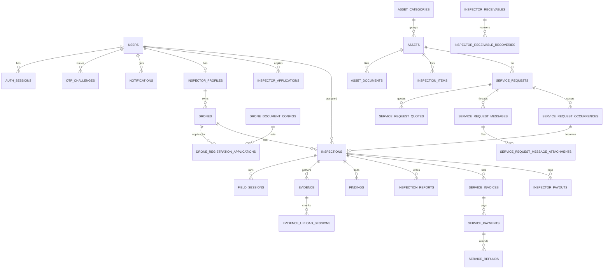

**Entities Description**

| # | Entity | Description |
| --- | --- | --- |
| 1 | `users` | Platform account with exactly one role, lockout and one-time-code state, and a per-user preference controlling whether advisory inference fallback may be used. |
| 2 | `auth_sessions` | Refresh session for a signed-in client, recording the current and previous refresh-token hashes so rotation and replay can be detected. |
| 3 | `otp_challenges` | Short-lived one-time code for registration, sign-in, or password reset, with attempt count and expiry. |
| 4 | `audit_events` | Attributable record of an important decision: actor, action, subject, prior and new status, trace identifier. |
| 5 | `prospective_customer_registrations` | Pre-account customer application holding organization identity, initial building, and the airspace review outcome. |
| 6 | `pilot_license_classes` | Catalogue of pilot-licence classes used to qualify an Inspector for an aircraft weight category. |
| 7 | `event_publication` | Transactional outbox row for a domain event awaiting publication to a listener. |
| 8 | `asset_categories` | Catalogue of building categories; only active building categories are offered when a Customer registers an asset. |
| 9 | `assets` | Customer-owned building with location, structural profile, and lifecycle state. |
| 10 | `asset_documents` | Reference document attached to a building, stored by object key with a checksum. |
| 11 | `inspection_items` | Individual inspection checkpoint defined for a building. |
| 12 | `checklist_templates` | Configurable pre-flight and post-flight checklist row. |
| 13 | `drones` | Registered aircraft with a single ownership scope, weight category, and serviceability state. |
| 14 | `drone_document_configs` | Administrator-configured set of documents an Inspector must supply for drone registration. |
| 15 | `drone_feature_configs` | Administrator-configured catalogue of drone features and safety checklist items. |
| 16 | `drone_registration_applications` | Inspector drone registration or renewal submission with its documents and review outcome. |
| 17 | `inspections` | Inspection occurrence: lifecycle status, assignment, flight-permit block, and schedule. |
| 18 | `field_sessions` | On-site session with telemetry source, flight trace, and computed flight metrics. |
| 19 | `evidence` | Photograph or video evidence with processing state, storage keys, and its source-video lineage. |
| 20 | `evidence_upload_sessions` | State of a resumable chunked upload for a large video. |
| 21 | `findings` | Confirmed or candidate building defect with its bounding region and the model confidence where applicable. |
| 22 | `inspection_reports` | Versioned inspection report with its status, return reason, and advisory summary. |
| 23 | `inspector_reliability_events` | Assignment and field reliability signal recorded against an Inspector. |
| 24 | `reinspection_defect_verifications` | Verification outcome recorded when a defect is re-examined in a later inspection. |
| 25 | `service_requests` | One-time or recurring inspection request raised for a building, with its owner customer and assigned Manager. |
| 26 | `service_request_quotes` | VND quotation stating scope, timing, price per occurrence, and required drone features; partner assignment is recorded later at dispatch. |
| 27 | `service_request_occurrences` | Individual occurrence covered by a request, carrying its own schedule and delivery state. |
| 28 | `service_request_messages` | Order-chat message exchanged between the Customer and the assigned Manager. |
| 29 | `service_request_message_attachments` | File attached to an order-chat message. |
| 30 | `inspection_messages` | Per-inspection chat between the assigned inspector and the customer, separate from the commercial order thread. |
| 31 | `inspection_message_attachments` | Private inspection-chat attachment metadata with MIME type, size, and checksum. |
| 32 | `service_invoices` | Service invoice derived from an accepted occurrence. |
| 33 | `service_payments` | Customer payment against an invoice, including refunded amount and refund state. |
| 34 | `service_refunds` | Refund allocation across Inspector payout reduction, platform commission, VAT, personal income tax, and platform absorption. |
| 35 | `inspector_payouts` | Amount payable to an Inspector following verified customer payment. |
| 36 | `inspector_receivables` | Amount owed back by an Inspector after a refund against an already-disbursed payout. |
| 37 | `inspector_receivable_recoveries` | Recorded recovery of an Inspector receivable. |
| 38 | `inspection_finance_settings` | Singleton rates for platform commission, VAT, and personal income tax. |
| 39 | `inspector_applications` | Public partner Inspector application with identity, licence details, and review outcome. |
| 40 | `inspector_profiles` | Approved Inspector profile holding licence data and partner status. |
| 41 | `inspector_flight_logs` | Intake record for an imported flight log, including non-MAVLink source formats. |
| 42 | `notifications` | In-app or email notice with its deduplication key and read state. |
| 43 | `platform_ai_settings` | Singleton inference configuration holding the auto-confirm flag and its confidence threshold (`default: 70.00` since `V63`, lowered from `85.00`). |
| 44 | `platform_operations_settings` | Singleton operations settings, including assignment acceptance timeout and dispatch defaults. |
| 45 | `inspection_knowledge_chunks` | Stores the eight seeded engineering-standard/guideline chunks that ground `DroneKnowledgeAI` (`V62`, updated to `vector(384)` by `V65`): standard code, title, asset-category code, defect patterns, severity, guidance text, reference URL, and a `vector(384)` embedding with an HNSW `vector_cosine_ops` index for cosine retrieval via local `fastembed`. |
| 46 | `historical_finding_cases` | Stores six anonymized benchmark cases and confirmed findings backfilled (`V64`) and indexed automatically at report publication (`V62`, updated to `vector(384)` by `V65`), with organization/asset references, defect label, severity, notes, outcome (including re-inspection resolution status), anonymized flag, and a `vector(384)` embedding; retrieval is tenant-isolated and excludes the current inspection. |

The model separates four coordinated areas. **Identity and onboarding** covers accounts, sessions, one-time codes, the two application records, and the building catalogue. **Commercial** covers the request, its quotation, its negotiation messages, its occurrences, and the recorded agreement. **Inspection** covers the occurrence, its field sessions and flight logs, its evidence and upload sessions, its findings, and its report versions. **Finance** covers the invoice, the customer payment, the Inspector payout, refunds with their allocations, receivables and their recovery, and the settings that parameterize the split.

---

### 3.2 Web Application — Public & Authentication

The public entry portal (`FE-01`, `FE-02`) admits customer organizations and partner inspector applicants while enforcing OTP identity verification, airspace pre-screening, and role-based portal redirection.

#### 3.2.1 Public Landing and Customer Registration (`FE-01`)
- **Function trigger**: A visitor opens the public landing page, submits customer organization registration, or switches to partner inspector onboarding.
- **Actors**: Public visitor, prospective Customer, Automated Identity Service.
- **Requirements**:
  - The customer registration screen (`/register`) validates the administrator's full name, email uniqueness, phone format, organization name/code, and strong password policy, followed by email OTP modal verification (`otp_challenges`).
  - Following sign-in, Customer airspace screening and initial building registration run through the Customer portal (`§3.3.2`) or prospective restricted-zone screening queued for `ADMIN` onboarding review (`prospective_customer_registrations`).
  - Password failures are rate-limited (`5` consecutive failed attempts trigger a 15-minute lockout) and OTP/sign-in endpoints are throttled per client address.
- **Normal cases**: Customer completes registration, verifies OTP, and signs in directly to `/client/dashboard`.
- **Abnormal cases**: Duplicate organization email/code, expired/reused OTP, or weak passwords are rejected with `MSG` feedback.

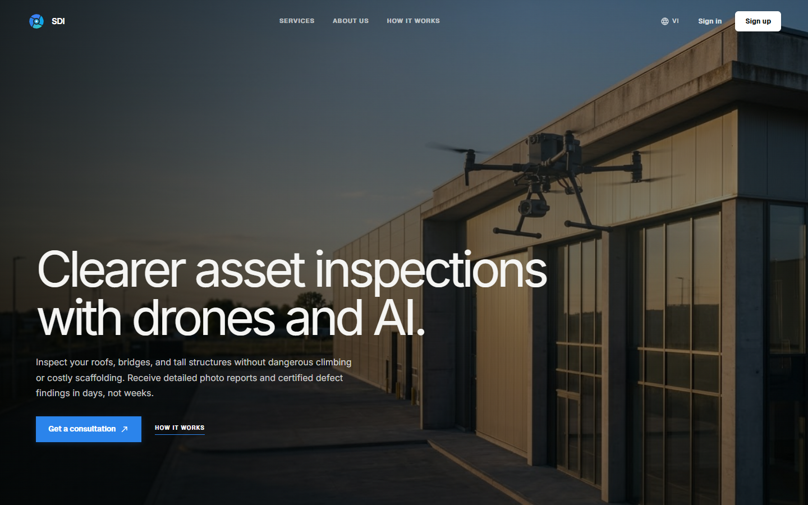

*Figure 7.3.1 — Public landing page presenting inspection workflows and Sign in / Sign up entry points.*

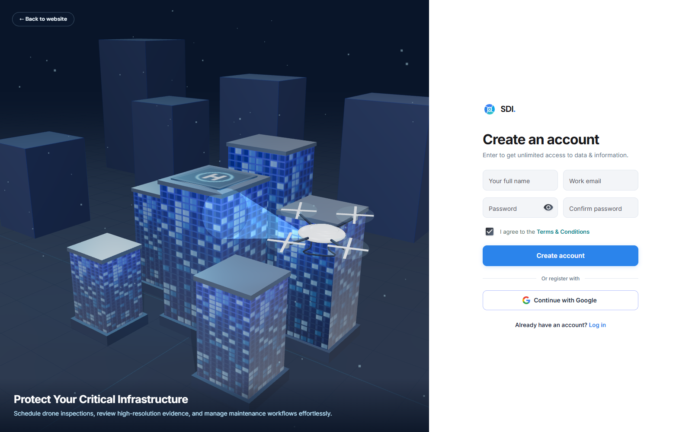

*Figure 7.3.2 — Customer organization and administrator registration form with OTP verification and link to partner inspector onboarding.*

#### 3.2.2 Partner Inspector Application (`FE-01`, `FE-02`)
- **Function trigger**: A prospective drone inspector opens `/register-inspector` and submits an application with pilot-licence evidence.
- **Actors**: Public applicant, `ADMIN`, `MANAGER`.
- **Requirements**:
  - The three-step application collects account credentials, national ID (`CCCD`), address, pilot-licence number/class/expiry, and a scanned licence file without immediately provisioning an active account.
  - Duplicate emails against existing accounts or open applications are rejected; drone ownership is optional at application time.
  - Only an attributable `ADMIN` or `MANAGER` approval provisions the `INSPECTOR` account and initial `inspector_profiles` record (`§3.5.1`, `§3.6.1`).
- **Normal cases**: Applicant completes all 3 steps including OTP confirmation and enters `PENDING` review.
- **Abnormal cases**: Missing licence scan, past expiry date, unrecognized licence class, or duplicate email blocks submission.

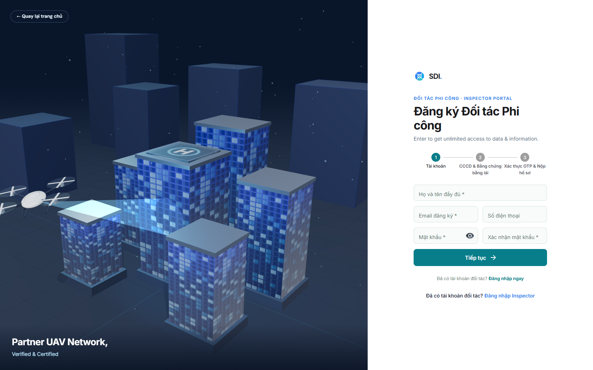

*Figure 7.3.3 — Three-step public Partner Inspector onboarding form collecting account, licence scan, and OTP confirmation.*

#### 3.2.3 User Sign-in, OTP and Password Reset (`FE-01`)
- **Function trigger**: An existing user signs in via credentials, OTP challenge, or Google OAuth2, or resets a forgotten password.
- **Actors**: `CUSTOMER`, `INSPECTOR`, `MANAGER`, `ADMIN`.
- **Requirements**:
  - Recognized roles are strictly `ADMIN`, `MANAGER`, `CUSTOMER`, and `INSPECTOR`; each account holds exactly one canonical role and routes exclusively to its matching portal (`/admin`, `/manager`, `/client`, `/operations`).
  - Password reset dispatches a short-lived OTP challenge before accepting a new password and revoking stale refresh tokens (`auth_sessions`).
- **Normal cases**: Verified user authenticates via password, OTP, or Google SSO and enters the authorized workspace.
- **Abnormal cases**: Five invalid password attempts trigger lockout; unapproved/suspended accounts cannot authenticate.

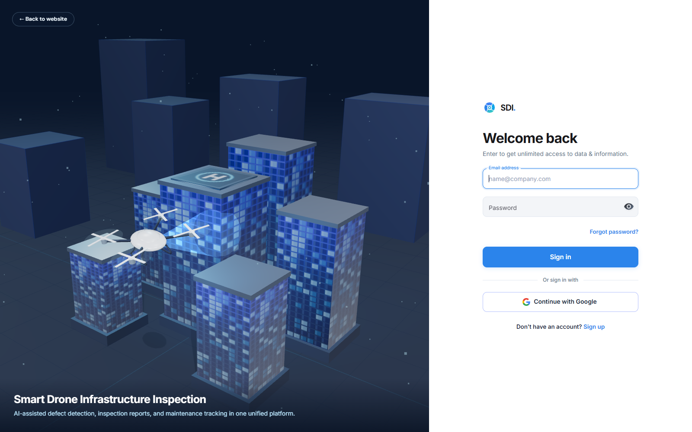

*Figure 7.3.4 — Platform sign-in page with email/password, OTP path, and Google OAuth2 SSO.*

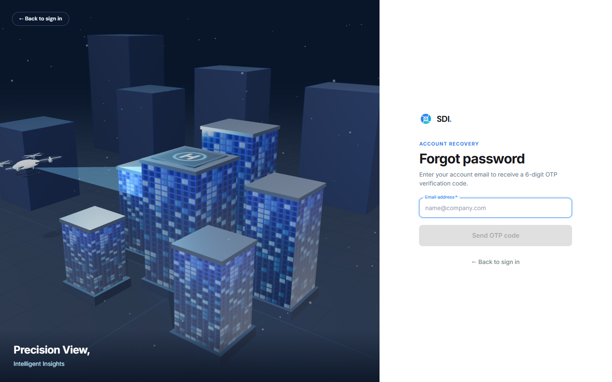

*Figure 7.3.5 — OTP-verified password recovery screen enforcing password policy.*

---

### 3.3 Web Application — Customer Portal

The Customer portal (`/client`, `CUSTOMER` role) scopes all reads and mutations strictly to the signed-in user's organization (`Query Own Data`), covering building registration with airspace screening, one-time/recurring inspection requests, negotiations, live inspection tracking, official report review, and PayOS VietQR / VNPay settlement.

#### 3.3.1 Customer Dashboard, Notifications and Account Settings (`FE-01`)
- **Function trigger**: Customer lands on `/client/dashboard`, opens `/client/notifications`, or updates profile/security settings in `/client/settings`.
- **Actors**: `CUSTOMER`, Automated System.
- **Requirements**:
  - Dashboard summarizes active buildings, requests in flight, scheduled/published inspections, and pending invoices.
  - Notifications are deduplicated per domain event (`notifications`) with deep links and read toggles.
  - Account settings permit updating full name, phone number, password, session revocation, and opting out of Vision LLM fallback on findings (`BR-44`); email and role stay immutable.
- **Normal cases**: Customer monitors alerts, opens target inspections, and maintains profile security.
- **Abnormal cases**: Cross-organization resource identifiers return not-found or forbidden; invalid current password blocks password update.

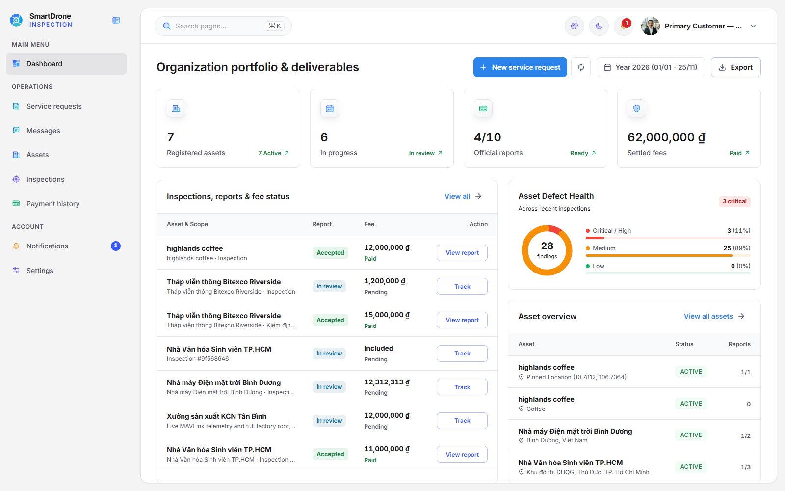

*Figure 7.3.6 — Customer organization dashboard showing active buildings, inspection pipeline KPIs, and recent notices.*

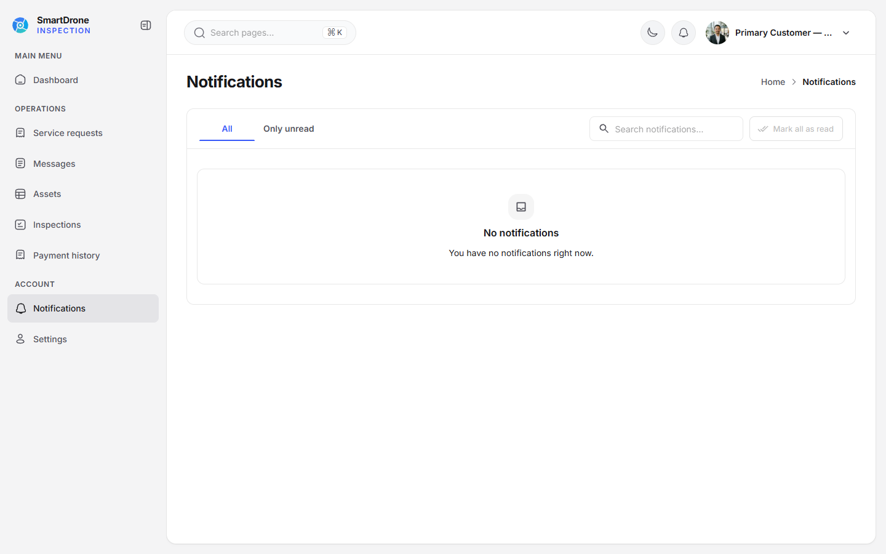

*Figure 7.3.7 — Deduplicated in-app notification center with unread state and direct deep links.*

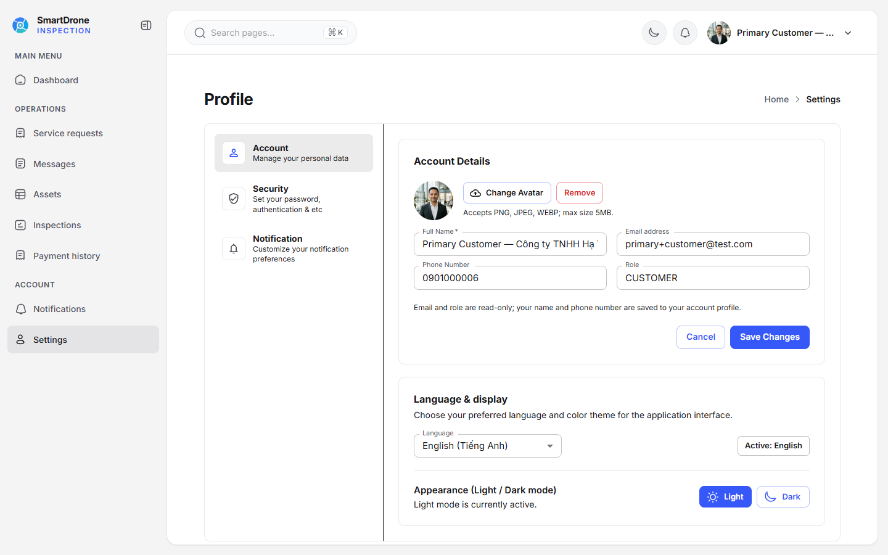

*Figure 7.3.8 — Self-service profile, password security, session management, and preferences page.*

#### 3.3.2 Building Inventory, Airspace Screening and Asset Details (`FE-03`)
- **Function trigger**: Customer views `/client/assets`, opens **New asset** with live map coordinate screening, or edits checkpoints/documents on a building detail view.
- **Actors**: `CUSTOMER`, `ADMIN`, `MANAGER`.
- **Requirements**:
  - Only the six platform-managed building categories (`asset_categories`) may be chosen; initial inspection checkpoints (`inspection_items`) seed automatically from the chosen category.
  - Selecting coordinates via the interactive map dialog runs backend Vietnam airspace evaluation: **No-Fly Zone** coordinates block creation (`409` / error), **Restricted Zone** coordinates flag review, and **Clear Zone** allows activation. Screening is advisory and does not confer legal aviation clearance (`BR-01`).
  - Building reference documents compute SHA-256 checksums and reject duplicate byte uploads within the same building. Retiring a building preserves history while blocking new requests.
- **Normal cases**: Customer pins building coordinates on the airspace map, saves an active building, adjusts checkpoints, and uploads PDF/image blueprints.
- **Abnormal cases**: Out-of-domain category, duplicate asset code within the organization, duplicate document SHA-256, or prohibited NFZ coordinates are rejected.

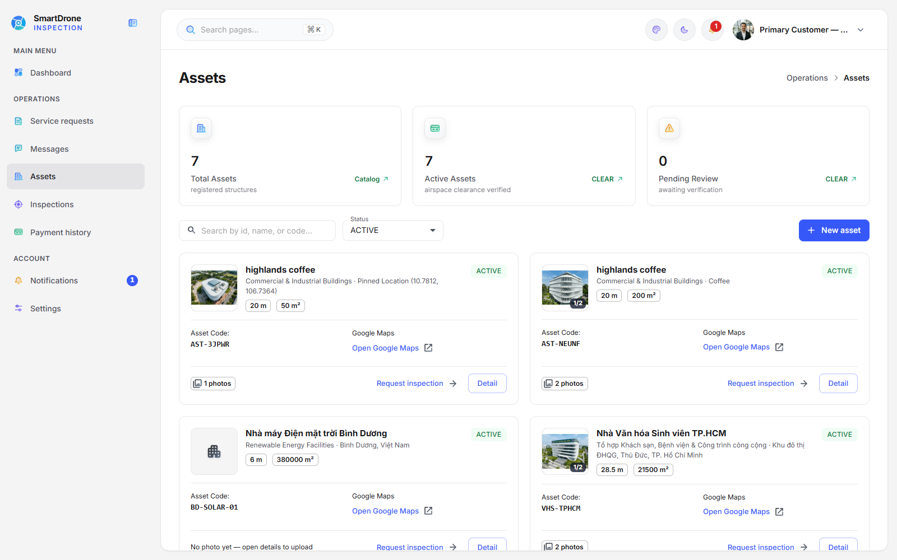

*Figure 7.3.9 — Customer building inventory (`Assets`) displaying status filter, airspace clear badge, building cards, and inspection shortcuts.*

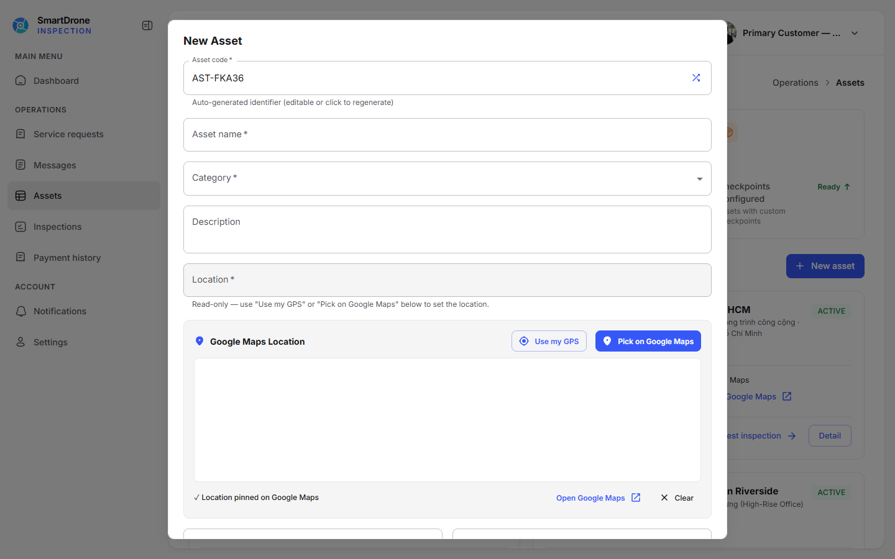

*Figure 7.3.10 — New building dialog integrating category selection, structural dimensions, and airspace screening inputs.*

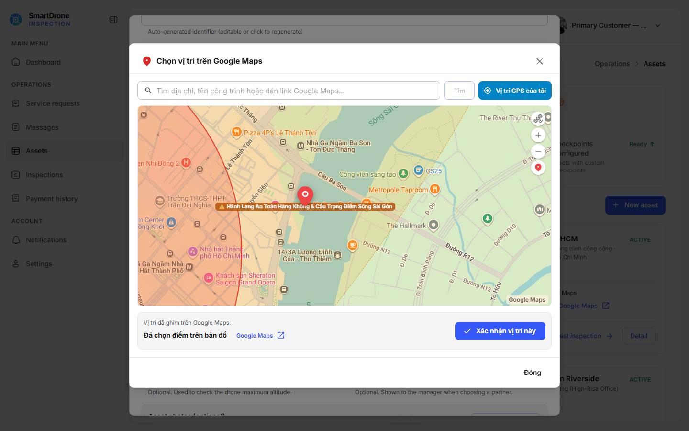

*Figure 7.3.11 — Interactive Vietnam airspace coordinate screening modal returning Clear, Restricted, or No-Fly Zone evaluation.*

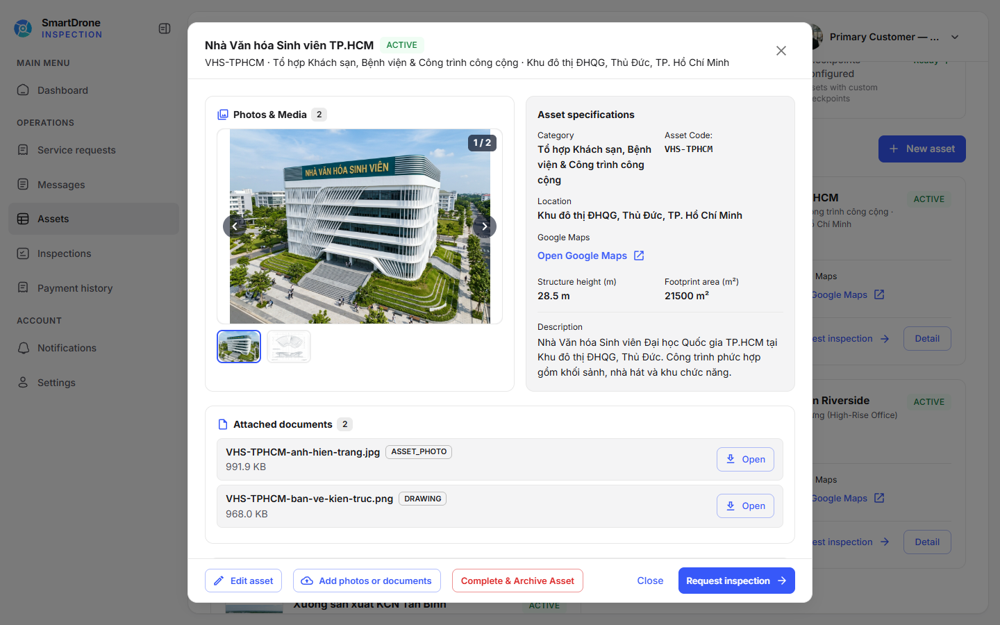

*Figure 7.3.12 — Building detail dialog presenting inspection checkpoints (`ITEM-01`+), photo gallery, and reference documents.*

#### 3.3.3 Service Requests, Quotations and Order Chat (`FE-04`)
- **Function trigger**: Customer creates a one-time or recurring request in `/client/contracts`, negotiates via `/client/messages`, or reviews/accepts a VND quotation.
- **Actors**: `CUSTOMER`, `MANAGER`.
- **Requirements**:
  - Requests enforce a minimum 20-day lead time (`Asia/Ho_Chi_Minh`), block duplicate active requests on the same non-retired building (unless creating a `RE_INSPECTION` via `sourceInspectionId`), and accept `1–120` month intervals with `2–100` occurrences on recurring requests.
  - Only the Customer may accept the active versioned VND quotation (`quoteRowVersion`), locking commercial scope, unit price, and anchor date; Manager chat messages cannot substitute for formal quotation acceptance (`BR-29`).
  - Real-time order chat supports file attachments between Customer and the claimed Manager; per-inspection chat switches to the assigned Inspector.
- **Normal cases**: Customer submits a request, clarifies timing/scope in Order Chat, accepts the active VND quote, and views materialized occurrences plus signed paper contract PDF.
- **Abnormal cases**: First date inside 20 days, multi-day window on `ONE_TIME` requests, stale `quoteRowVersion`, or duplicate active requests on the same building are refused.

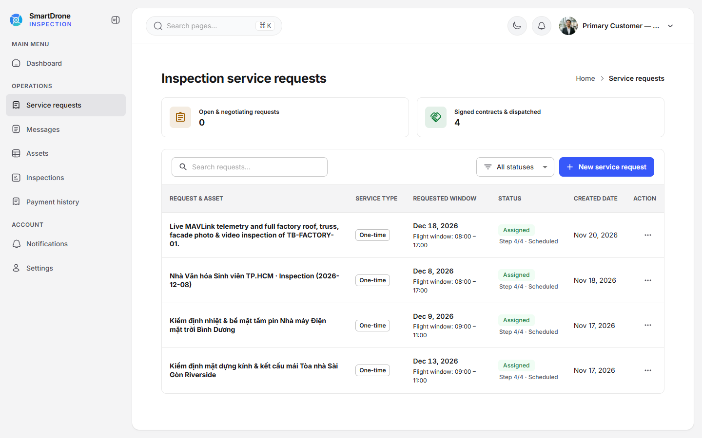

*Figure 7.3.13 — Customer service request list showing workflow progression badges across commercial and dispatch states.*

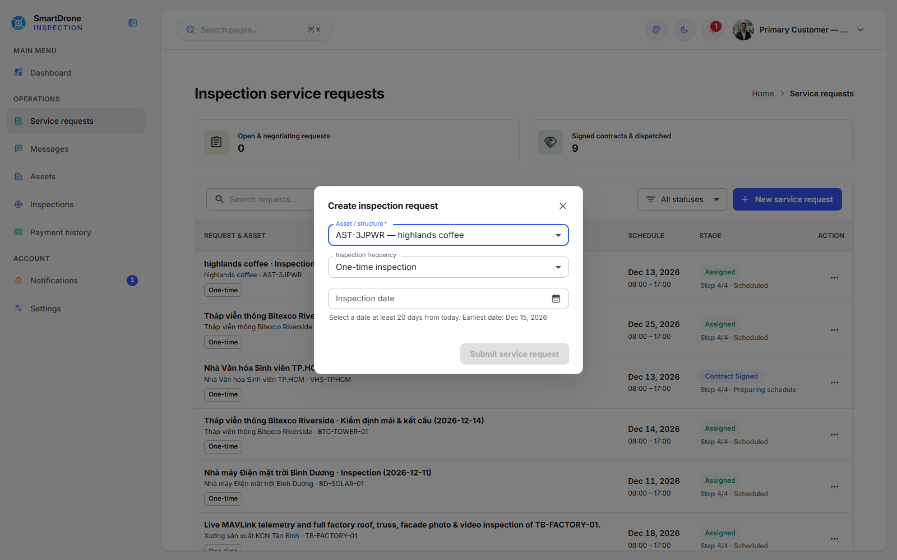

*Figure 7.3.14 — Create service request dialog configuring target building, 20-day lead date, flight hours, and recurrence cadence.*

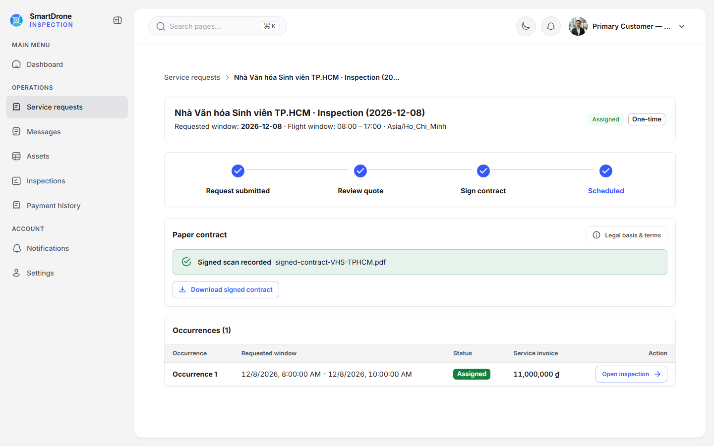

*Figure 7.3.15 — Customer request detail showing four commercial milestones, VND quotation terms, signed contract scan, and occurrences.*

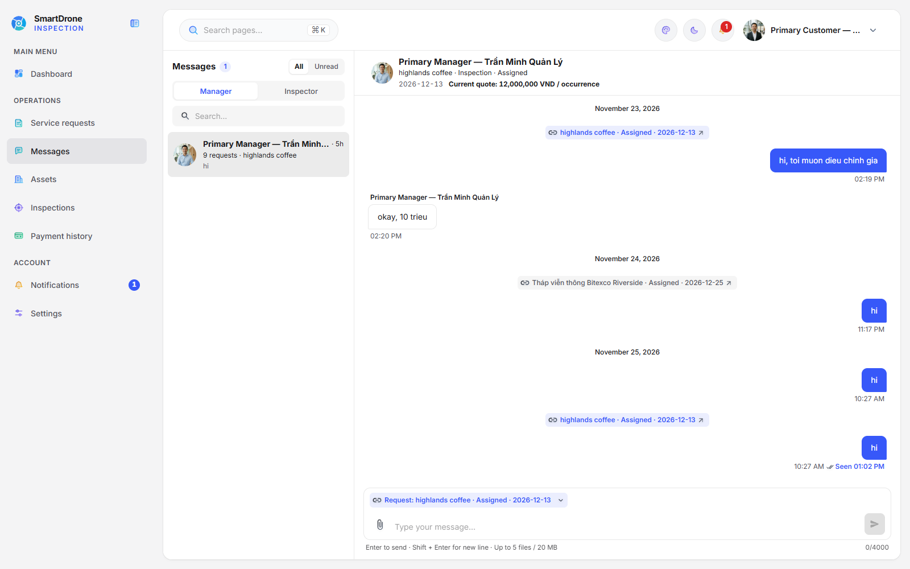

*Figure 7.3.16 — Customer messaging portal toggling between Manager order negotiation threads and Inspector mission chats.*

#### 3.3.4 Inspection Tracking, Official Reports and Settlement (`FE-05`, `FE-07`, `FE-08`)
- **Function trigger**: Customer tracks scheduled/completed inspections (`/client/inspections`), reads an immutable published report, requests clarification or accepts it, and settles payment via PayOS VietQR or VNPay.
- **Actors**: `CUSTOMER`, `MANAGER`, Payment Service (PayOS / VNPay).
- **Requirements**:
  - Customers view only `PUBLISHED` report versions (`inspection_reports`), accompanied by the AI Executive Summary and confirmed evidence/findings; internal `DRAFT`, `SUBMITTED`, and `RETURNED` states remain hidden (`BR-19`, `BR-20`).
  - Before acceptance, only the owning Customer may submit a clarification request (returning the report for revision). Accepting the published report starts the payment due window (default 15 days).
  - Checkout via PayOS VietQR or VNPay verifies cryptographic webhook/callback signatures (`BR-41`) before marking payment `PAID`; overdue notices never revoke report access or mutate payment status automatically.
  - Internal PDF Payment Notice (post-acceptance) and Payment Receipt (post-payment) downloads remain scoped to the owning organization.
- **Normal cases**: Customer previews the official published report, clicks **Accept official report**, pays via PayOS VietQR/VNPay (or authorized corporate wire), and archives receipts in `/client/finance-history`.
- **Abnormal cases**: Viewing an unpublished report, forging a gateway callback signature, double-paying an already settled invoice, or accessing another organization's PDF receipt is rejected.

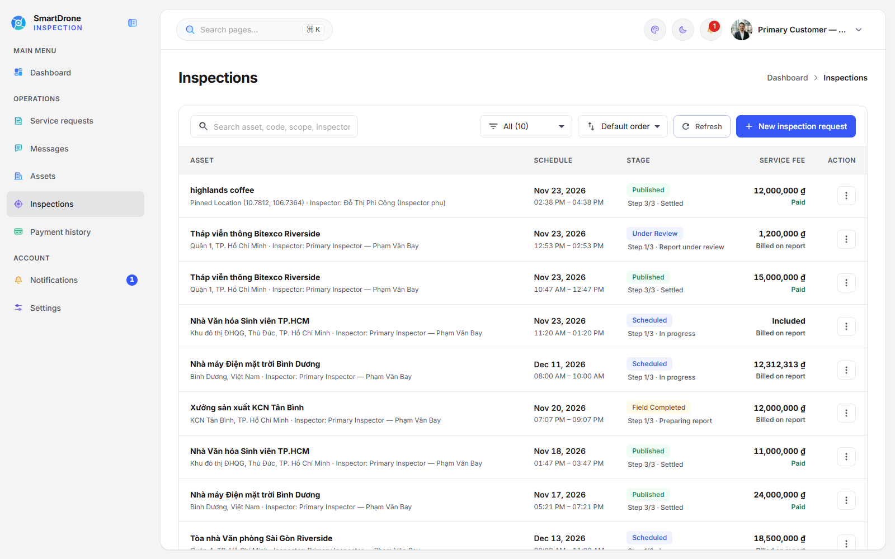

*Figure 7.3.17 — Customer inspections table displaying schedule windows, publication readiness (`v1`), and fee settlement links.*

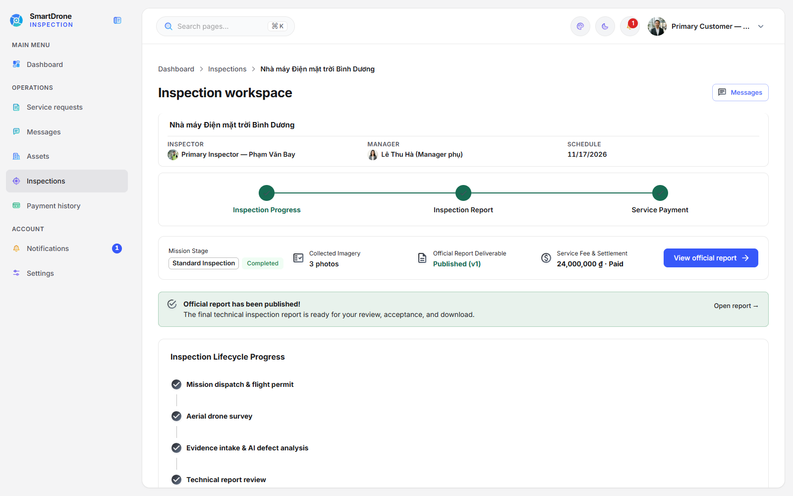

*Figure 7.3.18 — Customer inspection progress timeline showing schedule, permit readiness, and field execution milestones.*

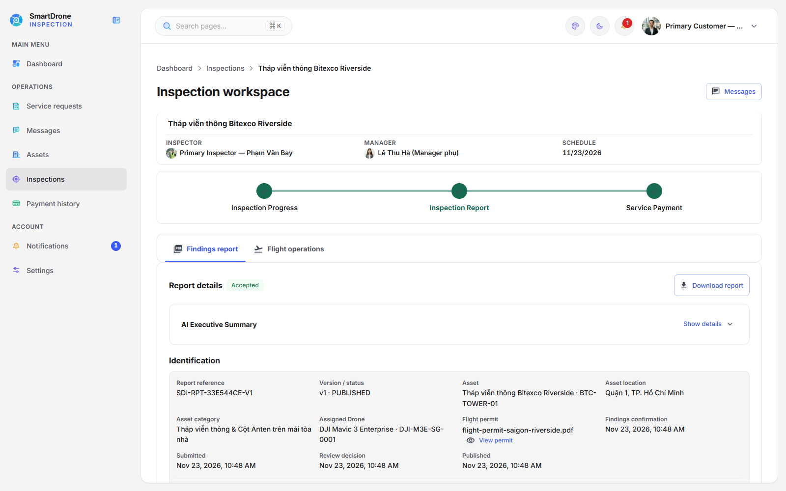

*Figure 7.3.19 — Published building inspection report (`v1`) showing AI Executive Summary, matched cases/standards, and confirmed defects.*

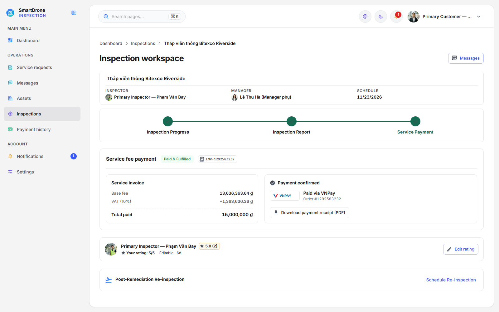

*Figure 7.3.20 — Three-step acceptance and payment settlement console with VAT-itemized invoice, PDF payment notice, and PayOS/VNPay checkout.*

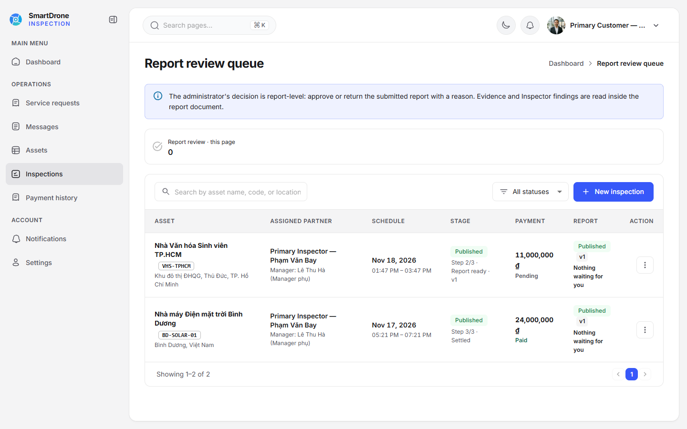

*Figure 7.3.21 — Customer archive of finalized building inspection reports ready for review, PDF download, and acceptance.*

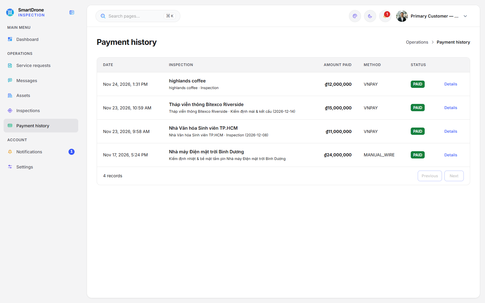

*Figure 7.3.22 — Customer financial ledger displaying verified service payments, methods, and downloadable receipts.*

---

### 3.4 Web Application — Partner Inspector Portal

The Partner Operations portal (`/operations`, `INSPECTOR` role) is strictly scoped to the Inspector's own owned aircraft, own earnings, and assigned inspection occurrences (`Query Own Data`).

#### 3.4.1 Inspector Dashboard and Owned Drone Fleet (`FE-01`, `FE-02`)
- **Function trigger**: Approved Inspector signs in to `/operations/dashboard` or registers/renews an owned drone in `/operations/inspector-drones`.
- **Actors**: `INSPECTOR`, `ADMIN`, `MANAGER`.
- **Requirements**:
  - Drone applications collect serial number, model, Decree 288/2025/ND-CP MTOW weight class (`< 2 kg` Class A vs `>= 2 kg` requires Class B licence), flight capabilities (wind resistance, optical zoom, thermal/RTK), real photos, configurable checklist items, and required documents (`REGISTRATION`, `OWNERSHIP`, optional `INSPECTION`).
  - Duplicate drone serial numbers owned by another party or parallel pending updates are blocked; Inspectors may mark an active drone unavailable for maintenance or permanently retire it.
- **Normal cases**: Inspector registers an aircraft with photos and documents; once approved by staff, the drone becomes selectable during Manager dispatch.
- **Abnormal cases**: Missing registration evidence, missing real photograph, Class A licence attempting `>= 2 kg` MTOW, or expired credentials disqualify the drone from assignment.

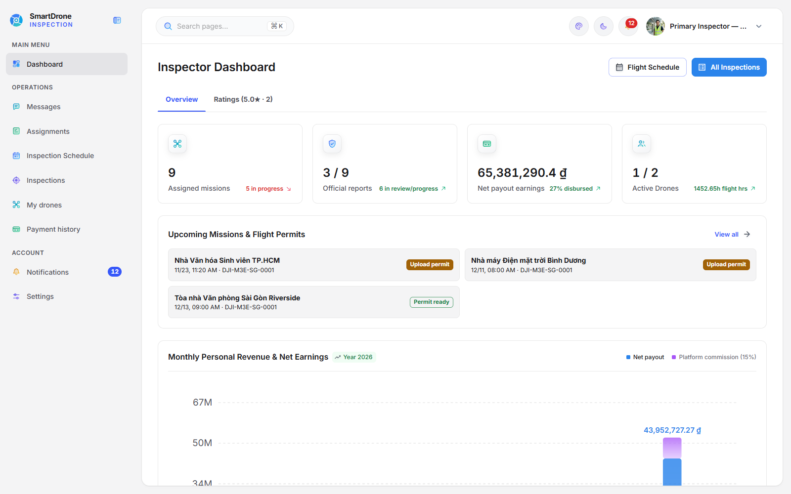

*Figure 7.3.23 — Partner Inspector dashboard showing upcoming assignments, licence expiry status, and active task counts.*

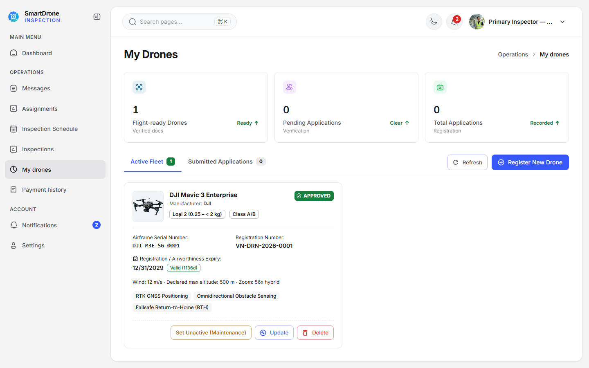

*Figure 7.3.24 — Partner Inspector owned drone inventory with Decree 288 eligibility state, serial numbers, and capability chips.*

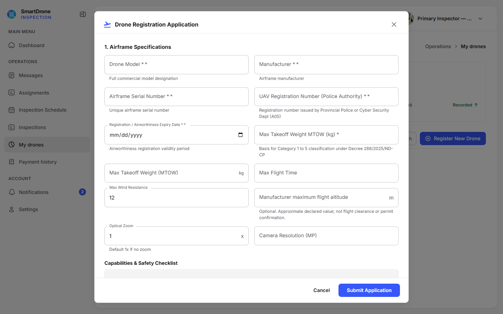

*Figure 7.3.25 — Drone registration dialog capturing airframe specs, MTOW class, photos, safety checklist, and mandatory documents.*

#### 3.4.2 Assigned Inspections and Per-Inspection Coordination (`FE-04`, `FE-05`)
- **Function trigger**: Inspector reviews pending/accepted assignments in `/operations/inspections` or coordinates site access with Customer via `/operations/messages`.
- **Actors**: `INSPECTOR`, `CUSTOMER`, Automated Timeout Monitor.
- **Requirements**:
  - New assignments arrive as `PENDING_ACCEPTANCE` and enforce the admin-configured confirmation window (`assignment_acceptance_timeout_hours`, `1–720` hours, default `24`h); unaccepted assignments automatically revert to `PENDING_ASSIGNMENT` (`BR-53`).
  - Inspectors accept or decline with a mandatory reason; declining clears assignment and logs an attributable `inspector_reliability_events` entry.
  - Per-inspection chat threads connect only the assigned Inspector with the owning Customer organization.
- **Normal cases**: Inspector accepts assignment before the deadline, coordinates access in mission chat, and enters the seven-stage Inspection Workspace.
- **Abnormal cases**: Accepting after deadline cancellation, declining without a reason, or reading unassigned inspection messages is rejected.

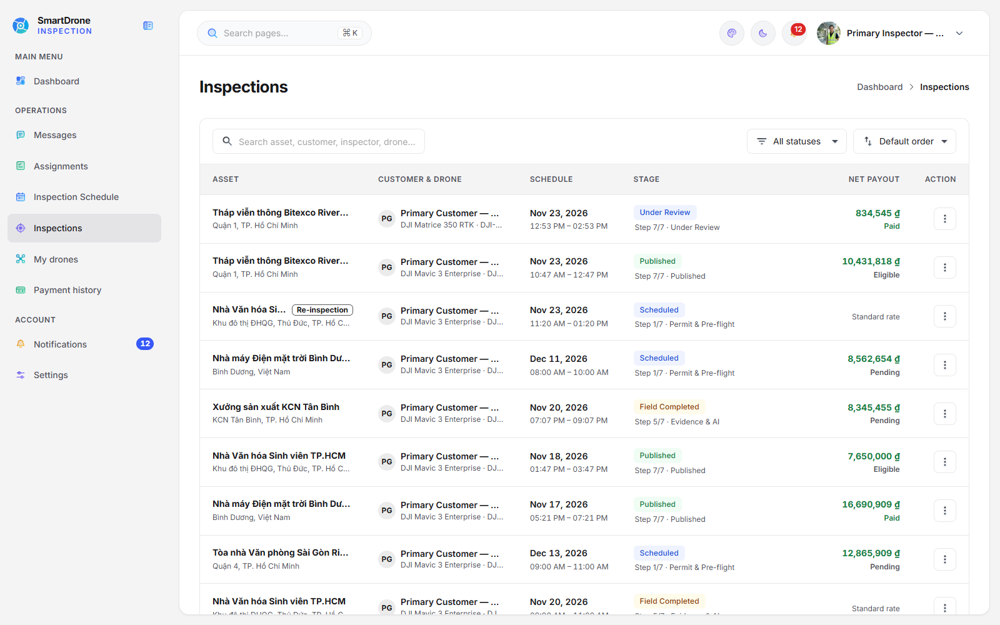

*Figure 7.3.26 — Assigned building inspections list with assignment acceptance status, schedule window, and workspace launch.*

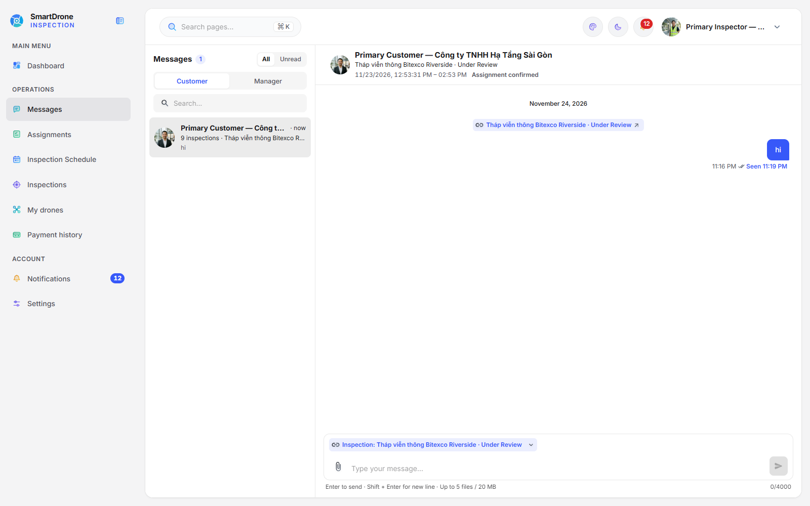

*Figure 7.3.27 — Per-inspection private messaging thread between the assigned Inspector and Customer organization.*

#### 3.4.3 Flight Permit, Pre-flight, Live Hub Telemetry and Post-flight (`FE-05`)
- **Function trigger**: Inspector steps through Stages 1–4 of `/operations/inspections/:id/*`: uploading the mission flight permit, completing pre-flight checks, connecting live MAVLink telemetry (`SmartDroneHub`) or importing flight logs, and verifying building inspection checkpoints post-flight.
- **Actors**: `INSPECTOR`, `MANAGER`, `ADMIN`, SmartDroneHub (`udp/tcp` MAVLink bridge).
- **Requirements**:
  - **Stage 1 (Permit)**: Non-empty PDF/PNG/JPG/WEBP `<= 25 MB` with matching magic bytes, permit number, authority, validity timestamps covering planned start/end, max altitude (`1–2000 m`), and matching assigned drone serial. Every upload enters `PENDING_REVIEW` for independent Manager/Admin approval.
  - **Stage 2 (Pre-flight)**: Configurable pre-flight safety checklist plus mandatory safety note; starting the field session verifies active licence, active drone, valid approved permit at both current and planned flight timestamps, and transitions status to `IN_PROGRESS` (`startNow` supported when permit already valid).
  - **Stage 3 (Flight Operation)**: Inspector may click **Connect Flight Operations** to stream live read-only MAVLink telemetry (`IN_FLIGHT`, `Mode`, `Armed`, live GPS, altitude, speed, heading, battery, waypoint, `Gimbal Active`) from ArduPilot/Mission Planner (`tcp:host.docker.internal:5762`) via SmartDroneHub—which never arms or controls the aircraft—or import `SRT`, `CSV`, `KML`, or `GPX` flight logs (`<= 15 MB`), or submit a disclosed manual flight declaration. Aborting captures a mandatory reason and notifies Managers.
  - **Stage 4 (Post-flight & Items)**: Inspector verifies target building checkpoints (`ITEM-01`+) and post-flight checklist, sealing `FIELD_COMPLETED` alongside the persisted GPS flight trace and Flight Operations Report.
- **Normal cases**: Permit approved -> pre-flight verified -> live MAVLink telemetry recorded (`wp.waypoints`) -> post-flight checkpoints verified -> session transitions cleanly to `FIELD_COMPLETED`.
- **Abnormal cases**: Starting without approved permit, expired credentials, permit/drone serial mismatch, malformed/position-less log import, or missing session safety/abort notes are rejected.

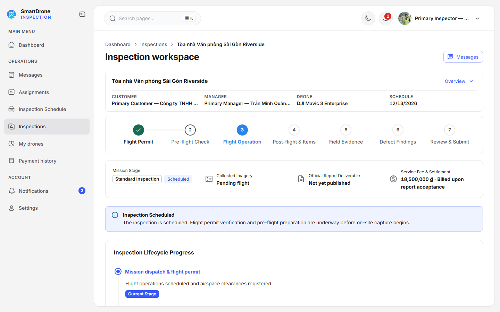

*Figure 7.3.28 — Seven-stage inspection workspace overview displaying assignment metadata and next required action.*

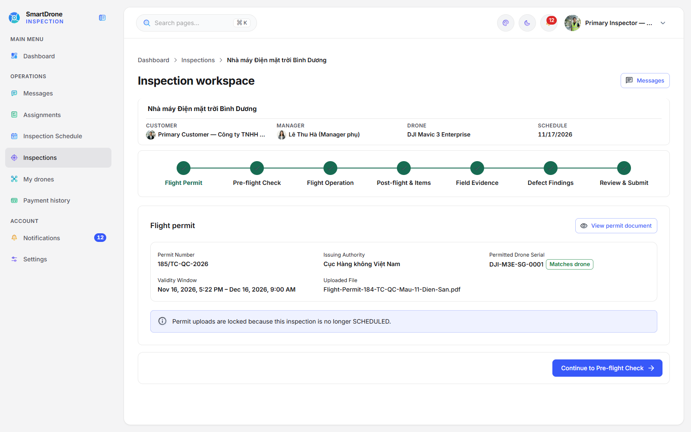

*Figure 7.3.29 — Mission flight permit submission and verification panel displaying structured permit metadata and uploaded scan.*

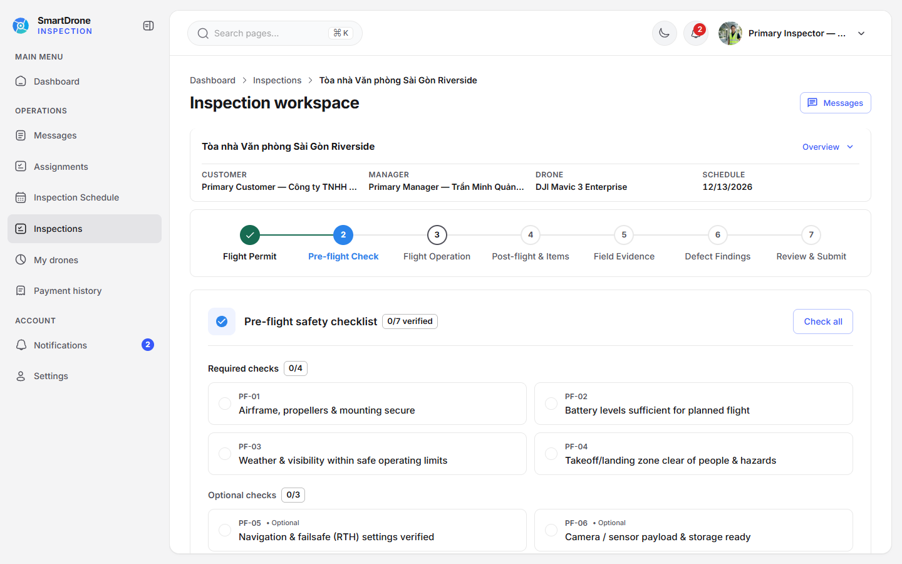

*Figure 7.3.30 — Configurable pre-flight safety checklist and mandatory site observation note prior to session start.*

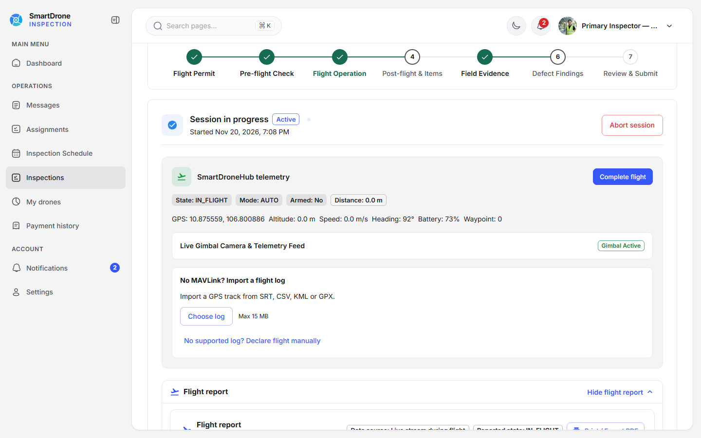

*Figure 7.3.31 — Active Flight Operation console streaming live ArduPilot/Mission Planner MAVLink telemetry (`IN_FLIGHT`, `Mode: AUTO`, GPS, battery, waypoint, and `Gimbal Active`) with fallback log import.*

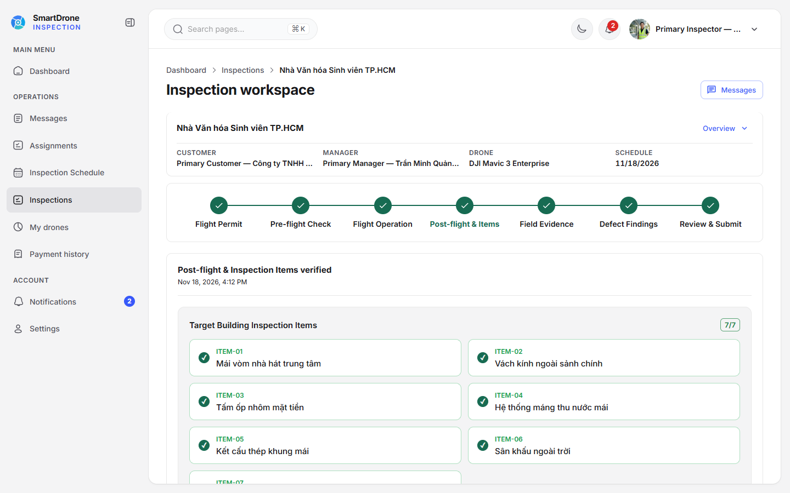

*Figure 7.3.32 — Post-flight completion view confirming building checkpoint coverage (`ITEM-01`+) and safety checks.*

#### 3.4.4 Evidence Intake, AI Defect Detection, `DroneKnowledgeAI` Advisor and Report Authoring (`FE-06`, `FE-07`)
- **Function trigger**: Inspector uploads field photos/MP4 videos in Stage 5 (`/evidence`), triggers YOLO11 + Vision analysis and drafts technical notes with `DroneKnowledgeAI` in Stage 6 (`/findings`), and prepares/submits the report in Stage 7 (`/report`).
- **Actors**: `INSPECTOR`, Automated Systems (`ai-inference` YOLO11 + `fastembed` RAG, LLM fallback, FFmpeg worker).
- **Requirements**:
  - **Evidence Intake**: Photos (`<= 10 MB`) normalize to max `2048 px` with `480 px` JPEG thumbnails; MP4 videos (`<= 2 GiB`) upload in `10 MiB` resumable chunks, retain raw sources until FFmpeg H.264 `1080p faststart` + `480 px` poster complete, auto-number duplicate filenames, support keyframe extraction, and serve media strictly via scoped short-lived media tickets (`HTTP Range` supported).
  - **AI Detection & Confirmation Gate**: YOLO11 detects 5 building defect classes (`crack`, `leakage`, `abscission`, `corrosion`, `bulge`) with confidence scores and bounding boxes (`V63` default auto-confirm threshold `70%`; Vision LLM fallback honors account opt-out). Every candidate remains advisory until confirmed (`Findings baseline confirmation`); subsequent evidence/finding mutations reset confirmation (`BR-09`, `BR-10`). On `RE_INSPECTION` findings, a `RESOLVED` verdict requires fresh in-session evidence (`BR-52`), carries a 14-day expiry warning window, and blocks report authoring/publication once expired (`RESOLUTION_EXPIRED`), while keeping three-way assessment (`RESOLVED`, `UNRESOLVED`, `INCONCLUSIVE`).
  - **`DroneKnowledgeAI` Advisor**: Toolbar provides `All active` / `Unconfirmed` / `Confirmed` status chips and batch `Draft all notes`; each finding card offers `Draft note with AI` (`POST .../draft-note`) and a collapsible `References` toggle (`GET /api/v1/inspections/{inspectionId}/findings/{findingId}/recommendations?limit=3`) backed by tenant-isolated `pgvector` `vector(384)` HNSW cosine search (`fastembed`, degrading to deterministic `HYBRID_MATCH`) against seeded engineering standards (`TCVN 9343:2012`, `TCVN 9361:2012`, `EN 1504-9`, `ISO 12944-5`, `ASTM C1583`) and anonymized/tenant historical cases. Drafted notes remain editable and never auto-save or auto-confirm (`BR-34`, `BR-55`).
  - **Report Authoring & Submission**: Auto-compiled report requires confirmed findings baseline, generates an advisory AI Executive Summary with `Matched Cases & Standards` (`GET /api/v1/inspections/{inspectionId}/knowledge-recommendations?limit=4`, `<= 4`), supports PDF preview/download, and moves to `SUBMITTED` for non-author review (`§3.5.3`).
- **Normal cases**: Inspector uploads 6 photos and an MP4 video from the mission, runs batch AI detection, drafts standard-cited notes (`ASTM C1583`, `TCVN 9343:2012`), confirms baseline, and submits report `v1`.
- **Abnormal cases**: Oversized photo, expired media ticket, unconfirmed findings at submission, expired `RESOLVED` verdict, or cross-tenant knowledge lookup is refused.

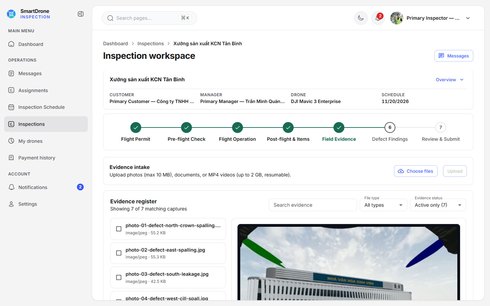

*Figure 7.3.33 — Evidence intake and register showing uploaded building defect/clear photos alongside the FFmpeg-transcoded MP4 mission video player.*

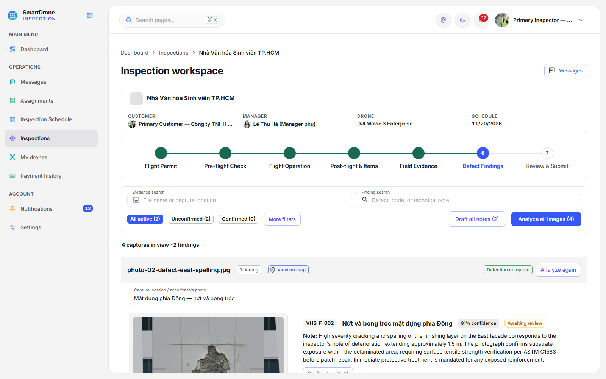

*Figure 7.3.34 — Defect findings screen featuring status chips, batch `Draft all notes` / `Analyze all images`, confidence badges, and confirmation gates.*

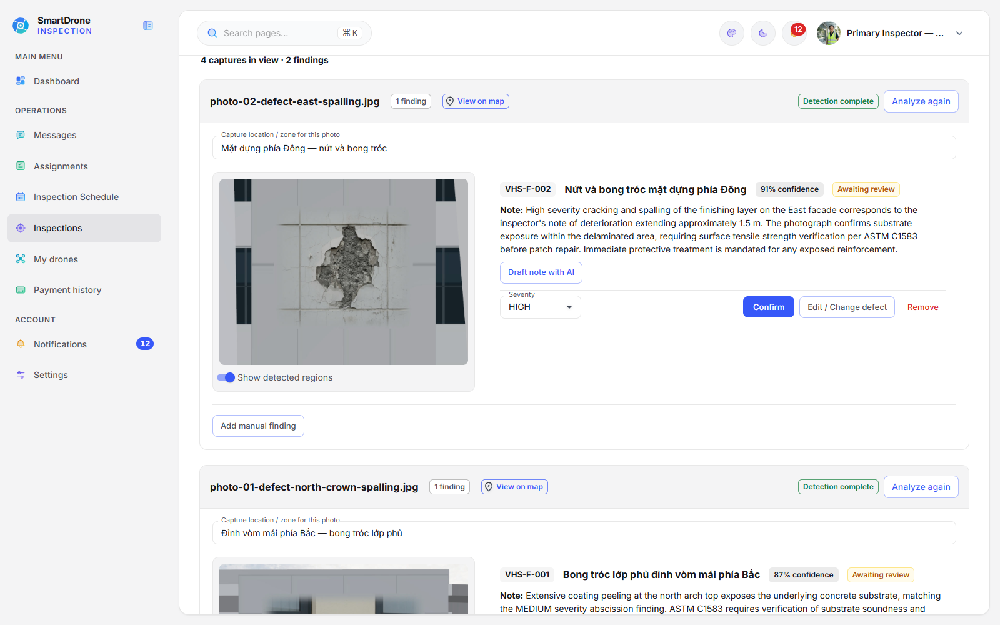

*Figure 7.3.35 — Annotated defect card illustrating AI-drafted ASTM-referenced technical note (`Draft note with AI`) and human `Confirm` / `Edit` / `Remove` actions.*

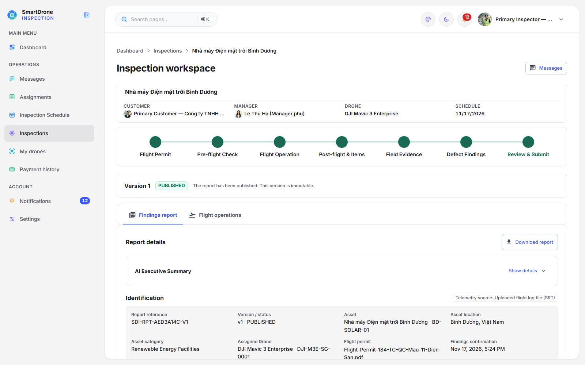

*Figure 7.3.36 — Report preparation view presenting AI Executive Summary, matched historical cases & standards, PDF preview/download, and submission.*

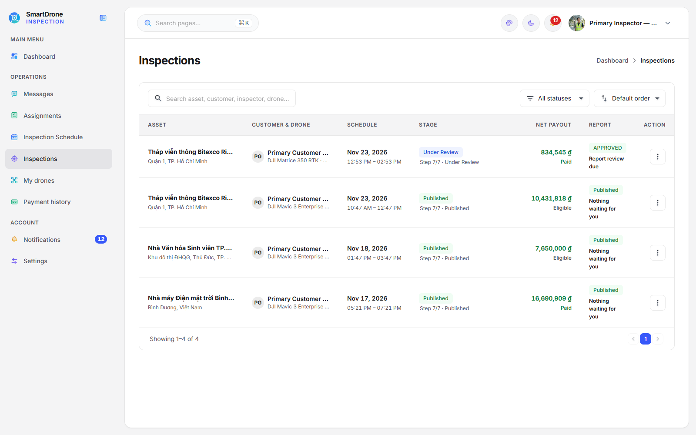

*Figure 7.3.37 — Inspector reports register tracking `DRAFT`, `SUBMITTED`, `RETURNED`, and `PUBLISHED` versions.*

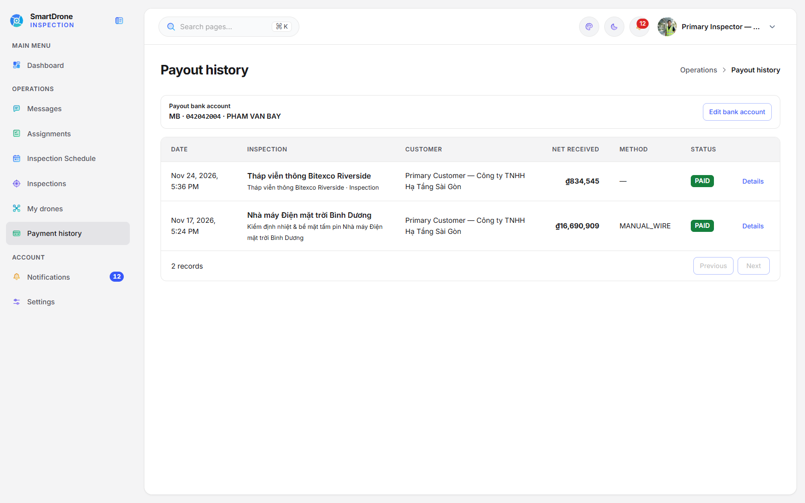

*Figure 7.3.38 — Partner Inspector financial history showing mission fee breakdown, platform commission, TNCN tax withholding, and payout status.*

---

### 3.5 Web Application — Platform Manager Portal

The Platform Manager portal (`/manager`, `MANAGER` role) coordinates onboarding approvals, service request claims, VND quoting, offline signed contract recording, partner/drone dispatch, independent permit & report verification, and financial payouts/refunds. A Manager cannot quote/review/publish a report they authored (`BR-17`), and may mutate only requests they have claimed (`BR-30`).

#### 3.5.1 Manager Dashboard, Onboarding Reviews, Partner Roster and Buildings (`FE-01`, `FE-02`, `FE-03`)
- **Function trigger**: Manager inspects daily workload (`/manager/dashboard`), reviews public inspector applications and drone registrations (`/manager/onboarding-reviews`), inspects partner eligibility in `/manager/platform-users` (`Partner inspectors`), or reviews customer buildings in `/manager/assets`.
- **Actors**: `MANAGER`, `INSPECTOR`.
- **Requirements**:
  - Reviewing a pending Inspector application (`APPROVED` / `REJECTED` with mandatory rejection reason) provisions the active `INSPECTOR` login upon approval. Approving a drone registration unlocks that drone for occurrence dispatch (`Decree 288` MTOW class enforced).
  - Partner roster displays licence class, licence expiry, linked drones, and reliability metrics (`declineCount`, `abortCount`, `noShowCount`).
- **Normal cases**: Manager approves qualified applicants/drones and verifies roster readiness prior to scheduling.
- **Abnormal cases**: Approving an application missing a valid scan/future expiry, rejecting without reason, or modifying another role's account config (`ADMIN` only) is denied.

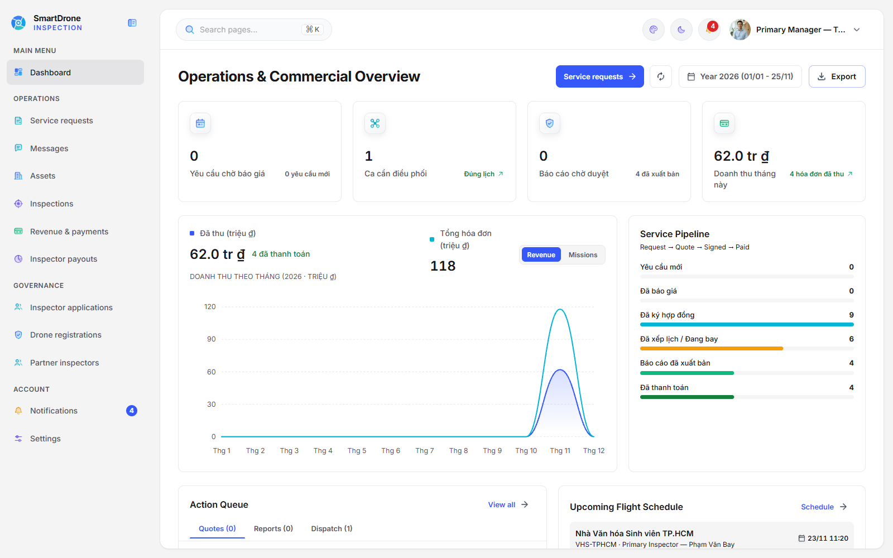

*Figure 7.3.39 — Platform Manager dashboard summarizing request claims, permit reviews, report publication queues, and revenue metrics.*

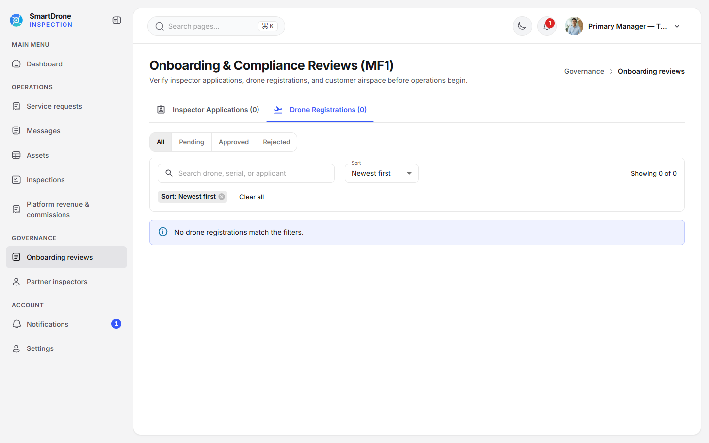

*Figure 7.3.40 — Manager compliance queue filtering Inspector Applications and Drone Registrations awaiting review.*

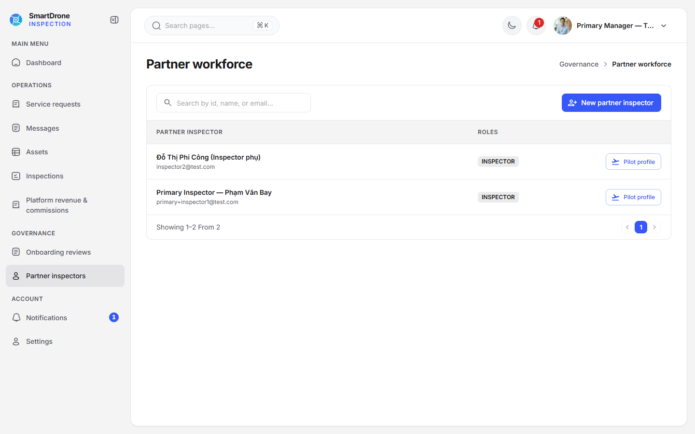

*Figure 7.3.41 — Partner Inspector directory showing pilot licence class/expiry, approved drones, and reliability indicators.*

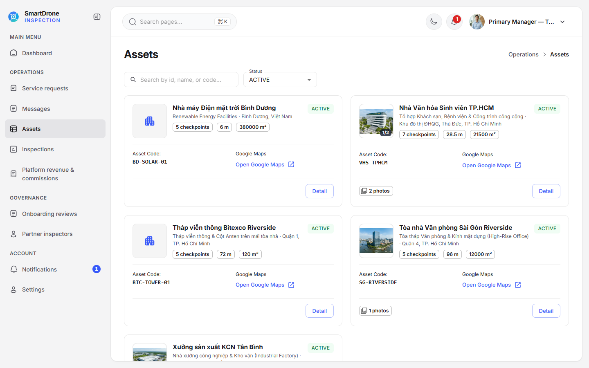

*Figure 7.3.42 — Manager cross-customer building directory displaying asset readiness and checkpoint summaries.*

#### 3.5.2 Service Requests, Quotations, Signed Agreements and Partner Dispatch (`FE-04`)
- **Function trigger**: Manager claims an open request (`/manager/contracts`), issues/updates a versioned VND quote, negotiates in `/manager/messages`, uploads the signed paper contract PDF/scan, and dispatches an eligible Inspector/drone pair per occurrence.
- **Actors**: `MANAGER`, `CUSTOMER`, `INSPECTOR`.
- **Requirements**:
  - Only an unassigned Manager claiming an `OPEN` request gains write scope; `ADMIN` may assign/reassign/unassign Managers (`§3.6.3`) but never quotes or dispatches.
  - Dispatch validates both pilot qualification (active account, current licence matching MTOW class, zero schedule conflict across all customer organizations) and drone readiness (owned by the selected Inspector, approved registration, current expiry). Recurring occurrences support `Apply to remaining` with per-occurrence validation (`FE-04`).
  - Following an aborted field session, Manager executes attributable reschedule, reassign, or cancellation recovery (`§3.5.3`).
- **Normal cases**: Manager claims request, issues VND quote anchored to requested start date, records customer-signed paper contract scan, and dispatches crew.
- **Abnormal cases**: Competing claim by another Manager, shifting first occurrence date on a recurring quote, dispatching unapproved/unowned drone, or schedule collision fails closed.

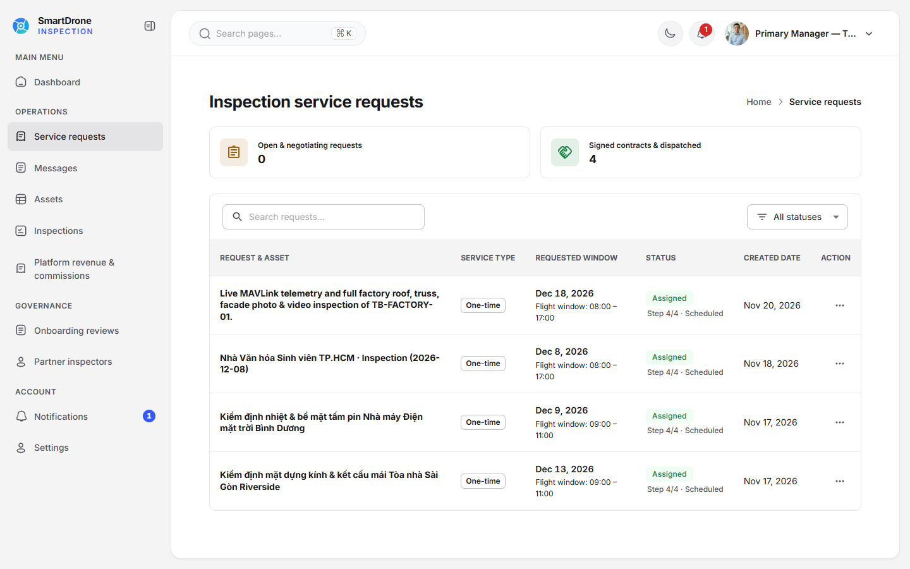

*Figure 7.3.43 — Manager service request list displaying unassigned/claimed requests and commercial lifecycle indicators.*

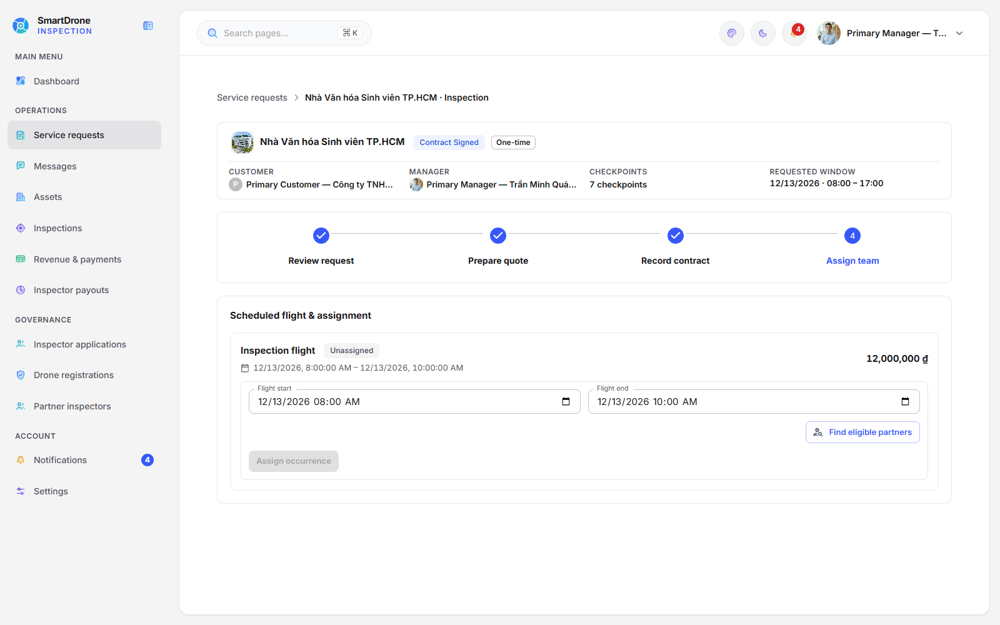

*Figure 7.3.44 — Four-stage commercial workspace managing VND quotation, signed paper contract upload, occurrence crew eligibility check, and dispatch.*

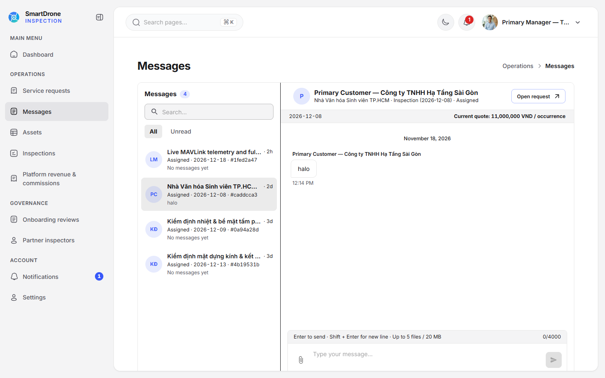

*Figure 7.3.45 — Manager messaging console carrying commercial scope/date negotiation threads and attachments with Customers.*

#### 3.5.3 Inspection Governance, Independent Report Review and Partner Settlement (`FE-05`, `FE-07`, `FE-08`)
- **Function trigger**: Manager audits permits and field activity in `/manager/inspections` and `/audit`, reviews submitted reports in `/manager/reports` and `/review`, disburses partner payouts or reconciles refunds in `/settlement`, and tracks ledger totals in `/manager/finance-history`.
- **Actors**: `MANAGER`, `INSPECTOR`, `CUSTOMER`.
- **Requirements**:
  - **Permit Audit**: Verification requires an `APPROVED` or `REJECTED` (reason required) decision from a Manager/Admin distinct from any submitter (`BR-17`). Rescheduling outside permit validity or swapping drone returns an approved permit to `PENDING_REVIEW`.
  - **Report Review**: Reviewer cannot be the report's author. Approving and publishing are atomic, freezing immutable version `vN` (`PUBLISHED`); returning requires an explicit written reason.
  - **Settlement & Refunds**: Verified customer payment unlocks payout eligibility (`ELIGIBLE`), requiring explicit Manager reference entry to mark `PAID`. Refunds follow `INITIATED` (places hold on unpaid payout) -> external transfer -> `COMPLETED` with exact allocation across Inspector deduction, platform commission, VAT, TNCN, and platform absorption; refunds after payout create attributable `inspector_receivables` recovered manually with references (`BR-36`–`BR-42`).
- **Normal cases**: Manager approves permit, publishes submitted report `v1`, and records net Inspector payout reference after Customer payment clears.
- **Abnormal cases**: Self-review by author, return without reason, duplicate payout/refund reference, refund exceeding captured payment, or payout during active refund hold is rejected.

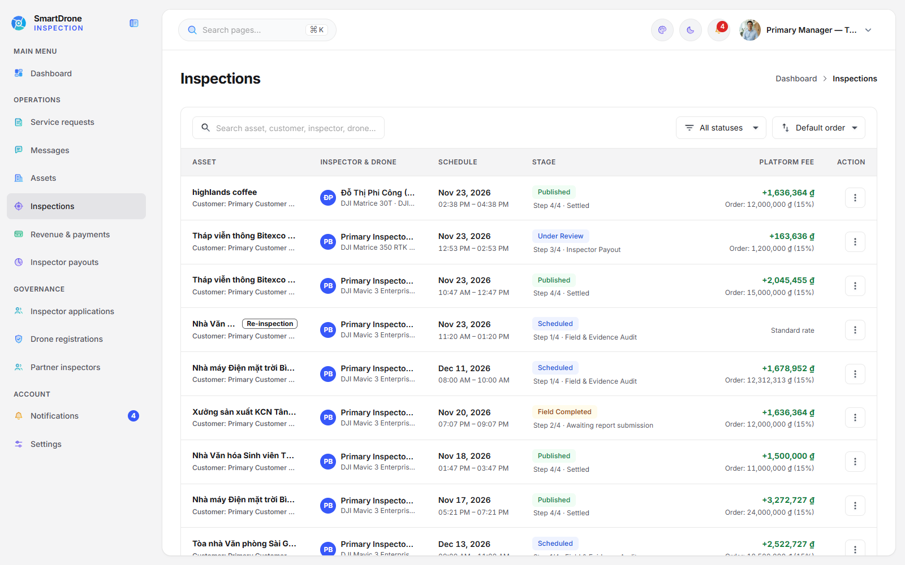

*Figure 7.3.46 — Manager inspections table monitoring crew acceptance, permit status, live session states, and abort recovery.*

*Figure 7.3.47 — Inspection workspace permit verification and attributable lifecycle audit panel.*

*Figure 7.3.48 — Manager report queue filtering `SUBMITTED` versions awaiting independent publication or return.*

*Figure 7.3.49 — Side-by-side report review interface with AI Executive Summary preview, PDF download, and Publish / Return actions.*

*Figure 7.3.50 — Manager financial settlement workspace tracking verified customer payment, partner net payout recording, and refund/receivable allocations.*

*Figure 7.3.51 — Manager financial analytics aggregating gross inflows, 15% platform commission, VAT/TNCN withholdings, and partner payouts.*

---

### 3.6 Web Application — Platform Admin Portal

The Platform Admin portal (`/admin`, `ADMIN` role) governs user account provisioning, customer restricted-airspace admissions, master catalogs (`asset_categories`, `pilot_license_classes`, `drone_document_configs`, `checklist_templates`), global finance/operations/AI thresholds, Manager assignment oversight, and platform audit logs (`BR-02`, `BR-27`). `ADMIN` cannot issue quotes, chat in order negotiations, accept reports for Customers, or execute payouts.

#### 3.6.1 Admin Dashboard, Onboarding Decisions and Platform Accounts (`FE-01`, `FE-02`)
- **Function trigger**: Administrator monitors `/admin/dashboard`, adjudicates 3-tab onboarding/airspace queues in `/admin/onboarding-reviews`, or creates/deactivates platform accounts in `/admin/platform-users`.
- **Actors**: `ADMIN`.
- **Requirements**:
  - Onboarding reviews include the third **Customer Airspace** tab (`prospective_customer_registrations`) exclusively adjudicated by `ADMIN` alongside Inspector Applications and Drone Registrations.
  - Platform Accounts directory enforces single-role assignment, account activation/deactivation, and mandatory initial password change policies.
- **Normal cases**: Admin reviews restricted-zone building applications, provisions a new Manager account via dialog, and resets locked accounts.
- **Abnormal cases**: Assigning multiple canonical roles to one account, creating duplicate email logins, or non-Admin roles invoking `/admin/*` endpoints fails with `403 Forbidden`.

*Figure 7.3.52 — Administrator governance dashboard summarizing platform users, onboarding queues, buildings, and activity audit summary.*

*Figure 7.3.53 — Admin onboarding console spanning Inspector Applications, Drone Registrations, and Customer Airspace Screening queues.*

*Figure 7.3.54 — Administrator user management table across `ADMIN`, `MANAGER`, `CUSTOMER`, and `INSPECTOR` accounts.*

*Figure 7.3.55 — Administrator modal creating internal platform staff accounts and configuring activation/password flags.*

#### 3.6.2 Catalog, Flight Config, Licence Classes, Finance, Operations and AI Settings (`FE-02`, `FE-04`, `FE-06`, `FE-08`)
- **Function trigger**: Administrator updates building categories (`/admin/asset-catalog`), required drone docs & checklists (`/admin/flight-config`), licence classes (`/admin/flight-config` / tabs), or singleton settings (`/admin/platform-settings` sub-views for Finance, Operations, AI).
- **Actors**: `ADMIN`.
- **Requirements**:
  - **Asset Catalog**: Maintains the six building categories (`TELECOM_ROOFTOP_TOWER`, commercial, industrial, residential, public, energy-rooftop) and seeded default inspection items without mutating historical inspections.
  - **Drone & Flight Config**: Configures required vs optional documents (`REGISTRATION`, `OWNERSHIP`, `INSPECTION`), capability tags, pre-flight/post-flight checklists, and UAV licence classes aligned with Decree 288/2025/ND-CP.
  - **Singleton Governance**: Finance settings set commission, VAT, TNCN, and invoice due days; Operations settings enforce assignment confirmation timeout (`1–720` hours, default `24`h); AI settings control YOLO11 auto-confirm threshold (default `70%` per `V63`) and Vision LLM fallback policy.
- **Normal cases**: Admin adjusts AI threshold or timeout hours and persists versioned configuration.
- **Abnormal cases**: Non-building infrastructure categories or out-of-range numeric percentages/timeout hours (`<1` or `>720`) are rejected.

*Figure 7.3.56 — Master list of the six building asset categories and seeded default inspection items.*

*Figure 7.3.57 — Category editor displaying EN/VN metadata and default building checkpoint items (`TELECOM_ROOFTOP_TOWER`).*

*Figure 7.3.58 — Administrator flight configuration panel defining required drone documents and configurable safety checklists.*

*Figure 7.3.59 — Administrator pilot-licence class matrix governing Decree 288 drone weight-category eligibility.*

*Figure 7.3.60 — Platform singleton finance settings defining commission rate, VAT, personal income tax (TNCN), and payment due windows.*

*Figure 7.3.61 — Platform singleton operations settings configuring partner assignment acceptance timeout (`assignment_acceptance_timeout_hours`).*

*Figure 7.3.62 — Platform singleton AI configuration governing auto-confirm confidence threshold (`70%`) and Vision LLM fallback behavior.*

#### 3.6.3 Request Governance, Building Registry and Activity Audit Log (`FE-02`, `FE-03`, `FE-04`)
- **Function trigger**: Administrator reassigns Manager ownership in `/admin/contracts`, audits cross-tenant buildings in `/admin/assets`, or queries immutable `audit_events` in `/admin/audit-logs`.
- **Actors**: `ADMIN`.
- **Requirements**:
  - Request Governance exposes assign/reassign/unassign Manager ownership actions while keeping quotation, pricing, contract upload, and dispatch disabled for `ADMIN` (`BR-27`, `BR-30`).
  - Activity log records immutable actor, role, action type, entity key, timestamp, and metadata across onboarding, permissions, permits, and report publication.
- **Normal cases**: Admin transfers an unassigned or overloaded request to another active `MANAGER` and traces the action in Activity Log.
- **Abnormal cases**: Attempting to alter immutable audit events or invoke Manager commercial endpoints as `ADMIN` is rejected.

*Figure 7.3.63 — Administrator request oversight registry supporting Manager ownership assignment/reassignment without commercial mutation.*

*Figure 7.3.64 — Platform-wide building registry displaying status, airspace classification, and organization ownership.*

*Figure 7.3.65 — Filterable platform audit log recording attributable onboarding, security, commercial, permit, and report actions.*

---

### 3.7 Mobile Application — Customer App (Flutter)

The cross-platform Flutter Mobile Application serves the **`CUSTOMER` role exclusively** (`lib/core/router/app_router.dart`), maintaining feature parity with the Customer Web portal across authentication, buildings, one-time/recurring requests, order chat, live inspection tracking, official report consumption, and PayOS/VNPay settlement. Non-customer roles (`ADMIN`, `MANAGER`, `INSPECTOR`) are rejected at mobile login (`§3.8`).

#### 3.7.1 Mobile Authentication, Home Dashboard and Notifications (`FE-01`)
- **Function trigger**: Customer opens the mobile app (`#/login`, `#/register`, `#/forgot-password`), lands on `#/home`, inspects `#/notifications`, or manages `#/profile`.
- **Actors**: `CUSTOMER`, Automated Identity Service.
- **Requirements**:
  - Secure JWT/refresh token persistence via `TokenStore` with automatic 401 refresh lock and explicit `CUSTOMER`-only role gate.
  - Home dashboard summarizes buildings, open requests, active/published inspections, and unread notification badge counts.
- **Normal cases**: Customer signs in on mobile, views notifications, and updates profile or language preference (`EN`/`VI`).
- **Abnormal cases**: Signing in with `INSPECTOR`/`MANAGER`/`ADMIN` credentials displays a role-restriction notice and blocks mobile portal entry.

*Figure 7.3.66 — Flutter mobile Customer login screen supporting password, OTP, and Google authentication.*

*Figure 7.3.67 — Flutter mobile customer organization sign-up screen with OTP verification.*

*Figure 7.3.68 — Flutter mobile OTP password recovery screen.*

*Figure 7.3.69 — Customer mobile home dashboard summarizing buildings, requests, upcoming inspections, and quick navigation.*

*Figure 7.3.70 — Mobile deduplicated notification feed with deep links into requests and inspection deliverables.*

*Figure 7.3.71 — Customer mobile account profile, security controls, locale switch, and sign-out screen.*

#### 3.7.2 Mobile Buildings, Service Requests and Order Chat (`FE-03`, `FE-04`)
- **Function trigger**: Customer browses `#/assets` and `#/assets/:id`, creates/tracks requests in `#/requests` / `#/requests/new` / `#/requests/:id`, or negotiates with Manager in `#/requests/:id/chat`.
- **Actors**: `CUSTOMER`, `MANAGER`.
- **Requirements**:
  - Read-only and operational parity with Web: buildings display checkpoints and attached documents; New Request form enforces the 20-day minimum lead time and monthly recurrence rules (`2–100` occurrences).
  - Request detail lets Customers inspect active VND quotations, accept quotes with optimistic locking (`quoteRowVersion`), view signed contracts, and open live Order Chat with attachments.
- **Normal cases**: Customer checks building checkpoints, submits a service request, negotiates via chat, and accepts the issued VND quote from mobile.
- **Abnormal cases**: Selecting an earlier date inside 20 days, submitting duplicate active requests on one building, or accepting a superseded quote version fails cleanly.

*Figure 7.3.72 — Customer mobile building list showing status chips, height/footprint badges, and inspection counts.*

*Figure 7.3.73 — Customer mobile building detail displaying coordinates, inspection checkpoints, and attached reference documents.*

*Figure 7.3.74 — Customer mobile service request list displaying status pills (`ASSIGNED`, `QUOTED`, `OPEN`) and building details.*

*Figure 7.3.75 — Mobile service request form selecting building, one-time/recurring mode, minimum 20-day lead date, and time window.*

*Figure 7.3.76 — Mobile request detail presenting VND quotation summary, commercial milestone state, signed contract, and chat link.*

*Figure 7.3.77 — Customer-Manager interactive order negotiation thread on Flutter mobile with attachment support.*

#### 3.7.3 Mobile Inspection Tracking, Official Report and Settlement (`FE-05`, `FE-07`, `FE-08`)
- **Function trigger**: Customer opens `#/inspections` -> `#/inspections/:id` and navigates between the **Tracking**, **Report**, and **Settlement** tabs.
- **Actors**: `CUSTOMER`, Payment Service (PayOS / VNPay).
- **Requirements**:
  - **Tracking tab**: Displays occurrence status, schedule window, assigned inspector/drone summary, and verified permit badge.
  - **Report tab**: Renders published version `vN` (`PUBLISHED` only), `AI Executive Summary` card (`overallRisk`, key highlights, recommended actions), `Matched cases & standards` strip, confirmed findings, and **Download official PDF**.
  - **Settlement tab**: Three-step tracker (`1. Accept official report -> 2. Settle service fee -> 3. Service fulfilled`), VAT-broken-down service invoice, **Accept report** / **Request clarification**, and PayOS VietQR / VNPay payment trigger.
- **Normal cases**: Customer reviews the published report and AI summary on mobile, accepts it, and completes PayOS/VNPay settlement.
- **Abnormal cases**: Unpublished internal drafts remain inaccessible; requesting clarification after acceptance or paying before acceptance is blocked.

*Figure 7.3.78 — Customer mobile inspections list showing asset title, schedule timestamp, and stage badges.*

*Figure 7.3.79 — Mobile Inspection Detail Tracking tab displaying occurrence timeline, crew assignment, and flight readiness.*

*Figure 7.3.80 — Mobile Report tab presenting published `v1` PDF download, `AI Executive Summary`, and matched historical cases & standards (`TCVN 9343:2012`, `TCVN 9361:2012`).*

*Figure 7.3.81 — Mobile Settlement tab showing 3-step closure progress, VAT service invoice (`11,000,000 đ`), Accept report, and clarification actions.*

### 3.8 Out-of-Scope Domains and Retired Capability

The application scope is limited to **building inspection** as described in §1. The following are outside the delivered product:

- **Non-building infrastructure.** Bridges, viaducts, power transmission lines and towers, ground-mounted solar farms, roads, dams, tunnels, ports, and pipelines are not supported. The inspection-item catalogue, the defect classes (`crack`, `leakage`, `abscission`, `corrosion`, `bulge`), and the report template are all built for building surfaces and building rooftop assets.
- **Corrective maintenance execution.** Work-order creation from published defects, repair scoping, repair cost estimation, field repair execution, maintenance completion reporting, maintenance acceptance, and cost reconciliation are not part of the application. The service ends at report acceptance and payment; the Customer arranges corrective work outside the platform. What the platform does provide is a re-inspection loop: once a source inspection is complete and its report is published, a customer or platform manager may create a re-inspection against it, and each originally confirmed defect is re-assessed three ways — resolved, unresolved, or inconclusive — by comparing the original finding against the evidence captured on the re-flight. That loop reuses `MF2` for scheduling and `MF3` for field work and evidence rather than introducing a separate flow.
- **Aircraft control.** The platform does not pilot, guide, or command an aircraft, and does not act as a ground control station.
- **Photogrammetric reconstruction.** Three-dimensional point-cloud and mesh generation are out of scope. Two-dimensional photographs and video, and the defect annotations derived from them, are in scope.
- **Retrieval boundary.** Inspection knowledge retrieval is in scope: `DroneKnowledgeAI` maintains a `pgvector` index of engineering standards and tenant-isolated historical defect cases for advisory use (§3.4.4, `BR-55`). A corrective-maintenance repair knowledge base (`repair_knowledge_chunks`), RAG repair-scope or cost-norm advising, external CMMS integration, and work-order execution remain outside the application.
- **Mobile coverage for non-customer roles.** The mobile application serves the `CUSTOMER` role only; Inspectors and platform staff use the web portals.

Where maintenance-related records remain in the data store from earlier development, they are retained unchanged for data preservation and are not exposed as an application workflow.

## 4. Non-Functional Requirements

### 4.1 External Interfaces

- **Web interface.** The service is available through a responsive web experience on current desktop and mobile browsers, with English and Vietnamese labels.
- **Mobile interface.** The `CUSTOMER` role has a native application covering sign-in, registration, buildings, requests with negotiation, inspection tracking, published reports, and notifications. Field capture and field-session recording are performed by inspectors in the operations web portal.
- **Detection service.** Building-defect detection is served by a self-hosted inference service, with an OpenAI-compatible vision model as fallback. A user may opt out of the fallback for their own account.
- **Narrative drafting service.** An OpenAI-compatible language model drafts the report narrative once per draft from the confirmed context, returns strict JSON, and is instructed not to invent facts.
- **Knowledge retrieval service.** An optional `DroneKnowledgeAI` advisor retrieves tenant-isolated historical defect cases and seeded engineering standards over a `pgvector` HNSW cosine index. When embeddings are unavailable it degrades to deterministic `HYBRID_MATCH`; no retrieval result becomes an official finding or report text.
- **Payment and identity services.** PayOS VietQR and VNPay process settlement and Google OAuth2 provides federated sign-in. Both gateways are configuration-gated and can be disabled, in which case an authorised manual confirmation records payment.
- **Ground-station integration.** An optional hub supplies read-only telemetry, flight traces, and mission video. A response from any external service does not replace the platform's own authorization or human review.

### 4.2 Quality Attributes

- **Usability.** Each stage communicates its purpose, status, responsible role, and required next action. Candidate findings and drafted summaries are visibly advisory, and a manual finding is distinguishable from a detected one. Users can work in English or Vietnamese.
- **Reliability.** Signed documents, building documents, and published reports keep their integrity, and unauthorised in-place changes are prevented. A retried event does not create a duplicate occurrence, evidence record, payment, or notice. A large video upload resumes after interruption, and a failed transcode retains its source.
- **Performance.** Standard actions, searches, and paged lists respond within two seconds at the 95th percentile under fifty concurrent users, and a single-image defect suggestion completes within five seconds. Report rendering never reads video into memory, so generation cost does not scale with evidence size.
- **Security and data protection.** Users see only what their role, organization, partner relationship, and assignment permit; a direct link or a known identifier grants nothing extra. A denied section has no route. A report author cannot publish their own report and a permit uploader cannot verify their own permit. Media is served only through short-lived scoped tickets. Credentials are supplied as configuration and never committed.
- **Maintainability and portability.** Module boundaries are enforced by an architecture test. Schema evolution is forward-only, and a test asserts the exact applied migration set. The service runs from container images with the database, storage, detection service, and application as separate services.

| NFR ID | Category | Requirement Statement | Metric | Target Threshold |
| :---: | --- | --- | --- | --- |
| `NFR-01` | Performance | Standard actions and list views respond promptly under concurrent use. | 95th percentile response time and server error rate. | `p95 <= 2.0 s` and `0%` server errors under `50` concurrent users. |
| `NFR-02` | Performance | Supported image analysis stays within interactive limits. | Processing time per image. | `<= 5.0 s` per request. |
| `NFR-03` | Security | Users cannot reach records or actions outside their role, organization, or assignment. | Unauthorised and cross-scope attempts blocked. | `100%` blocked; `0` disclosures. |
| `NFR-04` | Security | Sign-in resists guessing and revoked access stops working. | Lockout and request rate. | Lockout for `15 min` after `5` failures; over `10` requests per minute blocked. |
| `NFR-05` | Reliability | Signed and published records stay intact and cannot be silently altered. | Integrity and prevention of in-place change. | `100%` integrity; `100%` of unauthorised changes prevented. |
| `NFR-06` | Reliability | Large video evidence survives interruption and transcode failure. | Resume success and retry availability. | `100%` resumable; `100%` of failed transcodes retained. |
| `NFR-07` | Maintainability | All eight features have repeatable verification and module boundaries hold. | Feature coverage and boundary violations. | All eight features covered; `0` violations. |
| `NFR-08` | Portability | The service rebuilds and starts from its stated dependencies. | Clean start and migration set. | Starts from the compose stack with the declared migration set. |

These thresholds are acceptance targets, not measured claims. Verification is recorded in Report 5.

## 5. Requirement Appendix

### 5.1 Business Rules

Representative rules from the `BR-01`–`BR-55` set:

| ID | Rule Definition |
| --- | --- |
| `BR-01` | An account has exactly one login role, and no account may hold both a platform role and a customer or partner role. |
| `BR-02` | A partner inspector account is created only by platform approval of a submitted application, never by public self-registration. |
| `BR-03` | A user sees only records permitted by their role, organization, partner relationship, and assignment. |
| `BR-07` | The inspection scope is buildings only; non-building infrastructure is out of scope. |
| `BR-08` | A submitted partner application grants no platform role and is always provisioned as an inspector on approval. |
| `BR-09` | Drone ownership is not a condition of partner admission. |
| `BR-12` | Take-off weight classification follows the decree classes, and the pilot licence class must cover the aircraft. |
| `BR-24` | A flight permit must be verified by a person other than its uploader before field work may start. |
| `BR-26` | Field work cannot start without an approved permit and a completed pre-flight safety checklist. |
| `BR-28` | A recurring request carries exactly one schedule bound and produces between two and one hundred occurrences. |
| `BR-30` | A quotation cannot move the customer-requested first date. |
| `BR-33` | Acceptance freezes the agreed terms into an immutable snapshot; later changes require a revised quotation. |
| `BR-38` | Only human-confirmed findings become official inspection findings. |
| `BR-41` | A report cannot be published by its own author. |
| `BR-43` | A published report is immutable, and a correction is issued as a new version that supersedes the previous one. |
| `BR-47` | A retried event does not create a duplicate occurrence, evidence record, payment, or notice. |
| `BR-54` | Corrective maintenance execution, aircraft control, and photogrammetric reconstruction are out of scope; inspection knowledge retrieval is in scope (see `BR-55`). |
| `BR-55` | `DroneKnowledgeAI` advisory retrieval is in scope: matches are tenant-isolated (`organization_id = currentOrg OR is_anonymized_benchmark = TRUE`, with the current inspection excluded), benchmark cases are anonymized, retrieval is `PGVECTOR_RAG` with a deterministic `HYBRID_MATCH` fallback, and recommendations remain advisory and human-confirmed. Confirmed findings are indexed automatically at report publication. A corrective-maintenance repair knowledge base (`repair_knowledge_chunks`), external CMMS integration, and work-order execution are out of scope. |

### 5.2 Common Requirements

- **Language and locale.** The interface supports English and Vietnamese, and a generated report follows the language selected for the engagement.
- **Currency and tax.** Prices are stated in VND, and commission, VAT, and personal income tax are applied from the configured rates captured at invoice time.
- **Attribution.** Every material decision records the responsible actor and the time it was made, and historical records are never silently rewritten.
- **Advisory labelling.** Detection output and drafted narrative are labelled advisory wherever they appear.
- **Idempotency.** Repeated submission of the same event or request does not duplicate its effect.

### 5.3 Application Messages List

Representative messages from the `MSG01`–`MSG50` catalogue:

| # | Message code | Message Type | Context | Content |
| --- | --- | --- | --- | --- |
| 1 | `MSG01` | Error | Registration | The selected location is inside prohibited airspace. Choose another location. |
| 2 | `MSG02` | Info | Registration | Your registration is held for review because the location is inside restricted airspace. |
| 3 | `MSG03` | Error | Sign-in | Too many failed attempts. Try again in 15 minutes. |
| 4 | `MSG04` | Error | Sign-in | Too many requests from this address. Try again shortly. |
| 5 | `MSG05` | Error | Partner application | An account already exists for this email. Sign in instead. |
| 6 | `MSG06` | Info | Partner application | Your application has been submitted. You will be notified after review. |
| 7 | `MSG07` | Info | Partner application | Your application was approved. You can now sign in. |
| 8 | `MSG08` | Error | Partner application | A rejection reason is required. |
| 9 | `MSG09` | Error | Drone registration | The required documents are incomplete. |
| 10 | `MSG10` | Error | Drone registration | This serial number is already registered. |
| 11 | `MSG11` | Info | Drone registration | Your drone has been approved and is now available for assignment. |
| 12 | `MSG12` | Error | Service request | The first date must be at least 20 days from today. |
| 13 | `MSG13` | Error | Service request | A recurring request must produce between 2 and 100 occurrences. |
| 14 | `MSG14` | Error | Service request | A recurring request needs either an occurrence count or an end date, not both. |
| 15 | `MSG15` | Error | Quotation | The quotation cannot move the requested first date. |
| 16 | `MSG16` | Error | Quotation | The assigned inspector or drone is not eligible for every planned occurrence. |
| 17 | `MSG17` | Info | Quotation | Your quotation is ready for review. |
| 18 | `MSG18` | Info | Agreement | The agreed terms have been accepted and recorded. |
| 19 | `MSG19` | Error | Chat | A message must contain text or at least one attachment. |
| 20 | `MSG20` | Error | Chat | Each attachment must be 10 MiB or smaller and no more than five may be sent at once. |
| 21 | `MSG21` | Error | Dispatch | The inspector already has work scheduled at this time. |
| 22 | `MSG22` | Info | Dispatch | You have been assigned an inspection on the planned date. |
| 23 | `MSG23` | Error | Permit | A flight permit is required before the field session can start. |
| 24 | `MSG24` | Error | Permit | The permit must be verified by someone other than the person who uploaded it. |
| 25 | `MSG25` | Info | Permit | The flight permit has been verified. |
| 26 | `MSG26` | Error | Field session | Complete the pre-flight safety checklist before starting the session. |
| 27 | `MSG27` | Info | Field session | The session has been aborted and the manager has been notified. |
| 28 | `MSG28` | Info | Evidence | Processing is still in progress. Playback is available once it is ready. |
| 29 | `MSG29` | Error | Evidence | This file type is not supported. |
| 30 | `MSG30` | Info | Findings | Confirm the findings baseline before preparing the report. |
| 31 | `MSG31` | Info | Report | The report has been submitted for review. |
| 32 | `MSG32` | Error | Report | You cannot publish a report you authored. |
| 33 | `MSG33` | Info | Report | The report was returned for revision. See the reason provided. |
| 34 | `MSG34` | Info | Report | The report has been published. |
| 35 | `MSG35` | Info | Report | A newer version of this report has been published. |
| 36 | `MSG36` | Info | Payment | Report accepted. The service fee is now due. |
| 37 | `MSG37` | Info | Payment | Payment confirmed. Thank you. |
| 38 | `MSG38` | Info | Payment | Waiting for the payment provider to confirm. This may take a moment. |
| 39 | `MSG39` | Info | Settlement | Inspector payout recorded for this occurrence. |
| 40 | `MSG40` | Error | Settlement | The refund allocation must sum exactly to the refund amount. |
| 41 | `MSG41` | Error | Mobile | The mobile application is available to customer accounts only. |
| 42 | `MSG42` | Error | General | You do not have permission to perform this action. |
| 43 | `MSG43` | Error | General | The record you requested was not found. |
| 44 | `MSG44` | Error | General | The record was changed by someone else. Reload and try again. |
| 45 | `MSG45` | Error | General | The operation could not be completed. Try again. |
| 46 | `MSG46` | Info | Building | The building has been retired and cannot receive new requests. |
| 47 | `MSG47` | Error | Session | Your session has expired. Sign in again. |
| 48 | `MSG48` | Info | Notification | You have unread notifications. |
| 49 | `MSG49` | Info | Airspace | Airspace information is advisory and is not permission to fly. |
| 50 | `MSG50` | Info | Detection | Detected candidates are advisory. Confirm each finding before it becomes official. |

### 5.4 Other Requirements

- **Scope and operational constraints.** The platform does not pilot aircraft. Permits, airspace results, and published reports are the platform's governance records and are not government clearance.
- **Feature and flow traceability.** `FE-01` and `FE-02` belong to `MF1`; `FE-03` and `FE-04` to `MF2`; `FE-05` and `FE-06` to `MF3`; `FE-07` and `FE-08` to `MF4`.
- **Research basis.** Requirements were derived from the delivered product, verified against the running system, and checked against the decrees governing drone operation and building inspection in Vietnam.

