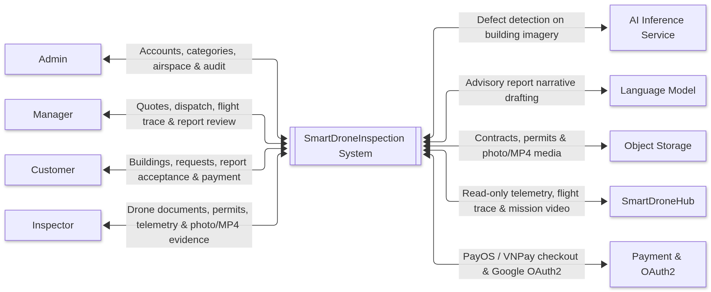
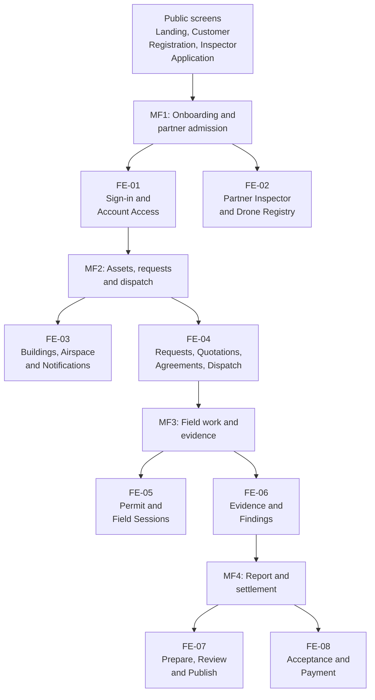
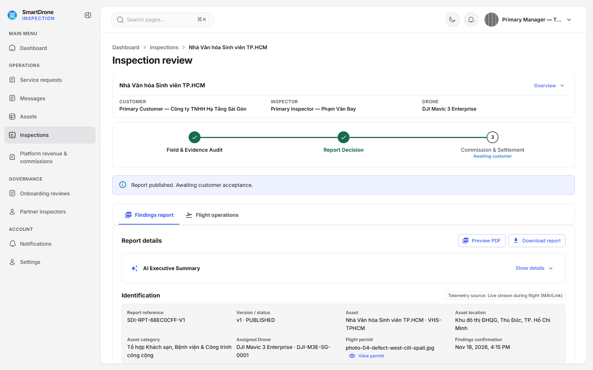
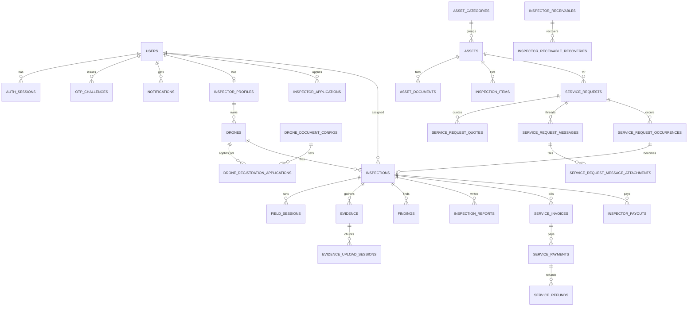

# III. Software Requirement Specification

## 1. Product Overview

SmartDroneInspection is a Platform Inspection Service for buildings. A Platform coordinates customer organizations that own buildings and partner drone inspectors who fly the missions. The service records preparation and field results; it does not pilot or control aircraft, and it does not depend on a drone-operation platform.

The scope is limited to buildings, in six supported categories: high-rise office and curtain-wall towers, residential apartment towers, commercial malls and podiums, industrial factories and warehouses, hotel, hospital and public complexes, and telecom rooftop masts with antenna structures. Bridges, transmission towers, solar farms, roads, dams, tunnels, ports, and pipelines are excluded, and every defect class and inspection checkpoint shipped with this release is building-specific.

Four roles sign in. `ADMIN` is the Platform Administrator and `MANAGER` the Platform Manager; `CUSTOMER` is the Customer Organization Manager or Owner, and `INSPECTOR` is a Partner Drone Inspector. There is no fifth login role. The four automated actors — `SYSTEM` (lifecycle gates, notices, assignment timeouts), `YOLO11` (defect detection with vision fallback), `LLM` (advisory narrative and executive summaries), and `DroneKnowledgeAI` (tenant-isolated historical-case and engineering-standard retrieval over `pgvector`) — are not login roles and cannot make a decision that a human is required to make.

The lifecycle runs through four main flows, two features each. `MF1` admits the parties: a partner inspector applies with licence details and is provisioned only after review, and a customer registers its organization and first building subject to airspace screening. `MF2` turns need into agreement: buildings and their reference documents, a one-time or recurring request, an order chat, a VND quotation, an offline signed agreement recorded against the request, and cross-organization dispatch of an inspector and drone to each occurrence. `MF3` delivers the field work: a flight permit that a second person must verify, an on-site field session, evidence capture, and human-confirmed findings. `MF4` closes the engagement: an independently reviewed and published report, customer acceptance with online settlement, partner payouts and refunds, and an optional re-inspection that re-assesses each confirmed defect.

Building owners, platform staff, and partner inspectors are the four human actors; the detection service, the language model, the `DroneKnowledgeAI` retrieval advisor, object storage, the ground-station hub, and the payment and identity gateways are supporting systems. The platform coordinates their work but does not control an aircraft.

*Figure 7.2 — System context and external integrations.*

## 2. User Requirements

The platform serves four human actors and a set of automated and external ones.

`ADMIN` governs the platform: accounts, the building category catalogue, pilot-licence classes, the required drone document configuration, finance settings, and AI inference settings, and reviews customer airspace cases, partner inspector applications, and drone registrations.

`MANAGER` coordinates delivery: inspector and drone records, customer service requests, VND quotations, signed agreements, dispatch, independent report review and publication, and partner payouts.

`CUSTOMER` acts for a building owner: registering the organization and its first building, maintaining buildings, inspection checkpoints, and reference documents, raising one-time or recurring requests, negotiating and accepting quotations, following progress, accepting published reports, and paying the service fee.

`INSPECTOR` is a partner pilot: applying publicly with licence details, registering owned drones against the required documents, uploading the mission flight permit, conducting the assigned field session, providing evidence, confirming findings, and preparing and submitting the report.

Supporting actors are the automated system, the external payment and identity services, and the optional ground-station hub. None of them can confirm a finding, approve a permit, publish a report, or clear a location for flight.

**Actors**

| # | Actor | Description |
| --- | --- | --- |
| 1 | `ADMIN` | Platform administrator. Governs accounts, building categories, licence classes, drone document requirements, finance and AI settings, and reviews airspace cases, partner applications, and drone registrations. |
| 2 | `MANAGER` | Platform manager. Coordinates partners, requests, quotations, agreements, dispatch, independent report review and publication, and payouts. |
| 3 | `CUSTOMER` | Customer organization representative. Registers and maintains the organization and its buildings, requests inspections, negotiates and accepts quotations, accepts reports, and pays. |
| 4 | `INSPECTOR` | Partner drone inspector. Applies for admission, registers owned drones, conducts assigned field work, confirms findings, and submits reports. |
| 5 | Automated System and AI Actors | `SYSTEM` runs lifecycle gates, notices, and assignment timeouts; `YOLO11` detects candidate defects with a vision fallback; `LLM` drafts advisory narrative and executive summaries; `DroneKnowledgeAI` retrieves tenant-isolated historical defect cases and engineering standards over `pgvector`. All automated output is advisory. |
| 6 | External Payment and Identity Services | Google OAuth2 sign-in, PayOS VietQR, and VNPay settlement. These do not replace the platform's authorization or review obligations. |
| 7 | SmartDroneHub | An optional ground-station integration supplying read-only telemetry, flight traces, and mission video. It receives no flight commands. |

```mermaid
%% title: Use Case Diagram
flowchart TD
  ADMIN["ADMIN"]
  MANAGER["MANAGER"]
  CUSTOMER["CUSTOMER"]
  INSPECTOR["INSPECTOR"]
  PUBLIC["Prospective Inspector"]
  AI["Automated advisory support"]
  HUB["SmartDroneHub"]
  GOV["Govern accounts and settings"]
  REVIEW["Review applications and records"]
  APPLY["Apply as partner inspector"]
  REGISTER["Register organization and building"]
  LEGACY["Manage buildings and drones"]
  COMMERCIAL["Request, negotiate and accept quote"]
  DISPATCH["Assign partner and dispatch"]
  PUBLISH["Review and publish report"]
  FINANCE["Manage payouts and refunds"]
  FIELD["Verify permit and record session"]
  EVIDENCE["Provide evidence and confirm findings"]
  PREPARE["Prepare and submit report"]
  PAYMENT["Accept report and pay fee"]
  ADMIN --> GOV
  ADMIN --> REVIEW
  MANAGER --> REVIEW
  MANAGER --> COMMERCIAL
  MANAGER --> DISPATCH
  MANAGER --> PUBLISH
  MANAGER --> FINANCE
  CUSTOMER --> REGISTER
  CUSTOMER --> LEGACY
  CUSTOMER --> COMMERCIAL
  CUSTOMER --> PAYMENT
  PUBLIC --> APPLY
  INSPECTOR --> LEGACY
  INSPECTOR --> FIELD
  INSPECTOR --> EVIDENCE
  INSPECTOR --> PREPARE
  AI --> EVIDENCE
  HUB --> FIELD
  GOV ~~~ COMMERCIAL
  REGISTER ~~~ COMMERCIAL
```

**Use Cases**

| ID | Use Case | Actors | Use Case Description |
| --- | --- | --- | --- |
| UC-01 | Sign In and Manage Account | All roles | Users sign in by password, one-time code, or Google, manage their account information, and end their own sessions. |
| UC-02 | Govern Platform Accounts and Catalogs | `ADMIN`, `MANAGER` | Staff manage accounts and the building category catalogue; `ADMIN` maintains licence classes, drone document configuration, and finance and AI settings. |
| UC-03 | Register Customer Organization and First Building | `CUSTOMER`, public | A prospective customer registers its organization with a first building; airspace screening may refuse, hold for review, or admit the registration. |
| UC-04 | Manage Buildings, Checkpoints and Documents | `CUSTOMER` | Customers maintain buildings, their inspection checkpoints, and reference documents, and may retire buildings no longer in service. |
| UC-05 | Submit and Review Partner Inspector Application | Public, `INSPECTOR`, `ADMIN`, `MANAGER` | A prospective inspector applies publicly with licence details and a scan; staff review, approve, or reject, and approval provisions the account. |
| UC-06 | Register and Review Inspector-Owned Drones | `INSPECTOR`, `ADMIN`, `MANAGER` | An inspector registers an owned drone with photographs, capabilities, and required documents; staff review it before it becomes assignable. |
| UC-07 | Request Inspection, Negotiate and Accept Quotation | `CUSTOMER`, `MANAGER` | A customer submits a one-time or recurring request, exchanges messages with the manager, and accepts the active VND quotation. |
| UC-08 | Record Signed Agreement and Arrange Occurrences | `MANAGER`, `CUSTOMER` | After the parties sign offline, the manager records the signed document; a recurring request covers the occurrences in its agreed term. |
| UC-09 | Assign, Reschedule, Reassign or Cancel an Inspection | `MANAGER`, `INSPECTOR`, Automated System | The manager assigns a qualified inspector and eligible drone to an occurrence; after an abort the manager may reschedule, reassign, or cancel. |
| UC-10 | Provide and Verify Mission Flight Permit | `INSPECTOR`, `MANAGER`, `ADMIN` | The inspector uploads the permit with structured metadata; a different manager or administrator verifies it before field work may start. |
| UC-11 | Record Field Session | `INSPECTOR` | The inspector records start, completion, or abort with the required safety note and an outcome or reason. |
| UC-12 | Capture Flight Evidence | `INSPECTOR`, SmartDroneHub | The inspector supplies read-only telemetry, imports a flight log, or receives mission video, and the trace is reviewable afterwards. |
| UC-13 | Review Airspace Information | All roles | Users review airspace information relevant to building and mission locations; it is advisory and not permission to fly. |
| UC-14 | Provide Inspection Evidence | `INSPECTOR`, `MANAGER`, `CUSTOMER` | Inspectors upload photographs and video and associate them with structural locations; authorised users review them within their responsibilities. |
| UC-15 | Review Candidate Findings and Confirm Findings | `INSPECTOR`, Automated System | The service proposes candidate defects; the inspector accepts, edits, rejects, or supplements each, and confirms the baseline. Only confirmed findings become official. |
| UC-16 | Prepare and Submit Inspection Report | `INSPECTOR`, Automated System | The report author prepares and submits the report for independent review; the drafted summary is advisory material only. |
| UC-17 | Independently Review and Publish Inspection Report | `MANAGER`, `ADMIN` | A reviewer who is not the author reviews the report, approves or returns it with reasons, and publishes the approved official report. |
| UC-18 | Follow Inspection, Accept Report and Pay | `CUSTOMER`, `MANAGER`, Payment Service | Customers follow progress, review the published report, record acceptance, and settle the fee through PayOS or VNPay. |
| UC-19 | Manage Partner Settlement, Payouts and Refunds | `MANAGER` | The manager records inspector payouts against verified customer payment, completes evidence-backed refunds, and records receivable recovery. |
| UC-20 | View Dashboard, Calendar and Notifications | All roles | Users review operational information, schedules, progress, and notices within their authorised scope. |
| UC-21 | Review Activity History | Authorised roles | Authorised users review attributable records of onboarding, commercial, inspection, payment, and acceptance decisions. |

## 3. Functional Requirements

### 3.1 System Functional Overview

SmartDroneInspection supports eight product features (`FE-01` to `FE-08`) across four main flows (`MF1` to `MF4`), two features per flow: onboarding and partner admission; building assets, requests and dispatch; field work, evidence and defect detection; and report publication with acceptance and settlement. The product scope is limited to **building structures**; every other infrastructure domain is excluded. The requirements below describe required service outcomes and business controls.

The service is delivered through four web portals, one per login role, and a Customer mobile application. Each portal exposes only the navigation sections its role may reach; a section a role may not use has no route at all rather than being hidden in the interface.

#### 3.1.1 Screens Flow

#### 3.1.2 Screen Descriptions

The screens below are the implemented application surfaces. Screenshots were captured from the running system with seeded data.

| # | Feature | Screen | Description |
| --- | --- | --- | --- |
| 1 | — | Public landing page | Introduces the service, its three flows, and the entry points to sign-in and registration. |
| 2 | FE-01 | Customer organization registration | Two-step public form collecting the responsible person, organization identity, and the initial building with its location for airspace screening. |
| 3 | FE-01, FE-02 | Partner Inspector application | Public form collecting Inspector identity, pilot-licence details, and a licence scan for platform review. Accounts are created only after approval. |
| 4 | FE-01 | Sign-in | Credential sign-in with a one-time-code path and Google sign-in; routes the user to the portal for their role. |
| 5 | FE-01 | Password reset | Sends a one-time code and sets a new password. |
| 6 | FE-01 | Admin dashboard | Platform-wide counts of accounts, applications, buildings, and inspections, with recent activity. |
| 7 | FE-02 | Onboarding reviews | Queue of pending customer airspace cases, partner Inspector applications, and drone registration applications awaiting a platform decision. |
| 8 | FE-02 | Platform accounts | Administrator-managed account list with activation, deactivation, and forced-password-change actions. |
| 9 | FE-02 | Building asset catalogue | Maintains the six building categories available to Customers. |
| 10 | FE-02 | UAV licence classes | Maintains the pilot-licence classes used for assignment qualification. |
| 11 | FE-02 | Required drone documents | Maintains the set of registration, ownership, and technical-inspection documents an Inspector must supply. |
| 12 | FE-02 | Finance settings | Maintains the platform commission, VAT, and personal-income-tax rates used in settlement. |
| 13 | FE-04 | Admin service requests | Read-only assignment registry letting `ADMIN` assign, reassign, or unassign request ownership. |
| 14 | FE-02 | Admin buildings | Platform-wide building list across all customer organizations. |
| 15 | FE-06 | AI settings | Maintains the singleton inference configuration: auto-confirm threshold and fallback preference. |
| 16 | FE-01 | Manager dashboard | Workload summary for the Manager's assigned requests, inspections, and reports awaiting review. |
| 17 | FE-04 | Manager service requests | Request queue with status chips and a four-stage progress subtitle; supports claiming unassigned requests and stepping into the quotation. |
| 18 | FE-04 | Manager messages | Dedicated inbox carrying the order-chat negotiation for assigned requests, with attachments. |
| 19 | FE-03 | Manager buildings | Building records across the customer organizations the Manager serves. |
| 20 | FE-05, FE-06 | Manager inspections | Every inspection occurrence with its assignment, readiness, and delivery state. |
| 21 | FE-07 | Manager reports | Report queue filtered to occurrences whose report is submitted for review or already published. |
| 22 | FE-02 | Partner inspectors | Inspector roster with partner status, pilot-licence class and expiry, and linked drone eligibility. |
| 23 | FE-05 | Inspection workspace — tracking | Occurrence summary, lifecycle position, and the role-appropriate next action. |
| 24 | FE-05 | Inspection workspace — permit | Permit upload with structured metadata and the verification outcome. |
| 25 | FE-05 | Inspection workspace — pre-flight checklist | Configurable pre-flight safety checklist recorded before the session starts. |
| 26 | FE-05 | Inspection workspace — field session | Start, complete, or abort the on-site session with the required notes. |
| 27 | FE-05 | Inspection workspace — post-flight checklist | Configurable post-flight checklist recorded at closure. |
| 28 | FE-06 | Inspection workspace — evidence | Photograph and video intake, resumable video upload, thumbnail review, and video keyframe extraction. |
| 29 | FE-06 | Inspection workspace — findings | Candidate defect proposals with confidence, human confirmation, and manual finding entry with a bounding box. |
| 30 | FE-06 | Inspection workspace — report | Report preparation, AI-drafted summary, submission, and the published version. |
| 31 | FE-05, FE-06 | Inspection workspace — audit | Attributable decision history for the occurrence. |
| 32 | FE-07, FE-08 | Inspection workspace — review and settlement | Reviewer decision panel and the payout, refund, and receivable ledger. |
| 33 | FE-01 | Customer dashboard | Summary of the organization's buildings, active requests, upcoming inspections, and outstanding payment. |
| 34 | FE-04 | Customer service requests | Create a one-time or recurring request and follow it through quotation, acceptance, and agreement. |
| 35 | FE-04 | Customer messages | Order-chat negotiation with the assigned Manager, including attachments. |
| 36 | FE-03 | Customer buildings | Building inventory with inspection checkpoints and uploaded reference documents. |
| 37 | FE-05 | Customer inspections | Occurrences for the organization with progress and the next available action. |
| 38 | FE-07, FE-08 | Customer reports | Published reports available for review, acceptance, and payment. |
| 39 | FE-01 | Inspector dashboard | The Inspector's assigned workload, upcoming occurrences, and credential-expiry warnings. |
| 40 | FE-05 | Inspector inspections | Assigned occurrences with readiness state and entry into the inspection workspace. |
| 41 | FE-02 | My drones | Drone registration applications with photographs, capabilities, checklist items, and uploaded documents. |
| 42 | FE-01 | Notifications | In-app notices with read state, deduplicated per event. |
| 43 | FE-01 | Settings | Profile, security, and notification preferences for the signed-in user. |

*Figure 7.3 — Public landing page.*

*Figure 7.4 — Customer building inventory.*

*Figure 7.5 — Manager report review and settlement.*

#### 3.1.3 Screen Authorization

The matrix below states which roles may use each screen. A visible screen is not by itself permission to act: organization ownership, work assignment, qualification, and separation of duties are enforced in addition to role. A section a role may not use is not routed for that role at all. The last two rows record the data-scope rule that applies across every screen.

| Screen | `ADMIN` | `MANAGER` | `CUSTOMER` | `INSPECTOR` |
| --- | :---: | :---: | :---: | :---: |
| Public landing, registration, Inspector application | X | X | X | X |
| Sign-in, password reset, account settings | X | X | X | X |
| Dashboard | X | X | X | X |
| Onboarding reviews | X | X |  |  |
| Platform accounts | X | X |  |  |
| Partner inspectors roster |  | X |  |  |
| Building asset catalogue | X |  |  |  |
| UAV licence classes | X |  |  |  |
| Required drone documents | X |  |  |  |
| Finance settings | X |  |  |  |
| AI settings | X |  |  |  |
| Service requests | X | X | X |  |
| Messages |  | X | X |  |
| Buildings | X | X | X |  |
| Inspections | X | X | X | X |
| Reports | X | X | X | X |
| My drones |  |  |  | X |
| Notifications | X | X | X | X |
| Query All Data | X | X |  |  |
| Query Own Data |  |  | X | X |

`Query All Data` means the role may list records across the whole platform or across every customer organization it serves. `Query Own Data` means the list is restricted to the acting user's own organization or own work assignment. `ADMIN` and `MANAGER` are additionally subject to the ownership and assignment rules in §5.1; a Manager sees only requests they hold, and an Inspector sees only occurrences assigned to them.

#### 3.1.4 Non-Screen Functions

These capabilities have no dedicated screen of their own; they run inside a user action, on a schedule, or in response to a domain event.

| # | Feature | System Function | Description |
| --- | --- | --- | --- |
| 1 | FE-01 | Airspace position screening | Compares a building's coordinates with the configured airspace zones and returns a prohibited, review-required, or clear outcome. |
| 2 | FE-01 | One-time-code issue and verify | Issues and validates short-lived codes for registration, sign-in, and password reset, with per-IP rate limiting. |
| 3 | FE-01 | Session issuance and refresh rotation | Issues access and refresh credentials, rotates the refresh token, and records the prior hash so a replayed token can be detected. |
| 4 | FE-02 | Pilot-licence expiry sweep | A scheduled job that flags Inspectors whose licence has lapsed and notifies them and the platform. |
| 5 | FE-03 | Building-inspection item seeding | Generates the default inspection checkpoints for a building from its category on registration. |
| 6 | FE-04 | Occurrence materialization | Creates the individual inspection occurrences covered by an accepted recurring agreement. |
| 7 | FE-03 | Duplicate-notification suppression | Deduplicates lifecycle notices so a retried event does not produce a second notice. |
| 8 | FE-04 | Schedule-conflict detection | Detects overlapping Inspector or drone commitments across all customer organizations before assignment. |
| 9 | FE-04 | Quotation validity evaluation | Revalidates pilot licence and drone registration against every scheduled occurrence before a quote is saved or accepted. |
| 10 | FE-05 | Permit verification reset | Returns an approved permit to pending review when the drone is changed or the schedule moves outside the permit window. |
| 11 | FE-05 | Inspection lifecycle monitor | A scheduled job that advances or flags occurrences whose scheduled window has passed without the expected session activity. |
| 12 | FE-05 | Flight-log import and normalisation | Parses an imported SRT, CSV, KML, or GPX log and normalises available position, time, altitude, speed, heading, and battery values, marking absent fields as unavailable. |
| 13 | FE-06 | Image normalization and thumbnailing | Extracts available capture metadata, normalises oversized or rotated photographs, and generates a thumbnail alongside the original. |
| 14 | FE-06 | Asynchronous video processing | Transcodes a resumable video upload into a bounded H.264 rendition with a poster image, retaining the source until both outputs are verified. |
| 15 | FE-06 | Duplicate evidence disambiguation | Detects a repeated filename in an inspection and saves it with a sequential suffix rather than rejecting the upload. |
| 16 | FE-06 | Candidate defect inference | Runs the self-hosted detection model over evidence and records candidate defects with model name and confidence. |
| 17 | FE-07 | Advisory narrative drafting | Sends the confirmed inspection context to the language model once and stores the returned narrative as clearly labelled advisory draft text. |
| 18 | FE-07 | Deterministic report rendering | Renders the report to PDF from a fixed template of numbered sections; the PDF text is not model-generated. |
| 19 | FE-08 | Payment gateway callback verification | Verifies the signature of a PayOS or VNPay callback before treating a payment as settled. |
| 20 | FE-08 | Invoice and settlement derivation | Derives the service invoice, Inspector payout eligibility, commission, and tax components from a verified payment. |

#### 3.1.5 Entity Relationship Diagram

The persisted model comprises 45 application tables (44 JPA runtime entity tables; 47 total tables in `public` including `event_publication` and `flyway_schema_history`) applied as a consolidated `V1` baseline plus six forward migrations through `V62__inspection_knowledge_rag.sql`. The `pgvector` extension backs the `DroneKnowledgeAI` case and standard stores. The diagram shows the principal entities and their relationships; reporting-only helpers such as audit, outbox, session, and configuration tables are omitted for legibility but are described in Report 4 §2.

**Entities Description**

| # | Entity | Description |
| --- | --- | --- |
| 1 | `users` | Platform account with exactly one role, lockout and one-time-code state, and a per-user preference controlling whether advisory inference fallback may be used. |
| 2 | `auth_sessions` | Refresh session for a signed-in client, recording the current and previous refresh-token hashes so rotation and replay can be detected. |
| 3 | `otp_challenges` | Short-lived one-time code for registration, sign-in, or password reset, with attempt count and expiry. |
| 4 | `audit_events` | Attributable record of an important decision: actor, action, subject, prior and new status, trace identifier. |
| 5 | `prospective_customer_registrations` | Pre-account customer application holding organization identity, initial building, and the airspace review outcome. |
| 6 | `pilot_license_classes` | Catalogue of pilot-licence classes used to qualify an Inspector for an aircraft weight category. |
| 7 | `event_publication` | Transactional outbox row for a domain event awaiting publication to a listener. |
| 8 | `asset_categories` | Catalogue of building categories; only active building categories are offered when a Customer registers an asset. |
| 9 | `assets` | Customer-owned building with location, structural profile, and lifecycle state. |
| 10 | `asset_documents` | Reference document attached to a building, stored by object key with a checksum. |
| 11 | `inspection_items` | Individual inspection checkpoint defined for a building. |
| 12 | `checklist_templates` | Configurable pre-flight and post-flight checklist row. |
| 13 | `drones` | Registered aircraft with a single ownership scope, weight category, and serviceability state. |
| 14 | `drone_document_configs` | Administrator-configured set of documents an Inspector must supply for drone registration. |
| 15 | `drone_feature_configs` | Administrator-configured catalogue of drone features and safety checklist items. |
| 16 | `drone_registration_applications` | Inspector drone registration or renewal submission with its documents and review outcome. |
| 17 | `inspections` | Inspection occurrence: lifecycle status, assignment, flight-permit block, and schedule. |
| 18 | `field_sessions` | On-site session with telemetry source, flight trace, and computed flight metrics. |
| 19 | `evidence` | Photograph or video evidence with processing state, storage keys, and its source-video lineage. |
| 20 | `evidence_upload_sessions` | State of a resumable chunked upload for a large video. |
| 21 | `findings` | Confirmed or candidate building defect with its bounding region and the model confidence where applicable. |
| 22 | `inspection_reports` | Versioned inspection report with its status, return reason, and advisory summary. |
| 23 | `inspector_reliability_events` | Assignment and field reliability signal recorded against an Inspector. |
| 24 | `reinspection_defect_verifications` | Verification outcome recorded when a defect is re-examined in a later inspection. |
| 25 | `service_requests` | One-time or recurring inspection request raised for a building, with its owner customer and assigned Manager. |
| 26 | `service_request_quotes` | VND quotation stating scope, timing, price per occurrence, and required drone features; partner assignment is recorded later at dispatch. |
| 27 | `service_request_occurrences` | Individual occurrence covered by a request, carrying its own schedule and delivery state. |
| 28 | `service_request_messages` | Order-chat message exchanged between the Customer and the assigned Manager. |
| 29 | `service_request_message_attachments` | File attached to an order-chat message. |
| 30 | `inspection_messages` | Per-inspection chat between the assigned inspector and the customer, separate from the commercial order thread. |
| 31 | `inspection_message_attachments` | Private inspection-chat attachment metadata with MIME type, size, and checksum. |
| 32 | `service_invoices` | Service invoice derived from an accepted occurrence. |
| 33 | `service_payments` | Customer payment against an invoice, including refunded amount and refund state. |
| 34 | `service_refunds` | Refund allocation across Inspector payout reduction, platform commission, VAT, personal income tax, and platform absorption. |
| 35 | `inspector_payouts` | Amount payable to an Inspector following verified customer payment. |
| 36 | `inspector_receivables` | Amount owed back by an Inspector after a refund against an already-disbursed payout. |
| 37 | `inspector_receivable_recoveries` | Recorded recovery of an Inspector receivable. |
| 38 | `inspection_finance_settings` | Singleton rates for platform commission, VAT, and personal income tax. |
| 39 | `inspector_applications` | Public partner Inspector application with identity, licence details, and review outcome. |
| 40 | `inspector_profiles` | Approved Inspector profile holding licence data and partner status. |
| 41 | `inspector_flight_logs` | Intake record for an imported flight log, including non-MAVLink source formats. |
| 42 | `notifications` | In-app or email notice with its deduplication key and read state. |
| 43 | `platform_ai_settings` | Singleton inference configuration holding the auto-confirm flag and its confidence threshold. |
| 44 | `platform_operations_settings` | Singleton operations settings, including assignment acceptance timeout and dispatch defaults. |
| 45 | `inspection_knowledge_chunks` | Stores the eight seeded engineering-standard/guideline chunks that ground `DroneKnowledgeAI` (`V62`): standard code, title, asset-category code, defect patterns, severity, guidance text, reference URL, and a `vector(1536)` embedding with an HNSW `vector_cosine_ops` index for cosine retrieval. |
| 46 | `historical_finding_cases` | Stores six anonymized benchmark cases and confirmed findings indexed automatically at report publication (`V62`), with organization/asset references, defect label, severity, notes, outcome, anonymized flag, and a `vector(1536)` embedding; retrieval is tenant-isolated and excludes the current inspection. |

The model separates four coordinated areas. **Identity and onboarding** covers accounts, sessions, one-time codes, the two application records, and the building catalogue. **Commercial** covers the request, its quotation, its negotiation messages, its occurrences, and the recorded agreement. **Inspection** covers the occurrence, its field sessions and flight logs, its evidence and upload sessions, its findings, and its report versions. **Finance** covers the invoice, the customer payment, the Inspector payout, refunds with their allocations, receivables and their recovery, and the settings that parameterize the split.

---

### 3.2 MF1 — FE-01 Registration, Sign-in and Account Access

This feature admits the two sides of the marketplace and secures every later action. A customer organization registers with its first building under airspace screening, and every user signs in through a credential, one-time-code, or federated path that resolves to exactly one role.

#### 3.2.1 Customer Registration and User Sign-in
- **Function trigger**: A prospective Customer registers an organization and its first building, or a user signs in.
- **Actors**: All Roles; prospective Customer; automated identity service.
- **Function description**: Register customer organizations subject to airspace screening of their first building, and provide authorized users with secure access to their assigned responsibilities.
- **Screen layout (mock-up)**: A two-step public registration form followed by a sign-in screen. See the screen figures in §3.1.2.
- **Requirements**:
  - Customer registration collects a responsible person, organization identity, and the initial building's location and description. The building is classified against the six building categories.
  - A location inside a prohibited airspace zone is not eligible for registration. A location requiring review remains pending until `ADMIN` records a decision. A location that passes screening may proceed; this is not legal flight clearance.
  - Users sign in by password, by a one-time code, or through Google. After successful sign-in the user is routed to the portal matching their single role.
  - After five consecutive unsuccessful password attempts, sign-in is temporarily restricted for fifteen minutes. Sign-in and one-time-code requests are rate limited per client address.
  - Password reset requires a verified one-time code and enforces the password policy.
- **Normal cases**: A Customer whose initial building passes screening completes organization onboarding; an authorized user signs in and reaches the portal for their role.
- **Abnormal cases**: A prohibited location is not accepted; a case requiring review cannot be treated as approved until a decision is recorded; incorrect credentials do not grant access; an expired or already-used one-time code is rejected.

#### 3.2.2 Account Management and Four-Role Access
- **Function trigger**: A user updates account information, changes a password, or ends an active session.
- **Actors**: All Roles.
- **Function description**: Maintain account access according to the four canonical roles and the user's organization, partner relationship, and work assignment.
- **Screen layout (mock-up)**: Account settings with profile, security, and notification sections. See the screen figures in §3.1.2.
- **Requirements**:
  - Recognized roles are `ADMIN`, `MANAGER`, `CUSTOMER`, and `INSPECTOR`. A user holds exactly one role.
  - `CUSTOMER` access is limited to its own organization. An `INSPECTOR` may access only assigned inspections. `ADMIN` and `MANAGER` access is limited to their platform responsibilities, and a Manager may act only on requests they hold.
  - Users may update their own full name and phone number through the authenticated profile; the service validates and persists these fields. Email and role remain read-only in this self-service flow.
  - Account or role changes and user-requested session revocation take effect for active access. Historical activity remains attributable to the responsible user.
  - A role, an account, or a visible screen does not confer legal aviation authority, professional qualification, or authority to bypass a review gate.
- **Normal cases**: Users manage their own permitted account information and reach only the records and activities within their authorized scope.
- **Abnormal cases**: Attempts to reach another organization's records, an unassigned inspection, or an action outside the user's role are denied.

---

### 3.3 MF1 — FE-02 Partner Inspector and Drone Registration

Partner supply enters only through review. A public applicant supplies licence evidence; platform staff decide, and approval is what creates the inspector account. The inspector then registers owned drones against the required document set, and each drone is reviewed before it can be dispatched.

#### 3.3.1 Partner Inspector Application and Qualification Records
- **Function trigger**: A prospective partner Inspector submits a public application, or platform staff review and decide on it.
- **Actors**: Public, `ADMIN`, `MANAGER`, `INSPECTOR`.
- **Function description**: Admit partner drone inspectors through a reviewed application, and maintain the pilot-qualification records that govern their eligibility for assignment.
- **Screen layout (mock-up)**: A public application form collecting identity, pilot-licence details, and a licence scan; a review queue showing each pending application with its scan; and the partner Inspector roster with licence class and expiry.
- **Requirements**:
  - The application is public and requires no account. It collects Inspector identity, contact details, pilot-licence number, licence class, expiry, and a scanned copy of the licence.
  - A submitted application creates no account. An `INSPECTOR` account is provisioned only when platform staff approve the application, and the licence record is created in the same step.
  - Approval or rejection requires an attributable decision from a `MANAGER` or `ADMIN`. Rejection requires a written reason and notifies the applicant with it.
  - Drone ownership is not a condition of admission; an approved Inspector may apply with no registered drone.
  - The applicant's email must be unique across accounts and open applications. A duplicate account or a second open application for the same email is rejected.
  - After approval the signed partner contract is recorded against the application. An Inspector may later renew licence details and re-upload the licence scan.
  - Historical flight missions an Inspector records are retained as attribution records and are visible to platform staff.
- **Normal cases**: A prospective Inspector submits a complete application with a licence scan; staff approve it; the account and licence record are provisioned and the applicant is notified.
- **Abnormal cases**: A missing licence number, scan, recognized class, or future expiry prevents approval; a duplicate email or a second open application is rejected; a rejection without a reason is not accepted; a non-reviewer cannot decide an application.

#### 3.3.2 Inspector-Owned Drone Registration and Review
- **Function trigger**: An approved Inspector submits or renews a registration for an owned drone, and platform staff review it.
- **Actors**: `INSPECTOR`, `ADMIN`, `MANAGER`.
- **Function description**: Register the drones a partner Inspector owns, and record the platform decision that makes a drone eligible for assignment.
- **Screen layout (mock-up)**: A drone registration screen with photographs, structured capabilities, configurable feature and safety-checklist items, and the required document set. See the screen figures in §3.1.2.
- **Requirements**:
  - An Inspector drone registration includes identifying details, at least one real drone photograph, structured outdoor flight capabilities (maximum wind resistance, optical zoom, thermal camera, RTK positioning), selected feature and safety-checklist items configured by `ADMIN`, and the supporting documents defined by the administrator-configured requirements. Registration and ownership documents are required by default; the technical-inspection document is optional unless enabled.
  - An Inspector may submit a renewal or update for an existing active drone they own. A duplicate serial for a drone owned by another party, or a second application while one is already pending, is rejected.
  - `ADMIN` or `MANAGER` reviews the registration and records an attributable decision. Only an accepted drone may be assigned to its owning Inspector.
  - Drone records are classified by maximum take-off weight into the five categories of Article 4 of Decree 288/2025/ND-CP. An airframe at 2.0 kg or above requires the assigned Inspector to hold a recognized Class B licence (Article 27). Unknown licence class or unknown weight fails eligibility; Class A is eligible only for known airframes below 2.0 kg.
  - A drone is eligible only while its serviceability is active and its registration number, evidence file, and expiry are present and current for the planned flight start. Expired or incomplete registration excludes the drone from selectable inventory, and permit upload and session start revalidate current validity.
  - An Inspector may mark an owned drone as unavailable for maintenance or retire it permanently.
- **Normal cases**: An `ADMIN` configures the required drone document set and the capability and safety checklist; an Inspector submits photographs, capabilities, and documents; after approval the drone becomes assignable.
- **Abnormal cases**: A missing required document, a missing photograph, a duplicate serial owned by another party, an unrecognized licence class, an unknown weight category, or an unresolved review prevents the drone from being used.

---

### 3.4 MF2 — FE-03 Buildings, Airspace Screening and Notifications

A building is the unit of work. The customer records its structure, checkpoints, and reference documents, and the platform screens its coordinates before any request can target it. Recurring requests materialize dated occurrences on acceptance, and lifecycle events reach the responsible users through a deduplicated inbox.

#### 3.4.1 Customer Buildings, Inspection Checkpoints and Documents
- **Function trigger**: A Customer registers or updates a building, attaches a reference document, or retires a building no longer in service.
- **Actors**: `CUSTOMER`, `ADMIN`, `MANAGER`.
- **Function description**: Maintain customer building records, their inspection checkpoints, and reference documents, and screen every building location against airspace constraints before it can be inspected.
- **Screen layout (mock-up)**: A building inventory with status, category, height, footprint, coordinates and checkpoints, with a detail panel for reference documents. See the screen figures in §3.1.2.
- **Requirements**:
  - A building record identifies the structure, its location and **building category**, and the inspection checkpoints relevant to it. Related reference documents may be attached.
  - Building creation is blocked for a location identified as prohibited airspace; a location requiring review follows the human review process.
  - The in-scope categories are the six platform-managed building categories. Categories outside the building domain cannot be registered.
  - Inspection checkpoints are seeded from the selected category on creation and may be adjusted afterwards. The recorded set travels with the building so historical inspections remain interpretable.
  - Reference documents are stored with a checksum, and a duplicate upload of identical bytes for the same building is rejected.
  - Retiring a building is terminal for new work: it preserves its inspection history and blocks new service requests against it.
  - `ADMIN` maintains the building category catalogue; a by-category change does not retroactively rewrite checkpoints already captured against existing buildings.
- **Normal cases**: A Customer registers an eligible building with its checkpoints and reference documents, maintains it over time, and retires it when it leaves service.
- **Abnormal cases**: A prohibited location cannot be registered as an eligible building; a duplicate asset code within the same organization, a duplicate identical document, an empty upload, an out-of-domain category, or an attempt to add a service request against a retired building is rejected.

#### 3.4.2 Recurring Service Requests, Occurrences and Notifications
- **Function trigger**: A Customer submits or updates a recurring service request for a building, or `MANAGER` prepares one of its occurrences.
- **Actors**: `CUSTOMER`, `MANAGER`, Automated System.
- **Function description**: Support recurring inspection requests and the coordination of distinct service occurrences under one agreed request, and inform responsible users about events that require their attention. Planned occurrences are materialized when the recurring request's quotation is accepted; this is not time-based generation.
- **Screen layout (mock-up)**: A request form selecting the building, first date, and cadence, with a schedule preview; a notification list with read state and deep links to the relevant record. See the screen figures in §3.1.2.
- **Requirements**:
  - A new recurring request uses a monthly interval of 1 to 120 months, including the common 1, 3, 6, 9, and 12 month choices. A request is bounded by either 2 to 100 occurrences or an end date producing 2 to 100 occurrences.
  - A new Customer request contains the building, the first requested inspection date, and the one-time or recurring choice. Detailed scope and inspection items are established during Manager quotation, not required in the request form.
  - The first requested date must be at least 20 calendar days after the current date in the platform's `Asia/Ho_Chi_Minh` business timezone. This is a product scheduling lead time, not a statutory deadline.
  - The requested agreement term end is derived from the requested first date and the recurrence bound. The Manager's quoted first occurrence anchors the schedule and must not fall before the requested start or push the planned schedule beyond the requested term.
  - The schedule preview and quotation must use the Customer-requested first date as the anchor; the Manager cannot shift the first occurrence to another date. Calendar-month arithmetic is anchored to the requested day and clamps to the last valid day of shorter months.
  - Before a partner pair is assigned to an occurrence, and before an assignment is applied across the remaining occurrences of a recurring request, the Inspector's licence and the drone's registration must remain valid at every planned occurrence start. If any occurrence falls on or after an expiry instant, the assignment is rejected and no partial schedule is created.
  - Each occurrence, when prepared for delivery, is identifiable by its planned period, assignment, delivery, and payment status, and remains associated with its parent request.
  - Where the parties agree, one signed agreement may cover the occurrences within its stated term. Each occurrence still requires its own assignment, readiness review, inspection, reporting, and settlement.
  - Notices identify the event, when it occurred, and the relevant record or action. The notification service avoids duplicate notices for the same event when processing is retried.
  - Notices cover application decisions, permit submissions and decisions, field aborts, report submissions and returns, publication, payment, and credential expiry.
  - Following a notice never grants access to its target record; normal authorization still applies.
- **Normal cases**: The Customer chooses a building, a first date at least twenty days ahead, and either a one-time or recurring monthly cadence within the occurrence bounds. The parties agree a signed agreement and coordinate each occurrence using the agreed timing and scope. A user receives and reviews a relevant notice and can navigate to an authorized record.
- **Abnormal cases**: An earlier start date is rejected; a schedule resolving to fewer than two or more than one hundred occurrences is rejected; a quotation that cannot fit the agreed term cannot be accepted or materialized; an occurrence is not dispatched if the assigned partner or drone is no longer eligible. A change to frequency or term requires a new agreement. A user cannot view or act on a record outside their organization, role, or assignment because they received a notice.

---

### 3.5 MF2 — FE-04 Service Requests, VND Quotations, Agreements and Dispatch

This feature turns an accepted need into a dispatched mission. One manager owns the request, the parties negotiate in an order chat, a VND quotation states the scope and price, acceptance freezes the terms, the signed paper agreement is recorded, and a qualified pair is assigned to each occurrence.

#### 3.5.1 Service Request, VND Quotation, Negotiation and Signed Agreement
- **Function trigger**: A Customer submits a one-time or recurring request for a building; a Manager claims an unassigned request; `ADMIN` corrects request ownership when needed; the parties negotiate and accept a quotation; and the parties sign an offline agreement.
- **Actors**: `CUSTOMER`, `MANAGER`, `ADMIN` (assignment registry only).
- **Function description**: Establish an agreed inspection scope and commercial terms for a building before inspection work is dispatched.
- **Screen layout (mock-up)**: A request list with status chips and a four-stage progress subtitle, a request detail with quotation panel, and a dedicated messages inbox. See the screen figures in §3.1.2.
- **Requirements**:
  - A new request identifies the building and the requested timing and is one-time or recurring. Detailed scope is agreed in the Manager's quotation. For a one-time request the Customer chooses a single date and the Manager cannot propose a different one. Both one-time and recurring first dates must be at least twenty calendar days ahead in `Asia/Ho_Chi_Minh` business time.
  - Customer and the assigned Manager exchange contextual messages through the dedicated messages inbox (entered via the secondary `Messages` action button on quote review or the left-nav inbox). A dedicated per-inspection messaging channel (`inspection_messages`) also lets Customer and the assigned `INSPECTOR` coordinate site access and field timing via `/operations/messages` and the `Inspector` tab in `/client/messages`, separated from commercial quote threads; `ADMIN` and `MANAGER` cannot access `inspection_messages`. Both channels support text, up to five attachments (PNG, JPG, WEBP, PDF, DOCX; max 10 MiB per file and 20 MiB total), signature/type verification, private object storage, and authorization-scoped preview or download. `ADMIN` cannot read request or inspection messages or attachments. A message does not itself change quotation terms.
  - `MANAGER` issues and edits a single active VND quotation stating scope, timing, price per occurrence, and required drone features. Partner assignment is recorded at dispatch, not in the quotation. For recurring requests the quotation's first occurrence must use the Customer-requested first date as its anchor. The Customer accepts the current active quotation.
  - When the Customer accepts, an immutable snapshot of the agreed terms is stored and the terms are locked against further modification.
  - The parties sign the agreement offline. `MANAGER` records the signed document after execution. A request is not ready for field dispatch until the signed agreement has been recorded.
  - Each request has at most one assigned Manager. Active Managers may claim an unassigned request; claiming and administrator assignment lock the request row so a concurrent claim cannot assign it twice. Only the assigned Manager may view request details or messages, or perform quotation, contract, dispatch, payment, and refund actions. Administrators see an assignment registry only and cannot act as a Manager.
  - In the request list, status uses the shared status-chip style paired with a compact four-stage progress subtitle derived from the request state. A cancelled request is terminal and does not imply progress through the active workflow.
  - For the owning Customer only, the request overview and profile dialog may display the assigned Manager's name, avatar, email, and telephone as read-only contact details (without direct `Email`/`Call` link buttons). Contact attribution is the persisted assignment, not the quotation issuer.
- **Normal cases**: The Customer submits a request; an active Manager claims it, then issues or edits the active VND quotation; the Customer accepts, or messages the Manager to negotiate; terms lock on acceptance; the parties sign; and the assigned Manager records the agreement.
- **Abnormal cases**: A first date inside the twenty-day lead time, a multi-day range on a one-time request, or a recurring quotation that shifts the requested first date is rejected. A competing claim is rejected. A non-assigned Manager cannot inspect or mutate the request. `ADMIN` cannot quote, message, dispatch, or manage finance. An accepted quotation cannot be modified or deleted. Dispatch cannot proceed without an accepted quotation and a recorded signed agreement. A message is not treated as acceptance or as a change in price or scope.

#### 3.5.2 Partner Assignment, Dispatch Recovery and Airspace Information
- **Function trigger**: `MANAGER` assigns an Inspector and owned drone to an agreed occurrence, or responds to an aborted field session.
- **Actors**: `MANAGER`, `ADMIN`, `CUSTOMER`, `INSPECTOR`, Automated System.
- **Function description**: Assign a qualified partner and eligible drone to an occurrence, manage dispatch changes, and provide relevant airspace information.
- **Screen layout (mock-up)**: Assignment panel on the inspection workspace with partner candidates and eligibility reasons, plus a schedule view of commitments.
- **Requirements**:
  - Assignment uses an Inspector and drone eligible for the work. The drone must be owned by that Inspector and must have passed its required review.
  - Eligibility considers current pilot qualification, complete scan evidence, recognized licence class, known drone weight category, current registration evidence and expiry, and overlapping commitments across all customer organizations. Expiry is evaluated against the planned flight start; unknown weight or class, or incomplete or expired registration, fails closed.
  - For recurring requests with multiple unassigned occurrences, `MANAGER` may apply a selected or already-assigned Inspector and owned drone pair across the remaining `PENDING_ASSIGNMENT` occurrences through explicit confirmation (`Apply to remaining` / `Apply this team to the remaining`). Each occurrence is still validated independently for eligibility and schedule conflicts; any conflicting or ineligible occurrence remains `PENDING_ASSIGNMENT` and is reported with the failed count.
  - Pending Inspector assignments in Step 4 enforce an administrator-configurable confirmation deadline (`platform_operations_settings.assignment_acceptance_timeout_hours`, range `1–720` hours, default `24` hours, configured in `/admin/operations-settings`). If an assigned `SCHEDULED` inspection remains `PENDING_ACCEPTANCE` past the configured window since `assignmentRequestedAt`, a scheduled monitor automatically cancels the unaccepted inspection, reverts the linked `ServiceRequestOccurrence` back to `PENDING_ASSIGNMENT` (reopening an `ASSIGNED` parent request to `CONTRACT_SIGNED` and recording `lastTimeoutCancelledAt` / `lastTimeoutInspectorId`), releases the prior Inspector/drone schedule reservation, and notifies the owning `MANAGER` (linking to `/manager/contracts?requestId=...`) to assign another team as well as the timed-out Inspector.
  - Rescheduling revalidates the assigned Inspector's licence and the assigned drone's registration against the proposed start. Reassignment validates both new and retained drone assignments against the inspection start. Permit upload checks credentials at upload time and at planned flight time, and session start rechecks them before work begins.
  - When an already-assigned drone is replaced, assignment confirms that the previously assigned Inspector remains properly qualified.
  - After an abort, `MANAGER` may reschedule, reassign, or cancel the dispatch. The decision and its reason are attributable.
  - Airspace information supports planning but does not certify legal clearance or authorize flight.
- **Normal cases**: An available, qualified Inspector and an eligible owned drone are assigned to an occurrence; after an abort the Manager records an appropriate recovery decision.
- **Abnormal cases**: Conflicting commitments, missing or expired credentials, an unknown or unrecognized licence class, an unknown weight category, incomplete or expired drone registration, an unapproved drone, or a drone not owned by the selected Inspector all prevent assignment or flight readiness.

---

### 3.6 MF3 — FE-05 Flight Permit and On-site Field Sessions

No field work begins without a verified permit. The assigned inspector uploads the mission permit; a different manager or administrator verifies it; the inspector records the pre-flight checklist and the on-site session, and an abort returns the occurrence to the manager for recovery.

#### 3.6.1 Flight Permit Verification
- **Function trigger**: The assigned Inspector uploads a mission flight permit before field work, and a distinct reviewer verifies it.
- **Actors**: `INSPECTOR`, `MANAGER`, `ADMIN`.
- **Function description**: Ensure that each building mission carries a valid, verifiable flight permit before work starts, without implying that the platform grants regulatory clearance.
- **Screen layout (mock-up)**: A permit panel on the inspection workspace showing the uploaded document, its structured metadata, and the verification outcome. See the screen figures in §3.1.2.
- **Requirements**:
  - The permit upload enforces file and integrity validation — non-empty, 25 MB or less, a PDF, PNG, JPG, or WEBP file whose signature matches its declared type, with recorded byte size, content type, and checksum.
  - The upload also requires structured metadata: permit number, issuing authority, validity window, optional drone serial, and optional maximum altitude between 1 and 2000 metres above ground level.
  - The metadata is cross-checked against the planned inspection window and the assigned drone serial. Uploads and replacements are locked once the occurrence leaves the scheduled state.
  - Every uploaded permit enters pending review regardless of the building's airspace classification; there is no automatic approval path.
  - Verification requires a decision of approved or rejected from a distinct `MANAGER` or `ADMIN`, with a mandatory reason on rejection. Approval and rejection notify the assigned Inspector; submission notifies Managers.
  - Starting a field session is blocked until the permit is approved, its validity covers the actual flight time, and the drone serial still matches.
  - Reassigning a different drone or rescheduling outside the permit window returns a previously approved verification to pending review.
- **Normal cases**: The Inspector uploads a permit whose metadata covers the planned window and drone, a reviewer approves it, and the session may begin.
- **Abnormal cases**: Self-review by the submitting Inspector, rejection without a reason, a corrupt or oversized upload, an upload outside the scheduled state, a metadata window that does not cover the plan, or a drone-serial mismatch all block readiness.

#### 3.6.2 On-site Field Session
- **Function trigger**: The assigned Inspector starts a session, completes it, or aborts it.
- **Actors**: `INSPECTOR`, `MANAGER`, SmartDroneHub.
- **Function description**: Record accountable on-site session outcomes for a building inspection, with optional read-only telemetry. The service does not plan routes or control aircraft.
- **Screen layout (mock-up)**: Pre-flight checklist, session start and completion panel, and post-flight checklist, with optional telemetry panel. See the screen figures in §3.1.2.
- **Requirements**:
  - Before field work begins the assigned Inspector supplies the verified permit, current credentials, and an approved drone, and records a pre-flight safety note addressing airframe, battery, and environmental conditions.
  - For an active session the Inspector may start an explicitly selected live telemetry connection or a clearly labelled demonstration. A live stream serves at most one active session, and the hub does not arm, guide, upload flight plans to, or control an aircraft.
  - Telemetry is optional. If the aircraft cannot supply a live connection, the Inspector may import an exported SRT, CSV, KML, or GPX log. Available position, timestamp, altitude, speed, heading, and battery values are normalised; fields absent from the source are shown as unavailable rather than invented.
  - If no supported log is available, the Inspector may submit an accountable manual flight declaration with a reason, estimated duration, optional estimated maximum altitude, and a field note. The declaration is clearly distinguished from telemetry and imported logs.
  - The observed flight report and the GPS flight trace are persisted at closure so the Inspector and authorised reviewers can audit the flown path. Mission video or camera snapshots may be synchronised from the hub into the authenticated evidence store.
  - Completion records the outcome. An abort records the reason and alerts Managers to arrange rescheduling, reassignment, or cancellation.
- **Normal cases**: The Inspector records readiness, starts and completes the session, and provides field evidence. Authorised reviewers can view the persisted report and any available trace after closure.
- **Abnormal cases**: A session cannot start when the permit is missing, pending, rejected, expired, not yet valid, or mismatched with the drone, when credentials or the safety note are missing, or after field work has already been completed. Unsupported, empty, malformed, oversized, or position-less imported logs are rejected. A missing heartbeat prevents live telemetry from being treated as connected.

---

### 3.7 MF3 — FE-06 Evidence Intake and Human-Reviewed Defect Detection

Evidence is the factual base of the report. Photographs and video are normalized and streamed through scoped tickets; the detector proposes advisory candidates; and only the assigned inspector's confirmed baseline becomes the official finding set.

#### 3.7.1 Inspection Evidence Intake and Processing
- **Function trigger**: The assigned Inspector uploads inspection photographs or video during or after a field session.
- **Actors**: `INSPECTOR`, `MANAGER`, `CUSTOMER`, Automated System.
- **Function description**: Accept, normalise, and serve the building evidence that findings and the report are built from, without making the rest of the experience unusable while large media transfers.
- **Screen layout (mock-up)**: An evidence tab with thumbnail grid, upload state, and playback controls. See the screen figures in §3.1.2.
- **Requirements**:
  - A photograph is limited to 10 MB. Available capture metadata is extracted before the image is normalised to at most 2048 px on its longest side, and a 480 px JPEG thumbnail is generated alongside the primary object.
  - Video is uploaded in resumable chunks of 10 MiB up to 2 GiB, and an interrupted upload resumes from the last accepted chunk rather than restarting. A completed upload is transcoded asynchronously to at most 1080p H.264 with faststart and a 480 px poster frame.
  - The raw source of a video is retained until both the primary rendition and the poster are verified. A failed transcode keeps its source and its failure state so an explicit retry remains possible.
  - A repeated filename within the same inspection is saved with a sequential suffix rather than rejected, and the uploader is notified.
  - Stored media is served only through a short-lived, evidence-scoped signed ticket and supports HTTP range requests, so a ticket grants access to that evidence record and nothing else.
  - A video keyframe may be extracted and retained as its own evidence record linked to the source video and its timestamp.
  - Evidence is associated with the inspection and, where applicable, with the field session in which it was captured, and carries its capture time and location when the source supplied them.
- **Normal cases**: The Inspector uploads photographs and video during the session; images are normalised and thumbnailed, video is transcoded in the background, and both are reviewable afterwards.
- **Abnormal cases**: An oversized photograph, an unsupported file type, a zero-byte upload, an expired ticket, or a request outside the viewer's scope is rejected. A missing or mismatched ticket does not grant access to any other evidence record.

#### 3.7.2 Candidate Defect Detection and Findings Confirmation
- **Function trigger**: The assigned Inspector requests analysis of selected evidence, then reviews and confirms the resulting findings.
- **Actors**: `INSPECTOR`, Automated System.
- **Function description**: Propose candidate building defects from the captured evidence and record the Inspector's human-reviewed baseline. Detection output is advisory and never becomes an official finding on its own.
- **Screen layout (mock-up)**: A findings tab listing candidate defects with the highlighted region, label, severity, model name, and confidence, with accept, edit, reject, and manual-entry actions. See the screen figures in §3.1.2.
- **Requirements**:
  - Analysis is available on a selected active photograph or on video keyframes. The self-hosted detection model runs over the image and returns candidate defects with a label, a severity estimate, a normalised bounding box, and a confidence score.
  - When the primary model returns no detections or is unreachable, the configured vision fallback analyses the same image. A user may opt out of the fallback for their own account, in which case no fallback analysis is attempted.
  - Candidates are stored as pending and are visibly labelled advisory. Only the assigned Inspector may accept, amend, or reject them, and only the assigned Inspector may confirm the baseline.
  - A manually created finding carries no model confidence and is distinguishable from a model-detected one. The Inspector may set or adjust the normalised bounding box on a manual finding.
  - Confirming the baseline is an explicit action. Once confirmed, any later edit to findings or evidence resets the confirmation until the Inspector confirms again.
  - Only confirmed findings become official inspection findings and appear in the report.
  - Re-running analysis may replace still-unreviewed candidates while leaving already-reviewed decisions intact.
  - A `RESOLVED` verdict in a re-inspection requires fresh evidence captured during a completed field session of that re-inspection. The capture time must fall inside the session's start/end interval, and the evidence must not be reused from the source inspection. Evidence with no field session, a session from another inspection, a session that is not completed, a missing or out-of-window capture time, or a reuse of the source evidence is rejected with a distinct validation error so the Inspector knows why the capture was refused.
  - A `RESOLVED` verdict carries a validity window recorded at decision time (`verified_at` and a derived `valid_until`). The Web client splits those verdicts into lapsed and near-term cases using a 14-day warning window. Once a verdict has lapsed, the backend refuses report authoring, submission, and publication with `RESOLUTION_EXPIRED`; the Web UI warning is advisory and never overrides that gate.
- **Normal cases**: The Inspector analyses evidence, reviews each candidate, amends or rejects as needed, adds any missed defect by hand, and confirms the baseline.
- **Abnormal cases**: A non-assigned user cannot invoke analysis or mutate findings. A finding is not counted as official before confirmation. A re-inspection `RESOLVED` verdict submitted without fresh in-session evidence is rejected. An image the detector cannot parse is reported as a failed analysis rather than producing a fabricated finding.

---

#### 3.7.3 DroneKnowledgeAI Historical Case and Engineering Guideline Advisor
- **Function trigger**: The Inspector views a finding card during finding review and requests advisory recommendations, or the finding detail loads the compact advisor strip.
- **Actors**: `INSPECTOR`, `CUSTOMER`, `MANAGER`, `ADMIN`, Automated System (`DroneKnowledgeAI`, `LLM` embedding provider).
- **Function description**: Suggest comparable past defects and relevant engineering standards to inform human finding review. Recommendations are advisory and never modify or confirm a finding on their own.
- **Screen layout (mock-up)**: A compact `Similar Cases & Guide` chip strip inside the finding card, with a one-click `Apply` action that copies a case's technical note into the Inspector's edit note. See the screen figures in §3.1.2.
- **Requirements**:
  - The service exposes `GET /api/v1/inspections/{inspectionId}/findings/{findingId}/recommendations?limit=3`, returning `KnowledgeRecommendationResponse` with `retrievalMode`, `cases`, and `guidelines`.
  - Retrieval is tenant-isolated: a historical case is visible only when `organization_id` equals the current organization or `is_anonymized_benchmark = TRUE`, and the current inspection's own cases are excluded. The same inspection read scope used by the findings endpoints applies, so role alone never grants cross-organization access.
  - The advisor uses `PGVECTOR_RAG` cosine-similarity retrieval over `pgvector` embeddings when available, otherwise deterministic `HYBRID_MATCH` scoring normalized to `[0.0, 1.0]`. The response states which mode produced the matches.
  - Seed data provides anonymized engineering standards (`TCVN 9343:2012`, `TCVN 9361:2012`, `EN 1504-9`, `ISO 12944-5`, `ASTM C1583`) and anonymized benchmark cases. No organization's private finding text is exposed to another organization.
  - `Apply` copies the selected technical note into the finding's edit note; the note is human-confirmed and saved only when the Inspector saves the finding. Applying a recommendation never auto-saves or auto-confirms a finding.
  - When a report moves to `PUBLISHED`, the service automatically indexes that report's confirmed findings as tenant-private historical finding cases, idempotently per finding.
  - If the advisor is unavailable or disabled, the strip is omitted or shown empty and finding review continues unchanged.
- **Normal cases**: The Inspector opens a finding, sees a short list of matched cases and standards, applies a technical note, reviews it, and saves the finding explicitly.
- **Abnormal cases**: A cross-organization case, a benchmark case with identifying detail, or a case from the current inspection is never returned. A request for a finding outside the caller's inspection scope returns not-found. An advisor failure produces no fabricated recommendation (`BR-34`, `BR-55`).

---

### 3.8 MF4 — FE-07 Inspection Report Preparation, Review and Publication

The report is compiled, not authored from scratch. The platform assembles the confirmed findings and session context, an advisory narrative may be drafted, the inspector submits, and an independent reviewer publishes an immutable versioned PDF.

#### 3.8.1 Report Preparation and Submission
- **Function trigger**: The report author prepares and submits the inspection report after the findings baseline has been confirmed.
- **Actors**: `INSPECTOR`, Automated System.
- **Function description**: Compile a human-authored inspection report from the confirmed findings, evidence, and field records, and submit it for independent review.
- **Screen layout (mock-up)**: A report preparation panel showing the compiled numbered sections, the advisory narrative draft, and the submission action. See the screen figures in §3.1.2.
- **Requirements**:
  - The report is compiled from the confirmed findings, their evidence, and the recorded session and inspection context. A report cannot be prepared before the findings baseline is confirmed.
  - The report author may request a narrative summary from the language model. That text is advisory, is based on the confirmed inspection context, is visibly labelled as advisory, and must be reviewed and edited by the author before submission.
  - The PDF deliverable is rendered deterministically from a fixed numbered-section template and is not model-generated text. The model contributes narrative text only.
  - Submission is an explicit action. Opening the report screen does not submit it.
  - Submission records the author and the time so that a later review can establish that the reviewer is a different person.
  - Report rendering never reads video objects into rendering memory, so rendering cost does not scale with the size of the stored evidence.
  - Before authoring or submitting a re-inspection report, the Web client checks the validity window of every `RESOLVED` verdict. It shows a `VerdictExpiryBanner` on the report page when a verdict has lapsed or lapses within 14 days, and a `ValidityNotice` beside the affected verification item. This is a pre-authoring prevention aid; the backend remains the authority that rejects a lapsed verdict with `RESOLUTION_EXPIRED`.
- **Normal cases**: The Inspector reviews the compiled report, optionally requests and edits an advisory summary, and submits the report for review.
- **Abnormal cases**: Submission is refused while findings remain unconfirmed. Submission or publication that depends on an expired `RESOLVED` verdict is refused with `RESOLUTION_EXPIRED`, and the expiry banner warns before that gate is reached. The drafted summary is never treated as a confirmed finding or as the official text of the report.

#### 3.8.2 Independent Review and Publication
- **Function trigger**: A `MANAGER` or `ADMIN` reviews a submitted report and either publishes it or returns it with reasons.
- **Actors**: `MANAGER`, `ADMIN`, `CUSTOMER`.
- **Function description**: Apply an independent human review to every submitted report and publish the approved report as an immutable official deliverable.
- **Screen layout (mock-up)**: A reviewer panel showing the submitted report beside its findings and evidence, with publish and return actions and a mandatory return-reason field. See the screen figures in §3.1.2.
- **Requirements**:
  - A report is reviewed by a `MANAGER` or `ADMIN` who is not its author. The service refuses a review decision from the report's own author.
  - The reviewer either publishes the report as the official deliverable or returns it with a written reason. A return without a reason is not accepted.
  - Publication and publication approval are one reviewer decision; there is no separate approval step that leaves a report approved but unpublished.
  - A published report is preserved as a versioned record. A correction is issued as a new version, and prior versions are retained and marked superseded rather than overwritten.
  - Customers see the published report, not internal drafts, candidate findings, or unapproved versions.
  - A returned report returns to the author for revision and may be submitted again as a later version.
  - The PDF for a published report is generated on demand for that report version, so a superseded version remains retrievable as it was published.
- **Normal cases**: An independent reviewer reads the submitted report, publishes it, and it becomes available to the Customer as an immutable PDF.
- **Abnormal cases**: Publication by the report's own author is refused. A return without reasons is refused. An unpublished report is never presented to the Customer as an official deliverable.

---

#### 3.8.3 Knowledge References in the AI Executive Summary
- **Function trigger**: The report author requests the advisory AI executive summary, or an authorized user opens the summary card of a compiled report.
- **Actors**: `INSPECTOR`, `CUSTOMER`, `MANAGER`, `ADMIN`, Automated System (`LLM`, `DroneKnowledgeAI`).
- **Function description**: Attach a short, source-backed list of matched historical cases and engineering standards to the advisory executive summary so the reader can see what grounded it.
- **Screen layout (mock-up)**: A compact `Matched Cases & Standards` strip in the footer of the `ReportAiSummaryCard`, listing each reference with a kind badge, a code or label, a short summary, and its normalized similarity. See the screen figures in §3.1.2.
- **Requirements**:
  - The service exposes `GET /api/v1/inspections/{inspectionId}/knowledge-recommendations?limit=4`, returning `KnowledgeRecommendationResponse` with `retrievalMode`, `cases`, and `guidelines` for the inspection's confirmed findings as a whole, under the same tenant-isolated scope and retrieval-mode rules as §3.7.3.
  - `ReportAiSummaryResponse` carries `knowledgeReferences`, a list of `KnowledgeReferenceSummary` values with `kind` (`CASE` or `GUIDELINE`), `codeOrLabel`, `summary`, and `similarity` normalized to `[0.0, 1.0]`.
  - The references strip is advisory, visibly distinguished from the confirmed findings and the rendered PDF template, and does not alter the official report text.
  - The strip stays compact and hides cleanly when no references are available or the advisor is disabled; the summary and report remain usable.
- **Normal cases**: The author requests a summary; the card shows the narrative draft and a short strip of matched cases and standards, which the author reviews before submitting.
- **Abnormal cases**: A reference from another organization or from the current inspection is never shown. Unavailable retrieval yields no references and no fabricated summary (`BR-43`, `BR-55`).

---

### 3.9 MF4 — FE-08 Customer Report Acceptance and Payment Settlement

The engagement closes with acceptance and settlement. The customer accepts the published version, pays through PayOS VietQR or VNPay with a verified callback, the manager records the partner payout, and a re-inspection can re-assess each original defect.

#### 3.9.1 Report Acceptance and Online Payment
- **Function trigger**: The Customer reviews a published report and accepts it, then settles the service fee.
- **Actors**: `CUSTOMER`, `MANAGER`, Payment Service.
- **Function description**: Record the Customer's acceptance of the official deliverable and settle the agreed service fee through an online gateway or an authorised recorded confirmation.
- **Screen layout (mock-up)**: A customer report view with the published PDF, an acceptance action, and a payment panel offering PayOS VietQR and VNPay. See the screen figures in §3.1.2.
- **Requirements**:
  - Acceptance is recorded against the specific published report version and the occurrence it covers.
  - Before acceptance, only the owning Customer may request clarification or revision on the published report. A request from a Manager, Administrator, Inspector, or another organization is refused.
  - The fee becomes due when the Customer accepts the published report. A payment cannot be settled before acceptance.
  - Online checkout supports PayOS VietQR and VNPay. Each callback is verified by signature before a payment is treated as settled; a redirect alone is not proof of payment.
  - An unresolved gateway order is not overwritten or switched to another gateway. A Manager may clear an unpaid order only after a gateway-confirmed cancellation.
  - Both gateways are configuration-gated and can be disabled. When they are disabled the application still runs and payment is recorded through an authorised manual confirmation attributed to the confirming user.
  - Acceptance starts a configurable payment deadline (default 15 days from acceptance). If the occurrence is still unpaid after the deadline, the system marks it overdue and sends one in-app reminder to the Customer and to platform Managers. Overdue never revokes access to the published report and never changes the payment state automatically.
  - The service renders a downloadable PDF payment notice after acceptance and a payment receipt after verified payment. Both are internal payment documents carrying the occurrence, the published report version, the billed organization, the service amount with its VAT breakdown, the payment status and, for the notice, the due date. Neither is an electronic VAT/tax invoice.
  - Payment documents are scoped to the owning organization and to the Inspector assigned to the mission; any other organization or an unassigned Inspector receives not-found. Generating a document never changes the payment state.
  - Prices, commission, VAT, and personal income tax are recorded consistently with their stated currency and the rates captured at invoice time.
  - A re-inspection settlement inherits the `FE-07` pre-authoring control: expired `RESOLVED` verdicts are surfaced in the Web UI before the re-inspection report is prepared and are refused by the backend, so customer acceptance is not solicited against a report whose re-inspection verdicts have lapsed.
- **Normal cases**: The Customer reads the published report, accepts it, pays through a gateway, and the payment is confirmed by a verified callback.
- **Abnormal cases**: A Customer cannot access an unpublished report as an official deliverable. A payment is not marked settled without a verified signature or an authorised confirmation. A duplicate or tampered callback is rejected. An overdue payment remains due and report access is not revoked; a second overdue scan sends no duplicate reminder. A payment document requested before acceptance is refused, and a request from a foreign organization or an unassigned Inspector is refused.

#### 3.9.2 Partner Settlement, Payouts and Refunds
- **Function trigger**: A verified customer payment exists, or a Manager must refund a settled occurrence.
- **Actors**: `MANAGER`.
- **Function description**: Track what the platform owes the assigned Inspector and record refunds and recoveries with full attribution, without ever moving money automatically.
- **Screen layout (mock-up)**: A settlement panel showing the payout eligibility, the recorded payout, the refund ledger, and the receivable recovery ledger.
- **Requirements**:
  - A verified customer payment makes the assigned Inspector's payout eligible but does not itself record a disbursement. A Manager records the actual payout with its external reference and actor attribution before it becomes paid.
  - Refunds follow an explicit lifecycle. An authorised Manager first records an initiation reference and reason, which immediately holds any unpaid Inspector payout and reserves the amount against the captured payment. The external transfer is performed outside the release.
  - Only after the transfer is made does the Manager complete the refund with a unique reference and an allocation across Inspector payout reduction, platform commission adjustment, VAT, personal income tax, and platform absorption. Allocations must sum exactly to the transferred amount, and cumulative completed plus pending refunds cannot exceed the captured payment.
  - A pending refund may be cancelled only if no transfer occurred, with a recorded reason. The payout hold is released only when no other pending or unreconciled refund remains.
  - If the payout was already disbursed, the historical payout is immutable. The refund then creates a separately attributable Inspector receivable, and later collections are recorded with references and notes. The system never automatically offsets future payouts.
  - The final payout is capped after verified reductions, and a legacy completed refund with no recorded allocation remains blocked from payout until it is individually reconciled from external evidence.
  - These entries are accounting records, not automatic bank transfers or tax advice.
- **Normal cases**: A Manager records the Inspector payout after a verified payment; a refund is initiated, transferred externally, completed with a full allocation, and any receivable is collected with a reference.
- **Abnormal cases**: Duplicate references, refunds exceeding the captured payment, refunds before payment, completion of a refund that was never initiated, cancellation after transfer, and a payout during an active refund hold are all rejected.

---

### 3.10 Out-of-Scope Domains and Retired Capability

The application scope is limited to **building inspection** as described in §1. The following are outside the delivered product:

- **Non-building infrastructure.** Bridges, viaducts, power transmission lines and towers, ground-mounted solar farms, roads, dams, tunnels, ports, and pipelines are not supported. The inspection-item catalogue, the defect classes (`crack`, `leakage`, `abscission`, `corrosion`, `bulge`), and the report template are all built for building surfaces and building rooftop assets.
- **Corrective maintenance execution.** Work-order creation from published defects, repair scoping, repair cost estimation, field repair execution, maintenance completion reporting, maintenance acceptance, and cost reconciliation are not part of the application. The service ends at report acceptance and payment; the Customer arranges corrective work outside the platform. What the platform does provide is a re-inspection loop: once a source inspection is complete and its report is published, a customer or platform manager may create a re-inspection against it, and each originally confirmed defect is re-assessed three ways — resolved, unresolved, or inconclusive — by comparing the original finding against the evidence captured on the re-flight. That loop reuses `MF2` for scheduling and `MF3` for field work and evidence rather than introducing a separate flow.
- **Aircraft control.** The platform does not pilot, guide, or command an aircraft, and does not act as a ground control station.
- **Photogrammetric reconstruction.** Three-dimensional point-cloud and mesh generation are out of scope. Two-dimensional photographs and video, and the defect annotations derived from them, are in scope.
- **Retrieval boundary.** Inspection knowledge retrieval is in scope: `DroneKnowledgeAI` maintains a `pgvector` index of engineering standards and tenant-isolated historical defect cases for advisory use (§3.7.3, §3.8.3, `BR-55`). A corrective-maintenance repair knowledge base (`repair_knowledge_chunks`), RAG repair-scope or cost-norm advising, external CMMS integration, and work-order execution remain outside the application.
- **Mobile coverage for non-customer roles.** The mobile application serves the `CUSTOMER` role only; Inspectors and platform staff use the web portals.

Where maintenance-related records remain in the data store from earlier development, they are retained unchanged for data preservation and are not exposed as an application workflow.

## 4. Non-Functional Requirements

### 4.1 External Interfaces

- **Web interface.** The service is available through a responsive web experience on current desktop and mobile browsers, with English and Vietnamese labels.
- **Mobile interface.** The `CUSTOMER` role has a native application covering sign-in, registration, buildings, requests with negotiation, inspection tracking, published reports, and notifications. Field capture and field-session recording are performed by inspectors in the operations web portal.
- **Detection service.** Building-defect detection is served by a self-hosted inference service, with an OpenAI-compatible vision model as fallback. A user may opt out of the fallback for their own account.
- **Narrative drafting service.** An OpenAI-compatible language model drafts the report narrative once per draft from the confirmed context, returns strict JSON, and is instructed not to invent facts.
- **Knowledge retrieval service.** An optional `DroneKnowledgeAI` advisor retrieves tenant-isolated historical defect cases and seeded engineering standards over a `pgvector` HNSW cosine index. When embeddings are unavailable it degrades to deterministic `HYBRID_MATCH`; no retrieval result becomes an official finding or report text.
- **Payment and identity services.** PayOS VietQR and VNPay process settlement and Google OAuth2 provides federated sign-in. Both gateways are configuration-gated and can be disabled, in which case an authorised manual confirmation records payment.
- **Ground-station integration.** An optional hub supplies read-only telemetry, flight traces, and mission video. A response from any external service does not replace the platform's own authorization or human review.

### 4.2 Quality Attributes

- **Usability.** Each stage communicates its purpose, status, responsible role, and required next action. Candidate findings and drafted summaries are visibly advisory, and a manual finding is distinguishable from a detected one. Users can work in English or Vietnamese.
- **Reliability.** Signed documents, building documents, and published reports keep their integrity, and unauthorised in-place changes are prevented. A retried event does not create a duplicate occurrence, evidence record, payment, or notice. A large video upload resumes after interruption, and a failed transcode retains its source.
- **Performance.** Standard actions, searches, and paged lists respond within two seconds at the 95th percentile under fifty concurrent users, and a single-image defect suggestion completes within five seconds. Report rendering never reads video into memory, so generation cost does not scale with evidence size.
- **Security and data protection.** Users see only what their role, organization, partner relationship, and assignment permit; a direct link or a known identifier grants nothing extra. A denied section has no route. A report author cannot publish their own report and a permit uploader cannot verify their own permit. Media is served only through short-lived scoped tickets. Credentials are supplied as configuration and never committed.
- **Maintainability and portability.** Module boundaries are enforced by an architecture test. Schema evolution is forward-only, and a test asserts the exact applied migration set. The service runs from container images with the database, storage, detection service, and application as separate services.

| NFR ID | Category | Requirement Statement | Metric | Target Threshold |
| :---: | --- | --- | --- | --- |
| `NFR-01` | Performance | Standard actions and list views respond promptly under concurrent use. | 95th percentile response time and server error rate. | `p95 <= 2.0 s` and `0%` server errors under `50` concurrent users. |
| `NFR-02` | Performance | Supported image analysis stays within interactive limits. | Processing time per image. | `<= 5.0 s` per request. |
| `NFR-03` | Security | Users cannot reach records or actions outside their role, organization, or assignment. | Unauthorised and cross-scope attempts blocked. | `100%` blocked; `0` disclosures. |
| `NFR-04` | Security | Sign-in resists guessing and revoked access stops working. | Lockout and request rate. | Lockout for `15 min` after `5` failures; over `10` requests per minute blocked. |
| `NFR-05` | Reliability | Signed and published records stay intact and cannot be silently altered. | Integrity and prevention of in-place change. | `100%` integrity; `100%` of unauthorised changes prevented. |
| `NFR-06` | Reliability | Large video evidence survives interruption and transcode failure. | Resume success and retry availability. | `100%` resumable; `100%` of failed transcodes retained. |
| `NFR-07` | Maintainability | All eight features have repeatable verification and module boundaries hold. | Feature coverage and boundary violations. | All eight features covered; `0` violations. |
| `NFR-08` | Portability | The service rebuilds and starts from its stated dependencies. | Clean start and migration set. | Starts from the compose stack with the declared migration set. |

These thresholds are acceptance targets, not measured claims. Verification is recorded in Report 5.

## 5. Requirement Appendix

### 5.1 Business Rules

Representative rules from the `BR-01`–`BR-55` set:

| ID | Rule Definition |
| --- | --- |
| `BR-01` | An account has exactly one login role, and no account may hold both a platform role and a customer or partner role. |
| `BR-02` | A partner inspector account is created only by platform approval of a submitted application, never by public self-registration. |
| `BR-03` | A user sees only records permitted by their role, organization, partner relationship, and assignment. |
| `BR-07` | The inspection scope is buildings only; non-building infrastructure is out of scope. |
| `BR-08` | A submitted partner application grants no platform role and is always provisioned as an inspector on approval. |
| `BR-09` | Drone ownership is not a condition of partner admission. |
| `BR-12` | Take-off weight classification follows the decree classes, and the pilot licence class must cover the aircraft. |
| `BR-24` | A flight permit must be verified by a person other than its uploader before field work may start. |
| `BR-26` | Field work cannot start without an approved permit and a completed pre-flight safety checklist. |
| `BR-28` | A recurring request carries exactly one schedule bound and produces between two and one hundred occurrences. |
| `BR-30` | A quotation cannot move the customer-requested first date. |
| `BR-33` | Acceptance freezes the agreed terms into an immutable snapshot; later changes require a revised quotation. |
| `BR-38` | Only human-confirmed findings become official inspection findings. |
| `BR-41` | A report cannot be published by its own author. |
| `BR-43` | A published report is immutable, and a correction is issued as a new version that supersedes the previous one. |
| `BR-47` | A retried event does not create a duplicate occurrence, evidence record, payment, or notice. |
| `BR-54` | Corrective maintenance execution, aircraft control, and photogrammetric reconstruction are out of scope; inspection knowledge retrieval is in scope (see `BR-55`). |
| `BR-55` | `DroneKnowledgeAI` advisory retrieval is in scope: matches are tenant-isolated (`organization_id = currentOrg OR is_anonymized_benchmark = TRUE`, with the current inspection excluded), benchmark cases are anonymized, retrieval is `PGVECTOR_RAG` with a deterministic `HYBRID_MATCH` fallback, and recommendations remain advisory and human-confirmed. Confirmed findings are indexed automatically at report publication. A corrective-maintenance repair knowledge base (`repair_knowledge_chunks`), external CMMS integration, and work-order execution are out of scope. |

### 5.2 Common Requirements

- **Language and locale.** The interface supports English and Vietnamese, and a generated report follows the language selected for the engagement.
- **Currency and tax.** Prices are stated in VND, and commission, VAT, and personal income tax are applied from the configured rates captured at invoice time.
- **Attribution.** Every material decision records the responsible actor and the time it was made, and historical records are never silently rewritten.
- **Advisory labelling.** Detection output and drafted narrative are labelled advisory wherever they appear.
- **Idempotency.** Repeated submission of the same event or request does not duplicate its effect.

### 5.3 Application Messages List

Representative messages from the `MSG01`–`MSG50` catalogue:

| # | Message code | Message Type | Context | Content |
| --- | --- | --- | --- | --- |
| 1 | `MSG01` | Error | Registration | The selected location is inside prohibited airspace. Choose another location. |
| 2 | `MSG02` | Info | Registration | Your registration is held for review because the location is inside restricted airspace. |
| 3 | `MSG03` | Error | Sign-in | Too many failed attempts. Try again in 15 minutes. |
| 4 | `MSG04` | Error | Sign-in | Too many requests from this address. Try again shortly. |
| 5 | `MSG05` | Error | Partner application | An account already exists for this email. Sign in instead. |
| 6 | `MSG06` | Info | Partner application | Your application has been submitted. You will be notified after review. |
| 7 | `MSG07` | Info | Partner application | Your application was approved. You can now sign in. |
| 8 | `MSG08` | Error | Partner application | A rejection reason is required. |
| 9 | `MSG09` | Error | Drone registration | The required documents are incomplete. |
| 10 | `MSG10` | Error | Drone registration | This serial number is already registered. |
| 11 | `MSG11` | Info | Drone registration | Your drone has been approved and is now available for assignment. |
| 12 | `MSG12` | Error | Service request | The first date must be at least 20 days from today. |
| 13 | `MSG13` | Error | Service request | A recurring request must produce between 2 and 100 occurrences. |
| 14 | `MSG14` | Error | Service request | A recurring request needs either an occurrence count or an end date, not both. |
| 15 | `MSG15` | Error | Quotation | The quotation cannot move the requested first date. |
| 16 | `MSG16` | Error | Quotation | The assigned inspector or drone is not eligible for every planned occurrence. |
| 17 | `MSG17` | Info | Quotation | Your quotation is ready for review. |
| 18 | `MSG18` | Info | Agreement | The agreed terms have been accepted and recorded. |
| 19 | `MSG19` | Error | Chat | A message must contain text or at least one attachment. |
| 20 | `MSG20` | Error | Chat | Each attachment must be 10 MiB or smaller and no more than five may be sent at once. |
| 21 | `MSG21` | Error | Dispatch | The inspector already has work scheduled at this time. |
| 22 | `MSG22` | Info | Dispatch | You have been assigned an inspection on the planned date. |
| 23 | `MSG23` | Error | Permit | A flight permit is required before the field session can start. |
| 24 | `MSG24` | Error | Permit | The permit must be verified by someone other than the person who uploaded it. |
| 25 | `MSG25` | Info | Permit | The flight permit has been verified. |
| 26 | `MSG26` | Error | Field session | Complete the pre-flight safety checklist before starting the session. |
| 27 | `MSG27` | Info | Field session | The session has been aborted and the manager has been notified. |
| 28 | `MSG28` | Info | Evidence | Processing is still in progress. Playback is available once it is ready. |
| 29 | `MSG29` | Error | Evidence | This file type is not supported. |
| 30 | `MSG30` | Info | Findings | Confirm the findings baseline before preparing the report. |
| 31 | `MSG31` | Info | Report | The report has been submitted for review. |
| 32 | `MSG32` | Error | Report | You cannot publish a report you authored. |
| 33 | `MSG33` | Info | Report | The report was returned for revision. See the reason provided. |
| 34 | `MSG34` | Info | Report | The report has been published. |
| 35 | `MSG35` | Info | Report | A newer version of this report has been published. |
| 36 | `MSG36` | Info | Payment | Report accepted. The service fee is now due. |
| 37 | `MSG37` | Info | Payment | Payment confirmed. Thank you. |
| 38 | `MSG38` | Info | Payment | Waiting for the payment provider to confirm. This may take a moment. |
| 39 | `MSG39` | Info | Settlement | Inspector payout recorded for this occurrence. |
| 40 | `MSG40` | Error | Settlement | The refund allocation must sum exactly to the refund amount. |
| 41 | `MSG41` | Error | Mobile | The mobile application is available to customer accounts only. |
| 42 | `MSG42` | Error | General | You do not have permission to perform this action. |
| 43 | `MSG43` | Error | General | The record you requested was not found. |
| 44 | `MSG44` | Error | General | The record was changed by someone else. Reload and try again. |
| 45 | `MSG45` | Error | General | The operation could not be completed. Try again. |
| 46 | `MSG46` | Info | Building | The building has been retired and cannot receive new requests. |
| 47 | `MSG47` | Error | Session | Your session has expired. Sign in again. |
| 48 | `MSG48` | Info | Notification | You have unread notifications. |
| 49 | `MSG49` | Info | Airspace | Airspace information is advisory and is not permission to fly. |
| 50 | `MSG50` | Info | Detection | Detected candidates are advisory. Confirm each finding before it becomes official. |

### 5.4 Other Requirements

- **Scope and operational constraints.** The platform does not pilot aircraft. Permits, airspace results, and published reports are the platform's governance records and are not government clearance.
- **Feature and flow traceability.** `FE-01` and `FE-02` belong to `MF1`; `FE-03` and `FE-04` to `MF2`; `FE-05` and `FE-06` to `MF3`; `FE-07` and `FE-08` to `MF4`.
- **Research basis.** Requirements were derived from the delivered product, verified against the running system, and checked against the decrees governing drone operation and building inspection in Vietnam.

