# IV. Software Design Description

## 1. System Design

### 1.1 System Architecture

SmartDroneInspection uses a modular client-server architecture that separates the client presentation sub-systems, the modular monolith backend (`FE-01`–`FE-24` across `MF1`–`MF4`), the persistence and object storage layer, and the external services.

The web portal serves all four roles, and the mobile app serves Customers. Both use a Spring Boot backend that stores records in PostgreSQL and files in MinIO. The component table below describes the services used for AI analysis, telemetry, payment, and sign-in.

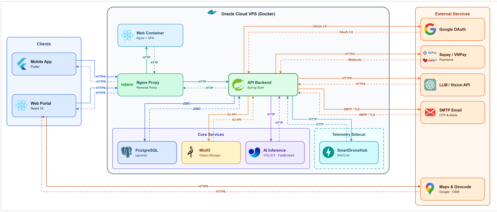

*Figure 7.6 — System architecture.*

| Component | Technology | Responsibility |
| --- | --- | --- |
| Web Portal Application | React 19, strict TypeScript, Vite, Material UI | Four role-scoped portals with route-level denial. |
| Customer Mobile App | Flutter, Riverpod, GoRouter, Dio | Customer access to buildings, inspection requests, reports, and payments. |
| Application Server | Java 21, Spring Boot 4.1.0, Spring Modulith 2.1.1 | Domain logic, authorization, state transitions, report management, audit, events. |
| YOLO11 & FastEmbed Service | Python FastAPI, Ultralytics YOLO11s, FastEmbed | Primary building-defect candidate detection and local 384-dimension multilingual embeddings (`POST /v1/embeddings`). |
| Vision and Drafting Gateway | OpenAI-compatible HTTP API | Vision fallback, single-shot narrative drafting, and AI finding note drafting. |
| Knowledge Advisor (`DroneKnowledgeAI`) | `HistoricalCaseService` and `DroneKnowledgeClient` | Finds relevant engineering standards and comparable defect cases for review and report drafting. |
| SmartDroneHub | External ground station | Read-only telemetry, flight traces, and mission video. |
| PostgreSQL | PostgreSQL 17 | Stores application records, audit events, and vectors for similarity search. |
| MinIO | S3-compatible object storage | Private storage of documents, evidence, and published report artefacts. |
| Sepay, VNPay, Google OAuth2 | External HTTPS services | Settlement (`SDI` / `SDIPAY`) and federated sign-in. |

### 1.2 Package Diagram

The package diagrams show how the backend, web portal, and Customer mobile app organise their code.

#### 1.2.1 Backend Application Server Package Diagram

The backend has eight Spring Modulith modules. Each module declares which packages it can call. For example, `contracts` uses the inspection integration interface, and `notifications` consumes events from `inspections` and `users`.

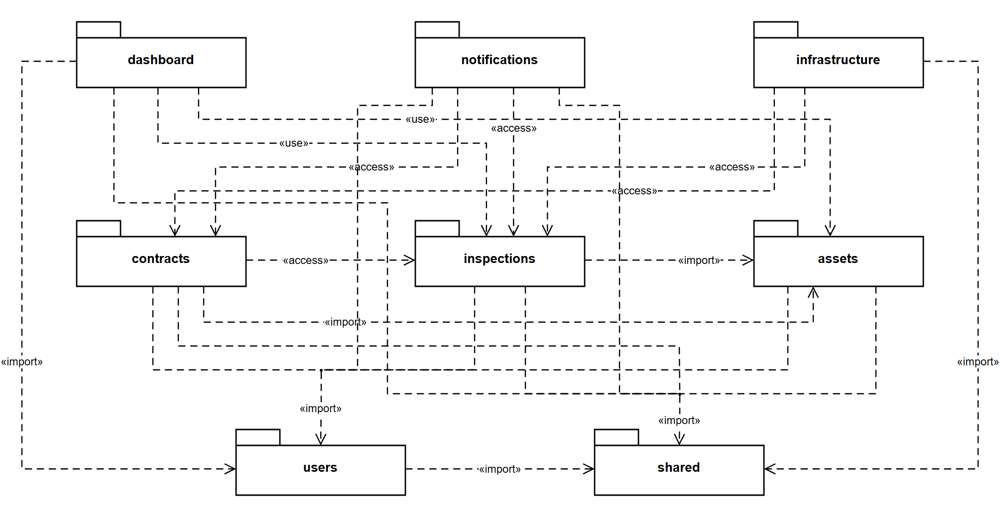

*Figure 7.7 — Backend module dependencies.*

| No | Package | Description |
| :---: | :--- | :--- |
| 01 | `com.smartdroneinspection.users` | Authentication, sessions, profiles, `MANAGER`-owned partner applications, audit, and platform administration. |
| 02 | `com.smartdroneinspection.contracts` | Manages service requests, quotations, contracts, assignment, and commercial messages. It also handles invoices, payments, and Inspector payouts. |
| 03 | `com.smartdroneinspection.assets` | Building categories, buildings (`V66`), inspection checkpoints, reference documents, airspace advisory screening (`MSG28`), drone configuration, and owned drones. |
| 04 | `com.smartdroneinspection.inspections` | Manages inspection permits, field sessions, evidence, findings, ratings, and versioned reports. |
| 05 | `com.smartdroneinspection.notifications` | Deduplicated bilingual (`EN`/`VI`) in-app and critical SMTP notifications driven by domain events. |
| 06 | `com.smartdroneinspection.dashboard` | Role-scoped operational metrics and Admin oversight views. |
| 07 | `com.smartdroneinspection.infrastructure` | Outbound adapters for object storage, detection and drafting clients, the ground-station hub, FFmpeg, and payment gateways. |
| 08 | `com.smartdroneinspection.shared` | Security configuration, response wrappers, role constants, cross-module ports, upload validation, error handling, and localization. |

In the web portal, `src/app` contains the shell, routing, theme, and access policy. Feature packages own their screens and requests. Shared code handles HTTP, maps, localization, and reusable controls.

#### 1.2.2 Web Portal Application Package Diagram

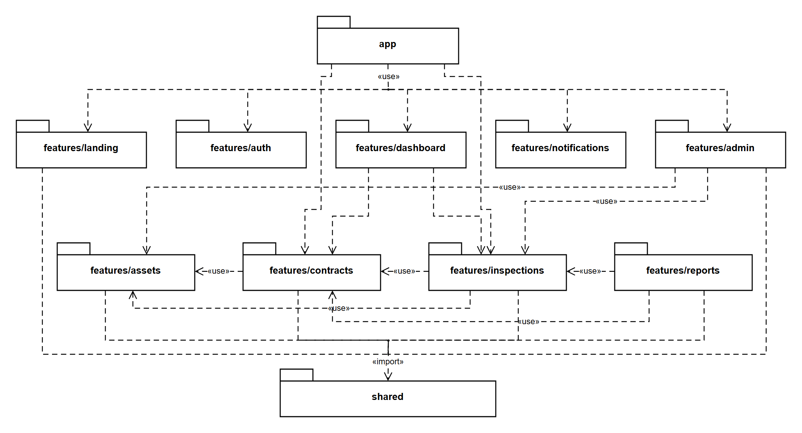

*Figure 7.7a — Web portal packages.*

**Package Descriptions**

| No | Package | Description |
| :---: | :--- | :--- |
| 01 | `src/app` | Owns the application shell, portal selection, theme, and route configuration. `accessPolicy.ts` defines the four portal access policies. |
| 02 | `src/features/auth` | Implements Customer account registration (`RESTRICTED_ZONE` `MSG28` amber warning), partner Inspector application submission, email/password and OTP sign-in, Google OAuth 2.0 callback handling, session bootstrapping, and route guards (`RequireAuth`). |
| 03 | `src/features/admin` | Provides platform account administration, pilot-licence class maintenance, drone document and feature configuration, platform finance/operations/rating-criteria/AI settings, Manager onboarding reviews, and read-only Admin oversight views. |
| 04 | `src/features/landing` | Provides the public landing experience and the role-aware entry point into the four portals. |
| 05 | `src/features/assets` | Provides building asset management (`checkpointsLocked`), reference document streaming, interactive airspace modal, and Inspector-owned drone registration and inventory. |
| 06 | `src/features/contracts` | Implements one-time and recurring service requests (`V80` checkpoints), in-context Order Chat + Partner Chat (`V79`) with attachments, VND quotation issuance and acceptance, signed contract upload, and occurrence dispatch. |
| 07 | `src/features/inspections` | Covers schedules and progress tracking, flight permits and field sessions, evidence uploads, and findings review. It also shows re-inspection verdict warnings. |
| 08 | `src/features/reports` | Covers report preparation, Manager review, payout and publication, and Customer clarification and acceptance. Customers can download the published PDF before paying. |
| 09 | `src/features/dashboard`, `src/features/notifications` | Provide four-role operational metrics and the bilingual in-app notification inbox with unread badge and `read-all`. |
| 10 | `src/shared` | Provides the Axios HTTP client with automatic token refresh, CSRF handling, and RFC 7807 problem parsing (`api`), the interactive Vietnam airspace planner and map (`airspace`), bilingual EN/VI localization (`i18n`), and the shared UI kit (`AuthenticatedImage`, `AuthenticatedMedia`). |

#### 1.2.3 Customer Mobile App Package Diagram

*Figure 7.7b — Customer mobile app packages.*

**Package Descriptions**

| No | Package | Description |
| :---: | :--- | :--- |
| 01 | `lib/core` | Configures the Dio HTTP client, authentication and locale headers, secure token storage, routing, and app-wide settings. |
| 02 | `lib/features/auth` | Implements mobile credential sign-in, Google OAuth 2.0 deep-link callback handling, and Riverpod session state. `session_provider.dart` enforces that only `CUSTOMER` accounts enter the application; the network layer raises `CUSTOMER_ONLY_MOBILE` for any other role. |
| 03 | `lib/features/assets` | Displays the Customer’s building assets, coordinates, and documents, with `data`, `domain`, and `presentation` layers. |
| 04 | `lib/features/contracts` | Implements the customer service-request list, new-request submission, request detail, and order-chat conversation. |
| 05 | `lib/features/inspections` | Implements the customer inspection list and inspection detail, including the published report and its findings. |
| 06 | `lib/features/dashboard`, `lib/features/notifications` | Provide the customer home summary and the in-app notification list. |
| 07 | `lib/features/profile`, `lib/shared` & `lib/l10n` | Provide user profile viewing and language switching, reusable asynchronous state widgets, and generated English/Vietnamese localization bundles from `app_en.arb` and `app_vi.arb`. |

## 2. Database Design

The database supports building inspections. It stores the records that link each building and service request to its inspections, evidence, reports, and payments.

Figure 7.8 shows the physical schema. The release has 53 application tables and two framework tables in PostgreSQL's `public` schema.

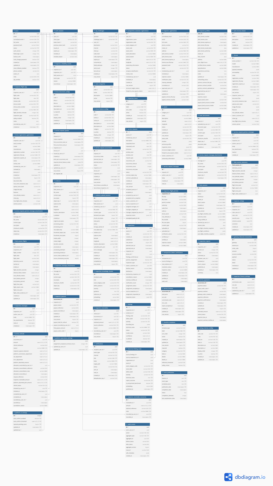

*Figure 7.8 — Physical ERD of the SmartDroneInspection PostgreSQL database, showing 53 application tables and the Spring Modulith event outbox.*

*Figure 7.8f — Logical Crow's-Foot ERD: Users, Sessions, Onboarding & Audit Governance.*

*Figure 7.8g — Logical Crow's-Foot ERD: Building Assets, Checkpoints, Airspace & Owned Drones.*

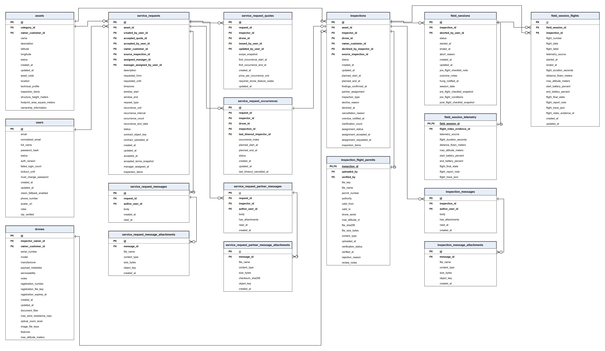

*Figure 7.8h — Logical Crow's-Foot ERD: Commercial Requests, Occurrences, Permits & Multi-Sortie Field Sessions.*

*Figure 7.8i — Logical Crow's-Foot ERD: Evidence, Findings, DroneKnowledgeAI, Ratings & Report Versions.*

*Figure 7.8j — Logical Crow's-Foot ERD: Service Invoices, Payments, Payouts, Refunds & Receivables.*

The framework tables are `event_publication` for the event outbox and `flyway_schema_history` for migration tracking. See Chapter V, Section 5.3 for the schema verification. The table below describes selected records.

| No | Table | Description |
| :---: | :--- | :--- |
| 01 | `users` | Platform accounts with role set, status, and lockout state. The Customer account ID is the ownership key for customer records. |
| 02 | `inspector_profiles` | Inspector licence details, partner contract, and onboarding state. |
| 03 | `inspector_applications` | Public partner applications and their review outcome. |
| 04 | `otp_challenges` | One-time verification challenges. |
| 05 | `auth_sessions` | Active sessions with hashed refresh tokens and revocation. |
| 06 | `inspector_flight_logs` | Historical inspector flight missions. |
| 07 | `prospective_customer_registrations` | Legacy registration records retained for historical airspace review data. New registrations activate immediately after advisory screening. |
| 08 | `drone_registration_applications` | Drone registration requests with documents and capabilities. |
| 09 | `drones` | Approved drones with registration validity and serviceability. |
| 10 | `asset_categories` | Building category catalogue; only active rows are selectable in asset registration. |
| 11 | `inspection_items` | Category-scoped inspection checkpoints. |
| 12 | `assets` | Customer buildings with coordinates, structural `technical_profile`, plain-text `ownership_information` (`V66`), and checkpoints. |
| 13 | `asset_documents` | Building reference documents with checksums. |
| 14 | `checklist_templates` | Configurable field checklist items. |
| 15 | `drone_document_configs` | Required drone document types. |
| 16 | `drone_feature_configs` | The drone capability catalogue. |
| 17 | `pilot_license_classes` | Recognised pilot-licence classes. |
| 18 | `inspection_finance_settings` | Commission, VAT, and tax rates. |
| 19 | `platform_ai_settings` | Detection auto-confirmation setting (`default: 70.00` since `V63`). |
| 20 | `platform_operations_settings` | Singleton operations settings, including assignment acceptance timeout and dispatch defaults. |
| 21 | `service_requests` | One-time and recurring requests with terms snapshot and manager assignment. |
| 22 | `service_request_messages` | Order-chat messages. |
| 23 | `service_request_message_attachments` | Private chat attachment metadata. |
| 24 | `inspection_messages` | Per-inspection chat between the assigned inspector and the customer, separate from the commercial order thread. |
| 25 | `inspection_message_attachments` | Private inspection-chat attachment metadata with MIME type, size, and checksum. |
| 26 | `service_request_quotes` | The active VND quotation. |
| 27 | `service_request_occurrences` | Dated occurrences with dispatch state. |
| 28 | `service_invoices` | Per-occurrence price and rate snapshots. |
| 29 | `service_payments` | Customer payment status, gateway order reference/timestamp (`gateway_order_created_at`, `V67`), due deadline, and refund totals. |
| 30 | `inspector_payouts` | Inspector payout state and refund hold. |
| 31 | `service_refunds` | Refund ledger with accounting allocation. |
| 32 | `inspector_receivables` | Inspector debt after a refund follows a paid payout. |
| 33 | `inspector_receivable_recoveries` | Collection records against a receivable. |
| 34 | `inspections` | Missions with assignment, clarification count, and findings confirmation state (permit data split 1-to-1 into `inspection_flight_permits` in `V69`). |
| 35 | `field_sessions` | On-site session lifecycle and safety/outcome notes (SmartDroneHub metrics, trace, and synced video split 1-to-1 into `field_session_telemetry` in `V69`). |
| 36 | `evidence` | Photographs and video with object keys and processing state. |
| 37 | `evidence_upload_sessions` | Resumable upload state. |
| 38 | `findings` | Candidate and confirmed defects. |
| 39 | `reinspection_defect_verifications` | Three-way re-inspection comparison. |
| 40 | `inspection_reports` | Versioned reports with publication state. |
| 41 | `notifications` | Deduplicated in-app notices. |
| 42 | `audit_events` | Append-only decision record. |
| 43 | `inspector_reliability_events` | Inspector reliability events. |
| 44 | `event_publication` | The transactional outbox. |
| 45 | `inspection_knowledge_chunks` | Stores engineering guidance and its source references. A `vector(384)` embedding and a cosine HNSW index support similarity search. |
| 46 | `historical_finding_cases` | Stores anonymized benchmarks and confirmed findings indexed at publication. Search uses `vector(384)` embeddings and excludes the current inspection. |
| 47 | `gateway_inbound_transactions` | Audits each incoming payment callback, including its payload and processing result. A unique `(gateway, external_id)` key deduplicates callbacks when an external ID is available. |
| 48 | `inspection_flight_permits` | One-to-one self-attested flight permit metadata keyed on `inspection_id` (`V69`), with read-only Manager and Admin audit access. |
| 49 | `field_session_telemetry` | 1-to-1 SmartDroneHub telemetry metrics, GPS `flight_trace_json`, and synced `flight_video_evidence_id` split from `field_sessions` (`V69`), keyed on `field_session_id`. |

## 3. Detailed Design

Endpoint paths in Section IV.3 omit the common /api/v1 prefix.

### 3.1 `MF1` — `FE-01` Account Authentication, OTP & 4-Role Access Control

The authentication services register Customers, verify email or Google credentials, and create sessions for the four roles. Password verification uses Argon2id. Web and mobile clients use HS256 access tokens and rotate refresh tokens, with HMAC-SHA256 verification.

#### 3.1.1 Class Diagram

*Figure 7.8k — FE-01 Account Authentication, OTP & 4-Role Access Control Class Diagram.*

**Class Specifications**

| No | Class | Description |
| :---: | :--- | :--- |
| 01 | `BrowserAuthController` & `MobileAuthController` | Handle customer registration, email/password sign-in, OTP verification and password reset, password change, and token refresh for web (`HttpOnly` cookie CSRF-protected chain) and mobile (`Bearer` / refresh token) clients. |
| 02 | `OAuth2Controller` | Handles federated Google OAuth 2.0 sign-in and callback redirection for web browsers and mobile deep links (`smartdrone://auth`). |
| 03 | `UserProfileController`, `PlatformUserController` & `AdminAuditLogController` | Allow signed-in users to manage their own profile (`/api/v1/users/me`, `vision_fallback_enabled`), let `ADMIN` provision/activate single-role platform accounts (`Last-Admin` protected), and expose append-only `audit_events`. |
| 04 | `AuthService`, `AuthRateLimitFilter` & `LoginFailureService` | Verify Argon2id passwords and issue and rotate tokens. Rate limits apply per IP to login and OTP requests. Five failed attempts lock the account for 15 minutes. |
| 05 | `User`, `OtpChallenge` & `AuthSession` | Domain entities representing single-role users across `ADMIN`, `MANAGER`, `CUSTOMER`, and `INSPECTOR`, time-limited OTP challenges, and rotated refresh sessions. |

#### 3.1.2 Customer Account and Initial Asset Registration Sequence Diagram

*Figure 7.8l — FE-01A Customer Registration, RESTRICTED_ZONE MSG28 Amber Warning & Immediate Onboarding Sequence.*

#### 3.1.3 User Sign-In, OTP Verification and Google OAuth 2.0 Sequence Diagram

*Figure 7.8m — FE-01B Password, OTP & Google OAuth 2.0 Sign-In Sequence.*

---

### 3.2 `MF1` — `FE-02` Partner Inspector Application & Qualification Management

A prospective Inspector submits licence details and supporting documents for Manager review. Approval provisions the Inspector account and profile. The profile also stores licence renewals, the partner contract, and flight history.

#### 3.2.1 Class Diagram

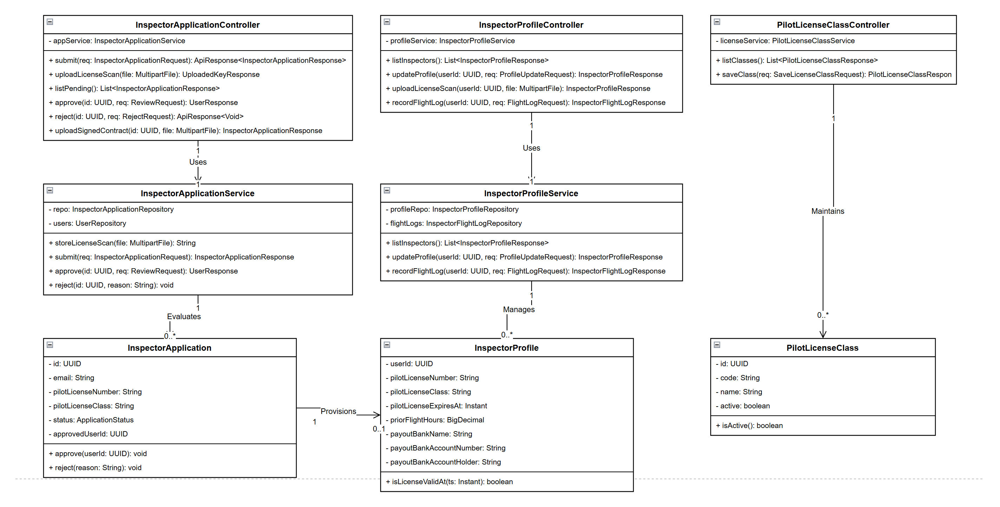

*Figure 7.8n — FE-02 Partner Inspector Application & Qualification Class Diagram.*

**Class Specifications**

| No | Class | Description |
| :---: | :--- | :--- |
| 01 | `InspectorApplicationController` & `InspectorApplicationService` | Save public applications and MinIO licence scans as `PENDING_REVIEW`. Manager approval creates the `INSPECTOR` account and profile. Rejection requires a reason. Administrators can read review records, and the service stores signed partner contracts. |
| 02 | `InspectorProfileController` & `InspectorProfileService` | Maintain pilot credentials in `inspector_profiles`, handle licence scan renewals, and store attribution flight history in `inspector_flight_logs` (`InspectorProfileController` also emits `PilotLicenseUpdatedEvent`). |
| 03 | `PilotLicenseClassController`, `PilotLicenseClassService` & `PilotLicenseExpiryCheckService` | Maintain recognized licence classes (`pilot_license_classes`) mapped to Decree 288 rules and run scheduled expiry checks notifying Inspectors and staff when licences lapse. |

#### 3.2.2 Partner Inspector Application, Review and Account Provisioning Sequence Diagram

*Figure 7.8o — FE-02 Partner Inspector Application, MANAGER Review & Account Provisioning Sequence.*

---

### 3.3 `MF1` — `FE-03` Inspector-Owned Drone Registration & Fleet Management

An Inspector submits an owned drone with a photograph and the required documents. A Manager reviews the submission. The fleet records registration renewal and maintenance. A drone can return from `IN_MAINTENANCE` to `ACTIVE`. Retirement is permanent.

#### 3.3.1 Class & Sequence Diagrams

*Figure 7.8p — FE-03 Inspector-Owned Drone Registration & Fleet Class Diagram.*

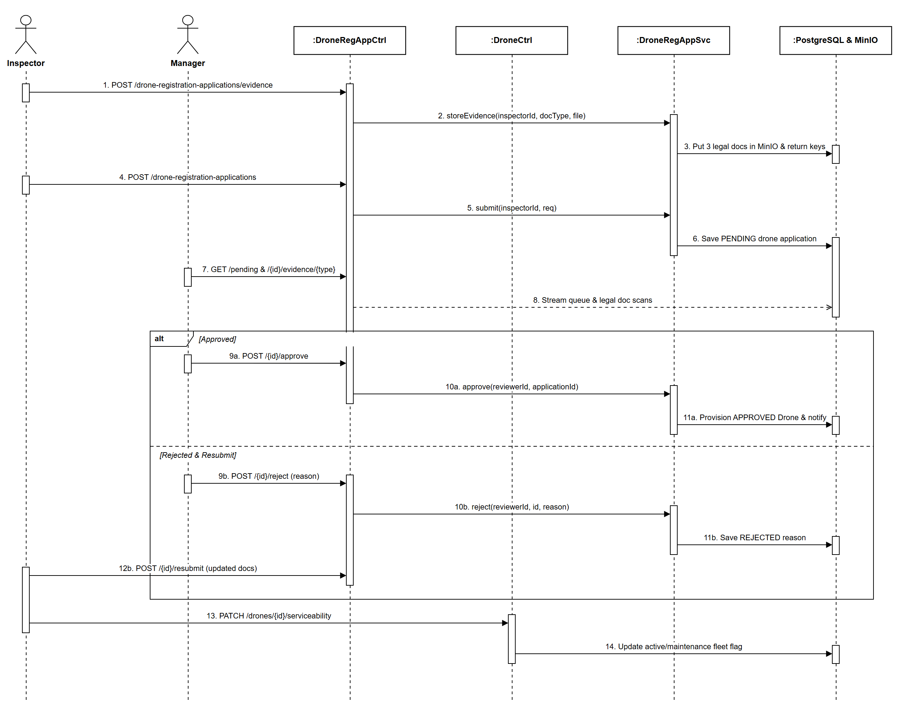

*Figure 7.8q — FE-03 Inspector-Owned Drone Application, MANAGER Review & Renewal Sequence.*

| No | Class | Description |
| :---: | :--- | :--- |
| 01 | `DroneDocumentConfigController` & `DroneFeatureConfigController` | Manage Admin-configurable document requirements (`REGISTRATION` & `OWNERSHIP` active/required by default; `INSPECTION` optional) and outdoor flight capability/safety checklists (`drone_document_configs`, `drone_feature_configs`). |
| 02 | `DroneRegistrationApplicationController` & `DroneEvidenceUploadService` | Handle MinIO evidence upload (`>= 1` `DRONE_IMAGE` photo + configured doc types), duplicate serial checks, `MANAGER` approval into `drones` (`inspector_owner_id`; `ADMIN` view read-only), and rejection reasons. |
| 03 | `DroneController` & `DroneService` | Manage Inspector fleet inventory (`InspectorDroneRegistrationPage`), registration renewal (`updateRegistration`), maintenance holds (`IN_MAINTENANCE`), and terminal `RETIRED` locks, enforcing Decree 288 MTOW (`>= 2 kg` -> Class B) during eligibility checks. |

---

### 3.4 `MF1` — `FE-04` Interactive Location Map & No-Fly Zone Airspace Screening

The airspace service evaluates a building location against published zones. Registration blocks a `NO_FLY_ZONE` and returns an advisory for a `RESTRICTED_ZONE`. The web map and mobile advisory display the result.

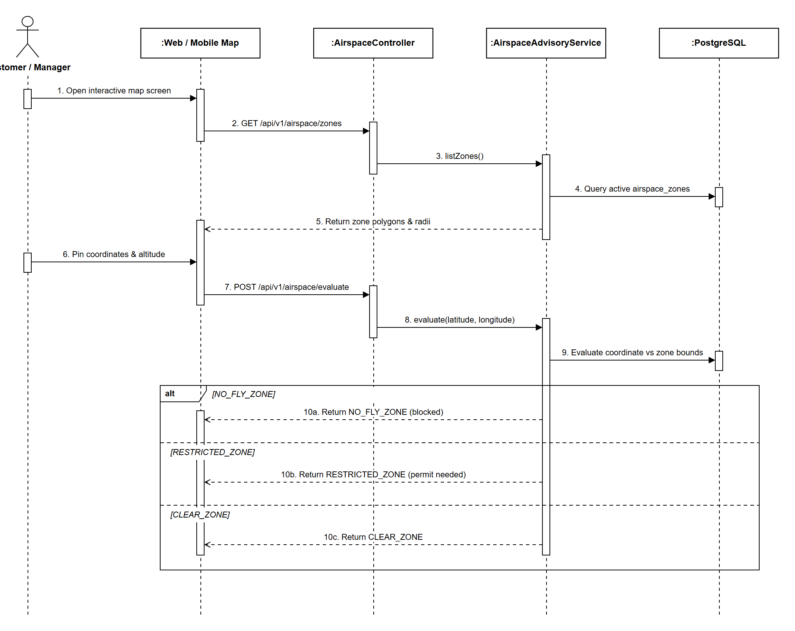

*Figure 7.8r — FE-04 Airspace Zone Screening Sequence.*

**Class & UI Specifications**

| No | Component / Class | Description |
| :---: | :--- | :--- |
| 01 | `AirspaceController` (`assets.api`) | Exposes `GET /api/v1/airspace/zones` (`AirspaceZoneResponse`) and `GET`/`POST /api/v1/airspace/evaluate` (`EvaluateAirspaceRequest` -> `AirspaceEvaluationResponse`), enforcing `latitude` in `[-90, 90]` and `longitude` in `[-180, 180]`. |
| 02 | `AirspaceAdvisoryService` (`assets.service`) | Compare coordinates with active zones using Haversine distance. The response classifies the location as `CLEAR_ZONE`, `RESTRICTED_ZONE`, or `NO_FLY_ZONE`. Restrictions include an `MSG28` advisory. The message catalogue records the planning-only disclaimer under `MSG49`. |
| 03 | `CustomerAirspacePolicyAdapter` (`assets.service`) | Adapter implementing `shared.api.CustomerAirspacePolicy` so `users` onboarding (`OrganizationRegistrationService`) blocks `NO_FLY_ZONE` (`403 ASSET_IN_NO_FLY_ZONE`) while allowing `RESTRICTED_ZONE` to activate immediately with structured `MSG28` advisory warning data. |
| 04 | Web `AssetLocationPickerModal.tsx` & Mobile `AirspaceAdvisoryCard` | Web map picker with zone overlays and a short permit advisory. Mobile displays airspace information through `AirspaceAdvisoryCard`. |

---

### 3.5 `MF4` — `FE-05` Financial History & Revenue/Payment Ledger

The finance API returns a different ledger for each role. Customers see their service payments, Inspectors see their payouts, and Managers reconcile collections, taxes, fees, and refunds.

*Figure 7.8s — FE-05 Role-Scoped Financial History & Ledger Query Sequence.*

**Class & UI Specifications**

| No | Component / Class | Description |
| :---: | :--- | :--- |
| 01 | `ContractWorkflowController` (`finance-history/*` routes) | Exposes `GET /api/v1/contracts/requests/finance-history/customer`, `/inspector`, and `/manager` (plus `/{occurrenceId}` detail endpoints) backed by `ContractWorkflowService` paged/filtered ledger queries. |
| 02 | `FinanceHistoryPageResponse`, `FinanceHistoryItemResponse`, `ManagerFinanceHistoryResponse` & `OccurrenceFinanceResponse` | DTOs projecting strict role-appropriate financial fields: Customer views payment amounts, receipts, and refundable status while masking partner payouts/receivables; Inspector views gross fee, commission/TNCN deductions, and net payout; Manager views platform inflows, commission, VAT/TNCN, and reconciliation state. |
| 03 | Web `FinanceHistoryPage.tsx` & `OverviewFinanceSection.tsx` | Role-aware Web ledger views mounted at `/client/finance-history`, `/operations/finance-history`, and `/manager/finance-history`, paired with per-inspection overview financial cards. |

---

### 3.6 `MF2` — `FE-06` Building Asset Registry, Checkpoints & Reference Documents

The building registry stores ownership details, reference documents, and checkpoints based on the building category. The API locks checkpoint edits when an inspection exists and deduplicates reference documents by SHA-256.

#### 3.6.1 Sequence Diagram

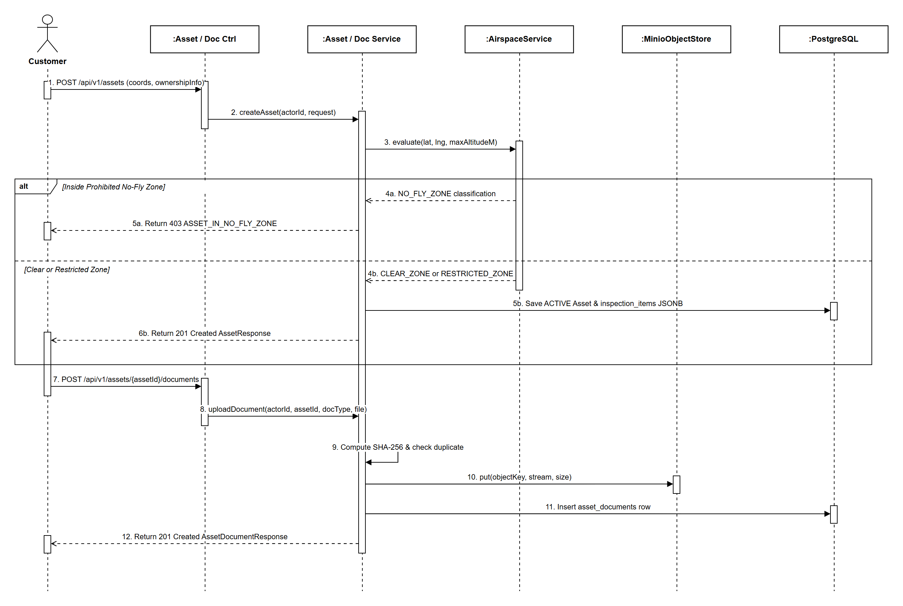

*Figure 7.8t — FE-06 Building Asset Registration & Document Upload Sequence.*

**Class Specifications**

| No | Class | Description |
| :---: | :--- | :--- |
| 01 | `AssetController`, `AssetService` & `Asset` (`assets`) | Store ownership text in `assets.ownership_information` (`VARCHAR(1000)`) and building specifications in `technical_profile`. A bulk inspection lookup populates `AssetResponse.checkpointsLocked`. Checkpoint changes after the first inspection return `409 INSPECTION_HISTORY_EXISTS`. The service also manages airspace screening and retirement. |
| 02 | `AssetCatalogController` & `AssetCatalogService` | Maintain the six building-only `AssetCategory` templates and default `InspectionItem` checkpoints without retroactively rewriting checkpoints on existing buildings. |
| 03 | `AssetDocumentController` & `AssetDocumentService` | Validate non-empty building reference documents (`PDF`/images/drawings), enforce per-asset `SHA-256` uniqueness, store binaries under `assets/{assetId}/documents/` in MinIO, and stream downloads strictly to authorized Customer/Manager/Admin actors. |

---

### 3.7 `MF2` — `FE-07` Restricted Airspace Advisory Warning & Immediate Onboarding

Public registration and building creation use the same restricted-airspace rule. A `RESTRICTED_ZONE` result returns `MSG28` and allows the building record to be saved. The warning identifies the authority and permit requirements.

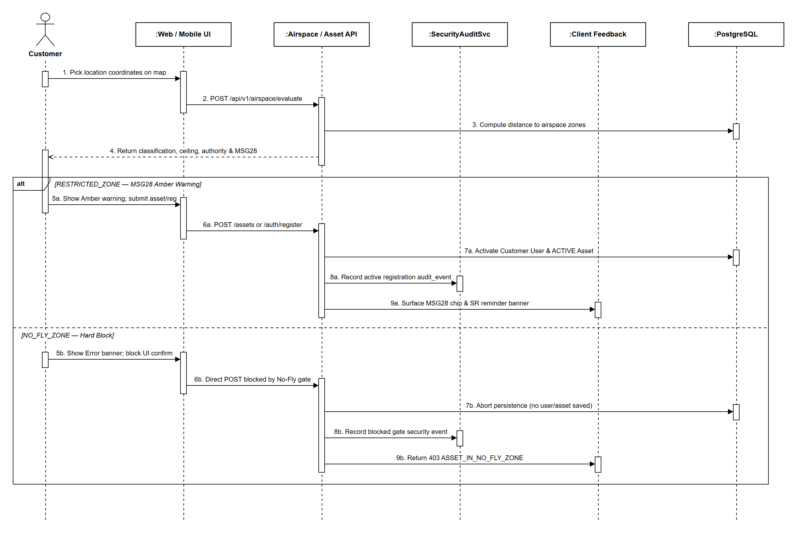

*Figure 7.8u — FE-07 Restricted Airspace Advisory (MSG28) & Immediate Activation Sequence.*

**Class & Workflow Specifications**

| No | Class / Component | Description |
| :---: | :--- | :--- |
| 01 | `OrganizationRegistrationService` (`users.service`) | Calls `CustomerAirspacePolicyAdapter.evaluateFirstAsset`: blocks `NO_FLY_ZONE` (`403 ASSET_IN_NO_FLY_ZONE`), immediately activates `CUSTOMER` user + initial `Asset` for both `CLEAR_ZONE` and `RESTRICTED_ZONE`, and returns `airspaceClassification` + structured `reviewMessage` (`MSG28` authority, ceiling, and `https://cambay.mod.gov.vn`). |
| 02 | Legacy Review Retirement (`AirspaceReviewController` & `prospective_customer_registrations`) | The legacy `/api/v1/platform/customer-airspace-reviews` controller and `customer-airspace` admin navigation section are removed; `prospective_customer_registrations` stays preserved in schema history without accepting new rows. |
| 03 | Web & Mobile `MSG28` Advisory Components | Render amber `MSG28` warnings on map coordinate selection, post-registration `/login` toast banner, `CreateServiceRequest` dialog (when choosing a `RESTRICTED_ZONE` asset), asset detail badges, and Stage 1 permit panels. |

---

### 3.8 `MF2` — `FE-08` Service Requests (One-Time & Recurring) & VND Quotations

Customers request one-time or recurring inspections. The first date must be at least 20 calendar days ahead in `Asia/Ho_Chi_Minh`. Recurrence supports a 1–120 month interval and 2–100 occurrences. The request stores a checkpoint snapshot and its active VND quotation.

#### 3.8.1 Sequence & State Diagrams

*Figure 7.8v — FE-08 Service Request, Manager Claim & VND Quotation Sequence.*

*Figure 7.8w — ServiceRequest State Machine Diagram.*

**Class & UI Specifications**

| No | Class / Component | Description |
| :---: | :--- | :--- |
| 01 | `ContractWorkflowController` & `ContractWorkflowService` | Enforce the first-date rule and lock the request during `claimRequest` to prevent simultaneous claims. Only the `assignedManagerId` can take commercial actions. Administrators manage assignments through `PUT` or `DELETE /manager-assignment`. Only the owning Customer sees the assigned Manager's contact details. |
| 02 | `ServiceRequest` & `ServiceRequestQuote` | Store request cadence/bounds, Manager assignment audit metadata, and single active VND quotation (`V60` nullable `inspector_id`/`drone_id`, empty `requiredDroneFeatureCodes` compatible). |
| 03 | Web `ServiceRequestListView.tsx`, `useContracts.ts`, `ManagerQuoteWorkspace.tsx`, `QuoteTermsSummary.tsx` | Shows the schedule, status, and available actions for each request. Claiming a request opens its quotation workspace, which sends an empty list for optional drone capabilities. |

---

### 3.9 `MF2` — `FE-09` Offline Signed Contract & Occurrence Dispatch Scheduling

Accepting the quotation freezes its terms and creates the scheduled occurrences. The Manager records the signed agreement before assigning eligible teams. The dispatch workflow supports rescheduling, reassignment, and cancellation after an aborted session.

#### 3.9.1 Class, Sequence & State Diagrams

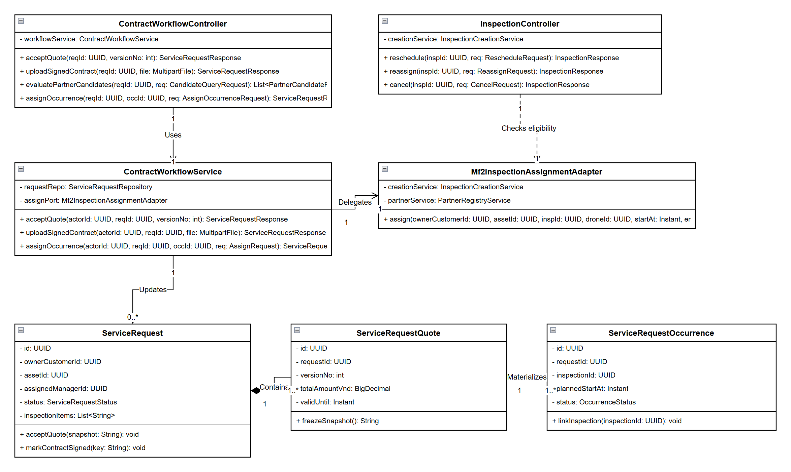

*Figure 7.8x — FE-09 Signed Contract Upload, Occurrence Dispatch & Recovery Class Diagram.*

*Figure 7.8y — FE-09 Quote Acceptance, Signed Contract Upload & Occurrence Dispatch Sequence.*

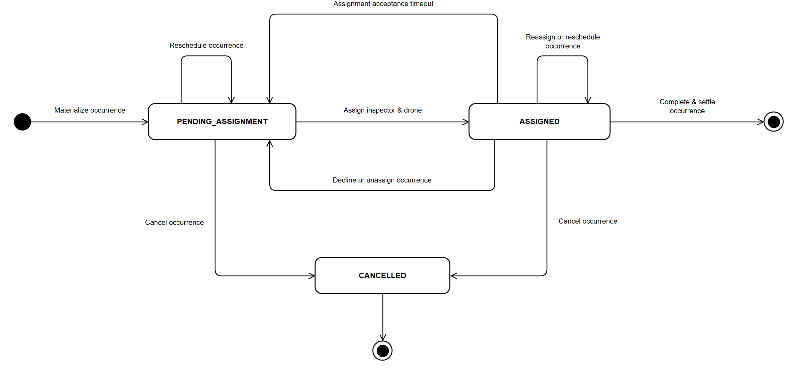

*Figure 7.8z — ServiceRequestOccurrence State Machine Diagram.*

**Class & UI Specifications**

| No | Class / Component | Description |
| :---: | :--- | :--- |
| 01 | `ContractWorkflowService` (`acceptQuote`, `uploadSignedContract`, `assignOccurrence`) | Freezes immutable quote snapshot, materializes recurring occurrences (`Jan 31 -> Feb 28/29 -> Mar 31`), persists signed paper contracts under `contracts/requests/{id}/`, and dispatches single or bulk (`Apply to remaining`) partner assignments. |
| 02 | `PartnerRegistryService` & `Mf2InspectionAssignmentAdapter` | Verify Decree 288 class match, non-expired registration/licence at planned flight timestamps, and absence of cross-organization schedule collisions (`hasScheduleConflict`). Reassigning a `FIELD_COMPLETED` inspection returns `409`. |
| 03 | Web `PartnerCandidateResults.tsx` & `ManagerOccurrencesStep.tsx` | Show eligible Inspectors and drones and require confirmation before assigning a team to multiple occurrences. |

---

### 3.10 `MF2` — `FE-10` Multi-Channel Messaging (Order Chat, Partner Chat & Inspection Chat)

Order Chat connects the Customer and assigned Manager. Partner Chat connects the Manager and Inspector during dispatch planning. Inspection Chat connects the Customer and assigned Inspector. The backend checks participants before serving messages or attachments.

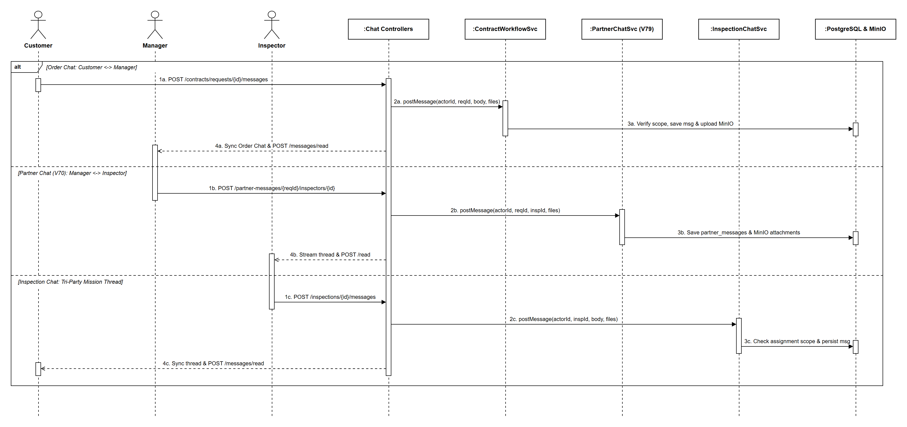

*Figure 7.8aa — FE-10 Separated Order Chat, Partner Chat (V79) & Inspection Chat Sequence.*

**Class & UI Specifications**

| No | Class / Component | Description |
| :---: | :--- | :--- |
| 01 | `ContractWorkflowController` (`/requests/{id}/messages*` & `/requests/{id}/partner-messages*`) | Serves Customer <-> assigned `MANAGER` commercial Order Chat and `MANAGER` <-> `INSPECTOR` Partner Chat (`V79`, `service_request_partner_messages*`: up to 5 files, `10 MiB` per file / `20 MiB` per message, `PNG`/`JPG`/`WEBP`/`PDF`/`DOCX`), refusing `ADMIN` and unrelated callers. |
| 02 | `InspectionChatController` & `InspectionChatService` (`V61`) | Only the owning Customer and assigned Inspector can read or post messages. Under `/inspections`, `GET /messages/threads` lists threads, and `GET` or `POST /{id}/messages` reads or posts messages. `POST /{id}/messages/read` marks messages as read. `GET /{id}/messages/{msgId}/attachments/{attId}` downloads attachments. Text is limited to 4,000 characters, and attachments to 10 MiB per file and 20 MiB per message. |
| 03 | `ChatAttachmentValidator` (`shared.storage`) | Validates real file magic signatures, declared MIME types, safe filenames, and size caps prior to object upload. |
| 04 | Web `RequestChatPanel.tsx`, `/messages` & Mobile `RequestChat`, `InspectionChatPage` | Separate conversations by request or inspection and by participant. Customer Mobile includes request and inspection threads. |

---

### 3.11 `MF2` — `FE-11` Assignment Acceptance Timeout & Escalation Handling

The workflow-state service evaluates the assigned Inspector, the scheduled inspection, the accepted assignment, and session history to return `canWithdrawAssignment`. The decline endpoint rechecks the same guard before recording withdrawal. A started session on the current assignment still blocks withdrawal after abort. When the Manager later cancels a withdrawn occurrence, cancellation clears `reassignmentRequired` and preserves the withdrawal and cancellation reasons.

The Administrator sets the deadline for an Inspector to accept a mission. If the assignment expires, a scheduled job releases the crew reservation and notifies the Manager to dispatch a replacement.

*Figure 7.8ab — FE-11 Assignment Acceptance Timeout & Escalation Sequence.*

**Class & UI Specifications**

| No | Class / Component | Description |
| :---: | :--- | :--- |
| 01 | `PlatformOperationsSettingsController`, `PlatformOperationsSettingsService` & `PlatformOperationsSettings` (`V61`) | Admin-only endpoints (`GET/PUT /api/v1/platform/operations-settings`) configuring `assignment_acceptance_timeout_hours` (`1–720`, default `24` hours). |
| 02 | `InspectionAssignmentTimeoutMonitor` (`inspections.service`) | When a `PENDING_ACCEPTANCE` assignment passes its deadline, one transaction cancels the inspection and releases the crew reservation. The occurrence returns to `PENDING_ASSIGNMENT`, and the request returns to `CONTRACT_SIGNED` when it reopens. The monitor records the timeout and emits `InspectionAssignmentTimedOutEvent`. |
| 03 | Web `PlatformOperationsSettingsPage.tsx` & Deep-Link Notification | Admin settings page plus actionable notifications routing the owning `MANAGER` directly to `/manager/contracts?requestId=...` to dispatch a replacement team. |

---

### 3.12 `MF2` — `FE-12` System Notifications & Alert Center

Domain events create English and Vietnamese notifications through the Spring Modulith outbox. The system deduplicates notices and can email critical alerts. Each recipient can mark individual notices or all notices as read.

#### 3.12.1 Sequence Diagram

*Figure 7.8ac — FE-12 Event-Driven Bilingual Notification & Outbox Delivery Sequence.*

**Class & UI Specifications**

| No | Class / Component | Description |
| :---: | :--- | :--- |
| 01 | `InspectionNotificationListener`, `InspectorApplicationNotificationListener`, `PaymentOverdueNotificationListener` & `PaymentSettlementNotificationListener` | Handle assignment, timeout, decline, overdue, reschedule, abort, self-attested permit, report review/payout/publication, inspector admission, and settlement events across all 5 workflow pillars with best-effort critical SMTP alerts. |
| 02 | `NotificationController`, `NotificationService` & `Notification` | Expose recipient-scoped paged queries, unread counter, `markAsRead`, and `PATCH /api/v1/notifications/read-all` protected by `uq_notifications_deduplication_key`. |
| 03 | Web `NotificationBell.tsx`, `NotificationsPage.tsx` & `targetPath.ts` | Render real-time unread counts, locale-split notification feed, and client-side `targetPath` allowlist sanitizer blocking malformed/external links while server APIs enforce independent authorization. |

---

### 3.13 `MF3` — `FE-13` Flight Permit Upload & Self-Attestation Gate

The assigned Inspector uploads a permit and self-attests it before starting the session. A valid upload sets `APPROVED`. Changing the drone or moving the flight outside the permit window resets it to `PENDING_REVIEW` (`BR-25`).

*Figure 7.8ad — FE-13 Self-Attested Flight Permit Upload, Reset & Pre-Session Gate Sequence.*

**Class & Workflow Specifications**

| No | Class / Component | Description |
| :---: | :--- | :--- |
| 01 | `InspectionController`, `InspectionListController` & `InspectionCreationService` | Expose `POST /inspections/{id}/flight-permit` (assigned `INSPECTOR` only, `SCHEDULED` lock — immediately activates `APPROVED` via self-attestation) and scoped `GET /inspections/{id}/flight-permit/content`. Manager/Admin approval endpoints are retired; staff audit permit records read-only. |
| 02 | `FlightPermitPolicy` (`inspections.service`) | Verify the file signature for PDF, PNG, JPG, or WEBP and enforce the 25 MB limit. Check the permit number, issuing authority, assigned drone serial, and validity window. The optional `maxAltitudeM` accepts 1–2000 m. A drone change or flight outside the permit window resets approval (`BR-25`). |
| 03 | Web `FlightPermitVerificationPanel.tsx` & `FlightPermitPreviewDialog.tsx` | Workspace Stage 1 self-attestation metadata form/viewer and read-only Manager Permit & Flight Trace Audit view inside `/audit`. |

---

### 3.14 `MF3` — `FE-14` On-Site Field Session & SmartDroneHub MAVLink Telemetry

The Inspector completes the safety checks and records each flight in a field session. SmartDroneHub records read-only MAVLink telemetry and can sync mission video. The Inspector can import SRT, CSV, KML, or GPX logs or record a manual declaration. An aborted session requires a reason and allows Manager recovery.

#### 3.14.1 Class & State Diagrams

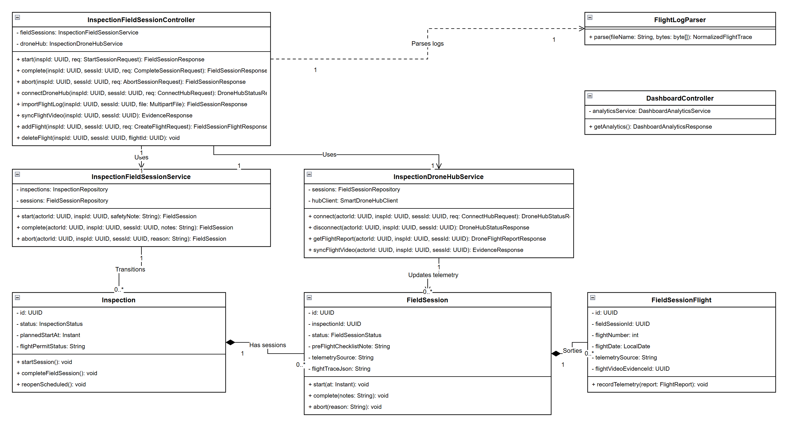

*Figure 7.8ae — FE-14 Multi-Sortie Field Session (V72), SmartDroneHub Telemetry & Dashboards Class Diagram.*

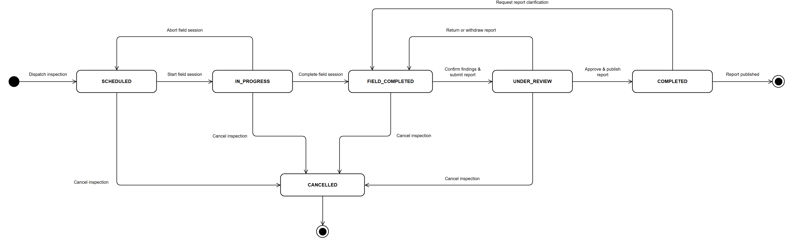

*Figure 7.8af — Inspection Lifecycle State Machine Diagram.*

*Figure 7.8ag — FieldSession Execution State Machine Diagram.*

#### 3.14.2 Field Session, SmartDroneHub Sync & Abort Recovery Sequence Diagrams

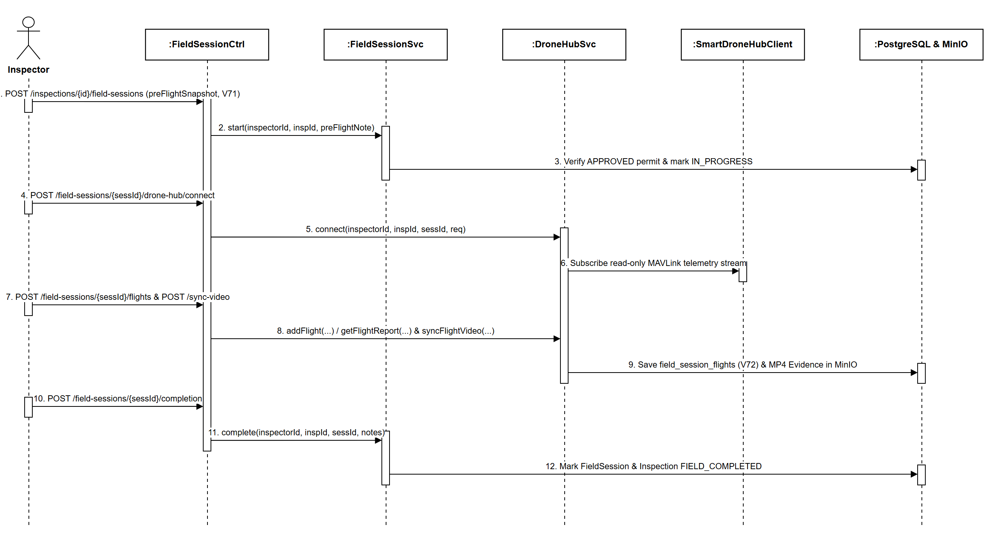

*Figure 7.8ah — FE-14A Self-Attested Permit Gate, Multi-Sortie Field Session & SmartDroneHub Telemetry Sync.*

*Figure 7.8ai — FE-14B Field Session Abort & Manager Reschedule / Reassign / Cancel Recovery Sequence.*

---

### 3.15 `MF3` — `FE-15` Field Evidence Intake & Chunked Video Processing Pipeline

Inspectors upload photos or MP4 video as evidence. The upload service supports resumable video uploads up to 2 GiB in 10 MiB chunks. A background worker prepares video for playback, and signed tickets scope access to the evidence record.

*Figure 7.8aj — FE-15 Evidence Intake, Resumable Chunked MP4 Transcode & Ticketed Streaming Sequence.*

**Class & Pipeline Specifications**

| No | Class / Component | Description |
| :---: | :--- | :--- |
| 01 | `EvidenceService`, `ExifMetadataExtractor` & `ImageNormalizer` | Extract EXIF GPS/time/orientation first, normalize oversized (`> 2048 px`) or rotated photos (`<= 10 MB`), emit `480 px` JPEG thumbnails (`?variant=thumb`), disambiguate duplicate filenames sequentially (`MSG17`), promote video keyframes (`<= 1280x720`), and enforce inspection read scope (`EvidenceOwnershipService`). |
| 02 | `EvidenceUploadSessionService` (`evidence_upload_sessions`) | Manages `OPEN -> COMPLETING -> COMPLETED`/`FAILED`/`CANCELLED`/`EXPIRED` resumable multipart uploads up to `2 GiB` in `10 MiB` chunks directly via MinIO S3 multipart without full-file JVM buffering. |
| 03 | `VideoProcessingWorker`, `FfmpegVideoTranscoder` & `MediaTicketService` | Process up to two video jobs at a time. FFmpeg produces up to 1080p H.264 MP4 with fast start and a 480 px poster. The worker retains the source until `READY` and can retry `FAILED` jobs. `GET` and `HEAD` playback use five-minute HMAC tickets and support HTTP Range requests. |
| 04 | Web `InspectionEvidencePage.tsx`, `EvidenceCaptureGroup.tsx`, `VideoFrameCropDialog.tsx` & `EvidenceGpsMapDialog.tsx` | Workspace Stage 5 upload queue, native `<video>` Range player (`AuthenticatedMedia`), EXIF map inspection, and frame promotion UI. |

---

### 3.16 `MF3` — `FE-16` AI Defect Detection (`YOLO11` + Vision Fallback) & Findings Confirmation

YOLO11s, trained on MBDD2025, proposes cracks, leakage, abscission, corrosion, and bulges. Vision fallback respects the user's `vision_fallback_enabled` setting. Detection uses a default auto-confirm threshold of 70%, and the Inspector confirms the final set of findings for the report.

#### 3.16.1 Class & Sequence Diagrams

*Figure 7.8ak — FE-16 AI Defect Detection & Findings Baseline Confirmation Class Diagram.*

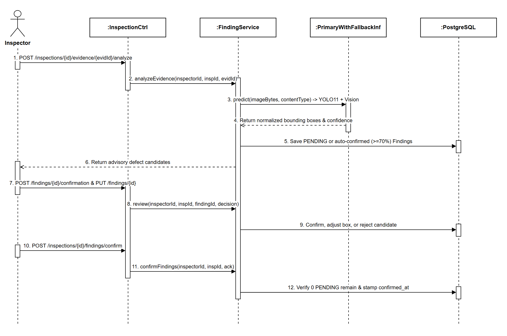

*Figure 7.8al — FE-16 YOLO11 + Fallback Defect Detection & Findings Confirmation Sequence.*

---

### 3.17 `MF3` — `FE-17` AI Case/Standard Retrieval (`pgvector` RAG), Note Drafting & Report Summary

DroneKnowledgeAI finds relevant engineering standards and past defect cases to support finding notes and report summaries. It uses vector similarity search with a keyword-based fallback. The diagrams below show how the inspection workspace requests and displays the references.

#### 3.17.1 Class & RAG Sequence Diagrams

*Figure 7.8am — FE-17 DroneKnowledgeAI Retrieval, AI Note Drafting & Summary Grounding Class Diagram.*

*Figure 7.8an — FE-17 Tenant-Isolated pgvector RAG Lookup & AI Finding Note Drafting Sequence.*

---

### 3.18 `MF4` — `FE-18` Inspection Report Compilation, Independent Review, Payouts & Publication

The system compiles the report from confirmed findings. An independent Manager reviews and approves it. The Manager publishes it once any required Inspector payout settles. Customers can download the published PDF. Each correction creates a new version and preserves the earlier one.

#### 3.18.1 Class, State & Publication Sequence Diagrams

*Figure 7.8ao — FE-18 Report Compilation, Approval, Payout-Before-Publish & PDF Export Class Diagram.*

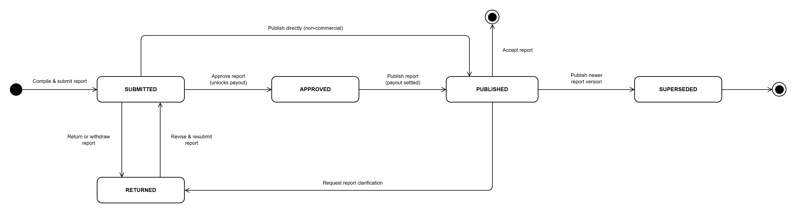

*Figure 7.8ap — InspectionReport Lifecycle State Machine Diagram (V76–V77).*

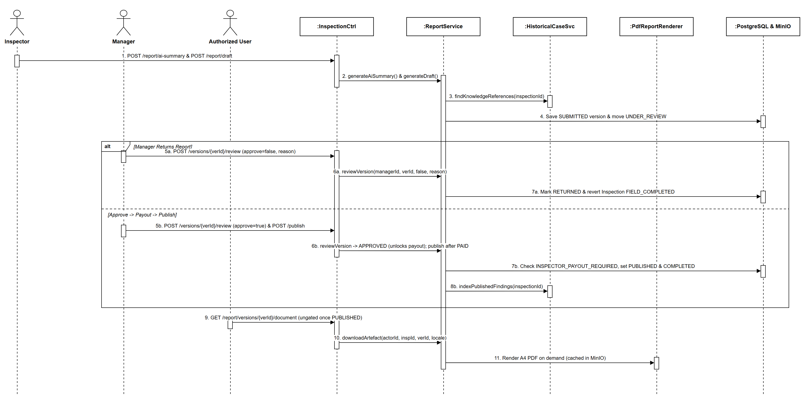

*Figure 7.8aq — FE-18 Report Submission, MANAGER Approval -> Sepay VietQR Payout -> Publication & Ungated PDF Export Sequence.*

---

### 3.19 `MF4` — `FE-19` Customer Report Acceptance, Ratings & Clarification Workflow

The Customer reviews and accepts the exact published report version. Before acceptance, the owning Customer can request clarification. Acceptance starts the payment window and sets the occurrence payment status to `PAYMENT_DUE`. The workflow also records Inspector ratings.

*Figure 7.8ar — FE-19 Published Report Acceptance, Inspector Ratings & Clarification Sequence.*

**Class & Workflow Specifications**

| No | Class / Component | Description |
| :---: | :--- | :--- |
| 01 | `ContractWorkflowService.customerAcceptReport` & `InspectionReportAcceptancePort` | Verify target report is `PUBLISHED`, transition occurrence payment status to `PAYMENT_DUE`, stamp `service_invoices.customer_accepted_at` and `payment_due_at`, and block duplicate acceptance or acceptance on unpublished drafts. |
| 02 | `ReportService.requestCustomerClarification` | Restricted strictly to the owning `CUSTOMER` prior to report acceptance (`403` for `MANAGER`, `ADMIN`, `INSPECTOR`, or other Customer accounts), incrementing `inspections.clarification_count` and notifying staff. |
| 03 | Web `CustomerReportDeliverablePage.tsx`, `CustomerReportSettlementCard.tsx` & Mobile Settlement Step 1 | Surface read-only official PDF deliverables (`PUBLISHED` only), Clarification dialog, and explicit **Accept report** confirmation before unlocking online checkout. |

---

### 3.20 `MF4` — `FE-20` Online Service Fee Payment (`Sepay` VietQR & `VNPay`)

Customers pay in VND through enabled Sepay VietQR or VNPay gateways. A verified callback or authorized manual confirmation records settlement. Switching gateways replaces the previous unpaid online order while retaining an audit trail for late callbacks.

#### 3.20.1 Sequence & State Diagrams

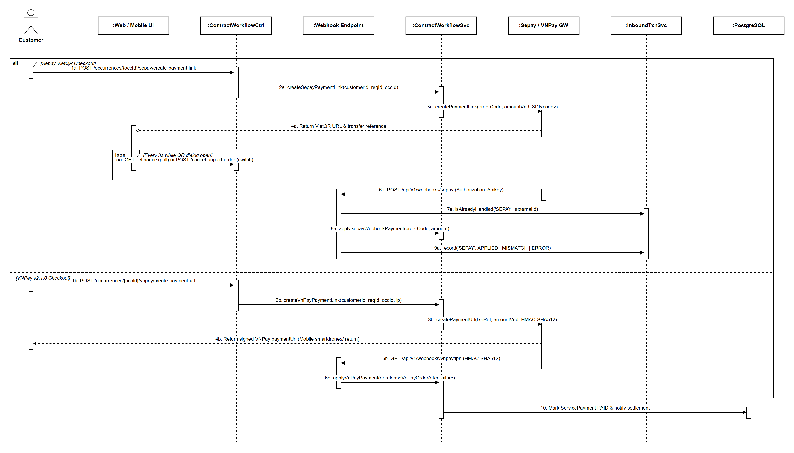

*Figure 7.8as — FE-20 Sepay VietQR (SDI) & VNPay v2.1.0 Online Settlement Sequence.*

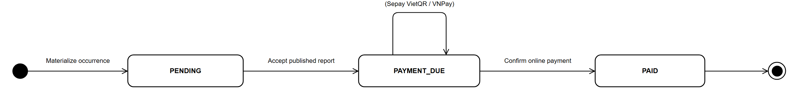

*Figure 7.8at — ServicePayment State Machine Diagram.*

**Class Specifications**

| No | Class / Component | Description |
| :---: | :--- | :--- |
| 01 | `SepayWebhookController`, `SepayPaymentGateway`, `SepayProperties` & `DisabledSepayGateway` | Include `SDI<orderCode>` in VietQR. Verify `Authorization: Apikey` in constant time, then check the receiving account and whole-VND amount. A valid callback settles `ServicePayment`. An unexpected error returns HTTP `500` so Sepay can retry. |
| 02 | `GatewayInboundTransactionService` & `GatewayInboundTransaction` (`gateway_inbound_transactions`) | Record results such as `APPLIED`, `AMOUNT_MISMATCH`, `ORDER_NOT_FOUND`, `REJECTED`, and `ERROR`. The audit record persists in a separate `REQUIRES_NEW` transaction, including when a payment rolls back. This also supports deduplication on callback retries. |
| 03 | `VnPayWebhookController`, `VnPayPaymentGateway`, `VnPayCrypto` & `DisabledVnPayGateway` | Sign VNPay v2.1.0 checkout URLs and verify callbacks with `HMAC-SHA512` (`BR-45`). The browser return redirects to `/settlement`. Terminal codes `24` (cancelled) and `11` (timed out) release the unresolved order. |
| 04 | `ContractWorkflowService` & Web `SepayQrDialog.tsx` | Switching between Sepay and VNPay, or retrying VNPay, replaces the unpaid online order. A pending manual order blocks online checkout with `PAYMENT_ORDER_ALREADY_OPEN`. The owning Customer or assigned Manager can cancel an unpaid due order. The browser polls every three seconds until `PAID`. |

---

### 3.21 `MF4` — `FE-21` Payment Deadlines, Invoices & Payment Document Management

Each occurrence invoice snapshots its commission and tax rates. Accepting the report starts the payment window, which defaults to 15 days. Customers can download a payment notice before payment or a receipt once payment is verified.

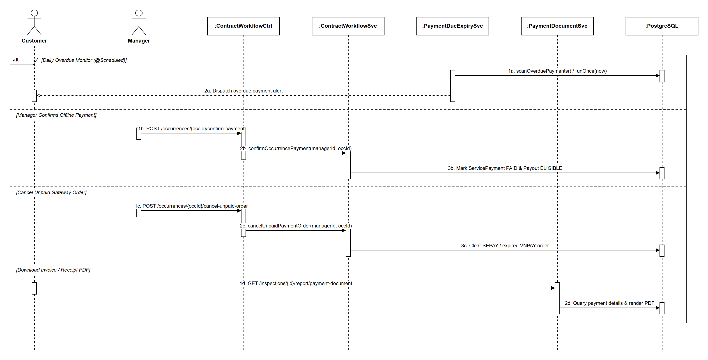

*Figure 7.8au — FE-21 Payment Deadline, Daily Overdue Notification & Notice/Receipt PDF Sequence.*

**Class & Service Specifications**

| No | Class / Component | Description |
| :---: | :--- | :--- |
| 01 | `InspectionFinanceSettingsController`, `InspectionFinanceSettingsService`, `InspectionFinanceCalculator` & `ServiceInvoice` | Manage Admin finance rates (`platformCommissionRate`, `vatRate`, `tncnRate`, `paymentDueDays`) and freeze exact rate snapshots onto each occurrence's `ServiceInvoice`. |
| 02 | `PaymentDueExpiryService` (`V4`) | Stamps `service_payments.payment_due_at = accepted_at + configuredWindow` once upon report acceptance; scheduled `scanOverduePayments()` emits a single `PaymentOverdueEvent` (`payment_overdue_notified_at` guard) to owning Customer and active Managers without revoking published report access or altering `PAYMENT_DUE`. |
| 03 | `PaymentDocumentService` & `PaymentDocumentRenderer` | Expose `GET /api/v1/inspections/{id}/report/payment-document` (returning `409` before acceptance, A4 Payment Notice PDF while `PAYMENT_DUE`, and Payment Receipt PDF once `PAID`, each bearing a non-tax-invoice disclaimer); strictly scoped to owning Customer, assigned Inspector, `MANAGER`, and `ADMIN` (`404` otherwise). |

---

### 3.22 `MF4` — `FE-22` Partner Inspector Payout Reconciliation (`Sepay` VietQR `SDIPAY`)

The Manager settles the Inspector payout before publishing a commercial report. The payout service applies refund holds and caps the disbursement at the adjusted amount. Each role sees only the settlement details it needs.

*Figure 7.8av — FE-22 Partner Inspector Sepay VietQR (SDIPAY) & Manual Payout Sequence.*

*Figure 7.8aw — InspectorPayout State Machine Diagram.*

**Class & UI Specifications**

| No | Class / Component | Description |
| :---: | :--- | :--- |
| 01 | `ContractWorkflowController.recordOccurrencePayout` & `InspectorPayout` | Transitions payout from `ELIGIBLE` to `PAID` only when a `MANAGER` supplies a unique external transfer reference (`payout_reference`, actor attribution, timestamp), enforcing active refund holds and post-reduction payout caps (`BR-46`). |
| 02 | `OccurrenceFinanceResponse` | The assigned Inspector sees the net payout, deductions, holds, and a limited refund summary in `inspectorRefundSummaries`. Managers see the full reconciliation rows. Customers see their payment details, with partner settlement fields omitted. |
| 03 | Web `OccurrenceFinanceDrawer.tsx`, `InspectorPayoutStatementCard.tsx` & `InspectorPayoutSummaryBar.tsx` | Render eligible/held/paid states, net disbursement breakdown, and Manager payout recording forms inside Workspace Settlement (`/settlement`). |

---

### 3.23 `MF4` — `FE-23` Evidence-Backed Refunds & Receivable Recovery

A Manager can initiate a refund against a captured payment. An active refund holds any unpaid Inspector payout. If a payout has already settled, completion leaves its record intact and creates a receivable for recovery.

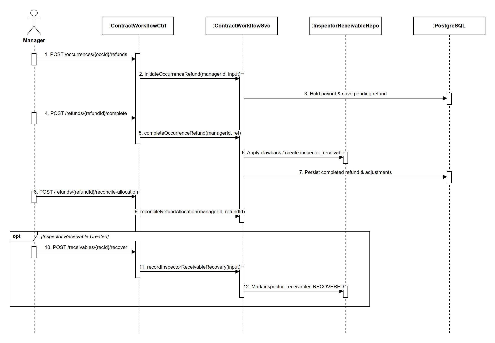

*Figure 7.8ax — FE-23 Five-Way Refund Allocation & Inspector Receivable Recovery Sequence.*

**Class & Ledger Specifications**

| No | Class / Component | Description |
| :---: | :--- | :--- |
| 01 | `ContractWorkflowController` & `ServiceRefund` (`service_refunds`) | `POST .../refunds` checks the captured balance and the unique, case-insensitive request reference, then creates an `INITIATED` refund and holds unpaid payouts (`BR-48`, `BR-49`). `POST .../complete` requires a unique transfer reference and checks that payout reduction, commission, VAT, TNCN, and platform absorption sum to the refund. `POST .../cancel` requires a reason and applies before completion. `POST .../reconcile-allocation` updates one legacy completed refund by ID. |
| 02 | `InspectorReceivable` & `InspectorReceivableRecovery` | A refund after a `PAID` payout creates a receivable and preserves the original payout (`BR-50`). `POST .../receivables/{id}/recover` records a manual collection up to the outstanding balance. `@Version` prevents competing updates from overwriting that balance. Future payouts remain separate. |
| 03 | Web `RefundControls.tsx` | Exposes four distinct Manager UI panels inside `/settlement` for refund initiation, external completion/cancellation, legacy ID reconciliation, and manual receivable collection. |

---

### 3.24 `MF4` — `FE-24` Post-Remediation Re-inspection & Defect Verification

A follow-up `RE_INSPECTION` links to the original inspection through `source_inspection_id`. The assigned Inspector compares fresh evidence with the original confirmed findings and records a `RESOLVED`, `UNRESOLVED`, or `INCONCLUSIVE` verdict. A `RESOLVED` verdict expires at `valid_until`.

#### 3.24.1 Class & Sequence Diagrams

*Figure 7.8ay — FE-24 Post-Remediation Re-inspection & Verdict Validity Class Diagram.*

*Figure 7.8az — FE-24 Re-inspection Creation, Fresh Evidence Gate & Three-Way Verification Sequence.*

| No | Class / Component | Description |
| :---: | :--- | :--- |
| 01 | `InspectionController`, `ReinspectionVerificationService` & `ReinspectionDefectVerification` (`V2`, `V3`) | The owning Customer or a Manager opens a re-inspection and creates one verification per confirmed source finding. The assigned Inspector records verdicts after `FIELD_COMPLETED` and before report submission. The service checks that evidence comes from the current completed field session, falls within its capture window, and has not been reused. Expired `RESOLVED` verdicts return `RESOLUTION_EXPIRED`. |
| 02 | Web `ReinspectionVerificationSection.tsx`, `verdictExpiry.ts` (`VerdictExpiryBanner`, `ValidityNotice`) & Mobile `verdict_expiry.dart` | Compare evidence before and after remediation and flag `RESOLVED` verdicts that have expired or expire within 14 days. |

---

### 3.25 Design Constraints and Exclusions

**Re-inspection.** The design records a verdict for each confirmed defect revisited after repair. The assigned Inspector compares the original finding with new evidence and marks it as resolved, unresolved, or inconclusive. A resolved verdict can expire. See Section 3.24 for the verification rules.

**Knowledge retrieval and review.** DroneKnowledgeAI searches engineering standards, anonymized benchmarks, and eligible cases belonging to the same Customer. It excludes the current inspection from its past-case results. Suggested references and draft text support the Inspector's review.

**Buildings only.** Building-defect classes, inspection checkpoints, and asset categories are all building-specific. No design element addresses bridges, transmission towers, solar farms, roads, dams, tunnels, ports, or pipelines.

**Server-side authorization.** The Manager who reviews and publishes a report must be distinct from its author (`BR-38`). The assigned Inspector submits and self-attests the permit (`BR-24`). Managers and Administrators can audit the permit record.

**Decision records.** AI services supply suggestions, and telemetry and airspace services supply observations. Approval and publication decisions record the authenticated actor and timestamp.
