# IV. Software Design Description

## 1. System Design

### 1.1 System Architecture

SmartDroneInspection uses a modular client-server architecture that separates the client presentation sub-systems, the modular monolith backend (`FE-01`–`FE-24` across `MF1`–`MF4`), the persistence and object storage layer, and the external services.

The clients are a React 19 web application serving four role-scoped portals and a Flutter mobile application that admits customer accounts only. The backend is a Spring Boot 4.1 modular monolith across eight modules whose permitted collaborators are declared per module and enforced by an architecture test. Persistence is PostgreSQL 17 with `53` application tables (`55` total tables in `public` including `event_publication` and `flyway_schema_history`, applied via `V1`–`V4` and `V60`–`V80`) and `pgvector` support for `DroneKnowledgeAI`, and binary content lives in MinIO. External services are the self-hosted YOLO11 detector, an OpenAI-compatible vision and drafting gateway, an optional ground-station hub, Sepay VietQR (for both customer collections and `SDIPAY` partner payouts) and VNPay for settlement, and Google OAuth2 for federated sign-in.

*Figure 7.6 — System architecture.*

| Component | Technology | Responsibility |
| --- | --- | --- |
| Web Portal Application | React 19, strict TypeScript, Vite, Material UI | Four role-scoped portals with route-level denial. |
| Mobile Field Application | Flutter, Riverpod, GoRouter, Dio | Customer-only mobile access. |
| Application Server | Java 21, Spring Boot 4.1.0, Spring Modulith 2.1.1 | Domain logic, authorization, state transitions, report management, audit, events. |
| YOLO11 & FastEmbed Service | Python FastAPI, Ultralytics YOLO11s, FastEmbed | Primary building-defect candidate detection and local 384-dimension multilingual embeddings (`POST /v1/embeddings`). |
| Vision and Drafting Gateway | OpenAI-compatible HTTP API | Vision fallback, single-shot narrative drafting, and AI finding note drafting. |
| Knowledge Advisor (`DroneKnowledgeAI`) | `HistoricalCaseService` + `DroneKnowledgeClient` | Tenant-isolated historical-case and engineering-standard retrieval over `pgvector` (`vector(384)` HNSW) + `POST .../draft-note`, with deterministic `HYBRID_MATCH` fallback, historical backfill (`V64`), and startup embedding backfill. |
| SmartDroneHub | External ground station | Read-only telemetry, flight traces, and mission video. |
| PostgreSQL | PostgreSQL 17 | `53` application tables (`V1`–`V4`, `V60`–`V80`) and `pgvector` case/standard stores; `55` total tables in `public` (`event_publication` outbox + `flyway_schema_history`), gateway webhook log, and audit trail. |
| MinIO | S3-compatible object storage | Private storage of documents, evidence, and published report artefacts. |
| Sepay, VNPay, Google OAuth2 | External HTTPS services | Settlement (`SDI` / `SDIPAY`) and federated sign-in. |

### 1.2 Package Diagram

SmartDroneInspection comprises three application sub-systems: the backend application server (`com.smartdroneinspection`), the web portal (`SmartDroneInspection-frontend/src`), and the mobile field application (`SmartDroneInspection-mobile/lib`).

#### 1.2.1 Backend Application Server Package Diagram

The backend is organised into `users`, `contracts`, `assets`, `inspections`, `notifications`, `dashboard`, `infrastructure`, and `shared`. Each declares its permitted collaborators, so `contracts` may reach `assets::domain`, `assets::enums`, `assets::repository`, `users`, and `inspections::spi`, while `notifications` may reach only `inspections::events` and `users::events`. Directional control therefore passes through narrow named sub-packages rather than whole modules.

*Figure 7.7 — Backend module dependencies.*

| No | Package | Description |
| :---: | :--- | :--- |
| 01 | `com.smartdroneinspection.users` | Authentication, sessions, profiles, `MANAGER`-owned partner applications, audit, and platform administration. |
| 02 | `com.smartdroneinspection.contracts` | Service requests (`V80` checkpoint snapshot), Order Chat + Partner Chat (`V79`) with attachments, VND quotations, agreements, occurrence dispatch, finance settings, Sepay payouts (`V78`), and payment webhooks. |
| 03 | `com.smartdroneinspection.assets` | Building categories, buildings (`V66`), inspection checkpoints, reference documents, airspace advisory screening (`MSG28`), drone configuration, and owned drones. |
| 04 | `com.smartdroneinspection.inspections` | Missions, self-attested flight permits, multi-sortie field sessions (`V72`), telemetry sync, evidence, findings, Inspector ratings (`V70`/`V73`), and versioned inspection reports (`V76`–`V77`). |
| 05 | `com.smartdroneinspection.notifications` | Deduplicated bilingual (`EN`/`VI`) in-app and critical SMTP notifications driven by domain events. |
| 06 | `com.smartdroneinspection.dashboard` | Role-scoped operational metrics and Admin oversight views. |
| 07 | `com.smartdroneinspection.infrastructure` | Outbound adapters for object storage, detection and drafting clients, the ground-station hub, FFmpeg, and payment gateways. |
| 08 | `com.smartdroneinspection.shared` | Security configuration, response wrappers, role constants, cross-module ports, upload validation, error handling, and localization. |

The web client separates `app` (shell, router, access policy, theme) from nine feature folders — `auth`, `admin`, `landing`, `assets`, `contracts`, `inspections`, `reports`, `dashboard`, and `notifications` — over a shared layer providing the HTTP client, airspace mapping, localization, and the UI kit. The mobile client separates `core` (network, token storage, router, theme) from `auth`, `assets`, `contracts`, `inspections`, `dashboard`, `notifications`, and `profile`, each with `data`, `domain`, and `presentation` layers where it holds state.

#### 1.2.2 Web Portal Application Package Diagram

*Figure 7.7a — Web Portal subsystem package structure (`SmartDroneInspection-frontend/src`).*

**Package Descriptions**

| No | Package | Description |
| :---: | :--- | :--- |
| 01 | `src/app` | Contains the application shell (`AppShell`), route configuration (`router.tsx`), the four-portal route access policy (`accessPolicy.ts`), capability helpers (`capability.ts`), portal selection (`PortalSelectionPage`), and design tokens and theme (`tokens.ts`, `theme.ts`, `ColorModeContext`). |
| 02 | `src/features/auth` | Implements customer organization registration (`RESTRICTED_ZONE` `MSG28` amber warning), partner Inspector application submission, email/password and OTP sign-in, Google OAuth 2.0 callback handling, session bootstrapping, and route guards (`RequireAuth`). |
| 03 | `src/features/admin` | Provides platform account administration, pilot-licence class maintenance, drone document and feature configuration, platform finance/operations/rating-criteria/AI settings, Manager onboarding reviews, and read-only Admin oversight views. |
| 04 | `src/features/landing` | Provides the public landing experience and the role-aware entry point into the four portals. |
| 05 | `src/features/assets` | Provides building asset management (`checkpointsLocked`), reference document streaming, interactive airspace modal, and Inspector-owned drone registration and inventory. |
| 06 | `src/features/contracts` | Implements one-time and recurring service requests (`V80` checkpoints), in-context Order Chat + Partner Chat (`V79`) with attachments, VND quotation issuance and acceptance, signed contract upload, and occurrence dispatch. |
| 07 | `src/features/inspections` | Implements the Inspector schedule calendar, the customer inspection progress view, on-site multi-sortie field sessions and `SmartDroneHub` telemetry controls, self-attested flight permits, photo and MP4 evidence upload, YOLO11 defect review, Inspector Rating dialogs (`V70`), and re-inspection verdict-expiry warnings. |
| 08 | `src/features/reports` | Implements pre-submission report drafting, independent Manager review -> Sepay VietQR Payout (`V78`) -> publication, Customer rating/clarification/acceptance, and ungated `PUBLISHED` PDF downloads. |
| 09 | `src/features/dashboard`, `src/features/notifications` | Provide four-role operational metrics and the bilingual in-app notification inbox with unread badge and `read-all`. |
| 10 | `src/shared` | Provides the Axios HTTP client with automatic token refresh, CSRF handling, and RFC 7807 problem parsing (`api`), the interactive Vietnam airspace planner and map (`airspace`), bilingual EN/VI localization (`i18n`), and the shared UI kit (`AuthenticatedImage`, `AuthenticatedMedia`). |

#### 1.2.3 Mobile Field Application Package Diagram

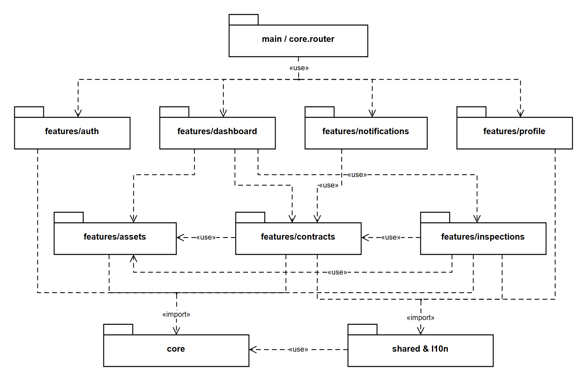

*Figure 7.7b — Customer Mobile Application package structure (`SmartDroneInspection-mobile/lib`).*

**Package Descriptions**

| No | Package | Description |
| :---: | :--- | :--- |
| 01 | `lib/core` | Provides the shared Dio HTTP client with authentication, API-response, and locale-header interceptors (`network`), secure token storage (`flutter_secure_storage`), application routing (`app_router.dart`), environment configuration (`env`), and theme and localization providers. |
| 02 | `lib/features/auth` | Implements mobile credential sign-in, Google OAuth 2.0 deep-link callback handling, and Riverpod session state. `session_provider.dart` enforces that only `CUSTOMER` accounts enter the application; the network layer raises `CUSTOMER_ONLY_MOBILE` for any other role. |
| 03 | `lib/features/assets` | Displays the organization's building assets, coordinates, and inspection checkpoints, with `data`, `domain`, and `presentation` layers. |
| 04 | `lib/features/contracts` | Implements the customer service-request list, new-request submission, request detail, and order-chat conversation. |
| 05 | `lib/features/inspections` | Implements the customer inspection list and inspection detail, including the published report and its findings. |
| 06 | `lib/features/dashboard`, `lib/features/notifications` | Provide the customer home summary and the in-app notification list. |
| 07 | `lib/features/profile`, `lib/shared` & `lib/l10n` | Provide user profile viewing and language switching, reusable asynchronous state widgets, and generated English/Vietnamese localization bundles from `app_en.arb` and `app_vi.arb`. |

## 2. Database Design

**Scope boundary.** The schema models buildings only. Flyway applies `V1__baseline.sql`, a consolidated baseline holding the complete schema and catalog seeds, followed by forward migrations `V2`–`V4` and `V60`–`V80`: including `V62`–`V65` (`DroneKnowledgeAI` `pgvector` 384d HNSW stores and historical case backfill), `V66` (`assets.ownership_information`), `V67`–`V68` (payment order timestamps and `gateway_inbound_transactions`), `V69` (1-to-1 `inspection_flight_permits` and `field_session_telemetry`), `V70` (`inspector_ratings`), `V72` (`field_session_flights` multi-sortie table), `V73` (`rating_criterion_configs`), `V76`–`V77` (`inspection_reports` `APPROVED` payout workflow state & backfill), `V78` (`inspector_payouts.payout_order_code` `SDIPAY`), `V79` (`service_request_partner_messages` & `_attachments`), and `V80` (`service_requests.inspection_items` checkpoint snapshot). `FullDatabaseSchemaMigrationTest` asserts all `55` relations in `public` (`53` application tables + `event_publication` outbox + `flyway_schema_history`; `52` `RUNTIME_ENTITY_TABLES`). Legacy table `prospective_customer_registrations` is retained untouched in PostgreSQL for schema stability and receives no new writes (`FE-07`).

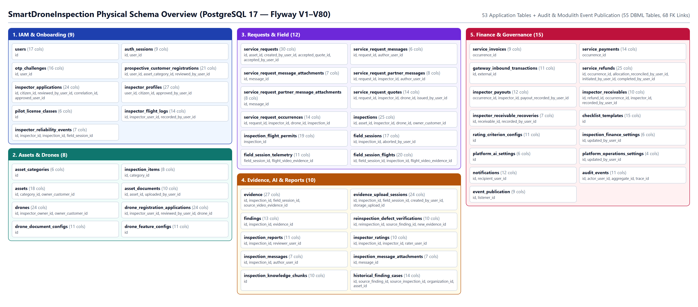

*Figure 7.8 — SmartDroneInspection Physical Schema Overview (`smartdrone-physical-erd.dbml`, `53` application tables + outbox/audit across `V1`–`V80`).*

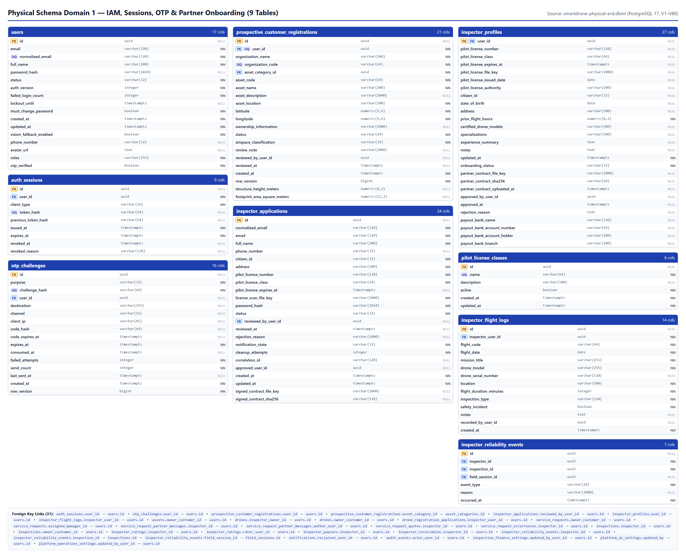

*Figure 7.8a — Physical Schema Domain 1 (`DBML`): IAM, Sessions, OTP & Partner Onboarding (`9` tables).*

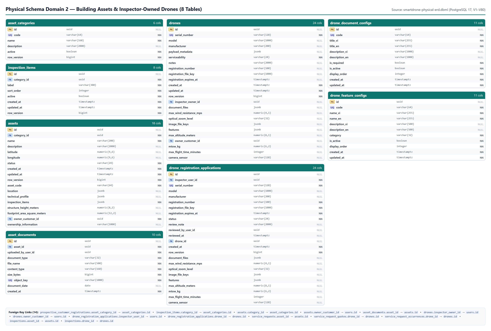

*Figure 7.8b — Physical Schema Domain 2 (`DBML`): Building Assets & Inspector-Owned Drones (`8` tables).*

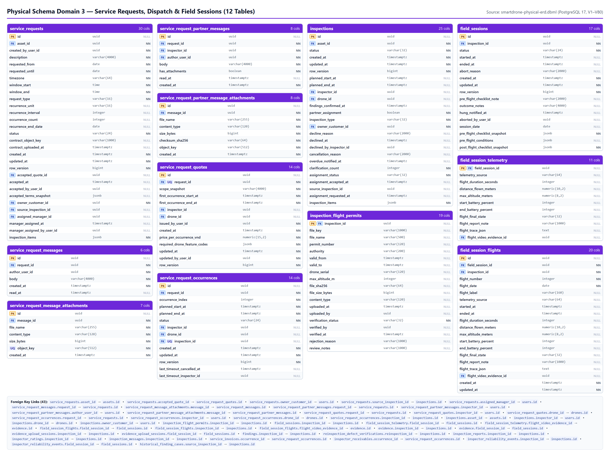

*Figure 7.8c — Physical Schema Domain 3 (`DBML`): Service Requests, Partner/Order Chat, Dispatch & Multi-Sortie Field Sessions (`12` tables).*

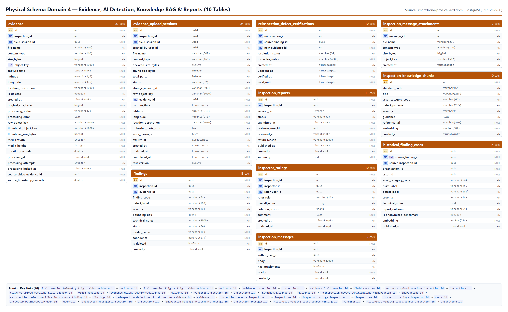

*Figure 7.8d — Physical Schema Domain 4 (`DBML`): Evidence, AI Detection, Knowledge RAG, Ratings & Reports (`10` tables).*

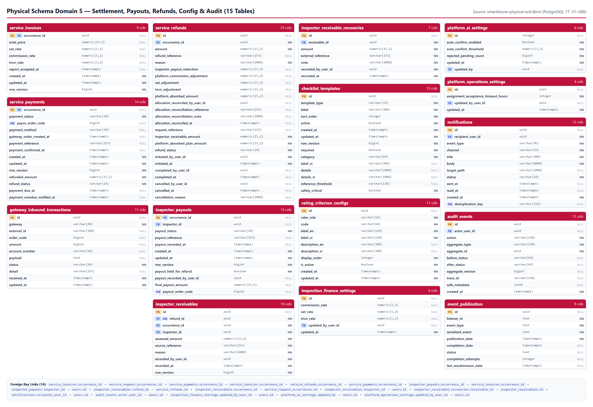

*Figure 7.8e — Physical Schema Domain 5 (`DBML`): Invoices, Sepay/VNPay Settlement, Payouts, Refunds, Config & Audit (`15` tables).*

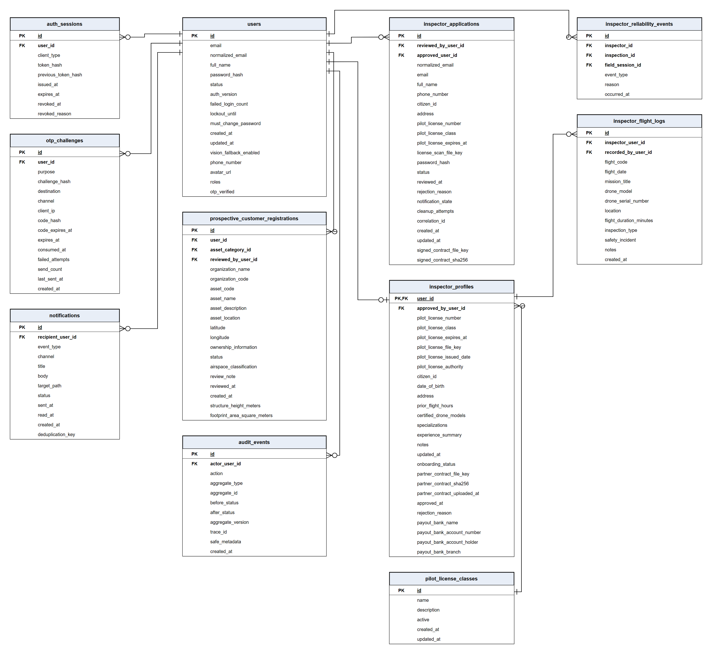

*Figure 7.8f — Logical Crow's-Foot ERD: Users, Sessions, Onboarding & Audit Governance.*

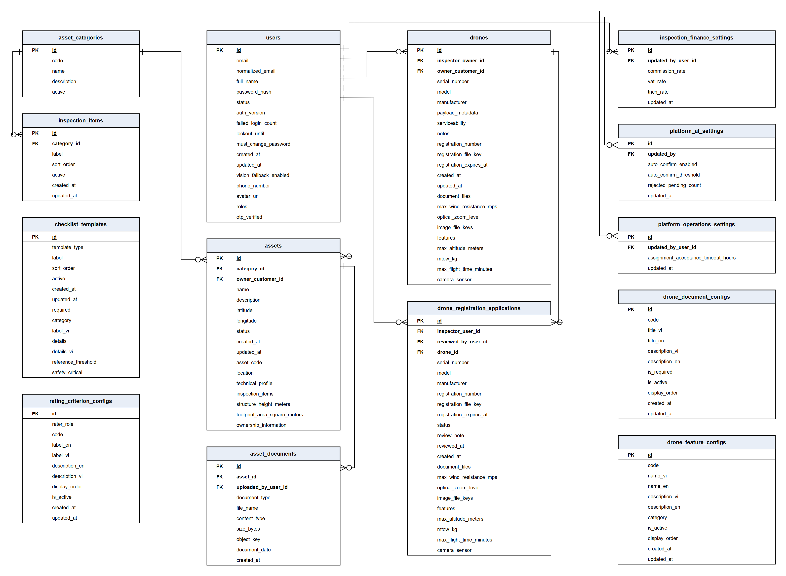

*Figure 7.8g — Logical Crow's-Foot ERD: Building Assets, Checkpoints, Airspace & Owned Drones.*

*Figure 7.8h — Logical Crow's-Foot ERD: Commercial Requests, Occurrences, Permits & Multi-Sortie Field Sessions.*

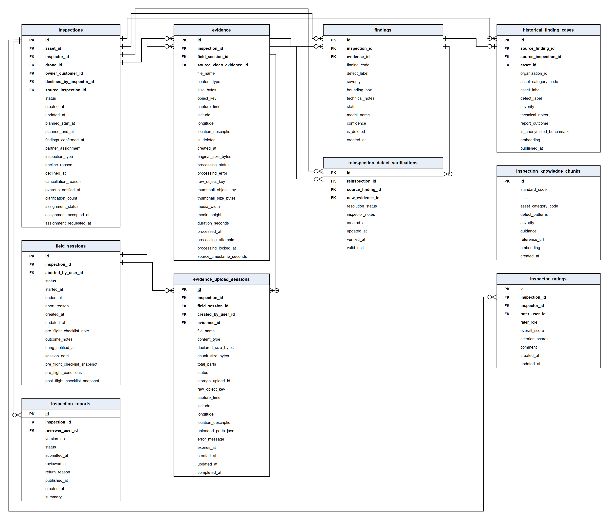

*Figure 7.8i — Logical Crow's-Foot ERD: Evidence, Findings, DroneKnowledgeAI, Ratings & Report Versions.*

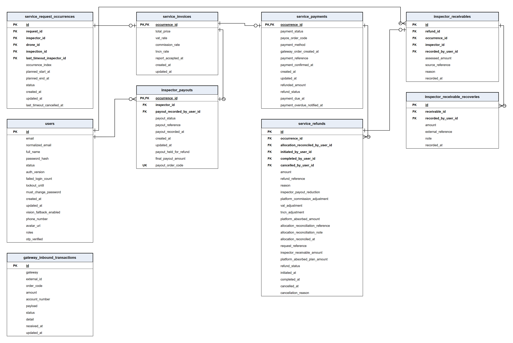

*Figure 7.8j — Logical Crow's-Foot ERD: Service Invoices, Payments, Payouts, Refunds & Receivables.*

**Framework tables:** `event_publication` stores the Spring Modulith transactional outbox and `flyway_schema_history` is Flyway's migration ledger (`55` total relations in `public`). Additional `V70`–`V80` entities (`field_session_flights`, `inspector_ratings`, `rating_criterion_configs`, `service_request_partner_messages`, `service_request_partner_message_attachments`) appear in Domains 3–5 above.

| No | Table | Description |
| :---: | :--- | :--- |
| 01 | `users` | Platform accounts with role set, status, and lockout state. A customer organization is represented by its owning account. |
| 02 | `inspector_profiles` | Inspector licence details, partner contract, and onboarding state. |
| 03 | `inspector_applications` | Public partner applications and their review outcome. |
| 04 | `otp_challenges` | One-time verification challenges. |
| 05 | `auth_sessions` | Active sessions with hashed refresh tokens and revocation. |
| 06 | `inspector_flight_logs` | Historical inspector flight missions. |
| 07 | `prospective_customer_registrations` | Registrations held for restricted-airspace review. |
| 08 | `drone_registration_applications` | Drone registration requests with documents and capabilities. |
| 09 | `drones` | Approved drones with registration validity and serviceability. |
| 10 | `asset_categories` | Building category catalogue; only active rows are selectable in asset registration. |
| 11 | `inspection_items` | Category-scoped inspection checkpoints. |
| 12 | `assets` | Customer buildings with coordinates, structural `technical_profile`, plain-text `ownership_information` (`V66`), and checkpoints. |
| 13 | `asset_documents` | Building reference documents with checksums. |
| 14 | `checklist_templates` | Configurable field checklist items. |
| 15 | `drone_document_configs` | Required drone document types. |
| 16 | `drone_feature_configs` | The drone capability catalogue. |
| 17 | `pilot_license_classes` | Recognised pilot-licence classes. |
| 18 | `inspection_finance_settings` | Commission, VAT, and tax rates. |
| 19 | `platform_ai_settings` | Detection auto-confirmation setting (`default: 70.00` since `V63`). |
| 20 | `platform_operations_settings` | Singleton operations settings, including assignment acceptance timeout and dispatch defaults. |
| 21 | `service_requests` | One-time and recurring requests with terms snapshot and manager assignment. |
| 22 | `service_request_messages` | Order-chat messages. |
| 23 | `service_request_message_attachments` | Private chat attachment metadata. |
| 24 | `inspection_messages` | Per-inspection chat between the assigned inspector and the customer, separate from the commercial order thread. |
| 25 | `inspection_message_attachments` | Private inspection-chat attachment metadata with MIME type, size, and checksum. |
| 26 | `service_request_quotes` | The active VND quotation. |
| 27 | `service_request_occurrences` | Dated occurrences with dispatch state. |
| 28 | `service_invoices` | Per-occurrence price and rate snapshots. |
| 29 | `service_payments` | Customer payment status, gateway order reference/timestamp (`gateway_order_created_at`, `V67`), due deadline, and refund totals. |
| 30 | `inspector_payouts` | Inspector payout state and refund hold. |
| 31 | `service_refunds` | Refund ledger with accounting allocation. |
| 32 | `inspector_receivables` | Inspector debt after a refund follows a paid payout. |
| 33 | `inspector_receivable_recoveries` | Collection records against a receivable. |
| 34 | `inspections` | Missions with assignment, clarification count, and findings confirmation state (permit data split 1-to-1 into `inspection_flight_permits` in `V69`). |
| 35 | `field_sessions` | On-site session lifecycle and safety/outcome notes (SmartDroneHub metrics, trace, and synced video split 1-to-1 into `field_session_telemetry` in `V69`). |
| 36 | `evidence` | Photographs and video with object keys and processing state. |
| 37 | `evidence_upload_sessions` | Resumable upload state. |
| 38 | `findings` | Candidate and confirmed defects. |
| 39 | `reinspection_defect_verifications` | Three-way re-inspection comparison. |
| 40 | `inspection_reports` | Versioned reports with publication state. |
| 41 | `notifications` | Deduplicated in-app notices. |
| 42 | `audit_events` | Append-only decision record. |
| 43 | `inspector_reliability_events` | Inspector reliability events. |
| 44 | `event_publication` | The transactional outbox. |
| 45 | `inspection_knowledge_chunks` | Stores the eight seeded engineering-standard/guideline chunks that ground `DroneKnowledgeAI` (`V62`, updated to `vector(384)` by `V65`): standard code, title, asset-category code, defect patterns, severity, guidance text, reference URL, and a `vector(384)` embedding with an HNSW `vector_cosine_ops` index for cosine retrieval via local `fastembed`. |
| 46 | `historical_finding_cases` | Stores six anonymized benchmark cases and confirmed findings backfilled (`V64`) and indexed automatically at report publication (`V62`, updated to `vector(384)` by `V65`), with organization/asset references, defect label, severity, notes, outcome (including re-inspection resolution status), anonymized flag, and a `vector(384)` embedding; retrieval is tenant-isolated and excludes the current inspection. |
| 47 | `gateway_inbound_transactions` | Idempotent inbound payment-gateway webhook audit table (`V68`) keyed uniquely on `(gateway, external_id)` when present, recording `order_code`, `amount`, `account_number`, raw `payload`, status (`APPLIED`, `AMOUNT_MISMATCH`, `ORDER_NOT_FOUND`, `REJECTED`, `ERROR`), and diagnostic `detail` across `REQUIRES_NEW` transactions. |
| 48 | `inspection_flight_permits` | 1-to-1 flight-permit document metadata and independent Manager/Admin review gate split from `inspections` (`V69`), keyed on `inspection_id`. |
| 49 | `field_session_telemetry` | 1-to-1 SmartDroneHub telemetry metrics, GPS `flight_trace_json`, and synced `flight_video_evidence_id` split from `field_sessions` (`V69`), keyed on `field_session_id`. |

## 3. Detailed Design

Endpoint paths in Section IV.3 omit the common /api/v1 prefix.

### 3.1 `MF1` — `FE-01` Account Authentication, OTP & 4-Role Access Control

This section presents the detailed design for `FE-01`: Customer organization registration (with No-Fly Zone airspace gate), Argon2id credential sign-in, consolidated `REGISTRATION`/`LOGIN`/`PASSWORD_RESET` OTP challenges, Google OAuth 2.0 federation, HS256 JWT and HmacSHA256 refresh-token rotation, self-service user profile updates, platform user administration, and strict four-role access control (`ADMIN`, `MANAGER`, `CUSTOMER`, `INSPECTOR`).

#### 3.1.1 Class Diagram

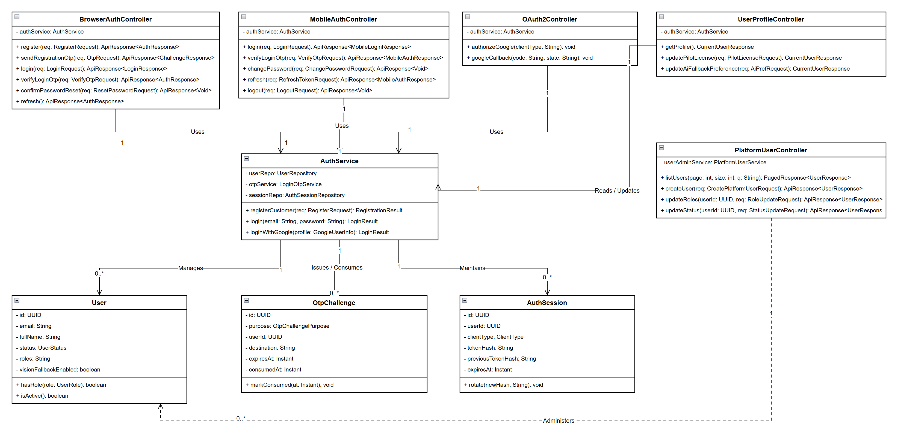

*Figure 7.8k — `FE-01` Account Authentication, OTP & 4-Role Access Control Class Diagram.*

**Class Specifications**

| No | Class | Description |
| :---: | :--- | :--- |
| 01 | `BrowserAuthController` & `MobileAuthController` | Handle customer registration, email/password sign-in, OTP verification and password reset, password change, and token refresh for web (`HttpOnly` cookie CSRF-protected chain) and mobile (`Bearer` / refresh token) clients. |
| 02 | `OAuth2Controller` | Handles federated Google OAuth 2.0 sign-in and callback redirection for web browsers and mobile deep links (`smartdrone://auth`). |
| 03 | `UserProfileController`, `PlatformUserController` & `AdminAuditLogController` | Allow signed-in users to manage their own profile (`/api/v1/users/me`, `vision_fallback_enabled`), let `ADMIN` provision/activate single-role platform accounts (`Last-Admin` protected), and expose append-only `audit_events`. |
| 04 | `AuthService`, `AuthRateLimitFilter` & `LoginFailureService` | Coordinates Argon2id verification, 5-failure 15-minute lockout, per-IP OTP/login throttling, and JWT issuance/rotation (`AccessTokenService`, `RefreshCookieService`). |
| 05 | `User`, `OtpChallenge` & `AuthSession` | Domain entities representing single-role users across `ADMIN`, `MANAGER`, `CUSTOMER`, and `INSPECTOR`, time-limited OTP challenges, and rotated refresh sessions. |

#### 3.1.2 Customer Organization and Initial Asset Registration Sequence Diagram

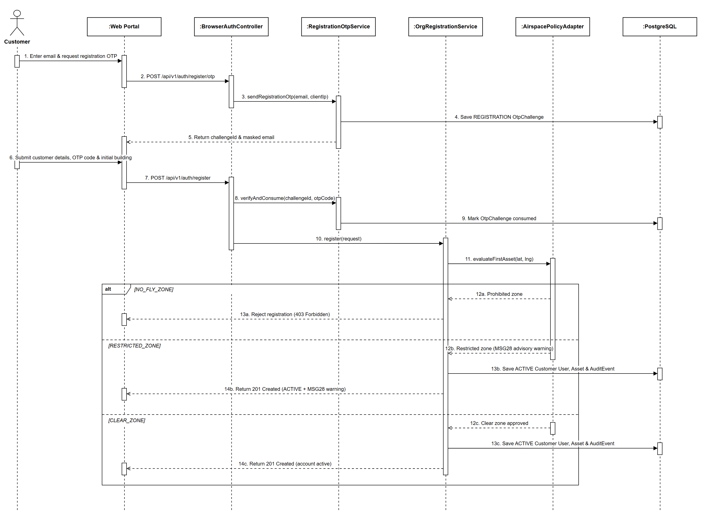

*Figure 7.8l — `FE-01A` Customer Registration, `RESTRICTED_ZONE` `MSG28` Amber Warning & Immediate Onboarding Sequence.*

#### 3.1.3 User Sign-In, OTP Verification and Google OAuth 2.0 Sequence Diagram

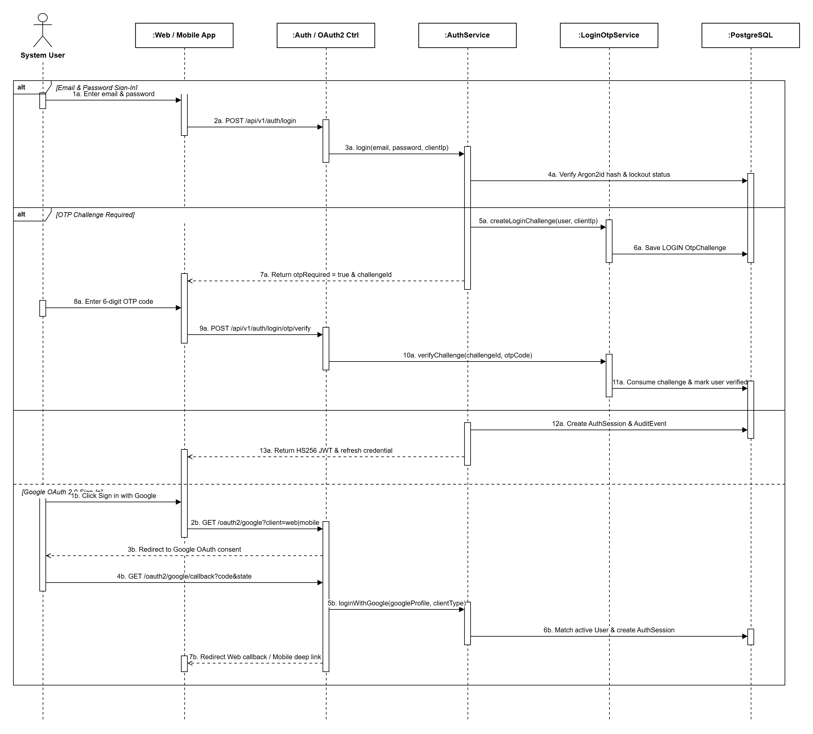

*Figure 7.8m — `FE-01B` Password, OTP & Google OAuth 2.0 Sign-In Sequence.*

---

### 3.2 `MF1` — `FE-02` Partner Inspector Application & Qualification Management

This section presents the detailed design for `FE-02`: the public partner Inspector application with licence scan, platform review and atomic account provisioning, the signed partner contract record, Administrator-managed UAV pilot-licence classes, pilot licence renewal, and Inspector flight logs.

#### 3.2.1 Class Diagram

*Figure 7.8n — `FE-02` Partner Inspector Application & Qualification Class Diagram.*

**Class Specifications**

| No | Class | Description |
| :---: | :--- | :--- |
| 01 | `InspectorApplicationController` & `InspectorApplicationService` | Accept unauthenticated partner applications and MinIO licence scans (`PENDING_REVIEW`), expose approval/rejection strictly to `MANAGER` (and read-only view to `ADMIN`), provision `INSPECTOR` user + `InspectorProfile` upon approval (requiring no drone at signup), record mandatory rejection reasons, and persist signed partner contracts. |
| 02 | `InspectorProfileController` & `InspectorProfileService` | Maintain pilot credentials in `inspector_profiles`, handle licence scan renewals, and store attribution flight history in `inspector_flight_logs` (`InspectorProfileController` also emits `PilotLicenseUpdatedEvent`). |
| 03 | `PilotLicenseClassController`, `PilotLicenseClassService` & `PilotLicenseExpiryCheckService` | Maintain recognized licence classes (`pilot_license_classes`) mapped to Decree 288 rules and run scheduled expiry checks notifying Inspectors and staff when licences lapse. |

#### 3.2.2 Partner Inspector Application, Review and Account Provisioning Sequence Diagram

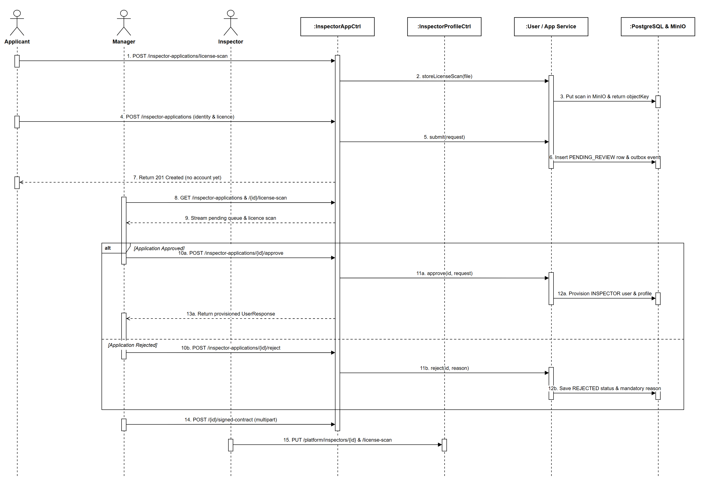

*Figure 7.8o — `FE-02` Partner Inspector Application, `MANAGER` Review & Account Provisioning Sequence.*

---

### 3.3 `MF1` — `FE-03` Inspector-Owned Drone Registration & Fleet Management

This section presents the detailed design for `FE-03`: Administrator configuration of required drone documents and safety/capability features, Inspector submission of owned drones with real photographs and documents, Decree 288/2025/ND-CP weight classification, `MANAGER` review and approval (`ADMIN` read-only view), renewal, and serviceability transitions (`ACTIVE <-> IN_MAINTENANCE -> RETIRED`).

#### 3.3.1 Class & Sequence Diagrams

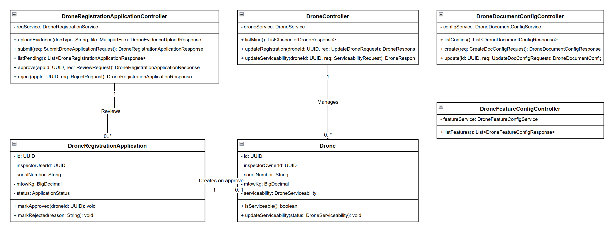

*Figure 7.8p — `FE-03` Inspector-Owned Drone Registration & Fleet Class Diagram.*

*Figure 7.8q — `FE-03` Inspector-Owned Drone Application, `MANAGER` Review & Renewal Sequence.*

| No | Class | Description |
| :---: | :--- | :--- |
| 01 | `DroneDocumentConfigController` & `DroneFeatureConfigController` | Manage Admin-configurable document requirements (`REGISTRATION` & `OWNERSHIP` active/required by default; `INSPECTION` optional) and outdoor flight capability/safety checklists (`drone_document_configs`, `drone_feature_configs`). |
| 02 | `DroneRegistrationApplicationController` & `DroneEvidenceUploadService` | Handle MinIO evidence upload (`>= 1` `DRONE_IMAGE` photo + configured doc types), duplicate serial checks, `MANAGER` approval into `drones` (`inspector_owner_id`; `ADMIN` view read-only), and rejection reasons. |
| 03 | `DroneController` & `DroneService` | Manage Inspector fleet inventory (`InspectorDroneRegistrationPage`), registration renewal (`updateRegistration`), maintenance holds (`IN_MAINTENANCE`), and terminal `RETIRED` locks, enforcing Decree 288 MTOW (`>= 2 kg` -> Class B) during eligibility checks. |

---

### 3.4 `MF1` — `FE-04` Interactive Location Map & No-Fly Zone Airspace Screening

This section presents the detailed design for `FE-04`: interactive coordinate selection on Web (`AssetLocationPickerModal` / `AirspaceNoFlyMap`) and Mobile (`AirspaceAdvisoryCard`), Vietnam restricted/no-fly zone polygon definitions, and deterministic coordinate/altitude evaluation (`AirspaceController`, `AirspaceAdvisoryService`) gating registration (`403 NO_FLY_ZONE` block) and surfacing `MSG28` amber advisories for `RESTRICTED_ZONE`.

*Figure 7.8r — `FE-04` Airspace Zone Screening Sequence.*

**Class & UI Specifications**

| No | Component / Class | Description |
| :---: | :--- | :--- |
| 01 | `AirspaceController` (`assets.api`) | Exposes `GET /api/v1/airspace/zones` (`AirspaceZoneResponse`) and `GET`/`POST /api/v1/airspace/evaluate` (`EvaluateAirspaceRequest` -> `AirspaceEvaluationResponse`), enforcing `latitude` in `[-90, 90]` and `longitude` in `[-180, 180]`. |
| 02 | `AirspaceAdvisoryService` (`assets.service`) | Performs Haversine distance calculations against active prohibited and restricted airspace zones, returning `CLEAR_ZONE`, `RESTRICTED_ZONE`, or `NO_FLY_ZONE` plus an advisory disclaimer (`MSG49`: screening never grants government aviation permission). |
| 03 | `CustomerAirspacePolicyAdapter` (`assets.service`) | Adapter implementing `shared.api.CustomerAirspacePolicy` so `users` onboarding (`OrganizationRegistrationService`) blocks `NO_FLY_ZONE` (`403 ASSET_IN_NO_FLY_ZONE`) while allowing `RESTRICTED_ZONE` to activate immediately with structured `MSG28` advisory warning data. |
| 04 | Web `AssetLocationPickerModal.tsx` & Mobile `AirspaceAdvisoryCard` | Interactive MapLibre/map picker displaying circle overlays, amber `MSG28` authority/ceiling banners, and altitude limits across Web registration/assets and Customer Mobile views. |

---

### 3.5 `MF4` — `FE-05` Financial History & Revenue/Payment Ledger

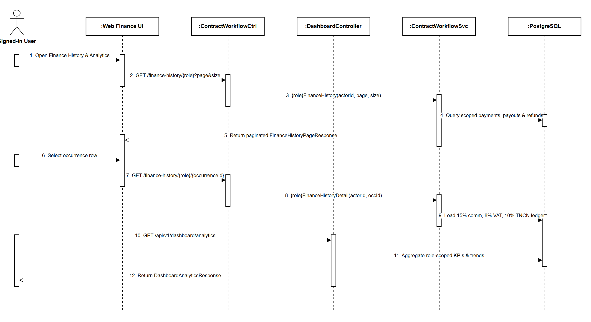

*Figure 7.8s — `FE-05` Role-Scoped Financial History & Ledger Query Sequence.*

This section presents the detailed design for `FE-05`: role-scoped financial ledgers querying settled payments, VAT breakdowns, platform commissions (`15%`), TNCN withholdings, partner payout statuses, and refund impacts across Customer, Inspector, and Manager portals.

**Class & UI Specifications**

| No | Component / Class | Description |
| :---: | :--- | :--- |
| 01 | `ContractWorkflowController` (`finance-history/*` routes) | Exposes `GET /api/v1/contracts/requests/finance-history/customer`, `/inspector`, and `/manager` (plus `/{occurrenceId}` detail endpoints) backed by `ContractWorkflowService` paged/filtered ledger queries. |
| 02 | `FinanceHistoryPageResponse`, `FinanceHistoryItemResponse`, `ManagerFinanceHistoryResponse` & `OccurrenceFinanceResponse` | DTOs projecting strict role-appropriate financial fields: Customer views payment amounts, receipts, and refundable status while masking partner payouts/receivables; Inspector views gross fee, commission/TNCN deductions, and net payout; Manager views platform inflows, commission, VAT/TNCN, and reconciliation state. |
| 03 | Web `FinanceHistoryPage.tsx` & `OverviewFinanceSection.tsx` | Role-aware Web ledger views mounted at `/client/finance-history`, `/operations/finance-history`, and `/manager/finance-history`, paired with per-inspection overview financial cards. |

---

### 3.6 `MF2` — `FE-06` Building Asset Registry, Checkpoints & Reference Documents

This section presents the detailed design for `FE-06`: the six building-only categories (`AssetCategory`), customer building creation and lifecycle management (`Asset`, with dedicated `ownership_information VARCHAR(1000)` added in `V66`), category-seeded inspection checkpoints (`inspection_items`), and SHA-256 deduplicated MinIO reference documents (`AssetDocument`).

#### 3.6.1 Sequence Diagram

*Figure 7.8t — `FE-06` Building Asset Registration & Document Upload Sequence.*

**Class Specifications**

| No | Class | Description |
| :---: | :--- | :--- |
| 01 | `AssetController`, `AssetService` & `Asset` (`assets`) | Manage customer buildings under the `NO_FLY_ZONE` gate; persist plain-text ownership in `assets.ownership_information` (`varchar(1000)`, `V66__asset_ownership_information.sql`) separate from `technical_profile jsonb`, enforce checkpoint edits only prior to the first inspection (`InspectionAssetUsageAdapter`), expose `AssetResponse.checkpointsLocked` from one bulk `AssetInspectionUsagePort.inspectedAssetIds` lookup per page and reject post-inspection edits with `409 INSPECTION_HISTORY_EXISTS`, and support terminal retirement (`RETIRED`). |
| 02 | `AssetCatalogController` & `AssetCatalogService` | Maintain the six building-only `AssetCategory` templates and default `InspectionItem` checkpoints without retroactively rewriting checkpoints on existing buildings. |
| 03 | `AssetDocumentController` & `AssetDocumentService` | Validate non-empty building reference documents (`PDF`/images/drawings), enforce per-asset `SHA-256` uniqueness, store binaries under `assets/{assetId}/documents/` in MinIO, and stream downloads strictly to authorized Customer/Manager/Admin actors. |

---

### 3.7 `MF2` — `FE-07` Restricted Airspace Advisory Warning & Immediate Onboarding

This section presents the detailed design for `FE-07`: unified `RESTRICTED_ZONE` `MSG28` amber advisory warning and immediate onboarding behavior across public registration (`OrganizationRegistrationService`) and post-login building creation (`AssetService`), replacing the legacy Admin pending-airspace review queue (removed endpoints and UI routes).

*Figure 7.8u — `FE-07` Restricted Airspace Advisory (`MSG28`) & Immediate Activation Sequence.*

**Class & Workflow Specifications**

| No | Class / Component | Description |
| :---: | :--- | :--- |
| 01 | `OrganizationRegistrationService` (`users.service`) | Calls `CustomerAirspacePolicyAdapter.evaluateFirstAsset`: blocks `NO_FLY_ZONE` (`403 ASSET_IN_NO_FLY_ZONE`), immediately activates `CUSTOMER` user + initial `Asset` for both `CLEAR_ZONE` and `RESTRICTED_ZONE`, and returns `airspaceClassification` + structured `reviewMessage` (`MSG28` authority, ceiling, and `https://cambay.mod.gov.vn`). |
| 02 | Legacy Review Retirement (`AirspaceReviewController` & `prospective_customer_registrations`) | The legacy `/api/v1/platform/customer-airspace-reviews` controller and `customer-airspace` admin navigation section are removed; `prospective_customer_registrations` stays preserved in schema history without accepting new rows. |
| 03 | Web & Mobile `MSG28` Advisory Components | Render amber `MSG28` warnings on map coordinate selection, post-registration `/login` toast banner, `CreateServiceRequest` dialog (when choosing a `RESTRICTED_ZONE` asset), asset detail badges, and Stage 1 permit panels. |

---

### 3.8 `MF2` — `FE-08` Service Requests (One-Time & Recurring) & VND Quotations

This section presents the detailed design for `FE-08`: one-time and recurring customer service requests (`>= 20` calendar-day lead time in `Asia/Ho_Chi_Minh`, `1–120` month cadence, `2–100` occurrences, `V80` `inspection_items` checkpoint snapshot, concise titles `<Building> · Monthly inspection`), pessimistic Manager self-claim with immediate detail navigation, ADMIN assignment oversight, and active VND quotation negotiation.

#### 3.8.1 Sequence & State Diagrams

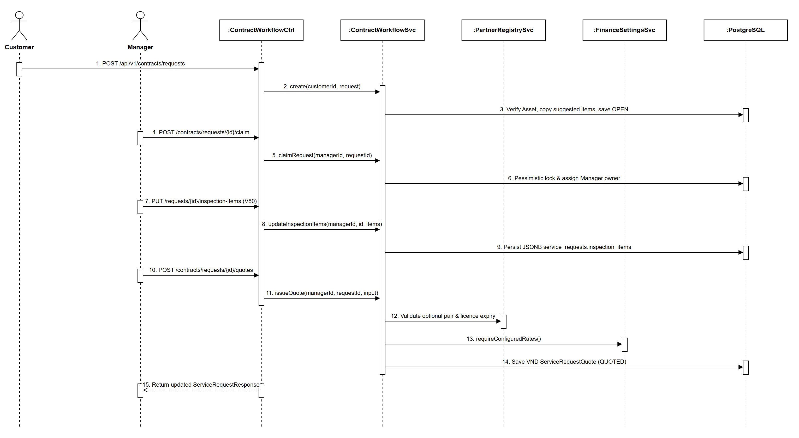

*Figure 7.8v — `FE-08` Service Request, Manager Claim & VND Quotation Sequence.*

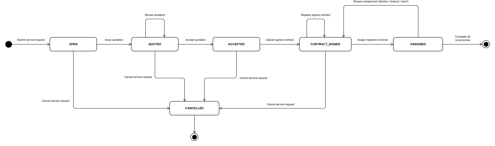

*Figure 7.8w — `ServiceRequest` State Machine Diagram.*

**Class & UI Specifications**

| No | Class / Component | Description |
| :---: | :--- | :--- |
| 01 | `ContractWorkflowController` & `ContractWorkflowService` | Enforce 20-day lead time, generate concise recurring titles (`Monthly inspection` / `Every N-month inspection`), serialize `claimRequest` under DB locking, restrict commercial actions to `assignedManagerId`, expose `ADMIN` assignment registry (`PUT`/`DELETE /manager-assignment`), and project assigned Manager read-only contact info (`ServiceManagerContactResponse`) solely to the owning Customer. |
| 02 | `ServiceRequest` & `ServiceRequestQuote` | Store request cadence/bounds, Manager assignment audit metadata, and single active VND quotation (`V60` nullable `inspector_id`/`drone_id`, empty `requiredDroneFeatureCodes` compatible). |
| 03 | Web `ServiceRequestListView.tsx`, `useContracts.ts`, `ManagerQuoteWorkspace.tsx`, `QuoteTermsSummary.tsx` | Compact 4-column desktop table (`Request & Asset / Schedule / Stage / Action`) with compact schedule range (`formatFlightTimeRange`) and `N occurrences` wording; claiming caches the request and opens `?requestId=...` detail immediately without reload; quote form omits the optional drone-capability checkboxes while sending `[]` on the API contract (`PR #139`). |

---

### 3.9 `MF2` — `FE-09` Offline Signed Contract & Occurrence Dispatch Scheduling

This section presents the detailed design for `FE-09`: Customer quotation acceptance (freezing terms snapshot & materializing month-end anchored occurrences), offline signed paper agreement upload to MinIO, partner eligibility & cross-organization schedule-conflict checks, bulk `Apply to remaining` occurrence dispatch, and abort recovery (`reschedule`, `reassign`, `cancel`).

#### 3.9.1 Class, Sequence & State Diagrams

*Figure 7.8x — `FE-09` Signed Contract Upload, Occurrence Dispatch & Recovery Class Diagram.*

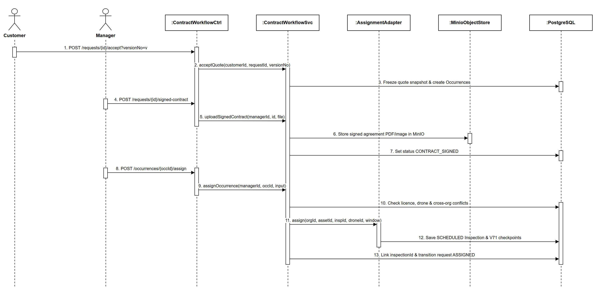

*Figure 7.8y — `FE-09` Quote Acceptance, Signed Contract Upload & Occurrence Dispatch Sequence.*

*Figure 7.8z — `ServiceRequestOccurrence` State Machine Diagram.*

**Class & UI Specifications**

| No | Class / Component | Description |
| :---: | :--- | :--- |
| 01 | `ContractWorkflowService` (`acceptQuote`, `uploadSignedContract`, `assignOccurrence`) | Freezes immutable quote snapshot, materializes recurring occurrences (`Jan 31 -> Feb 28/29 -> Mar 31`), persists signed paper contracts under `contracts/requests/{id}/`, and dispatches single or bulk (`Apply to remaining`) partner assignments. |
| 02 | `PartnerRegistryService` & `Mf2InspectionAssignmentAdapter` | Verify Decree 288 class match, non-expired registration/licence at planned flight timestamps, and absence of cross-organization schedule collisions (`hasScheduleConflict`). Reassigning a `FIELD_COMPLETED` inspection returns `409`. |
| 03 | Web `PartnerCandidateResults.tsx` & `ManagerOccurrencesStep.tsx` | Render explicit candidate table column widths with an icon-only details action button (`PR #139`) preventing overlap between drone tier, details, and `Select` controls, plus bulk team assignment confirmation. |

---

### 3.10 `MF2` — `FE-10` Multi-Channel Messaging (Order Chat, Partner Chat & Inspection Chat)

This section presents the detailed design for `FE-10`: strictly separated commercial Order Chat (`service_request_messages`, Customer <-> assigned Manager), Manager <-> Partner Inspector pre-dispatch coordination chat (`service_request_partner_messages` added in `V79`), and operational Inspection Chat (`inspection_messages` added in `V61`, Customer <-> assigned Inspector) with private MinIO attachment storage and Mobile parity.

*Figure 7.8aa — `FE-10` Separated Order Chat, Partner Chat (`V79`) & Inspection Chat Sequence.*

**Class & UI Specifications**

| No | Class / Component | Description |
| :---: | :--- | :--- |
| 01 | `ContractWorkflowController` (`/requests/{id}/messages*` & `/requests/{id}/partner-messages*`) | Serves Customer <-> assigned `MANAGER` commercial Order Chat and `MANAGER` <-> `INSPECTOR` Partner Chat (`V79`, `service_request_partner_messages*`: up to 5 files, `10 MiB` per file / `20 MiB` per message, `PNG`/`JPG`/`WEBP`/`PDF`/`DOCX`), refusing `ADMIN` and unrelated callers. |
| 02 | `InspectionChatController` & `InspectionChatService` (`inspections.api/service`, `V61`) | Exposes `GET /inspections/messages/threads`, `GET /inspections/{id}/messages`, `POST /{id}/messages`, `POST /{id}/messages/read`, and `GET /{id}/messages/{msgId}/attachments/{attId}` scoped solely to owning `CUSTOMER` and assigned `INSPECTOR` (`ADMIN` and `MANAGER` denied), capping message text at `4000` chars and attachments at `10 MiB` per file and `20 MiB` total per message in MinIO (`inspections/{id}/messages/`). |
| 03 | `ChatAttachmentValidator` (`shared.storage`) | Validates real file magic signatures, declared MIME types, safe filenames, and size caps prior to object upload. |
| 04 | Web `RequestChatPanel.tsx`, `/messages` & Mobile `RequestChat`, `InspectionChatPage` | Deliver tabbed inboxes (`/client/messages` switching `Service requests` vs `Inspector`, `/manager/messages` switching `Order Chat` vs `Partner Chat`, `/operations/messages`) and matching Flutter Mobile threads (`PR #27`). |

---

### 3.11 `MF2` — `FE-11` Assignment Acceptance Timeout & Escalation Handling

This section presents the detailed design for `FE-11`: the Administrator-configurable Step 4 assignment acceptance SLA (`platform_operations_settings`, `V61`) and the scheduled timeout monitor that releases unaccepted crew reservations and notifies stakeholders.

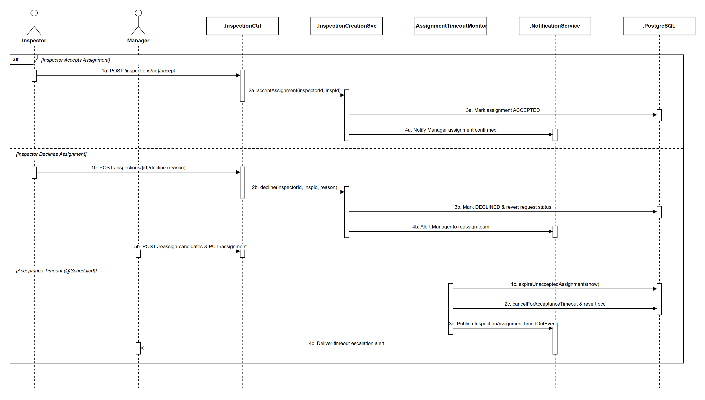

*Figure 7.8ab — `FE-11` Assignment Acceptance Timeout & Escalation Sequence.*

**Class & UI Specifications**

| No | Class / Component | Description |
| :---: | :--- | :--- |
| 01 | `PlatformOperationsSettingsController`, `PlatformOperationsSettingsService` & `PlatformOperationsSettings` (`V61`) | Admin-only endpoints (`GET/PUT /api/v1/platform/operations-settings`) configuring `assignment_acceptance_timeout_hours` (`1–720`, default `24` hours). |
| 02 | `InspectionAssignmentTimeoutMonitor` (`inspections.service`) | Scheduled monitor scanning `SCHEDULED` inspections in `PENDING_ACCEPTANCE` past `assignmentRequestedAt + timeoutHours`; atomically cancels the inspection, clears crew reservations, reverts `ServiceRequestOccurrence` to `PENDING_ASSIGNMENT` (reopening `ASSIGNED` request to `CONTRACT_SIGNED`), stamps `lastTimeoutCancelledAt`/`lastTimeoutInspectorId`, and emits `InspectionAssignmentTimedOutEvent`. |
| 03 | Web `PlatformOperationsSettingsPage.tsx` & Deep-Link Notification | Admin settings page plus actionable notifications routing the owning `MANAGER` directly to `/manager/contracts?requestId=...` to dispatch a replacement team. |

---

### 3.12 `MF2` — `FE-12` System Notifications & Alert Center

This section presents the detailed design for `FE-12`: transactional Spring Modulith outbox-driven notifications across all five workflow pillars, bilingual `"Tiếng Việt | English"` formatting, SMTP critical alerts, `PATCH /api/v1/notifications/read-all`, database-level deduplication (`uq_notifications_deduplication_key`), and XSS/open-redirect safe deep linking.

#### 3.12.1 Sequence Diagram

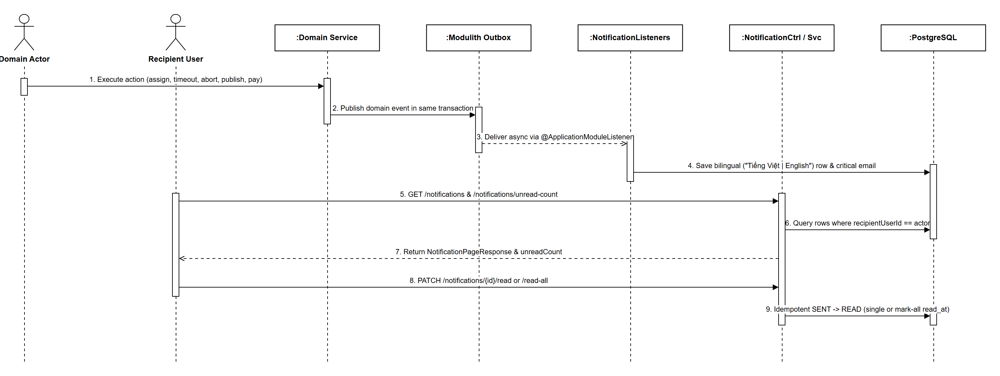

*Figure 7.8ac — `FE-12` Event-Driven Bilingual Notification & Outbox Delivery Sequence.*

**Class & UI Specifications**

| No | Class / Component | Description |
| :---: | :--- | :--- |
| 01 | `InspectionNotificationListener`, `InspectorApplicationNotificationListener`, `PaymentOverdueNotificationListener` & `PaymentSettlementNotificationListener` | Handle assignment, timeout, decline, overdue, reschedule, abort, self-attested permit, report review/payout/publication, inspector admission, and settlement events across all 5 workflow pillars with best-effort critical SMTP alerts. |
| 02 | `NotificationController`, `NotificationService` & `Notification` | Expose recipient-scoped paged queries, unread counter, `markAsRead`, and `PATCH /api/v1/notifications/read-all` protected by `uq_notifications_deduplication_key`. |
| 03 | Web `NotificationBell.tsx`, `NotificationsPage.tsx` & `targetPath.ts` | Render real-time unread counts, locale-split notification feed, and client-side `targetPath` allowlist sanitizer blocking malformed/external links while server APIs enforce independent authorization. |

---

### 3.13 `MF3` — `FE-13` Flight Permit Upload & Self-Attestation Gate

This section presents the detailed design for `FE-13`: assigned-Inspector flight permit submission (`<= 25 MB`, verified binary signature & `SHA-256`, structured permit metadata), immediate `APPROVED` activation via Inspector self-attestation (no Manager/Admin permit approval), pre-session gate enforcement, automatic reset to `PENDING_REVIEW` when drone or schedule changes (`BR-25`), and read-only Manager/Admin audit views.

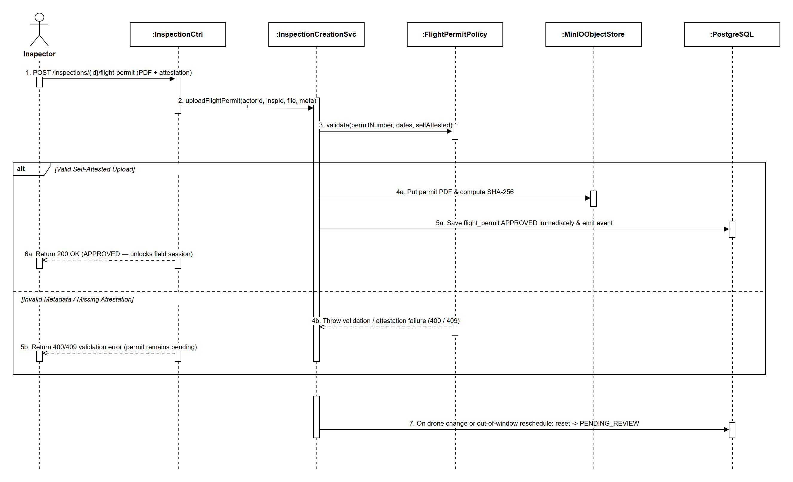

*Figure 7.8ad — `FE-13` Self-Attested Flight Permit Upload, Reset & Pre-Session Gate Sequence.*

**Class & Workflow Specifications**

| No | Class / Component | Description |
| :---: | :--- | :--- |
| 01 | `InspectionController`, `InspectionListController` & `InspectionCreationService` | Expose `POST /inspections/{id}/flight-permit` (assigned `INSPECTOR` only, `SCHEDULED` lock — immediately activates `APPROVED` via self-attestation) and scoped `GET /inspections/{id}/flight-permit/content`. Manager/Admin approval endpoints are retired; staff audit permit records read-only. |
| 02 | `FlightPermitPolicy` (`inspections.service`) | Validates binary magic bytes (`PDF`/`PNG`/`JPG`/`WEBP`, `<= 25 MB`), `permitNumber`, `issuingAuthority`, `validFrom`/`validTo` window covering planned flight time, assigned drone serial match, optional `maxAltitudeM` (`1–2000 m`), and resets `APPROVED` -> `PENDING_REVIEW` on drone swap or out-of-window reschedule (`BR-25`). |
| 03 | Web `FlightPermitVerificationPanel.tsx` & `FlightPermitPreviewDialog.tsx` | Workspace Stage 1 self-attestation metadata form/viewer and read-only Manager Permit & Flight Trace Audit view inside `/audit`. |

---

### 3.14 `MF3` — `FE-14` On-Site Field Session & SmartDroneHub MAVLink Telemetry

This section presents the detailed design for `FE-14`: pre-flight safety checklists, accountable `Start` / `Complete` / reasoned `Abort` field sessions, read-only `SmartDroneHub` live MAVLink telemetry (`14551/udp`, `5762/tcp`) and mission video sync, non-MAVLink log import (`SRT`/`CSV`/`KML`/`GPX`), manual flight declarations, abort recovery dispatch, and role dashboards/calendar.

#### 3.14.1 Class & State Diagrams

*Figure 7.8ae — `FE-14` Multi-Sortie Field Session (`V72`), SmartDroneHub Telemetry & Dashboards Class Diagram.*

*Figure 7.8af — `Inspection` Lifecycle State Machine Diagram.*

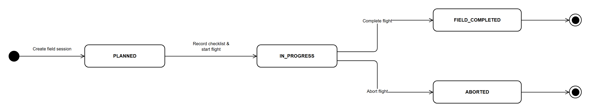

*Figure 7.8ag — `FieldSession` Execution State Machine Diagram.*

#### 3.14.2 Field Session, SmartDroneHub Sync & Abort Recovery Sequence Diagrams

*Figure 7.8ah — `FE-14A` Self-Attested Permit Gate, Multi-Sortie Field Session & SmartDroneHub Telemetry Sync.*

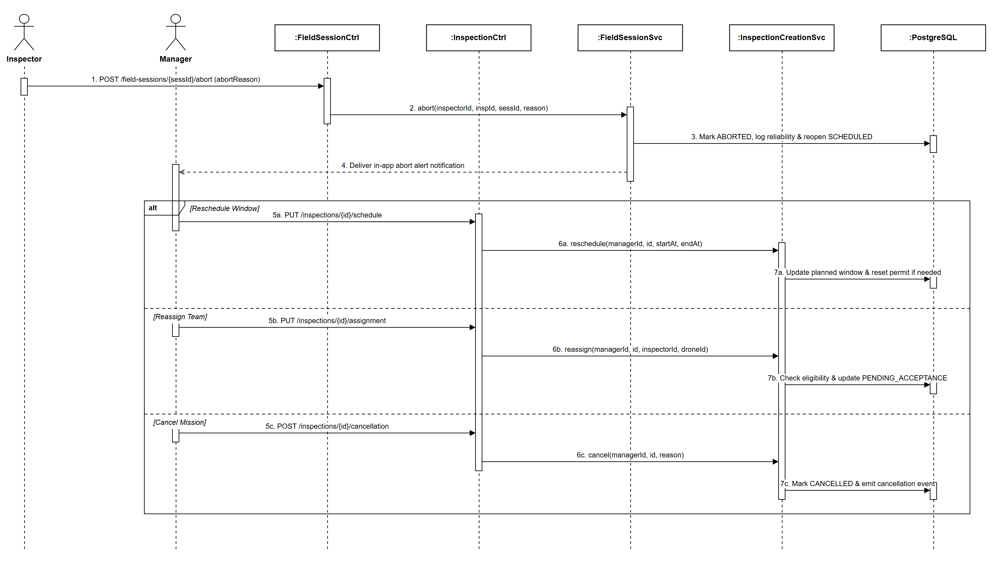

*Figure 7.8ai — `FE-14B` Field Session Abort & Manager Reschedule / Reassign / Cancel Recovery Sequence.*

---

### 3.15 `MF3` — `FE-15` Field Evidence Intake & Chunked Video Processing Pipeline

This section presents the detailed design for `FE-15`: image EXIF extraction prior to decoding and `2048 px` / `480 px` normalization, resumable `10 MiB` S3 multipart MP4 uploads up to `2 GiB`, durable async FFmpeg `<= 1080p` faststart + poster transcoding, duplicate filename disambiguation (`name (1).ext`), video keyframe extraction, and short-lived HMAC ticketed HTTP Range playback.

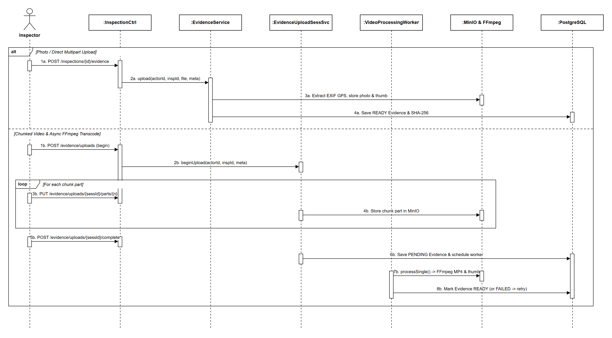

*Figure 7.8aj — `FE-15` Evidence Intake, Resumable Chunked MP4 Transcode & Ticketed Streaming Sequence.*

**Class & Pipeline Specifications**

| No | Class / Component | Description |
| :---: | :--- | :--- |
| 01 | `EvidenceService`, `ExifMetadataExtractor` & `ImageNormalizer` | Extract EXIF GPS/time/orientation first, normalize oversized (`> 2048 px`) or rotated photos (`<= 10 MB`), emit `480 px` JPEG thumbnails (`?variant=thumb`), disambiguate duplicate filenames sequentially (`MSG17`), promote video keyframes (`<= 1280x720`), and enforce inspection read scope (`EvidenceOwnershipService`). |
| 02 | `EvidenceUploadSessionService` (`evidence_upload_sessions`) | Manages `OPEN -> COMPLETING -> COMPLETED`/`FAILED`/`CANCELLED`/`EXPIRED` resumable multipart uploads up to `2 GiB` in `10 MiB` chunks directly via MinIO S3 multipart without full-file JVM buffering. |
| 03 | `VideoProcessingWorker`, `FfmpegVideoTranscoder` & `MediaTicketService` | Poll `PENDING` video jobs (`max-concurrent-jobs: 2`), transcode via argument-array `ffmpeg` (`<= 1080p` H.264 `+faststart` MP4 + `480 px` poster) retaining `raw_object_key` until verified `READY` (retryable on `FAILED`), and mint 5-minute HMAC streaming tickets (`GET/HEAD .../stream?ticket=...` supporting `200`/`206`/`416`/`If-Range`). |
| 04 | Web `InspectionEvidencePage.tsx`, `EvidenceCaptureGroup.tsx`, `VideoFrameCropDialog.tsx` & `EvidenceGpsMapDialog.tsx` | Workspace Stage 5 upload queue, native `<video>` Range player (`AuthenticatedMedia`), EXIF map inspection, and frame promotion UI. |

---

### 3.16 `MF3` — `FE-16` AI Defect Detection (`YOLO11` + Vision Fallback) & Findings Confirmation

This section presents the detailed design for `FE-16`: Ultralytics `YOLO11s` (`MBDD2025`, 5 building classes: `crack`, `leakage`, `abscission`, `corrosion`, `bulge`), Vision LLM fallback respecting per-user opt-out (`vision_fallback_enabled`), `V63` `70.00` default auto-confirm threshold (`platform_ai_settings`), confirmation status filter chips, manual finding entry (`confidence = null`), normalized `[0, 1]` bounding boxes, and explicit baseline confirmation.

#### 3.16.1 Class & Sequence Diagrams

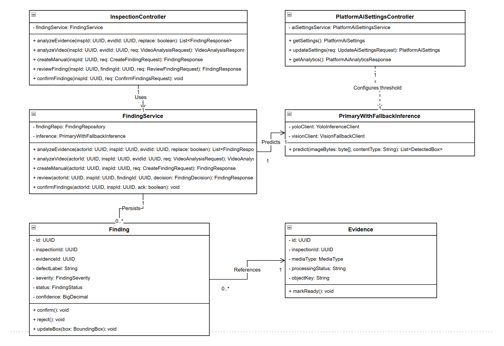

*Figure 7.8ak — `FE-16` AI Defect Detection & Findings Baseline Confirmation Class Diagram.*

*Figure 7.8al — `FE-16` YOLO11 + Fallback Defect Detection & Findings Confirmation Sequence.*

---

### 3.17 `MF3` — `FE-17` AI Case/Standard Retrieval (`pgvector` RAG), Note Drafting & Report Summary

This section presents the detailed design for `FE-17` (`DroneKnowledgeAI`): tenant-isolated `pgvector` `vector(384)` HNSW cosine search over `inspection_knowledge_chunks` and `historical_finding_cases` (`V62`, `V64` published-case backfill, `V65` local `fastembed` `paraphrase-multilingual-MiniLM-L12-v2` embeddings in `ai-inference`), automatic `HYBRID_MATCH` fallback, `POST .../draft-note` (`Draft note with AI` + batch `Draft all notes`), `ReportAiSummaryResponse.knowledgeReferences`, and Customer Mobile `KnowledgeReferencesStrip`.

#### 3.17.1 Class & RAG Sequence Diagrams

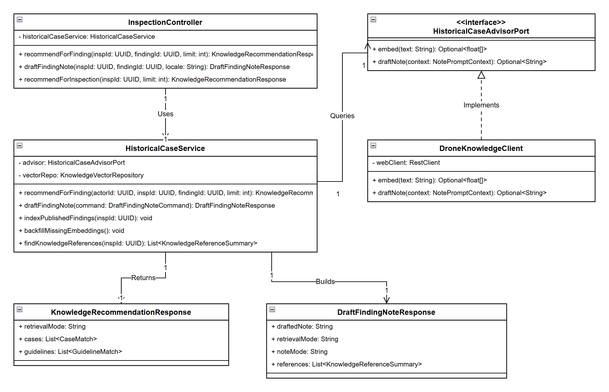

*Figure 7.8am — `FE-17` `DroneKnowledgeAI` Retrieval, AI Note Drafting & Summary Grounding Class Diagram.*

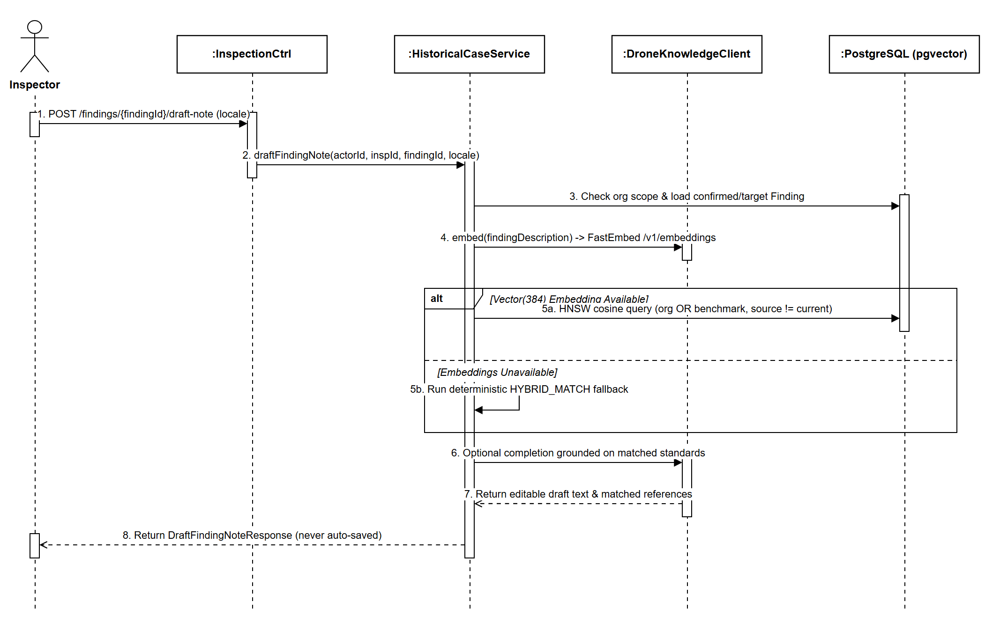

*Figure 7.8an — `FE-17` Tenant-Isolated `pgvector` RAG Lookup & AI Finding Note Drafting Sequence.*

---

### 3.18 `MF4` — `FE-18` Inspection Report Compilation, Independent Review, Payouts & Publication

This section presents the detailed design for `FE-18`: deterministic fixed-section report compilation from confirmed findings (`SUBMITTED`, `RETURNED`, `APPROVED`, `PUBLISHED`, `SUPERSEDED` via `V76`–`V77`), single-shot advisory narrative drafting (`ReportDraftClient` + `Matched Cases & Standards`), strict non-author independent `MANAGER` approval (`ADMIN` read-only), integrated Partner Sepay VietQR payout (`V78` `SDIPAY`) prior to official publication, ungated `PUBLISHED` A4 PDF rendering without video buffering, and version supersession.

#### 3.18.1 Class, State & Publication Sequence Diagrams

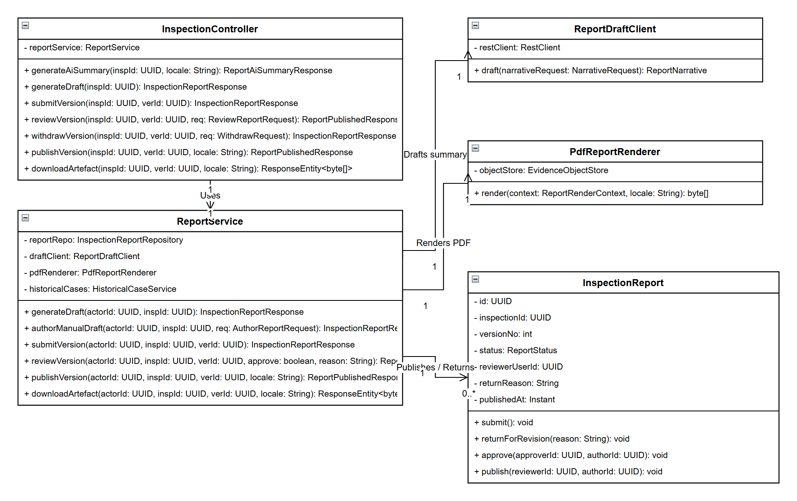

*Figure 7.8ao — `FE-18` Report Compilation, Approval, Payout-Before-Publish & PDF Export Class Diagram.*

*Figure 7.8ap — `InspectionReport` Lifecycle State Machine Diagram (`V76`–`V77`).*

*Figure 7.8aq — `FE-18` Report Submission, `MANAGER` Approval -> Sepay VietQR Payout -> Publication & Ungated PDF Export Sequence.*

---

### 3.19 `MF4` — `FE-19` Customer Report Acceptance, Ratings & Clarification Workflow

This section presents the detailed design for `FE-19`: Customer organization review of published inspection deliverables across Web and Flutter Mobile, Customer and Manager structured Inspector Ratings (`inspector_ratings` `V70`, configurable EN/VI criteria `rating_criterion_configs` `V73`), explicit acceptance against the exact published report version (`PAYMENT_DUE`), and owning-Customer-only pre-acceptance clarification requests (`BR-41`).

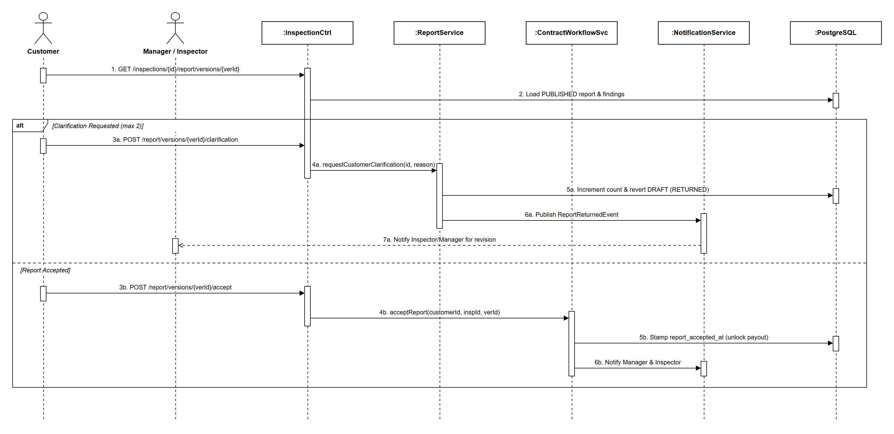

*Figure 7.8ar — `FE-19` Published Report Acceptance, Inspector Ratings & Clarification Sequence.*

**Class & Workflow Specifications**

| No | Class / Component | Description |
| :---: | :--- | :--- |
| 01 | `ContractWorkflowService.customerAcceptReport` & `InspectionReportAcceptancePort` | Verify target report is `PUBLISHED`, transition occurrence payment status to `PAYMENT_DUE`, stamp `service_invoices.customer_accepted_at` and `payment_due_at`, and block duplicate acceptance or acceptance on unpublished drafts. |
| 02 | `ReportService.requestCustomerClarification` | Restricted strictly to the owning `CUSTOMER` prior to report acceptance (`403` for `MANAGER`, `ADMIN`, `INSPECTOR`, or foreign organizations), incrementing `inspections.clarification_count` and notifying staff. |
| 03 | Web `CustomerReportDeliverablePage.tsx`, `CustomerReportSettlementCard.tsx` & Mobile Settlement Step 1 | Surface read-only official PDF deliverables (`PUBLISHED` only), Clarification dialog, and explicit **Accept report** confirmation before unlocking online checkout. |

---

### 3.20 `MF4` — `FE-20` Online Service Fee Payment (`Sepay` VietQR & `VNPay`)

This section presents the detailed design for `FE-20`: configuration-gated VND checkout, VietQR transfer-code matching (`SDI<orderCode>`) and `Authorization: Apikey` webhook verification for `Sepay` VietQR (backed by `V68` `gateway_inbound_transactions`), `VNPay v2.1.0` (`HMAC-SHA512`) IPN/Return handling with automatic terminal cancel/expiry order release (`V67` `gateway_order_created_at`), unresolved gateway order locks (`BR-47`), 3-second Web QR status polling, and authorized manual confirmation fallback.

#### 3.20.1 Sequence & State Diagrams

*Figure 7.8as — `FE-20` Sepay VietQR (`SDI`) & VNPay v2.1.0 Online Settlement Sequence.*

*Figure 7.8at — `ServicePayment` State Machine Diagram.*

**Class Specifications**

| No | Class / Component | Description |
| :---: | :--- | :--- |
| 01 | `SepayWebhookController`, `SepayPaymentGateway`, `SepayProperties` & `DisabledSepayGateway` | Generate public VietQR image URLs embedding `SDI<orderCode>`, verify `Authorization: Apikey` via constant-time SHA-256 comparison plus receiving account number and whole-VND checks, and settle `ServicePayment`; returns `HTTP 500` on unexpected runtime exceptions so Sepay retries transient failures while persisting outcomes safely via `GatewayInboundTransactionService`. |
| 02 | `GatewayInboundTransactionService` & `GatewayInboundTransaction` (`gateway_inbound_transactions`) | Persists inbound gateway outcomes (`APPLIED`, `AMOUNT_MISMATCH`, `ORDER_NOT_FOUND`, `REJECTED`, `ERROR`) in `Propagation.REQUIRES_NEW` transactions (`V68`) so audit records survive rolled-back payment attempts and deduplicate redeliveries. |
| 03 | `VnPayWebhookController`, `VnPayPaymentGateway`, `VnPayCrypto` & `DisabledVnPayGateway` | Generate signed `VNPay v2.1.0` payment URLs and verify `HMAC-SHA512` IPN/Return params (`BR-45`); browser `/return` redirects directly back to `/settlement` without settling on its own, and terminal failure codes `24` (cancelled) or `11` (timed out) release the unresolved order via `releaseVnPayOrderAfterFailure`. |
| 04 | `ContractWorkflowService` & Web `SepayQrDialog.tsx` | Prevent overwriting an active unresolved gateway order across providers (`MSG49`) using `gateway_order_created_at` (`V67`) for automatic expiry release, allow attributable Manager cancellation (`cancelUnpaidPaymentOrder`), support manual confirmation when gateways are disabled, and poll every 3 seconds in the Web UI to close `SepayQrDialog` automatically upon `PAID`. |

---

### 3.21 `MF4` — `FE-21` Payment Deadlines, Invoices & Payment Document Management

This section presents the detailed design for `FE-21`: per-occurrence `ServiceInvoice` commission/VAT/TNCN snapshots (`InspectionFinanceSettings`), `V4` configurable payment-due window (default `15` days) with one-time overdue notification (`PaymentDueExpiryService`), and downloadable non-tax-invoice notice/receipt PDFs (`PaymentDocumentService`, `PaymentDocumentRenderer`) across Web and Mobile.

*Figure 7.8au — `FE-21` Payment Deadline, Daily Overdue Notification & Notice/Receipt PDF Sequence.*

**Class & Service Specifications**

| No | Class / Component | Description |
| :---: | :--- | :--- |
| 01 | `InspectionFinanceSettingsController`, `InspectionFinanceSettingsService`, `InspectionFinanceCalculator` & `ServiceInvoice` | Manage Admin finance rates (`platformCommissionRate`, `vatRate`, `tncnRate`, `paymentDueDays`) and freeze exact rate snapshots onto each occurrence's `ServiceInvoice`. |
| 02 | `PaymentDueExpiryService` (`V4`) | Stamps `service_payments.payment_due_at = accepted_at + configuredWindow` once upon report acceptance; scheduled `scanOverduePayments()` emits a single `PaymentOverdueEvent` (`payment_overdue_notified_at` guard) to owning Customer and active Managers without revoking published report access or altering `PAYMENT_DUE`. |
| 03 | `PaymentDocumentService` & `PaymentDocumentRenderer` | Expose `GET /api/v1/inspections/{id}/report/payment-document` (returning `409` before acceptance, A4 Payment Notice PDF while `PAYMENT_DUE`, and Payment Receipt PDF once `PAID`, each bearing a non-tax-invoice disclaimer); strictly scoped to owning organization, assigned Inspector, `MANAGER`, and `ADMIN` (`404` otherwise). |

---

### 3.22 `MF4` — `FE-22` Partner Inspector Payout Reconciliation (`Sepay` VietQR `SDIPAY`)

This section presents the detailed design for `FE-22`: Partner Inspector payout reconciliation supporting integrated `Approved -> Sepay VietQR Payout (SDIPAY, V78) -> Published` release and explicit Manager-recorded disbursements (`PAID`), refund-hold blocking, final capped payout computation, and role-based financial masking.

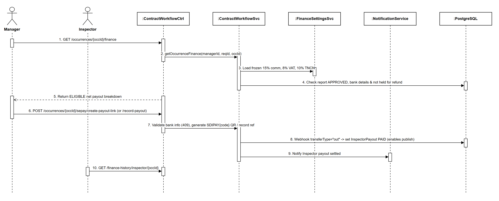

*Figure 7.8av — `FE-22` Partner Inspector Sepay VietQR (`SDIPAY`) & Manual Payout Sequence.*

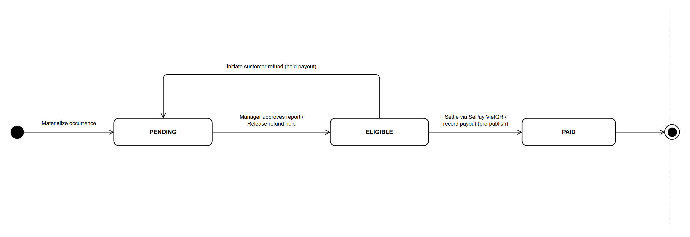

*Figure 7.8aw — `InspectorPayout` State Machine Diagram.*

**Class & UI Specifications**

| No | Class / Component | Description |
| :---: | :--- | :--- |
| 01 | `ContractWorkflowController.recordOccurrencePayout` & `InspectorPayout` | Transitions payout from `ELIGIBLE` to `PAID` only when a `MANAGER` supplies a unique external transfer reference (`payout_reference`, actor attribution, timestamp), enforcing active refund holds and post-reduction payout caps (`BR-46`). |
| 02 | `OccurrenceFinanceResponse` & Role Masking | Projects net payout, commission/TNCN deductions, refund holds, masked `inspectorRefundSummaries` (exposing payout reduction and receivable impact while omitting platform absorption, commission/VAT adjustments, and internal notes), and recovery ledgers to assigned `INSPECTOR`, full rows to `MANAGER`, while stripping internal partner settlement details from `CUSTOMER` payloads. |
| 03 | Web `OccurrenceFinanceDrawer.tsx`, `InspectorPayoutStatementCard.tsx` & `InspectorPayoutSummaryBar.tsx` | Render eligible/held/paid states, net disbursement breakdown, and Manager payout recording forms inside Workspace Settlement (`/settlement`). |

---

### 3.23 `MF4` — `FE-23` Evidence-Backed Refunds & Receivable Recovery

This section presents the detailed design for `FE-23`: Manager-initiated refunds holding unpaid payouts, external transfer completion with exact five-way accounting allocations (`service_refunds`), untransferred cancellation, individual legacy refund reconciliation, and immutable post-payout `InspectorReceivable` recovery ledgers.

*Figure 7.8ax — `FE-23` Five-Way Refund Allocation & Inspector Receivable Recovery Sequence.*

**Class & Ledger Specifications**

| No | Class / Component | Description |
| :---: | :--- | :--- |
| 01 | `ContractWorkflowController` & `ServiceRefund` (`service_refunds`) | `POST .../refunds` validates captured balance (`BR-49`) and unique case-insensitive request reference to create `INITIATED` refund and hold unpaid payouts (`BR-48`); `POST .../complete` enforces a unique external reference and exact five-part sum (`inspectorPayoutReduction + platformCommission + vat + tncn + platformAbsorption == amount`); `POST .../cancel` allows cancellation only prior to completion with mandatory reason; `POST .../reconcile-allocation` reconciles legacy `COMPLETED` rows individually by refund ID. |
| 02 | `InspectorReceivable` & `InspectorReceivableRecovery` (`inspector_receivables*`) | When a completed refund follows an already-`PAID` payout, the historical payout stays immutable (`BR-50`) and an attributable `InspectorReceivable` row is created. `POST .../receivables/{id}/recover` appends manual collections under `@Version` concurrency control, capped at outstanding balance, with zero automatic future payout offsets. |
| 03 | Web `RefundControls.tsx` | Exposes four distinct Manager UI panels inside `/settlement` for refund initiation, external completion/cancellation, legacy ID reconciliation, and manual receivable collection. |

---

### 3.24 `MF4` — `FE-24` Post-Remediation Re-inspection & Defect Verification

This section presents the detailed design for `FE-24`: opening follow-up `RE_INSPECTION` occurrences linked via `source_inspection_id` against a completed published inspection, recording three-way defect comparisons (`RESOLVED`, `UNRESOLVED`, `INCONCLUSIVE`), enforcing fresh in-session evidence (`V2`), and surfacing/enforcing `RESOLVED` verdict validity expiry (`V3`, `valid_until`).

#### 3.24.1 Class & Sequence Diagrams

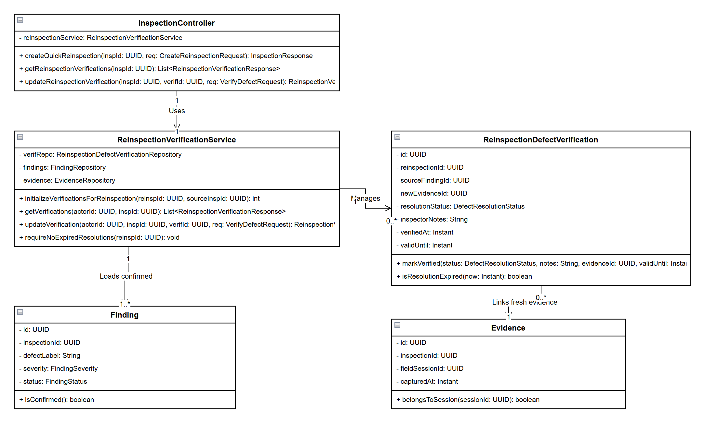

*Figure 7.8ay — `FE-24` Post-Remediation Re-inspection & Verdict Validity Class Diagram.*

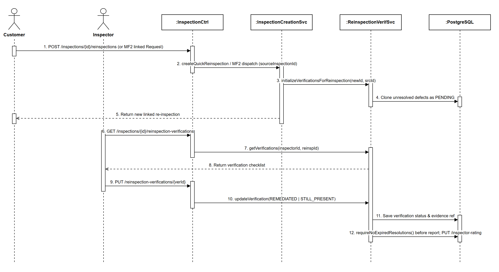

*Figure 7.8az — `FE-24` Re-inspection Creation, Fresh Evidence Gate & Three-Way Verification Sequence.*

| No | Class / Component | Description |
| :---: | :--- | :--- |
| 01 | `InspectionController`, `ReinspectionVerificationService` & `ReinspectionDefectVerification` (`V2`, `V3`) | Authorize re-inspection creation strictly for owning `CUSTOMER` or `MANAGER`, initialize one verification row per source `CONFIRMED` finding, restrict verdict updates to the assigned `INSPECTOR` only after `FIELD_COMPLETED` (and lock once report `SUBMITTED`/`PUBLISHED`), enforce fresh evidence from a completed field session of the current re-inspection (`EVIDENCE_NOT_FRESH`, `EVIDENCE_SESSION_MISMATCH`, `EVIDENCE_SESSION_NOT_COMPLETED`, `EVIDENCE_OUTSIDE_SESSION`, `EVIDENCE_REUSED`), and reject expired `RESOLVED` verdicts (`valid_until < now`) via `requireNoExpiredResolutions` (`RESOLUTION_EXPIRED`). |
| 02 | Web `ReinspectionVerificationSection.tsx`, `verdictExpiry.ts` (`VerdictExpiryBanner`, `ValidityNotice`) & Mobile `verdict_expiry.dart` | Render Before-vs-After comparison cards and split `RESOLVED` verdicts into lapsed vs expiring within 14 days (`VERDICT_SOON_WINDOW_MS`) on both Web and Customer Mobile (`PR #27`). |

---

### 3.25 Design Constraints and Exclusions

**No maintenance design exists.** Corrective maintenance — work orders, repair scope advisory, repair execution, completion reporting, and cost close-out — is absent from the delivered codebase. There is no maintenance package, class, endpoint, or table, so there is no retained schema to document. `reinspection_defect_verifications` is part of the inspection design, not of a maintenance design: it records the three-way comparison (`RESOLVED`, `UNRESOLVED`, `INCONCLUSIVE`) between an original finding and fresh re-observed evidence during a re-inspection, including the `V3` `valid_until` expiry of a `RESOLVED` verdict, designed under `FE-24`.

**DroneKnowledgeAI is advisory, tenant-isolated and degradation-tolerant.** `V62` creates the `pgvector` extension, `V64` backfills published historical cases, and `V65` persists `vector(384)` embeddings in `inspection_knowledge_chunks` (eight seeded engineering standards) and `historical_finding_cases` (six anonymized benchmarks plus published confirmed findings), each with an HNSW `vector_cosine_ops` index. `HistoricalCaseService` (`FE-17`) backfills missing vectors on `ApplicationReadyEvent` and queries these stores behind `HistoricalCaseAdvisorPort`, using `PGVECTOR_RAG` via local `fastembed` `/v1/embeddings` when available and deterministic `HYBRID_MATCH` otherwise, as well as `AI_VISION_RAG` for note drafting (`POST .../draft-note`). Retrieval is scoped by `(organization_id = actor org OR is_anonymized_benchmark = TRUE) AND (source_inspection_id IS NULL OR source_inspection_id <> current inspection)`, so no cross-organization PII leaks. Recommendations, drafted notes, and knowledge references never confirm a finding, publish a report, clear a location for flight, or authorize maintenance.

**Buildings only.** Building-defect classes, inspection checkpoints, and asset categories are all building-specific. No design element addresses bridges, transmission towers, solar farms, roads, dams, tunnels, ports, or pipelines.

**Separation of duties is a design constraint, not a UI convention.** The `MANAGER` reviewer of an inspection report (`FE-18`) must differ from its `INSPECTOR` author (`ADMIN` holds read-only view), whereas flight permits (`FE-13`) transition immediately to `APPROVED` upon valid assigned-Inspector self-attestation (`BR-24`, `BR-38`). All authorization boundaries execute inside server transactions rather than only in client routing.

**External services never substitute for human authority.** The detection service, vision fallback, narrative drafter, DroneKnowledgeAI advisor, SmartDroneHub telemetry bridge, and airspace advisory all produce advisory or read-only outputs; official transitions require authenticated human decisions recorded with actor and timestamp.
