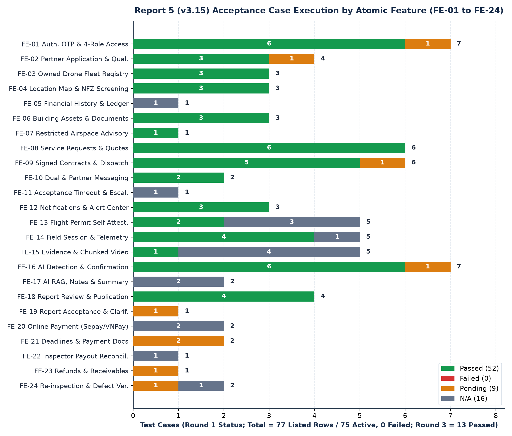

# V. Software Testing Documentation

## 1. Scope of Testing

Testing covers the delivered platform across the web portals, the customer mobile application, the backend, and the AI, telemetry, and payment integrations, for all twenty-four atomic product features (`FE-01`–`FE-24`) organized across the four main operational flows (`MF1`–`MF4`) and business rules `BR-01`–`BR-55`. The inspection scope is buildings only.

- **`MF1` — Identity, Partner/Drone Onboarding & Airspace Screening (`FE-01`–`FE-04`):** Customer registration, password/OTP/Google sign-in, session rotation, `/users/me` profile, bilingual localization, and four-role portal/API RBAC (`FE-01`); public partner application, `MANAGER`-only admission, `inspector_profiles` licence credentials, and flight logs (`FE-02`); Admin drone document/feature config and Inspector-owned drone registration/fleet lifecycle (`FE-03`); and interactive Vietnam coordinate map and No-Fly Zone screening (`FE-04`).
- **`MF2` — Buildings, Airspace Clearance, Commercial Service & Notifications (`FE-06`–`FE-12`):** Building assets (`V66` `ownership_information`), checkpoints (`V80` request checkpoint snapshot + `checkpointsLocked`), and MinIO reference documents (`FE-06`); restricted-airspace `MSG28` amber warning with immediate onboarding and retired Admin queue (`FE-07`); minimal compact service requests (`PR #139`) with concise recurring titles (`PR #164`), monthly cadence bounds/month-end anchoring, Manager claim, and VND quotations (`FE-08`); offline signed agreements, occurrence materialization, and cross-organization dispatch (`FE-09`); separated Customer–Manager Order Chat, Manager–Partner pre-dispatch chat (`V79`), and Customer–Inspector Inspection Chat (`FE-10`); Admin-configurable Step 4 assignment acceptance timeout (`FE-11`); and bilingual `"Tiếng Việt | English"` Spring Modulith outbox & SMTP notifications (`FE-12`, `WF2-028`).
- **`MF3` — Flight Permits, Field Telemetry, Evidence Pipeline & AI/RAG Analysis (`FE-13`–`FE-17`):** Mission flight-permit upload granting immediate `APPROVED` status via Inspector self-attestation, automatic reset to `PENDING_REVIEW` on drone/window change, and read-only Manager audit (`FE-13`, `WF2-029`–`WF2-031`); multi-sortie field sessions (`V72` `field_session_flights`), SmartDroneHub MAVLink traces, log imports/declarations, dashboards, and calendar (`FE-14`); EXIF-first image normalization/thumbnails, duplicate auto-numbering, resumable `2 GiB` chunked MP4 upload, FFmpeg transcoding, and HMAC HTTP Range streaming (`FE-15`); YOLO11 (`70%` default per `V63`) + Vision fallback detection, filter chips, Inspector baseline confirmation, and fresh re-inspection evidence gating (`FE-16`); and tenant-isolated `DroneKnowledgeAI` local 384d `fastembed` RAG (`V64`/`V65`), single/batch AI note drafting (`Draft note with AI` / `Draft all notes`), Mobile `KnowledgeReferencesStrip`, and `ReportAiSummaryCard` references (`FE-17`).
- **`MF4` — Report Publication, Acceptance, Payment Settlement, Ledger & Re-inspection (`FE-05`, `FE-18`–`FE-24`):** Role-scoped Customer/Inspector/Manager financial history ledgers (`FE-05`); 5-state inspection report compilation (`SUBMITTED`, `RETURNED`, `APPROVED`, `PUBLISHED`, `SUPERSEDED`), independent Manager review banning self-publication, integrated `Approved -> Sepay VietQR Payout (SDIPAY, V78) -> Published` release (`V76`–`V77`), ungated `PUBLISHED` PDF export, and `/with-reports` queues (`FE-18`); Customer report acceptance gating invoicing, clarification workflow, and Customer/Manager Inspector Ratings (`V70`/`V73`) (`FE-19`); `V29` / `V67`–`V68` Sepay VietQR and VNPay v2.1.0 checkout, webhook auditing, cancel/expiry order release, and role-masked finance projections (`FE-20`); acceptance-stamped payment deadlines, daily single overdue reminders, and payment notice/receipt PDF downloads (`FE-21`); Partner Inspector payout reconciliation (`ELIGIBLE -> PAID`, idempotency, caps) (`FE-22`); evidence-backed refunds, payout holds, legacy reconciliation, and Inspector receivable recovery (`FE-23`); and post-remediation re-inspection with three-way verdicts (`RESOLVED`, `UNRESOLVED`, `INCONCLUSIVE`), `RESOLVED` verdict expiry tracking, and Mobile parity (`FE-24`).

In scope: building inspection including tenant-isolated `DroneKnowledgeAI` advisory retrieval over engineering standards and historical finding cases (`BR-55`). Out of scope: physical aircraft control and flight-controller firmware; corrective maintenance execution and its repair knowledge base; non-building infrastructure; native push delivery and commercial mail relay; banking core systems behind the payment gateways; and mobile behaviour for roles other than `CUSTOMER`.

Four levels were executed. Unit level verifies entities, services, components, and widgets in isolation. Integration level verifies controllers, repositories, migrations, the security filter chain, object storage, and the event outbox against containerized services. System level verifies connected flows and non-functional thresholds across the integrated stack. Acceptance level verifies business rules and acceptance criteria per feature.

Constraints: integration tests need a running Docker daemon; when the inference container or the drafting gateway is unreachable the system routes to its fallbacks so workflows stay testable; payment verification uses signed test credentials rather than live debits; and permits, airspace results, and reports are governance records, not government clearance.

## 2. Test Strategy

### 2.1 Testing Types

Functional and business rule testing applies equivalence partitioning and boundary analysis to the stated limits — 10 MB photographs, 2 GB video in 10 MiB chunks, coordinate ranges, rate percentages, the twenty-day lead time, and the occurrence and interval bounds. Domain state machine testing walks every lifecycle entity along its valid edges and asserts that illegal edges are refused. Security and scope isolation testing probes cross-organization identifiers, permutes the four roles across the four portals, and simulates brute-force sign-in. AI testing verifies bounding-box parsing, automatic vision fallback, and the deterministic template path. Performance and payment testing covers response latency, tampered-signature webhook rejection, and published-report immutability. Interface, localization, and regression testing covers component rendering, `Accept-Language` negotiation, theme persistence, and repeated full-suite runs.

### 2.2 Test Levels

| Type of Tests | Unit | Integration | System | Acceptance |
| --- | :---: | :---: | :---: | :---: |
| Functional and Business Rule Testing | X | X | X | X |
| Domain State Machine Transition Testing | X | X | X | X |
| API and Database Persistence Testing | | X | X | |
| Security and Scope Isolation Testing | X | X | X | X |
| AI Vision, Narrative Drafting and Fallback Testing | X | X | X | X |
| Performance, Payment Webhook and Report Integrity Testing | | X | X | X |
| User Interface, Localization and Regression Testing | X | X | X | X |

### 2.3 Supporting Tools

| Purpose | Tool | Vendor/In-house | Version |
| --- | --- | --- | --- |
| Backend unit and integration testing | JUnit Jupiter, Spring Boot Test, MockMvc | Open Source / Broadcom | `JUnit 6.x` / `4.1.0` |
| Containerized database and storage harness | Testcontainers (`pgvector:pg17`, `adobe/s3mock`) | AtomicJar / Docker | `1.20.x` / `PostgreSQL 17` |
| Architectural boundary verification | Spring Modulith Test | Broadcom | `2.1.1` |
| Backend coverage measurement | JaCoCo Maven Plugin | EclEmma | `0.8.13` |
| Frontend component and unit testing | Vitest, React Testing Library, JSDOM | Open Source | `5.0.1` / `16.3.3` |
| Mobile widget and repository testing | Flutter Test, Dart Analyzer | Google | `Flutter 3.x` |
| Report workbook generation and verification | Custom Python OOXML exporter and unittest suite | In-house | `Python 3.12+` |

## 3. Test Plan

### 3.1 Human Resources

| Worker/Doer | Role | Specific Responsibilities/Comments |
| --- | --- | --- |
| Trần Hoàng Trung Hiếu (`SE184212`) | Project Leader and Tester (`FE-01`–`FE-05`) | Owns the cases and regression runs for authentication/OTP/4-role RBAC (`FE-01`), partner admission (`FE-02`), owned-drone fleet (`FE-03`), airspace map (`FE-04`), and financial history ledger (`FE-05`), plus Customer Mobile co-testing. |
| Phùng Trung Quốc (`SE170027`) | Backend and Mobile Engineer and Tester (`FE-06`–`FE-12`) | Owns the cases and regression runs for building assets (`FE-06`), restricted-airspace clearance (`FE-07`), service requests & VND quotes (`FE-08`), signed contracts & dispatch (`FE-09`), dual chat (`FE-10`), assignment timeout (`FE-11`), and notifications (`FE-12`). |
| Trần Tùng Bách (`SE180220`) | Full-Stack and AI Engineer and Tester (`FE-13`–`FE-18`) | Owns the cases and regression runs for flight permits (`FE-13`), field telemetry (`FE-14`), evidence/chunked video pipeline (`FE-15`), YOLO11 + fallback confirmation (`FE-16`), `DroneKnowledgeAI` RAG & drafting (`FE-17`), and report publication (`FE-18`), plus backend/DB architecture & Mobile co-testing. |
| Trương Thái Như (`SE180082`) | Full-Stack Engineer and Tester (`FE-19`–`FE-24`) | Owns the cases and regression runs for customer acceptance (`FE-19`), Sepay VietQR/VNPay settlement (`FE-20`), payment deadlines/documents (`FE-21`), Inspector payouts (`FE-22`), refunds & receivables (`FE-23`), and re-inspection (`FE-24`), plus automated test reconciliation & Report 5 workbook maintenance. |
| Supervisors | Reviewers | Review the strategy, audit traceability across Reports 3–5, and evaluate defence readiness. |

### 3.2 Test Environment

| Purpose | Tool | Provider | Version |
| --- | --- | --- | --- |
| Application runtime | Java 21 with Spring Boot Modulith | Eclipse Temurin / Broadcom | `Java 21` / `4.1.0` |
| Relational database | PostgreSQL (`53` application tables / `55` total in `public`, migrations `V1`–`V4`, `V60`–`V80`) | PostgreSQL Global Development Group | `17` |
| Object storage | MinIO (`inspection-evidence` bucket) | MinIO Inc. | `RELEASE.2025` |
| Test containers | Testcontainers with `pgvector:pg17` and `adobe/s3mock` | AtomicJar / Docker | `PostgreSQL 17` |
| Computer vision service | FastAPI with Ultralytics YOLO11s | Python / Ultralytics | `YOLO11s` |
| Web client under test | Chrome and Edge (desktop) | Google / Microsoft | Evergreen |
| Mobile client under test | Flutter test runner and Android client | Google | `Flutter 3.x` |
| Local execution platform | Windows 11 with Git Bash | Microsoft | `10.0.26200` |

### 3.3 Test Milestones

| Milestone Task | Start Date | End Date |
| --- | --- | --- |
| Milestone 1: Unit and migration foundation gate | `2026-09-15` | `2026-10-08` |
| Milestone 2: Core inspection, storage, detection and report integration testing | `2026-10-09` | `2026-10-22` |
| Milestone 3: Review baseline and scope retirement verification | `2026-10-23` | `2026-10-27` |
| Milestone 4: Four-role, multi-flow consolidation across `MF1`–`MF4` with contracts and payment | `2026-10-28` | `2026-11-04` |
| Milestone 5: Final regression, 24-feature decomposition (`FE-01`–`FE-24`), staging walkthrough, and defence rehearsal | `2026-11-05` | `2026-11-30` |

## 4. Test Cases

Unit test cases live in the repository suites. On 25 Nov 2026 (`main`), the backend test suite passed `1,052` tests with `0` failures (`./mvnw test`, Spring Modulith boundary verification and `FullDatabaseSchemaMigrationTest` enforcing all `55` relations across `V1`–`V4` and `V60`–`V80` passed). The frontend full `npx vitest run` executed `120` files (`116` passed, `4` deprecated files skipped) and `830` tests (`826` passed, `4` skipped, `0` failed), alongside clean `npm run lint` (`0` errors) and `npm run build` (`tsc -b && vite build`). The mobile suite (`flutter test`, `PR #33`) passed `58` tests with `0` failures and `flutter analyze` passed cleanly, covering customer-only admission, role cleanup (`DEF-01` resolved), localization, verdict expiry, payment-document PDF, Inspector–Customer chat, the knowledge strip, and all customer screens. Report 5 (`v3.15`) tracks `77` listed rows (`75` active test cases + `2` superseded `FE-13` cases `WF2-008`/`WF2-009`) across `FE-01`–`FE-24`: preserving all historical records, `3` honest unexecuted (`N/A / Pending / Pending`) standalone breakout cases (`WF3-032` in `FE-05`, `WF2-021` in `FE-11`, `WF3-033` in `FE-22`), `7` executed `MF2` cases (`WF2-022`–`WF2-028`), and `3` `FE-13` cases (`WF2-029`–`WF2-031`).

Integration, system, and acceptance cases live in `Report5_Test Report.xlsx`, partitioned across twenty-four feature sheets (`Feature 1`–`Feature 24`, mapped 1-to-1 to `FE-01`–`FE-24`) with columns for the procedure, expected results, preconditions, three execution rounds, the test date, the tester, and a note recording the mode and the automated evidence.

## 5. Test Reports

### 5.1 Automated Suite Results

*Figure 7.9 — Verified automated test inventory by repository at handover.*

| Suite | Command | Scope | Result |
| --- | --- | --- | --- |
| Backend | `.\mvnw.cmd test` | Domain, service, controller, repository, migration (`V1`–`V4`, `V60`–`V80`), storage, architecture and knowledge retrieval tests | `1,052` tests passed, `0` failures, `0` errors; Spring Modulith boundary verification and `55`-table schema migration gate passed (25 Nov 2026 verification). |
| Web portal | `npm test` (`npx vitest run`) | Components, pages, access policy, API clients, Sepay/VNPay payout & settlement UI, ratings, bilingual notifications, and DroneKnowledgeAI note drafting | Full suite (25 Nov 2026): `120` files (`116` passed, `4` deprecated skipped), `830` tests (`826` passed, `4` skipped), `0` failed; `npm run lint` (`0` errors) and `npm run build` exited `0`. |
| Mobile | `flutter test` | Customer-only session, role cleanup (`DEF-01` resolved), localization, verdict expiry, payment PDF, chat, knowledge strip and screens (`PR #33`) | `58` tests passed, `0` failures; `flutter analyze` passed. |

### 5.2 Acceptance Case Execution

*Figure 7.10 — Round 1 acceptance case status for the `77` listed rows (`75` active) across `FE-01`–`FE-24` (`Report 5 v3.15`).*

| Feature | Total cases | Passed | Failed | Pending | N/A | Coverage focus |
| --- | ---: | ---: | ---: | ---: | ---: | --- |
| `FE-01` | 7 | 6 | 0 | 1 | 0 | Registration, OTP, Google OAuth2, sessions, profile, EN/VI i18n, and 4-role RBAC |
| `FE-02` | 4 | 3 | 0 | 1 | 0 | Partner Inspector application, non-disclosing email checks, `inspector_profiles`, and flight logs |
| `FE-03` | 3 | 3 | 0 | 0 | 0 | Admin drone checklists, owned-drone registration/renewal, photos, and serviceability states |
| `FE-04` | 3 | 3 | 0 | 0 | 0 | Interactive coordinate map, coordinate bounds validation, and hard No-Fly Zone gate |
| `FE-05` | 1 | 0 | 0 | 0 | 1 | Scoped Customer/Inspector/Manager financial history ledgers (`WF3-032`: `N/A / Pending / Pending`) |
| `FE-06` | 3 | 3 | 0 | 0 | 0 | Building registry (`V66` `ownership_information`), checkpoints (`V80` + lock), MinIO docs, and retirement lock |
| `FE-07` | 1 | 1 | 0 | 0 | 0 | Restricted-airspace `MSG28` amber advisory and immediate onboarding (`WF1-009` Passed) |
| `FE-08` | 6 | 6 | 0 | 0 | 0 | Compact requests & concise recurring titles, cadence bounds/month-end anchoring, and VND quotes |
| `FE-09` | 6 | 5 | 0 | 1 | 0 | Signed agreements, occurrence dispatch conflict/eligibility guards, abort recovery, Mobile E2E |
| `FE-10` | 2 | 2 | 0 | 0 | 0 | Separated Customer–Manager Order Chat, Partner Chat (`V79`), and Customer–Inspector Inspection Chat |
| `FE-11` | 1 | 0 | 0 | 0 | 1 | Step 4 assignment acceptance timeout & escalation alert (`WF2-021`: `N/A / Pending / Pending`) |
| `FE-12` | 3 | 3 | 0 | 0 | 0 | Deduplicated bilingual (`EN`/`VI`) Modulith notifications (`WF2-028`) and `targetPath` safety |
| `FE-13` | 5 | 2 | 0 | 0 | 3 | Self-attested flight permit gate (`APPROVED` on valid upload) and drone/window reset (`WF2-029`–`WF2-031`) |
| `FE-14` | 5 | 4 | 0 | 0 | 1 | Multi-sortie field session start/complete/abort, MAVLink telemetry, log import, dashboards, calendar |
| `FE-15` | 5 | 1 | 0 | 0 | 4 | EXIF image normalization/thumbnails, duplicate numbering, 2 GiB chunked MP4, FFmpeg, Range tickets |
| `FE-16` | 7 | 6 | 0 | 1 | 0 | YOLO11 (`70%` default) + Vision fallback, filter chips, baseline confirmation, and fresh evidence |
| `FE-17` | 2 | 0 | 0 | 0 | 2 | Tenant-isolated `DroneKnowledgeAI` local 384d RAG, note drafting, Mobile strip, and summary refs |
| `FE-18` | 4 | 4 | 0 | 0 | 0 | Five-state report lifecycle, compilation, independent Manager review (`Approved -> Payout -> Published`), PDF export |
| `FE-19` | 1 | 0 | 0 | 1 | 0 | Customer report acceptance (`ACCEPTED`), ratings (`V70`/`V73`), clarification paths, staging handoff |
| `FE-20` | 2 | 0 | 0 | 0 | 2 | Normalized `V29`/`V67`–`V68` finance schema, Sepay VietQR & VNPay HMAC webhooks, and masked views |
| `FE-21` | 2 | 0 | 0 | 2 | 0 | Payment due deadline (`payment_due_at`), single overdue reminder, and notice/receipt PDF |
| `FE-22` | 1 | 0 | 0 | 0 | 1 | Partner Inspector payout reconciliation (`ELIGIBLE -> PAID`, Sepay VietQR `SDIPAY`, idempotency; `WF3-033`) |
| `FE-23` | 1 | 0 | 0 | 1 | 0 | Refund initiation holds, exact allocation, legacy reconciliation, and Inspector receivables |
| `FE-24` | 2 | 0 | 0 | 1 | 1 | Post-remediation re-inspection verdicts (`RESOLVED`/`UNRESOLVED`/`INCONCLUSIVE`) & Mobile parity |
| **Total** | **77** | **52** | **0** | **9** | **16** | Report 5 `v3.15` (`75` active cases + `2` historical superseded `FE-13` cases) |

The Round 1 inventory (`Report 5 v3.15`) records `52` passed and `0` failed cases across `77` listed rows (`75` active cases + `2` historical superseded `FE-13` cases): `9` pending and `16` N/A (`52/61 = 85.25%` Round 1 coverage). Historical Round 1 remains preserved (`45 Passed / 0 Failed / 8 Pending / 3 N/A = 56` cases).

Report 5 records `13` executed Round 3 cases with `0` failures: `WF3-005`, `WF3-006`, `WF3-009`, `WF3-016`, `WF3-018`, `WF3-019`, `WF3-021`, `WF3-026`, `WF3-027`, `WF3-028`, `WF3-029`, `WF3-030` and `WF3-031`; `WF3-020`, `WF3-022`–`WF3-025`, `WF3-032`, `WF2-021`, and `WF3-033` remain Pending. `PaymentDueAndDocumentApiIntegrationTest` supplies the connected-HTTP evidence for `WF3-026`/`WF3-027`; `WF3-028` records fresh re-inspection evidence, `WF3-019` the current payout contract, and `WF3-029`–`WF3-031` the `DroneKnowledgeAI` retrieval, advisory summary references and Customer Mobile parity.

### 5.3 Cross-Cutting Assertions

| Assertion | Test | What it proves |
| --- | --- | --- |
| Schema baseline is exact | `FullDatabaseSchemaMigrationTest` | The applied migration set is `V1`–`V4` and `V60`–`V80`; the inventory is `55` relations in `public` (`53` application tables, `event_publication` outbox, and `flyway_schema_history`), with `52` JPA runtime entity tables including `inspector_ratings` (`V70`), `field_session_flights` (`V72`), `rating_criterion_configs` (`V73`), `service_request_partner_messages` (`V79`), and `service_requests.inspection_items` (`V80`). |
| Module boundaries hold | `ModulithArchitectureTest` | No module reaches another outside its declared `allowedDependencies`. |
| Lifecycle is connected | `ConnectedMainFlowE2eIntegrationTest` | Onboarding, building and drone registration, request and quotation, dispatch, evidence and detection, publication, and settlement execute in one run. |
| A report author cannot publish | Reviewer-scope and role-policy tests | Publication requires a `MANAGER` reviewer who is not the author (`ADMIN` is read-only). |
| Flight permit self-attestation holds | Permit policy and workflow tests | Valid permit upload immediately transitions the permit to `APPROVED`; drone change or out-of-window reschedule resets to `PENDING_REVIEW` (`ADMIN`/`MANAGER` cannot alter). |
| Media is scoped | Evidence ticket tests | A signed ticket grants access to one evidence record and nothing else. |
| Payment needs a signature | `SepayWebhookControllerTest`, `VnPayWebhookAndGatewayTest` & webhook tests | A browser redirect alone never settles a payment; missing/forged `Authorization: Apikey` or VNPay HMAC-SHA512 signatures are rejected, while Sepay inbound outcomes persist idempotently in `gateway_inbound_transactions`. |
| Knowledge retrieval & note drafting are tenant-isolated | `HistoricalCaseServiceTest`, `HistoricalCaseApiIntegrationTest`, `InspectionFindingsPage.test.tsx`, `KnowledgeRecommendationPanel.test.tsx`, `knowledge_recommendation_test.dart` | `DroneKnowledgeAI` returns `PGVECTOR_RAG` via local `fastembed` (`vector(384)`) when embeddings exist and deterministic `HYBRID_MATCH` otherwise, plus `AI_VISION_RAG` for note drafting; benchmark cases are anonymized, cross-organization cases and the current inspection are excluded, and the customer mobile strip hides when empty. |
| Payment deadline and documents over HTTP | `PaymentDueAndDocumentApiIntegrationTest` | On Testcontainers PostgreSQL 17 and the real security filter chain: acceptance stamps `payment_due_at` once, the document endpoint returns `409` before acceptance, a notice PDF after acceptance and a receipt after verified payment, foreign-organization callers receive `404`, and a repeated overdue scan sends no second reminder. Report 5 records this as the Round 3 Passed evidence for `WF3-026` and `WF3-027`. |
| Expired re-inspection verdict is surfaced early | `verdictExpiry.ts`, `VerdictExpiryBanner`, `ValidityNotice`, `ReinspectionWorkflow.test.tsx` | The Web client distinguishes lapsed `RESOLVED` verdicts from those lapsing within 14 days and warns before report authoring; the backend remains the authority that refuses an expired verdict with `RESOLUTION_EXPIRED`. |

### 5.4 Defects and Limitations

| ID | Severity | Status | Description | Impact |
| --- | --- | --- | --- | --- |
| `DEF-01` | Low | Resolved | The mobile `UserRole` enumeration previously retained the retired `MAINTENANCE_ENGINEER` role; `PR #33` unified mobile roles to the four canonical roles (`CUSTOMER`, `INSPECTOR`, `MANAGER`, `ADMIN`) with zero legacy references (`flutter analyze` and `flutter test` `58/58` pass). | Closed on `main`; Customer-only gate remains verified. |
| `DEF-02` | Low | Open | The backend E2E runner script resolves its frontend root to a directory that does not exist in the workspace. | The script cannot execute as written; the connected lifecycle is verified by the integration test instead. |

Neither defect affects a delivered feature path, and neither is claimed as passing. Cases not executed in this run remain `Pending` in the workbook.

