# VI. Release Package & User Guides

## 1. Deliverable Package

| No. | Deliverable Item | Description |
| --- | --- | --- |
| 1 | Project Schedule/Tracking | Task schedule, milestone dates, and effort tracking against the plan in Report 2. |
| 2 | Project Backlog | The feature and function backlog for `FE-01`–`FE-08` across `MF1`–`MF4`. |
| 3 | Source Codes | Four independent repositories: backend (Java 21, Spring Boot 4.1), frontend (React 19, strict TypeScript), mobile (Flutter), and documentation. |
| 4 | Database Script(s) | Flyway migrations `V1__baseline.sql`, `V2__remove_finding_recommended_action.sql`, `V3__reinspection_resolved_validity.sql`, `V4__payment_due_expiry.sql`, `V60__quote_partner_assignment_optional.sql`, `V61__inspection_chat_and_dispatch_settings.sql`, `V62__inspection_knowledge_rag.sql`, `V63__ai_auto_confirm_default_70.sql`, `V64__backfill_published_historical_cases.sql`, and `V65__rag_local_embeddings_384.sql`, defining the PostgreSQL 17 schema: 45 application tables (44 JPA runtime entities, 47 total tables in `public`) with `pgvector` (`vector(384)`) for `DroneKnowledgeAI`. |
| 5 | Final Report Document | Reports 1–7 of this documentation set, exported against the official templates. |
| 6 | Test Cases Document | `Report5_Test Report.xlsx` with one sheet per feature, plus the executed results in Report 5 §5. |
| 7 | Defects List | The defect log, including the two open defects recorded above. |
| 8 | Issues List | Outstanding issues and known limitations, including the out-of-scope items in Report 3 §3.10. |
| 9 | Slide | The defence presentation used for the final review. |

## 2. Installation Guides

### 2.1 System Requirements

Hardware: a 64-bit machine with at least 4 logical cores, 8 GB of memory, and 40 GB of free disk space. The detection service and the video transcoder dominate resource use, so a machine that also runs the inference container should give Docker at least 8 GB.

Software: Docker Engine 27 or later with the Compose plugin; Java 21 (Temurin) for a local backend build; Node 22 or later for the web client; the Flutter SDK with the Android toolchain for the mobile client; and a current Chrome or Edge. PostgreSQL 17, MinIO, and FFmpeg are provided by the compose stack. A local non-container backend run needs FFmpeg on the `PATH`.

### 2.2 Installation Instruction

Clone the four repositories into sibling folders, because the frontend proxy and the tooling assume that layout. Copy the backend example environment file to `.env` and set the database identity, the MinIO credentials and bucket, both signing secrets, the allowed client origin, and the first administrator's bootstrap credentials. Generate each signing secret as a long random value and never commit them. The AI, payment, and telemetry integrations are optional; leave them disabled for a self-contained local installation, in which case detection falls back to manual entry and drafting falls back to the deterministic template.

Start the backend stack with `docker compose up -d --build`; Flyway applies `V1`–`V4` and `V60`–`V65` on first start. Migration `V62` enables `pgvector`, `V63` sets the default auto-confirm threshold to `70%`, `V64` backfills historical published cases, and `V65` configures `vector(384)` HNSW cosine indexes for `DroneKnowledgeAI` backed by the local `fastembed` `/v1/embeddings` endpoint inside `ai-inference`; no extra embedding service key is required, and an unavailable embedding endpoint degrades cleanly to deterministic `HYBRID_MATCH`. Confirm health with `docker compose ps` and `curl http://localhost:8080/actuator/health`, which should report `UP`. Then copy the frontend example environment file, run `npm install` and `npm run dev`, and open `http://localhost:3000`, where the dev server proxies `/api` to port 8080. If port 3000 is occupied, Vite prints the port it chose; update the backend's allowed origin to match and restart the backend container.

For mobile, run `flutter pub get` and `flutter run` in the mobile repository. Finally, sign in with the bootstrap administrator, change its password immediately, and create the remaining accounts from the platform accounts screen.

If the backend container exits at start-up, check that both signing secrets are present and long enough. If uploads fail while everything else works, verify the MinIO credentials and that the configured bucket exists. If the detection service is unavailable, finding creation still works and detection simply becomes manual; the `DroneKnowledgeAI` strip likewise hides cleanly when no references or embedding provider are available.

## 3. User Manual

### 3.1 Overview

The platform coordinates building inspections between the platform team, customer organizations, and partner drone inspectors. An inspection passes through onboarding, a commercial agreement, field preparation and execution, reporting, and settlement. The four login roles each have their own portal, and a section a role may not use does not appear in its navigation.

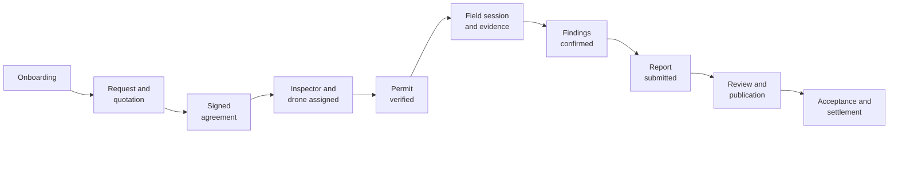

### 3.2 Workflow 1: Customer Onboarding and Building Registration

**Purpose.** Bring a new customer organization onto the platform and register its first building. **Actors.** Prospective customer (public), `ADMIN`, `MANAGER`. **Preconditions.** The platform is reachable and the building's location is decided, because the screening result determines the path.

**Step 1.** Open the public site and choose **Sign up**, then select the customer path.

*Figure 7.11 — Public landing page.*

**Step 2.** Complete the organization form — name, code, your own name, email, phone, and a password meeting the stated policy — then enter the building's name, category, and address and place its location on the map.

*Figure 7.12 — Customer registration with the screened building location.*

**Step 3.** Submit and enter the one-time code sent to your email. A prohibited location is refused, a restricted one is held for platform review, and an eligible one completes registration immediately. Screening is the platform's own check, not a government flight clearance.

**Step 4.** Sign in with the account created in Step 3.

**Step 5.** Open **Notifications** to read deduplicated lifecycle notices and follow their deep links to authorized records.

**Step 6.** Open **Settings** to review the profile, security, and notification preferences held for the signed-in user.

**Step 7.** After signing in, open **Assets** to see your building register.

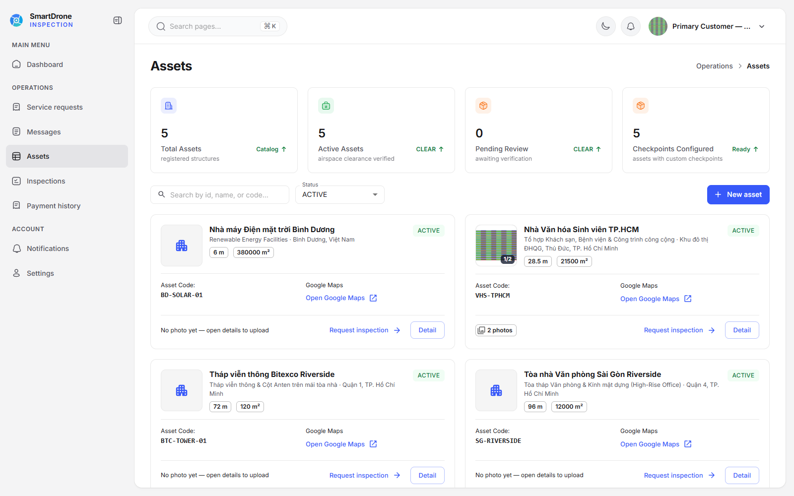

*Figure 7.13 — Customer building register.*

**Step 8.** Choose **New asset** to add another building, or open a record to review its details. Set the category, structure height, footprint, technical profile, and coordinates, attach drawings, and retire a building when it leaves service; retiring preserves history and blocks new requests.

**Step 9.** As `ADMIN` or `MANAGER`, open **Onboarding Reviews** to decide held registrations.

*Figure 7.14 — Onboarding review queue.*

Approve or reject with a written reason. The reason is mandatory on rejection and the decision is attributed in the activity history.

The Manager portal exposes the same review queue for the requests that manager owns; the Administrator sees every pending case, while a Manager sees the queue they are responsible for. Neither role can approve a case that has already been decided.

### 3.3 Workflow 2: Partner Inspector Application and Drone Registration

**Purpose.** Admit a partner inspector and register the drones that inspector will fly. **Actors.** Prospective inspector (public), `ADMIN`, `MANAGER`, `INSPECTOR`. **Preconditions.** The applicant holds a pilot licence and a scanned copy. Drone ownership is not required to apply.

**Step 1.** On the public site choose the partner inspector path.

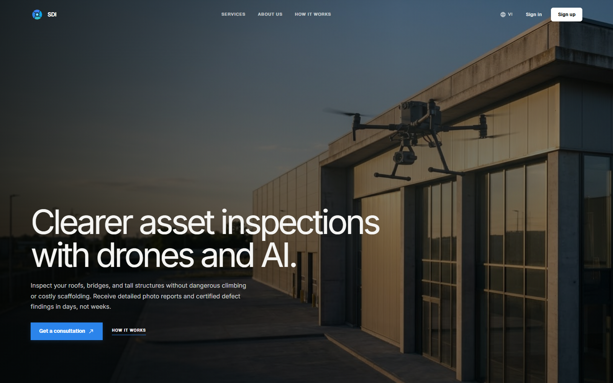

*Figure 7.15 — Partner inspector application.*

**Step 2.** Enter your identity and contact details, licence number, class, and expiry, upload the licence scan, and submit. No account exists yet; you are notified after review.

**Step 3.** As `ADMIN` or `MANAGER`, open the review queue, open the licence scan, and check it against the details supplied.

**Step 4.** Approve or reject. Approval provisions the inspector account and licence profile in one step; rejection requires a reason. Record the signed partner contract after approval.

**Step 5.** As the inspector, open **My Drones**, choose to register a drone, and supply the serial number, model, manufacturer, at least one photograph, the outdoor flight capabilities, and the required documents.

*Figure 7.16 — Inspector drone inventory.*

**Step 6.** Wait for platform review; once approved the drone becomes assignable. You can renew a registration or mark a drone unavailable from the same screen.

### 3.4 Workflow 3: Service Request, Quotation and Agreement

**Purpose.** Turn an inspection need into an agreed, signed engagement. **Actors.** `CUSTOMER`, `MANAGER`. **Preconditions.** The customer has an active building, and an eligible inspector and serviceable drone exist.

**Step 1.** In the customer portal open **Service Requests**, choose **New request**, select the building and inspection type, choose one-time or recurring, and pick a window starting at least twenty calendar days away.

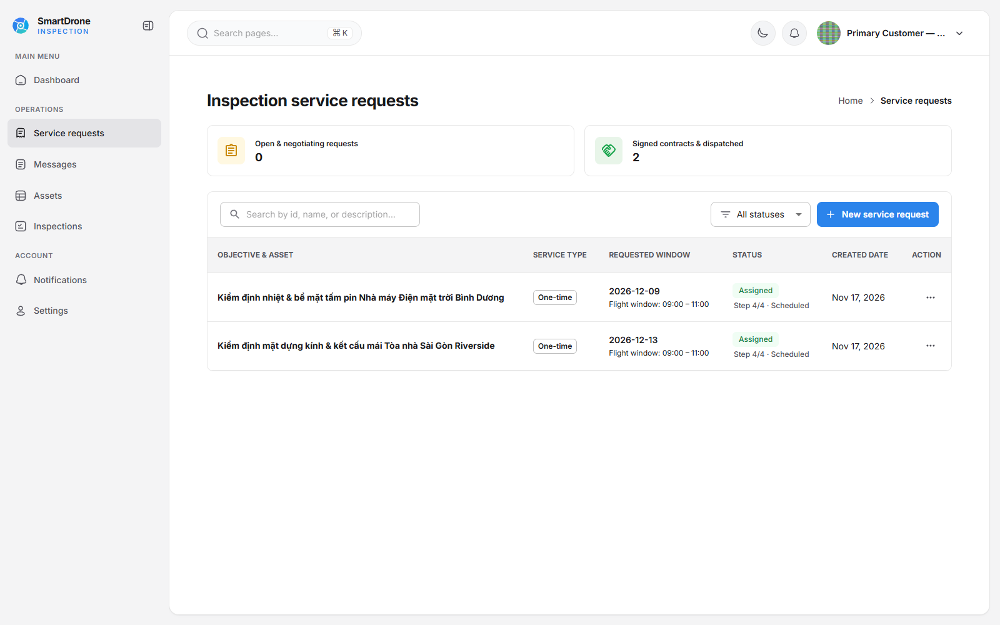

*Figure 7.17 — Customer request list.*

**Step 2.** Submit. The request enters the manager queue.

The request appears with the manager's assigned requests, inspections, and reports awaiting review.

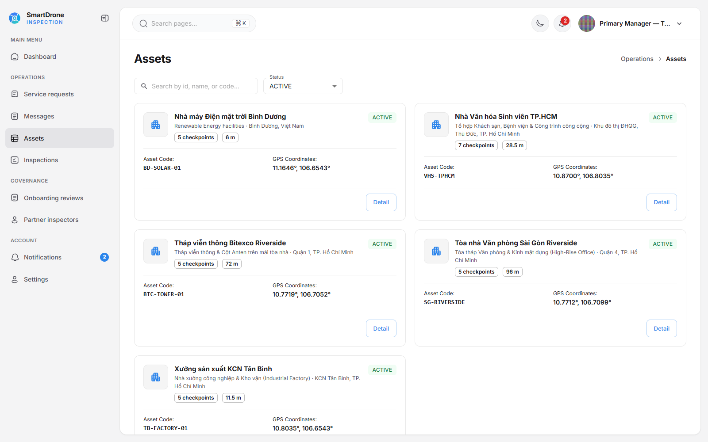

*Figure 7.18 — Customer buildings visible to the manager.*

**Step 3.** As `MANAGER`, open **Service Requests**, claim the request, and discuss scope in its order chat.

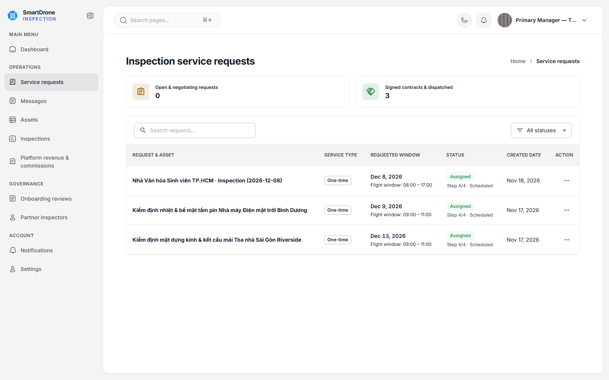

*Figure 7.19 — Manager request queue.*

**Step 4.** Open the request's **Messages** action to negotiate scope, price, or timing in the order chat. Text and up to five attachments are supported per message; a message is not itself an acceptance or a change in price.

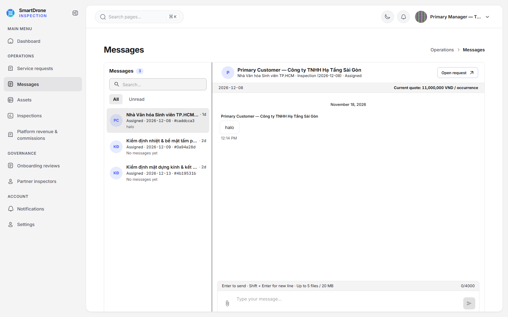

*Figure 7.20 — Manager order-chat inbox.*

**Step 5.** As `CUSTOMER`, open **Messages** to read and reply to the same thread. A dedicated inspection thread also lets the customer and the assigned inspector coordinate site access, separately from the commercial quotation thread.

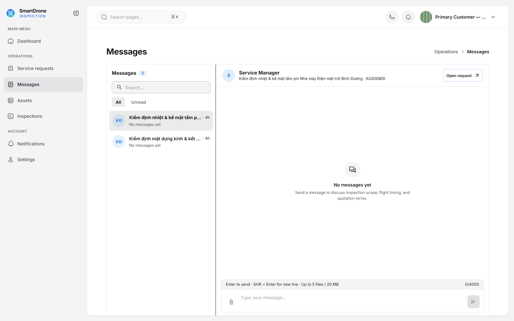

*Figure 7.21 — Customer message inbox with the commercial and inspection threads.*

**Step 6.** As `MANAGER`, issue the quotation: scope, first occurrence window, price per occurrence in VND, and any required drone features. The first occurrence must fall on the customer's requested date. The inspector and drone are selected later, at dispatch.

**Step 7.** As `CUSTOMER`, accept the quotation. Acceptance freezes the agreed terms and materially schedules a recurring request. For different terms, ask for a revised quotation instead.

**Step 8.** Sign the agreement on paper and have the manager record the signed copy, after which occurrences become available for dispatch.

### 3.5 Workflow 4: Dispatch, Flight Permit and Field Session

**Purpose.** Prepare and execute one occurrence in the field. **Actors.** `MANAGER`, `INSPECTOR`, `ADMIN`. **Preconditions.** The occurrence exists, and the inspector's licence and the drone's registration are valid on the planned date.

**Step 1.** As `MANAGER`, open the occurrence and assign an inspector and drone. An assignment whose credentials expire before the planned start, or that conflicts with other work, is refused.

*Figure 7.22 — Dispatch state across occurrences.*

The manager's tracking view carries the same occurrence from `SCHEDULED` through acceptance, permit review, field execution, and reporting, so a stalled mission is visible before its planned date passes.

**Step 2.** As `INSPECTOR`, open the assigned mission from **Inspections**.

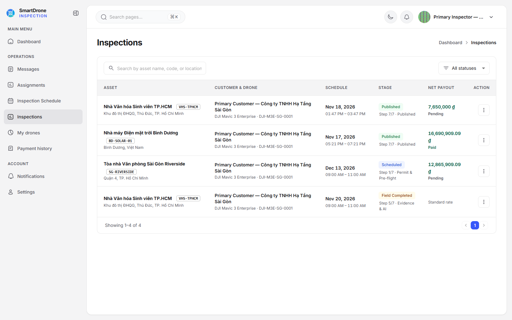

*Figure 7.23 — Inspector's assigned inspection queue.*

**Step 3.** Open the **Tracking** tab to see the occurrence summary, its lifecycle position, and the next action available to the signed-in role.

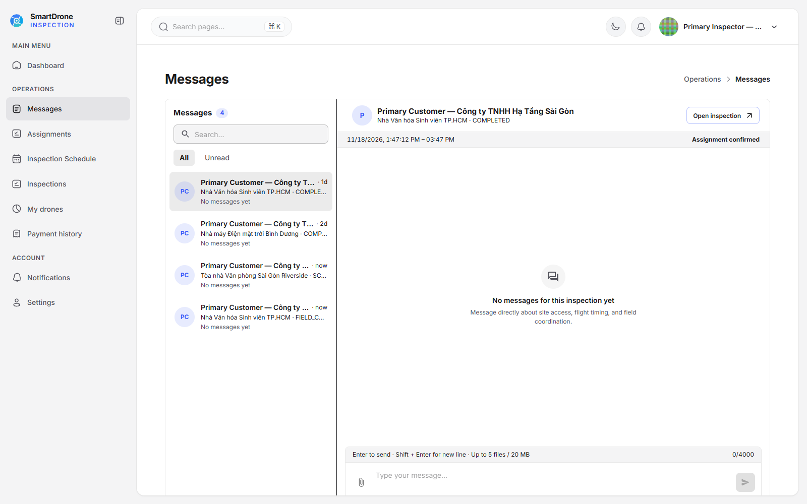

*Figure 7.24 — Inspector-to-customer inspection chat.*
The **Messages** action on this screen opens the per-inspection channel used to coordinate site access; it is separate from the commercial order chat.

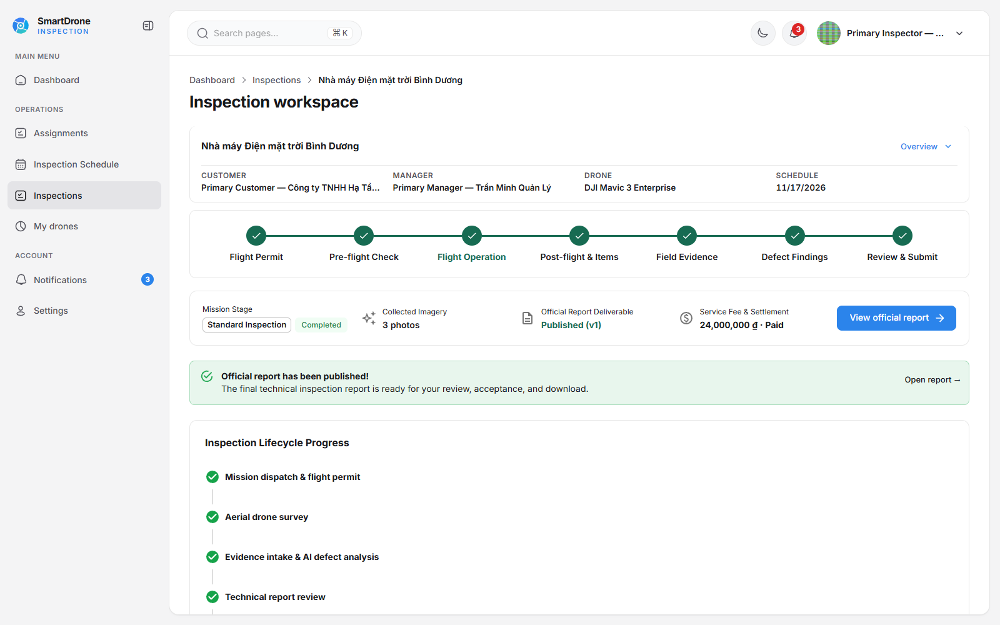

*Figure 7.25 — Inspector workspace tracking and next-action panel.*

**Step 4.** Upload the flight permit in the **Permit** tab with its number, authority, validity window, and optionally the drone serial and maximum altitude.

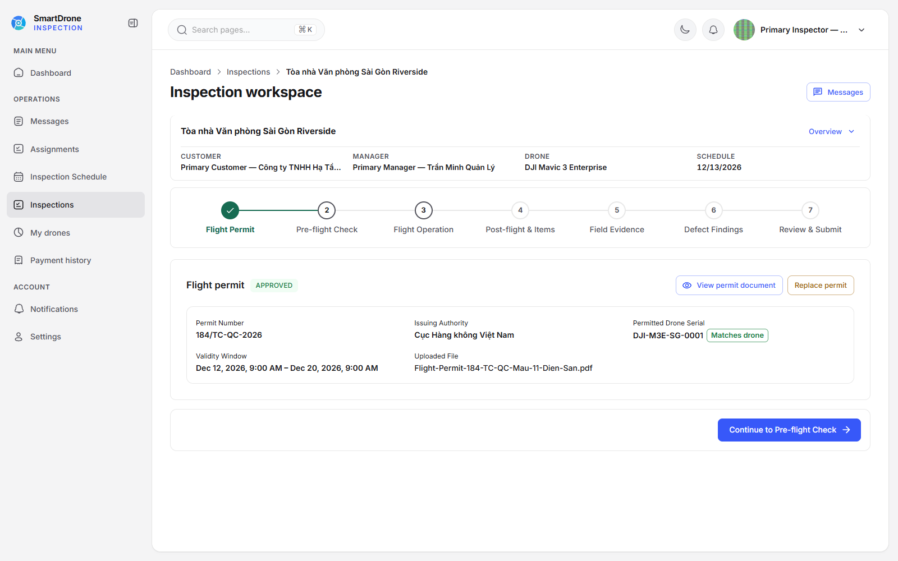

*Figure 7.26 — Flight permit upload.*

**Step 5.** As a different `MANAGER` or `ADMIN`, verify the permit. The session cannot start without approval, and there is no bypass.

**Step 6.** Open the **Pre-flight** tab and complete the safety checklist.

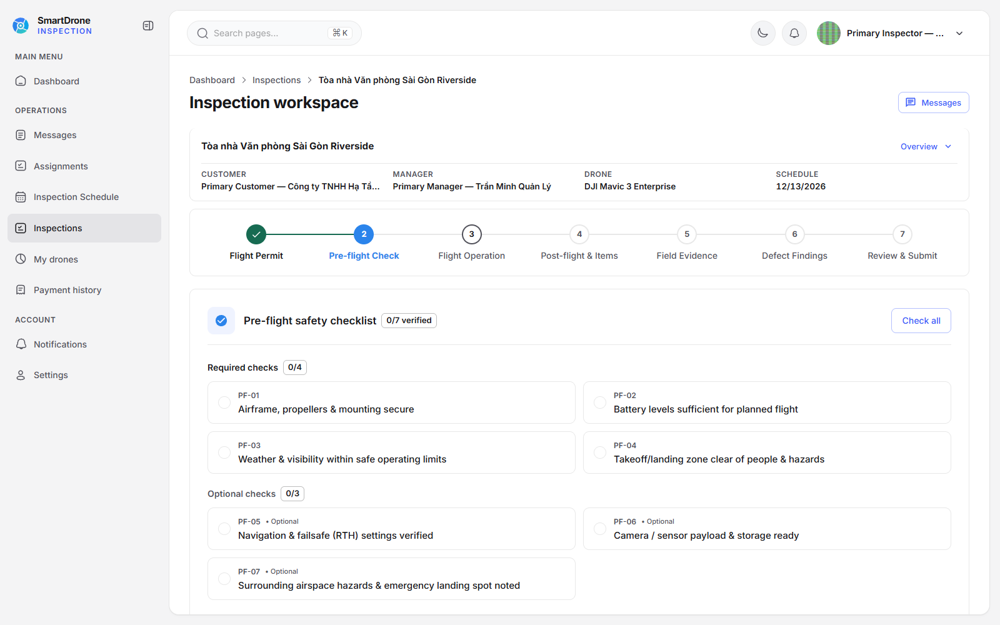

*Figure 7.27 — Pre-flight safety checklist.*

**Step 7.** Open **Field Session** and choose **Start**. When finished choose **Complete** with outcome notes; if the mission cannot proceed choose **Abort** with a reason, and the manager is alerted to reschedule, reassign, or cancel.

*Figure 7.28 — Field session controls.*

**Step 8.** Review the **Post-flight** tab; when a ground station is connected, metrics and the GPS trace are recorded automatically.

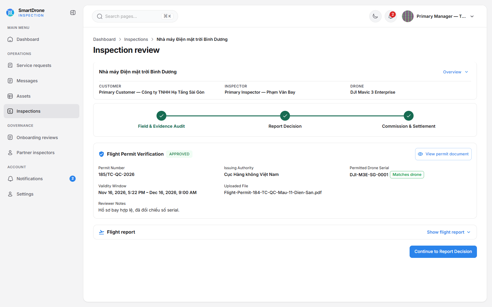

*Figure 7.29 — Manager field and evidence audit stage.*
The manager reviews the permit, the flight report, and the evidence audit before moving to the report decision.

*Figure 7.30 — Post-flight metrics and flight trace.*

### 3.6 Workflow 5: Evidence, Detection and Findings

**Purpose.** Capture evidence and turn it into agreed official findings. **Actors.** `INSPECTOR`. **Preconditions.** A field session has been started or completed.

**Step 1.** Open the **Evidence** tab and upload photographs; each is normalized and thumbnailed for fast review.

*Figure 7.31 — Evidence capture.*

**Step 2.** To upload a video, select it and let the upload run; a large file uploads in chunks and resumes if the connection drops, and playback is available once processing completes.

**Step 3.** Choose **Analyse** on a photograph or video keyframe. The platform proposes candidates with class, severity, confidence, and a highlighted region, falling back to its secondary vision service or to manual entry when the primary cannot run.

**Step 4.** In the **Findings** tab, accept, edit, or reject each candidate, and add any finding the system missed by hand.

*Figure 7.32 — Candidate findings.*

**Step 5.** Use the **All active**, **Unconfirmed**, or **Confirmed** filter chips to focus on findings awaiting decision. While editing or reviewing a finding, choose **Draft note with AI** (inside the card) or **Draft all notes** (next to **Analyze all images** in the toolbar) to populate an editable technical note grounded in matched historical cases and engineering standards (`TCVN 9343:2012`), with sources tucked under a collapsed **References** toggle; save and confirm every finding explicitly.

**Step 5.** Choose **Confirm findings**. This explicit action fixes the baseline, and only confirmed findings become official.

### 3.7 Workflow 6: Report Submission, Review and Publication

**Purpose.** Produce and publish the official report. **Actors.** `INSPECTOR`, `MANAGER`, `ADMIN`. **Preconditions.** Findings are confirmed.

**Step 1.** Open the **Report** tab. The platform compiles the report from the confirmed findings, evidence, and session record. The **AI Executive Summary** also carries a compact **Matched Cases & Standards** row of reference chips linking the advisory narrative to the historical cases and engineering standards that informed it; these chips are informational and do not change the report content. You may request an advisory narrative draft, which you must review and edit before use.

*Figure 7.33 — Compiled report preview.*

**Step 2.** Review every section and choose **Submit**. Opening the report does not submit it.

**Step 3.** As a different `MANAGER` or `ADMIN`, open the report in the review queue. The queue lists every occurrence whose report is submitted for review or already published, with its version and status.

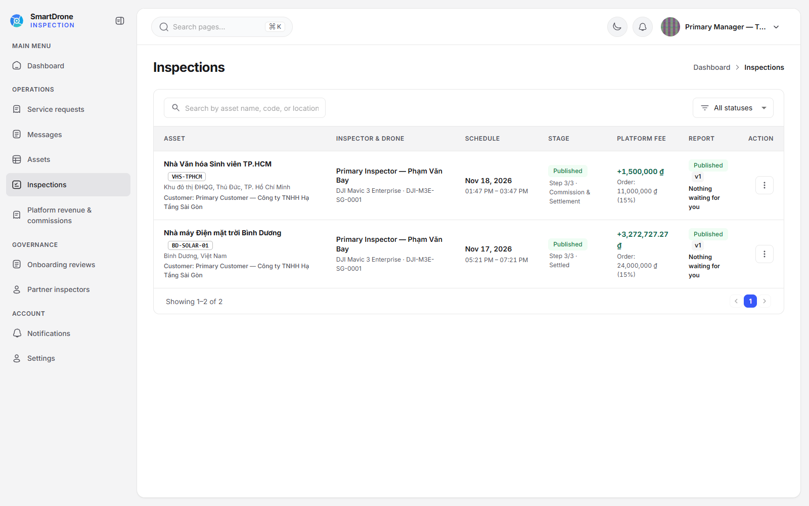

*Figure 7.34 — Manager report queue filtered to submitted and published reports.*

*Figure 7.35 — Independent report review.*

**Step 4.** Publish, or return with reasons. Publication by the report's own author is refused, and publication locks the official report version.

**Step 5.** To correct a published report, issue a new version; the previous version is preserved and marked superseded.

For a re-inspection report, the Web UI also flags a `RESOLVED` verdict whose validity window has lapsed, or lapses within 14 days, before authoring begins: a banner appears on the report page and a validity notice sits beside the affected verification item. The flag is a prevention aid, not an override — the backend still refuses authoring, submission, or publication that depends on an expired verdict.

### 3.8 Workflow 7: Report Acceptance and Payment

**Purpose.** Accept the published report and settle the fee. **Actors.** `CUSTOMER`, `MANAGER`. **Preconditions.** The report is published and the customer is signed in.

**Step 1.** Open **Inspections** and select the completed inspection.

*Figure 7.36 — Customer inspection list.*

**Step 2.** Open and review the published inspection report.

**Step 3.** Choose **Accept report**; acceptance is recorded against the occurrence and the fee becomes due.

**Step 4.** Choose **Pay** and select PayOS VietQR or VNPay. For VietQR, scan the displayed code; for VNPay, follow the redirect.

The published report also shows a payment-due badge with its countdown and a **Download payment document** action, returning a notice before payment and a receipt after a verified gateway callback.

**Step 5.** Confirm the payment shows as paid. Settlement is confirmed by the gateway callback rather than the redirect alone, so the status may take a moment. Once paid, a manager records the inspector's payout from the settlement workspace.

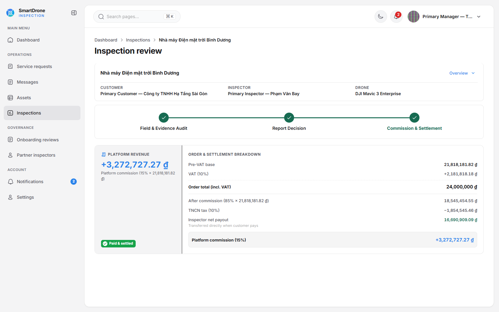

*Figure 7.37 — Manager settlement workspace with payout, refund, and receivable controls.*

**Step 6.** If the occurrence must be refunded, the manager initiates the refund before any external transfer so the unpaid payout is held, then completes it with a unique reference and an allocation that sums exactly to the transferred amount. A refund against an already-paid payout creates a receivable; collections are recorded separately and the system never offsets a future payout automatically.

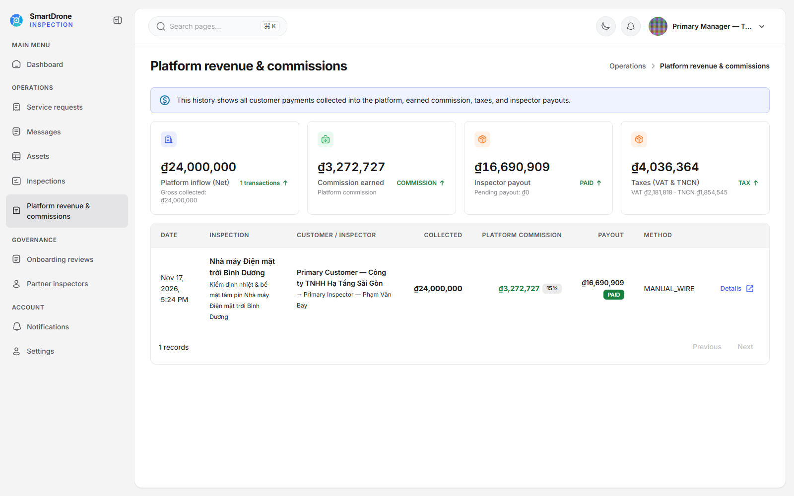

*Figure 7.38 — Platform revenue, commission, VAT, and payout history.*

### 3.9 Workflow 8: Platform Administration and Governance

**Purpose.** Govern the catalogues, accounts, and settings that every other workflow depends on. **Actors.** `ADMIN`; `MANAGER` for the review queues it shares. **Preconditions.** The signed-in account holds the `ADMIN` role.

**Step 1.** Open **Settings** to reach the consolidated governance sections: asset catalog, drone and flight configuration, onboarding reviews, platform accounts, platform settings, and the activity log.

The six governance sections appear together in the left navigation: operations remain in the service-request, asset, and inspection queues.

**Step 2.** Maintain the building category catalogue in **Asset catalog**. Each category seeds the inspection checkpoints used when a customer registers a building of that category; changing the catalogue does not rewrite checkpoints already captured against existing buildings.

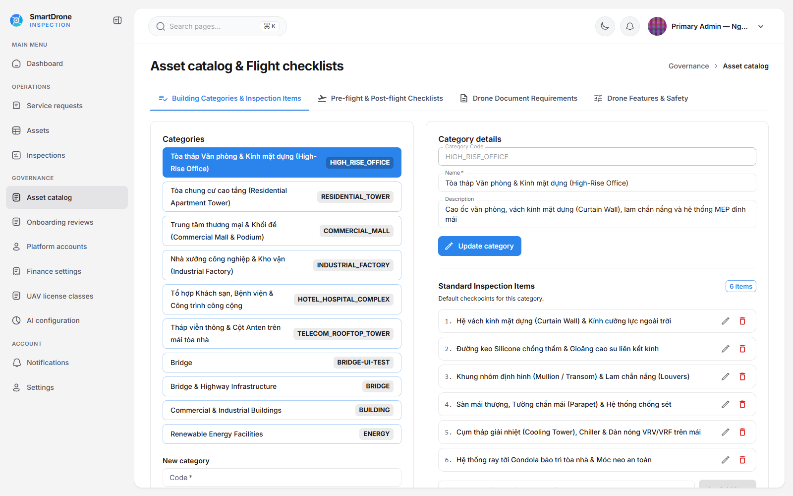

*Figure 7.39 — Building category catalogue with the two-tier `AdminTableToolbar` filter.*

Choose **Manage** on a category to open a centred `maxWidth="md"` dialog with its identity and the standard checkpoints it seeds for new buildings.

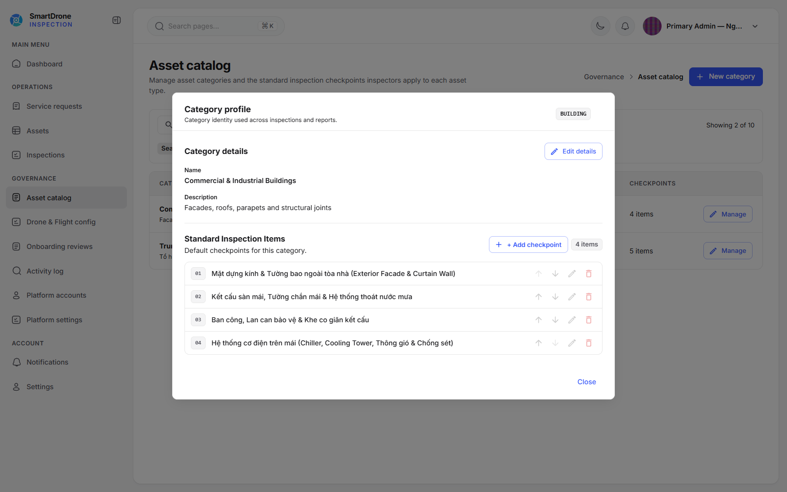

*Figure 7.40 — Centred category-details dialog with standard inspection items.*

**Step 3.** Maintain the recognised **Pilot licence classes** used by assignment eligibility. A licence class carries its validity rule, and an inspector whose class is unknown or expired cannot be assigned.

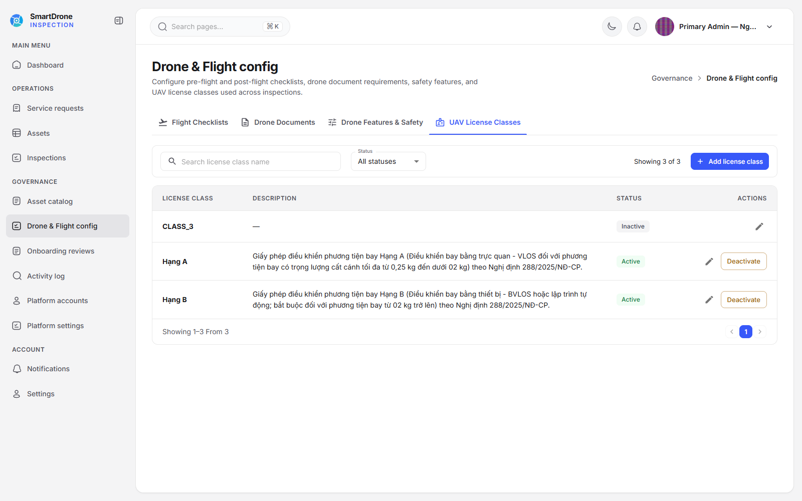

*Figure 7.41 — Pilot licence class catalogue.*
**Drone and flight configuration.** The **Drone & Flight config** section holds the checklists, the required document set, the drone capabilities, and the licence classes behind assignment eligibility.

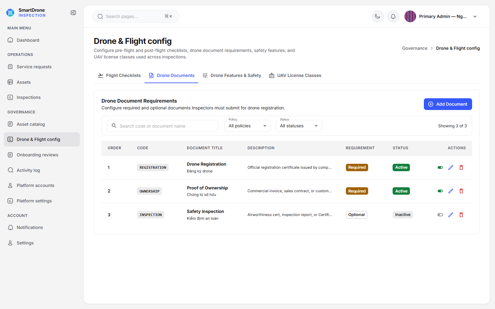

*Figure 7.42 — Administrator-configured drone document requirements.*

**Step 4.** Maintain **Platform accounts** — create an account, change its role, reset its password, or activate and deactivate it. An account holds exactly one role, and a deactivated account cannot sign in.

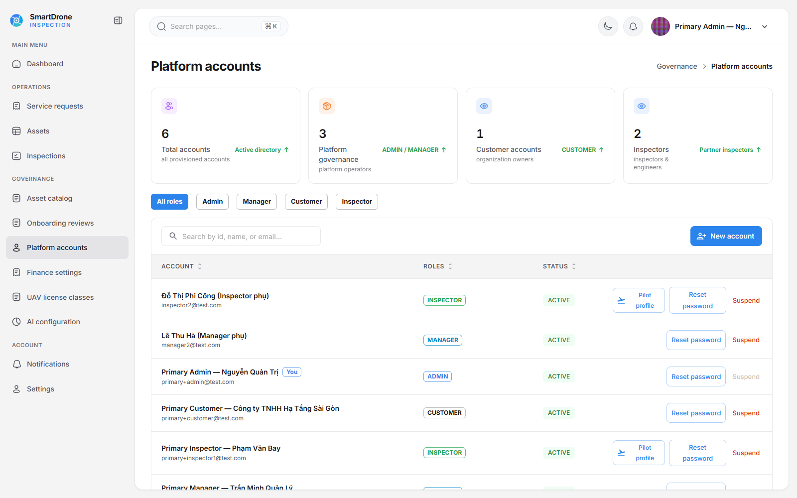

*Figure 7.43 — Platform account list with role, status, and standardized filters.*

Choose **Manage** on an account to open a centred dialog with **Account & Security**, **Pilot Profile & License**, and **Flight Logs** tabs.

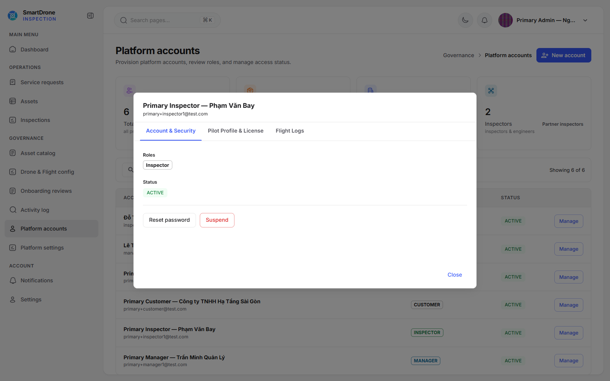

*Figure 7.44 — Centred platform-account dialog with tabs.*

**Step 5.** Maintain the finance rates in **Finance settings**. Commission, VAT, and personal income tax are captured at invoice time, so a later rate change does not rewrite an issued invoice.

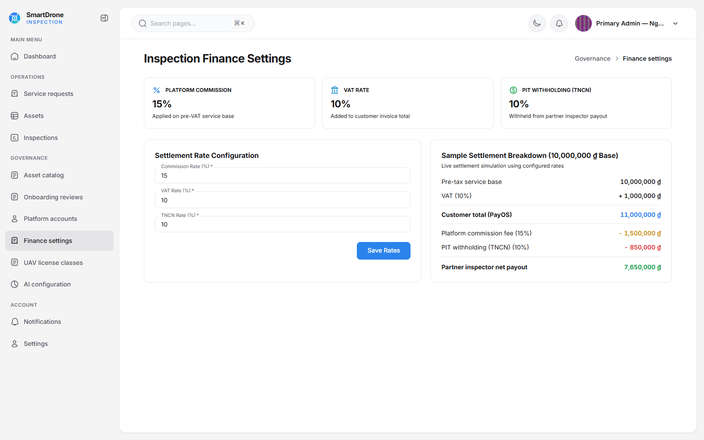

*Figure 7.45 — Finance settings for commission, VAT, and personal income tax.*

**Step 6.** Maintain the singleton **AI settings** — the auto-confirm threshold (`70%` default since `V63`) and the account-level fallback preference. Detection remains advisory regardless of the threshold, and a human still confirms every finding.

Operations settings are held in the adjacent tab of the same workspace; they include the assignment-acceptance timeout applied to pending Step 4 assignments.

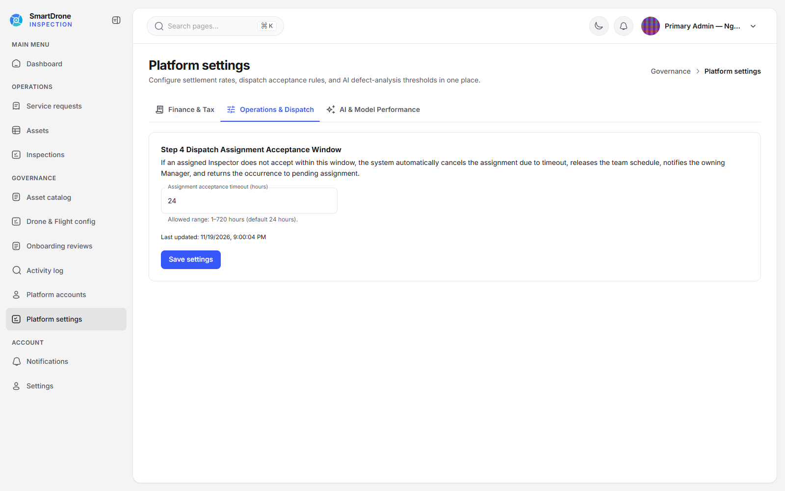

*Figure 7.46 — Platform operations settings and assignment timeout.*

**Step 7.** Use **Service requests** as a read-only assignment registry: an administrator may assign, reassign, or unassign request ownership, but cannot quote, dispatch, or manage finance as a manager.

**Step 8.** Review **Activity log** entries for attributable onboarding, commercial, inspection, payment, and acceptance decisions, filtered by actor, action, and date. The log is append-only.

The queue is served by `GET /api/v1/admin/audit-logs`, whose query filters narrow the same record by actor, action, outcome, and time range.

### 3.10 Workflow 9: Customer Mobile Application

**Purpose.** Follow and act on inspections from a phone. **Actors.** `CUSTOMER` only. **Preconditions.** The account holds the `CUSTOMER` role; any other role is refused at sign-in with the `CUSTOMER_ONLY_MOBILE` error code.

**Step 1.** Install the application and sign in with customer credentials or continue with Google. The mobile client stores the session in secure storage and refreshes it through the mobile authentication endpoints.

**Step 2.** Use the bottom navigation for **Home**, **Buildings**, **Requests**, **Inspections**, and **Profile**.

| Mobile screen | Route | What the customer can do |
| --- | --- | --- |
| Sign-in and registration | `/login`, `/register` | Sign in, register an organization, or complete a Google redirect. |
| Home | `/home` | Read the organization summary and the next inspection. |
| Buildings | `/assets` | Review the building register and its checkpoints. |
| Requests | `/requests`, `/requests/new` | Raise a one-time or recurring request and open the order chat. |
| Inspections | `/inspections`, `/inspections/:id` | Track progress and read the published report. |
| Notifications | `/notifications` | Read deduplicated lifecycle notices. |
| Profile | `/profile` | Change name, phone, and language. |

**Step 3.** Open **Requests** to raise a request or continue a conversation, and **Inspections** to track progress and read the published report.

**Step 4.** Open **Profile** to change your name, phone number, or language. English and Vietnamese are supported and the choice persists.

The Customer client (PR `#27`, `9939c00`) mirrors the web verdict-expiry warning, the payment-due badge and `/report/payment-document` PDF download, the Inspector–Customer **Inspector** chat thread, and a collapsible **Matched cases & standards** strip that hides cleanly when empty. Field capture, permit handling, and report preparation are not available on mobile; those tasks belong to the inspector and are performed in the operations web portal. The mobile application admits `CUSTOMER` accounts only by design, not by an omitted screen.
