# VI. Release Package & User Guides

## 1. Deliverable Package

| No. | Deliverable Item | Description |
| --- | --- | --- |
| 1 | Project Schedule/Tracking | Task schedule, milestone dates, and effort tracking against the weighted plan in Report 2 (`208` md). |
| 2 | Project Backlog | The twenty-four atomic feature backlog (`FE-01`–`FE-24`) across `MF1`–`MF4`. |
| 3 | Source Codes | Four independent repositories: backend service (`SmartDroneInspection-backend`), web portals (`SmartDroneInspection-frontend`), Customer mobile client (`SmartDroneInspection-mobile`), and documentation (`SmartDroneInspection-docs`). |
| 4 | Database Script(s) | Automated schema migration scripts (`V1`–`V4` and `V60`–`V80`) defining the PostgreSQL 17 database (`53` application tables / `55` total database tables, including `inspector_ratings` `V70`, `field_session_flights` `V72`, `rating_criterion_configs` `V73`, `service_request_partner_messages` `V79`, and `V80` checkpoint snapshots), `pgvector` support for `DroneKnowledgeAI`, and plain-text building ownership details. |
| 5 | Final Report Document | Reports 1–7 of this documentation set, exported against the official templates. |
| 6 | Test Cases Document | `Report5_Test Report.xlsx` (`v3.15`) with twenty-four feature sheets (`Feature 1`–`Feature 24`) covering `77` listed rows (`75` active cases + `2` superseded `FE-13` cases), plus the executed results in Report 5 §5. |
| 7 | Defects List | The defect log, recording `DEF-01` as resolved (`PR #33`) and one low-severity open tooling defect (`DEF-02`). |
| 8 | Issues List | Outstanding issues and known limitations, including the out-of-scope items in Part III §3.8 (Report 3 §3.26). |
| 9 | Slide | The defence presentation used for the final review. |

## 2. Installation Guides

### 2.1 System Requirements

**Hardware Requirements**

| Component | Minimum Specification | Recommended Specification | Notes |
| --- | --- | --- | --- |
| Processor | 64-bit x86_64, 4 logical cores | 8+ logical cores | Detection inference (`YOLO11`) and FFmpeg video transcoding are CPU/RAM intensive. |
| Memory (RAM) | 8 GB | 16 GB | Allocate at least 8 GB to Docker Desktop when running `ai-inference` alongside Postgres and backend. |
| Disk Space | 40 GB free | 60+ GB SSD | Required for container images, PostgreSQL storage, and MinIO photo/MP4 evidence buckets. |
| Network / Ports | Localhost loopback | Stable broadband / LAN (`14551/udp`, `5762/tcp`) | Required for package installs, optional OpenAI/Sepay/VNPay callbacks, and Mission Planner MAVLink bridge. |

**Software Prerequisites**

| Layer | Requirement | Purpose |
| --- | --- | --- |
| Containerization | Docker Engine 27+ with Compose plugin | Runs `postgres` (`pgvector:pg17`), `minio`, `ai-inference`, `smartdronehub`, and `backend`. |
| Backend Runtime | Java 21 (Temurin) | Local backend builds (`./mvnw test`, `./mvnw verify`). |
| Frontend Toolchain | Node.js 22+ & npm | Builds and serves the React 19 + TypeScript Web Portal (`vite`). |
| Mobile SDK | Flutter SDK + Android toolchain / Chrome | Builds and runs the `CUSTOMER` mobile client (`flutter run`). |
| Client Browser | Modern Chrome / Edge | Runs all four web portals cleanly in Light/Dark mode. |

### 2.2 Installation Instruction

#### Step 1 — Clone Repositories and Configure Environment

Clone the four repositories into sibling directories so cross-repo proxies and tooling resolve as configured. In `SmartDroneInspection-backend/`, copy the environment template to `.env` and populate PostgreSQL credentials, MinIO bucket and keys, JWT/ticket signing secrets (long random values — never commit real secrets), allowed CORS origin (`http://localhost:3000`), and bootstrap administrator credentials. Optional integrations (`ai-inference` Vision fallback, Sepay, VNPay, and Google OAuth2) default cleanly to disabled/manual modes when keys are omitted.

#### Step 2 — Start Backend Stack and Apply Flyway Migrations

Launch all five containers inside `SmartDroneInspection-backend/` with `docker compose up -d --build`. On first startup, automated database migrations configure all schema tables, enable vector knowledge search, load built-in engineering standards and historical case backfill, and prepare plain-text building ownership fields with no manual database steps required. Verify service readiness via `docker compose ps` and `curl http://localhost:8080/actuator/health` returning `UP`.

#### Step 3 — Start Web Portal and Mobile Client

In `SmartDroneInspection-frontend/`, copy the frontend `.env` example, run `npm install`, and start `npm run dev` on `http://localhost:3000` (proxies `/api/*` directly to `http://localhost:8080`). In `SmartDroneInspection-mobile/`, run `flutter pub get` and launch `flutter run --dart-define=API_BASE_URL=http://10.0.2.2:8080/api/v1` (Android emulator) or configure the LAN/loopback host matching the backend.

#### Step 4 — Bootstrap Login and Troubleshooting

Sign in using the bootstrap `ADMIN` account, rotate credentials immediately, and provision additional accounts in `/admin/platform-users`. If the backend container fails on startup, verify both JWT/media signing secrets meet minimum length; if file uploads fail while API calls succeed, inspect MinIO credentials and bucket creation; if the AI embedding service is unavailable, finding drafting and recommendations automatically fall back to deterministic keyword matching without blocking workflows.

## 3. User Manual

### 3.1 Overview

SmartDroneInspection organizes daily operations across its four authenticated Web Portals (`CUSTOMER`, `INSPECTOR`, `MANAGER`, `ADMIN`) and the Customer Mobile App (`CUSTOMER` only) around five canonical end-to-end Main Flows (`MF1A`–`MF4`). Every step figure in §3.2–§3.7 marks interactive controls using numbered red callouts (`❶`, `❷`, `❸`, `❹`) matched directly to each step.

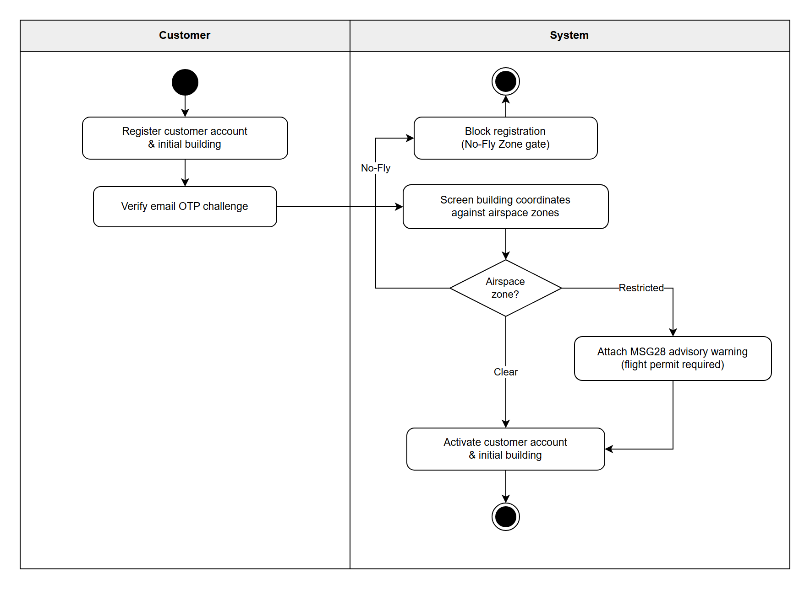

*Figure 7.10a — End-to-end activity flow (`MF1A`): Customer registration, `RESTRICTED_ZONE` `MSG28` amber warning, `NO_FLY_ZONE` hard block, and asset setup.*

*Figure 7.10b — End-to-end activity flow (`MF1B`): Partner Inspector admission and drone registration (`MANAGER` review; `ADMIN` read-only).*

*Figure 7.10c — End-to-end activity flow (`MF2`): One-time/recurring request, VND quote, Order/Partner chat, signed contract upload, and occurrence dispatch.*

*Figure 7.10d — End-to-end activity flow (`MF3`): Inspector self-attested flight permit (`APPROVED`), SmartDroneHub telemetry, chunked evidence, YOLO11, and DroneKnowledgeAI.*

*Figure 7.10e — End-to-end activity flow (`MF4`): Manager report decision -> Sepay VietQR Payout (`SDIPAY`) -> publication, Customer rating, and Sepay/VNPay settlement.*

### 3.2 Workflow 1: Customer Onboarding, Airspace Screening and Asset Setup (`FE-01`, `FE-04`, `FE-06`, `FE-07`, `FE-12`)

**Purpose.** Onboard a new Customer account, screen building coordinates against Vietnam airspace zones (`NO_FLY_ZONE` hard block; `RESTRICTED_ZONE` amber `MSG28` advisory with immediate onboarding), configure inspection checkpoints and ownership notes, and verify notification settings.
**Actors.** Prospective Customer (public), `CUSTOMER`.
**Preconditions.** Backend and Web Portal are reachable; target building coordinates and category are known.

**Step 1 — Navigate from Public Landing.** Review the **Header navigation** ❶. Select **Sign in** ❷ if you have an account, or **Sign up** ❸ to create one. **Get a consultation** ❹ opens the consultation entry point.

*Figure 7.11 — Workflow 1 Step 1 — Public landing page entry controls.*

**Step 2 — Complete Customer Registration.** Enter your name, email, and password in the **Registration form** ❶, then select **Create account** ❷. Follow the email verification and initial building prompts. Account activation proceeds immediately unless coordinates fall inside a prohibited `NO_FLY_ZONE`.

*Figure 7.12 — Workflow 1 Step 2 — Customer account creation form.*

**Step 3 — Screen Building Coordinates on Airspace Map.** Sign in as `CUSTOMER`, open **Assets -> + New asset**, enter structural height/footprint, and click **Pick on Google Maps** to launch the **Interactive Airspace Map dialog** ❶. Pin the exact building coordinates; prohibited zones disable confirmation (`ASSET_IN_NO_FLY_ZONE`), whereas restricted locations display the amber `MSG28` advisory and permit confirmation (`Xác nhận vị trí này`).

*Figure 7.13 — Workflow 1 Step 3 — Interactive Airspace Map dialog evaluating building coordinates.*

**Step 4 — Review `RESTRICTED_ZONE` (`MSG28`) Advisory Banner and Save Immediately.** After confirming a coordinate inside a `RESTRICTED_ZONE`, the **New Asset form** displays the amber **Restricted Airspace (`MSG28`) warning banner** ❶ citing the governing military authority, altitude ceiling (`<= 120 m AGL`), and `https://cambay.mod.gov.vn` alongside **Google Maps Location controls** ❷ while keeping submission enabled (no Admin approval wait required).

*Figure 7.14 — Workflow 1 Step 4 — Restricted Airspace `MSG28` amber advisory banner during asset onboarding.*

**Step 5 — Manage Building Register.** In **Assets**, select **New asset** ❶, narrow the list with **Search and status filters** ❷, or select **Detail** ❸ to inspect a building record.

*Figure 7.15 — Workflow 1 Step 5 — Customer building inventory and filter controls.*

**Step 6 — Maintain Checkpoints and Reference Documents.** Check coordinates and status in the **Asset detail header** ❶ and inspect the **Attached documents and Inspection Checkpoints** ❷. Edit checkpoints before the first inspection. The example shows checkpoints locked by an existing inspection.

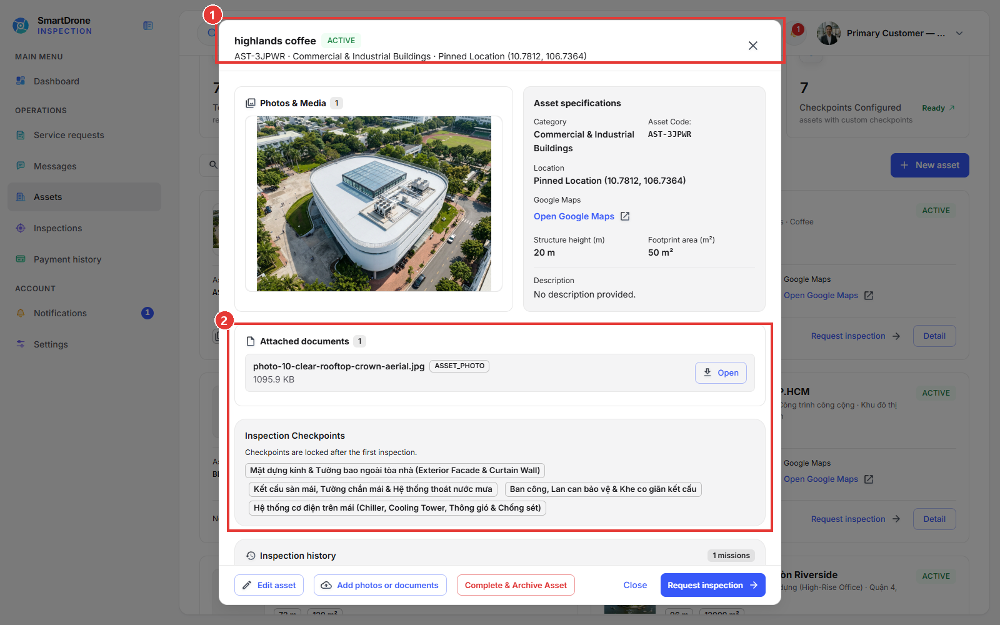

*Figure 7.16 — Workflow 1 Step 6 — Customer building detail checkpoints and document attachments.*

**Step 7 — Verify Notification Inbox and Account Settings.** Open **Notifications** ❶ from the account sidebar to inspect deduplicated onboarding and lifecycle updates inside **Notice list** ❷.

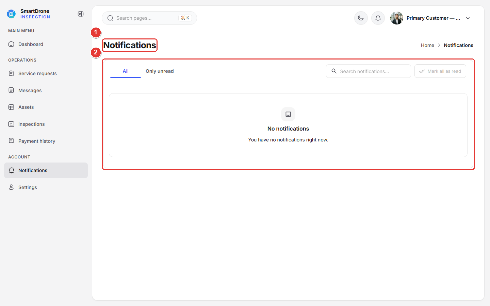

*Figure 7.17 — Workflow 1 Step 7 — Account notifications inbox and deep-link alerts.*

### 3.3 Workflow 2: Partner Inspector Admission and Drone Registration (`FE-02`, `FE-03`)

**Purpose.** Admit a qualified drone pilot through public application review and register an airframe eligible for mission dispatch under Decree 288/2025/ND-CP.
**Actors.** Prospective Inspector (public), `INSPECTOR`, `MANAGER` (approver); `ADMIN` holds read-only oversight.
**Preconditions.** Applicant holds a valid civil pilot licence scan; drone registration/ownership documents are ready.

**Step 1 — Submit Public Inspector Application.** Open the Partner Inspector registration page, follow the **3-step stepper** ❶ (`Account -> CCCD & Licence -> OTP & Submit`), complete credentials and licence details inside **Applicant inputs** ❷, attach the licence scan, and verify OTP.

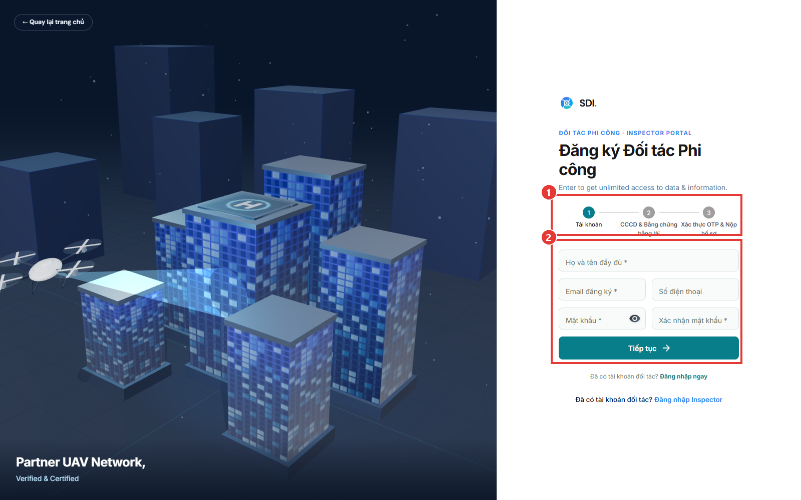

*Figure 7.18 — Workflow 2 Step 1 — Three-step Partner Inspector public application form.*

**Step 2 — Review Application or Drone Queue.** `MANAGER` opens **Onboarding reviews**, toggles **Onboarding navigation entries** ❶ (`Inspector Applications` / `Drone Registrations`), applies status chips inside **Filters & queue area** ❷, and approves qualified records (`ADMIN` may inspect both queues read-only).

*Figure 7.19 — Workflow 2 Step 2 — Onboarding navigation and drone registration filters.*

**Step 3 — Confirm Eligibility in Partner Roster.** Open **Partner inspectors** and inspect **Partner inspector row** ❶ to verify active status, pilot licence class (`Class B` / `Class A`), licence expiry, and eligible aircraft.

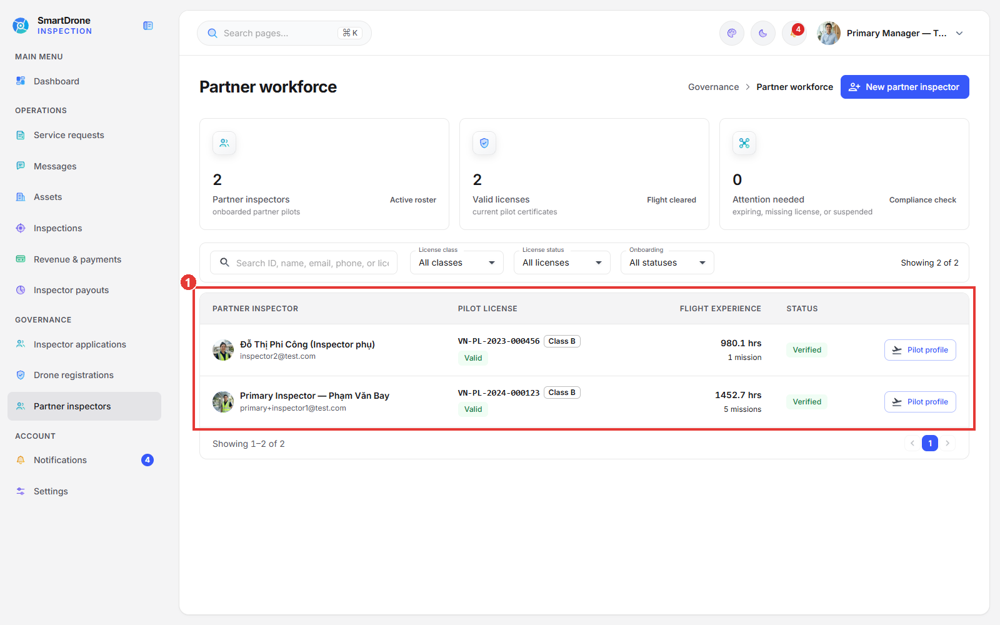

*Figure 7.20 — Workflow 2 Step 3 — Manager partner inspectors eligibility directory.*

**Step 4 — Open My Drones Registry.** The approved `INSPECTOR` signs in, navigates to **My drones**, reviews existing approvals on **Owned drone card** ❷ (`DJI Mavic 3 Enterprise`), or clicks **Register drone** ❶ to add a new airframe.

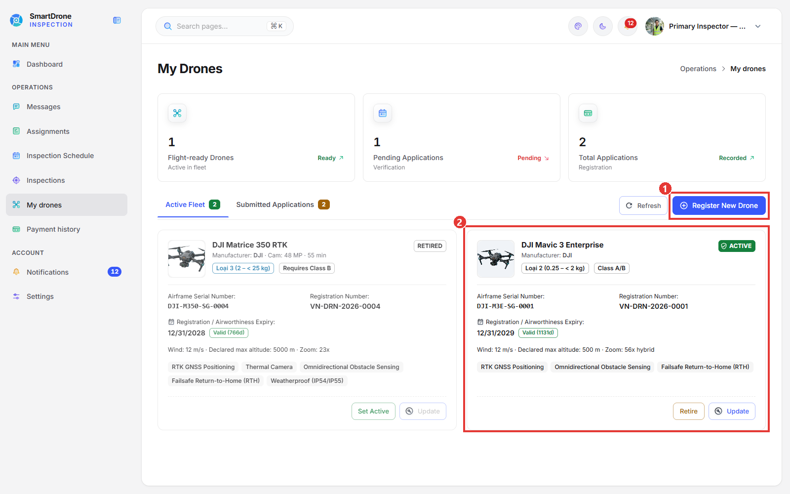

*Figure 7.21 — Workflow 2 Step 4 — Inspector owned drone fleet registry.*

**Step 5 — Submit Aircraft Specs, Photos and Documents.** Confirm details under **Register drone title** ❶, fill serial number, Decree 288 MTOW category, real photos, capability checkboxes, and mandatory documents in **Drone specs & docs** ❷, and submit for Manager review.

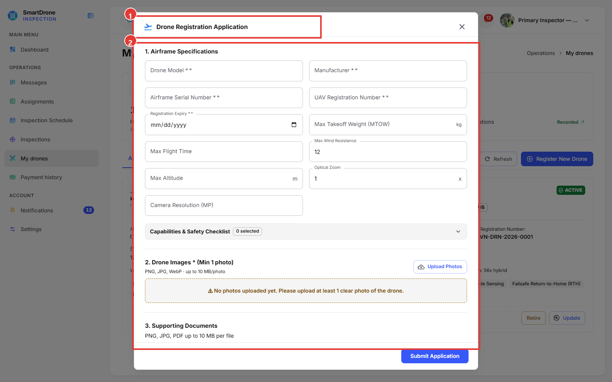

*Figure 7.22 — Workflow 2 Step 5 — Register owned drone specification and document form.*

### 3.4 Workflow 3: Service Request, Quotation, Contract and Dispatch (`FE-08`–`FE-11`)

**Purpose.** Create a building inspection request, negotiate commercial terms via Order Chat, record customer acceptance and the signed offline contract, and dispatch an eligible partner crew.
**Actors.** `CUSTOMER`, `MANAGER`.
**Preconditions.** At least one `ACTIVE` building exists and an approved Inspector + owned Drone pair is eligible.

**Step 1 — Open Customer Service Requests.** In **Service Requests**, track active requests with concise recurring request titles cleanly displayed in the compact four-column list via **Request row** ❷ or click **+ New service request** ❶ to start a new booking.

*Figure 7.23 — Workflow 3 Step 1 — Customer service requests list and creation button.*

**Step 2 — Define Schedule and Recurrence Cadence.** Inside **Dialog title** ❶, select target building, first inspection date (`>= 20` days lead time in `Asia/Ho_Chi_Minh`), flight hours, and one-time or recurring interval inside **Request schedule & recurrence form** ❷, then submit.

*Figure 7.24 — Workflow 3 Step 2 — Customer service request form with schedule validation.*

**Step 3 — Claim Request as Platform Manager.** Manager opens `/manager/contracts`, selects an unassigned or claimed **Service request card** ❶, and steps into the commercial quote workspace.

*Figure 7.25 — Workflow 3 Step 3 — Manager incoming service requests queue.*

**Step 4 — Negotiate Scope via Manager Order Chat.** Open **Messages**, choose the **Request thread** ❶, and respond to Customer questions or share scope clarifications using **Order chat reply** ❷.

*Figure 7.26 — Workflow 3 Step 4 — Manager Order Chat workspace.*

**Step 5 — Reply from Customer Messages Portal.** In **Messages**, select **Manager** in the **Manager/Inspector toggle** ❶ for Order Chat. Use the **Chat composer** ❷ to send a message or attachment.

*Figure 7.27 — Workflow 3 Step 5 — Customer Order Chat negotiation panel.*

**Step 6 — Issue VND Quote, Upload Contract and Dispatch Crew.** Follow the **Commercial and dispatch stepper** ❶ to prepare the VND quote and record the signed paper contract after Customer acceptance. The example is at **Assign team**. Set the flight window, find eligible partners, and assign an Inspector and drone in **Scheduled flight & assignment** ❷.

*Figure 7.28 — Workflow 3 Step 6 — Manager scheduled flight window and partner assignment controls.*

**Step 7 — Verify Accepted Quote and Occurrence on Customer Side.** Open the request detail and review the **Contract lifecycle stepper** ❶. Once the inspection is scheduled, select **Open inspection** ❷ to track it.

*Figure 7.29 — Workflow 3 Step 7 — Customer request detail showing the scheduled inspection link.*

**Step 8 — Confirm Dispatched Inspection in Manager Queue.** Open **Inspections** and check the assigned Inspector, drone, and schedule in the **Scheduled occurrence row** ❶. Verify acceptance in the inspection details before field work begins.

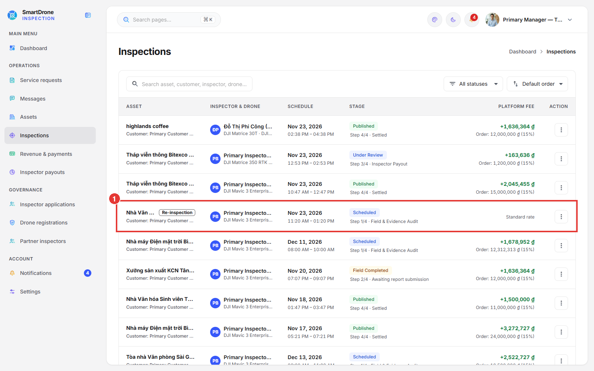

*Figure 7.30 — Workflow 3 Step 8 — Manager scheduled occurrence monitor.*

### 3.5 Workflow 4: Mission Execution, Flight Permit and Live Hub Telemetry (`FE-10`, `FE-13`, `FE-14`)

**Purpose.** Accept partner dispatch, self-attest and upload the regulatory flight permit, execute pre-flight checks, connect live ArduPilot/Mission Planner MAVLink telemetry (`SmartDroneHub`), and close post-flight verification.
**Actors.** `INSPECTOR`, `MANAGER` (read-only audit), SmartDroneHub (`14551/udp` / `5762/tcp`).
**Preconditions.** Dispatched inspection is `SCHEDULED` and accepted by `INSPECTOR`; flight permit document (`<= 25 MB`) is available.

**Step 1 — Open Assigned Inspection.** `INSPECTOR` opens **Inspections** in the operations portal and selects **Assigned building inspection** ❶ to accept the mission before the response deadline and enter the workspace.

*Figure 7.31 — Workflow 4 Step 1 — Inspector assigned inspections schedule.*

**Step 2 — Coordinate Access via Inspection Chat.** Open `/operations/messages`, reply to Customer site instructions using **Inspection chat composer** ❷, or jump directly to field stages via **Open inspection shortcut** ❶.

*Figure 7.32 — Workflow 4 Step 2 — Inspector per-inspection chat with Customer.*

**Step 3 — Review Workspace Lifecycle Tracker.** In Stage 0 (`/tracking`), inspect **Inspection stepper** ❶ across all seven stages and follow the guided prompt inside **Next action panel** ❷.

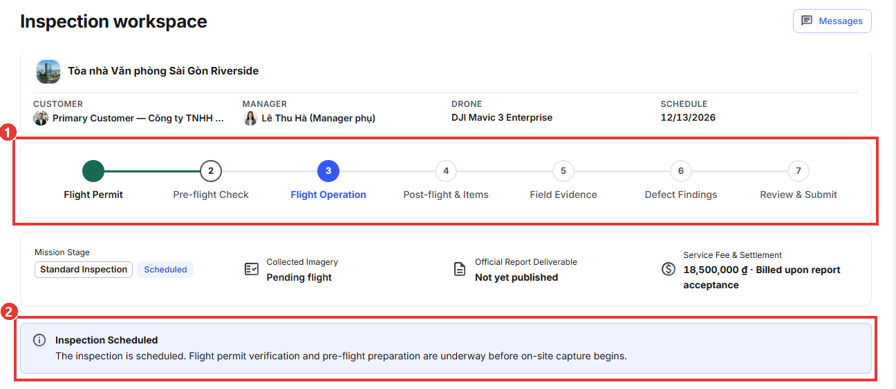

*Figure 7.33 — Workflow 4 Step 3 — Inspection workspace tracking and stage progress.*

**Step 4 — Self-Attest and Upload Mission Flight Permit.** Open **Flight Permit** from the **Workspace stage bar** ❶. While the job is scheduled, submit the document, permit metadata, and your attestation. A valid upload immediately sets the permit to `APPROVED`. The example shows the stored **Permit details** ❷ and **View permit document** ❸ after field work.

*Figure 7.34 — Workflow 4 Step 4 — Inspector mission flight permit panel.*

**Step 5 — Audit Permit and Flight Trace Read-Only (Manager).** `MANAGER` navigates via **Manager stage stepper** ❶ to inspect self-attested permit metadata, document download, and recorded flight report details inside **Read-only Permit & Flight Audit** ❷ (`ADMIN` and `MANAGER` never approve or reject permits).

*Figure 7.35 — Workflow 4 Step 5 — Manager read-only flight permit and telemetry audit panel.*

**Step 6 — Complete Pre-flight Safety Checklist.** Once the permit is approved, `INSPECTOR` opens **Pre-flight stage active** ❶, verifies all items inside **Checklist items** ❷ (or clicks **Check all** ❸), adds a site observation note, and starts the field session (`In Progress`).

*Figure 7.36 — Workflow 4 Step 6 — Pre-flight safety checklist verification.*

**Step 7 — Connect Live MAVLink Telemetry (`SmartDroneHub`).** Open **Flight Operation** ❶. During the field session, connect SmartDroneHub for live MAVLink telemetry or import an SRT, CSV, KML, or GPX log. Complete the flight once the sortie ends. The **Flight session panel** ❷ shows the completed state and log import options.

*Figure 7.37 — Workflow 4 Step 7 — Completed field session with SmartDroneHub and flight log import options.*

**Step 8 — Verify Post-flight and Target Building Items.** Advance to **Post-flight stage stepper** ❶, tick each inspected structural checkpoint inside **Target building inspection items** ❷ and post-flight checks, and submit **Complete session** to complete the field work.

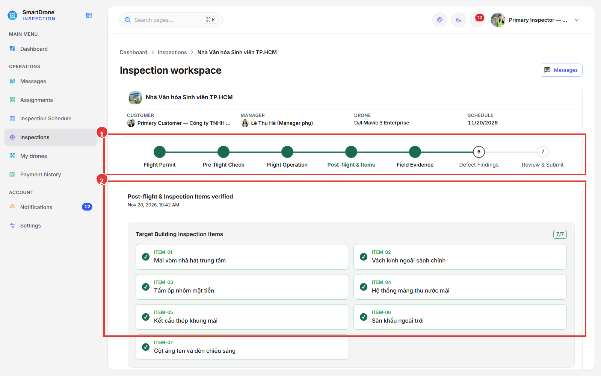

*Figure 7.38 — Workflow 4 Step 8 — Post-flight checklist and target building checkpoint completion.*

### 3.6 Workflow 5: Evidence Intake, AI Defect Detection and Findings Confirmation (`FE-15`, `FE-16`, `FE-17`)

**Purpose.** Upload building photos and resumable MP4 video from the mission, run AI defect detection, refine notes using `DroneKnowledgeAI`, and confirm the official finding baseline.
**Actors.** `INSPECTOR`, Automated AI Pipeline (`YOLO11`, `DroneKnowledgeAI`, media processor).
**Preconditions.** Field session is active or completed; inspection photos and MP4 footage are staged locally.

**Step 1 — Upload Field Photos and MP4 Video.** Open Stage 5 (**Evidence**), select photos (`<= 10 MB`) and MP4 video (`<= 2 GB`, automatically resumable in chunks if interrupted) via **Choose files & Upload** ❶, wait for background video optimization to finish, and review captures/playback inside **Evidence register card** ❷.

*Figure 7.39 — Workflow 5 Step 1 — Field evidence upload controls and inspection photo register.*

**Step 2 — Filter Findings and Trigger Batch AI Analysis.** Open Stage 6 (`/findings`), slice captures with **Status filter chips** ❶ (`All active`, `Unconfirmed`, `Confirmed`), invoke **Batch analyze all images** ❸ (`YOLO11`), or generate technical notes across unconfirmed defects via **Batch Draft all notes** ❷.

*Figure 7.40 — Workflow 5 Step 2 — Defect findings filter chips and batch AI actions.*

**Step 3 — Review Bounding Box and Draft Note with AI.** Inspect the normalized lesion bounding box on **Annotated evidence frame** ❸, click **Draft note with AI** ❶ to generate an editable engineering-standard note (and inspect cited `References` when drafted), then finalize using **Confirm** ❷.

*Figure 7.41 — Workflow 5 Step 3 — Finding card with bounding region, AI-drafted ASTM note, and human confirmation.*

**Step 4 — Confirm Official Findings Baseline.** Review every pending finding, then select **Confirm findings and continue** ❶ to unlock report preparation. If the inspection has no defects, acknowledge that you reviewed the captures. The example shows two findings still awaiting review.

*Figure 7.42 — Workflow 5 Step 4 — Findings baseline confirmation while two findings await review.*

### 3.7 Workflow 6: Report Authoring, Review, Acceptance and Financial Settlement (`FE-05`, `FE-17`–`FE-24`)

**Purpose.** Prepare and publish the official inspection report, allow the Customer to accept and pay online through Sepay VietQR or VNPay, and record Partner Inspector payouts.
**Actors.** `INSPECTOR`, `MANAGER`, `CUSTOMER`, Payment Gateway (Sepay / VNPay).
**Preconditions.** Official findings baseline has been confirmed.

**Step 1 — Generate AI Summary and Submit Report.** After confirming the findings baseline, open **Review & Submit**. Review the draft and advisory summary, then submit it for independent review. The published example shows where to expand the **AI Executive Summary** ❶ and select **Download report** ❷.

*Figure 7.43 — Workflow 6 Step 1 — Published report view with AI summary and PDF download.*

**Step 2 — Locate Submitted Report in Manager Queue.** A distinct `MANAGER` opens **Reports** and selects **Submitted/Published report row** ❶.

*Figure 7.44 — Workflow 6 Step 2 — Manager inspection reports review queue.*

**Step 3 — Perform Independent Review, Partner Payout and Publication.** Follow the **Review stages** ❶ and inspect the **Report details** ❷ before approving. For a commercial inspection, settle the Inspector payout through Sepay VietQR (`SDIPAY`). When approval and payout are recorded, select **Continue to Publish Report** ❸, then publish the official version. The Customer can download the published PDF.

*Figure 7.45 — Workflow 6 Step 3 — Manager report approved and payout settled, ready to publish.*

**Step 4 — Open Published Deliverable (Customer).** `CUSTOMER` selects **Inspections menu item** ❶ and opens **Published inspection row** ❷ (`Report ready · v1`).

*Figure 7.46 — Workflow 6 Step 4 — Customer inspections list highlighting published deliverable.*

**Step 5 — Accept Report, Rate Inspector and Pay via Sepay VietQR / VNPay.** Follow the **Inspection stages** ❶ to accept the official report, then pay with Sepay VietQR or VNPay under **Service Payment**. The example shows a completed VNPay payment in the **Service fee payment panel** ❸. Select **Download payment receipt (PDF)** ❷ and use the Inspector rating card to leave or edit your rating.

*Figure 7.47 — Workflow 6 Step 5 — Customer service payment confirmation, receipt, and Inspector rating.*

**Step 6 — Verify Customer Payment Ledger.** Open **Payment history** and inspect the method, amount, and paid status in the **Payment ledger table** ❶. Select **Details** to open the payment record.

*Figure 7.48 — Workflow 6 Step 6 — Customer payment history ledger.*

**Step 7 — Verify Customer Settlement (Manager).** Open the inspection’s **Customer Settlement** stage after payment. Use the **Settlement and invoice panel** ❶ to check the recorded payment method, paid amount, and invoice breakdown. Partner payout takes place before publication in Step 3.

*Figure 7.49 — Workflow 6 Step 7 — Manager Customer settlement and invoice breakdown.*

**Step 8 — Audit Platform Revenue, Commission and Taxes.** Open **Finance History** in the manager portal to inspect platform inflows, earned commission (`15%`), VAT/personal income tax withholdings in **Revenue, commission & tax KPIs** ❶ and per-occurrence rows inside **Commission, VAT & payout table** ❷.

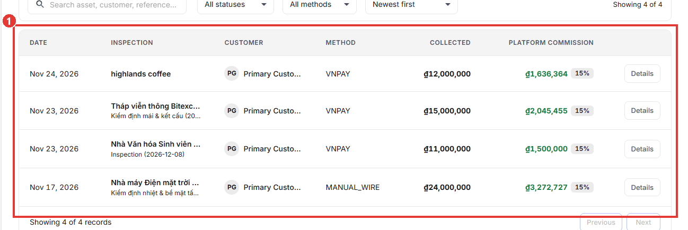

*Figure 7.50 — Workflow 6 Step 8 — Manager platform revenue, commission, tax, and payout history ledger.*
