# VI. Release Package & User Guides

## 1. Deliverable Package

| No. | Deliverable Item | Description |
| --- | --- | --- |
| 1 | Project Schedule/Tracking | Task schedule, milestone dates, and effort tracking against the weighted plan in Report 2 (`208` md). |
| 2 | Project Backlog | The twenty-four atomic feature backlog (`FE-01`–`FE-24`) across `MF1`–`MF4`. |
| 3 | Source Codes | Four independent repositories: backend service (`SmartDroneInspection-backend`), web portals (`SmartDroneInspection-frontend`), Customer mobile client (`SmartDroneInspection-mobile`), and documentation (`SmartDroneInspection-docs`). |
| 4 | Database Script(s) | Automated schema migration scripts (`V1`–`V4` and `V60`–`V80`) defining the PostgreSQL 17 database (`53` application tables / `55` total database tables, including `inspector_ratings` `V70`, `field_session_flights` `V72`, `rating_criterion_configs` `V73`, `service_request_partner_messages` `V79`, and `V80` checkpoint snapshots), `pgvector` support for `DroneKnowledgeAI`, and plain-text building ownership details. |
| 5 | Final Report Document | Reports 1–7 of this documentation set, exported against the official templates. |
| 6 | Test Cases Document | `Report5_Test Report.xlsx` (`v3.15`) with twenty-four feature sheets (`Feature 1`–`Feature 24`) covering `77` listed rows (`75` active cases + `2` superseded `FE-13` cases), plus the executed results in Report 5 §5. |
| 7 | Defects List | The defect log, recording `DEF-01` as resolved (`PR #33`) and one low-severity open tooling defect (`DEF-02`). |
| 8 | Issues List | Outstanding issues and known limitations, including the out-of-scope items in Part III §3.8 (Report 3 §3.26). |
| 9 | Slide | The defence presentation used for the final review. |

## 2. Installation Guides

### 2.1 System Requirements

**Hardware Requirements**

| Component | Minimum Specification | Recommended Specification | Notes |
| --- | --- | --- | --- |
| Processor | 64-bit x86_64, 4 logical cores | 8+ logical cores | Detection inference (`YOLO11`) and FFmpeg video transcoding are CPU/RAM intensive. |
| Memory (RAM) | 8 GB | 16 GB | Allocate at least 8 GB to Docker Desktop when running `ai-inference` alongside Postgres and backend. |
| Disk Space | 40 GB free | 60+ GB SSD | Required for container images, PostgreSQL storage, and MinIO photo/MP4 evidence buckets. |
| Network / Ports | Localhost loopback | Stable broadband / LAN (`14551/udp`, `5762/tcp`) | Required for package installs, optional OpenAI/Sepay/VNPay callbacks, and Mission Planner MAVLink bridge. |

**Software Prerequisites**

| Layer | Requirement | Purpose |
| --- | --- | --- |
| Containerization | Docker Engine 27+ with Compose plugin | Runs `postgres` (`pgvector:pg17`), `minio`, `ai-inference`, `smartdronehub`, and `backend`. |
| Backend Runtime | Java 21 (Temurin) | Local backend builds (`./mvnw test`, `./mvnw verify`). |
| Frontend Toolchain | Node.js 22+ & npm | Builds and serves the React 19 + TypeScript Web Portal (`vite`). |
| Mobile SDK | Flutter SDK + Android toolchain / Chrome | Builds and runs the `CUSTOMER` mobile client (`flutter run`). |
| Client Browser | Modern Chrome / Edge | Runs all four web portals cleanly in Light/Dark mode. |

### 2.2 Installation Instruction

#### Step 1 — Clone Repositories and Configure Environment

Clone the four repositories into sibling directories.

In `SmartDroneInspection-backend/`, copy `.env.example` to `.env`. Set the PostgreSQL and MinIO credentials, signing secrets, web origin, and bootstrap Administrator credentials. Use the comments in the template to configure any integrations required for your environment.

#### Step 2 — Start Backend Stack and Apply Flyway Migrations

From `SmartDroneInspection-backend/`, run `docker compose up -d --build`. Flyway applies the database migrations on startup.

Run `docker compose ps` to check the services. Verify that `http://localhost:8080/actuator/health` reports `UP` before starting the clients.

#### Step 3 — Start Web Portal and Mobile Client

**Web.** In `SmartDroneInspection-frontend/`, copy `.env.example` to `.env`, run `npm install`, and start `npm run dev`. Open `http://localhost:3000`. The dev server proxies `/api/*` to `http://localhost:8080` by default.

**Android emulator.** In `SmartDroneInspection-mobile/`, run `flutter pub get` and then `flutter run --dart-define=API_BASE_URL=http://10.0.2.2:8080/api/v1`. On a physical device, use the host address that the device can reach.

#### Step 4 — Bootstrap Login and Troubleshooting

Sign in using the bootstrap `ADMIN` account, rotate credentials immediately, and provision additional accounts in `/admin/platform-users`. If the backend container fails on startup, verify both JWT/media signing secrets meet minimum length; if file uploads fail while API calls succeed, inspect MinIO credentials and bucket creation; if the AI embedding service is unavailable, finding drafting and recommendations automatically fall back to deterministic keyword matching without blocking workflows.

## 3. User Manual

### 3.1 Overview

SmartDroneInspection supports the Customer, Inspector, Manager, and Admin web portals, plus a Customer mobile app. The six tutorials below illustrate the web portals and follow the five main flows (`MF1A`–`MF4`). Match each numbered instruction above a figure to the same number in the image. The red boxes identify the control to use or the area to check, and numbering restarts with each figure.

*Figure 7.10a — End-to-end activity flow (MF1A): Customer registration, RESTRICTED_ZONE MSG28 amber warning, NO_FLY_ZONE hard block, and asset setup.*

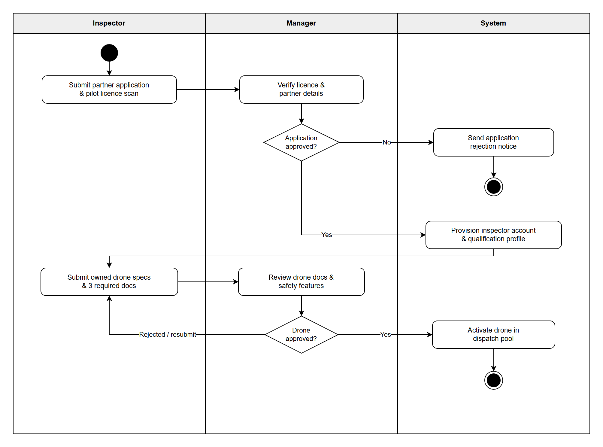

*Figure 7.10b — End-to-end activity flow (MF1B): Partner Inspector admission and drone registration (MANAGER review; ADMIN read-only).*

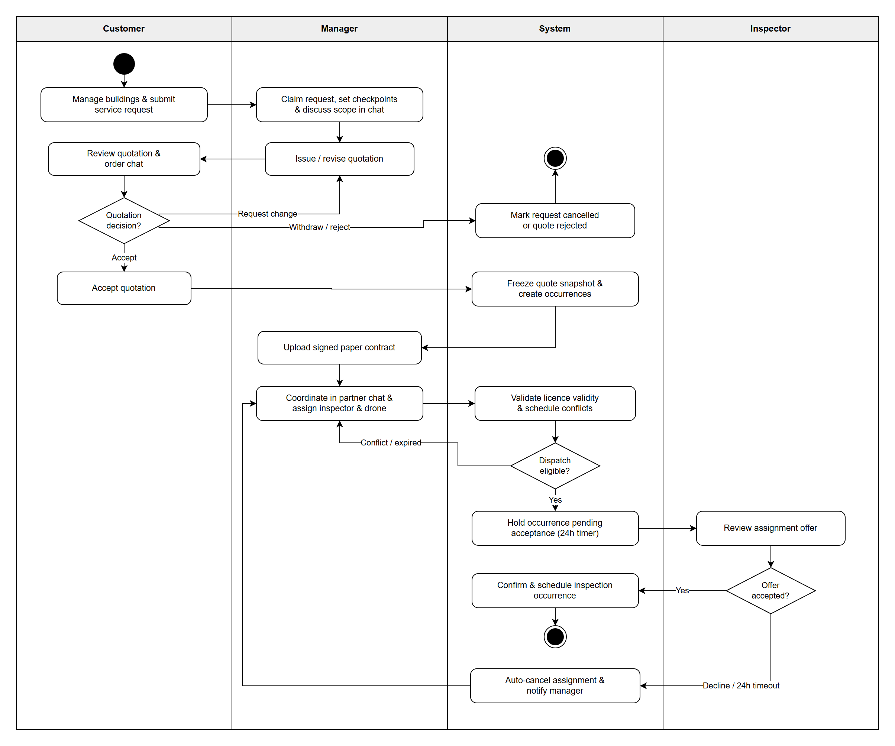

*Figure 7.10c — End-to-end activity flow (MF2): One-time/recurring request, VND quote, Order/Partner chat, signed contract upload, and occurrence dispatch.*

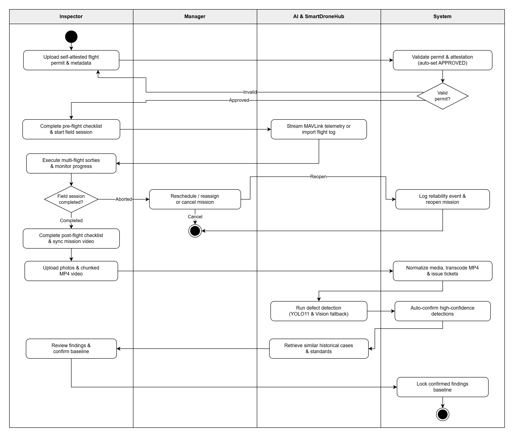

*Figure 7.10d — End-to-end activity flow (MF3): Inspector self-attested flight permit (APPROVED), SmartDroneHub telemetry, chunked evidence, YOLO11, and DroneKnowledgeAI.*

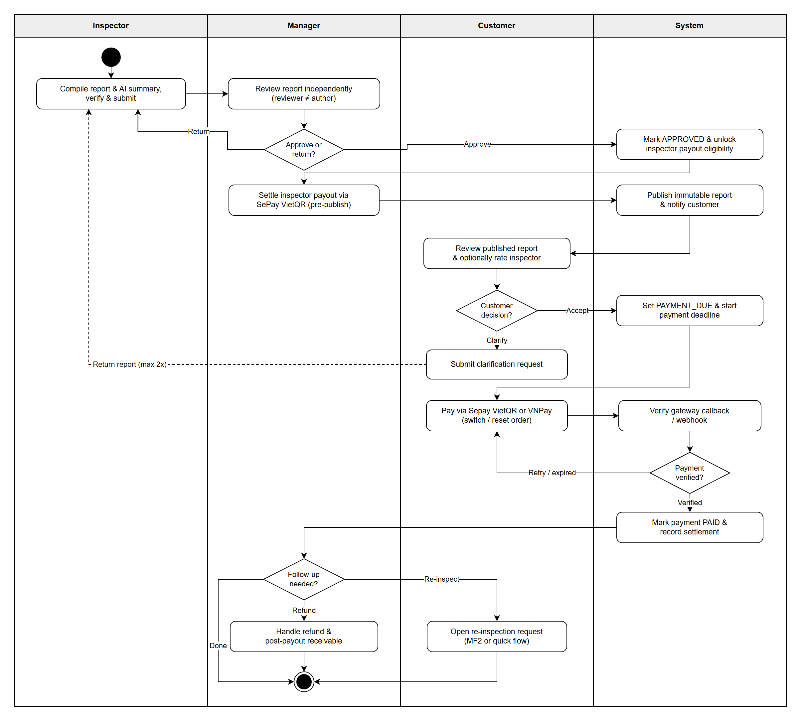

*Figure 7.10e — End-to-end activity flow (MF4): Manager report decision -> Sepay VietQR Payout (SDIPAY) -> publication, Customer rating, and Sepay/VNPay settlement.*

### 3.2 Workflow 1: Customer Onboarding, Airspace Screening and Asset Setup (`FE-01`, `FE-04`, `FE-06`, `FE-07`, `FE-12`)

**Purpose.** Onboard a new Customer account, screen building coordinates against Vietnam airspace zones (`NO_FLY_ZONE` hard block; `RESTRICTED_ZONE` amber `MSG28` advisory with immediate onboarding), configure inspection checkpoints and ownership notes, and verify notification settings.
**Actors.** Prospective Customer (public), `CUSTOMER`.
**Preconditions.** Backend and Web Portal are reachable; target building coordinates and category are known.

**Step 1 — Navigate from the Public Landing Page.**

❶ Use the **Header navigation** to find Services, About us, and How it works.

❷ Select **Sign in** if you already have an account.

❸ Select **Sign up** to create a Customer account.

❹ Select **Get a consultation** to open the Customer registration page.

*Figure 7.11 — Workflow 1 Step 1 — Public landing page entry controls.*

**Step 2 — Create a Customer Account.**

❶ Enter your name, email, and password, then review and accept the terms.

❷ Select **Create account**. Follow the email verification and initial building prompts.

A restricted location shows an advisory and allows registration. A no-fly location blocks registration with those coordinates.

*Figure 7.12 — Workflow 1 Step 2 — Customer account creation form.*

**Step 3 — Screen a Building Location.**

❶ In **Assets**, select **New asset** and then **Pick on Google Maps**. Pin the building, check the airspace result, and select **Xác nhận vị trí này** (Confirm this location) when available.

A no-fly result blocks confirmation. A restricted result shows an amber advisory and allows confirmation.

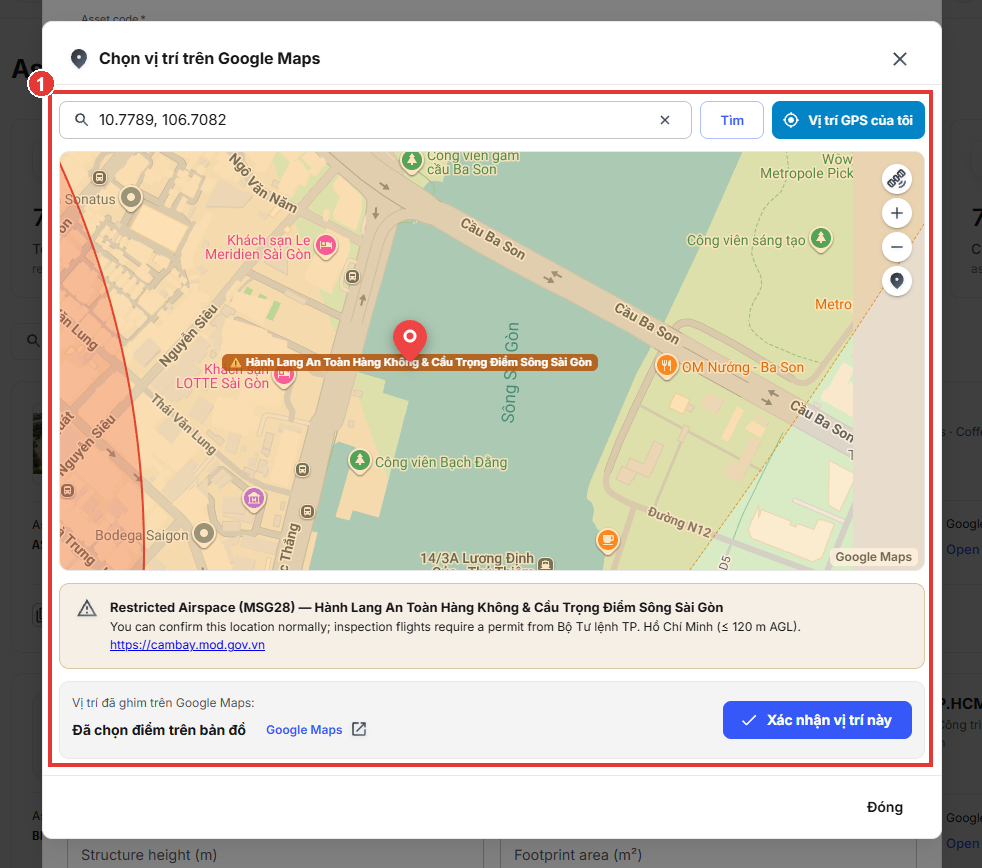

*Figure 7.13 — Workflow 1 Step 3 — Interactive Airspace Map dialog evaluating building coordinates.*

**Step 4 — Review the Restricted Airspace Advisory.**

❶ Read the **Restricted Airspace** warning (`MSG28`) for the named authority, altitude ceiling, and published reference.

❷ Use **Pick on Google Maps** to adjust the pin if needed.

Complete the required asset fields and save. Restricted locations can be saved immediately. Flight authorization remains a separate requirement.

*Figure 7.14 — Workflow 1 Step 4 — Restricted Airspace MSG28 amber advisory banner during asset onboarding.*

**Step 5 — Manage the Building Register.**

❶ Select **New asset** to add a building.

❷ Use **Search** and **Status** to narrow the list.

❸ Select **Detail** on the building card to open its record.

*Figure 7.15 — Workflow 1 Step 5 — Customer building inventory and filter controls.*

**Step 6 — Review Checkpoints and Reference Documents.**

❶ Check the building name, status, and pinned location in the **Asset detail header**.

❷ Review **Attached documents** and **Inspection Checkpoints**.

Edit checkpoints before the first inspection. The example shows the locked state after an inspection has been created.

*Figure 7.16 — Workflow 1 Step 6 — Customer building detail checkpoints and document attachments.*

**Step 7 — Review Customer Notifications.**

❶ Open **Notifications** in the account sidebar.

❷ Read the **Notification list** and open an alert to see the related update.

*Figure 7.17 — Workflow 1 Step 7 — Account notifications inbox and deep-link alerts.*

### 3.3 Workflow 2: Partner Inspector Admission and Drone Registration (`FE-02`, `FE-03`)

**Purpose.** Admit a qualified drone pilot through public application review and register an airframe eligible for mission dispatch under Decree 288/2025/ND-CP.
**Actors.** Prospective Inspector (public), `INSPECTOR`, `MANAGER` (approver); `ADMIN` holds read-only oversight.
**Preconditions.** Applicant holds a valid civil pilot licence scan; drone registration/ownership documents are ready.

**Step 1 — Submit a Partner Inspector Application.**

❶ Follow the three stages shown in the progress bar. Enter account details, provide identity and licence documents, then verify the email code and submit.

❷ Fill in the account form and select **Tiếp tục** (Continue) to move to the document stage.

*Figure 7.18 — Workflow 2 Step 1 — Three-step Partner Inspector public application form.*

**Step 2 — Review Inspector or Drone Applications.**

❶ As `MANAGER`, open **Inspector applications** or **Drone registrations** in the governance menu.

❷ Filter the queue by status. Open a pending record with **Review application** and record the decision.

The example shows the Drone registrations queue. `ADMIN` can view both queues in read-only mode.

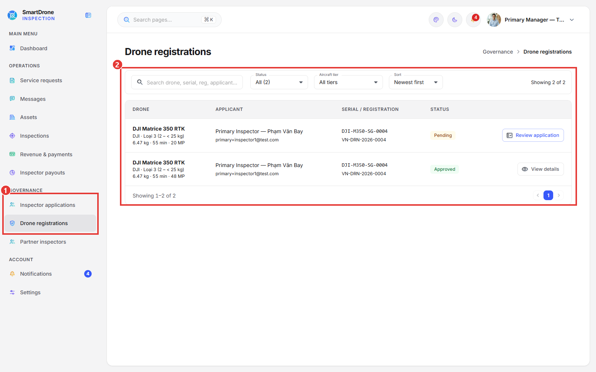

*Figure 7.19 — Workflow 2 Step 2 — Onboarding navigation and drone registration filters.*

**Step 3 — Check the Partner Roster.**

❶ Open **Partner inspectors** and check the Inspector’s status, licence class, and validity in the **Partner workforce** table. Open **Pilot profile** to see more details.

*Figure 7.20 — Workflow 2 Step 3 — Manager partner inspectors eligibility directory.*

**Step 4 — Open My Drones.**

❶ As an approved `INSPECTOR`, open **My drones** and select **Register New Drone** to add an aircraft.

❷ Use the **Active Fleet** cards to check the status and details of an existing aircraft.

*Figure 7.21 — Workflow 2 Step 4 — Inspector owned drone fleet registry.*

**Step 5 — Submit Drone Details and Documents.**

❶ Enter the aircraft details, select its capabilities, and upload the drone photos and supporting documents requested by the form.

❷ Select **Submit Application**. A Manager reviews the submission in **Drone registrations** from Step 2.

*Figure 7.22 — Workflow 2 Step 5 — Register owned drone specification and document form.*

### 3.4 Workflow 3: Service Request, Quotation, Contract and Dispatch (`FE-08`–`FE-11`)

**Purpose.** Create a building inspection request, negotiate commercial terms via Order Chat, record customer acceptance and the signed offline contract, and dispatch an eligible partner crew.
**Actors.** `CUSTOMER`, `MANAGER`.
**Preconditions.** At least one `ACTIVE` building exists and an approved Inspector + owned Drone pair is eligible.

**Step 1 — Open Customer Service Requests.**

❶ Select **New service request** to create a request.

❷ Open an existing **Request row** to check its schedule and status.

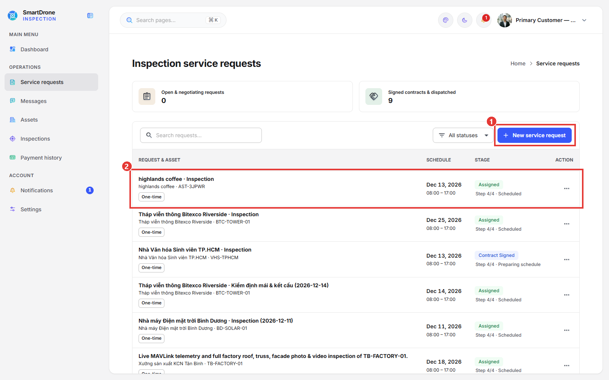

*Figure 7.23 — Workflow 3 Step 1 — Customer service requests list and creation button.*

**Step 2 — Set the Inspection Schedule.**

❶ Choose the building and inspection frequency. Set the first date at least 20 days ahead and complete any fields shown for recurring work.

❷ Select **Submit service request** once the required fields are complete.

*Figure 7.24 — Workflow 3 Step 2 — Customer service request form with schedule validation.*

**Step 3 — Claim the Service Request.**

❶ As `MANAGER`, open **Service requests**. Use the actions menu on the new request and select **Claim request** to take ownership.

The example shows the request list with records already in progress.

*Figure 7.25 — Workflow 3 Step 3 — Manager incoming service requests queue.*

**Step 4 — Negotiate Scope in Manager Order Chat.**

❶ Open **Messages**, select the **Customer** tab, and choose the Customer’s request thread.

❷ Use the **Message composer** to clarify scope and the proposed terms.

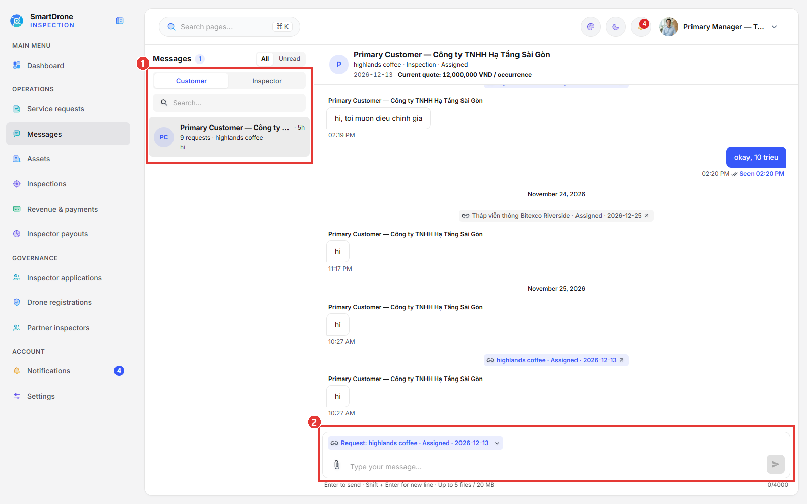

*Figure 7.26 — Workflow 3 Step 4 — Manager Order Chat workspace.*

**Step 5 — Reply in Customer Order Chat.**

❶ In **Messages**, select the **Manager** tab and open the request thread.

❷ Use the **Message composer** to send a reply or attachment.

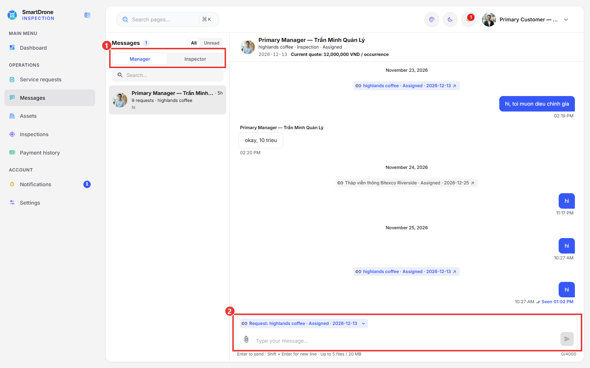

*Figure 7.27 — Workflow 3 Step 5 — Customer Order Chat negotiation panel.*

**Step 6 — Quote, Record the Contract, and Assign the Team.**

❶ As Manager, use **Prepare quote** to issue the VND quotation. The Customer opens **Review quote** and selects **Accept quote**. Then use **Record contract** to upload the signed paper agreement.

❷ In **Scheduled flight & assignment**, set the flight window, select **Find eligible partners**, and assign an Inspector and drone.

The figure shows the **Assign team** stage, after the contract was recorded.

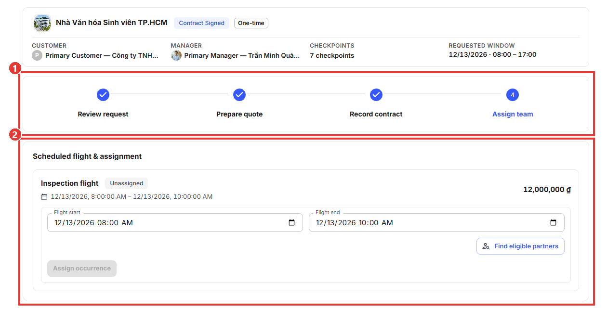

*Figure 7.28 — Workflow 3 Step 6 — Manager scheduled flight window and partner assignment controls.*

**Step 7 — Open the Scheduled Inspection as Customer.**

❶ Open the request and check that the progress bar has reached **Scheduled**.

❷ Select **Open inspection** to track the assigned inspection.

*Figure 7.29 — Workflow 3 Step 7 — Customer request detail showing the scheduled inspection link.*

**Step 8 — Check the Dispatched Inspection as Manager.**

❶ In **Inspections**, open the **Scheduled** occurrence and verify the assigned Inspector, drone, and flight window. Check the assignment acceptance status in the inspection details.

*Figure 7.30 — Workflow 3 Step 8 — Manager scheduled occurrence monitor.*

### 3.5 Workflow 4: Mission Execution, Flight Permit and Live Hub Telemetry (`FE-10`, `FE-13`, `FE-14`)

**Purpose.** Accept partner dispatch, self-attest and upload the regulatory flight permit, execute pre-flight checks, connect live ArduPilot/Mission Planner MAVLink telemetry (`SmartDroneHub`), and close post-flight verification.
**Actors.** `INSPECTOR`, `MANAGER` (read-only audit), SmartDroneHub (`14551/udp` / `5762/tcp`).
**Preconditions.** An inspection has been dispatched to the Inspector and is `SCHEDULED`. Have the flight permit document ready for upload (up to 25 MB).

**Step 1 — Open an Assigned Inspection.**

❶ As `INSPECTOR`, open **Inspections** and select the row for the assigned building.

If the assignment is awaiting your response, accept it in the workspace before starting field preparation.

*Figure 7.31 — Workflow 4 Step 1 — Inspector assigned inspections schedule.*

**Step 2 — Coordinate Site Access in Inspection Chat.**

❶ Use the **Inspection link** in the Customer conversation to reopen the matching inspection.

❷ Use the **Message composer** to confirm the site access arrangements.

*Figure 7.32 — Workflow 4 Step 2 — Inspector per-inspection chat with Customer.*

**Step 3 — Check Inspection Progress.**

❶ Use the **Inspection progress bar** to identify the current stage and open an available stage.

❷ Read the **Inspection Scheduled** message for the next action.

*Figure 7.33 — Workflow 4 Step 3 — Inspection workspace tracking and stage progress.*

**Step 4 — Upload and Self-Attest the Flight Permit.**

❶ Open **Flight Permit** while the inspection is scheduled. Upload the permit, enter its metadata, and attest to its validity. A valid upload is recorded as `APPROVED`.

❷ Check the saved **Permit details**, including the drone serial number and validity window.

❸ Select **View permit document** to open the uploaded file.

The example shows the stored permit after the inspection has left the scheduled stage.

*Figure 7.34 — Workflow 4 Step 4 — Inspector mission flight permit panel.*

**Step 5 — Complete the Pre-flight Safety Check.**

❶ Select **Pre-flight Check** in the inspection progress bar.

❷ Verify each item under **Required checks** and any applicable optional checks.

❸ After verifying the items, use **Check all** to mark the checklist together if appropriate.

Record any site observations and start the field session when the required checks are complete.

*Figure 7.35 — Workflow 4 Step 5 — Pre-flight safety checklist verification.*

**Step 6 — Record Flight Operations.**

❶ Open **Flight Operation** once the field session is active.

❷ Use **SmartDroneHub telemetry** to connect live MAVLink telemetry or import a supported flight log.

Complete the flight at the end of the sortie, then continue to **Post-flight & Items**. The figure shows the completed session and log import options.

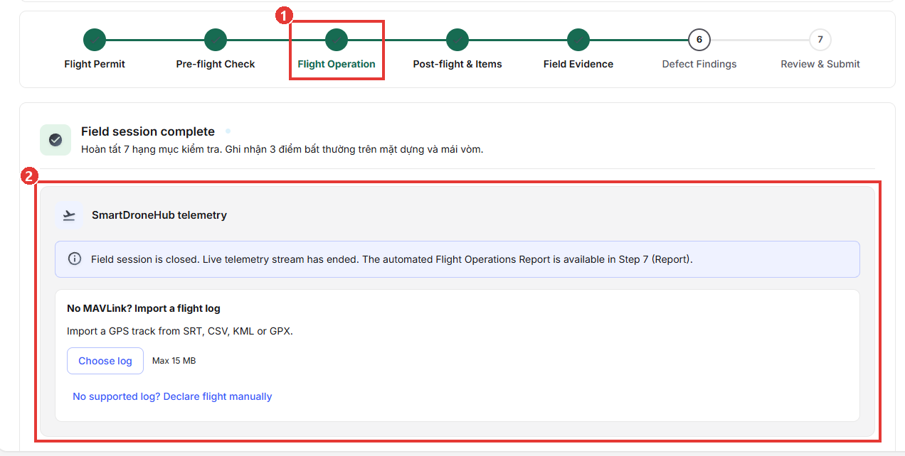

*Figure 7.36 — Workflow 4 Step 6 — Completed field session with SmartDroneHub and flight log import options.*

**Step 7 — Complete Post-flight Checks and Building Items.**

❶ Open **Post-flight & Items** and complete the post-flight checklist.

❷ Mark the **Target Building Inspection Items** you verified.

Complete the session to proceed to evidence. The figure shows the building items after verification.

*Figure 7.37 — Workflow 4 Step 7 — Post-flight checklist and target building checkpoint completion.*

**Step 8 — Audit Field Evidence as Manager.**

❶ As `MANAGER`, open **Field & Evidence Audit** in the inspection review workspace.

❷ Inspect the uploaded **Flight Permit** and expand **Flight report** to review the recorded flight details.

The audit provides read-only access to the Inspector’s permit and flight records.

*Figure 7.38 — Workflow 4 Step 8 — Manager read-only flight permit and telemetry audit panel.*

### 3.6 Workflow 5: Evidence Intake, AI Defect Detection and Findings Confirmation (`FE-15`, `FE-16`, `FE-17`)

**Purpose.** Upload building photos and resumable MP4 video from the mission, run AI defect detection, refine notes using `DroneKnowledgeAI`, and confirm the official finding baseline.
**Actors.** `INSPECTOR`, Automated AI Pipeline (`YOLO11`, `DroneKnowledgeAI`, media processor).
**Preconditions.** Field session is active or completed; inspection photos and MP4 footage are staged locally.

**Step 1 — Upload Photos and Video.**

❶ In **Field Evidence**, select **Choose files**, then **Upload**. Photos may be up to 10 MB and MP4 videos up to 2 GB.

❷ Open a file in the **Evidence register** to check it. Wait for video processing to finish before reviewing playback.

*Figure 7.39 — Workflow 5 Step 1 — Field evidence upload controls and inspection photo register.*

**Step 2 — Filter Findings and Run AI Actions.**

❶ Use the status filters to show **All active**, **Unconfirmed**, or **Confirmed** findings.

❷ Select **Draft all notes** to generate suggested notes for eligible findings.

❸ Select **Analyze all images** to run defect detection on the available photos.

Review any AI suggestions before confirming a finding.

*Figure 7.40 — Workflow 5 Step 2 — Defect findings filter chips and batch AI actions.*

**Step 3 — Review and Confirm an Individual Finding.**

❶ Check the **Evidence photo** and turn on **Show detected regions** to compare the marked area with the suspected defect.

❷ Select **Draft note with AI** if needed. Check and edit the proposed note before saving it.

❸ Select **Confirm** once the finding accurately reflects the evidence.

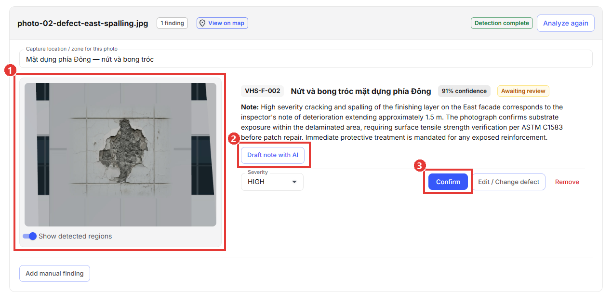

*Figure 7.41 — Workflow 5 Step 3 — Finding card with bounding region, AI-drafted ASTM note, and human confirmation.*

**Step 4 — Confirm the Findings Baseline.**

❶ Resolve every finding awaiting review, then select **Confirm findings and continue** to unlock report preparation.

The button is disabled in the example because two findings still need a decision. For an inspection with no findings, acknowledge that you reviewed the captures before continuing.

*Figure 7.42 — Workflow 5 Step 4 — Findings baseline confirmation while two findings await review.*

### 3.7 Workflow 6: Report Authoring, Review, Acceptance and Financial Settlement (`FE-05`, `FE-17`–`FE-24`)

**Purpose.** Prepare and publish the official inspection report, allow the Customer to accept and pay online through Sepay VietQR or VNPay, and record Partner Inspector payouts.
**Actors.** `INSPECTOR`, `MANAGER`, `CUSTOMER`, Payment Gateway (Sepay / VNPay).
**Preconditions.** Official findings baseline has been confirmed.

**Step 1 — Prepare and Submit the Inspection Report.**

❶ In **Review & Submit**, expand **AI Executive Summary** and check the advisory summary against the confirmed findings. Submit the draft for independent Manager review.

❷ Use **Download report** to save the official PDF after publication, as shown in the example.

The figure shows the published view.

*Figure 7.43 — Workflow 6 Step 1 — Published report view with AI summary and PDF download.*

**Step 2 — Locate the Report as Manager.**

❶ Open the Manager **Reports** queue and select the inspection with a report awaiting review or further action. Read the **Stage** and **Report** columns to identify the next action.

The highlighted record shows **Approved** and **Inspector Payout**.

*Figure 7.44 — Workflow 6 Step 2 — Manager inspection reports review queue.*

**Step 3 — Review, Settle Inspector Payout, and Publish.**

❶ Use the progress bar to open **Report Decision**.

❷ Check the **Report details** and summary against the inspection evidence, then approve the report. For a commercial inspection, complete **Inspector Payout** through Sepay VietQR before publication.

❸ After approval and payout are recorded, select **Continue to Publish Report** and publish the official version.

*Figure 7.45 — Workflow 6 Step 3 — Manager report approved and payout settled, ready to publish.*

**Step 4 — Open the Published Report as Customer.**

❶ Open **Inspections** in the Customer portal.

❷ Select a row marked **Published**, then open **Inspection Report** to read the report.

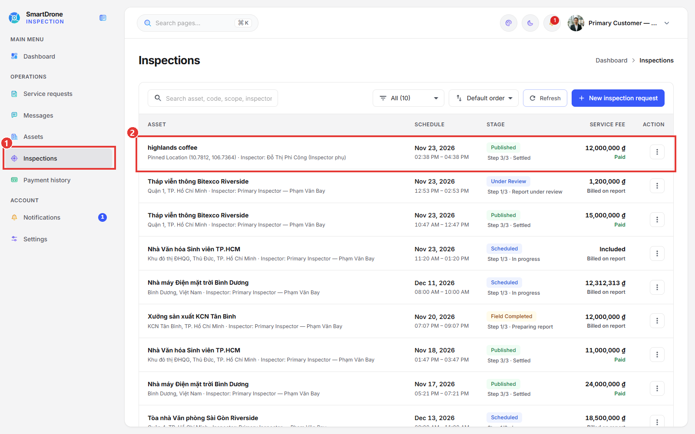

*Figure 7.46 — Workflow 6 Step 4 — Customer inspections list highlighting published deliverable.*

**Step 5 — Accept the Report, Pay, and Rate the Inspector.**

❶ Open **Inspection Report** and accept it. Then open **Service Payment** to pay through Sepay VietQR or VNPay.

❷ Check **Payment confirmed** and the recorded payment method after settlement.

❸ Select **Download payment receipt (PDF)** to save the receipt.

❹ Use the Inspector’s rating card to leave or edit a rating.

The figure shows a completed VNPay payment and an existing rating.

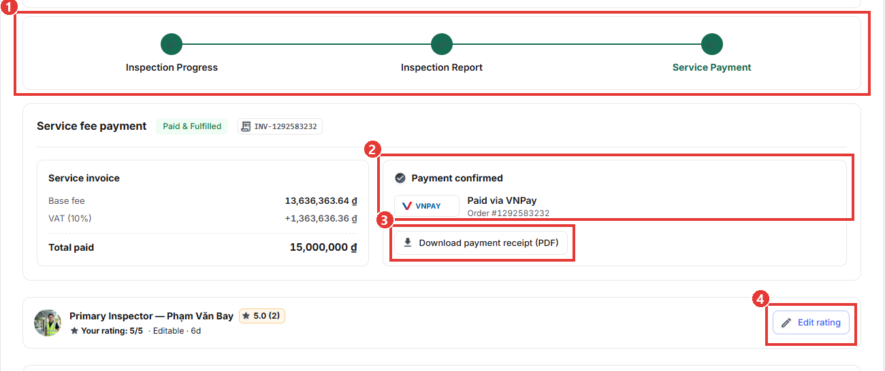

*Figure 7.47 — Workflow 6 Step 5 — Customer service payment confirmation, receipt, and Inspector rating.*

**Step 6 — Verify Customer Payment History.**

❶ Open **Payment history** and check the amount, method, and status in the **Payment ledger**.

❷ Select **Details** on a row to view the payment record.

*Figure 7.48 — Workflow 6 Step 6 — Customer payment history ledger.*

**Step 7 — Verify Customer Settlement as Manager.**

❶ Open **Customer Settlement** in the inspection review workspace.

❷ Check the acceptance and payment status, payment method, and invoice breakdown. Download the receipt when needed.

*Figure 7.49 — Workflow 6 Step 7 — Manager Customer settlement and invoice breakdown.*

**Step 8 — Review Platform Revenue and Payments.**

❶ Open **Revenue & payments** and review the totals for collections, earned commission, and VAT.

❷ Use the transaction table to check the method, collected amount, and commission for each inspection.

*Figure 7.50 — Workflow 6 Step 8 — Manager platform revenue, commission, tax, and payout history ledger.*
