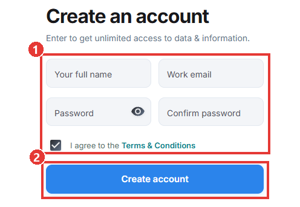
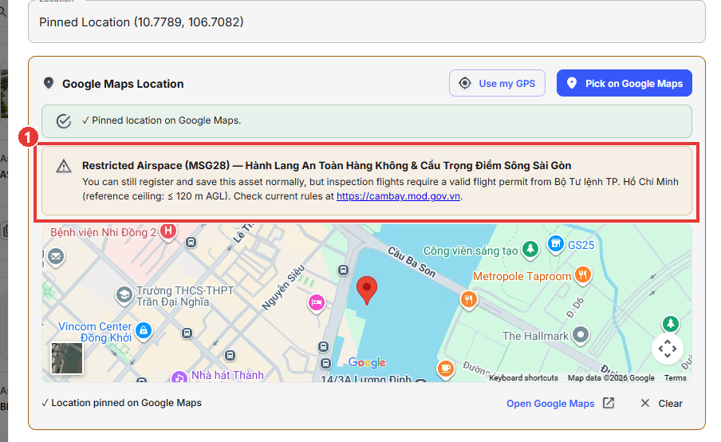
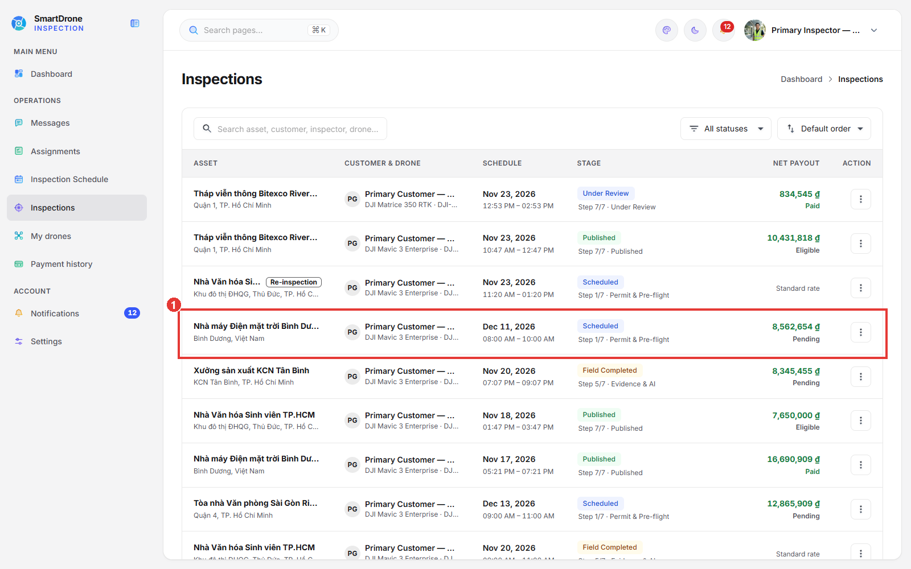
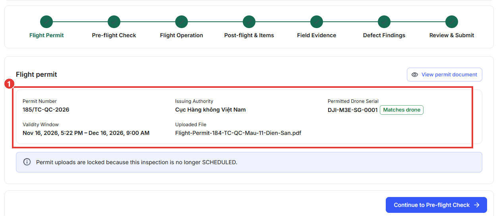
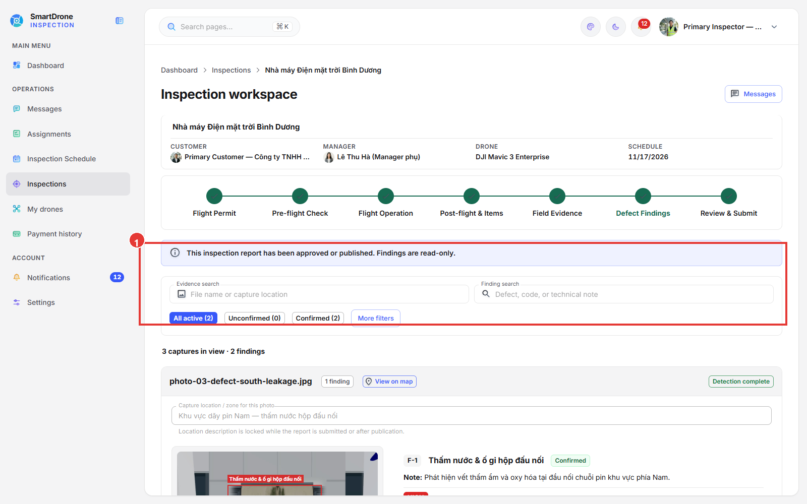
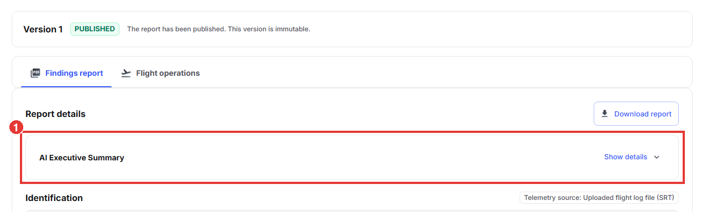
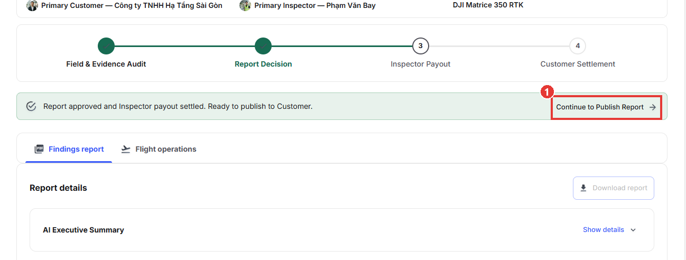
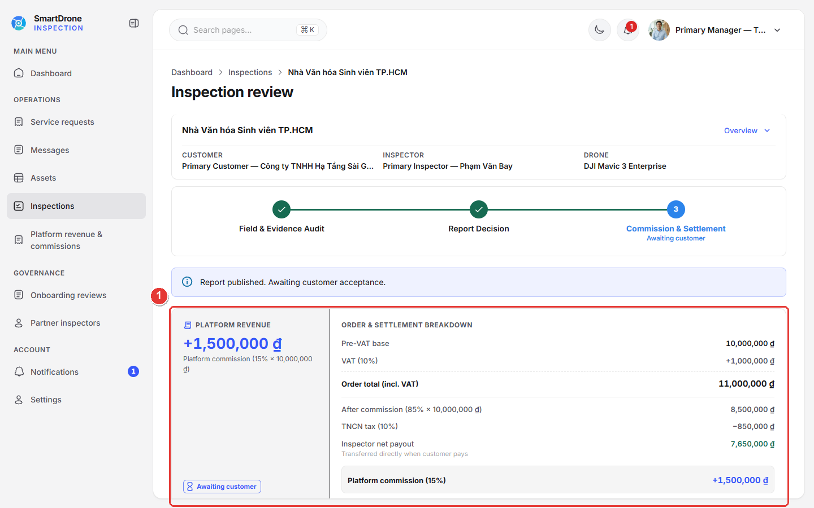

# VI. Release Package & User Guides

## 1. Deliverable Package

| No. | Deliverable Item | Description |
| --- | --- | --- |
| 1 | Project Schedule/Tracking | Task schedule, milestone dates, and effort tracking against the weighted plan in Report 2 (`208` md). |
| 2 | Project Backlog | The twenty-four atomic feature backlog (`FE-01`–`FE-24`) across `MF1`–`MF4`. |
| 3 | Source Codes | Four independent repositories: backend service (`SmartDroneInspection-backend`), web portals (`SmartDroneInspection-frontend`), Customer mobile client (`SmartDroneInspection-mobile`), and documentation (`SmartDroneInspection-docs`). |
| 4 | Database Script(s) | Automated schema migration scripts (`V1`–`V4` and `V60`–`V80`) defining the PostgreSQL 17 database (`53` application tables / `55` total database tables, including `inspector_ratings` `V70`, `field_session_flights` `V72`, `rating_criterion_configs` `V73`, `service_request_partner_messages` `V79`, and `V80` checkpoint snapshots), `pgvector` support for `DroneKnowledgeAI`, and plain-text building ownership details. |
| 5 | Final Report Document | Reports 1–7, prepared using the official templates. |
| 6 | Test Cases Document | `Report5_Test Report.xlsx` (`v3.15`) with twenty-four feature sheets (`Feature 1`–`Feature 24`) covering `77` listed rows (`75` active cases + `2` superseded `FE-13` cases), plus the executed results in Report 5 §5. |
| 7 | Defects List | The defect log, recording `DEF-01` as resolved (`PR #33`) and one low-severity open tooling defect (`DEF-02`). |
| 8 | Issues List | Outstanding issues and known limitations, including the product limitations listed in Chapter III. |
| 9 | Slide | The defence presentation used for the final review. |

## 2. Installation Guides

### 2.1 System Requirements

| Component | Minimum Setup | Notes |
| --- | --- | --- |
| Host | 64-bit x86 processor with 4 logical cores, 8 GB RAM and 40 GB free disk | Allow additional CPU, memory and storage for detection and video processing. Use 16 GB RAM and 60 GB free for the recommended setup. |
| Backend and storage | Docker Engine 27+ with Docker Compose | Runs PostgreSQL, MinIO, AI inference, SmartDroneHub and the Spring Boot API. Java 21 is required for local backend builds and tests. |
| Web development | Node.js 22+ and npm | Runs the Vite development server. Use Chrome or Edge. |
| Customer mobile app | Flutter SDK and Android toolchain | Run on an emulator or physical Android device. |
| Optional integrations | Network access for configured services | SmartDroneHub receives MAVLink on UDP 14551 by default. Its default TCP connection targets the host on port 5762. |

### 2.2 Installation Procedure

#### Step 1 — Configure and Start the Backend

Clone the backend, frontend, mobile and documentation repositories into sibling directories. In the backend directory, copy `.env.example` to `.env`. Set credentials for PostgreSQL and MinIO, the signing secrets, the web origin and the bootstrap Administrator. Configure mail if you need to exercise public registration with email verification.

Run `docker compose up -d --build` in the backend directory. Use `docker compose ps` and open `http://localhost:8080/actuator/health`. Wait for `UP` before connecting either client. Flyway applies the migrations during startup.

#### Step 2 — Start the Web Portal

From the frontend directory, run `npm install` and then `npm run dev`. Open `http://localhost:3000` and check that the sign-in page loads. The development server proxies `/api` to `http://localhost:8080` by default.

#### Step 3 — Start the Customer Mobile App

From the mobile directory, run `flutter doctor` and `flutter pub get`. Start an Android emulator and run `flutter run --dart-define=API_BASE_URL=http://10.0.2.2:8080/api/v1`. On a physical device, use a backend address that the device can reach. Verify that a Customer can sign in and open the home screen.

#### Step 4 — Verify the First Web Login

Use the bootstrap Administrator credentials to sign in to the web portal. Change the initial password and check that **Platform users** opens.

If startup fails, use `docker compose logs backend` to find the failing check. For a signing error, check the secret lengths against `.env.example`. If uploads fail after sign-in, check that MinIO is healthy and the configured buckets are available.

## 3. User Manual

### 3.1 Find the Right Workflow

The six workflows use the web portal. Screenshots show example records. In your portal, keep using the same building, request and inspection when you switch roles. Match each numbered line to the red callout in its figure.

| If you want to | Start with | Finish when |
| --- | --- | --- |
| Create a Customer account and prepare a building | Workflow 1 · Customer | The building opens in **Assets** and its checkpoints are ready. |
| Onboard a Partner Inspector and register a drone | Workflow 2 · Applicant, Manager, Inspector | The Inspector account is approved and the drone appears in the active fleet. |
| Request, contract and schedule an inspection | Workflow 3 · Customer, Manager | The agreed occurrence has an assigned Inspector and drone. |
| Prepare and complete a field session | Workflow 4 · Inspector | The session is complete and **Field Evidence** is available. |
| Upload evidence and confirm findings | Workflow 5 · Inspector | The findings are confirmed and **Review & Submit** opens. |
| Publish a report and settle payment | Workflow 6 · Inspector, Manager, Customer | The Customer accepts the published report and sees **Payment confirmed**. |

### 3.2 Workflow 1: Set Up a Customer Account and Building

Use a mailbox you can access for verification. Have the building address, category and map location ready.

#### Customer registration and building setup

**Step 1 — Create your Customer account.**

From the public home page, select **Sign up**.

❶ Enter your name and email, set and confirm your password, and accept the terms.

❷ Select **Create account** to request the email code.

Enter the six-digit code, then sign in when the portal returns you to the login page.

*Figure 7.11 — Customer registration form.*

**Step 2 — Add and screen the building.**

In **Assets**, select **New asset**. Enter the building details and open **Pick on Google Maps**.

❶ Pin the building and check the airspace result.

❷ Select **Xác nhận vị trí này** (Confirm this location) when available.

A no-fly result blocks confirmation. For a restricted result, go to Step 3. For a clear location, finish the form, save and continue to Step 4.

*Figure 7.12 — Building location and airspace result.*

**Step 3 — Review a restricted-zone warning.**

Follow this step when the confirmed position shows the amber warning.

❶ Read the named authority, altitude limit and reference in the advisory.

You can still save the building. Obtain and record the required flight permit before field work.

*Figure 7.13 — Restricted-zone advisory on the building form.*

**Step 4 — Open the building you just added.**

❶ Select **Detail** on the building you just added to check its location and checkpoints.

*Figure 7.14 — Opening the newly added building record.*

**Step 5 — Prepare checkpoints for the first inspection.**

❶ Verify the building code and pinned location against the intended inspection site.

❷ Review **Inspection Checkpoints** and any **Attached documents**. Update the checkpoints that the Inspector should verify before the first inspection is created.

If an inspection already exists, the checkpoints are read-only, as shown in the example.

*Figure 7.15 — Building checkpoints and reference documents.*

#### Find an update from a notification

**Step 6 — Open the linked request or inspection.**

❶ In the Customer portal, open **Notifications**.

❷ Select the alert for the request or inspection you want to follow.

*Figure 7.16 — Customer notification linking to a work item.*

### 3.3 Workflow 2: Approve a Partner Inspector and Register a Drone

The applicant needs an email address, identity information and a pilot licence scan. The Manager needs a signed partner contract before approval. The Inspector can prepare the aircraft documents after account approval.

#### Applicant submits the application

**Step 1 — Apply as a Partner Inspector.**

On the Inspector sign-in page, select **Register as Inspector**.

❶ Enter your account details and select **Tiếp tục** (Continue).

❷ Provide identity and licence information, upload the requested scan and complete email verification to submit the application.

*Figure 7.17 — Partner Inspector application stages.*

#### Manager reviews the application

**Step 2 — Record the signed contract and approve the applicant.**

Open **Inspector applications**, locate the applicant and select **Review application**. Verify the licence details and scan.

Use **Upload signed contract** to attach the signed partner agreement. Approve the application once the scan is attached. The approved Inspector can then sign in.

#### Inspector submits the drone registration

**Step 3 — Open the registration form.**

Sign in as the approved Inspector and open **My drones**.

❶ Select **Register New Drone**.

*Figure 7.18 — Opening the Register New Drone form.*

**Step 4 — Submit the aircraft and supporting documents.**

❶ Enter the aircraft details, select its capabilities and attach the requested photos and documents. Check the requirements shown for registration, proof of ownership and technical inspection.

❷ Select **Submit Application** and check that the application is awaiting review.

*Figure 7.19 — Drone registration form and submit action.*

#### Manager reviews the drone registration

**Step 5 — Approve the drone application.**

❶ Open **Drone registrations** as Manager.

❷ Find the pending aircraft and open **Review application**.

Check the documents before approving the application. After approval, the Inspector can verify the aircraft in **My drones → Active Fleet**.

*Figure 7.20 — Manager drone registration queue.*

### 3.4 Workflow 3: Request, Quote, Contract and Dispatch an Inspection

Start with an active building in the Customer portal. Use the same request when switching between Customer and Manager.

#### Customer submits the request

**Step 1 — Create a service request.**

Open **Service requests → New service request**.

❶ Select the building and inspection frequency. Set the first date at least 20 days ahead and complete the recurring schedule fields if shown.

❷ Select **Submit service request** and confirm the new request appears in the list.

*Figure 7.21 — Building, schedule and submit controls for a service request.*

#### Manager claims the request and prepares the quotation

**Step 2 — Claim the new request.**

Open **Service requests** as Manager. On the new request, open the actions menu and select **Claim request**. The claimed request opens for review.

**Step 3 — Clarify the scope if needed.**

❶ In **Messages**, select the **Customer** tab and open the request thread.

❷ Ask about the inspection scope or proposed schedule. The Customer replies in the same request thread from the **Manager** tab in **Messages**.

*Figure 7.22 — Order Chat for a Customer request.*

**Step 4 — Issue the quotation.**

In the claimed request, open **Prepare quote**. Review the inspection checkpoints and complete the scope, dates and VND pricing. Select **Save quote**. The request waits for the Customer to review the quote.

#### Customer accepts the quoted terms

**Step 5 — Accept the current quotation.**

Open the same request and select **Review quote**. Verify the scope, first date and price, then select **Accept quote** and confirm. The Manager can now record the signed agreement.

#### Manager records the contract and dispatches the team

**Step 6 — Record the signed contract.**

Once the paper agreement has been signed, open **Record contract** in the request and upload the signed scan. The occurrence is ready for team assignment once the contract is recorded.

**Step 7 — Assign the Inspector and drone.**

Open **Assign team** for the occurrence after the contract is recorded.

❶ In **Scheduled flight & assignment**, set the flight window and select **Find eligible partners**.

Once the candidates load, choose an eligible Inspector and their drone, then select **Assign occurrence**. Verify the assigned pair and flight window. If the mission is awaiting the Inspector’s response, continue with **Accept mission** in Workflow 4.

*Figure 7.23 — Flight window and eligible team selection.*

#### Customer verifies the dispatched inspection

**Step 8 — Open the scheduled inspection.**

❶ In the same request, check that the progress bar shows **Scheduled**.

❷ Select **Open inspection** to confirm the scheduled occurrence.

*Figure 7.24 — Scheduled request and inspection link.*

### 3.5 Workflow 4: Accept a Mission and Complete Field Work

Use the assigned Inspector account. Have the flight permit ready and confirm that it covers the assigned aircraft and planned flight window.

#### Inspector accepts and prepares the mission

**Step 1 — Open and accept the assigned mission.**

❶ In **Inspections**, open the row for the assigned building and date.

If the mission is awaiting a response, select **Accept mission** in the inspection. If you cannot take it, select **Decline mission** and enter a reason so the Manager can reassign it.

*Figure 7.25 — Inspector assignment list.*

**Step 2 — Confirm site access if needed.**

From the inspection’s **Messages** action, open the Customer conversation. Confirm the meeting point, access arrangements or any change before the visit.

**Step 3 — Upload and verify the flight permit.**

While the inspection is scheduled, select **Flight Permit** in the progress bar. Upload the permit (up to 25 MB), enter its authority, dates and other requested details, and attest to its validity. A valid upload immediately shows **Approved**.

❶ Check that the saved serial number matches the assigned drone and that the permit covers the flight window.

The figure shows the stored permit. Upload a new permit if a drone change or an out-of-window reschedule resets its status.

*Figure 7.26 — Stored permit and assigned aircraft details.*

#### Inspector completes the field session

**Step 4 — Complete pre-flight checks and start the session.**

❶ Select **Pre-flight Check** in the progress bar.

❷ Verify each item under **Required checks**. Check applicable optional items below that list.

❸ Use **Check all** only after verifying every item it will mark.

Record relevant site observations under **Pre-flight note**, then select **Start session & Continue to Flight**. The workspace opens **Flight Operation** when the session starts.

*Figure 7.27 — Required pre-flight checks and checklist controls.*

**Step 5 — Record and finish a flight.**

In **Flight Operation**, use **SmartDroneHub telemetry** to record or import the flight data according to the available controls. Use **Complete flight** after each sortie when telemetry is active. This closes the sortie so the session can proceed to post-flight checks.

❶ Select **Choose log** to import a supported flight log when needed.

The figure shows log import after the session is closed. During the session, continue to **Post-flight & Items** after the final sortie.

*Figure 7.28 — Flight log import after the session closes.*

**Step 6 — Complete post-flight checks and close the session.**

❶ Open **Post-flight & Items**.

❷ Complete the post-flight checklist and mark the **Target Building Inspection Items** you verified. The figure shows the building items after verification.

Select **Complete session & Continue to Evidence**. Supply a reason if the app prompts for an explanation of remaining items. If field work cannot continue, use **Abort session** and record why.

*Figure 7.29 — Post-flight stage and building inspection items.*

#### Manager checks the recorded field work

**Step 7 — Audit the permit and flight record.**

❶ Open **Field & Evidence Audit** in the Manager inspection workspace.

❷ Check the recorded **Flight Permit** and expand **Flight report** to review the flight details.

*Figure 7.30 — Manager audit of the permit and flight record.*

### 3.6 Workflow 5: Upload Evidence and Confirm Findings

Use the assigned Inspector account and the same inspection as in Workflow 4. Have the photos or MP4 files available. Complete field work before confirming findings.

#### Inspector records evidence and findings

**Step 1 — Upload the inspection captures.**

❶ In **Field Evidence**, select **Choose files** and then **Upload**. Photos may be up to 10 MB and MP4 videos up to 2 GB.

❷ Verify that the files appear in the evidence register. Wait for video processing before checking playback.

*Figure 7.31 — Evidence upload and registered captures.*

**Step 2 — Run detection on the uploaded images.**

❶ In **Defect Findings**, select **Analyze all images** to run detection on eligible photos.

❷ When findings are present, select **Draft all notes** if you want suggested notes for them.

Review the evidence yourself before accepting a detection or an AI-drafted note.

*Figure 7.32 — Batch detection and note drafting controls.*

**Step 3 — Decide each suggested finding.**

❶ Turn on **Show detected regions** to compare the marked region with the evidence photo.

❷ Use **Draft note with AI** when needed and correct the suggested text before saving.

❸ Select **Confirm** when the finding is supported by the evidence.

❹ Select **Remove** if the evidence does not support the suggestion.

*Figure 7.33 — Evidence, suggested note and finding decision.*

**Step 4 — Confirm the findings baseline.**

❶ Once field work is complete and at least one evidence item is still active, select **Confirm findings and continue**.

If suggestions are awaiting a decision, as shown in the figure, use **Unconfirmed** to find and resolve them. If no findings were observed, acknowledge that you reviewed the captures. Confirmation opens **Review & Submit**.

*Figure 7.34 — Findings confirmation awaiting review decisions.*

### 3.7 Workflow 6: Submit, Publish and Pay for the Report

Start with a confirmed findings baseline for the same inspection. An independent Manager reviews the submitted report. The Customer can accept the report after publication.

#### Inspector submits the report

**Step 1 — Review the report before submitting.**

Open **Review & Submit** and compare the report preview with the confirmed findings and flight record.

❶ Expand **AI Executive Summary** and verify what it says against the inspection evidence.

The figure shows the location of the summary in a published report. In the submission view, select **Submit for review**, then **Confirm and Submit**. Verify that the report is **Submitted**.

*Figure 7.35 — Where to review the AI executive summary.*

#### Manager decides, settles payout and publishes

**Step 2 — Review the submitted report.**

Open **Reports**, select the same inspection with a submitted report and open **Report Decision**. Compare the report and summary with the evidence. Approve a correct report, or return it with a reason for the Inspector to address.

**Step 3 — Settle the Inspector payout.**

For a commercial inspection, continue to **Inspector Payout** after approval. Select **Pay Inspector via SePay (VietQR)** and verify that the payout is settled before publishing.

**Step 4 — Publish the official report.**

❶ Select **Continue to Publish Report** once the report is approved and any required payout is settled.

Select **Publish to Customer** and verify that the report is **Published**.

*Figure 7.36 — Approved report with settled payout ready for publication.*

#### Customer accepts the report and pays

**Step 5 — Open the published report.**

❶ Open **Inspections** in the Customer portal.

❷ Select the inspection marked **Published**, then open **Inspection Report** to read the report.

*Figure 7.37 — Customer inspections list with the published report.*

**Step 6 — Accept the published report.**

Select **Accept Report**, then **Confirm & Accept Report**. Verify that **Service Payment** is available.

**Step 7 — Pay and verify settlement.**

Open **Service Payment**, choose Sepay VietQR or VNPay and follow the payment instructions. Return to the inspection and check the result before paying again.

❶ Check **Payment confirmed** and verify the recorded method.

❷ Select **Download payment receipt (PDF)** if you need a copy.

The figure shows a settled VNPay payment. The Customer can also use the rating card to leave or edit an Inspector rating.

*Figure 7.38 — Confirmed Customer payment and receipt download.*

#### Customer looks up a past payment

**Step 8 — Find the payment record.**

❶ Open **Payment history** and verify the amount, method and status for the inspection.

❷ Select **Details** on its payment row to retrieve the payment record.

*Figure 7.39 — Customer payment history and transaction details.*

#### Manager reconciles an inspection payment

**Step 9 — Check payment against the inspection invoice.**

❶ Open **Customer Settlement** in the inspection workspace.

❷ Compare the recorded acceptance, amount and payment status with the invoice breakdown. Use the receipt for reconciliation when needed.

*Figure 7.40 — Manager view of Customer settlement and invoice details.*

**Step 10 — Reconcile the same payment in the ledger.**

Open **Revenue & payments** in the Manager portal.

❶ Find the same inspection in the transaction list and compare the amount collected and recorded commission with the settlement record.

*Figure 7.41 — Manager revenue ledger and per-inspection transactions.*
