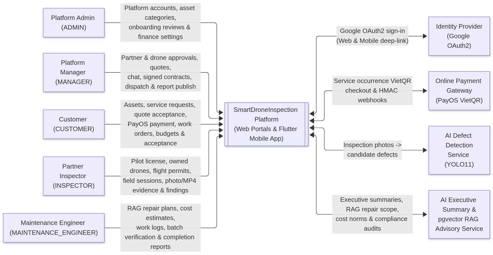
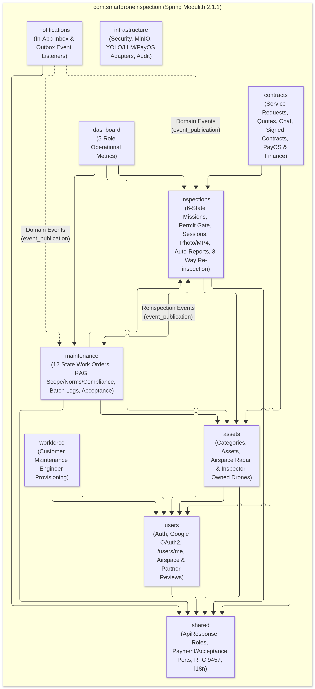
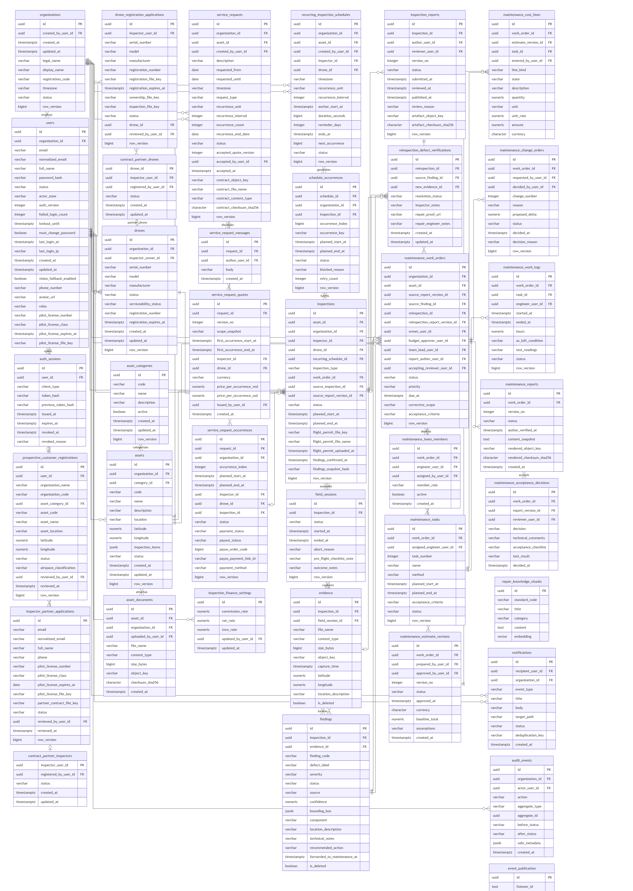
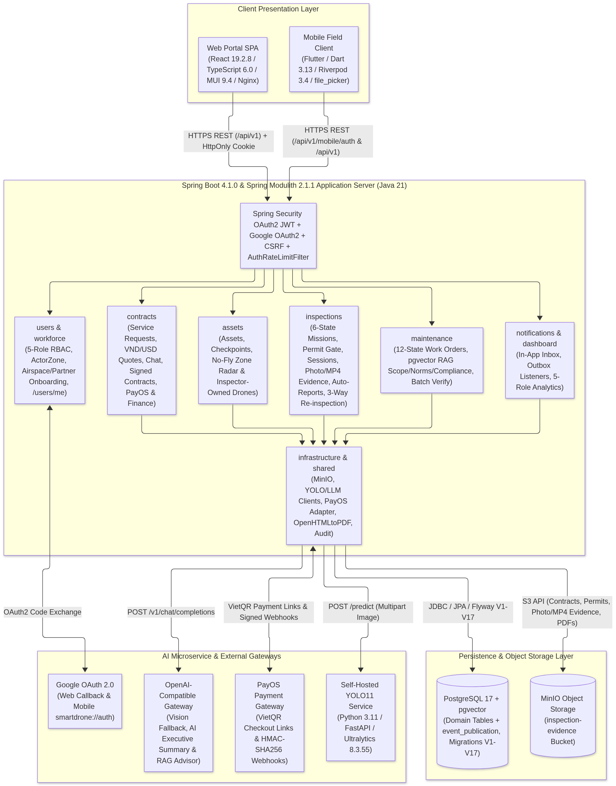

# I. BM01 – Design Brief (SmartDroneInspection — `GFA26SE139`)

## 1. System Context & External Interfaces
**SmartDroneInspection (SDI)** operates as a centralized **Platform-Managed Infrastructure Inspection & Corrective Maintenance Service Platform** serving **5 human login roles** across **3 operational zones** (`PLATFORM`, `INSPECTOR_PARTNER`, `CUSTOMER_ORGANIZATION`) via a responsive **React 19 Web SPA (`:3000` / `:443`)** and a **Flutter Field Mobile App**, backed by a **Spring Boot 4.1.0 / Spring Modulith 2.1.1 Backend (`:8080`)** and **4 external/containerized integrations**:

*Figure 1.1 – System Context Diagram (traces to Report 3 SRS §1.1 & Report 4 SDD §1.1)*

| Interface | Protocol & Auth | Timeout / Fallback & Resilience Contract |
| --- | --- | --- |
| **Web SPA (`React 19`) & Mobile (`Flutter`) -> Backend API** | `HTTPS REST/JSON` + `multipart/form-data`; `HS256` JWT (`15m`) + rotating `HmacSHA256` Refresh Token (`7d`) + Google OAuth2 (`/api/v1/auth/oauth2/authorize/google`) + `X-CSRF-Token` | Structured error envelopes (`code`, `message`, `details`); automatic single-flight `/auth/refresh` interceptor on `401`. |
| **Backend -> Self-Hosted `YOLO11` Container (`ai-inference:8000`)** | Internal Docker HTTP/1.1 `POST /infer` (`multipart/form-data`, `confidence_threshold=0.25`) | `connectTimeout=5s`, `readTimeout=60s`; `PrimaryWithFallbackInference` automatically falls back to multimodal **Vision LLM** when `YOLO11` returns empty detections or fails, and manual `POST /findings` remains available. |
| **Backend -> OpenAI-Compatible LLM / Embedding API (`Summary & RAG`)** | `HTTPS POST /v1/chat/completions` & `/v1/embeddings` (`Bearer API_KEY`) | `readTimeout=30s`; falls back to deterministic report summary synthesis and `DeterministicScopeFallback` (`TCVN 9343:2012`, `EN 1504-9`, `ISO 12944-5`). |
| **Backend -> `PayOS (VietQR)` Gateway & Webhooks** | `HTTPS POST /v2/payment-requests` & `POST /api/v1/webhooks/payos` (`HMAC-SHA256` signature verification) | Verifies `checksumKey` signature; marks `payment_status = PAID` and `payout_status = ELIGIBLE` idempotently. |
| **Backend -> `MinIO` Object Storage (`:9000`)** | AWS S3 v2 (`PutObject` / `GetObject`) on bucket `inspection-evidence` | Private bucket; all downloads/streams proxied through RBAC-checked backend endpoints (`10 MiB` upload cap, `SHA-256` verification, streaming `video/mp4`). |

---

## 2. Architectural Style & Spring Modulith Justification
The backend adopts a **Modular Monolith** architecture enforced at compile time by **Spring Modulith 2.1.1** (`ModulithArchitectureTest`):

*Figure 1.2 – High-Level Component & Package Diagram (traces to Report 4 SDD §1.1–§1.2)*

- **7 Bounded Application Modules**: `users` (Auth, Google OAuth2, 5-Role `ActorZone` RBAC, Partner Inspector Onboarding, Customer Restricted-Airspace Review, Workforce), `assets` (Asset Categories, Customer Assets, Checkpoints, Documents, Inspector-Owned Drone 3-Doc Registration, Vietnam Airspace Map), `contracts` (Service Requests, Order Chat, VND/USD Quotations, Signed Paper Contracts, Recurring Occurrences, Partner Dispatch, PayOS VietQR & Finance Settings), `inspections` (6-State Inspections, Flight Permits, 2-Outcome Field Sessions, Photo/MP4 Evidence, `YOLO11` + Vision Fallback, Findings, 5-State Auto-Compiled Reports, AI Summary, Dashboard & Calendar), `maintenance` (Work Orders, `pgvector` RAG Scope/Norms/Compliance Advisors, Estimates, Change Orders, Tasks, Batch-Verified Work Logs, Auto-Draft Completion Reports, 3-Way Re-inspection Verification, Cost Reconciliation), `notifications` (Outbox Listeners & Deduplicated Inbox), and `infrastructure` (`SHARED` technical adapters).
- **Why Modular Monolith over Microservices**: Eliminates distributed transaction overhead across `Organization -> ServiceRequest -> Inspection -> Report -> MaintenanceWorkOrder` while isolating CPU/GPU-bound Python `PyTorch / Ultralytics YOLO11` inference in its own container (`ai-inference`). Cross-module communication uses explicit domain ports (`InspectionAssignmentPort`, `ContractMissionPaymentPort`) and **Spring Modulith's transactional outbox (`event_publication`)** (`ReinspectionRequestedEvent`, `ReinspectionCreatedEvent`, `ReinspectionReportPublishedEvent`, `FieldSessionAbortedEvent`).

---

## 3. Technology Stack & Locked Versions

| Layer | Technology | Locked Version | Purpose & Verification Source |
| --- | --- | :---: | --- |
| **Backend Runtime & Framework** | Eclipse Temurin Java + Spring Boot + Spring Modulith | `Java 21` / `4.1.0` / `2.1.1` | `SmartDroneInspection-backend/pom.xml` |
| **Persistence & Migration** | PostgreSQL (`pgvector:pg17`) + Hibernate/JPA + Flyway | `PG 17` / `V1–V17` | 34 active tables (`vector(1536)` HNSW index + composite tenant FKs) |
| **PDF & Image Processing** | OpenHTMLtoPDF (`pdfbox`) + Metadata-Extractor | `1.0.10` / `2.19.0` | Server-side immutable A4 PDF rendering (`SHA-256`) & EXIF GPS |
| **AI Vision Microservice** | Python + FastAPI + Ultralytics YOLO11 (`mbdd2025-v1`) | `3.11` / `0.115.6` / `8.3.55` | `ai-inference/requirements.txt` (bridge/building defect model + Vision fallback) |
| **Web Frontend** | React + TypeScript + Vite + Material UI (MUI) + TanStack Query + Leaflet | `19.2.8` / `6.0.2` / `8.2.2` / `9.4.0` | `SmartDroneInspection-frontend/package.json` |
| **Mobile Client** | Flutter (Dart) + Riverpod + GoRouter + Dio + `file_picker` | `3.13.2` / `3.4.2` / `17.2.1` / `5.11.0` / `12.1.3` | `SmartDroneInspection-mobile/pubspec.yaml` |

---

## 4. Database Schema Overview (`34` Active Tables across `V1`–`V17`)
The PostgreSQL 17 database (`V1`–`V17`) enforces **multi-zone & multi-tenant isolation** via `ActorZone` checks and composite foreign keys `(id, organization_id)` across 6 domain clusters:

*Figure 1.3 – Entity-Relationship Diagram (traces to Report 4 SDD §2.1)*

1. **Identity, Zone & Partner/Customer Onboarding (`7` tables)**: `organizations`, `users` (`ADMIN`, `MANAGER`, `CUSTOMER`, `INSPECTOR`, `MAINTENANCE_ENGINEER`), `auth_sessions`, `audit_events`, `prospective_customer_registrations` (`V7`), `inspector_partner_applications` (`V7`), `event_publication`.
2. **Commercial Contracts, Occurrences & PayOS Settlement (`7` tables)**: `service_requests` (`V8`), `service_request_messages` (`V9`), `service_request_quotes` (`V9`), `service_request_occurrences` (`V9`), `contract_partner_inspectors` (`V8`), `contract_partner_drones` (`V8`), `inspection_finance_settings` (`V12`).
3. **Asset, Owned-Drone 3-Doc Registry & Recurring Schedules (`7` tables)**: `asset_categories`, `assets`, `asset_documents`, `drones` (`inspector_owner_id`), `drone_registration_applications` (`V7`: `REGISTRATION`, `OWNERSHIP`, `INSPECTION`), `recurring_inspection_schedules`, `schedule_occurrences`.
4. **Inspection, Field Execution, Evidence, Findings & Reports (`5` tables)**: `inspections` (6 states `V15`, PayOS columns `V12`/`V13`, `inspection_type` `V10`), `field_sessions` (2 terminal states: `FIELD_COMPLETED`, `ABORTED`), `evidence` (photos & `video/mp4`), `findings`, `inspection_reports` (5 states `V16`/`V17`, `ai_executive_summary`).
5. **Maintenance Work Orders, 3-Way Re-inspection & RAG (`10` tables)**: `maintenance_work_orders` (`reinspection_id` `V10`), `maintenance_team_members`, `maintenance_estimate_versions`, `maintenance_cost_lines`, `maintenance_change_orders`, `maintenance_tasks`, `maintenance_work_logs`, `maintenance_reports`, `maintenance_acceptance_decisions`, `reinspection_defect_verifications` (`V14`), `repair_knowledge_chunks` (`vector(1536)`).
6. **Notifications (`1` table)**: `notifications` (`uq_notifications_deduplication_key`).

---

## 5. Key Domain State Machines (`11` Core Lifecycles)
All domain entities enforce deterministic state transitions inside aggregate methods (verified by unit and integration tests; full diagrams in Report 4 SDD `§2.1.1`):
- **`ServiceRequest` (`6` states)**: `OPEN -> QUOTED -> ACCEPTED -> CONTRACT_SIGNED -> ASSIGNED` (plus `CANCELLED`).
- **`ServiceRequestOccurrence` (`4` states)**: `PENDING_ASSIGNMENT -> ASSIGNED -> COMPLETED / CANCELLED`.
- **`InspectionPaymentStatus` (`5` states)**: `NOT_APPLICABLE -> UNPAID -> PAYMENT_DUE -> PAID / REFUNDED` (with `PartnerPayoutStatus`: `NOT_ELIGIBLE -> ELIGIBLE -> PAID / CANCELLED`).
- **`Asset` (`3` states)** & **`Drone` (`3` states)**: `ACTIVE <-> INACTIVE -> RETIRED`; `ACTIVE <-> IN_MAINTENANCE -> RETIRED` (after 3-document `REGISTRATION`/`OWNERSHIP`/`INSPECTION` approval).
- **`RecurringInspectionSchedule` (`3` states)**: `ACTIVE <-> PAUSED -> COMPLETED`.
- **`Inspection` (`6` states, `V15`)**: `SCHEDULED -> IN_PROGRESS -> FIELD_COMPLETED -> UNDER_REVIEW -> COMPLETED` (plus `Abort` reversion `IN_PROGRESS -> SCHEDULED` and `CANCELLED`).
- **`FieldSession` (`3` states)**: `PLANNED -> IN_PROGRESS -> FIELD_COMPLETED / ABORTED` (`POSTPONED` removed).
- **`Finding` (`3` states)**: `PENDING -> CONFIRMED / REJECTED`.
- **`InspectionReport` (`5` states, `V16`/`V17`)**: `SUBMITTED <-> RETURNED -> APPROVED -> PUBLISHED -> SUPERSEDED` (`DRAFT` and `AUTHOR_VERIFIED` removed; auto-compiled on tab visit).
- **`ReinspectionDefectVerification` (`4` states, `V14`)**: `PENDING -> RESOLVED / UNRESOLVED / INCONCLUSIVE`.
- **`MaintenanceWorkOrder` (`12` states)**: `DRAFT -> AWAITING_APPROVAL -> APPROVED -> READY -> IN_PROGRESS -> WORK_COMPLETED -> SUBMITTED_FOR_ACCEPTANCE -> ACCEPTED / REWORK_REQUIRED / REINSPECTION_REQUIRED -> COST_RECONCILED -> CLOSED` (plus `CANCELLED`).

---

## 6. Cross-Cutting Concerns (Auth, 5-Role RBAC, Validation, Audit & Observability)
- **Authentication & Session Security (`FE-01`)**: Argon2id password hashing; Google OAuth2 login (Web callback & Mobile `smartdrone://auth`); `15m` `HS256` access JWT + `7d` rotating `HmacSHA256` refresh token (`HttpOnly` cookie on Web, secure bearer flow on Mobile); `AuthRateLimitFilter` (`10 req / 60s` per IP); `5` failed logins -> `15m` lockout.
- **5-Role & 3-Zone RBAC + Separation of Duties**: Method-level `@PreAuthorize` + `CurrentUser` zone resolution (`PLATFORM`, `CUSTOMER_ORGANIZATION`, `INSPECTOR_PARTNER`); `MANAGER` reviews/publishes inspection reports (`!= createdBy`); `CUSTOMER` approves maintenance budgets and accepts completion reports (`!= Team Lead / Author`); Customer cannot view unpublished reports (`403 REPORT_NOT_PUBLISHED`) or download unpaid PDFs (`402 Payment Required`).
- **Validation & File Hardening**: Jakarta Bean Validation (`@Valid`), `ImageIO.read()` decode verification for images, validated streaming for `video/mp4` up to `10 MiB`, and `SHA-256` checksums on signed contracts, asset documents, and published PDF reports.
- **Auditability & Observability**: `security_audit_logs` table records auth/role/review events; `CorrelationIdFilter` propagates `X-Correlation-Id`; `/actuator/health` monitors DB and MinIO readiness.

---

## 7. Deployment Topology (`https://smartdroneinspection.duckdns.org`)

*Figure 1.4 – Staging & Production Deployment Topology (traces to Report 4 SDD §1.3.4)*

---

## 8. Traceability Matrix (8 Features ->SRS -> SDD -> Code -> Report 5 Tests)

| Feature ID & Name | SRS Section | SDD Section | Backend / Frontend / Mobile Modules | Report 5 Sheet & Test Cases (`65` Total) | Owner |
| --- | :---: | :---: | --- | --- | --- |
| **`FE-01` Auth, Google OAuth2 & 5-Role RBAC** | `§3.2` | `§3.1` | `users` (`AuthController`, `OAuth2Controller`, `UserProfileController`, `JwtTokenProvider`) | **`Feature 1`** (`WF1-001`–`WF1-005` — `5` TCs) | **Trần Tùng Bách** |
| **`FE-02` Partner, Workforce, Asset & Drone 3-Doc** | `§3.3` | `§3.2` | `users` (`PartnerOnboardingController`, `WorkforceController`), `assets` (`AssetController`, `DroneRegistrationController`) | **`Feature 2`** (`WF1-006`–`WF1-016` — `11` TCs) | **Trần Hoàng Trung Hiếu** |
| **`FE-03` Recurring Schedules, Occurrences & Outbox** | `§3.4` | `§3.3` | `assets` (`RecurringInspectionScheduleController`), `contracts` (`ContractWorkflowService`), `notifications` | **`Feature 3`** (`WF1-017`–`WF1-021` — `5` TCs) | **Trần Hoàng Trung Hiếu** |
| **`FE-04` Service Requests, Quotes, Contracts, Dispatch & Map** | `§3.5` | `§3.4` | `contracts` (`ServiceRequestController`, `Mf2InspectionAssignmentAdapter`), `assets` (`AirspaceController`) | **`Feature 4`** (`WF2-001`–`WF2-005` — `5` TCs) | **Phùng Trung Quốc** |
| **`FE-05` Flight Permit Gate, Field Execution, Dashboard & Calendar** | `§3.6` | `§3.5` | `inspections` (`FieldSessionController`, `DashboardController`), Web `ScheduleCalendarPage`, Mobile `field_session` | **`Feature 5`** (`WF2-008`, `009`, `011`, `012`, `015`–`020`, `WF3-009` — `11` TCs) | **Phùng Trung Quốc** |
| **`FE-06` Evidence, YOLO11, Auto-Compiled Report & PayOS** | `§3.7` | `§3.6` | `inspections` (`EvidenceController`, `FindingController`, `ReportController`), `contracts` (`PayOSWebhookController`), `ai-inference` | **`Feature 6`** (`WF3-001`–`008`, `WF3-010`, `012`, `016`, `017` — `12` TCs) | **Trần Tùng Bách** |
| **`FE-07` Work Orders, RAG Scope/Norms & Repair Execution** | `§3.8` | `§3.7` | `maintenance` (`MaintenancePlanningService`, `MaintenanceScopeAdvisorService`, `MaintenanceExecutionService`) | **`Feature 7`** (`WF4-001`–`WF4-011` — `11` TCs) | **Trương Thái Như** |
| **`FE-08` Completion Report, 3-Way Re-inspection & Cost Closure** | `§3.9` | `§3.8` | `maintenance` (`WorkOrderReinspectionListener`, `ReinspectionVerificationController`, `MaintenancePdfGenerator`) | **`Feature 8`** (`WF4-012`–`WF4-016` — `5` TCs) | **Trương Thái Như** |
